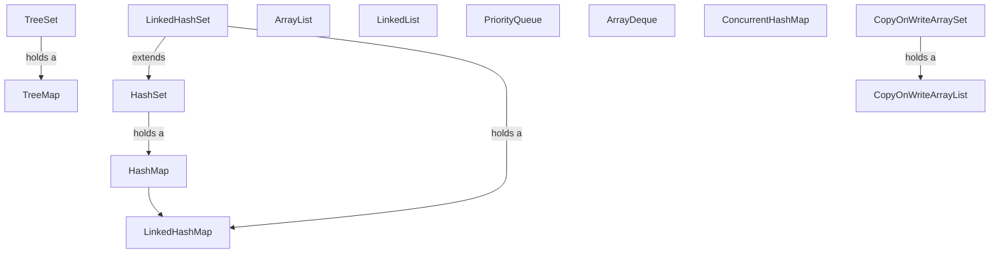
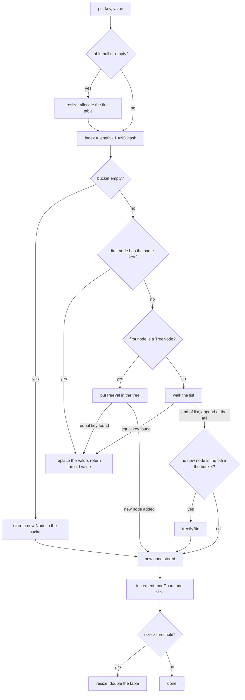
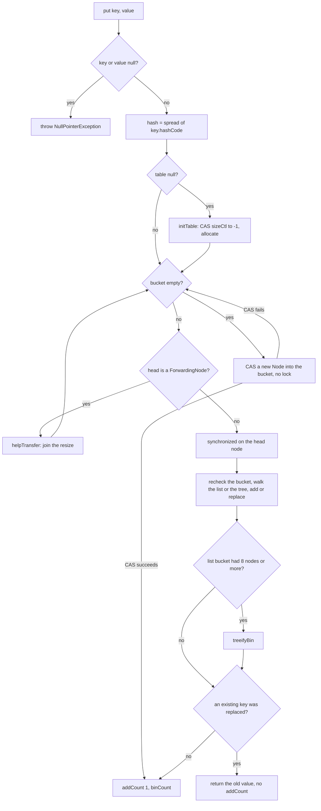

# Collections Internals

## Why It Matters

Java interviews ask how the JDK collections work inside. Common questions are "How does `HashMap` work?", "Why is `ConcurrentHashMap` thread-safe without one big lock?", "Why does this loop throw `ConcurrentModificationException`?", and "When is `LinkedList` better than `ArrayList`?". On the job, the same knowledge explains slow code (a `LinkedList` indexed in a loop), lost memory (a cache that never evicts), and rare bugs (a mutable key in a `HashSet`, a `get` inside an iteration over an access-ordered map). This page reads the JDK 21 source of each class and states what the code does. The theory of hash tables, balanced trees, and heaps has its home in [hash tables](../dsa/foundations/04-hash-tables.md), [trees and balanced BSTs](../dsa/foundations/05-trees-and-balanced-bsts.md), and [heaps](../dsa/foundations/06-heaps.md). The collection APIs for coding rounds are in the [Java toolkit](../dsa/java-toolkit.md). This page links to them and does not repeat them.

## Core Concepts

**Structural modification**: a change that alters the size of a collection, or that changes it in a way that can disturb an iteration in progress. Setting the value at an index in an `ArrayList` is not structural. Adding or removing an element is. In an access-ordered `LinkedHashMap`, a `get` is structural too.

**`modCount`**: an `int` field that a collection increments at each structural modification. `ArrayList`, `LinkedList`, `HashMap`, `TreeMap`, and `PriorityQueue` use it. The iterator stores the value at its creation (`expectedModCount`) and compares it on later calls.

**Fail-fast iterator**: an iterator that throws `ConcurrentModificationException` (CME) if it finds that the collection changed in a way that the iterator itself did not make. The javadoc says this is a best-effort check, not a guarantee. A program must not rely on the exception for its correctness.

**Weakly consistent iterator**: an iterator of a concurrent collection. It never throws CME. The `java.util.concurrent` package javadoc says that such iterators "are guaranteed to traverse elements as they existed upon construction exactly once, and may (but are not guaranteed to) reflect any modifications subsequent to construction".

**Snapshot iterator**: an iterator that reads a frozen copy of the data. `CopyOnWriteArrayList` gives this kind.

**Bucket**: one position of the table array of a hash table, with the chain of entries that share that index. This is the term of [hash tables](../dsa/foundations/04-hash-tables.md) and of the glossary. The JDK source and its identifiers say "bin" (`treeifyBin`, `TreeBin`, `binCount`). This page says "bucket" in prose and keeps "bin" inside code names.

**Slot**: one position of the backing array of an array-based collection that is not a hash table (`ArrayList`, `ArrayDeque`, `PriorityQueue`). The capacity of such a collection is its number of slots.

**Load factor**: the entry count divided by the table length. The table grows when the count passes `capacity × load factor`.

**View**: an object that reads and writes the data of another collection and does not copy it. `Collections.unmodifiableList`, `Arrays.asList`, `Map.keySet()`, and `List.subList` return views.

**Immutable collection**: a collection that holds its own data and that no code can change. `List.of`, `Set.of`, `Map.of`, and `List.copyOf` return one. This differs from an unmodifiable view, which blocks writes through the view only (see "Immutable collections and unmodifiable views").

**CAS (compare-and-set)**: an atomic hardware-supported instruction that writes a new value only if the memory still holds the expected old value. The thread-safety pages explain it: [concurrent collections and locks](08-java-util-concurrent.md).

The class tree below shows which classes share code. A `HashSet` holds a `HashMap`. A `TreeSet` holds a `TreeMap`. A `LinkedHashMap` extends `HashMap` and reuses its code through hook methods.



## How It Works

All facts in this section come from the JDK 21 source (`java.base`, version 21.0.7) and its javadoc, unless the text says "Observed". An observation comes from a program that ran on JDK 21.0.7 and used reflection to read private fields (the run needs `--add-opens`). The JDK 25 source (tag `jdk-25-ga`) has the same algorithms for every class in this section. The differences between the two versions are small (see "What changed after Java 21").

### ArrayList

`ArrayList` stores its elements in one `Object[] elementData` and keeps a separate `int size`. The array length is the capacity. The field `modCount` comes from `AbstractList`.

**Growth.** The constructor decides the first capacity:

| Constructor | Array after the constructor | Capacity after the first `add` |
|---|---|---|
| `new ArrayList<>()` | A shared empty array, `DEFAULTCAPACITY_EMPTY_ELEMENTDATA` | 10 (`DEFAULT_CAPACITY`) |
| `new ArrayList<>(0)` | A shared empty array, `EMPTY_ELEMENTDATA` | 1 |
| `new ArrayList<>(n)`, `n > 0` | `new Object[n]` | `n` (no growth is needed) |
| `new ArrayList<>(collection)` with `k > 0` elements | A copy of `collection.toArray()`, length `k` | The array is full, so `grow` applies the rule below |

When the array is full, `grow(minCapacity)` calls `ArraysSupport.newLength(oldCapacity, minCapacity - oldCapacity, oldCapacity >> 1)`. This returns `oldCapacity + max(minGrowth, oldCapacity >> 1)`, so the capacity grows by about 50 percent. Then `Arrays.copyOf` copies the elements to the new array. Observed: the default list gets capacities 10, 15, 22, 33, 49, 73, 109. The list built with capacity 0 gets 1, 2, 3, 4, 6, 9, 13, 19, 28.

Every `add` is O(1) except the one that grows the array, which costs O(n). The growth factor is a constant above 1, so the total copy work for `n` adds is O(n) and the amortized cost is O(1). The argument is the same as in [stacks, queues, and deques](../dsa/foundations/03-stacks-queues-deques.md). `add(int index, E e)` and `remove(int index)` call `System.arraycopy` to shift the tail, so they cost O(n - index). `remove(Object)` scans with `equals` and then shifts, so it costs O(n).

**`modCount`.** `add`, `remove`, `clear`, `addAll`, `sort`, `replaceAll`, `trimToSize`, and a growing `ensureCapacity` increment it. `removeIf` increments it only if it removes at least one element. `add` increments it even when the array does not grow. `set` does not increment it. `sort` and `replaceAll` change no size, but they increment `modCount`, so an open iterator throws CME after either call.

**The iterator.** The private class `Itr` has `cursor`, `lastRet`, and `expectedModCount`. Its `hasNext()` returns `cursor != size`. It does not check `modCount`. Its `next()` calls `checkForComodification()` first. This explains a known quirk: if a for-each loop removes the second-to-last element, `size` drops by one, `cursor` now equals `size`, `hasNext()` returns `false`, and the loop ends without a CME. The program in "Java Example" shows it. `Itr.remove()` calls `ArrayList.this.remove(lastRet)` and then sets `expectedModCount = modCount`, so removal through the iterator is safe.

**`subList`.** `subList(from, to)` returns a view (`ArrayList.SubList`) with an offset into the same array. A structural change to the parent list makes later calls on the view throw CME, because the view compares its `modCount` with the root's.

**`removeIf`.** `removeIf` runs the predicate on all elements, then compacts the array once. It costs O(n). A loop that calls `remove(Object)` for each match costs O(n) per call.

**Memory.** The list holds references, not elements. A `List<Integer>` holds one reference per element and one `Integer` object per value (except for cached values, see [language core](01-language-core.md)).

### LinkedList

`LinkedList` is a doubly linked list. It has `first`, `last`, and `size` fields. Each element sits in a private `Node` object with three references: `item`, `next`, and `prev`. The class implements both `List` and `Deque`. It allows `null`.

| Operation | Cost | Reason |
|---|---|---|
| `addFirst`, `addLast`, `removeFirst`, `removeLast`, `getFirst`, `getLast` | O(1) | The list holds `first` and `last` |
| `get(i)`, `set(i, e)`, `add(i, e)`, `remove(i)` | O(n) | `node(i)` starts at `first` if `i < size / 2` and at `last` otherwise, so it takes at most about `n / 2` steps |
| `remove(Object)`, `contains`, `indexOf` | O(n) | A scan with `equals` |
| `ListIterator.add`, `ListIterator.remove` at the current position | O(1) | The iterator holds the node |

The O(1) insert in the middle needs a `ListIterator` that already stands at the position. Finding the position costs O(n). So a loop that calls `list.get(i)` on a `LinkedList` costs O(n²) in total.

Recommendation: use `ArrayList` for lists and `ArrayDeque` for stacks and queues. `LinkedList` allocates one `Node` per element, and a traversal follows references to separate objects. Use `LinkedList` only when the code needs `null` elements in a deque, or needs a `ListIterator` that inserts and removes at many positions of a long list. The toolkit page gives the same advice for coding rounds: [LinkedList in the Java toolkit](../dsa/java-toolkit.md).

`LinkedList` has `modCount`, and its `ListItr` is fail-fast in the same way as `ArrayList`'s iterator. Its `hasNext()` is `nextIndex < size`.

### HashMap

The theory (hashing, chaining, load factor, the contract of `equals` and `hashCode`, hash flooding) is in [hash tables](../dsa/foundations/04-hash-tables.md), section "Java `HashMap`". That page lists the constants. This section follows the code.

**Fields.** `Node<K,V>[] table`, `int size`, `int modCount`, `int threshold`, `final float loadFactor`. A `Node` has `final int hash`, `final K key`, `V value`, and `Node<K,V> next`. The map stores the hash in the node, so a resize and an equality check do not call `hashCode` again. `TreeNode` extends `LinkedHashMap.Entry`, which extends `Node`. So a tree node also carries `before`, `after`, `prev`, `parent`, `left`, `right`, and a color. This is why a tree node is about twice the size of a plain node (source comment).

**Lazy table.** The constructor does not allocate the table. The first `put` calls `resize()`, which allocates 16 buckets (or the rounded initial capacity). Until then, `threshold` holds the initial capacity. `new HashMap<>(n)` stores `tableSizeFor(n)`, the next power of two at least `n`, in `threshold`.

**Hash spreading and the index.** `hash(key)` returns 0 for `null` and `h ^ (h >>> 16)` otherwise, where `h = key.hashCode()`. The index is `(table.length - 1) & hash`. The table length is a power of two, so `length - 1` is a mask of the low bits. The spreading folds the high 16 bits into the low 16 bits, so a key whose hash differs only in the high bits still lands in different buckets.

**`put` step by step** (`putVal` in the source):



Key comparison compares the stored hash first and then uses `==` or `equals`. A new node goes to the tail of the list. Replacing the value of an existing key does not change `modCount`, so it is not a structural change. A `put` that adds a node does change it.

**`get`** (`getNode`) computes the same index, checks the first node, and then walks the list or the tree. It does not lock and does not change `modCount`.

**Resize.** `resize()` doubles the table: `newCap = oldCap << 1`. For a table of 16 or more buckets, it doubles `threshold` by a shift. The map resizes when `++size > threshold`, so the default map resizes when the 13th entry arrives. Observed: a default `HashMap<Integer,Integer>` got a table of 16 buckets at the first insert, 32 at size 13, 64 at size 25, 128 at size 49, and 256 at size 97.

The new index of an entry is either the old index `j` or `j + oldCap`. The code tests the single bit `hash & oldCap`. If it is 0, the entry stays at `j`. If it is 1, it moves to `j + oldCap`. The code builds a "low" list and a "high" list for each old bucket and keeps the order of the nodes. For a tree bucket, `TreeNode.split` does the same, and it converts a half back to a list if the half has 6 nodes or fewer (`UNTREEIFY_THRESHOLD`).

The program `ResizeSplitDemo` in "Java Example" prints the hash, both indexes, and the tested bit for eight keys. For the key `"apple"`, the spread hash is `0x58b86d1`. The index at 16 buckets is 1, and the index at 32 buckets is 17, because bit 4 (value 16) is set.

**Why the capacity is a power of two.** The source requires it ("MUST be a power of two") and the code depends on it in two places:

1. The index is a bit mask, `hash & (length - 1)`. A mask works as a modulo only for a power of two.
2. A resize to twice the length needs to test one more bit of the hash. The code splits each bucket by `hash & oldCap` and does not recompute the index. A length that is not a power of two has no such rule.

The cost of this design is that the index uses only the low bits of the hash. The spreading step reduces this cost. The textbook alternative, a prime length, mixes all bits with a modulo, and `HashMap` does not use it.

**Treeification.** The rules and the reason for the numbers (9th node, table of at least 64 buckets, Poisson probabilities) are in [hash tables](../dsa/foundations/04-hash-tables.md), so this page gives the JDK-specific points only:

- `putVal` calls `treeifyBin` when `binCount >= TREEIFY_THRESHOLD - 1`. The count excludes the first node, so the bucket has just received its 9th node.
- `treeifyBin` first checks the table length. If it is below `MIN_TREEIFY_CAPACITY` (64), it calls `resize()` and does not build a tree. The observed sequence for keys with one hash code is on the hash tables page.
- A tree bucket keeps the `next` order of the list, so iteration and `split` treat it like a list.
- The tree orders nodes by hash, then by `compareTo` if both keys have the same `Comparable` class, then by class name and `System.identityHashCode` (`tieBreakOrder`). This last step keeps the order total, and it does not help a lookup of a key that is not `Comparable`.

**Iteration.** `HashIterator` walks the table from index 0 upward and each bucket from its head. The order depends on the hashes and the table length, so it can change at a resize. Small `Integer` keys come out in ascending order because their hash equals their value. This looks sorted and the javadoc does not promise it. The cost is proportional to the capacity plus the size (javadoc), because the iterator scans empty buckets.

**`null`.** One `null` key is allowed (hash 0, index 0), and any number of `null` values.

**`computeIfAbsent`, `computeIfPresent`, `compute`, `merge`.** Each of these four `HashMap` methods records `modCount` before it calls the function. If the function changed the map structurally, the method throws CME (the source line is `if (mc != modCount) { throw new ConcurrentModificationException(); }`), and the javadoc of each method lists this exception. The check came with the fix for JDK-8071667, "HashMap.computeIfAbsent() adds entry that HashMap.get() does not find", fixed in JDK 9 (build b59). Before the fix, a function that added entries could trigger a resize, and the method then stored its new entry in a bucket of the old table, where `get` could not find it. The JDK 8 source has no check. The JDK 9 GA source (tag `jdk-9+181`) and the JDK 21 source have it in all four methods. A recursive memoization such as `memo.computeIfAbsent(n, k -> fib(k - 1) + fib(k - 2))` therefore throws CME on a `HashMap` in JDK 9 and later. On JDK 8 it does not throw, and it can lose entries.

**Sizing.** `new HashMap<>(n)` takes a capacity, not a number of entries. The hash tables page explains the effect and `HashMap.newHashMap(n)` (JDK 19). Compare `ConcurrentHashMap` below, where the same argument counts entries.

### HashSet

`HashSet` has one field, `HashMap<E,Object> map`, and a static `PRESENT = new Object()`. `add(e)` is `map.put(e, PRESENT) == null`. `remove(o)` is `map.remove(o) == PRESENT`. Every cost, the `null` rules, the iteration order, and the treeification rules of `HashMap` apply to `HashSet`. `HashSet(Collection c)` creates its map with `HashMap.newHashMap(Math.max(c.size(), 12))` in JDK 21. `LinkedHashSet` extends `HashSet` and creates a `LinkedHashMap`. `TreeSet` holds a `TreeMap` in the same way.

### LinkedHashMap

`LinkedHashMap` extends `HashMap`. It replaces the node type with `LinkedHashMap.Entry`, which adds `before` and `after` references, and it keeps `head` and `tail` of a doubly linked list through all entries. The table logic stays in `HashMap`. `LinkedHashMap` overrides the node factory `newNode` and three hook methods that are empty in `HashMap`:

| Hook | When `HashMap` calls it | What `LinkedHashMap` does |
|---|---|---|
| `newNode` | A node is created | Creates an `Entry` and links it at the tail |
| `afterNodeAccess(e)` | A `get` on an existing key, or a `put` that replaces a value (and `compute*` and `merge`) | If `accessOrder` is true, moves `e` to the tail and does `++modCount` |
| `afterNodeInsertion(evict)` | A `put` added a new node | If `evict` is true and `removeEldestEntry(head)` returns true, removes the head |
| `afterNodeRemoval(e)` | A node is removed | Unlinks `e` from the list |

**Order.** With `accessOrder = false` (the default), the list order is the insertion order. Putting a key that is already present does not change the order. With the constructor `new LinkedHashMap<>(initialCapacity, loadFactor, true)`, the list order is the order of last access, from least recent to most recent. The javadoc lists which methods count as an access: `put`, `putIfAbsent`, `get`, `getOrDefault`, `compute`, `computeIfAbsent`, `computeIfPresent`, `merge`, and `replace` when it replaces a value. `containsKey` and the views do not count. A `get` moves an entry, so it changes `modCount`. The javadoc says: "In access-ordered linked hash maps, merely querying the map with `get` is a structural modification." Two consequences follow: a `get` inside a loop over the keys throws CME, and a `get` is not safe for concurrent readers without a lock.

**`removeEldestEntry`.** The method receives the head entry, the eldest. The default returns `false`. The map calls it after each insertion, so the override `size() > maxEntries` keeps the map at `maxEntries` entries. The javadoc allows the method to modify the map itself, but then it must return `false`. This gives an LRU (least recently used) cache in about ten lines. The full design with `Cache` contracts, a `Deque` and `HashMap` version, LFU, and thread safety is in the [LRU and LFU cache case study](../lld/case-studies/02-lru-and-lfu-cache/README.md). That page is the home of the LRU cache. `LruDemo` below shows the ordering rules.

**Iteration cost.** The javadoc says that iteration over a `LinkedHashMap` takes time proportional to its size, because it walks the linked list. A `HashMap` iteration takes time proportional to its capacity.

**JDK 21 additions.** `LinkedHashMap` implements `SequencedMap` (JEP 431, final in Java 21). It adds `putFirst`, `putLast`, `firstEntry`, `lastEntry`, `pollFirstEntry`, `pollLastEntry`, and `reversed()`. See [modern Java](13-modern-java.md).

### TreeMap

`TreeMap` is a red-black tree (the javadoc says "A Red-Black tree based `NavigableMap` implementation"). The theory, the five properties, and the comparison with AVL trees are in [trees and balanced BSTs](../dsa/foundations/05-trees-and-balanced-bsts.md), section "`TreeMap` and `TreeSet`". The JDK-specific points follow.

**Node.** `TreeMap.Entry` has `key`, `value`, `left`, `right`, `parent`, and a `boolean color` (`BLACK = true`, `RED = false`). The map has `root`, `size`, `modCount`, and an optional `comparator`. There is no hash code and no `equals` call on keys.

**`put`.** `put(key, value)` walks down from the root. At each node it calls `comparator.compare(key, t.key)` or, if the comparator is `null`, `((Comparable) key).compareTo(t.key)`. If the result is 0, it replaces the value of that node. If the walk reaches `null`, it attaches a new red node and calls `fixAfterInsertion`, which recolors nodes and makes at most two rotations. For the first entry, `addEntryToEmptyMap` calls `compare(key, key)` as a type and `null` check. So `put(null, v)` on an empty `TreeMap` with natural ordering throws `NullPointerException` (observed). A comparator that accepts `null` allows `null` keys.

**Equality is the comparator.** Two keys are the same key if the comparison returns 0. The javadoc says the ordering should be consistent with `equals`. If it is not, the map still works as a sorted map, and it does not follow the general contract of `Map`. A `TreeSet` that orders objects by one field drops objects that tie on that field.

**`deleteEntry`.** If the node has two children, the code copies the key and value of the successor into this node and removes the successor node instead. The tree rebalances in `fixAfterDeletion` only if the removed node was black. Because the node object of the successor disappears, the iterator's `remove()` has a special case: if `lastReturned` has two children, the iterator sets `next = lastReturned`, since that node now holds the next key.

**Iteration.** The iterator walks with `successor(e)`: the leftmost node of the right subtree, or the first ancestor of which the current node is in the left subtree. One step costs O(log n) in the worst case, and a full iteration costs O(n) in total. The iterator checks `modCount` in `nextEntry`, like the other fail-fast iterators.

**Cost.** `get`, `put`, `remove`, and `containsKey` cost O(log n) (javadoc). `containsValue` costs O(n). `size()` costs O(1). `TreeMap` implements `NavigableMap` and, since JDK 21, `SequencedMap`. For concurrent use, `ConcurrentSkipListMap` is the sorted concurrent map (home: [concurrent collections and locks](08-java-util-concurrent.md)).

### PriorityQueue

The theory (the array layout, sift up, sift down, Floyd's O(n) build) and the `PriorityQueue` facts (default capacity 11, `null` rejection, unsorted iteration, O(n) `remove(Object)`) are in [heaps](../dsa/foundations/06-heaps.md), section "`PriorityQueue` in the JDK". This section adds the points that page does not cover.

- The state is `Object[] queue`, `int size`, `Comparator comparator`, and `modCount`. The queue is a binary min-heap. The children of index `n` are `2n + 1` and `2n + 2`.
- `offer` increments `modCount`, grows the array if `size >= queue.length`, and calls `siftUp`. `poll` takes `queue[0]`, moves the last element to the root, and calls `siftDown`.
- `grow` adds `oldCapacity + 2` slots if the array has fewer than 64 slots (about doubling) and `oldCapacity >> 1` slots otherwise. Observed capacities: 11, 24, 50, 102, 153, 229.
- `removeAt(i)` moves the last element into position `i`, sifts it down, and, if it did not move, sifts it up. If the element sifted up, it was moved into the part of the array that the iterator already passed. The iterator would miss it, so the iterator keeps such elements in a private `forgetMeNot` deque and returns them at the end. This is the reason for the field in the source.
- The iterator walks the array from index 0, so the order is the heap order and not the sorted order (observed: `[1, 3, 2, 5, 9, 8]` for the input `5, 3, 8, 1, 9, 2` built by the collection constructor).

### ArrayDeque

`ArrayDeque` is a circular array. The fields are `Object[] elements`, `int head`, and `int tail`. `head` is the index of the first element. `tail` is the index where the next `addLast` writes. Index arithmetic wraps around with `inc(i, length)` and `dec(i, length)`.

- `addFirst(e)` does `elements[head = dec(head, length)] = e`. `addLast(e)` does `elements[tail] = e` and then `tail = inc(tail, length)`. If `head == tail` after the write, the array is full and the code calls `grow(1)`. So the array keeps one free slot, and a deque with 16 elements needs 17 slots.
- The constructor `new ArrayDeque<>()` allocates `16 + 1` slots. `grow` adds `oldCapacity + 2` slots if the array has fewer than 64 slots, and `oldCapacity >> 1` slots otherwise. Observed capacities: 17, 36, 74, 111. After `Arrays.copyOf`, if the data wraps around the end of the array, the code shifts the first part forward to keep the order.
- The capacity is not a power of two in JDK 21. The JDK 8 source says that the array length is always a power of two and masks the index with `& (elements.length - 1)`. A reader who learned the mask version needs to know that the newer code uses `inc` and `dec` with a conditional wrap.
- `null` is not allowed, because an empty slot is `null`. `addFirst(null)` throws `NullPointerException`.
- `push` is `addFirst`, `pop` is `removeFirst`, `offer` is `offerLast`, and `poll` is `pollFirst`. `poll` writes `null` into the freed slot, so the deque does not keep a reference to a removed element.
- The class has no `modCount`. The iterator counts the remaining elements, and `next()` calls `nonNullElementAt`, which throws CME if it finds a `null` slot. The source comment says that this check "doesn't catch all possible comodifications, but does catch ones that corrupt traversal". So the fail-fast check of `ArrayDeque` is weaker than the one of `ArrayList`.
- `addFirst`, `addLast`, `pollFirst`, and `pollLast` are O(1) (amortized for the ones that grow). `contains` and `remove(Object)` are O(n) (javadoc).

### ConcurrentHashMap

`ConcurrentHashMap` (CHM) is a hash table that allows reads with no lock and writes that lock one bucket. The class javadoc states the contract. The source overview comment states the design goal: "to maintain concurrent readability ... while minimizing update contention". The JDK 7 source uses an array of `Segment` objects, each a `ReentrantLock`. The JDK 8 and later design has no segments. The JDK 21 source keeps a `Segment` class only "for the sake of serialization compatibility". The thread-safety primitives (CAS, `synchronized`, `volatile`) are explained in [concurrency basics](07-concurrency-basics.md) and [concurrent collections and locks](08-java-util-concurrent.md). This section explains how CHM uses them.

**Node types.** A normal `Node` has `final int hash`, `final K key`, `volatile V val`, and `volatile Node next`. The other node types have a negative hash and `null` key and value:

| Node type | Hash | Role |
|---|---|---|
| `Node` | At least 0 | A normal entry in a list bucket |
| `TreeBin` | -2 (`TREEBIN`) | The head of a tree bucket. It holds the root and a small read-write lock |
| `ForwardingNode` | -1 (`MOVED`) | Placed in an old bucket after its entries moved to the new table during a resize |
| `ReservationNode` | -3 (`RESERVED`) | A placeholder while `computeIfAbsent` or `compute` calculates a value in an empty bucket |

**Table access.** The `table` field is `volatile`. Reads of a bucket use `Unsafe.getReferenceAcquire`, writes use `putReferenceRelease`, and the compare-and-set uses `compareAndSetReference` (`tabAt`, `setTabAt`, `casTabAt`). The spreading is `(h ^ (h >>> 16)) & HASH_BITS`, with `HASH_BITS = 0x7fffffff`. The mask clears the sign bit, because negative hash values mark the special nodes.

**`put` step by step** (`putVal`):



1. If the bucket is empty, the thread tries one CAS to put the new node in. No lock is taken. If the CAS fails, another thread won, and the loop starts again.
2. If the bucket has a `ForwardingNode`, a resize is running, and the thread helps (`helpTransfer`).
3. Otherwise the thread runs `synchronized (head)`. It checks that the bucket still holds the same head, because a resize or a removal can change it. Then it walks the list or calls `TreeBin.putTreeVal`. A `put` of a key that is present replaces `val`.
4. After the lock, if the bucket had 8 or more nodes before the insert, the thread calls `treeifyBin`. The tree rule is the same as in `HashMap`: a new node becomes the 9th. If the table is shorter than 64, `treeifyBin` calls `tryPresize(n << 1)` instead. `tryPresize(size)` computes a target `c = tableSizeFor(size + (size >>> 1) + 1)` buckets. Then it loops: while `c > sizeCtl`, it doubles the table. The loop compares a bucket count (`c`) with `sizeCtl`, which holds a resize threshold of 0.75 × the table length, so it can double the table more than once in one call. For a 32-bucket table, `tryPresize(64)` computes `c = tableSizeFor(97) = 128`. The table doubles from 32 to 64 (`sizeCtl` becomes 48), from 64 to 128 (`sizeCtl` 96), and from 128 to 256 (`sizeCtl` 192). The loop stops because 128 is at most 192. Observed: a map created with `new ConcurrentHashMap<>(12)` (a 32-bucket table) and nine keys with one hash code. The 9th insert ran `tryPresize` and grew the table from 32 to 256 buckets, and the bucket was still a list. The 10th insert saw a table of at least 64 buckets and built the `TreeBin`. A `HashMap` that starts with 16 buckets doubles the table once per such insert (to 32 at the 9th, to 64 at the 10th) and builds the tree at the 11th insert (see [hash tables](../dsa/foundations/04-hash-tables.md)).
5. If the `put` replaced the value of an existing key, it returns the old value here and does not change the count. Otherwise `addCount(1, binCount)` updates the size and may start a resize.

A `put` holds the lock of one bucket only. Threads that write to different buckets do not block each other, and a CAS covers the case of an empty bucket.

**`get`** takes no lock. It reads the table with an acquire read, walks the bucket, and reads the `volatile val`. If the head is a `ForwardingNode`, `find` follows it into the new table. If the head is a `TreeBin`, `find` reads under the tree's read lock, or walks the `first` list if a writer holds the lock. The javadoc states the visibility guarantee: an update of a key happens-before any retrieval of that key that reports the new value.

**`sizeCtl`.** One `volatile int sizeCtl` field controls the table. The source comment lists its meanings:

| Condition | Meaning of `sizeCtl` |
|---|---|
| Table is `null`, value 0 | Use the default capacity (16) at the first insert |
| Table is `null`, value above 0 | The initial table length to use |
| Value is -1 | A thread is initializing the table |
| Table exists, value at least 0 | The size at which the next resize starts. After `initTable` it is `n - (n >>> 2)`, that is 0.75 × n |
| Table exists, value below 0 | A resize is running. The field comment gives the simplified form `-(1 + the number of active resizing threads)`. The code stores `(resizeStamp(n) << 16) + 2` for the first resizer: the high 16 bits hold a stamp derived from the table length, and the low 16 bits hold 1 plus the number of threads that resize |

`initTable` uses a CAS from the current value to -1. A thread that loses the CAS calls `Thread.yield()` and tries again until the table exists.

**Resize threshold.** The check is `s >= sizeCtl` in `addCount`, and the table keeps the 0.75 ratio no matter what load factor the constructor received. `HashMap` resizes when `size > threshold`, so CHM resizes one insert earlier. Observed: the default CHM got tables of 16 buckets at the first insert, 32 at size 12, 64 at size 24, 128 at size 48, and 256 at size 96. The `HashMap` points were 13, 25, 49, and 97.

**Constructor sizing.** The argument of `new ConcurrentHashMap<>(n)` is a number of entries, not a bucket count. The javadoc says that the map gets "an initial table size accommodating the specified number of elements without the need to dynamically resize". The JDK 8 javadoc says the same, so this meaning is not new in JDK 21. The formula changed in JDK 11:

| JDK | Source of `ConcurrentHashMap(int)` | `n = 16` | `n = 22` |
|---|---|---|---|
| 8 | `tableSizeFor(n + (n >>> 1) + 1)` | 32 | 64 |
| 11 to 25 | `this(n, LOAD_FACTOR, 1)`, which computes `tableSizeFor((int) (long) (1.0 + n / 0.75f))` | 32 | 32 |

The change is JDK-8202422, "value of 'sizeCtl' in ConcurrentHashMap varies with the constructor called" (fixed in JDK 11). Observed on JDK 21: `new ConcurrentHashMap<>(16)` gets 32 buckets, while `new HashMap<>(16)` gets 16. `new ConcurrentHashMap<>(12)` also gets 32 buckets, because `1 + 12 / 0.75 = 17`. The internal `tryPresize` (used by `putAll` and by `treeifyBin`) still sizes with `size + size/2 + 1`, a density of 2/3. JDK-8249589 reported this difference and was closed as "Not an Issue".

**Cooperative resize** (`transfer`). Any thread that finds the map over the threshold, or that meets a `ForwardingNode`, can help. The steps:

1. The first thread creates `nextTable` with `2n` buckets and sets `transferIndex = n`.
2. Each thread claims a range ("stride") of buckets by a CAS that lowers `transferIndex`. The stride is at least 16 buckets (`MIN_TRANSFER_STRIDE`) and is `(n / 8) / NCPU` for larger tables on a multi-core machine. The threads work from the high index down.
3. For an empty bucket, the thread CASes a `ForwardingNode` into the old bucket. For a non-empty bucket, the thread locks the head and splits the list into a low part (stays at `i`) and a high part (goes to `i + n`) by the bit `hash & n`. The code finds the last run of nodes that go to the same side (`lastRun`) and reuses it. It clones the nodes before `lastRun`. Then it writes the two lists into `nextTable` and puts a `ForwardingNode` into the old bucket.
4. A reader that meets a `ForwardingNode` follows it to `nextTable`. A writer helps with the resize. The old chain stays intact while it is copied, so a concurrent `get` on it still works.
5. Each thread decrements the resizer count when its ranges are done. The last thread checks the whole old table again, then sets `table = nextTab` and `sizeCtl = (n << 1) - (n >>> 1)`, that is 0.75 × 2n.

**Counting.** A single shared counter would make every `put` contend on one memory location. CHM uses the design of `LongAdder`:

- `baseCount` is a `volatile long`. While no counter cells exist, `addCount` updates it by CAS. If the CAS succeeds, the update is done.
- If the CAS fails, or if the cells already exist, the thread uses a `CounterCell[]` array. It picks a cell with `ThreadLocalRandom.getProbe() & (length - 1)` and adds with a CAS on that cell. The cell class is annotated `@Contended`, so each cell sits on its own cache line. The array starts with 2 cells and doubles while its length is below `NCPU` (`fullAddCount`).
- `size()` calls `sumCount()`, which adds `baseCount` and all cells. It reads the cells one by one while other threads update them. The result can be stale. The javadoc says that the results of `size`, `isEmpty`, and `containsValue` "are typically useful only when a map is not undergoing concurrent updates". `mappingCount()` returns a `long` and is the recommended call for large maps.

**No `null` keys or values.** The class javadoc states the rule: "this class does *not* allow `null` to be used as a key or value". `put`, `get`, and `containsKey` throw `NullPointerException` for a `null` key, and `put` throws for a `null` value (the `@throws` clauses of each method, and observed). The javadoc gives no reason for the rule. Two facts and one explanation follow.

- Fact: the `ConcurrentMap` javadoc has an implementation note on its default methods (for example `getOrDefault`). It says that the default code "assumes that the ConcurrentMap cannot contain null values and `get()` returning null unambiguously means the key is absent". Implementations that support `null` values "must override" these default methods. So the default methods use one `get` as the test for presence, and that test is correct only if no value is `null`.
- Fact: `ConcurrentMap` itself does not forbid `null`. Its `@throws` clauses say "if the specified key or value is null, and this map does not permit null keys or values". `ConcurrentHashMap` and `ConcurrentSkipListMap` both forbid it.
- Explanation (this page's reasoning, not a quotation): if `null` were a legal value, a caller that gets `null` would need a second call, `containsKey`, to tell "absent" from "mapped to `null`". In a map that other threads change, another thread can add or remove the key between the two calls, so the answer can be wrong. A `HashMap` that one thread owns has no such race, so it can allow `null`.

**Atomic compound operations.** `putIfAbsent`, `computeIfAbsent`, `computeIfPresent`, `compute`, `merge`, `replace(key, old, new)`, and `remove(key, value)` run atomically for the key. `computeIfAbsent` on an empty bucket creates a `ReservationNode`, takes `synchronized` on it, and then installs it in the bucket with a CAS. It runs the function while it holds that lock, and then replaces the reservation with the result node. On a non-empty bucket it runs the function under `synchronized (head)`. The javadoc warns that other updates on the same bucket wait while the function runs, so the function must be short and must not update other mappings of the map. The source detects some violations. If the function updates the same bucket (the lock is reentrant, so the same thread gets in and finds the `ReservationNode` still in place, or finds that the list grew during the call), the code throws `IllegalStateException("Recursive update")`. It does not detect all of them. A resize (`transfer`) that meets a `ReservationNode` throws the same exception. On JDK 8, a recursive `computeIfAbsent` could hang: the bug report JDK-8062841 is titled "ConcurrentHashMap.computeIfAbsent stuck in an endless loop", and it was closed as a duplicate of the JDK 9 `java.util.concurrent` update (JDK-8134853). The jdk8u source has no "Recursive update" check. A check-then-act sequence such as `if (!map.containsKey(k)) map.put(k, v)` is not atomic, even on a CHM. Use `putIfAbsent` or `computeIfAbsent`.

**Iterators.** The iterators, spliterators, and enumerations are weakly consistent. The `Traverser` class walks the table, follows `ForwardingNode`s into the new table, and returns each node that it reaches. It does not check a `modCount`, because CHM has none. The javadoc says that an iterator returns elements "reflecting the state of the hash table at some point at or since the creation of the iterator", and that "iterators are designed to be used by only one thread at a time".

**Bulk operations.** `forEach`, `search`, `reduce`, and their variants take a `parallelismThreshold`. The operation runs sequentially if the estimated size of the map is less than that threshold. `Long.MAX_VALUE` suppresses all parallelism, and `1` gives the maximum parallelism in `ForkJoinPool.commonPool()` (javadoc). The functions must not depend on the order or on the state of the map.

**Frequency maps and sets.** The javadoc suggests `freqs.computeIfAbsent(key, k -> new LongAdder()).increment()` for a scalable frequency map. `ConcurrentHashMap.newKeySet()` returns a `Set` that wraps a CHM. A `Hashtable` and a `Collections.synchronizedMap` lock the whole map for each call, and CHM does not.

### CopyOnWriteArrayList

`CopyOnWriteArrayList` keeps a `volatile Object[] array` and a `final Object lock`. All mutators copy the array.

- `add(e)` does `synchronized (lock) { es = Arrays.copyOf(getArray(), len + 1); es[len] = e; setArray(es); }`. Each write costs O(n) time and allocates a new array. `set`, `remove`, and `addIfAbsent` copy in the same way.
- `get(i)` reads the current array with no lock and costs O(1).
- `iterator()` captures the current array as a `snapshot` and does not read the list again. The iterator does not throw CME and does not show later changes. Its `remove`, `set`, and `add` throw `UnsupportedOperationException`. The class javadoc says: "Element-changing operations on iterators themselves (`remove`, `set`, and `add`) are not supported."
- `CopyOnWriteArraySet` holds a `CopyOnWriteArrayList`. Its `add` calls `addIfAbsent`, so `contains` and `add` cost O(n).

Use it for a list that many threads read and iterate, and that changes rarely: for example, a list of event listeners. Do not use it for a list that changes often, because every write copies the whole array. The write throughput falls as the list grows. The class guarantees the happens-before relationship of a write with later reads through the `volatile` array.

### Fail-fast iterators and ConcurrentModificationException

| Class | Mechanism | Where the check runs |
|---|---|---|
| `ArrayList`, `LinkedList` | `modCount` against `expectedModCount` | `next()` and `remove()` of the iterator. `ArrayList.hasNext()` does not check |
| `HashMap`, `LinkedHashMap`, `HashSet` | `modCount` | `nextNode()` and `remove()`. `hasNext()` is `next != null` and does not check |
| `TreeMap`, `TreeSet` | `modCount` | `nextEntry()` and `remove()` |
| `PriorityQueue` | `modCount` | `next()` and `remove()` |
| `ArrayDeque` | No `modCount`. A `null` slot raises CME | `next()` only, and only when the traversal meets a `null` slot |
| `ConcurrentHashMap`, `ConcurrentLinkedQueue`, and most `java.util.concurrent` classes | Weakly consistent. No CME | None |
| `CopyOnWriteArrayList` | Snapshot. No CME | None |

The `forEach` methods and the spliterators check at a different place. `ArrayList.forEach` loops while `modCount == expectedModCount` and throws CME after the loop if the count changed. `HashMap.forEach` throws CME after it visited all entries. A stream pipeline over an `ArrayList` throws CME at the end of the traversal if the source changed during it.

CME is also possible in a single thread. The loop that removes inside a for-each is the common case (the [Java toolkit](../dsa/java-toolkit.md) lists it as pitfall 7). The javadoc of `ArrayList` says that the check is "best-effort", and that "it would be wrong to write a program that depended on this exception for its correctness". Inside an iterator loop, the safe calls are the iterator's own `remove`, and `ListIterator.add` and `set`. In place of the loop, `Collection.removeIf` and `List.replaceAll` do the whole change in one call. A loop over a copy also works. For concurrent access, use a concurrent collection or a lock.

### Immutable collections and unmodifiable views

| Factory | Type | Copies data? | `null` | Mutation | Follows the source? |
|---|---|---|---|---|---|
| `List.of(...)`, `Set.of(...)`, `Map.of(...)` | Immutable | Yes (own array or table) | Rejected: `NullPointerException` | `UnsupportedOperationException` | No |
| `List.copyOf(c)`, `Set.copyOf(c)`, `Map.copyOf(m)` | Immutable | Yes. `List.copyOf` returns the same object if the argument is already an immutable list from `List.of` or `copyOf` | Rejected | `UnsupportedOperationException` | No |
| `Collections.unmodifiableList(l)` and the other `unmodifiable*` methods | View | No | Same as the source | `UnsupportedOperationException` through the view | Yes |
| `Arrays.asList(array)` | Fixed-size view of the array | No | Allowed | `set` works and writes through. `add` and `remove` throw | Yes, both directions |
| `Stream.toList()` | Unmodifiable list | Yes | Allowed | `UnsupportedOperationException` | No |

**The JDK 21 classes.** `List.of` returns `ImmutableCollections.List12` for one or two elements (fields `e0` and `e1`) and `ListN` (an array) for zero or three or more. `Set.of` returns `Set12` or `SetN`. `SetN` and `MapN` use an open-addressing table of `2 × n` buckets with linear probing (`EXPAND_FACTOR = 2`). `Map.of` returns `Map1` or `MapN`. The list, set, and map classes reject `null` elements, keys, and values at creation. A query with `null` also throws `NullPointerException`: `List.of(...).contains(null)`, `Set.of(...).contains(null)`, and `Map.of(...).containsKey(null)` all throw (observed). `Set.of` and `Map.of` throw `IllegalArgumentException` for a duplicate element or key.

**Iteration order of `Set.of` and `Map.of` varies between JVM runs.** A static initializer of `ImmutableCollections` computes a salt, `SALT32L`, from a seed. In a normal run, the seed is `System.nanoTime()`. When the JVM dumps a class data sharing (CDS) archive (`-Xshare:dump`), the seed comes from `CDS.getRandomSeedForDumping()`, which is derived from the JDK build, so that the archive is reproducible. The lowest bit of the salt sets a flag, `REVERSE`. The `SetN` and `MapN` iterators start at a salt-dependent index and walk forward or, if `REVERSE` is set, backward. The `Set12` iterator also reads `REVERSE`, so even a two-element `Set.of` can change its order between runs. The order also depends on the hash codes of the elements, which decide their positions in the table. The source comment says that the salt "needs to vary sufficiently from one run to the next so that iteration order will vary between JVM runs". Observed: six runs of the same program on JDK 21.0.7 printed `Set.of("a", "b", "c", "d", "e")` in three different orders. The javadoc does not define an order. A program must not depend on it, and a test that prints a `Set.of` can pass on one run and fail on another.

**Unmodifiable view.** `Collections.unmodifiableList(source)` wraps `source` in an object that forwards reads and throws on writes. If the owner of `source` changes it, the view shows the change. The wrapper is a read-only access path, not a snapshot. To give a caller a list that never changes, copy first: `List.copyOf(source)`. The `unmodifiableCollection` wrapper does not forward `equals` and `hashCode`: it uses the identity version of `Object` (see the next section).

### `equals` and `hashCode` of collections

The `List`, `Set`, and `Map` interfaces define `equals` and `hashCode` by content, and the classes follow them. The result does not depend on the class.

| Type | `equals(o)` is true if | `hashCode()` |
|---|---|---|
| `List` | `o` is a `List` of the same size, and the elements at each index are equal | Start with `h = 1`. For each element `e`: `h = 31 * h + (e == null ? 0 : e.hashCode())` |
| `Set` | `o` is a `Set` of the same size, and it contains every element | The sum of the hash codes of the elements (a `null` counts as 0) |
| `Map` | `o` is a `Map` with the same entry set | The sum of the hash codes of the entries |
| `Map.Entry` | Key and value are equal | `key.hashCode() ^ value.hashCode()` (a `null` counts as 0) |

Consequences:

- An `ArrayList` equals a `List.of` or a `LinkedList` with the same elements in the same order. A `List` does not equal a `Set`, even with the same elements.
- A `HashSet` equals a `TreeSet` with the same elements, because both are `Set`s.
- The hash of a list depends on its content and the order. So a list is a poor key if the code changes it after insertion. The entry lands in the bucket for the old hash, and later lookups use the new hash and miss it. This is the mutable-key bug from [hash tables](../dsa/foundations/04-hash-tables.md).
- The wrapper from `Collections.unmodifiableCollection` does not override `equals`, so `unmodifiableCollection(c).equals(c)` is false (observed). The wrappers from `unmodifiableList`, `unmodifiableSet`, and `unmodifiableMap` forward `equals` and `hashCode` to the source.
- Arrays do not follow this rule. An `int[]` uses identity `equals` and `hashCode`. Use `Arrays.equals` and `Arrays.hashCode`, or wrap the data in a `List` or a record.

### What changed after Java 21

A comparison of the JDK 21.0.7 source with the tag `jdk-25-ga` covers `ArrayList`, `HashMap`, `LinkedHashMap`, `TreeMap`, `PriorityQueue`, `ArrayDeque`, `ConcurrentHashMap`, `CopyOnWriteArrayList`, and `ImmutableCollections`. It ignores comment lines. The algorithms on this page are the same in both versions. The differences are:

| Change | Where | Effect |
|---|---|---|
| `ArrayList` overrides `sort` for a `subList` | `ArrayList` | `subList(from, to).sort(c)` sorts the range in place. JDK 21 copies the range to an array first (the default `List.sort`) |
| `CopyOnWriteArrayList` shares one empty array | `CopyOnWriteArrayList` | Less allocation for empty lists. No change in behavior |
| `ConcurrentHashMap(Map)` sizes the table through `this(m.size())`. `putAll` calls `tryPresize` only if the table exists, with `size() + m.size()` | `ConcurrentHashMap` | In JDK 21 the copy constructor sets `sizeCtl` to 16 and lets `putAll` call `tryPresize(m.size())`, which sizes at a density of 2/3. In JDK 25 the copy constructor sizes at 0.75 through the `int` constructor, and a `putAll` into a map that has a table presizes for the combined count |
| Immutable lists override `removeFirst` and `removeLast` | `ImmutableCollections` | `List.of().removeFirst()` throws `NoSuchElementException` in JDK 21 (the default `List.removeFirst` checks for an empty list first, observed) and `UnsupportedOperationException` in JDK 25. On a non-empty immutable list, both versions throw `UnsupportedOperationException` |
| New internal list and map classes for stable values | `ImmutableCollections` | Support for the Stable Values API (JEP 502, preview in JDK 25). `List.of`, `Set.of`, and `Map.of` keep the same classes and the same iteration salt |
| Compact object headers become a product feature in JDK 25 (JEP 519), off by default there (`-XX:+UseCompactObjectHeaders` turns them on). JEP 534 makes them the default. openjdk.org lists JEP 534 as delivered in JDK 27 (general availability on 15 September 2026) | JVM | An object header shrinks from 96 to 64 bits (JEP 534), so each node is smaller. See [memory and GC](06-memory-and-gc.md) |

JEP 431, sequenced collections (final in Java 21), adds new interfaces to the collection hierarchy: `SequencedCollection`, `SequencedSet`, and `SequencedMap`, with `getFirst`, `getLast`, `reversed()`, and related methods on `List`, `Deque`, `LinkedHashSet`, `LinkedHashMap`, `SortedSet`, and `SortedMap`. `HashMap` and `HashSet` are not sequenced.

## Trade-offs and When to Use

Costs below come from the JDK 21 javadoc of each class and from the source. "Expected" means for a well-distributed hash.

| Structure | Lookup | Insert | Remove | Iteration | Notes |
|---|---|---|---|---|---|
| `ArrayList` | `get(i)` O(1). `contains` O(n) | End: O(1) amortized. Index: O(n) | Index: O(n). By value: O(n) | O(n), array order | Growth by 1.5. Best default list |
| `LinkedList` | `get(i)` O(n). `contains` O(n) | Ends: O(1). Index: O(n) to find, then O(1) | Ends: O(1). Index: O(n) | O(n) | One `Node` per element |
| `HashMap`, `HashSet` | O(1) expected. O(log n) in a tree bucket. O(n) in a long list bucket | O(1) expected. O(n) on a resize | O(1) expected | O(capacity + size), no defined order | One `null` key. Not thread-safe |
| `LinkedHashMap`, `LinkedHashSet` | Same as `HashMap` | Same | Same | O(size), insertion or access order | Extra two references per entry. Access order makes `get` structural |
| `TreeMap`, `TreeSet` | O(log n) | O(log n) | O(log n) | O(n), sorted order | Needs a `Comparable` key or a comparator. No hash code |
| `PriorityQueue` | `peek` O(1). `contains` O(n) | `offer` O(log n) | `poll` O(log n). `remove(Object)` O(n) | O(n), heap order, not sorted | Not stable. No `null` |
| `ArrayDeque` | `peek` O(1). `contains` O(n) | Ends: O(1) amortized | Ends: O(1). `remove(Object)` O(n) | O(n) | No `null`. Best stack and queue |
| `ConcurrentHashMap` | O(1) expected, no lock | O(1) expected, lock on one bucket or a CAS | O(1) expected, lock on one bucket | O(capacity + size), weakly consistent | No `null`. `size()` is an estimate under updates |
| `CopyOnWriteArrayList` | `get(i)` O(1), no lock | O(n), copies the array | O(n), copies the array | O(n), snapshot | Read-mostly lists only |

Choose a map by the question that the code asks:

| Need | Choice | Reason |
|---|---|---|
| Lookup by key, no order | `HashMap` | Lowest expected cost |
| Lookup and a stable order of insertion | `LinkedHashMap` | Linked list through the entries |
| Lookup and eviction of the least recently used entry | `LinkedHashMap` with access order and `removeEldestEntry` | Ten lines. Single-threaded, or wrap it with a lock |
| Sorted keys, nearest key, range | `TreeMap` | Red-black tree |
| Many threads read and write | `ConcurrentHashMap` | Bucket-level locking, lock-free reads |
| Many threads, sorted keys | `ConcurrentSkipListMap` | Sorted and concurrent ([concurrent collections and locks](08-java-util-concurrent.md)) |
| A fixed read-only table of constants | `Map.of`, `Map.copyOf` | Immutable, no `null`, order varies |
| A small number of entries and read-heavy | `Map.of` or `HashMap` | Both give expected O(1) lookups. Choose by whether the data must be immutable |

`Collections.synchronizedMap(map)` wraps every method in `synchronized` on one mutex. It is thread-safe for single calls, but a compound operation needs a lock held by the caller, and an iteration must lock the map manually. Recommendation: replace it with `ConcurrentHashMap`, unless the code needs `null` keys or values.

## Java Example

The first program shows the fail-fast rules, the snapshot iterator, and the weakly consistent iterator. The output uses no hash codes, times, or thread names.

```java
import java.util.ArrayList;
import java.util.ConcurrentModificationException;
import java.util.Iterator;
import java.util.List;
import java.util.Map;
import java.util.concurrent.ConcurrentHashMap;
import java.util.concurrent.CopyOnWriteArrayList;

public class FailFastDemo {
    public static void main(String[] args) {
        // 1. ArrayList: remove inside for-each throws on the next call to next().
        List<Integer> list = new ArrayList<>(List.of(1, 2, 3, 4));
        try {
            for (Integer x : list) {
                if (x == 2) list.remove(x);
            }
        } catch (ConcurrentModificationException e) {
            System.out.println("ArrayList, remove 2: ConcurrentModificationException");
        }

        // 2. The same loop removes the second-to-last element: hasNext() sees
        //    cursor == size, so the loop ends before next() can check modCount.
        list = new ArrayList<>(List.of(1, 2, 3, 4));
        for (Integer x : list) {
            if (x == 3) list.remove(x);
        }
        System.out.println("ArrayList, remove 3: no exception, list = " + list);

        // 3. Safe ways to remove.
        list = new ArrayList<>(List.of(1, 2, 3, 4));
        Iterator<Integer> it = list.iterator();
        while (it.hasNext()) {
            if (it.next() % 2 == 0) it.remove();
        }
        System.out.println("Iterator.remove: " + list);
        list = new ArrayList<>(List.of(1, 2, 3, 4));
        list.removeIf(x -> x % 2 == 0);
        System.out.println("removeIf: " + list);

        // 4. CopyOnWriteArrayList: the iterator reads a snapshot.
        List<Integer> cow = new CopyOnWriteArrayList<>(List.of(1, 2, 3));
        List<Integer> seen = new ArrayList<>();
        for (Integer x : cow) {
            if (x == 1) cow.add(4);
            seen.add(x);
        }
        System.out.println("COW iterator saw " + seen + ", list is now " + cow);
        try {
            cow.iterator().remove();
        } catch (UnsupportedOperationException e) {
            System.out.println("COW iterator.remove: UnsupportedOperationException");
        }

        // 5. ConcurrentHashMap: no ConcurrentModificationException while we change the map.
        Map<Integer, String> chm = new ConcurrentHashMap<>();
        for (int i = 1; i <= 5; i++) chm.put(i, "v" + i);
        for (Integer k : chm.keySet()) {
            if (k == 1) {
                chm.remove(5);
                chm.put(100, "new");
            }
        }
        System.out.println("ConcurrentHashMap: no exception, size = " + chm.size());
    }
}
```

<!-- expected-output -->
```text
ArrayList, remove 2: ConcurrentModificationException
ArrayList, remove 3: no exception, list = [1, 2, 4]
Iterator.remove: [1, 3]
removeIf: [1, 3]
COW iterator saw [1, 2, 3], list is now [1, 2, 3, 4]
COW iterator.remove: UnsupportedOperationException
ConcurrentHashMap: no exception, size = 5
```

The second program applies the resize rule of `HashMap` to eight keys. For each key it computes the spread hash, the index in a table of 16 buckets and in a table of 32 buckets, and the tested bit. It throws an `AssertionError` if the rule "stay at `j` or move to `j + oldCap`" fails.

```java
import java.util.List;

public class ResizeSplitDemo {
    static int spread(Object key) {
        int h = key.hashCode();
        return h ^ (h >>> 16);   // the same expression as HashMap.hash(Object)
    }

    public static void main(String[] args) {
        int oldCap = 16;
        int newCap = 32;
        List<String> keys = List.of(
                "Aa", "BB", "apple", "banana", "cherry", "date", "elder", "fig");
        System.out.println("key      spread(hex)  idx@16  idx@32  hash&16  moves");
        for (String key : keys) {
            int h = spread(key);
            int oldIndex = h & (oldCap - 1);
            int newIndex = h & (newCap - 1);
            boolean highBit = (h & oldCap) != 0;
            // The rule from HashMap.resize: the entry stays at j or moves to j + oldCap.
            if (newIndex != (highBit ? oldIndex + oldCap : oldIndex)) {
                throw new AssertionError(key);
            }
            System.out.printf("%-8s %-12s %-7d %-7d %-8d %s%n",
                    key, Integer.toHexString(h), oldIndex, newIndex, h & oldCap,
                    highBit ? "yes" : "no");
        }
    }
}
```

<!-- expected-output -->
```text
key      spread(hex)  idx@16  idx@32  hash&16  moves
Aa       840          0       0       0        no
BB       840          0       0       0        no
apple    58b86d1      1       17      16       yes
banana   acc5e3a0     0       0       0        no
cherry   aed85b41     1       1       0        no
date     2eef80       0       0       0        no
elder    5c1e7cb      11      11      0        no
fig      18c05        5       5       0        no
```

The third program is a `LinkedHashMap` in access order with `removeEldestEntry`. It shows which calls count as an access, and that `get` inside a loop throws CME. The full LRU design is in the [LRU and LFU cache case study](../lld/case-studies/02-lru-and-lfu-cache/README.md).

```java
import java.util.LinkedHashMap;
import java.util.Map;

public class LruDemo {
    static class LruMap<K, V> extends LinkedHashMap<K, V> {
        private final int maxEntries;

        LruMap(int maxEntries) {
            super(16, 0.75f, true);              // true = access order
            this.maxEntries = maxEntries;
        }

        @Override
        protected boolean removeEldestEntry(Map.Entry<K, V> eldest) {
            return size() > maxEntries;          // called after each insert
        }
    }

    public static void main(String[] args) {
        LruMap<String, Integer> cache = new LruMap<>(3);
        cache.put("a", 1);
        cache.put("b", 2);
        cache.put("c", 3);
        System.out.println("start:         " + cache.keySet());
        cache.get("a");
        System.out.println("get(a):        " + cache.keySet());
        cache.put("b", 20);
        System.out.println("put(b) again:  " + cache.keySet());
        cache.put("d", 4);
        System.out.println("put(d):        " + cache.keySet() + "  (c was the eldest)");
        cache.containsKey("a");
        System.out.println("containsKey:   " + cache.keySet() + "  (no access)");
        try {
            for (String k : cache.keySet()) cache.get(k);
        } catch (java.util.ConcurrentModificationException e) {
            System.out.println("get() inside a loop: ConcurrentModificationException");
        }
    }
}
```

<!-- expected-output -->
```text
start:         [a, b, c]
get(a):        [b, c, a]
put(b) again:  [c, a, b]
put(d):        [a, b, d]  (c was the eldest)
containsKey:   [a, b, d]  (no access)
get() inside a loop: ConcurrentModificationException
```

The fourth program uses four threads on a `ConcurrentHashMap`. It joins the threads before it prints, so the output is the same on each run. It also shows the `null` rules and the return value of `putIfAbsent`.

```java
import java.util.concurrent.ConcurrentHashMap;
import java.util.concurrent.atomic.LongAdder;

public class ConcurrentCountDemo {
    public static void main(String[] args) throws InterruptedException {
        ConcurrentHashMap<String, Integer> merged = new ConcurrentHashMap<>();
        ConcurrentHashMap<String, LongAdder> adders = new ConcurrentHashMap<>();
        String[] words = {"red", "green", "blue", "red"};
        Thread[] threads = new Thread[4];
        for (int t = 0; t < threads.length; t++) {
            threads[t] = new Thread(() -> {
                for (int i = 0; i < 10_000; i++) {
                    String w = words[i % words.length];
                    merged.merge(w, 1, Integer::sum);                     // atomic per key
                    adders.computeIfAbsent(w, k -> new LongAdder()).increment();
                }
            });
            threads[t].start();
        }
        for (Thread t : threads) t.join();
        System.out.println("merge:  red=" + merged.get("red") + " green=" + merged.get("green")
                + " blue=" + merged.get("blue"));
        System.out.println("adder:  red=" + adders.get("red").sum() + " green="
                + adders.get("green").sum() + " blue=" + adders.get("blue").sum());

        try {
            merged.put("key", null);
        } catch (NullPointerException e) {
            System.out.println("put(key, null): NullPointerException");
        }
        try {
            merged.get(null);
        } catch (NullPointerException e) {
            System.out.println("get(null): NullPointerException");
        }
        System.out.println("putIfAbsent returns " + merged.putIfAbsent("red", 0)
                + " when the key exists and " + merged.putIfAbsent("pink", 7) + " when it is new");
    }
}
```

<!-- expected-output -->
```text
merge:  red=20000 green=10000 blue=10000
adder:  red=20000 green=10000 blue=10000
put(key, null): NullPointerException
get(null): NullPointerException
putIfAbsent returns 20000 when the key exists and null when it is new
```

The fifth program compares an immutable copy, an unmodifiable view, and `Arrays.asList`, and it checks the `equals` and `hashCode` rules of the collection interfaces.

```java
import java.util.ArrayList;
import java.util.Arrays;
import java.util.Collections;
import java.util.List;
import java.util.Set;

public class ImmutableDemo {
    public static void main(String[] args) {
        List<Integer> source = new ArrayList<>(List.of(1, 2, 3));
        List<Integer> view = Collections.unmodifiableList(source);   // a view of source
        List<Integer> copy = List.copyOf(source);                    // an independent copy
        source.add(4);
        System.out.println("source = " + source);
        System.out.println("view   = " + view + "  (follows the source)");
        System.out.println("copy   = " + copy + "  (does not change)");
        System.out.println("copyOf(copy) returns the same object: " + (List.copyOf(copy) == copy));

        try {
            view.add(5);
        } catch (UnsupportedOperationException e) {
            System.out.println("view.add: UnsupportedOperationException");
        }
        try {
            List.of(1, 2).contains(null);
        } catch (NullPointerException e) {
            System.out.println("List.of(...).contains(null): NullPointerException");
        }
        try {
            List.of(1, null);
        } catch (NullPointerException e) {
            System.out.println("List.of(1, null): NullPointerException");
        }

        // Arrays.asList: fixed size, writes through to the array.
        String[] array = {"a", "b", "c"};
        List<String> asList = Arrays.asList(array);
        asList.set(0, "z");
        System.out.println("array after set = " + Arrays.toString(array));
        try {
            asList.add("d");
        } catch (UnsupportedOperationException e) {
            System.out.println("Arrays.asList.add: UnsupportedOperationException");
        }

        // equals and hashCode follow the interface, not the class.
        List<Integer> a = new ArrayList<>(List.of(1, 2, 3));
        List<Integer> b = List.of(1, 2, 3);
        int formula = 1;
        for (int x : a) formula = 31 * formula + x;
        System.out.println("ArrayList equals List.of: " + a.equals(b));
        System.out.println("hashCode equal: " + (a.hashCode() == b.hashCode())
                + ", formula 31*h+x gives " + formula + ", hashCode is " + a.hashCode());
        System.out.println("List equals Set with the same elements: "
                + a.equals(new java.util.HashSet<>(a)));
        System.out.println("Set hashCode is the sum of element hash codes: "
                + (Set.of(1, 2, 3).hashCode() == 6));
        System.out.println("unmodifiableCollection equals the list: "
                + Collections.unmodifiableCollection(a).equals(a));
        System.out.println("unmodifiableList equals the list: "
                + Collections.unmodifiableList(a).equals(a));
    }
}
```

<!-- expected-output -->
```text
source = [1, 2, 3, 4]
view   = [1, 2, 3, 4]  (follows the source)
copy   = [1, 2, 3]  (does not change)
copyOf(copy) returns the same object: true
view.add: UnsupportedOperationException
List.of(...).contains(null): NullPointerException
List.of(1, null): NullPointerException
array after set = [z, b, c]
Arrays.asList.add: UnsupportedOperationException
ArrayList equals List.of: true
hashCode equal: true, formula 31*h+x gives 30817, hashCode is 30817
List equals Set with the same elements: false
Set hashCode is the sum of element hash codes: true
unmodifiableCollection equals the list: false
unmodifiableList equals the list: true
```

## Interview Angle

### Questions

??? question "How does `HashMap` work inside?"

    A `HashMap` keeps a table (an array) whose length is a power of two. The code allocates the table at the first `put`. To find the bucket for a key, it computes `h = key.hashCode()`, spreads the bits with `h ^ (h >>> 16)`, and takes `(length - 1) & hash`. Each bucket holds a list of nodes (`hash`, `key`, `value`, `next`). `get` compares the stored hash and then `equals` along that list. `put` replaces the value of an equal key, or appends a node.

    The map counts its entries. When the count passes `capacity × 0.75` (12 for the default 16 buckets), it doubles the table and moves the nodes. Since JDK 8, a list bucket that reaches 9 nodes becomes a red-black tree if the table has at least 64 buckets. If the table is shorter, the map doubles the table instead. The expected cost of `get` and `put` is O(1) if the hash codes spread well. The worst case is O(log n) in a tree bucket, if the colliding keys have distinct hashes or are `Comparable`, and O(n) in a long list bucket. The map is not thread-safe, and the iteration order is not defined. Two details show depth: the node stores the hash, so a resize and a lookup do not call `hashCode` again, and replacing the value of an existing key does not change `modCount`.

??? question "Why is the table length a power of two, and what does the resize do to the entries?"

    A power of two lets the map compute the index with a mask, `hash & (length - 1)`, which equals a modulo only for such lengths. It also makes a resize cheap: after doubling, an entry stays at its index `j` or moves to `j + oldCapacity`, and one bit of the hash, `hash & oldCapacity`, decides which. The code splits each old bucket into a low list and a high list and keeps the order, with no new index computation.

    The trade-off is that the mask reads only the low bits of the hash. `HashMap` folds the high 16 bits into the low 16 with `h ^ (h >>> 16)` so that keys that differ only in the high bits do not all collide. The constructor keeps the rule: `tableSizeFor(n)` rounds any requested capacity up to the next power of two. A tree bucket splits by the same bit in `TreeNode.split`, and a half with 6 nodes or fewer becomes a list again. The general theory (mask versus prime modulo) is on the [hash tables](../dsa/foundations/04-hash-tables.md) page.

??? question "When does a `HashMap` bucket turn into a tree, and what if the table is small?"

    A list bucket turns into a tree when an insert gives it its 9th node, that is, when the bucket length passes `TREEIFY_THRESHOLD = 8`, and only if the table has at least 64 buckets (`MIN_TREEIFY_CAPACITY`). If the table has fewer buckets, `treeifyBin` doubles the table and no tree appears. A resize split turns a tree half back to a list if it has 6 nodes or fewer. In the source, `putVal` tests `binCount >= TREEIFY_THRESHOLD - 1`, and `binCount` does not count the first node, which is why the 9th node is the trigger. Tree buckets give O(log n) lookups when the keys have different hashes or are `Comparable`. The tree orders nodes by hash, then by `compareTo` for keys of the same `Comparable` class, then by class name and `System.identityHashCode` (`tieBreakOrder`). The last step only makes the insert order total: a lookup of a non-`Comparable` key with a tied hash may still search both subtrees. Tree buckets protect the map against many keys with one hash code, for example hash flooding. With a reasonable `hashCode`, tree buckets almost never occur: the source comment gives a probability of about 0.00000006 for a bucket of 8 nodes. The [hash tables](../dsa/foundations/04-hash-tables.md) page explains the numbers.

??? question "How does `ConcurrentHashMap` stay thread-safe in Java 8 and later?"

    It uses three techniques and no global lock. First, reads take no lock: the table is `volatile`, node values and `next` are `volatile`, and `get` reads with acquire semantics. Second, an insert into an empty bucket uses a CAS, so no lock is taken. Third, an insert, update, or removal in a non-empty bucket takes `synchronized` on the first node of that bucket, so threads that work on different buckets do not wait for each other.

    For the size it keeps a `baseCount` and an array of counter cells, in the style of `LongAdder`, so the threads do not contend on one counter. A resize is cooperative: threads claim ranges of buckets, move them into a new table twice as long, and mark each moved bucket with a `ForwardingNode`, so readers and writers find the data and join the work. The Java 7 version used an array of `Segment` locks, and the Java 8 version removed them.

??? question "Why does `ConcurrentHashMap` reject `null` keys and values?"

    The javadoc states the rule but gives no reason, so I give the reasoning and label it as mine. In a map that other threads change, a `get` that returns `null` should mean that the key is absent. If `null` values were legal, the caller would need `containsKey` to tell "absent" from "mapped to `null`", and the two calls are not atomic: another thread can change the map between them. A `HashMap` that one thread owns has no such race, so it can allow `null`. The JDK backs this up in one place: the `ConcurrentMap` default methods (for example `getOrDefault`) carry an implementation note that they assume no `null` values, so that `get` returning `null` "unambiguously means the key is absent". The class rejects `null` keys as well, in every method. `ConcurrentSkipListMap` follows the same rule. In practice, I would store a sentinel object or an `Optional` if the domain needs "known to be empty".

??? question "Is `ConcurrentHashMap.size()` exact?"

    No, not while other threads update the map. `size()` adds `baseCount` and the counter cells, and it reads them one at a time while threads change them. The result may not equal the size of the map at any single instant. The javadoc says that `size`, `isEmpty`, and `containsValue` are "typically useful only when a map is not undergoing concurrent updates", and that otherwise the results "may be adequate for monitoring or estimation purposes, but not for program control". For a large map, `mappingCount()` returns a `long`. If the code needs an exact count under updates, it needs its own synchronization or a different design.

??? question "What is a fail-fast iterator? Why does removing inside a for-each loop throw, and why does removing the second-to-last element not?"

    A fail-fast iterator checks a `modCount` counter. The collection increments it on each structural change, and the iterator copies it at creation. In `next()`, the iterator compares the two values and throws `ConcurrentModificationException` if they differ. The for-each loop uses an iterator, so a `list.remove` in the loop body changes `modCount` and the next call to `next()` throws.

    `ArrayList.Itr.hasNext()` is `cursor != size` and does not check `modCount`. If the loop removes the second-to-last element, `size` drops by one and equals `cursor`, so `hasNext()` returns `false` and the loop ends with no exception. The javadoc says that the check is best-effort and that a program must not depend on it. The safe tools are `Iterator.remove`, `removeIf`, and a loop over a copy. Concurrent collections use weakly consistent iterators instead, which never throw CME.

??? question "`ArrayList` or `LinkedList`: which one, and why?"

    Use `ArrayList` in almost every case. It stores references in one array, so `get(i)` is O(1), an append is amortized O(1), and a scan reads memory in sequence. `LinkedList` allocates a three-reference `Node` per element, and `get(i)` walks up to half of the list, so it costs O(n). The one advantage, an O(1) insert or removal in the middle, needs an iterator that already stands at the position, and reaching that position costs O(n). So the claim "`LinkedList` is faster for insertion" holds only for the ends, and `ArrayDeque` is better for the ends.

    The cost of `ArrayList` is the O(n) shift for an insert or removal at an index, and the O(n) copy when the array grows (by about 50 percent, so the amortized cost stays O(1)). I would pick `LinkedList` only for a deque that must hold `null`, or for many iterator-based edits in a long list.

??? question "How do you build an LRU cache with `LinkedHashMap`?"

    Create the map with `new LinkedHashMap<>(16, 0.75f, true)`, where `true` selects access order, and override `removeEldestEntry` to return `size() > maxEntries`. In access order, each `get` and `put` of an existing key moves the entry to the end of an internal doubly linked list. The head is the least recently used entry. After each insert, the map calls `removeEldestEntry(head)`, and the map removes the head if the method returns `true`. Every operation is expected O(1), the cost of the underlying `HashMap` lookup plus a constant number of link changes.

    Two limits matter. The map is not thread-safe, and `get` changes it, so even readers need a lock. A `get` inside a loop over the map throws CME, because in access order `get` is a structural change. In an interview, I would also state the version with a `HashMap` and a hand-written doubly linked list, because the interviewer often asks for it. The [LRU and LFU cache case study](../lld/case-studies/02-lru-and-lfu-cache/README.md) has both.

??? question "How does `TreeMap` find a key, and what must the key type provide?"

    `TreeMap` is a red-black tree. `get` starts at the root and compares the key with the node key using the comparator, or `compareTo` if no comparator exists. It goes left or right until it finds a match or `null`. The height is at most `2 log₂(n + 1)`, so `get`, `put`, and `remove` cost O(log n). `put` rebalances with recoloring and at most two rotations.

    The key type must be `Comparable`, or the map needs a `Comparator`, or `put` throws `ClassCastException` (and `NullPointerException` for `null` with natural ordering). The comparison is the only test of equality, so a comparator that returns 0 for two different objects makes the map treat them as one key. `TreeMap` calls neither `hashCode` nor `equals`.

??? question "What is the difference between `List.of`, `Collections.unmodifiableList`, and `Arrays.asList`?"

    `List.of` and `List.copyOf` return an immutable list that holds its own data. It rejects `null` elements, and no code can change it. `Collections.unmodifiableList(source)` returns a read-only view. It throws on writes through the view, and it shows every later change that the owner makes to `source`. `Arrays.asList(array)` returns a fixed-size list backed by the array: `set` writes through to the array, and `add` and `remove` throw `UnsupportedOperationException`.

    To hand out a list that must not change, copy it with `List.copyOf`. To expose a read-only window on live data, use the view. Also note that the iteration order of `Set.of` and `Map.of` differs between JVM runs, so code and tests must not depend on it.

??? question "When would you use `CopyOnWriteArrayList`?"

    Use it when many threads read or iterate a list and writes are rare, for example a list of listeners that threads register at startup and notify often. Each write copies the whole array under a lock, so a write costs O(n). A read takes no lock, and an iterator works on a snapshot of the array, so iteration never throws CME and never blocks writers. The cost is that an iterator does not show later changes, and its `remove`, `set`, and `add` throw `UnsupportedOperationException`. For a list with frequent writes, use a lock, a `ConcurrentLinkedQueue`, or another design.

??? question "How does `PriorityQueue` order its elements, and why does iterating it not give sorted output?"

    It stores a binary min-heap in an `Object[]`. The head (`queue[0]`) is the least element. `offer` appends the element and sifts it up in O(log n). `poll` moves the last element to the root and sifts it down in O(log n). The heap guarantees only that each parent is no larger than its children, so the array is not sorted. The iterator reads the array in index order. For a sorted output, poll until the queue is empty, or sort a copy. `remove(Object)` costs O(n) because it scans for the element. If the code changes the priority of an element that is in the queue, the heap property can break with no error, so remove the element and add it again, or add a new entry and skip the stale one later.

### Follow-up Questions

??? question "What happens to a `HashMap` entry whose key is mutated after the insert?"

    The node stays in the bucket for the old hash. A later `get` computes the new hash, looks in another bucket (or finds a different hash in the node) and misses the entry. The entry is still in the map: it counts in `size()` and the iterator returns it, but `get` and `remove` cannot reach it. This is why keys should be immutable. The same holds for a mutable element in a `HashSet`, and for a mutable key in a `TreeMap` when the change alters the comparison.

??? question "Why did the memoized Fibonacci with `computeIfAbsent` throw an exception?"

    `HashMap.computeIfAbsent` reads `modCount` before it calls the mapping function and compares it afterward. The recursive call adds entries, so the counts differ, and the method throws `ConcurrentModificationException`. The javadoc of the method lists this exception. The check exists since JDK 9: it came with the fix for JDK-8071667. On JDK 8 the same code does not throw, but it can silently lose entries, because a resize inside the function leaves the method writing into the old table. `computeIfPresent`, `compute`, and `merge` have the same check.

    On a `ConcurrentHashMap`, the same pattern is also wrong. The function runs while the thread holds the bucket lock, and the javadoc says the function must not update other mappings of the map. If the recursive call hits the same bucket, JDK 9 and later throw `IllegalStateException("Recursive update")`. If a resize starts during the function and meets the reservation, it throws the same exception. Explanation, not a quotation: if the recursive call hits another bucket, it can succeed, or it can deadlock with another thread that holds that bucket and waits for the first one. On JDK 8 the pattern could hang (JDK-8062841, closed as a duplicate of the JDK 9 `java.util.concurrent` update). The fix is to compute outside the map: check `get`, compute the value, then `put`, or fill the table bottom-up.

??? question "How many buckets does `new ConcurrentHashMap<>(16)` allocate, and how does it differ from `new HashMap<>(16)`?"

    `new ConcurrentHashMap<>(16)` allocates 32 buckets. In JDK 11 and later, the constructor computes `1 + 16 / 0.75 = 22.33`, truncates to 22, and rounds up to a power of two. `new HashMap<>(16)` rounds the argument up to a power of two and allocates 16 buckets. The reason: the CHM argument is the number of entries that the map should hold without a resize (the javadoc says so, in JDK 8 and in JDK 21), and the `HashMap` argument is a number of buckets. Both values are observed on JDK 21.0.7.

    The formula is version-dependent. JDK 8 computed `tableSizeFor(n + n/2 + 1)`, which also gives 32 for 16, but gives 64 for 22 where JDK 11 and later give 32 (JDK-8202422). To get the same entry-count meaning from `HashMap`, call `HashMap.newHashMap(n)` (JDK 19 and later).

??? question "Can two threads corrupt a `HashMap`? What can go wrong?"

    Yes. The class javadoc says: "If multiple threads access a hash map concurrently, and at least one of the threads modifies the map structurally, it must be synchronized externally." `HashMap` has no locks and no `volatile` fields, so several things can go wrong:

    - Lost updates: two threads write a new node into the same empty bucket, and one node overwrites the other. Two threads run `++size`, and the count loses an increment.
    - Lost entries during a resize: one thread moves the nodes into a new table while another thread inserts into the old one.
    - Visibility: a reader thread can see a stale table, or a node with an old `value` or `next`, because these fields are not `volatile` and no lock creates a happens-before edge.

    The classic interview story is the infinite loop of JDK 7 and earlier. The JDK 7 `transfer` method inserts each moved node at the head of its new bucket, so a resize reverses each list (the JDK 7 source shows the head insertion). Explanation, not a quotation from the JDK: two threads that resize the same list at once can each reverse part of it and leave two nodes that point to each other, and a later `get` on that bucket loops forever at 100 percent CPU. JDK 8 builds the low and high lists in their original order, so this specific cycle does not form, but the lost updates and lost entries remain. The JDK treats all of this as misuse: bug reports of high CPU in `HashMap.get` were closed as "Not an Issue" (for example JDK-6423457). Use `ConcurrentHashMap`, or confine the map to one thread.

??? question "How does `ConcurrentHashMap` treeify a bucket, and what happens to readers?"

    The thread that added the 9th node calls `treeifyBin`. If the table has fewer than 64 buckets, it resizes instead. Otherwise it locks the bucket head, builds `TreeNode`s in the same order, and installs a `TreeBin` as the new head of the bucket. The `TreeBin` holds a small read-write lock because tree rotations can change the root. A reader that cannot take the read lock because a writer holds it walks the `first` list of the bucket, which stays valid.

### Red Flags

- Saying "`HashMap` is synchronized" or "`HashMap` is O(1)" with no condition on the hash function.
- Saying "`ConcurrentHashMap` locks the whole map" or "uses 16 segments". The segment design is the JDK 7 design.
- Saying "`ConcurrentHashMap` allows `null` values".
- Saying "`LinkedList` is faster than `ArrayList` for insertion" with no mention that finding the position costs O(n).
- Saying that the fail-fast check guarantees a CME, or writing code that depends on the exception.
- Saying that `List.of` and `Collections.unmodifiableList` are the same thing.
- Saying that `PriorityQueue` iterates in sorted order.
- Saying that a bucket becomes a tree "after 8 collisions" in a table of any size, with no mention of the 64-bucket rule.
- Saying that `HashSet` is "a separate hash table" and not a `HashMap` with a dummy value.
- Saying that `TreeMap` uses `equals` or `hashCode`.

## Common Mistakes

| Mistake | Why it fails | Fix |
|---|---|---|
| Remove from a list inside a for-each loop | CME on the next `next()`, or a skipped element in the second-to-last case | `Iterator.remove`, `removeIf`, or a loop over a copy |
| Call `get` on an access-ordered `LinkedHashMap` while iterating it | `get` is a structural change, so CME | Copy the keys first, or iterate the entry set and read the values from the entries |
| Use a `LinkedHashMap` LRU from several threads | `get` moves entries, so readers race | Wrap each call in a lock, or use a cache library |
| Call `list.get(i)` in a loop on a `LinkedList` | O(n) per call, O(n²) in total | Use an iterator, for-each, or an `ArrayList` |
| Use `if (!map.containsKey(k)) map.put(k, v)` on a `ConcurrentHashMap` | The two calls are not atomic, so two threads can both insert | `putIfAbsent` or `computeIfAbsent` |
| Run slow code or update the map inside `computeIfAbsent` or `merge` | The function holds a bucket lock. Other writers to that bucket wait. Updates of other keys can throw or block | Compute the value outside, then `putIfAbsent`. Keep the function short |
| Use `size()` of a `ConcurrentHashMap` for a decision | The value is an estimate under concurrent updates | Use a separate atomic counter, or avoid decisions that depend on the exact size |
| Memoize recursively with `HashMap.computeIfAbsent` | CME in JDK 9 and later. Lost entries in JDK 8 | Check `get`, compute, then `put` |
| Expect `new HashMap<>(n)` to hold `n` entries with no resize | A load factor of 0.75 resizes at `0.75 × capacity` | `HashMap.newHashMap(n)` (JDK 19 and later) |
| Rely on the iteration order of `HashMap`, `HashSet`, `Set.of`, or `Map.of` | Order changes at a resize, and for `Set.of` and `Map.of` it differs between JVM runs | `LinkedHashMap`, `TreeMap`, or sort |
| Mutate a key or element after the insert | The entry is lost (see [hash tables](../dsa/foundations/04-hash-tables.md)) | Use immutable keys, or remove, change, and insert again |
| Return `Collections.unmodifiableList(internalList)` and think the data is safe | The owner still changes the list, and the caller sees it. A caller that holds the view also sees updates in the middle of a read | Return `List.copyOf(internalList)` |
| Use `CopyOnWriteArrayList` for a write-heavy list | Each write copies the array | A lock-protected `ArrayList`, a queue, or another design |
| Put `null` into `ArrayDeque`, `ConcurrentHashMap`, `List.of`, or a `TreeMap` with natural ordering | `NullPointerException` | Use a sentinel value or `Optional`, and keep `null` out of the collection |
| Use a `PriorityQueue` iterator to read the sorted order | Heap order, not sorted order | Poll until empty, or sort a copy |
| Change the priority of an element inside a `PriorityQueue` | The heap property breaks with no error | Remove and add again, or add a new entry and skip the stale one |

## Commonly Confused With

| Looks like | Difference | Deciding question |
|---|---|---|
| `HashMap` vs `Hashtable` vs `ConcurrentHashMap` | `HashMap` has no synchronization and allows `null`. `Hashtable` locks the whole table on each call and rejects `null`. `ConcurrentHashMap` locks one bucket, reads without a lock, and rejects `null` | Do several threads write? Then use CHM |
| `Collections.synchronizedMap` vs `ConcurrentHashMap` | The wrapper uses one lock for all calls, and the caller must lock for iteration and compound actions. CHM has atomic compound methods and weakly consistent iterators | Does the code need atomic `merge` or `computeIfAbsent`, or iteration during writes? |
| Fail-fast vs weakly consistent vs snapshot iterator | Fail-fast throws CME on change (best effort). Weakly consistent never throws and may show changes. Snapshot never throws and shows none | What should the reader see if the data changes during the loop? |
| `List.of` vs `Collections.unmodifiableList` vs `Arrays.asList` | Immutable copy, read-only view, and fixed-size array view | Must the data stay the same after the owner changes the source? |
| `ArrayList` vs `LinkedList` vs `ArrayDeque` | Array list, doubly linked list and deque, circular array deque | Is the access by index, or only at the ends? |
| `HashMap` vs `LinkedHashMap` vs `TreeMap` | Unordered, insertion or access order, sorted by key | Which order does the code need, if any? |
| `HashSet` vs a `HashMap` | A `HashSet` is a `HashMap` that maps each element to a shared dummy value | Is a value needed for each key? |
| Treeified bucket vs `TreeMap` | One crowded bucket of a `HashMap` becomes a red-black tree ordered by hash. A `TreeMap` is one tree ordered by key | Is the whole map a tree? Then it is a `TreeMap` |
| `size` vs `capacity` vs `threshold` | Entry count, table length, and the entry count that triggers the next resize | Which value changes at a resize? Capacity and threshold |
| `PriorityQueue` vs `TreeSet` | A heap with O(1) `peek`, duplicates allowed, no order of iteration. A sorted set with O(log n) `first`, no duplicates, sorted iteration | Does the code need only the minimum, or the full order? |

## Quick Reference Card

- `ArrayList`: `Object[]`, default capacity 10 at the first add, growth `old + max(needed, old >> 1)` (about 1.5). `add` is amortized O(1). Insert and remove at an index are O(n). `modCount` makes the iterator fail-fast. `hasNext()` does not check it.
- `LinkedList`: doubly linked `Node`s. `get(i)` is O(n), from the nearer end. The ends are O(1). Prefer `ArrayList` and `ArrayDeque`.
- `HashMap`: table of 16 buckets at the first `put`, load factor 0.75, resize when `size > threshold` (the 13th entry for the default). Index is `(length - 1) & (h ^ (h >>> 16))`. A resize moves an entry to `j` or `j + oldCap` by the bit `hash & oldCap`. A bucket treeifies at its 9th node if the table has at least 64 buckets. Otherwise the table doubles.
- `HashSet` is a `HashMap` with a dummy value. `LinkedHashSet` and `TreeSet` follow the same pattern.
- `LinkedHashMap`: `HashMap` plus a linked list. Access order plus `removeEldestEntry` gives an LRU cache. `get` is structural in access order.
- `TreeMap`: red-black tree, O(log n), comparator decides equality, no `null` key with natural ordering, no `hashCode`.
- `PriorityQueue`: array min-heap, default capacity 11, iteration is not sorted, `remove(Object)` is O(n).
- `ArrayDeque`: circular array with `head` and `tail`, 17 slots at the start, no `null`, JDK 21 does not use a power-of-two length.
- `ConcurrentHashMap`: CAS into an empty bucket, `synchronized` on the head node of a non-empty bucket, lock-free `get`, `sizeCtl`, cooperative resize with `ForwardingNode`, counter cells for `size`, no `null`, resize at `count >= 0.75 × length`, weakly consistent iterators.
- `CopyOnWriteArrayList`: copy on each write, lock-free reads, snapshot iterator whose `remove`, `set`, and `add` throw.
- Fail-fast is best effort. Do not rely on CME for correctness.
- `List.of` is immutable and rejects `null`. `unmodifiableList` is a read-only view. `Arrays.asList` is a fixed-size view. `Set.of` and `Map.of` have a JVM-dependent order.
- `List.equals` is by order, `Set.equals` is by content, and a `List` does not equal a `Set`. `List.hashCode` uses `31 * h + e`.
- The theory is in [hash tables](../dsa/foundations/04-hash-tables.md), [trees](../dsa/foundations/05-trees-and-balanced-bsts.md), and [heaps](../dsa/foundations/06-heaps.md). The coding-round APIs are in the [Java toolkit](../dsa/java-toolkit.md).

## Further Reading

- [`ArrayList` source (OpenJDK 21)](https://github.com/openjdk/jdk21u/blob/master/src/java.base/share/classes/java/util/ArrayList.java): `grow`, `Itr`, and `fastRemove`. The class comment states the fail-fast rule.
- [`HashMap` source (OpenJDK 21)](https://github.com/openjdk/jdk21u/blob/master/src/java.base/share/classes/java/util/HashMap.java): the implementation notes, `putVal`, `resize`, and `treeifyBin`.
- [`LinkedHashMap` source (OpenJDK 21)](https://github.com/openjdk/jdk21u/blob/master/src/java.base/share/classes/java/util/LinkedHashMap.java): the hook methods and the access-order code.
- [`TreeMap` source (OpenJDK 21)](https://github.com/openjdk/jdk21u/blob/master/src/java.base/share/classes/java/util/TreeMap.java): `put`, `fixAfterInsertion`, and `deleteEntry`.
- [`PriorityQueue` source (OpenJDK 21)](https://github.com/openjdk/jdk21u/blob/master/src/java.base/share/classes/java/util/PriorityQueue.java): the sift methods, `grow`, and the iterator with `forgetMeNot`.
- [`ArrayDeque` source (OpenJDK 21)](https://github.com/openjdk/jdk21u/blob/master/src/java.base/share/classes/java/util/ArrayDeque.java): the circular buffer and `nonNullElementAt`.
- [`ConcurrentHashMap` source (OpenJDK 21)](https://github.com/openjdk/jdk21u/blob/master/src/java.base/share/classes/java/util/concurrent/ConcurrentHashMap.java): the overview comment by Doug Lea, `putVal`, `transfer`, and `addCount`.
- [`CopyOnWriteArrayList` source (OpenJDK 21)](https://github.com/openjdk/jdk21u/blob/master/src/java.base/share/classes/java/util/concurrent/CopyOnWriteArrayList.java): the copy in each mutator and the snapshot iterator.
- [`ImmutableCollections` source (OpenJDK 21)](https://github.com/openjdk/jdk21u/blob/master/src/java.base/share/classes/java/util/ImmutableCollections.java): `List12`, `ListN`, `SetN`, `MapN`, and the iteration salt.
- [`ArrayList` javadoc (JDK 21)](https://docs.oracle.com/en/java/javase/21/docs/api/java.base/java/util/ArrayList.html): the cost statements and the fail-fast paragraph.
- [`HashMap` javadoc (JDK 21)](https://docs.oracle.com/en/java/javase/21/docs/api/java.base/java/util/HashMap.html): capacity, load factor, iteration cost, and `newHashMap`.
- [`LinkedHashMap` javadoc (JDK 21)](https://docs.oracle.com/en/java/javase/21/docs/api/java.base/java/util/LinkedHashMap.html): access order, the list of access methods, and `removeEldestEntry`.
- [`TreeMap` javadoc (JDK 21)](https://docs.oracle.com/en/java/javase/21/docs/api/java.base/java/util/TreeMap.html): the O(log n) guarantee and the rule on ordering consistent with `equals`.
- [`PriorityQueue` javadoc (JDK 21)](https://docs.oracle.com/en/java/javase/21/docs/api/java.base/java/util/PriorityQueue.html): the cost statements and the iteration warning.
- [`ArrayDeque` javadoc (JDK 21)](https://docs.oracle.com/en/java/javase/21/docs/api/java.base/java/util/ArrayDeque.html): the cost statements and the `null` rule.
- [`ConcurrentHashMap` javadoc (JDK 21)](https://docs.oracle.com/en/java/javase/21/docs/api/java.base/java/util/concurrent/ConcurrentHashMap.html): the retrieval and iterator guarantees, sizing, and the bulk operations.
- [`ConcurrentMap` javadoc (JDK 21)](https://docs.oracle.com/en/java/javase/21/docs/api/java.base/java/util/concurrent/ConcurrentMap.html): the implementation notes of the default methods, which assume no `null` values, and the memory consistency effects.
- [`java.util.concurrent` package summary (JDK 21)](https://docs.oracle.com/en/java/javase/21/docs/api/java.base/java/util/concurrent/package-summary.html): the definition of weakly consistent iterators.
- [`CopyOnWriteArrayList` javadoc (JDK 21)](https://docs.oracle.com/en/java/javase/21/docs/api/java.base/java/util/concurrent/CopyOnWriteArrayList.html): the snapshot iterator and the cost of mutators.
- [`List` javadoc (JDK 21)](https://docs.oracle.com/en/java/javase/21/docs/api/java.base/java/util/List.html): the `equals` and `hashCode` definitions and the section on unmodifiable lists.
- [`Collection` javadoc (JDK 21)](https://docs.oracle.com/en/java/javase/21/docs/api/java.base/java/util/Collection.html): the sections on view collections and unmodifiable collections.
- [JEP 180: Handle Frequent HashMap Collisions with Balanced Trees](https://openjdk.org/jeps/180): why JDK 8 added tree buckets.
- [JEP 431: Sequenced Collections](https://openjdk.org/jeps/431): the interfaces that Java 21 added to the collection hierarchy.
- [JEP 519: Compact Object Headers](https://openjdk.org/jeps/519) and [JEP 534: Compact Object Headers by Default](https://openjdk.org/jeps/534): the object header size, which sets the memory cost of each node.
