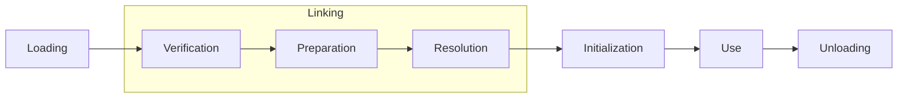
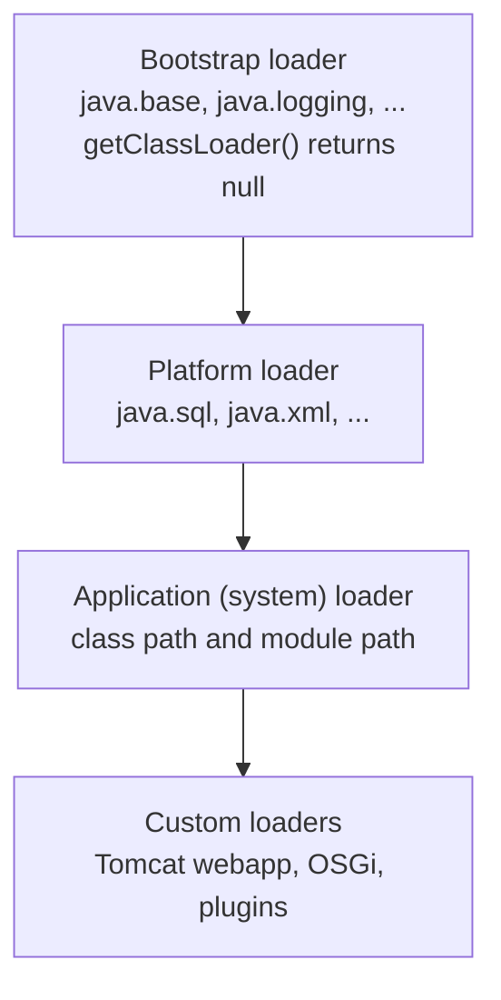
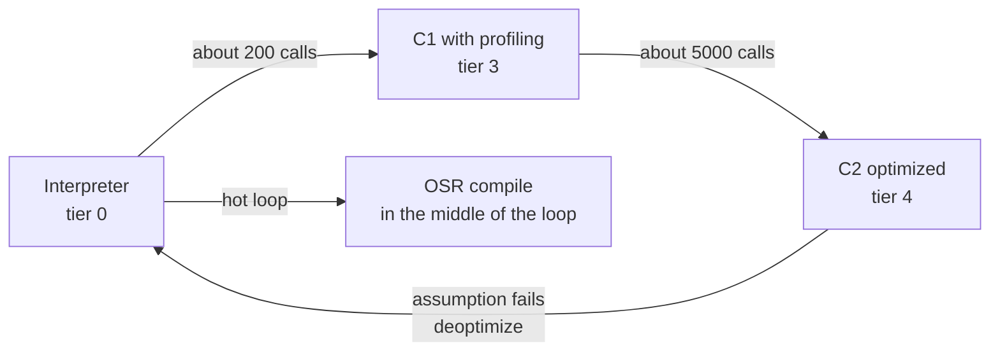

# JVM Architecture

## Why It Matters

Every Java interview for a backend role tests whether you know what happens between `java Main` and the first line of `main`, and what the JVM does to your code while it runs. Typical questions: "Explain class loading and parent delegation", "When does a class get initialized?", "What is the difference between `ClassNotFoundException` and `NoClassDefFoundError`?", "Where do objects, static fields, and local variables live?", "What is the JIT compiler, and why is the first request slow?", "Why does a micro-benchmark with a plain loop give wrong numbers?". On the job, the same knowledge explains `NoClassDefFoundError` after a deployment, a `Metaspace` leak after many redeploys, a `StackOverflowError`, a service that is slow for the first minute after a restart, and a JVM that a container kills because it uses more memory than the heap size. This page covers the structure of the JVM and the execution of code. Memory sizing, garbage collectors, and leaks are in [memory and garbage collection](06-memory-and-gc.md). The Java Memory Model is in [concurrency basics](07-concurrency-basics.md).

## Core Concepts

**JVM (Java Virtual Machine)**: the program that loads class files and runs them. The JVM specification (JVMS) defines what a conforming JVM does. **HotSpot** is the JVM implementation in OpenJDK, and this page describes HotSpot in JDK 21. Other implementations (for example Eclipse OpenJ9) follow the same specification but differ in the details that this page labels as HotSpot behavior.

**Class file**: the binary format that `javac` produces for each class. It holds a constant pool, field and method descriptions, and bytecode (JVMS chapter 4).

**Bytecode**: the instruction set of the JVM. It is a stack-based instruction set: most instructions take their operands from a stack and push their result on it (JVMS chapter 6).

**Class loader**: an object that finds the bytes of a class by name and asks the JVM to define a class from them. Each class in the JVM has a **defining loader**. JVMS 5.3 says that a class is identified by its binary name and its defining loader. The same bytes loaded by two loaders give two different classes that are not assignable to each other.

**Linking**: the step after loading. It has three parts: verification, preparation, and resolution.

**Initialization**: the step that runs the static initializer of a class (`<clinit>`, the method that the compiler builds from static field initializers and `static { }` blocks).

**Runtime data areas**: the memory structures that the JVM defines at run time (JVMS 2.5): the heap, the method area, the JVM stacks, the PC registers, and the native method stacks.

**Interpreter**: the part of the JVM that executes bytecode one instruction at a time.

**JIT compiler (just-in-time compiler)**: the part of the JVM that compiles hot bytecode to machine code while the program runs. HotSpot has two JIT compilers: **C1** (the client compiler, fast compile, light optimization) and **C2** (the server compiler, slow compile, heavy optimization).

**Hot method**: a method that the JVM has executed often enough to be worth compiling.

**Deoptimization**: the JVM discards compiled code and returns to the interpreter, because an assumption that the compiler made is no longer true.

**OSR (on-stack replacement)**: the JVM replaces a running interpreted loop with compiled code in the middle of the loop, without waiting for the method to return and run again.

### Where the JVM spec stops and HotSpot starts

The JVMS says what a JVM must do, not how. The JVMS does not require a JIT compiler, a particular garbage collector, or a Metaspace. These parts are HotSpot choices. When this page says "HotSpot", the statement does not apply to every JVM.

## How It Works

### The lifecycle of a class

A class passes through these phases (JVMS chapter 5):



1. **Loading.** A class loader finds the bytes of the class and the JVM builds the internal representation of the class (in HotSpot: the class metadata in Metaspace, plus a `java.lang.Class` object on the heap). Loading of a class also loads its superclass and its direct superinterfaces first.
2. **Verification.** The JVM checks that the bytecode is structurally correct and type-safe. It checks, for example, that each instruction finds operands of the right type on the stack, that jumps land on instruction boundaries, and that a `final` class has no subclass. Verification protects the JVM from corrupt or hostile class files. JVMS 4.10 defines the checks.
3. **Preparation.** The JVM allocates the static fields of the class and sets each to its default value (`0`, `false`, or `null`). It does not run any Java code in this step. A `static int x = 5;` has the value 0 after preparation and the value 5 after initialization.
4. **Resolution.** The JVM replaces symbolic references in the constant pool (a method name, a class name) with direct references. The JVMS lets a JVM resolve a reference when it first uses the reference or earlier. HotSpot resolves lazily, at first use.
5. **Initialization.** The JVM runs `<clinit>` once. The JVM initializes the superclass first.

!!! note "Lazy by design"
    The JVM loads a class when a running program first needs it, not at startup. A program that never reaches a line of code never loads the class that this line uses. The JVMS lets an implementation load earlier, but HotSpot loads lazily. Tools that print `-verbose:class` show the order.

### Class loaders since Java 9

Java 9 replaced the extension class loader with the platform class loader when it introduced the module system (JEP 261, with the modular runtime image of JEP 220). A running JDK 21 has three built-in loaders:



| Loader | Loads | `getName()` | Implemented in |
|---|---|---|---|
| Bootstrap | The core modules, for example `java.base` | Not an object: `getClassLoader()` returns `null` | The JVM (native code) |
| Platform | The other JDK modules, for example `java.sql` | `platform` | Java (`jdk.internal.loader.ClassLoaders`) |
| Application | The class path, the module path, and the application's own classes | `app` | Java (`jdk.internal.loader.ClassLoaders`) |

The first program in the Java Example section prints this hierarchy.

### Parent delegation

The default `ClassLoader.loadClass(name)` follows this order (JDK 21 javadoc of `ClassLoader.loadClass`):

1. Call `findLoadedClass(name)`. If this loader already defined the class, return it.
2. Ask the parent loader to load the class. For the bootstrap loader at the top, the JVM does this natively.
3. If the parent fails, call `findClass(name)` on this loader.

Parent delegation has three effects:

- **Security.** An application cannot replace `java.lang.String`. A request for `java.lang.String` always reaches the bootstrap loader first, which finds the real one. A custom loader that tries to define a class in the `java.*` packages gets a `SecurityException`.
- **Uniqueness.** Each class has one definition in a loader tree, so `String` in the library and `String` in your code are the same type.
- **Visibility.** A child loader sees the classes of its parents. A parent does not see the classes of its children. This one-way rule is why a framework class that your application loader loaded cannot see classes of a plugin that a child loader loaded.

!!! tip "Override `findClass`, not `loadClass`"
    A custom loader that only needs a new place to find bytes overrides `findClass`. The `loadClass` method of the parent class implements delegation. An override of `loadClass` that forgets the delegation breaks the three effects above.

#### Where delegation breaks

| Case | What happens | Why |
|---|---|---|
| Servlet containers (Tomcat) | The web application loader looks in its local repositories before it delegates. The Tomcat 10.1 class loader how-to gives the search order from the web application: the JVM bootstrap classes, `/WEB-INF/classes`, `/WEB-INF/lib/*.jar`, the system loader, then the common loader. Two exceptions: the application cannot override the JRE base classes, and the loader always delegates first for the Jakarta EE APIs that Tomcat implements (Servlet, JSP, EL, WebSocket) | Each web application can ship its own version of a library, and two applications in one container must not see each other's classes. The Servlet specification recommends this order |
| OSGi and plugin systems | A loader per module with its own import and export rules, not a strict tree | Modules need independent versions and lifecycles |
| `ServiceLoader` and JDBC `DriverManager` | The core library (loaded by a parent) must find provider classes that live in the application. `ServiceLoader.load(Class)` uses the **thread context class loader** (TCCL) | A parent cannot see its children, so the parent code asks the loader that the thread carries (`Thread.getContextClassLoader()`) |
| Hot reload | A new loader instance loads the new version of a class, and the old loader is dropped | A loader cannot redefine a class it already defined. A new loader gives a new class |
| `Class.forName(name)` | Uses the loader of the calling class. The three-argument form takes any loader | The caller chooses the loader |

The JVMS rule in 5.3 explains the last two rows: the identity of a class is the pair (binary name, defining loader). A class `com.acme.Plugin` from loader A and `com.acme.Plugin` from loader B are different classes, and a cast between them fails with `ClassCastException` even though the names match.

A custom loader that reverses the order (child first) has this shape. The code needs only the JDK:

```java
import java.net.URL;
import java.net.URLClassLoader;

class ChildFirstClassLoader extends URLClassLoader {
    ChildFirstClassLoader(URL[] urls, ClassLoader parent) {
        super(urls, parent);
    }

    @Override
    protected Class<?> loadClass(String name, boolean resolve) throws ClassNotFoundException {
        // Never define java.* classes in a custom loader: delegate them.
        if (name.startsWith("java.")) {
            return super.loadClass(name, resolve);
        }
        synchronized (getClassLoadingLock(name)) {
            Class<?> c = findLoadedClass(name);
            if (c == null) {
                try {
                    c = findClass(name);            // own URLs first
                } catch (ClassNotFoundException e) {
                    c = super.loadClass(name, false); // then the parent
                }
            }
            if (resolve) {
                resolveClass(c);
            }
            return c;
        }
    }
}
```

### Class initialization triggers

JLS 12.4.1 (Java SE 21) lists four events. The JVM initializes a class or interface `T` immediately before the first of these events:

- `T` is a class and an instance of `T` is created (`new T()`).
- A `static` method that `T` declares is invoked.
- A `static` field that `T` declares is assigned.
- A `static` field that `T` declares is used, and the field is **not** a constant variable (a `final` field of primitive or `String` type that a constant expression initializes, JLS 4.12.4).

The same section adds three rules:

- When a class is initialized, its superclasses are initialized first, and also its superinterfaces that declare at least one default method.
- Some reflective methods in `Class` and in `java.lang.reflect` also initialize a class (for example `Class.forName(name)` and `Constructor.newInstance`).
- "A class or interface will not be initialized under any other circumstance."

The JVM also initializes the initial class, the class that contains `main`, at startup (JVMS 5.5).

The JLS also lists what does **not** trigger initialization, and interviews test these cases:

| Action | Initializes the class? | Reason |
|---|---|---|
| Read `Child.CONST` where `CONST` is a `static final int = 7` | No | The compiler copies the value into the caller (a constant variable, JLS 15.29) |
| Read `Child.p` where `p` is declared in `Parent` | Only `Parent` | Only the class that declares the field initializes (JLS 12.4.1) |
| `Child[] a = new Child[3]` | No | Creating an array does not initialize the element class |
| `Child.class` (class literal) | No | A class literal only loads the class |
| `Class.forName(name, false, loader)` | No | The `false` argument turns initialization off |
| `Class.forName(name)` | Yes | The one-argument form initializes |
| Initialization of a class that implements an interface | Not the interface, unless the interface declares a default method | JLS 12.4.1 and 12.4.2 |

**Initialization is thread-safe.** JVMS 5.5 defines an initialization lock for each class. If two threads need the same uninitialized class, one thread runs `<clinit>` and the other waits. This guarantee is the reason why the **initialization-on-demand holder idiom** gives a lazy, thread-safe singleton without `synchronized`: the holder class initializes at its first use, and the JVM provides the lock and the visibility guarantee (JLS 12.4.2, 17.4.5 gives the happens-before edge). The same lock can cause a deadlock if two classes initialize each other from two threads.

**Failed initialization.** If `<clinit>` throws an exception whose class is not `Error` or a subclass of `Error`, the JVM wraps it in `ExceptionInInitializerError`. An `Error` propagates without the wrapper (JLS 12.4.2, step 11). In both cases the JVM marks the class as erroneous, and every later use of the class throws `NoClassDefFoundError: Could not initialize class X`. Since JDK 18 (JDK-8048190), that later `NoClassDefFoundError` carries the original failure as its cause. JDK 17.0.12 also shows the cause, and JDK 11.0.11 does not (both tested). This program uses a class whose initializer divides by zero, and uses the class twice:

```java
public class InitFailure {
    static class Config {
        static final int TIMEOUT = 100 / Integer.parseInt("0");   // not a constant variable
    }

    public static void main(String[] args) {
        for (int attempt = 1; attempt <= 2; attempt++) {
            try {
                System.out.println(Config.TIMEOUT);
            } catch (Error e) {
                System.out.println(attempt + ": " + e);
                System.out.println("   cause class:   " + e.getCause().getClass().getName());
                System.out.println("   cause message: " + e.getCause().getMessage());
            }
        }
    }
}
```

<!-- expected-output -->
```text
1: java.lang.ExceptionInInitializerError
   cause class:   java.lang.ArithmeticException
   cause message: / by zero
2: java.lang.NoClassDefFoundError: Could not initialize class InitFailure$Config
   cause class:   java.lang.ExceptionInInitializerError
   cause message: Exception java.lang.ArithmeticException: / by zero [in thread "main"]
```

The first use gets the `ExceptionInInitializerError` that wraps the `ArithmeticException`. The second use gets the `NoClassDefFoundError`, and its cause records the original exception and the thread that ran the initializer. On a JDK without the change (JDK 11, for example), the second error has no cause. On any version, a `NoClassDefFoundError` with the text "Could not initialize class" means that the class exists and its static initializer failed earlier: read the cause, or look earlier in the log for the `ExceptionInInitializerError`.

### `ClassNotFoundException` and `NoClassDefFoundError`

| | `ClassNotFoundException` | `NoClassDefFoundError` |
|---|---|---|
| Kind | Checked exception (`Exception`) | `Error` (`LinkageError`) |
| When | Code asks a loader for a class by name at run time (`Class.forName`, `loadClass`) and the loader finds no bytes | A class was present at compile time, and the JVM cannot find it at run time. Or the class failed to initialize earlier |
| Typical cause | Wrong name, missing jar on the class path for a reflective lookup | A jar that was `provided` or `optional` at build time and absent at run time. A failed `<clinit>` |
| Fix | Add the jar or correct the name | Add the dependency to the run-time class path. Find the first `ExceptionInInitializerError` |

### Runtime data areas

JVMS 2.5 defines these areas. Some belong to each thread, and some are shared:

```text
 Shared by all threads                  One set per thread
+------------------------------+       +-------------------------------+
| Heap                         |       | PC register                   |
|   all objects and arrays     |       |   address of the current      |
|   (garbage collected)        |       |   bytecode instruction        |
+------------------------------+       +-------------------------------+
| Method area                  |       | JVM stack                     |
|   class metadata, method     |       |   one frame per method call:  |
|   code, run-time constant    |       |   local variables,            |
|   pool (HotSpot: Metaspace)  |       |   operand stack, frame data   |
+------------------------------+       +-------------------------------+
| (HotSpot only, outside the   |       | Native method stack           |
|  spec: code cache, direct    |       |   frames of native (JNI)      |
|  buffers, thread stacks)     |       |   methods                     |
+------------------------------+       +-------------------------------+
```

| Area | Holds | Scope | Error when it is full |
|---|---|---|---|
| Heap | Objects and arrays. In HotSpot, `static` field values live in the `Class` object on the heap, and the string pool lives on the heap | All threads | `OutOfMemoryError: Java heap space` |
| Method area | Per-class data: field and method metadata, bytecode, the run-time constant pool | All threads | `OutOfMemoryError: Metaspace` (HotSpot) |
| JVM stack | A frame for each method call that has not returned | One thread | `StackOverflowError` when the depth exceeds the limit. `OutOfMemoryError` if a new thread cannot get stack memory |
| PC register | The address of the bytecode instruction that the thread executes. Undefined during a native method | One thread | None |
| Native method stack | The state of native calls (JNI) | One thread | `StackOverflowError` or `OutOfMemoryError` |

A **frame** (JVMS 2.6) holds three things: the **local variable array** (the parameters and the local variables, indexed from 0; for an instance method, slot 0 is `this`), the **operand stack** (the working stack of the bytecode), and a reference to the run-time constant pool of the method's class. A call pushes a frame and a return pops it. Local variables of primitive type live in the frame. A local variable of reference type holds a reference in the frame, and the object lives on the heap.

#### Method area, PermGen, and Metaspace

Before Java 8, HotSpot stored class metadata in the **permanent generation** (PermGen), a fixed-size region of the Java heap. JEP 122 removed it in Java 8. Class metadata now lives in **Metaspace**, which uses native memory. JEP 122 also lists the move of interned strings and class statics to the Java heap. JDK 7 had already made the first of these moves: the JDK 7 release notes (RFE 6962931) state that interned strings are no longer allocated in the permanent generation. In JDK 8 and later, both interned strings and `static` field values are on the Java heap.

Facts about Metaspace in JDK 21 (HotSpot):

- Metaspace memory is native memory, so the heap flags `-Xmx` and `-Xms` do not limit it.
- `-XX:MaxMetaspaceSize` limits Metaspace. The default on this JDK is unlimited (the value printed by `-XX:+PrintFlagsFinal` is the largest 64-bit value). Without a limit, a class loader leak can use all the memory of the machine or the container.
- `-XX:MetaspaceSize` is not a minimum or maximum. It is the amount of class metadata that triggers the first garbage collection for class unloading (21 MB on JDK 21.0.7, as `PrintFlagsFinal` shows. The `java` command documentation describes the flag).
- With compressed class pointers (the default), HotSpot reserves a separate **compressed class space** for class structures, with a default reserved size of 1 GB (`CompressedClassSpaceSize`). The reservation costs address space, not memory.
- The JVM frees the metadata of a class only when its class loader is unreachable, and the JVM unloads all classes of that loader together. A loader that something still references (a `ThreadLocal`, a static field in a parent-loaded class, a JDBC driver registration) keeps every class that it loaded. This is the **class loader leak** that causes `OutOfMemoryError: Metaspace` after repeated redeploys of a web application.

#### Stack size and what `StackOverflowError` means

Each thread has its own stack. The size is `-Xss` (or `-XX:ThreadStackSize`). The default is platform-dependent. The JDK 21 `java` command documentation lists 1024 KB for Linux/x64 and macOS/x64, and 2048 KB for Linux/AArch64 and macOS/AArch64. `PrintFlagsFinal` on the test machine for this page (macOS, AArch64) shows `ThreadStackSize=2048`. Check your machine with `java -XX:+PrintFlagsFinal -version`. Deep recursion without a base case, or recursion that is deeper than the stack allows, throws `StackOverflowError`. The fix is a base case, an iterative version, or (rarely) a larger `-Xss`. A larger `-Xss` multiplies by the number of threads: 1,000 threads with 1 MB stacks reserve about 1 GB of address space, and the committed part grows as the threads use their stacks.

#### Memory that is not the heap

A JVM process uses more memory than `-Xmx`. This explains why a container with a 1 GB limit and `-Xmx1g` gets killed by the operating system:

| Memory | Controlled by |
|---|---|
| Java heap | `-Xms`, `-Xmx` (or `-XX:MaxRAMPercentage`) |
| Metaspace and compressed class space | `-XX:MaxMetaspaceSize` |
| Thread stacks | `-Xss` times the number of threads |
| Code cache (JIT-compiled code) | `-XX:ReservedCodeCacheSize` (about 240 MB reserved on JDK 21 with tiered compilation, as `PrintFlagsFinal` shows) |
| Direct byte buffers (NIO) | `-XX:MaxDirectMemorySize` (default: about the maximum heap size) |
| GC data structures (remembered sets, mark bitmaps) | The collector and the heap size |
| Native libraries and JNI | The libraries |

To see the real numbers, start the JVM with `-XX:NativeMemoryTracking=summary` and run `jcmd <pid> VM.native_memory summary`. Native Memory Tracking costs performance: the JDK 21 Java Virtual Machine Guide states that "enabling NMT causes a 5% -10% performance overhead". Turn it on for a diagnosis, not permanently.

### Bytecode basics

`javap` is the JDK tool that prints the contents of a class file. `javap -c -p` prints the bytecode of all methods, including private ones. The listing below comes from this source file, compiled with `javac --release 21` and printed with `javap -c -p` (JDK 21.0.7, Zulu, macOS aarch64). The comments after `//` are output of `javap`:

```java
public class Calc {
    private int total;

    static int sum(int[] a) {
        int s = 0;
        for (int i = 0; i < a.length; i++) {
            s += a[i];
        }
        return s;
    }

    int add(int x) {
        total += x;
        return total;
    }
}
```

```text
static int sum(int[]);
  Code:
     0: iconst_0
     1: istore_1
     2: iconst_0
     3: istore_2
     4: iload_2
     5: aload_0
     6: arraylength
     7: if_icmpge     22
    10: iload_1
    11: aload_0
    12: iload_2
    13: iaload
    14: iadd
    15: istore_1
    16: iinc          2, 1
    19: goto          4
    22: iload_1
    23: ireturn

int add(int);
  Code:
     0: aload_0
     1: dup
     2: getfield      #7                  // Field total:I
     5: iload_1
     6: iadd
     7: putfield      #7                  // Field total:I
    10: aload_0
    11: getfield      #7                  // Field total:I
    14: ireturn
```

How to read it:

- The number on the left is the **offset** of the instruction in the method's code array. Instructions have different lengths: `iconst_0` takes 1 byte and `if_icmpge` takes 3 bytes, so the offsets jump from 7 to 10.
- In `sum` (a `static` method), local slot 0 is the parameter `a`, slot 1 is `s`, and slot 2 is `i`. In `add` (an instance method), slot 0 is `this` and slot 1 is `x`.
- The prefix of a mnemonic gives the type: `i` for `int`, `a` for a reference. `iload_2` pushes the `int` in local slot 2. `istore_1` pops an `int` and stores it in slot 1.
- `if_icmpge 22` pops two `int` values and jumps to offset 22 if the first is greater than or equal to the second. The `for` condition `i < a.length` compiles to the opposite test that exits the loop. `goto 4` jumps back to the test.
- `iinc 2, 1` adds 1 to local slot 2 without using the operand stack.
- `total += x` compiles to six instructions. `aload_0` and `dup` push `this` twice, `getfield` reads `total` (consuming one copy of `this`), `iadd` adds `x`, and `putfield` writes the sum (consuming the other copy). Then the return statement reads the field again. The `#7` is an index into the constant pool, and `javap` resolves it in the comment. The statement is not atomic: it has a separate read and a write, which is the reason why `total++` is not thread-safe (see [concurrency basics](07-concurrency-basics.md)).

The five invoke instructions (JVMS 6.5) are the ones that interviews name:

| Instruction | Use |
|---|---|
| `invokestatic` | A `static` method |
| `invokespecial` | A constructor (`<init>`) or a `super.method()` call |
| `invokevirtual` | An instance method on a class type. The JVM picks the override at run time from the receiver's class. Since JDK 11 (JEP 181, nest-based access control), `javac` also uses `invokevirtual` for calls to `private` instance methods of the class and of its nestmates (`javap` on JDK 21 shows it). Before JDK 11 (and with `javac --release 8` today), a private call used `invokespecial`, and a call from a nested class went through a synthetic `access$000` method |
| `invokeinterface` | An instance method on an interface type (and, since JDK 11, a `private` interface method) |
| `invokedynamic` | A call site that a **bootstrap method** links at first execution. `javac` uses it for lambdas (through `LambdaMetafactory`) and, since Java 9, for string concatenation (JEP 280) |

### The execution engine: interpreter, C1, and C2

HotSpot starts every method in the **interpreter**. The interpreter starts at once and runs slowly. While it runs, it counts how often each method is called and how often each loop jumps back (the invocation counter and the back-edge counter). When a counter passes a threshold, the JVM queues the method for compilation on a background compiler thread, and the program keeps running in the meantime.

**Tiered compilation** has been the default since Java 8. It has five levels:

| Level | Executed by | Profiling | Purpose |
|---|---|---|---|
| 0 | Interpreter | Yes (counters) | Start immediately |
| 1 | C1, full optimization | No | Trivial methods (for example a getter) that C2 cannot improve |
| 2 | C1, limited profiling | Invocation and back-edge counters only | Used when the C2 queue is long |
| 3 | C1, full profiling | Counters plus branch and type profiles | The normal path to C2: the profile feeds the C2 compiler |
| 4 | C2 | No | Best optimization of the hot code, based on the profile |

The level descriptions come from the comments in `src/hotspot/share/compiler/compilationPolicy.hpp` in the JDK 21 source. The default thresholds on JDK 21.0.7, printed by `PrintFlagsFinal`, are `Tier3InvocationThreshold=200` and `Tier4InvocationThreshold=5000`. These flags are only part of the policy: the JVM also looks at the back-edge counts and at the compile queue length, and it scales the thresholds with the load of the compiler threads. Treat the numbers as the shape of the policy, not as a fixed rule.



#### What `-XX:+PrintCompilation` shows

The lines below come from a program that calls a four-byte method `square` 200,000 times in a loop (JDK 21.0.7, Zulu, macOS aarch64; the output is filtered to the lines of the program and the timestamps differ on each run):

```text
22    7       3       Hot::square (4 bytes)
22    8       4       Hot::square (4 bytes)
22    7       3       Hot::square (4 bytes)   made not entrant
23    9 %     3       Hot::main @ 4 (32 bytes)
24   10       3       Hot::main (32 bytes)
24   11 %     4       Hot::main @ 4 (32 bytes)
```

The columns are: the time in milliseconds since JVM start, the compilation id, flags (`%` marks an OSR compilation), the tier level, the method, and the size of its bytecode in bytes. The output tells this story:

1. `square` is compiled at tier 3 (id 7), and then at tier 4 (id 8). The tier 3 version is then marked `made not entrant`: new calls use the tier 4 code. The text `made not entrant` appears when compiled code is replaced by better code, and also when deoptimization invalidates it.
2. `main` has only one call, but its loop runs 200,000 times. The back-edge counter triggers an **OSR compilation** (`%`, `@ 4` is the bytecode offset of the loop head), first at tier 3 and then at tier 4.

#### What C2 does

C2 compiles with **speculative optimization**. It uses the profile that tier 3 collected and assumes that the future looks like the past.

- **Inlining.** The compiler replaces a call with the body of the callee. This removes the call cost and, more importantly, lets the compiler optimize across the former call boundary. HotSpot inlines a method with a bytecode size up to `MaxInlineSize` (35 bytes) when the call is not hot, and up to `FreqInlineSize` (325 bytes) when the call is hot (JDK 21.0.7 defaults). A method that is larger than the limit is not inlined, so a short method inlines and a long method does not.
- **Devirtualization.** A virtual call has a target that depends on the receiver's class. If the profile shows one class (monomorphic) or two classes (bimorphic) at a call site, C2 inlines the likely targets behind a cheap type check. The JVM also uses **class hierarchy analysis**: if only one loaded class implements an interface method, the compiler can call it directly, and it records the assumption that no other implementation loads.
- **Escape analysis.** The compiler checks whether an object escapes the method (is stored in a field, passed out, or returned). For an object that does not escape, C2 can apply **scalar replacement**: it removes the allocation and keeps the fields in registers. It can also remove the locks on such an object (**lock elision**). The common phrase "the JVM allocates the object on the stack" is not accurate for HotSpot: the object does not exist at all after scalar replacement, and it is on the heap in all other cases. `-XX:+DoEscapeAnalysis` and `-XX:+EliminateAllocations` are on by default in C2.
- **Loop optimizations.** Loop unrolling, hoisting of invariant computations, and range-check elimination (removal of repeated array-bounds checks).
- **Uncommon traps.** For a branch that the profile never saw, C2 does not compile the code. It inserts a trap. If the program takes the branch later, the trap fires.

**Deoptimization** is the safety net of speculation. When an assumption fails (a new class loads and breaks a class hierarchy assumption, a type profile is wrong, an uncommon trap is hit), the JVM marks the compiled code as not entrant, converts the compiled frame into interpreter frames, and continues in the interpreter. The method collects a new profile and compiles again. Deoptimization is correct but costs time, so a service whose traffic changes shape (a new request type arrives) can show a latency bump while the JVM recompiles.

The compiled code lives in the **code cache**, which HotSpot splits into segments (non-method code, profiled code, and non-profiled code) when tiered compilation is on (`SegmentedCodeCache`). If the code cache fills, the JVM prints a warning such as `CodeCache is full. Compiler has been disabled.` (with a segmented code cache, the message names the full segment, for example `CodeHeap 'non-profiled nmethods' is full`) and stops new compilations. With `UseCodeCacheFlushing` (on by default) the JVM can free cold compiled code and compile again later. Until then, new hot code runs in the interpreter. Size it with `-XX:ReservedCodeCacheSize`.

### Warm-up and benchmarks

The first run of any code path is slower than later runs, because the interpreter runs it first, the profile is empty, and the compilers have not run. This is **JIT warm-up**. It has three consequences:

- A service has high latency right after a start or a deployment. Common mitigations: send synthetic traffic before the load balancer adds the instance (a readiness gate), use class data sharing (CDS) archives, and, in newer JDKs, ahead-of-time caches (see the table at the end of this section).
- A micro-benchmark that runs a loop once measures the interpreter and the compilation, not the code that the production JVM runs.
- A micro-benchmark that does not use its result can measure nothing: C2 removes **dead code**, and it folds a computation on constants into a constant.

Use **JMH** (the Java Microbenchmark Harness, an OpenJDK project) for benchmarks. JMH runs warm-up iterations, forks a fresh JVM for each benchmark, and gives you `Blackhole` to consume results. JMH is a library that this page's runner does not have. The block below was compiled against JMH 1.37 (`jmh-core` and the `jmh-generator-annprocess` annotation processor) and run once. The JMH annotation processor rejects a benchmark class in the default package, so the class needs a `package` line:

<!-- fragment -->
```java
package bench;

import org.openjdk.jmh.annotations.*;
import org.openjdk.jmh.infra.Blackhole;
import java.util.concurrent.TimeUnit;

@BenchmarkMode(Mode.AverageTime)
@OutputTimeUnit(TimeUnit.NANOSECONDS)
@Warmup(iterations = 5, time = 1)
@Measurement(iterations = 5, time = 1)
@Fork(2)
@State(Scope.Thread)
public class SumBenchmark {
    int[] data = new int[1_000];

    @Benchmark
    public void sum(Blackhole bh) {
        int s = 0;
        for (int v : data) {
            s += v;
        }
        bh.consume(s);   // keeps C2 from removing the loop as dead code
    }
}
```

!!! warning "Do not time code with `System.currentTimeMillis` around one call"
    One call measures the interpreter, class loading, and the first-use costs. Even a loop that runs in `main` is compiled by OSR code, which can differ from the code that the method gets when many callers use it. Use JMH.

#### Startup and warm-up changes after Java 21

| JDK | Feature | What changed | Source |
|---|---|---|---|
| 24 | Ahead-of-time class loading and linking | The JVM caches classes in a loaded and linked state, which a training run records | JEP 483 |
| 25 | Ahead-of-time method profiling | The AOT cache also stores method profiles, so the JIT starts to optimize hot code sooner | JEP 515 |

The status of both JEPs is "Closed / Delivered" on openjdk.org, checked on 2026-10-22. JDK 21 has class data sharing for the JDK classes (the "sharing" word in the `java -version` output) and AppCDS archives for application classes.

### The JVM flags that interviews ask about

All defaults below are for JDK 21 on HotSpot, from `java -XX:+PrintFlagsFinal -version` on the machine of this page (macOS aarch64, 16 GB of RAM) unless the table says otherwise. A default that depends on the machine says so.

| Flag | Meaning | Default and notes |
|---|---|---|
| `-Xms<size>`, `-Xmx<size>` | Initial and maximum heap size | The default maximum is 25 percent of the physical memory (`MaxRAMPercentage=25`). The JVM reads the container limit when it runs in a container |
| `-XX:MaxRAMPercentage=<n>` | Maximum heap as a percentage of the memory limit | 25. Commonly raised for a container that runs one JVM |
| `-Xss<size>` | Stack size of each thread | Platform-dependent: 2048 KB here |
| `-XX:MaxMetaspaceSize=<size>` | Upper limit for Metaspace | Unlimited |
| `-XX:+UseSerialGC`, `-XX:+UseParallelGC`, `-XX:+UseG1GC`, `-XX:+UseZGC`, `-XX:+UseShenandoahGC` | Select the collector | G1 on a machine that the JVM counts as a server-class machine, Serial otherwise. The JDK 21 GC tuning guide: two or more processors and at least 1792 MB of physical memory. JEP 523 (delivered for JDK 27) makes G1 the default in all environments. See [memory and GC](06-memory-and-gc.md) |
| `-XX:MaxGCPauseMillis=<n>` | Pause-time goal for G1 | 200. A goal, not a guarantee |
| `-Xlog:gc*` | Unified logging of GC events | Off. Unified GC logging arrived in Java 9 (JEP 158, JEP 271). JDK 21 still accepts `-XX:+PrintGCDetails` and prints `-XX:+PrintGCDetails is deprecated. Will use -Xlog:gc* instead.` |
| `-XX:+HeapDumpOnOutOfMemoryError`, `-XX:HeapDumpPath=<path>` | Write a heap dump when the heap is full | Off |
| `-XX:+ExitOnOutOfMemoryError` | End the JVM at the first `OutOfMemoryError`, so that an orchestrator restarts it | Off |
| `-XX:+PrintCompilation` | Print each JIT compilation | Off |
| `-XX:TieredStopAtLevel=1` | Use only C1 | 4. Lowers the compile cost and peak speed. Used for short-lived tools and tests |
| `-XX:ReservedCodeCacheSize=<size>` | Size of the code cache | About 240 MB |
| `-XX:NativeMemoryTracking=summary` | Track the JVM's own native memory | Off |
| `-XX:+PrintFlagsFinal` | Print every flag with its final value | Off. The tool for checking a default on your JVM |
| `-XX:+AlwaysPreTouch` | Touch every page of the heap at start | Off. Moves the cost of the first page faults to startup |
| `-XX:+DisableExplicitGC` | Make `System.gc()` do nothing | Off. Use with care: some libraries (NIO direct memory cleanup) call `System.gc()` |
| `-XX:+UseStringDeduplication` | Let the collector merge duplicate `String` contents | Off. Since JDK 18 all collectors support it: Serial, Parallel, G1, ZGC, and Shenandoah (each one starts the deduplication thread on JDK 21.0.7). The JDK 21 `java` man page still says G1 only, which is out of date |

Recommendation: do not copy a list of tuning flags from the internet. Set `-Xmx` (or `MaxRAMPercentage`), the heap dump flags, and GC logging. Change other flags only after a measurement shows a problem.

## Trade-offs and When to Use

### Interpreter, C1, and C2

| | Interpreter | C1 | C2 |
|---|---|---|---|
| Start cost | None | Low (fast compile) | High (slow compile, more CPU and memory) |
| Speed of the result | Slowest | Faster than the interpreter, slower than C2. The ratio depends on the code | Fastest. Uses profile-based speculation |
| Needs a profile | No (it collects) | Tier 3 collects | Yes, from tier 3 |
| Best for | The first calls and code that runs once | Short programs and startup | Long-running services |

### JIT compilation, AOT, and native images

| Approach | Startup | Peak speed | Cost |
|---|---|---|---|
| HotSpot with tiered JIT | Slow start, long warm-up | Highest for long runs, because the profile at run time drives the optimization | Warm-up time, code cache memory, compile threads |
| HotSpot with a CDS or AOT cache (JEP 483, JEP 515) | Faster start | Same as JIT after warm-up | An extra training run and an archive file to build and ship |
| GraalVM Native Image (a closed-world ahead-of-time compiler, not part of OpenJDK) | Fast start, low memory | Often lower for peak throughput than a warmed-up JIT (depends on the workload) | Build time, limits on reflection and dynamic class loading, different debugging |

Recommendation: for a long-running backend service, the default HotSpot JIT is the baseline. Look at AOT caches or native images only if startup time or memory per instance is the measured problem (for example, serverless functions or a large number of small instances).

## Java Example

The first program prints the class loader hierarchy of JDK 21. The output is the same on every run:

```java
import java.sql.Driver;

public class LoaderDemo {
    public static void main(String[] args) {
        ClassLoader app = ClassLoader.getSystemClassLoader();
        ClassLoader platform = app.getParent();
        System.out.println("String loader:       " + String.class.getClassLoader());
        System.out.println("java.sql.Driver:     " + Driver.class.getClassLoader().getName());
        System.out.println("system loader:       " + app.getName());
        System.out.println("parent of system:    " + platform.getName());
        System.out.println("parent of platform:  " + platform.getParent());
    }
}
```

<!-- expected-output -->
```text
String loader:       null
java.sql.Driver:     platform
system loader:       app
parent of system:    platform
parent of platform:  null
```

The `null` for `String` means that the bootstrap loader loaded the class. The bootstrap loader is not a Java object, so Java code sees `null`.

The second program shows the class initialization rules. It prints a line when each class initializes, so the output shows the order and the cases that do not trigger initialization:

```java
public class InitDemo {
    static class Parent {
        static int p = 1;
        static { System.out.println("  Parent initialized"); }
    }

    static class Child extends Parent {
        static final int K = 7;      // constant variable: copied into the caller
        static int c = 2;
        static { System.out.println("  Child initialized"); }
    }

    interface Marker {
        int M = compute();           // not a constant: needs initialization
        static int compute() {
            System.out.println("  Marker initialized");
            return 5;
        }
    }

    static class Impl implements Marker {
        static { System.out.println("  Impl initialized"); }
    }

    public static void main(String[] args) throws Exception {
        System.out.println("1. read Child.K (constant)");
        System.out.println("  value " + Child.K);

        System.out.println("2. read Child.p (declared in Parent)");
        System.out.println("  value " + Child.p);

        System.out.println("3. Class.forName with initialize=false");
        Class.forName("InitDemo$Child", false, InitDemo.class.getClassLoader());
        System.out.println("  loaded");

        System.out.println("4. read Child.c");
        System.out.println("  value " + Child.c);

        System.out.println("5. new Impl()");
        new Impl();

        System.out.println("6. read Marker.M");
        System.out.println("  value " + Marker.M);
    }
}
```

<!-- expected-output -->
```text
1. read Child.K (constant)
  value 7
2. read Child.p (declared in Parent)
  Parent initialized
  value 1
3. Class.forName with initialize=false
  loaded
4. read Child.c
  Child initialized
  value 2
5. new Impl()
  Impl initialized
6. read Marker.M
  Marker initialized
  value 5
```

Step 1 does not initialize `Child` at all, because `K` is a constant variable that `javac` copies into the caller. Step 2 initializes only `Parent`. Step 5 initializes `Impl` but not `Marker`, because `Marker` declares no default method. Step 6 is the first use of a non-constant field of `Marker`.

## Interview Angle

### Questions

??? question "Explain class loading in the JVM. What are the phases?"

    A class passes through loading, linking, and initialization (JVMS chapter 5).

    - **Loading**: a class loader finds the bytes and the JVM builds the class (its metadata, and a `Class` object). The superclass and the direct superinterfaces load first.
    - **Linking** has three parts. **Verification** checks that the bytecode is type-safe and well-formed. **Preparation** allocates the static fields and gives them default values. **Resolution** turns symbolic references into direct ones. HotSpot resolves lazily.
    - **Initialization** runs `<clinit>`: the static field initializers and `static` blocks, in source order, once, under a per-class lock.

    The JVM loads lazily: a class loads when a running program first needs it. The reason for the split is that verification and preparation can run for classes that never initialize, and initialization has side effects that the JLS ties to exact triggers.

??? question "What is parent delegation? Why does it exist, and when would you break it?"

    A loader that receives `loadClass(name)` first checks whether it already defined the class. If not, it asks its parent. Only if the parent fails does the loader call its own `findClass`. In JDK 9 and later the chain is application, platform, bootstrap.

    The reasons are security and consistency. Core classes like `java.lang.String` always come from the bootstrap loader, so application code cannot replace them, and one name means one class in a loader tree.

    Frameworks break the order on purpose. Tomcat's web application loader looks in the application's `WEB-INF/classes` and `WEB-INF/lib` before the system and common loaders, so that each web application can ship its own library versions. It still takes JRE base classes from the bootstrap loader first, and it always delegates first for the Jakarta EE APIs that Tomcat implements (Servlet, JSP, EL, WebSocket), so an application cannot replace them. OSGi uses a graph of module loaders. `ServiceLoader` and JDBC use the thread context class loader, because a class that a parent loaded cannot see the classes of a child. The cost of breaking delegation is the risk of two copies of one class, and a `ClassCastException` between them, because class identity is the pair of name and defining loader.

??? question "When does the JVM initialize a class? Give cases where it does not."

    JLS 12.4.1 lists four triggers: the JVM initializes a class immediately before the first instance creation, the first call of a static method that the class declares, the first assignment to a static field that it declares, or the first use of a static field that it declares that is not a constant variable. Some reflective calls also initialize (`Class.forName(name)`, `Constructor.newInstance`). Initializing a class first initializes its superclasses, and its superinterfaces that declare default methods. The JVM initializes the class with `main` at startup (JVMS 5.5). The JLS says that nothing else initializes a class.

    Cases that do not initialize: reading a `static final` compile-time constant (the compiler inlines it), reading a static field through a subclass name (only the declaring class initializes), creating an array of the class, a class literal, and `Class.forName(name, false, loader)`. A class does not initialize its interfaces, unless an interface declares default methods. I can show these with print statements in `static` blocks.

??? question "What is the difference between `ClassNotFoundException` and `NoClassDefFoundError`?"

    `ClassNotFoundException` is a checked exception. Code asks a loader for a class by name (`Class.forName`, `loadClass`, a reflective framework) and the loader finds no bytes. The fix is a name or class path correction.

    `NoClassDefFoundError` is a `LinkageError`. The class was there when the code compiled, but the JVM cannot find it at run time, or the class exists and its static initializer failed in an earlier attempt. In the second case, the first failure threw `ExceptionInInitializerError` (or the original `Error`), and every later use throws `NoClassDefFoundError: Could not initialize class X`. Since JDK 18 that error carries the original failure as its cause, so on JDK 21 the stack trace shows it (on JDK 11 it does not). When I debug it, I check the run-time class path for a dependency that the build treated as `provided` or `optional`, and I search the log for the first `ExceptionInInitializerError`.

??? question "Describe the JVM runtime data areas. Which are per thread, and which are shared?"

    Shared by all threads: the **heap** (objects and arrays, collected by the GC) and the **method area** (class metadata, method bytecode, the run-time constant pool; HotSpot keeps it in Metaspace, in native memory).

    Per thread: the **PC register** (the current instruction), the **JVM stack** (a frame for each call, holding the local variable array and the operand stack), and the **native method stack**.

    Primitives that are local variables live in the frame. Objects live on the heap, and a local variable holds only the reference. The errors map to the areas: `StackOverflowError` for the JVM stack, `OutOfMemoryError: Java heap space` for the heap, `OutOfMemoryError: Metaspace` for class metadata. A JVM process also uses memory outside these areas: the code cache, direct buffers, and thread stacks. This is why a container limit must be larger than `-Xmx`.

??? question "What changed between PermGen and Metaspace? Why does `OutOfMemoryError: Metaspace` happen?"

    Before Java 8, class metadata lived in the permanent generation, a fixed-size part of the heap, and a redeploy-heavy server hit `OutOfMemoryError: PermGen space`. JEP 122 removed it in Java 8. Metadata now lives in Metaspace, which is native memory. Interned strings (already in JDK 7) and static field values moved to the heap.

    Metaspace has no fixed maximum by default (`MaxMetaspaceSize` is unlimited). The JVM frees the metadata of a class only when its whole class loader becomes unreachable. If something keeps a reference to the loader (a thread, a `ThreadLocal`, a driver registered in a parent loader, a static in a parent-loaded class), the loader and all its classes stay. Repeated redeploys then leak Metaspace. I set `MaxMetaspaceSize` so that the leak fails fast, and I take a heap dump to find the reference path to the loader.

??? question "What is the JIT compiler? Explain tiered compilation."

    HotSpot starts a method in the interpreter, which starts at once and runs slowly. It counts method calls and loop back-edges. At a threshold, the JVM compiles the method on a background thread. Tiered compilation uses levels: tier 0 interpreter, tiers 1 to 3 C1 (tier 3 with full profiling), tier 4 C2.

    The usual path is interpreter, then C1 with profiling (tier 3) after about 200 invocations on JDK 21, then C2 (tier 4) after about 5,000 (defaults from `PrintFlagsFinal`; the policy also uses back-edge counts and queue length, so these numbers are approximate). C1 compiles fast and optimizes lightly. C2 compiles slowly and uses the tier 3 profile to optimize hard: inlining, devirtualization, escape analysis, loop optimization.

    The trade-off is warm-up. A service is slow at the start and fast after the hot code is compiled. When C2's assumptions fail, the JVM deoptimizes the code back to the interpreter and compiles again.

??? question "What is escape analysis? Does the JVM allocate objects on the stack?"

    Escape analysis is a C2 analysis that checks whether an object can be reached outside the method (stored in a field, passed to another thread, returned). If it does not escape, C2 applies scalar replacement: it does not allocate the object and keeps its fields in registers. It can also remove synchronization on that object (lock elision).

    HotSpot does not allocate whole objects on the stack. The object either is scalar-replaced and does not exist, or it is a normal heap object. The effect is that short-lived helper objects in hot code can cost no allocation. The condition is that the code is hot enough for C2, and that the allocation and the use are inlined into one compilation unit. I would not design code on the assumption that the optimization happens.

??? question "What are OSR and deoptimization?"

    **OSR** (on-stack replacement) switches a running interpreted loop to compiled code in the middle of the loop. It is needed when a method is called once and loops for a long time, like `main` with a big loop. The `%` flag in `-XX:+PrintCompilation` marks these compilations.

    **Deoptimization** is the reverse. C2 compiles with assumptions from the profile and the class hierarchy. If an assumption fails (a new subclass loads, a branch that the profile never saw is taken, a type check fails), the JVM discards the compiled code, rebuilds interpreter frames from the compiled frame, and continues in the interpreter. The program stays correct. The cost is a latency bump while the method warms up again.

??? question "How do you benchmark Java code correctly?"

    I use JMH, not a timer around a loop. The JVM interprets the code first, compiles it later, and C2 can remove code whose result nobody uses or fold constants. JMH forks a fresh JVM for each benchmark, runs warm-up iterations before it measures, runs several measurement iterations, and gives a `Blackhole` that consumes results so that C2 cannot remove the work.

    I also check that the benchmark input has realistic size and type variety. A benchmark with only one receiver class at a call site gets monomorphic inlining that production code with five implementations does not get. I report the mean with its error, run more than one fork, and compare against a baseline.

??? question "Which JVM flags would you set for a service in a container?"

    I set the heap with `-XX:MaxRAMPercentage` (the default is 25 percent of the container limit, which is low for a container that runs one JVM) or `-Xmx`. I leave room for non-heap memory: Metaspace, thread stacks, the code cache, and direct buffers. I turn on `-Xlog:gc*` to a file, `-XX:+HeapDumpOnOutOfMemoryError` with a `HeapDumpPath` on a volume that survives the restart, and often `-XX:+ExitOnOutOfMemoryError` so that the orchestrator restarts the failed instance. I keep the default collector (G1) until a measurement shows a pause problem, and I use `-XX:+PrintFlagsFinal` to check what the JVM chose.

### Follow-up Questions

??? question "Can two classes with the same name exist in one JVM?"

    Yes. The identity of a class is its name plus its defining loader (JVMS 5.3). Two loaders can each define `com.acme.Plugin`. The two classes are different types, and a cast from one to the other throws `ClassCastException`. Application servers use this to isolate web applications.

??? question "Why is `javac` output stack-based? What does `iinc` do?"

    A stack-based instruction set has short instructions (no register names) and is easy to verify and to port across processors. The JIT compiler maps the stack operations to registers. `iinc` adds a constant to a local variable slot directly, without the operand stack, because a counter loop uses this pattern in most `for` statements.

??? question "What happens when a `static` initializer throws?"

    If the exception is not an `Error`, the JVM wraps it in `ExceptionInInitializerError`. An `Error` propagates as it is (JLS 12.4.2). The JVM marks the class as erroneous and never retries the initializer. Every later use throws `NoClassDefFoundError: Could not initialize class X`. Since JDK 18 this later error has the original failure as its cause (JDK 17.0.12 has it too). On JDK 11 the cause appears only in the first error, so you search the log for it.

??? question "How does the JVM decide what to inline?"

    By bytecode size and hotness. On JDK 21 a method up to `MaxInlineSize=35` bytes can inline, and a hot call site can inline a method up to `FreqInlineSize=325` bytes. Virtual calls inline when the profile shows one or two receiver classes, or when class hierarchy analysis shows one implementation. This is one reason to prefer small methods: they inline.

??? question "Is JIT-compiled code faster than ahead-of-time compiled code?"

    It can be, for long runs, because the JIT sees the real profile and class hierarchy of the running program and compiles for that. An ahead-of-time compiler must assume more and cannot deoptimize in the same way. The JIT pays with warm-up time, CPU for compiler threads, and code cache memory. Native images start faster and use less memory, and often have lower peak throughput. The answer depends on the workload, so I measure.

### Red Flags

- "The JVM loads all classes at startup." It loads lazily.
- "`static final` fields always trigger class initialization when you read them." A constant variable does not.
- "Objects live on the heap and local variables live on the stack, so a local `String` lives on the stack." The reference is in the frame, and the `String` object is on the heap.
- "PermGen holds the string pool in Java 21." PermGen does not exist since Java 8, and the string pool is on the heap.
- "Escape analysis puts objects on the stack." HotSpot applies scalar replacement. It does not stack-allocate objects.
- "`-Xmx` is the memory of the JVM process." The process also uses Metaspace, thread stacks, the code cache, and direct buffers.
- "I measured it with `System.currentTimeMillis` around a loop." The measurement includes interpretation and compilation.
- "`ClassNotFoundException` and `NoClassDefFoundError` are the same thing." They differ in kind, cause, and fix.

## Common Mistakes

| Mistake | Fix |
|---|---|
| Override of `loadClass` in a custom loader without delegation, which gives duplicate `java.*` or framework classes | Override `findClass`. If you reverse the order on purpose, delegate `java.*` and test for `ClassCastException` between the two copies |
| A class loader leak after redeploy: a thread, a `ThreadLocal`, or a JDBC driver in a parent loader keeps a reference to the web application loader | Stop threads and clear `ThreadLocal` values at undeploy, deregister drivers, and look for the path from a GC root to the loader in a heap dump |
| Reading `NoClassDefFoundError` as a missing jar only | If the message says "Could not initialize class", the static initializer failed. Read the cause (JDK 18 and later) or search the log for the earlier `ExceptionInInitializerError` |
| Heavy work or blocking calls in a `static` block, and cyclic static dependencies between classes | Keep static initializers small. Use the holder idiom for lazy work. A cycle between two classes that two threads initialize can deadlock |
| Setting `-Xmx` equal to the container memory limit | Leave room for Metaspace, stacks, the code cache, and direct memory. Use `MaxRAMPercentage` below 100 and measure with Native Memory Tracking |
| Benchmarking with a hand-written timer | Use JMH with warm-up, forks, and `Blackhole` |
| Running a load test against a cold JVM and comparing the numbers with a warm production JVM | Warm up first, and compare the same phase |
| Enabling `-XX:TieredStopAtLevel=1` on a long-running service to save CPU | Use it for short-lived programs. A service loses the C2 peak speed |
| Disabling `System.gc()` with `-XX:+DisableExplicitGC` without checking the libraries | Check whether NIO direct memory cleanup depends on it in your stack |

## Commonly Confused With

| Looks like | Difference | Deciding question |
|---|---|---|
| `ClassNotFoundException` and `NoClassDefFoundError` | The first is a checked exception from a by-name lookup. The second is a `LinkageError` for a class that was present at compile time or failed to initialize | Did my code ask for the class by name through reflection, or did the JVM fail to link code that I compiled? |
| Loading and initialization | Loading builds the class. Initialization runs `<clinit>` | Did a static block run, or did the class only become available? |
| Heap and Metaspace | The heap holds objects. Metaspace holds class metadata in native memory | Is it an instance, or a description of a class? |
| Stack (JVM stack) and the data structure called stack | The JVM stack holds the method frames of one thread | Am I talking about method calls, or about an algorithm? |
| Interpreter and JIT | The interpreter runs bytecode directly. The JIT compiles hot bytecode to machine code | Is the method already hot? |
| C1 and C2 | C1 compiles fast with light optimization. C2 compiles slowly with speculative optimization | Is the code short-lived, or long-lived and hot? |
| OSR and normal compilation | OSR swaps code inside a running loop. Normal compilation applies from the next call | Is the method called once but loops for a long time? |
| Deoptimization and a JIT failure | Deoptimization is a correct fallback to the interpreter. The program stays correct | Did an assumption fail, or did the code produce a wrong result? |
| JVM, JRE, JDK | The JVM runs bytecode. A JRE has what a program needs to run. The JDK also has the compiler and tools (`javac`, `javap`, `jcmd`) | Do I need to compile, or only to run? |

## Quick Reference Card

- **Class lifecycle**: load, link (verify, prepare, resolve), initialize. Lazy. Initialization is once and thread-safe.
- **Loaders (Java 9+)**: bootstrap (`null` in Java), platform, application. Delegation: own cache, parent, `findClass`. Override `findClass`.
- **Class identity**: binary name plus defining loader.
- **Init triggers (JLS 12.4.1)**: `new`, static method call, static field write, non-constant static field use, some reflection. Also: subclass init initializes the superclass first, and the `main` class at startup (JVMS 5.5). Not: constants, array creation, class literal, `forName(.., false, ..)`.
- **Run-time areas**: heap and method area are shared. PC, JVM stack, and native stack are per thread.
- **Metaspace**: native memory, since Java 8 (JEP 122). Freed with the class loader. Default maximum: unlimited.
- **Process memory**: heap + Metaspace + stacks + code cache + direct buffers + GC data.
- **Bytecode**: stack machine. Read it with `javap -c -p`. Slot 0 is `this` for instance methods.
- **Execution**: interpreter, then C1 (tier 3 profiles), then C2 (tier 4). OSR for hot loops. Deoptimization for failed assumptions.
- **C2**: inlining (35 and 325 bytes), devirtualization, escape analysis with scalar replacement, loop optimizations.
- **Benchmarks**: JMH. Warm-up, forks, `Blackhole`.
- **Flags**: `-Xmx` or `MaxRAMPercentage`, `-Xss`, `-XX:MaxMetaspaceSize`, `-Xlog:gc*`, `-XX:+HeapDumpOnOutOfMemoryError`, `-XX:+PrintFlagsFinal`.
- **After Java 21**: JEP 483 (Java 24) and JEP 515 (Java 25) add AOT caches for faster startup and warm-up.

## Further Reading

- [JVM Specification, Java SE 21, chapter 5: Loading, Linking, and Initializing](https://docs.oracle.com/javase/specs/jvms/se21/html/jvms-5.html). The rules for class identity, verification, preparation, resolution, and initialization.
- [JVM Specification, Java SE 21, section 2.5: Run-Time Data Areas](https://docs.oracle.com/javase/specs/jvms/se21/html/jvms-2.html#jvms-2.5). The definition of the heap, the method area, stacks, and the PC register.
- [JVM Specification, Java SE 21, chapter 6: The Java Virtual Machine Instruction Set](https://docs.oracle.com/javase/specs/jvms/se21/html/jvms-6.html). The meaning of each bytecode instruction.
- [JLS Java SE 21, section 12.4: Initialization of Classes and Interfaces](https://docs.oracle.com/javase/specs/jls/se21/html/jls-12.html#jls-12.4). The exact list of initialization triggers.
- [JDK 21 javadoc: `ClassLoader`](https://docs.oracle.com/en/java/javase/21/docs/api/java.base/java/lang/ClassLoader.html). The delegation order and the loader hierarchy.
- [JEP 122: Remove the Permanent Generation](https://openjdk.org/jeps/122). The reason for Metaspace.
- [JEP 261: Module System](https://openjdk.org/jeps/261). The change from the extension loader to the platform loader.
- [JEP 181: Nest-Based Access Control](https://openjdk.org/jeps/181). Why `javac` emits `invokevirtual` for private method calls since JDK 11.
- [JEP 523: Make G1 the Default Garbage Collector in All Environments](https://openjdk.org/jeps/523). The end of the server-class machine rule, delivered for JDK 27.
- [JDK 21 Java Virtual Machine Guide: Native Memory Tracking](https://docs.oracle.com/en/java/javase/21/vm/native-memory-tracking.html). How to use NMT and its stated overhead.
- [JDK 21 GC tuning guide: Ergonomics](https://docs.oracle.com/en/java/javase/21/gctuning/ergonomics1.html). The server-class machine rule and the default heap sizes.
- [JEP 483: Ahead-of-Time Class Loading and Linking](https://openjdk.org/jeps/483) and [JEP 515: Ahead-of-Time Method Profiling](https://openjdk.org/jeps/515). Startup and warm-up work after Java 21.
- [JDK 21 `java` command reference](https://docs.oracle.com/en/java/javase/21/docs/specs/man/java.html). Documentation of the flags in this page.
- [JMH, the Java Microbenchmark Harness](https://openjdk.org/projects/code-tools/jmh/). The benchmark tool and its samples, which show the traps of manual timing.
- [HotSpot source, `compilationPolicy.hpp` in JDK 21u](https://github.com/openjdk/jdk21u/blob/master/src/hotspot/share/compiler/compilationPolicy.hpp). The comments that describe the compilation tiers.
- [Apache Tomcat class loader how-to](https://tomcat.apache.org/tomcat-10.1-doc/class-loader-howto.html). A real case where delegation is reversed.
