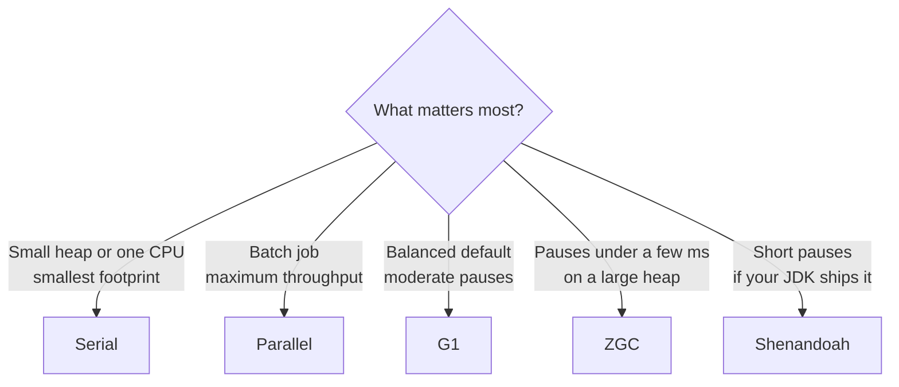
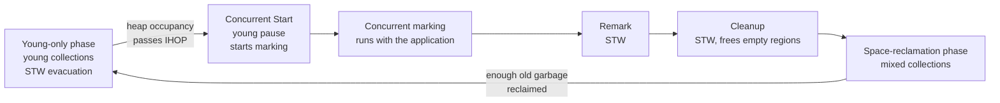

# Memory and Garbage Collection

## Why It Matters

Java interviews for backend roles ask how the JVM manages memory: "How does garbage collection decide what to free?", "Explain G1", "How is ZGC different?", "How do you find a memory leak in production?", "What is a weak reference for?". Senior interviews add scenario questions: "The service pauses for two seconds every few minutes. What do you check?" On the job, GC settings and heap sizing decide tail latency and the cost of each instance. A leak or a wrongly sized heap causes the incidents that wake people at night: `OutOfMemoryError`, container kills, and long pauses. This page covers the heap, the collectors in JDK 21, how to read a GC log, the kinds of `OutOfMemoryError`, memory leaks, and reference types. The structure of the JVM (class loading, runtime data areas, the JIT compiler) is in [JVM architecture](05-jvm-architecture.md). The Java Memory Model is in [concurrency basics](07-concurrency-basics.md).

## Core Concepts

**Garbage collection (GC)**: the automatic reclaiming of heap memory that the program can no longer reach. The program never frees an object. The collector does.

**Garbage**: an object that no live thread can reach through any chain of references.

**GC root**: a reference that the JVM treats as live without looking at who points to it. Reachability starts at the roots. The roots in HotSpot include:

- local variables and operand stack entries in the frames of live threads,
- `static` fields of loaded classes,
- active threads and their `Thread` objects,
- JNI global and local references,
- monitors that threads hold, and
- `Class` objects and class loaders that the JVM keeps live.

**Reachability**: an object is **reachable** if a chain of references leads from a root to it. The collector keeps reachable objects and frees the others. Because the collector traces from the roots, it frees cycles of unreachable objects. Java does not use reference counting.

**Live set**: the memory that reachable objects use after a collection.

**Stop-the-world (STW) pause**: a time in which the JVM stops all application threads so that the collector can do work that needs a stable heap. The JVM stops threads at a **safepoint**, a point where each thread has a known state.

**Concurrent phase**: collector work that runs at the same time as the application threads.

**Generational hypothesis**: most objects die young. A collector that looks at the young objects often and at the old objects rarely frees more memory for less work.

**Young generation**: the area where new objects start. It has **Eden** (the allocation area) and two **survivor spaces**. **Old generation** (tenured generation): the area for objects that survived several young collections.

**Minor (young) collection**: collects the young generation only. **Major or full collection**: collects the old generation, and in most collectors the whole heap.

**Promotion**: the move of a survivor to the old generation. **Tenuring threshold**: the number of young collections that an object survives before promotion. The JDK 21 maximum default is 15 (`MaxTenuringThreshold`, printed by `-XX:+PrintFlagsFinal`).

**Throughput, latency, footprint**: the three goals that a collector balances. Throughput is the share of time that the program runs instead of collecting. Latency is the length of the pauses. Footprint is the memory that the JVM needs.

**Memory leak (in Java)**: objects that the program no longer uses but that stay reachable, so the collector cannot free them.

## How It Works

### Heap layout and generations

Serial and Parallel use one contiguous young area and one contiguous old area. G1, ZGC, and Shenandoah divide the heap into regions (below).

```text
 Serial and Parallel heap (one contiguous reserved range)

 |<--------------- young generation --------------->|<------ old generation ------>|
 +-----------------------------+-----------+--------+------------------------------+
 |            Eden             | Survivor0 | Surv1  |           Old                |
 +-----------------------------+-----------+--------+------------------------------+
   new objects start here        one is empty at any time    objects that survived
                                 (copy target)                MaxTenuringThreshold GCs
```

The flow of an object:

1. The program allocates the object in Eden.
2. When Eden is full, a young collection copies the live objects from Eden and from the survivor space in use to the empty survivor space. Each copy raises the age of the object by one.
3. When the age reaches the tenuring threshold (or the survivor space overflows), the collector promotes the object to the old generation.
4. When the old generation fills, a full collection frees memory in the old generation.

On JDK 21 the default `SurvivorRatio=8` makes Eden eight times the size of one survivor space, and `NewRatio=2` makes the old generation twice the size of the young generation (both printed by `PrintFlagsFinal`; they apply to Serial and Parallel, and G1 sizes the young generation adaptively).

!!! note "The string pool and statics are on the heap"
    In JDK 8 and later, the interned strings and the values of `static` fields live on the Java heap. The interned strings moved there in JDK 7 (JDK 7 release notes, RFE 6962931), and JEP 122 removed the permanent generation in JDK 8. Class metadata lives in Metaspace, which is outside the heap. See [JVM architecture](05-jvm-architecture.md).

### Object layout, header size, and compressed oops

Every object on the HotSpot heap starts with a header (JEP 450 gives the layout):

- The **mark word** has the size of a machine address, 8 bytes on a 64-bit JVM. It holds the identity hash code (once computed), the GC age, and the lock state.
- The **class word** points to the class metadata. With **compressed class pointers**, which are on by default on 64-bit HotSpot (`UseCompressedClassPointers=true`), it takes 4 bytes. Without them, it takes 8 bytes.
- An array has a 4-byte **length** field after the header.

JEP 450 states that object headers take between 96 bits (12 bytes) and 128 bits (16 bytes), depending on the configuration. The usual case on a 64-bit HotSpot JDK 21 is 12 bytes. HotSpot aligns object sizes to 8 bytes (`ObjectAlignmentInBytes=8`), so the JVM pads each object to a multiple of 8.

**Compressed ordinary object pointers (compressed oops)**: a reference takes 4 bytes instead of 8. The JVM stores the address divided by the alignment (8) and shifts it back on use, so 32 bits address 32 GB of heap. HotSpot turns compressed oops on by default (`UseCompressedOops=true` on JDK 21.0.7 for a 4 GB maximum heap). The JDK 21 `java` man page states that the range that compressed pointers cover is 32 GB by default. If you set a maximum heap above this range, the JVM turns compressed oops off (approximate: the exact limit is a little under 32 GB, because the JVM also needs room for the heap base). A larger `-XX:ObjectAlignmentInBytes` (for example 16) raises the range (to 64 GB) at the cost of more padding. Crossing the limit makes every reference twice as large, so a heap just above 32 GB can hold fewer objects than a heap just below it. How much larger the heap must be to break even depends on how many references the objects hold. This is the reason why services keep the heap just under 32 GB unless they need much more.

Sizes measured with JOL 0.17 (`ClassLayout.instanceSize` and `GraphLayout.totalSize`) on JDK 21.0.7, macOS AArch64, default flags (compressed class pointers and compressed oops on). They match the layout rules above:

| Object | Layout | Size |
|---|---|---|
| `new Object()` | 12 header + 4 padding | 16 bytes |
| `Integer` (one `int` field) | 12 header + 4 | 16 bytes |
| Object with `long` and `int` fields | 12 header + 4 `int` + 8 `long` | 24 bytes |
| `new int[0]` | 12 header + 4 length | 16 bytes |
| `new byte[1]` | 12 header + 4 length + 1 + 7 padding | 24 bytes |
| `new int[1000]` | 16 header and length + 4,000 | 4,016 bytes |
| `ArrayList` of 1,000 distinct `Integer` values (1000 to 1999, outside the `Integer` cache), filled by `add` | 1,000 × 16 for the `Integer` objects, plus the `Object[]` backing array, which has grown to a capacity of 1,234 (16 + 1,234 × 4 = 4,952), plus 24 for the `ArrayList` | 20,976 bytes, about five times the `int[1000]` |

Tools to measure object size are JOL (the Java Object Layout project in OpenJDK) and a heap dump analysis. A later change, **compact object headers**, shrinks the header to 8 bytes (JEP 450, experimental in Java 24; JEP 519, a product feature in Java 25 that you turn on with `-XX:+UseCompactObjectHeaders`; JEP 519 states that it is not the default layout). JEP 534, "Compact Object Headers by Default", has the status "Closed / Delivered" for JDK 27 (checked on openjdk.org on 2026-10-22).

### Allocation and TLABs

Allocation in the young generation is cheap. Each thread owns a **TLAB** (thread-local allocation buffer), a slice of Eden that only that thread uses. To allocate, the thread moves a pointer forward in its TLAB (**bump-pointer allocation**) and writes the header. The thread needs no lock and no atomic instruction, because no other thread uses the slice. When the TLAB has too little space for the object, the thread gets a new TLAB from the shared Eden (with an atomic compare-and-swap on the shared allocation pointer), or, for a large object, allocates outside the TLAB, in Eden or in the old generation. The JVM sizes TLABs adaptively (`UseTLAB=true` and `ResizeTLAB=true` by default). The JIT compiler can also remove an allocation completely through escape analysis (see [JVM architecture](05-jvm-architecture.md)).

The cheap allocation path is the reason why short-lived objects cost little in Java. Allocation still has a cost: the allocation rate decides how often young collections run, so a program that allocates less runs fewer collections.

### How a collector finds garbage

HotSpot collectors combine these building blocks:

| Technique | What it does | Cost |
|---|---|---|
| **Mark** | Traces from the GC roots and marks every reachable object | Proportional to the live set, not to the garbage |
| **Sweep** | Frees the unmarked objects in place | Leaves free memory in fragments |
| **Compact** | Moves live objects together and updates references | Moves data, and needs a pause or barriers |
| **Copy (evacuate)** | Copies live objects to a new area and then frees the whole old area at once | Needs free space for the copies. Best when most objects are dead, as in the young generation |

A collector that collects one generation needs to know which old objects point to young objects, without scanning the whole old generation. Serial, Parallel, and G1 use a **card table**: the JVM divides the heap into small cards (512 bytes in HotSpot), and a **write barrier** (a small piece of code that the JIT compiler adds to each reference store) marks a card dirty when the program stores a reference in it. A young collection scans only the dirty cards, in addition to the roots.

### The collectors in JDK 21



| Collector | Flag | Threads | Pauses | Heap structure | Typical use |
|---|---|---|---|---|---|
| Serial | `-XX:+UseSerialGC` | One GC thread, all work in STW pauses | Proportional to the heap that it collects | Young and old, contiguous | Small heaps (about 100 MB or less), single-CPU containers, short tools |
| Parallel | `-XX:+UseParallelGC` | Many GC threads, all work in STW pauses | Shorter than Serial on a multi-core machine, because many threads share the work. Full collections still grow with the live set and reach seconds on large heaps | Young and old, contiguous | Batch jobs, throughput first. Default collector of JDK 8 |
| G1 | `-XX:+UseG1GC` | Many GC threads, STW evacuation plus concurrent marking | Aimed at `MaxGCPauseMillis` (default 200 ms) | Regions | General services. Default since JDK 9 (JEP 248) |
| ZGC | `-XX:+UseZGC` (add `-XX:+ZGenerational` in JDK 21) | Mostly concurrent | Goal: at most 1 ms (JEP 439) | Regions (called pages) | Low-latency services, large heaps |
| Shenandoah | `-XX:+UseShenandoahGC` | Mostly concurrent | Short and nearly independent of heap size | Regions | Low-latency services (OpenJDK builds that include it) |

#### Which collector the JVM selects by default

JDK 21 selects **G1** if the JVM runs on a **server-class machine**, and **Serial** otherwise. The JDK 21 GC tuning guide states: "The VM considers machines as server-class if the VM detects two or more processors and physical memory larger than or equal to 1792 MB." (The JDK 21 source, `os::is_server_class_machine` in `os.cpp`, computes 1792 MB as 2 GB minus 256 MB.) The JVM reads the container limits, so a container with a limit of one CPU or less than 1792 MB runs **Serial** unless you set a collector. This is a common surprise in Kubernetes: a small pod uses the single-threaded collector. Check the first line of the GC log (`Using G1`, `Using Serial`) or run `java -XX:+PrintFlagsFinal -version`. JEP 523 removes this rule: the JVM "will always select G1, regardless of the number of processors and the available physical memory". JEP 523 has the status "Closed / Delivered" for JDK 27 (checked on openjdk.org on 2026-10-22), so JDK 21 to 26 still use the rule above.

#### Serial and Parallel

Both collect the young generation by copying and the old generation by mark-compact, inside STW pauses. Serial uses one thread. Parallel uses many (`ParallelGCThreads`). The pause of a full collection grows with the live set, which makes Parallel unsuitable for latency-sensitive services on large heaps. Parallel suits batch work, where total throughput counts and pauses do not.

Parallel throws `OutOfMemoryError: GC overhead limit exceeded` when, in the words of the JDK 21 GC tuning guide, "more than 98% of the total time is spent in garbage collection and less than 2% of the heap is recovered". The flags are `UseGCOverheadLimit` (on), `GCTimeLimit=98`, and `GCHeapFreeLimit=2`. On JDK 21.0.7, G1 does not apply this check: the same program that fills a 32 MB heap gets `GC overhead limit exceeded` under Parallel and `Java heap space` under G1. The current jdk21u source has a G1 version of the check (`G1CollectedHeap::update_gc_overhead_counter`), so a later JDK 21 update can report it under G1 too.

#### G1 (Garbage-First)

G1 is the default and the collector that interviews ask about.

**Regions.** G1 divides the heap into equal-sized regions. The size is a power of 2. Ergonomics picks a size between 1 MB and 32 MB, and since JDK 18 you can set up to 512 MB with `-XX:G1HeapRegionSize` (JDK 21.0.7 accepts `512m` and rejects `1024m` with "outside the allowed range [ 0 ... 536870912 ]"; the JDK 21 man page still says 32 MB). By default the JVM aims for about 2,048 regions, so a 4 GB maximum heap gives 2 MB regions (`G1HeapRegionSize=2097152` on this page's test machine, printed by `PrintFlagsFinal`). Each region has a role at a time: Eden, survivor, old, or humongous. The young generation is a set of regions, not one contiguous block, which lets G1 resize it between collections.

```text
 G1 heap: each cell is one region (2 MB in this example)

 +----+----+----+----+----+----+----+----+
 | E  | E  | S  | O  | O  | E  | H  | H  |    E  Eden       S  Survivor
 +----+----+----+----+----+----+----+----+    O  Old         H  Humongous
 | O  | E  | free| O | E  | free| O | E  |    (an H run holds one huge object)
 +----+----+----+----+----+----+----+----+
```

**Humongous objects.** An object whose size is at least half a region is **humongous**. G1 allocates it in its own run of contiguous regions of the old generation, and not in Eden. Many humongous allocations fragment the heap and trigger early collections (in the first log below, `(G1 Humongous Allocation)` is the reason for each collection). Reduce them with a larger `-XX:G1HeapRegionSize` or by changing the code that allocates large arrays.

**Remembered sets.** Each region has a **remembered set** that records which cards in other regions hold references into this region. The write barrier keeps the sets up to date (dirty cards go to a queue, and refinement threads process them). With the remembered sets, G1 can collect any chosen set of regions without scanning the rest of the heap.

**The collection cycle.** G1 alternates between a young-only phase and a space-reclamation phase:



1. **Young collection.** An STW pause evacuates (copies) the live objects of the Eden and survivor regions to new survivor or old regions and frees the source regions.
2. **Concurrent start.** When heap occupancy passes the **initiating heap occupancy percent** (`InitiatingHeapOccupancyPercent`, default 45, which G1 adapts at run time), G1 starts a concurrent marking cycle on top of a young collection. Marking runs **concurrently** and uses a **snapshot-at-the-beginning** approach: a pre-write barrier records references that the program overwrites, so marking sees all objects that were reachable when it started.
3. **Remark and cleanup.** Two short STW pauses finish the marking and free the regions that are completely empty.
4. **Mixed collections.** For the next collections, G1 adds old regions to the young regions in the collection set. It picks the old regions with the **most garbage** first, which gives the collector its name. A mixed collection stops adding old regions when the predicted pause would exceed the goal. `G1MixedGCCountTarget` (default 8) spreads the old regions over up to eight mixed collections, and `G1HeapWastePercent` (default 5) is the share of garbage that G1 accepts leaving.
5. **Evacuation failure and full collection.** If G1 finds no free region to copy an object to during a pause, an **evacuation failure** occurs. G1 does not stop at once: it keeps the objects that it already moved, leaves the other objects in place, fixes the references, and finishes the pause. The JDK 21 GC tuning guide states that G1 assumes that enough space remains to run until marking completes. If this assumption does not hold, G1 schedules a **full collection**, an STW compaction of the whole heap (parallel since JDK 10, JEP 307). A full collection in G1 signals a tuning or sizing problem.

**Pause target.** `-XX:MaxGCPauseMillis` (default 200) is a goal. G1 predicts the cost of collecting each region from past pauses and picks the number of regions for the young generation and the collection set to fit the goal. A smaller goal gives smaller young generations and more frequent pauses, which lowers throughput. G1 does not promise that no pause exceeds the goal.

#### ZGC

ZGC is a **concurrent** collector. It does the marking, the relocation of objects (compaction), and the updating of references while the application runs. Its pauses are short because they do not depend on the size of the heap or the live set: the STW pauses do only a small, fixed amount of synchronization work. JEP 439 lists the goal "Pause times should not exceed 1 millisecond" and states that pauses are "typically shorter than one millisecond".

Two techniques make this possible:

- **Colored pointers.** A ZGC reference is a 64-bit pointer that carries metadata bits next to the address. The bits record the state of the object for the current cycle. Because the metadata bits need a 64-bit pointer, ZGC does not support compressed oops: the JDK 21 source (`zArguments.cpp`) sets `UseCompressedOops` to false with the comment "CompressedOops not supported". A reference costs 8 bytes.
- **Load barriers.** The JIT compiler adds a small piece of code at each read of a reference from the heap. The barrier checks the bits and, if needed, fixes the pointer or helps relocate the object before the program uses it. This is the price of ZGC: every reference load pays for the barrier, which lowers throughput and uses more CPU than G1 (approximate: measure with your workload).

**Generational ZGC.** The first ZGC versions had no generations: every cycle looked at the whole heap. JEP 439 added a young and an old generation to ZGC in **JDK 21**, based on the weak generational hypothesis. In JDK 21 you enable it with `-XX:+UseZGC -XX:+ZGenerational`, and `-XX:+UseZGC` alone selects the non-generational mode. The default changed later:

| JDK | Change | JEP |
|---|---|---|
| 21 | Generational ZGC, enabled with `-XX:+ZGenerational` | 439 |
| 23 | Generational mode is the default for ZGC. The non-generational mode is deprecated | 474 |
| 24 | The non-generational mode is removed | 490 |

All three JEPs have the status "Closed / Delivered" on openjdk.org (checked on 2026-10-22). The default collector of the JVM remains G1 in these releases. JEP 474 changes only what `-XX:+UseZGC` selects.

#### Shenandoah, Epsilon

**Shenandoah** is a concurrent collector that also compacts while the application runs, with a load reference barrier. It became a product feature in JDK 15 (JEP 379). **Generational Shenandoah** was experimental in JDK 24 (JEP 404) and became a product feature in JDK 25 (JEP 521). Shenandoah is part of OpenJDK, but a given JDK distribution may or may not include it. Run `java -XX:+UseShenandoahGC -version` to check. **Epsilon** (`-XX:+UseEpsilonGC`, JEP 318, experimental) allocates and never collects. It exists for performance tests and for programs that end before the heap fills.

### How to read a GC log

Since Java 9 all JVM logging uses one system, **unified logging**, with the option `-Xlog` (JEP 158 for the framework, JEP 271 for the GC log format). The usual starting point:

```text
-Xlog:gc*:file=gc.log:time,uptime,level,tags:filecount=5,filesize=20m
```

The option reads as: log all messages with the tag `gc` (and `gc+...` tags, from the `*`), to the file `gc.log`, with these decorators, and rotate over 5 files of 20 MB. With plain `-Xlog:gc`, the JVM prints one line for each collection to the standard output.

The line below comes from a G1 collection (JDK 21.0.7, Zulu, macOS aarch64, `-Xms256m -Xmx256m`, a program that allocates 1 KB arrays and drops half of them from time to time). The decorators `time`, `uptime`, `level`, and `tags` produce the prefix. The JVM prints each log entry on one line. This page wraps long lines with a 4-space indent to fit the width:

```text
[2026-10-22T15:10:12.991+0530][0.042s][info][gc] GC(0) Pause Young (Normal)
    (G1 Evacuation Pause) 24M->13M(256M) 2.406ms
```

| Part | Meaning |
|---|---|
| `[2026-10-22T15:10:12.991+0530]` | Wall-clock time (decorator `time`) |
| `[0.042s]` | Time since JVM start (decorator `uptime`) |
| `[info]`, `[gc]` | Log level and tag |
| `GC(0)` | The index of the collection. The JVM counts each collection and concurrent cycle |
| `Pause Young (Normal)` | The kind of pause: a young collection. Other kinds below |
| `(G1 Evacuation Pause)` | The cause: Eden was full, and G1 evacuated live objects |
| `24M->13M(256M)` | Heap use before the pause, heap use after the pause, and the committed heap size |
| `2.406ms` | The length of the pause. This is the number to compare against the pause goal |

The same collection with `-Xlog:gc*` has more lines. The phase lines show where the pause time went (the timestamps in the first column are shortened here):

```text
GC(0) Pause Young (Normal) (G1 Evacuation Pause)
GC(0) Using 6 workers of 8 for evacuation
GC(0)   Pre Evacuate Collection Set: 0.2ms
GC(0)   Merge Heap Roots: 0.0ms
GC(0)   Evacuate Collection Set: 1.7ms
GC(0)   Post Evacuate Collection Set: 1.5ms
GC(0)   Other: 0.7ms
GC(0) Eden regions: 23->0(42)
GC(0) Survivor regions: 0->3(3)
GC(0) Old regions: 2->12
GC(0) Humongous regions: 0->0
GC(0) Metaspace: 76K(320K)->76K(320K) NonClass: 72K(192K)->72K(192K) Class: 3K(128K)->3K(128K)
GC(0) Pause Young (Normal) (G1 Evacuation Pause) 24M->13M(256M) 4.291ms
GC(0) User=0.00s Sys=0.00s Real=0.00s
```

`Eden regions: 23->0(42)` says that Eden had 23 regions before, has 0 after, and has a target of 42 for the next cycle. Survivor and old region counts show where the live objects went: here 3 survivor regions and 10 more old regions (2 to 12).

The kinds of lines that an interviewer expects you to know (all from runs on JDK 21.0.7 with small heaps; the first and the third come from a 64 MB heap, which causes the humongous allocations):

```text
[0.021s][info][gc] GC(0) Pause Young (Concurrent Start) (G1 Humongous Allocation)
    28M->17M(64M) 0.361ms
[0.024s][info][gc] GC(7) Pause Remark 53M->53M(64M) 0.115ms
[0.024s][info][gc] GC(7) Pause Cleanup 59M->59M(64M) 0.014ms
[0.024s][info][gc] GC(8) Pause Young (Prepare Mixed) (G1 Humongous Allocation)
    (Evacuation Failure) 61M->49M(64M) 0.171ms
[0.025s][info][gc] GC(9) Pause Young (Mixed) (G1 Humongous Allocation)
    (Evacuation Failure) 61M->57M(64M) 0.128ms
```

| Line | Reading |
|---|---|
| `Pause Young (Concurrent Start)` | A young pause that also starts the concurrent marking cycle. The cause here is a humongous allocation |
| `Pause Remark`, `Pause Cleanup` | The two short STW pauses at the end of marking |
| `Pause Young (Prepare Mixed)`, `Pause Young (Mixed)` | Marking is done. The next collections add old regions |
| `(Evacuation Failure)` | G1 could not find free regions to copy the live objects to. This is a warning: the heap is too small or too full |

For comparison, the first lines of a Parallel collector on a 256 MB heap, and one full collection of Parallel on a 64 MB heap that the program fills:

```text
[0.057s][info][gc] GC(0) Pause Young (Allocation Failure) 65M->12M(245M) 9.251ms
[0.080s][info][gc] GC(1) Pause Young (Allocation Failure) 76M->19M(245M) 3.450ms
[0.036s][info][gc] GC(3) Pause Full (Ergonomics) 53M->40M(61M) 8.948ms
```

`Allocation Failure` means that the young generation was full. `Ergonomics` means that the collector decided on its own to collect, to follow its sizing policy. Other causes you meet: `System.gc()` (a program called `System.gc()`), `Metadata GC Threshold` (Metaspace grew past its threshold), and `G1 Humongous Allocation`.

What to read in a GC log, in this order:

1. **The heap after each collection.** The "after" value of full or mixed collections is the live set. If it rises over hours, the program has a leak. If it is stable but high, the heap is too small.
2. **The pause lengths against the goal.** Look at the maximum and at the 99th percentile, not only at the mean.
3. **The frequency of pauses.** A pause every 100 ms with 20 ms each costs 20 percent of the time.
4. **Full collections, `Evacuation Failure`, and humongous allocations in G1.** Each one points to a sizing or an allocation problem.
5. **The cause of each collection.** `System.gc()` calls from a library are common and avoidable.

Third-party tools (GCViewer, GCeasy) draw these logs as graphs. They are not part of the JDK.

### Memory leaks in Java

A Java leak is not memory that the program forgot to free. It is memory that the program still references and no longer needs. The usual sources:

| Source | How it leaks | Fix |
|---|---|---|
| **Static collections** | A `static Map` or `List` that only grows. The class is a GC root, so everything in the collection stays | Bound the size. Remove entries. Use an eviction policy |
| **Unbounded caches** | A cache without a size limit or expiry | Use a cache library with limits (for example Caffeine). Do not build a cache on `SoftReference` |
| **Listeners and callbacks** | An object registers with a long-lived publisher (a static event bus, a UI component, a JMX bean) and never unregisters | Unregister in a `close` method. Use weak listeners if the framework supports them |
| **`ThreadLocal` in thread pools** | A pool thread lives as long as the pool. A `ThreadLocal` value that is not removed stays with the thread, and the value can hold a reference to a class loader | Call `remove()` in a `finally` block after the task |
| **Inner classes** | A non-static inner class, an anonymous class, or a lambda that uses `this` holds a hidden reference to the outer object. A long-lived inner object keeps the outer object (and everything that the outer object references) alive | Use a `static` nested class and pass only what it needs |
| **Class loader leaks** | A reference from a long-lived object to one class of a web application keeps the whole application class loader (see [JVM architecture](05-jvm-architecture.md)) | Find the path from a GC root to the loader in a heap dump |
| **Mutable keys** | An object whose `hashCode` changes after it is put in a `HashMap` can no longer be found or removed | Use immutable keys |
| **Unclosed resources** | Connections, streams, and sockets hold native memory, and their wrapper objects stay reachable in pools | Use try-with-resources |

The code below shows four of these patterns with their fixes. It compiles but is not meant to run:

```java
import java.lang.ref.WeakReference;
import java.util.*;

class LeakPatterns {
    // 1. Static collection that grows without a bound.
    static final Map<String, byte[]> CACHE = new HashMap<>();

    static void leakyCache(String key) {
        CACHE.put(key, new byte[1024]);          // never removed
    }

    // Fix: a bounded LRU map (see the LRU case study for the full design).
    static final Map<String, byte[]> BOUNDED = new LinkedHashMap<>(16, 0.75f, true) {
        @Override
        protected boolean removeEldestEntry(Map.Entry<String, byte[]> eldest) {
            return size() > 1_000;
        }
    };

    // 2. Listener that is never removed.
    interface Listener { void onEvent(String e); }
    static final List<Listener> LISTENERS = new ArrayList<>();

    static class Screen {
        byte[] bigState = new byte[1_000_000];
        void open()  { LISTENERS.add(e -> bigState.hashCode()); } // captures this
        void close() { /* forgot LISTENERS.remove(...) */ }
    }

    // 3. ThreadLocal in a pool thread.
    static final ThreadLocal<byte[]> BUFFER = new ThreadLocal<>();

    static void handleRequest() {
        BUFFER.set(new byte[100_000]);
        try {
            // ... work that uses BUFFER.get()
        } finally {
            BUFFER.remove();                      // the fix: always remove
        }
    }

    // 4. Non-static inner class keeps the outer object alive.
    static class Outer {
        byte[] heavy = new byte[10_000_000];
        class Inner { }                           // holds Outer.this
        static class SafeInner { }                // holds nothing
        Object leak() { return new Inner(); }     // returns an Inner that pins heavy
        Object ok()   { return new SafeInner(); }
    }
}
```

#### How to find a leak

The symptom is a **rising floor**: the heap after each full or mixed collection is higher than after the last one, until `OutOfMemoryError` or a container kill. The process:

1. **Confirm it is a leak.** Read the GC log (above). A rising "after" value over time supports a leak. A high but flat value means that the heap is too small.
2. **Take a class histogram.** `jcmd <pid> GC.class_histogram` prints the count and the shallow size of the instances of each class. Take two, ten minutes apart. The class whose count grows is the suspect. The command runs a full collection first, unless you add `-all`.
3. **Take a heap dump.** `jcmd <pid> GC.heap_dump /path/dump.hprof` writes the dump. Or start the JVM with `-XX:+HeapDumpOnOutOfMemoryError -XX:HeapDumpPath=/path` to get one at the failure. The `jmap -dump:live,format=b,file=...` command does the same. The output of a failed run on JDK 21.0.7 (`-Xmx32m`):

    ```text
    java.lang.OutOfMemoryError: Java heap space
    Dumping heap to /path/dump.hprof ...
    Heap dump file created [34901053 bytes in 0.030 secs]
    ```

4. **Analyze the dump with Eclipse MAT (Memory Analyzer).** Open the dump and use:
    - **Leak Suspects report**: MAT proposes the objects that keep the most memory.
    - **Dominator tree**: the objects sorted by **retained size**, the memory that the JVM would free if it freed the object. **Shallow size** is only the object's own fields. A small `HashMap` that holds 500 MB has a small shallow size and a large retained size.
    - **Path to GC roots (excluding weak and soft references)** on a suspect: the chain from a root to the object. The last link before the root is the cause: a static field, a thread, a `ThreadLocal`, a listener list.
5. **Compare two dumps** (MAT has a compare function) to see which objects grow.
6. **Use JFR** (Java Flight Recorder): the `OldObjectSample` event samples objects that survive for a long time, with low overhead. If you start the recording with `path-to-gc-roots=true` (for example `-XX:StartFlightRecording=path-to-gc-roots=true,filename=leak.jfr`), JFR collects the path from a GC root to each sampled object at the end of the recording. The JDK 21 `java` man page warns that this collection is time-consuming and recommends it only when you suspect a leak.

!!! warning "A heap dump is sensitive data"
    A heap dump holds every object in memory: passwords, tokens, and personal data. Its size is about the size of the live heap. Store it with the access controls of production data, and delete it after use. A dump pauses the JVM for the time that it takes to write the file.

### Kinds of `OutOfMemoryError`

`OutOfMemoryError` is an `Error` (a `VirtualMachineError`). The message names the cause. The first, third, and fourth rows were produced on JDK 21.0.7 with small heap limits, and the other messages come from the HotSpot sources and documentation.

| Message | Cause | Typical fix |
|---|---|---|
| `Java heap space` | The live set does not fit in `-Xmx`, or a leak fills the heap | Find the leak. Raise `-Xmx` if the live set is real |
| `Requested array size exceeds VM limit` | A single array larger than the maximum array length of the JVM (about `Integer.MAX_VALUE` elements) | Change the algorithm. Use chunks |
| `GC overhead limit exceeded` | More than 98 percent of the time in GC and less than 2 percent of the heap recovered. Parallel on JDK 21.0.7 (G1 throws `Java heap space` in the same situation) | Same as `Java heap space` |
| `Metaspace` | Class metadata exceeded `MaxMetaspaceSize`, usually a class loader leak or code that generates classes without a bound | Find the leaked loader. Check proxy and bytecode generation libraries |
| `Compressed class space` | The compressed class space (1 GB by default) is full | Same as `Metaspace`. Raise `CompressedClassSpaceSize` only after you find the cause |
| `unable to create native thread` | The operating system refused a new thread: process or user limit, or no memory for the stack | Fewer threads. Use a pool or virtual threads (see [virtual threads](10-virtual-threads.md)). Check `ulimit -u` and `-Xss` |
| `Cannot reserve N bytes of direct buffer memory` | The total of `ByteBuffer.allocateDirect` buffers passed `MaxDirectMemorySize` | Reuse buffers. Find the leak. Raise `MaxDirectMemorySize` if the use is real |

For the direct buffer message, the run printed `Cannot reserve 67108864 bytes of direct buffer memory (allocated: 0, limit: 16777216)` with `-XX:MaxDirectMemorySize=16m`.

Three more points:

- `StackOverflowError` is not an `OutOfMemoryError`. It belongs to the thread stack (see [JVM architecture](05-jvm-architecture.md)).
- An `OutOfMemoryError` in one thread does not stop the JVM. Other threads may continue in a damaged state, because allocations fail at random places. Recommendation: for a service, use `-XX:+ExitOnOutOfMemoryError` together with a heap dump flag, and let the orchestrator restart the instance.
- A container kill (exit code 137, `OOMKilled`) is not a Java exception. The operating system kills the process because its total memory (heap, Metaspace, stacks, code cache, direct buffers) passed the container limit. The JVM never gets to throw an error.

### Reference types

A **reference** in Java is by default a **strong reference**: the collector never frees an object that a strong reference reaches. The package `java.lang.ref` adds three weaker kinds. Each wraps a **referent** in a `Reference` object. The collector decides at its own time whether to clear the weak wrapper.

| Kind | Class | `get()` | The collector clears it | Typical use |
|---|---|---|---|---|
| Strong | A normal reference | The object | Never while reachable | Everything |
| Soft | `SoftReference` | The object or `null` | When memory is short: the JVM clears all soft references before it throws `OutOfMemoryError`. Before that, it keeps them for a time that depends on the free heap and `SoftRefLRUPolicyMSPerMB` (default 1000 ms for each MB of free heap) | Memory-sensitive caches (with doubts, below) |
| Weak | `WeakReference` | The object or `null` | At the next collection that finds the object only weakly reachable | Canonical maps, metadata that must not keep its key alive, `WeakHashMap` |
| Phantom | `PhantomReference` | Always `null` | When the object becomes phantom reachable (its finalizer, if any, has run and no stronger reference reaches it). Since Java 9 the collector clears a phantom reference at that moment, as it does for soft and weak references, and then puts it in its `ReferenceQueue` | Cleanup actions after an object dies. The base of `Cleaner` |

The JDK 21 javadoc of `java.lang.ref` defines these levels of reachability: strongly, softly, weakly, and phantom reachable. The collector treats an object by the strongest path that reaches it. If any strong reference reaches the object, the weak references to it stay.

A **`ReferenceQueue`** receives the `Reference` objects after the collector clears them. A program polls or blocks on the queue to learn which referents are gone.

**Soft references as caches.** Soft references look attractive as a cache, but the clearing time depends on the GC and the heap size. A service that uses them has a cache size that varies with the collector's decisions, a cache that fills the heap before it is cleared (which raises GC work), and no control over eviction. Recommendation: use a bounded cache library (for example Caffeine) with an explicit size or time policy.

**`WeakHashMap`.** The map holds its **keys** by weak references. When a key becomes weakly reachable, the collector clears it, and the map removes the entry the next time that you call a method on the map. Rules that cause bugs:

- The **value** is held strongly. If the value refers to the key (directly or through a chain), the key never becomes weakly reachable, and the entry is never removed.
- A key that is a `String` literal or an `Integer` from the cache is held strongly by the string pool or the `Integer` cache, so the entry stays.
- `WeakHashMap` is not thread-safe. Use `Collections.synchronizedMap` if you share it.

**`Cleaner`.** `java.lang.ref.Cleaner` (Java 9) is the supported way to release native resources when an object becomes unreachable. You register the object and a cleaning action. The JVM runs the action on a daemon thread after the object becomes phantom reachable. Two rules:

- The cleaning action must **not** refer to the registered object. If it does, the object stays reachable and the action never runs. Put the data the action needs in a separate static nested class.
- A `Cleaner` is a safety net, not the main release mechanism. The normal path is an explicit `close()` (with try-with-resources) that calls the cleaning action. The JVM may never run the action if the program exits first, and the time of the run is not defined.

### `finalize` and why it is deprecated

`Object.finalize()` let an object run code before the collector freed it. **JEP 421 (JDK 18)** deprecated finalization for removal. `Object.finalize()` and `Runtime.runFinalization()` are marked for removal, and finalization is still on by default in JDK 21 (the JEP says so). The JEP adds `--finalization=disabled` to turn it off for testing. The JEP names these problems:

- **Unpredictable timing**: nothing says when, or if, the finalizer runs.
- **Slow collection**: an object with a finalizer survives at least one more collection and needs a finalizer thread.
- **Resurrection**: a finalizer can store `this` in a static field and bring the object back.
- **Failures are hidden**: an exception in a finalizer is ignored.
- **Security**: a subclass of a class whose constructor throws can use `finalize` to get hold of the half-built object (a finalizer attack).

JEP 421 recommends try-with-resources for scoped resources and `Cleaner` for the others. The JEP describes a long transition and states that the removal has no fixed date. JEP 421 states that "in a future release it will be disabled by default". Check the JEP page for the current state.

## Trade-offs and When to Use

### Choosing a collector

| Situation | Choice | Reason |
|---|---|---|
| General backend service, heap from 1 to about 32 GB | G1 (default) | Balanced throughput and pauses. Most documented and tuned |
| Heap below about 100 MB, single CPU, or a command-line tool | Serial | No GC threads, smallest footprint |
| Batch or offline job, throughput is the only goal | Parallel | Highest throughput of the stop-the-world collectors, when pauses do not matter |
| Latency SLO with pauses of a few ms, large heap | ZGC (generational) | Pauses independent of heap size. Costs more CPU and uses 8-byte references |
| Latency SLO and a JDK build that includes Shenandoah | Shenandoah | Similar goal as ZGC, different design |

### The three goals pull against each other

| To improve | Cost |
|---|---|
| Lower pauses | More concurrent work and barriers (lower throughput, more CPU), or a smaller pause target (more frequent pauses) |
| Higher throughput | Longer pauses (Parallel) |
| Smaller footprint | More frequent collections and a higher CPU use |

### Heap sizing

- A larger heap lowers the frequency of collections and raises the length of full collections (in the stop-the-world collectors).
- Setting `-Xms` equal to `-Xmx` removes the cost of heap resizing and makes the memory use predictable. It also reserves the memory. Recommendation: do this for a service with a stable load.
- Leave memory for non-heap use (see [JVM architecture](05-jvm-architecture.md)). A common starting point for a container is a heap of 50 to 75 percent of the limit through `-XX:MaxRAMPercentage`. This number is a rule of thumb: measure the real non-heap use with Native Memory Tracking.
- Recommendation: do not tune before you measure. Turn on the GC log, find the actual problem (a leak, humongous allocations, a too small heap), and change one setting at a time.

## Java Example

The program below shows the reference types. A garbage collection run is a request, not a command, so the program calls `System.gc()` in a short loop until the effect shows. Each wait has a limit. On HotSpot, the weak, phantom, and `Cleaner` effects appear within a few collections, and the program prints only the results.

```java
import java.lang.ref.Cleaner;
import java.lang.ref.PhantomReference;
import java.lang.ref.Reference;
import java.lang.ref.ReferenceQueue;
import java.lang.ref.WeakReference;
import java.util.Map;
import java.util.WeakHashMap;
import java.util.concurrent.CountDownLatch;
import java.util.concurrent.TimeUnit;
import java.util.function.BooleanSupplier;

public class RefDemo {
    static final Cleaner CLEANER = Cleaner.create();

    // The state must not refer to the Resource, or the Resource never becomes unreachable.
    static class State implements Runnable {
        private final String name;
        private final CountDownLatch released;

        State(String name, CountDownLatch released) {
            this.name = name;
            this.released = released;
        }

        @Override
        public void run() {
            System.out.println("released " + name);
            released.countDown();
        }
    }

    static class Resource implements AutoCloseable {
        private final Cleaner.Cleanable cleanable;

        Resource(String name, CountDownLatch released) {
            this.cleanable = CLEANER.register(this, new State(name, released));
        }

        @Override
        public void close() {
            cleanable.clean();          // runs the action at most once
        }
    }

    // Asks for a collection until the condition holds or 100 tries have passed.
    static boolean gcUntil(BooleanSupplier done) throws InterruptedException {
        for (int i = 0; i < 100 && !done.getAsBoolean(); i++) {
            System.gc();
            Thread.sleep(20);
        }
        return done.getAsBoolean();
    }

    static void addTemporaryEntry(Map<Object, String> map) {
        map.put(new Object(), "temporary");     // the key is reachable only through the map
    }

    static PhantomReference<Object> newPhantom(ReferenceQueue<Object> queue) {
        return new PhantomReference<>(new Object(), queue);
    }

    static void forgetResource(CountDownLatch released) {
        new Resource("forgotten", released);    // never closed: the Cleaner is the safety net
    }

    public static void main(String[] args) throws Exception {
        // 1. WeakReference: cleared when the referent has no strong reference.
        Object strong = new Object();
        WeakReference<Object> weakToStrong = new WeakReference<>(strong);
        WeakReference<Object> weakToGarbage = new WeakReference<>(new Object());
        boolean cleared = gcUntil(() -> weakToGarbage.get() == null);
        System.out.println("weak to garbage cleared: " + cleared);
        System.out.println("weak to strongly held cleared: " + (weakToStrong.get() == null));

        // 2. WeakHashMap: an entry disappears when its key is garbage.
        Map<Object, String> map = new WeakHashMap<>();
        Object liveKey = new Object();
        map.put(liveKey, "live");
        addTemporaryEntry(map);
        System.out.println("map shrinks to 1 entry: " + gcUntil(() -> map.size() == 1));

        // 3. PhantomReference: get() is always null, and the queue gets the reference.
        ReferenceQueue<Object> queue = new ReferenceQueue<>();
        PhantomReference<Object> phantom = newPhantom(queue);
        System.out.println("phantom get(): " + phantom.get());
        Reference<?>[] polled = new Reference<?>[1];
        boolean enqueued = gcUntil(
                () -> polled[0] != null || (polled[0] = queue.poll()) != null);
        System.out.println("phantom enqueued: " + enqueued);

        // 4. Cleaner: close() runs the action once. The safety net covers a forgotten resource.
        CountDownLatch closed = new CountDownLatch(1);
        try (Resource r = new Resource("closed", closed)) {
            System.out.println("using the resource");
        }
        closed.await();
        CountDownLatch forgotten = new CountDownLatch(1);
        forgetResource(forgotten);
        System.out.println("forgotten resource cleaned: "
                + gcUntil(() -> forgotten.getCount() == 0));

        Reference.reachabilityFence(phantom);   // the Reference itself must stay reachable
        Reference.reachabilityFence(strong);    // keeps strong and liveKey reachable up to here
        Reference.reachabilityFence(liveKey);
    }
}
```

<!-- expected-output -->
```text
weak to garbage cleared: true
weak to strongly held cleared: false
map shrinks to 1 entry: true
phantom get(): null
phantom enqueued: true
using the resource
released closed
released forgotten
forgotten resource cleaned: true
```

Two things to notice. First, the order of the last lines is fixed: the `try` block ends and `close()` calls the cleaning action on the calling thread, which prints `released closed` before the program creates the forgotten resource. The forgotten resource prints from the cleaner thread, and the `gcUntil` call returns only after its latch counted down, so the line `released forgotten` comes before the `forgotten resource cleaned` line. Second, the demo depends on the JVM running a collection when asked. HotSpot does with the default settings, and `-XX:+DisableExplicitGC` would break the demo.

## Interview Angle

### Questions

??? question "How does the garbage collector decide which objects to free?"

    It uses **reachability**, not reference counting. The collector starts from the **GC roots**: local variables and operand stack entries of live threads, `static` fields of loaded classes, JNI references, and live threads. It marks every object that a chain of references reaches. Unmarked objects are garbage, and the collector reclaims their memory.

    This means that cycles of unreachable objects are freed, and that the cost of marking depends on the **live set**, not on the amount of garbage. Collectors also use the **generational hypothesis**: most objects die young, so the JVM collects the young generation often, by copying the few survivors, and the old generation rarely.

??? question "Explain the heap generations and what happens to an object during its life."

    A new object is allocated in Eden, in a thread-local allocation buffer. When Eden fills, a young collection copies the live objects of Eden and the active survivor space into the empty survivor space and raises their age. When the age reaches the tenuring threshold (default maximum 15), or the survivor space is too small, the collector promotes the object to the old generation. The old generation is collected less often, by a full collection (or by mixed collections in G1).

    The design works because the young collection costs only the live set of the young generation, which is small, and the card table and write barrier let the collector find old-to-young references without scanning the old generation. In G1 the generations are sets of regions, not contiguous ranges.

??? question "How does G1 work, and why is it the default?"

    G1 splits the heap into equal regions (a power of 2: ergonomics picks 1 to 32 MB, and a manual setting can go up to 512 MB since JDK 18), and each region is Eden, survivor, old, or humongous. Young collections are STW pauses that evacuate live objects from the chosen regions. When heap occupancy passes the initiating threshold (default 45 percent, adaptive), G1 starts a concurrent marking cycle. After marking, G1 runs mixed collections that add the old regions with the most garbage to the young regions. It sizes the collection set so that the predicted pause fits `MaxGCPauseMillis` (default 200 ms). Remembered sets let G1 collect a subset of regions without a scan of the whole heap.

    G1 is the default since JDK 9 (JEP 248) because it balances throughput and pause time for the common heap sizes and needs little tuning. The cost is more memory and CPU than Parallel. The failure modes are evacuation failure and full collections when the heap is too small, and humongous allocations for large arrays.

??? question "How is ZGC different from G1? When do you use it?"

    ZGC does almost all its work concurrently: marking, relocation, and reference updates. The STW pauses are short synchronization points, so their length does not depend on the heap size or the live set. JEP 439 states the goal that pauses "should not exceed 1 millisecond". It works with colored pointers (metadata bits in a 64-bit reference) and load barriers (code at each reference read). In JDK 21 you enable the generational version with `-XX:+UseZGC -XX:+ZGenerational`. It became the default mode of ZGC in JDK 23 (JEP 474), and JDK 24 removed the non-generational mode (JEP 490).

    The costs are throughput and CPU from the barriers, and 8-byte references (no compressed oops). I would use ZGC when the service has a latency requirement that G1 pauses violate, or a very large heap. For a normal service, G1 is the default I start with, and I switch only after a measurement.

??? question "How do you read a GC log line such as `GC(12) Pause Young (Normal) (G1 Evacuation Pause) 61M->20M(256M) 4.1ms`?"

    It is the 13th collection (index 12). It is a young pause in G1, caused by an evacuation pause (Eden was full). The heap use went from 61 MB before the pause to 20 MB after, with a committed heap of 256 MB. The pause lasted 4.1 ms. The things that I check in a log: the "after" value of full and mixed collections (it shows the live set, and a rising value means a leak), the pause lengths against the pause goal, the frequency of pauses, and warning signs such as `Pause Full`, `Evacuation Failure`, and humongous allocation causes. I enable it with `-Xlog:gc*:file=gc.log:time,uptime,level,tags` and a rotation.

??? question "How do you find a memory leak in a running Java service?"

    First I confirm the symptom in the GC log: the heap after full or mixed collections rises over time. Then I take two class histograms with `jcmd <pid> GC.class_histogram`, some minutes apart, and look at the classes whose instance count grows. Next I take a heap dump (`jcmd <pid> GC.heap_dump`, or `-XX:+HeapDumpOnOutOfMemoryError`) and open it in Eclipse MAT. The dominator tree shows the objects with the largest retained size. For a suspect, I run "path to GC roots, excluding weak and soft references". The last link before the root is the cause: a static map, a `ThreadLocal`, a listener list, or a class loader.

    I treat the dump as sensitive data, because it contains everything that was in memory. The fix is code: bound the collection, remove the listener, call `ThreadLocal.remove()`, or close the resource.

??? question "Give examples of memory leaks in a language with a garbage collector."

    A Java leak is an object that stays reachable but is no longer used. Examples: a static `Map` used as a cache without eviction; listeners that are registered with a long-lived publisher and never removed; a `ThreadLocal` that is set in a pooled thread and never removed (the value lives as long as the thread, and can pin a class loader); a non-static inner class, anonymous class, or lambda that holds `this` of an outer object; a class loader that a thread, driver, or static field in a parent loader references, so that every class of a redeployed application stays in Metaspace; and mutable keys in a hash map.

    The fixes are bounded caches, explicit deregistration, `remove()` in `finally`, `static` nested classes, and cleanup of threads and drivers at undeploy.

??? question "What kinds of `OutOfMemoryError` exist, and what does each one mean?"

    The message names the area. `Java heap space`: the live set does not fit in `-Xmx`, or a leak. `GC overhead limit exceeded`: more than 98 percent of the time in GC with less than 2 percent of the heap recovered; on JDK 21.0.7 only Parallel applies this check. `Requested array size exceeds VM limit`: one array that is larger than the JVM allows. `Metaspace` and `Compressed class space`: class metadata, typically a class loader leak or unbounded class generation. `unable to create native thread`: the operating system refused a thread (limits, or no memory for stacks). `Cannot reserve N bytes of direct buffer memory`: the direct buffers passed `MaxDirectMemorySize`.

    A container kill with exit code 137 is not an `OutOfMemoryError`: the operating system kills the process when heap plus non-heap memory passes the container limit. For a service, I add a heap dump flag and `-XX:+ExitOnOutOfMemoryError` so that the instance restarts with evidence.

??? question "What are strong, soft, weak, and phantom references? When do you use each?"

    A strong reference keeps its object alive. A `SoftReference` is cleared when memory is short, and always before `OutOfMemoryError`. A `WeakReference` is cleared at the next collection once no strong or soft reference reaches the object. A `PhantomReference` always returns `null` from `get()`. When the object becomes phantom reachable, the collector clears the reference (since Java 9) and puts it on its `ReferenceQueue`, so a cleanup thread learns that the object is gone without being able to resurrect it.

    Uses: weak references for canonical maps and for metadata that must not keep its key alive (`WeakHashMap`); phantom references and `Cleaner` for cleanup of native resources; soft references for memory-sensitive caches, but I prefer a bounded cache library, because the clearing depends on the GC and the heap size, not on my policy.

??? question "Why is `finalize()` deprecated? What replaces it?"

    Finalizers run at an undefined time, or never. They slow the collector, because an object with a finalizer survives an extra collection and needs a finalizer thread. They can resurrect the object, hide exceptions, and give attackers a way to get a half-built object when a constructor throws. JEP 421 (JDK 18) deprecated finalization for removal, and it is still enabled by default in JDK 21. Use try-with-resources with `AutoCloseable` for scoped resources, and `java.lang.ref.Cleaner` as a safety net for resources that need to be released when an object becomes unreachable. The cleaning action must not reference the object, or the object never becomes unreachable.

??? question "A service pauses for seconds every few minutes. What do you check?"

    I enable or read the GC log and look at what runs during the pause. If it is `Pause Full`, the heap is too small or the live set grows: I check the "after" values for a leak. If G1 shows `Evacuation Failure` or humongous allocations, I look at region size and at the code that allocates large arrays. If the pauses follow the `MaxGCPauseMillis` pattern but exceed the SLO, I consider ZGC. If the GC log shows short pauses and the application still stalls, the cause is outside the collector: a safepoint delay, swapping, a noisy neighbor, or a lock. I also check the container memory limit against the heap and non-heap memory, because swapping or throttling looks like a GC pause.

### Follow-up Questions

??? question "What is a humongous object in G1?"

    An object that takes at least half a region. G1 allocates it in its own run of contiguous regions in the old generation, outside Eden. Many humongous allocations fragment the heap and start concurrent cycles early. A larger `G1HeapRegionSize` or fewer large arrays fixes it.

??? question "Why does the JVM stop compressed oops above about 32 GB?"

    A compressed reference is 32 bits, and the JVM multiplies it by the object alignment (8 bytes), so it addresses 2^32 × 8 bytes = 32 GB. If `-Xmx` is above that range (a little under 32 GB in practice, because of the heap base), the JVM turns compressed oops off and every reference takes 8 bytes. A heap just above 32 GB can then hold fewer objects than a heap just below it; the break-even size depends on how reference-heavy the objects are. Two ways out: stay under the limit, or raise `-XX:ObjectAlignmentInBytes` to 16, which covers 64 GB at the cost of more padding.

??? question "What is the difference between shallow size and retained size?"

    Shallow size is the memory of the object itself. Retained size is the memory that the collector would free if it freed the object: the object plus everything that only it keeps alive. A small `HashMap` can have a large retained size.

??? question "What is a TLAB?"

    A thread-local allocation buffer: a slice of Eden that one thread uses. Allocation is a pointer bump with no lock. When the TLAB is full, the thread gets a new one.

??? question "Does `System.gc()` run a collection?"

    It requests one; the javadoc says that the JVM makes a "best effort". With Serial, Parallel, and G1, HotSpot runs a full STW collection by default (G1 runs a concurrent cycle instead with `-XX:+ExplicitGCInvokesConcurrent`). ZGC and Shenandoah run a concurrent cycle. `-XX:+DisableExplicitGC` turns the call into a no-op. Production code does not need to call it. A library that calls it makes the GC log show `System.gc()` as the cause.

??? question "Is G1 a generational collector?"

    Yes. G1 keeps the young and old generations, but as sets of regions, not contiguous ranges. The young generation is collected by evacuation, and the old generation by concurrent marking followed by mixed collections.

### Red Flags

- "Java uses reference counting." The collectors trace from roots.
- "`System.gc()` frees memory right away." It is a request.
- "Setting an object to `null` frees it." It removes one reference. The object is freed only when nothing else reaches it, and only when a collection runs. Nulling local variables is rarely needed.
- "The young generation is collected by mark-and-sweep." The young generation uses copying.
- "A bigger heap is always better." A bigger heap raises the length of full collections in the stop-the-world collectors, and above about 32 GB loses compressed oops.
- "`WeakHashMap` is a cache with automatic eviction." It evicts by reachability of the key, not by size or time, and a value that references the key blocks eviction.
- "Java cannot leak memory because it has a garbage collector." Reachable but unused objects leak.
- "ZGC has no pauses." It has pauses that are short and do not depend on the heap size.
- "I'd raise `-Xmx` to fix the `OutOfMemoryError`." Without an analysis, this delays the failure of a leak.
- "Soft references make a good cache." The clearing is not under your control.

## Common Mistakes

| Mistake | Fix |
|---|---|
| Setting `-Xmx` equal to the container memory limit | Leave room for Metaspace, stacks, the code cache, and direct buffers. Use `MaxRAMPercentage` and measure with Native Memory Tracking |
| Running a small container on Serial without knowing it | Read the first GC log line. Set the collector or give the container at least 2 CPUs and 2 GB |
| Tuning flags from a blog post before a measurement | Enable the GC log, find the real problem, and change one flag at a time |
| A `static Map` cache without a limit | Use a bounded cache with an eviction policy |
| `ThreadLocal.set` in a pool thread without `remove()` | Call `remove()` in a `finally` block |
| A listener or callback that is never unregistered | Unregister in `close()`, or use weak listeners where the library supports them |
| A `Cleaner` action that references the registered object | Put the state in a static nested class that has no reference to the object |
| Relying on `finalize` or `Cleaner` to release a resource in time | Use try-with-resources. Keep `Cleaner` as a safety net |
| A `WeakHashMap` whose value refers to its key | Hold the value by a weak reference too, or use another structure |
| Calling `System.gc()` to "fix" memory use | Remove the call. Find why the heap fills. If a library calls it, check the cause before you set `DisableExplicitGC` |
| Taking a heap dump and leaving it on a shared disk | Treat it as production data: restrict access and delete it |
| Changing the collector without the same load test and the same GC log before and after | Compare p99 latency, throughput, and CPU for both collectors on the same load |

## Commonly Confused With

| Looks like | Difference | Deciding question |
|---|---|---|
| Heap and Metaspace | Objects live on the heap. Class metadata lives in Metaspace (native memory) | Is it an instance or a class description? |
| Young collection and full collection | A young collection covers the young generation. A full collection covers the whole heap, with a longer pause in the stop-the-world collectors | Which regions are in the collection set? |
| Mixed collection (G1) and full collection | A mixed collection adds a chosen set of old regions to a young collection, with a bounded pause. A full collection compacts the whole heap | Did G1 plan it, or did it fail to keep up? |
| Concurrent and parallel | Concurrent: the collector runs at the same time as the application. Parallel: the collector uses many threads (and may stop the application) | Does the application run during the work? |
| Shallow size and retained size | Shallow is the object alone. Retained is the object plus what only it keeps alive | How much would be freed if I freed this object? |
| Weak and soft reference | A weak reference clears at the next collection. A soft reference clears when memory is short | Should the object survive when memory is plentiful? |
| Phantom reference and `Cleaner` | `Cleaner` is the supported API built on phantom references | Do I need a cleanup action, or a custom queue? |
| `OutOfMemoryError` and `StackOverflowError` | The first means that an area is full. The second means that one thread's stack is full | Is it the heap, or the call depth? |
| `OutOfMemoryError` and a container kill (`OOMKilled`) | The first is a Java error. The second comes from the operating system when total memory passes the limit | Did the JVM throw, or did the process vanish? |
| Memory leak and a too-small heap | A leak: the live set grows over time. A small heap: the live set is flat but large | Does the heap after a full collection rise? |

## Quick Reference Card

- **Reachability**: the collector traces from the GC roots (stack variables, statics, threads, JNI). It does not count references.
- **Generations**: Eden, two survivor spaces, old. Most objects die young. Default maximum tenuring threshold: 15.
- **Object header**: 8-byte mark word and 4-byte class word with compressed class pointers, so 12 bytes. Arrays add 4 bytes of length. Alignment: 8 bytes. Approximate: from JEP 450.
- **Compressed oops**: 4-byte references up to about 32 GB of heap. Above that, references take 8 bytes.
- **TLAB**: a per-thread slice of Eden. Allocation is a pointer bump.
- **Default collector**: G1 on a server-class machine (2 or more CPUs, at least 1792 MB), Serial otherwise. JEP 523 (JDK 27) makes G1 the default everywhere.
- **G1**: regions, remembered sets, young pauses, concurrent marking, mixed collections, pause goal 200 ms, humongous objects at half a region.
- **ZGC**: concurrent, colored pointers, load barriers, pauses under 1 ms as a goal. Generational: JDK 21 flag (JEP 439), default in JDK 23 (JEP 474), only mode in JDK 24 (JEP 490).
- **Shenandoah**: product since JDK 15 (JEP 379). Generational: product in JDK 25 (JEP 521).
- **Log**: `-Xlog:gc*:file=gc.log:time,uptime,level,tags`. Read the "after" value, the pause time, the cause, and the frequency.
- **Leaks**: static collections, caches, listeners, `ThreadLocal` in pools, inner classes, class loaders.
- **Find a leak**: GC log, `jcmd GC.class_histogram` twice, `jcmd GC.heap_dump`, MAT dominator tree, path to GC roots.
- **`OutOfMemoryError`**: heap space, GC overhead limit (Parallel on JDK 21.0.7), Metaspace, native thread, direct buffer memory. A container kill is not one.
- **References**: strong, soft (before OOM), weak (next GC), phantom (`get()` is `null`). `Cleaner` for native resources.
- **`finalize`**: deprecated for removal since JDK 18 (JEP 421). Use try-with-resources and `Cleaner`.

## Further Reading

- [JEP 439: Generational ZGC](https://openjdk.org/jeps/439), [JEP 474: ZGC: Generational Mode by Default](https://openjdk.org/jeps/474), and [JEP 490: ZGC: Remove the Non-Generational Mode](https://openjdk.org/jeps/490). The design of generational ZGC and the changes of its default.
- [JEP 248: Make G1 the Default Garbage Collector](https://openjdk.org/jeps/248). The reason for the default.
- [JEP 523: Make G1 the Default Garbage Collector in All Environments](https://openjdk.org/jeps/523). The end of the server-class machine rule, delivered for JDK 27.
- [JOL, the Java Object Layout tool](https://github.com/openjdk/jol). The tool that measured the object sizes on this page.
- [JEP 379: Shenandoah](https://openjdk.org/jeps/379) and [JEP 521: Generational Shenandoah](https://openjdk.org/jeps/521). The status of Shenandoah and its generational mode.
- [JEP 450: Compact Object Headers (Experimental)](https://openjdk.org/jeps/450) and [JEP 519: Compact Object Headers](https://openjdk.org/jeps/519). The object header layout and its later reduction.
- [JEP 421: Deprecate Finalization for Removal](https://openjdk.org/jeps/421). The reasons and the plan to remove finalization.
- [JEP 122: Remove the Permanent Generation](https://openjdk.org/jeps/122). The move of class metadata to native memory.
- [JEP 158: Unified JVM Logging](https://openjdk.org/jeps/158) and [JEP 271: Unified GC Logging](https://openjdk.org/jeps/271). The `-Xlog` option and the GC log format.
- [JDK 21 HotSpot Virtual Machine Garbage Collection Tuning Guide](https://docs.oracle.com/en/java/javase/21/gctuning/index.html). The official description of each collector, ergonomics, and the server-class machine rule.
- [JDK 21 javadoc: `java.lang.ref` package](https://docs.oracle.com/en/java/javase/21/docs/api/java.base/java/lang/ref/package-summary.html). The definition of the reachability levels, and the `Cleaner` class.
- [JDK 21 `java` command reference](https://docs.oracle.com/en/java/javase/21/docs/specs/man/java.html). The documentation of `-Xlog`, the heap flags, and the collector flags.
- [JDK 21 `jcmd` reference](https://docs.oracle.com/en/java/javase/21/docs/specs/man/jcmd.html). The `GC.class_histogram`, `GC.heap_dump`, and `VM.native_memory` commands.
- [Eclipse Memory Analyzer (MAT)](https://eclipse.dev/mat/). The tool for heap dump analysis, with its documentation of the dominator tree and the leak suspects report.
- [Effective Java, 3rd edition, item 8: Avoid finalizers and cleaners, and item 7: Eliminate obsolete object references](https://www.oreilly.com/library/view/effective-java-3rd/9780134686097/). The classic guidance on leaks and on resource release.
