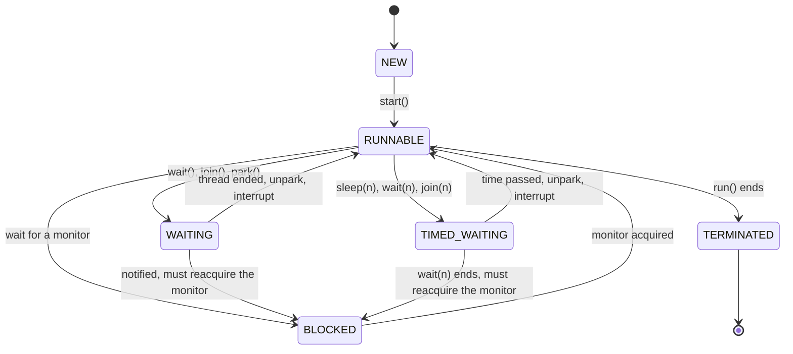
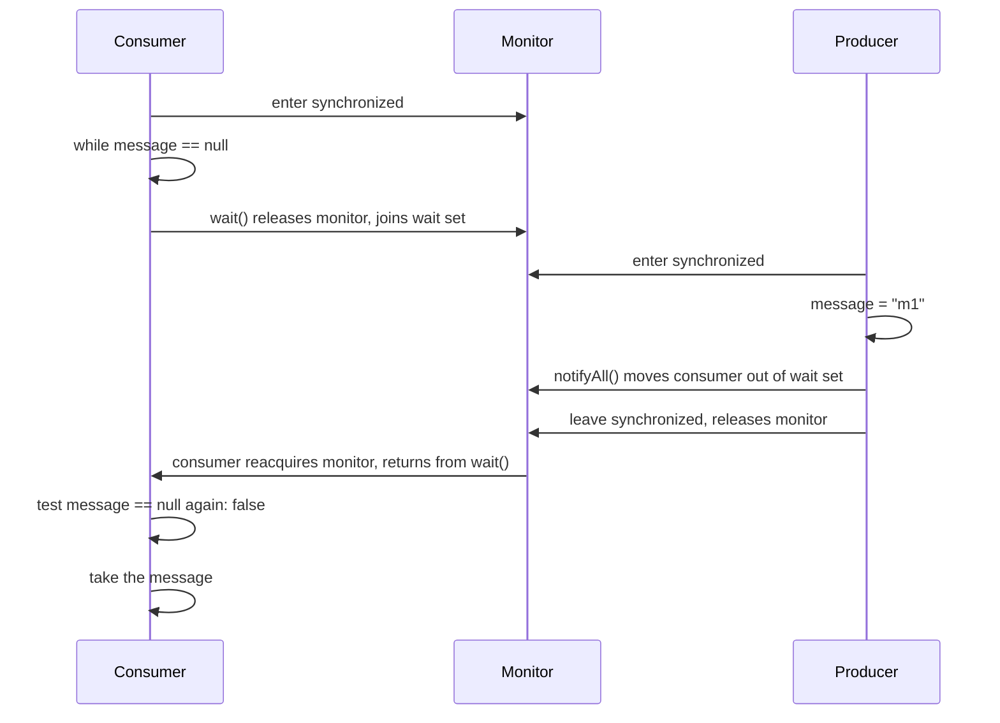
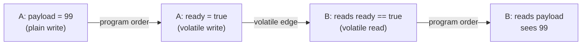

# Concurrency Basics: Threads, Locks, and the Java Memory Model

A thread runs code, and all threads of a process share the heap. This page explains how Java threads work, what `synchronized`, `wait`, `notify`, and `volatile` guarantee, and how the Java Memory Model (JMM) defines those guarantees. It is the home of the thread-safety primitives of the language itself. The classes of `java.util.concurrent` (executors, locks, atomics, queues) are in [java.util.concurrent](08-java-util-concurrent.md). The design view, which tool to pick for a booking or wallet problem, is in [Concurrency in LLD](../lld/fundamentals/09-concurrency-in-lld.md). That page links here for the memory model and the monitor details. See also `kb/operating-systems/03-synchronization.md` for the operating system view.

## Why It Matters

Almost every Java backend interview asks: "What does `volatile` do?", "What is the difference between `synchronized` and `ReentrantLock`?", "How does double-checked locking work?", or "Write code that causes a deadlock, then fix it". An answer that says "`volatile` makes the variable thread-safe" costs points. An answer that names visibility, ordering, the happens-before edge, and the missing atomicity gets full credit. On the job, the same knowledge explains bugs that no unit test finds: a stale flag, a half-built object, a hung service with all threads in `BLOCKED` state. This page gives the rules from the Java Language Specification (JLS), and it gives a deterministic demo for each rule that you can run and change.

## Core Concepts

**Thread**: a unit of execution inside the JVM. Each thread has its own call stack and program counter. All threads share the heap, so two threads can read and write the same object at the same time. In Java 21, a *platform thread* is a thread that maps one-to-one to an operating system thread. A *virtual thread* is a lightweight thread that the JVM schedules (JEP 444). This page uses "thread" for a platform thread. Virtual threads follow the same memory model rules. See [Virtual Threads](10-virtual-threads.md).

**Monitor**: the lock that every Java object has. A thread *acquires* the monitor when it enters a `synchronized` block or method on the object, and *releases* it when it leaves. Only one thread owns a monitor at a time. Every object also has a *wait set*: the set of threads that called `wait()` on the object and did not wake up yet (JLS 17.2).

**Data race**: two accesses to the same variable, where at least one is a write, and no happens-before relation orders them (JLS 17.4.5). The JMM allows any of a set of results for a program with a data race, so the result can be surprising.

**Race condition**: a bug where the result depends on the order in which threads run their steps. A program can have a race condition without a data race (for example, two correctly synchronized steps in the wrong order), and a data race without a visible bug.

**Atomicity**: other threads see an operation as one step, either complete or not started. **Visibility**: a write by one thread can be read by another thread. **Ordering**: the order in which threads observe the writes. The JMM treats these three separately. `synchronized` gives all three. `volatile` gives visibility and ordering, and gives atomicity only for a single read or a single write.

**Happens-before**: a partial order over the actions of a program (JLS 17.4.5). If action x happens-before action y, then x is visible to y and ordered before y. The JMM defines every guarantee in terms of this relation. Section "Happens-before in the JLS" lists the rules.

**Synchronization action**: a volatile read or write, a monitor lock or unlock, the synthetic first and last action of a thread, an action that starts a thread, or an action that detects that a thread ended (JLS 17.4.2).

**Safe publication**: making a reference to an object visible to another thread in a way that also makes the object's state visible. Section "Safe publication" lists the idioms.

**Liveness**: the program makes progress. A *deadlock*, a *livelock*, and *starvation* are liveness failures (Oracle Java Tutorial, "Liveness"). **Safety**: nothing bad happens, for example no lost update and no half-built object. A concurrency fix that improves safety can reduce liveness, so check both.

## How It Works

### Threads: creation, states, daemon, interruption

#### Create and start a thread

You create a thread with a `Runnable` (or a `Thread` subclass) and call `start()`. `start()` asks the JVM to create the operating system thread and to call `run()` in it. A call to `run()` directly is an ordinary method call on the caller's thread. A thread can start only once: a second `start()` throws `IllegalThreadStateException`.

Since Java 21, the builder `Thread.ofPlatform()` creates platform threads with a name, a daemon flag, and other settings (`Thread.Builder`, final with JEP 444). Prefer a thread pool over direct thread creation in application code (see [java.util.concurrent](08-java-util-concurrent.md)). Direct creation is correct for a long-lived background thread and for demos.

```java
import java.util.ArrayList;
import java.util.List;

public class ThreadCreation {
    static class Worker extends Thread {
        @Override
        public void run() {
            System.out.println("subclass of Thread runs");
        }
    }

    public static void main(String[] args) throws InterruptedException {
        Worker w = new Worker();
        Thread r = new Thread(() -> System.out.println("Runnable lambda runs"));
        Thread b = Thread.ofPlatform().name("loader").unstarted(
                () -> System.out.println("builder thread " + Thread.currentThread().getName()));
        Thread bad = new Thread(() -> { throw new IllegalStateException("boom"); });
        bad.setUncaughtExceptionHandler(
                (t, e) -> System.out.println("handler got: " + e.getMessage()));

        List<Thread> all = new ArrayList<>(List.of(w, r, b, bad));
        for (Thread t : all) {
            t.start();
            t.join();   // join after each start, so the output order is fixed
        }
        System.out.println("run() called directly runs on the caller: "
                + callRunDirectly());
    }

    static String callRunDirectly() {
        String[] name = new String[1];
        Thread t = new Thread(() -> name[0] = Thread.currentThread().getName(), "other");
        t.run();   // does not start a thread
        return name[0];
    }
}
```

<!-- expected-output -->
```text
subclass of Thread runs
Runnable lambda runs
builder thread loader
handler got: boom
run() called directly runs on the caller: main
```

If a thread throws an exception that no code catches, only that thread ends. The JVM calls the thread's own `UncaughtExceptionHandler` if one is set. Otherwise it calls `ThreadGroup.uncaughtException`, which calls the default handler from `Thread.setDefaultUncaughtExceptionHandler` if one is set. If no handler is set at all, `ThreadGroup.uncaughtException` prints the thread name and the stack trace to `System.err`. The other threads continue (`Thread` and `ThreadGroup` javadoc).

#### Thread states

The `Thread.State` enum has six values. The javadoc says that the states "are virtual machine states which do not reflect any operating system thread states".

| State | Meaning (from the `Thread.State` javadoc) | How a thread enters it |
|---|---|---|
| `NEW` | The thread has not started. | `new Thread(...)` |
| `RUNNABLE` | The thread executes in the JVM, but it may wait for other resources from the operating system, such as a processor. | `start()`. Also the end of a sleep, a join, or a park, and the reacquisition of the monitor after `Object.wait` |
| `BLOCKED` | The thread waits for a monitor lock to enter a `synchronized` block or method, or to reenter one after `Object.wait`. | Entering `synchronized` while another thread owns the monitor |
| `WAITING` | The thread waits without a time limit for another thread to act. | `Object.wait()`, `Thread.join()`, `LockSupport.park` |
| `TIMED_WAITING` | The same, with a time limit. | `Thread.sleep`, `Object.wait(timeout)`, `Thread.join(timeout)`, `LockSupport.parkNanos`, `LockSupport.parkUntil` |
| `TERMINATED` | The thread completed `run()`. | End of `run()`, or an uncaught exception |



Two facts that interviews test. First, a thread that waits for a `ReentrantLock` is `WAITING`, not `BLOCKED`, because `ReentrantLock` parks the thread with `LockSupport.park`. Only a monitor wait gives `BLOCKED`. Second, a thread that returns from `Object.wait` must first reacquire the monitor. If another thread owns the monitor, the woken thread is `BLOCKED` until the monitor is free.

The demo below moves a thread into each state and prints it. The main thread waits (in a loop on `getState()`) until the thread reaches the wanted state, so the output is the same on every run.

```java
import java.util.concurrent.locks.ReentrantLock;

public class ThreadStates {
    static volatile boolean release = false;

    public static void main(String[] args) throws Exception {
        Object monitor = new Object();

        Thread spinner = new Thread(() -> {
            while (!release) {
                Thread.onSpinWait();
            }
        });
        System.out.println("not started yet      : " + spinner.getState());
        spinner.start();
        System.out.println("spinning on a flag   : " + spinner.getState());
        release = true;
        spinner.join();
        System.out.println("after the run ended  : " + spinner.getState());

        Thread sleeper = new Thread(() -> {
            try {
                Thread.sleep(60_000);
            } catch (InterruptedException e) {
                // the demo interrupts the sleeper to end it
            }
        });
        sleeper.start();
        awaitState(sleeper, Thread.State.TIMED_WAITING);
        System.out.println("in Thread.sleep      : " + sleeper.getState());
        sleeper.interrupt();
        sleeper.join();

        Thread waiter = new Thread(() -> {
            synchronized (monitor) {
                try {
                    monitor.wait();
                } catch (InterruptedException e) {
                    Thread.currentThread().interrupt();
                }
            }
        });
        waiter.start();
        awaitState(waiter, Thread.State.WAITING);
        System.out.println("in Object.wait       : " + waiter.getState());
        synchronized (monitor) {
            monitor.notifyAll();
        }
        waiter.join();

        Thread blocked = new Thread(() -> {
            synchronized (monitor) {
                // enters only after main leaves its synchronized block
            }
        });
        synchronized (monitor) {
            blocked.start();
            awaitState(blocked, Thread.State.BLOCKED);
            System.out.println("waits for a monitor  : " + blocked.getState());
        }
        blocked.join();

        ReentrantLock lock = new ReentrantLock();
        Thread parked = new Thread(() -> {
            lock.lock();
            lock.unlock();
        });
        lock.lock();
        parked.start();
        awaitState(parked, Thread.State.WAITING);
        System.out.println("waits for a Lock     : " + parked.getState());
        lock.unlock();
        parked.join();
    }

    static void awaitState(Thread t, Thread.State wanted) {
        while (t.getState() != wanted) {
            Thread.onSpinWait();
        }
    }
}
```

<!-- expected-output -->
```text
not started yet      : NEW
spinning on a flag   : RUNNABLE
after the run ended  : TERMINATED
in Thread.sleep      : TIMED_WAITING
in Object.wait       : WAITING
waits for a monitor  : BLOCKED
waits for a Lock     : WAITING
```

#### Daemon threads

A *daemon thread* is a thread that does not keep the JVM alive. The JVM starts its shutdown sequence when all started non-daemon threads have ended (`Thread` javadoc). It does not wait for daemon threads. When the JVM terminates, all threads stop at once: "finally clauses are not executed" (`Runtime` javadoc, "Shutdown Sequence"). Use a daemon thread for background work whose loss at exit does not matter, such as a cache cleaner. Do not use it for work that must finish, such as writing a file.

- A new thread has the daemon status of the thread that creates it.
- `setDaemon(true)` must come before `start()`. While the thread is alive, it throws `IllegalThreadStateException`. On a thread that has ended, the javadoc leaves the behavior unspecified, so the demo keeps the thread alive with a latch.
- Virtual threads are daemon threads (`Thread` javadoc).

```java
import java.util.concurrent.CountDownLatch;

public class DaemonDemo {
    public static void main(String[] args) throws Exception {
        Thread user = new Thread(() -> { });
        System.out.println("new thread from main is daemon: " + user.isDaemon());

        boolean[] childIsDaemon = new boolean[1];
        Thread daemon = new Thread(() -> {
            Thread child = new Thread(() -> { });
            childIsDaemon[0] = child.isDaemon();   // inherits from its creator
        });
        daemon.setDaemon(true);
        daemon.start();
        daemon.join();
        System.out.println("thread created by a daemon is daemon: " + childIsDaemon[0]);

        CountDownLatch release = new CountDownLatch(1);
        Thread started = new Thread(() -> {
            try {
                release.await();   // stays alive until main has called setDaemon
            } catch (InterruptedException e) {
                Thread.currentThread().interrupt();
            }
        });
        started.start();
        try {
            started.setDaemon(true);
        } catch (IllegalThreadStateException e) {
            System.out.println("setDaemon after start: IllegalThreadStateException");
        }
        release.countDown();
        started.join();

        Thread forever = new Thread(() -> {
            try {
                Thread.sleep(Long.MAX_VALUE);
            } catch (InterruptedException e) {
                // not interrupted in this demo
            }
        });
        forever.setDaemon(true);
        forever.start();
        System.out.println("main ends; the JVM exits, although a daemon thread still sleeps");
    }
}
```

<!-- expected-output -->
```text
new thread from main is daemon: false
thread created by a daemon is daemon: true
setDaemon after start: IllegalThreadStateException
main ends; the JVM exits, although a daemon thread still sleeps
```

#### Interruption

Interruption is a cooperative request to stop. `t.interrupt()` sets the *interrupt status* (a flag) of thread `t`. It does not stop the thread. The target thread decides how to react. JLS 17.2.3 defines the interrupt action: it sets the status, and if the thread is in the wait set of an object, it removes the thread from that wait set, so that `wait` throws `InterruptedException` after the thread reacquires the monitor.

| Case | What happens |
|---|---|
| The thread is in `sleep`, `wait`, or `join` | The method throws `InterruptedException` and clears the flag |
| The thread is blocked in an I/O operation on an interruptible channel (`InterruptibleChannel`, for example `SocketChannel` or `FileChannel`) | The channel closes, the thread gets `ClosedByInterruptException`, and the flag stays set (`InterruptibleChannel` javadoc). A thread whose flag is already set gets the exception at once when it starts such an operation |
| The thread is blocked in `Selector.select` | The selection returns at once, as if `wakeup` were called, and the flag stays set (`Thread.interrupt` javadoc) |
| The thread is parked by `LockSupport.park` | `park` returns without an exception and does not report why it returned. The caller can read the interrupt status, which `park` does not clear (`LockSupport` javadoc). So `ReentrantLock.lock()` keeps waiting after an interrupt, and `lockInterruptibly()` throws `InterruptedException` |
| A platform thread is blocked in `java.net.Socket` stream I/O (`InputStream.read` on a socket that no `SocketChannel` created) | The call does not respond to the interrupt: only the flag is set. Close the socket to unblock it. In a virtual thread, Java 21 makes these socket calls interruptible: the interrupt closes the socket (JEP 444) |
| The thread runs normal code | The flag stays set. The code must test `Thread.currentThread().isInterrupted()` |
| `Thread.interrupted()` (static) | Returns the flag of the current thread and clears it |
| `t.isInterrupted()` (instance) | Returns the flag and does not clear it |

The rule for code that catches `InterruptedException`: either rethrow it, or call `Thread.currentThread().interrupt()` to restore the flag before you return. If you swallow the exception and clear the flag, the caller cannot learn that someone asked the thread to stop. The JLS also says that an interrupt by one thread synchronizes-with the point where another thread detects it (JLS 17.4.4), so the interrupting thread's earlier writes are visible to the interrupted thread.

```java
public class InterruptDemo {
    public static void main(String[] args) throws InterruptedException {
        // 1. A blocking call throws InterruptedException and clears the flag.
        Thread sleeper = new Thread(() -> {
            try {
                Thread.sleep(60_000);
                System.out.println("not reached");
            } catch (InterruptedException e) {
                System.out.println("sleeper: caught, flag is "
                        + Thread.currentThread().isInterrupted());
                Thread.currentThread().interrupt();   // restore the flag
                System.out.println("sleeper: restored, flag is "
                        + Thread.currentThread().isInterrupted());
            }
        });
        sleeper.start();
        sleeper.interrupt();
        sleeper.join();

        // 2. A loop that does no blocking call must check the flag itself.
        Thread looper = new Thread(() -> {
            while (!Thread.currentThread().isInterrupted()) {
                Thread.onSpinWait();   // no blocking call: only the flag ends the loop
            }
            System.out.println("looper: saw the flag and stopped");
        });
        looper.start();
        looper.interrupt();
        looper.join();

        // 3. Thread.interrupted() reads and clears the flag of the current thread.
        Thread.currentThread().interrupt();
        System.out.println("main: Thread.interrupted() -> " + Thread.interrupted());
        System.out.println("main: Thread.interrupted() -> " + Thread.interrupted());
    }
}
```

<!-- expected-output -->
```text
sleeper: caught, flag is false
sleeper: restored, flag is true
looper: saw the flag and stopped
main: Thread.interrupted() -> true
main: Thread.interrupted() -> false
```

`Thread.sleep` does not release monitors that the thread owns (`Thread` javadoc: the thread "does not lose ownership of any monitors"). `Object.wait` releases only the monitor of the object it is called on.

### The problem: three reasons that threads misbehave

Three separate mechanisms break shared code.

1. **No atomicity.** `count++` is three steps: read, add, write. Two threads can read the same value, and one update is lost.
2. **No visibility.** A thread can keep a value in a register or a CPU cache. A write by another thread may not reach it, unless a synchronization action creates a happens-before edge.
3. **No ordering.** The compiler, the JIT, and the CPU may reorder independent reads and writes in one thread. Another thread can observe the writes in a different order than the program order.

The demo below removes the luck from the first problem. A `CyclicBarrier` makes both threads read the counter before either writes. The counter is `volatile`, which proves that `volatile` does not make a read-modify-write atomic. The result is 1 on every run.

```java
import java.util.concurrent.BrokenBarrierException;
import java.util.concurrent.CyclicBarrier;

public class ForcedLostUpdate {
    // volatile does not make "read, add, write" atomic
    static volatile int counter = 0;

    public static void main(String[] args) throws InterruptedException {
        CyclicBarrier bothHaveRead = new CyclicBarrier(2);
        Runnable increment = () -> {
            int seen = counter;           // step 1: read
            try {
                bothHaveRead.await();     // force both threads to read before either writes
            } catch (InterruptedException | BrokenBarrierException e) {
                throw new IllegalStateException(e);
            }
            counter = seen + 1;           // step 2: write
        };
        Thread a = new Thread(increment);
        Thread b = new Thread(increment);
        a.start();
        b.start();
        a.join();
        b.join();
        System.out.println("two increments, counter = " + counter);
    }
}
```

<!-- expected-output -->
```text
two increments, counter = 1
```

Without the barrier, the same code loses updates only on some runs, and the count of lost updates changes from run to run. A test that passes ten times proves nothing. The fix needs a lock or an atomic class.

### `synchronized`

`synchronized` has two forms. Both use the monitor of an object.

```java
class SyncForms {
    private final Object lock = new Object();
    private int count;

    // 1. Block: the monitor of the object in parentheses
    void incBlock() {
        synchronized (lock) {
            count++;
        }
    }

    // 2. Method: the monitor of this (instance method) or of the Class object (static method)
    synchronized void inc() {
        count++;
    }
}
```

#### What it guarantees

`synchronized` gives **mutual exclusion**: at most one thread owns a monitor at a time, so two threads cannot run critical sections on the same monitor together. It also gives **visibility and ordering**: an unlock on a monitor happens-before every later lock on the same monitor (JLS 17.4.4, 17.4.5). So everything a thread wrote before it released the monitor is visible to the next thread that acquires the same monitor. Both threads must use the same monitor. Two threads that synchronize on different objects have no edge between them and no exclusion.

```java
public class SyncCounter {
    private int count;   // guarded by this

    synchronized void increment() {
        count++;
    }

    synchronized int get() {
        return count;
    }

    public static void main(String[] args) throws InterruptedException {
        SyncCounter counter = new SyncCounter();
        Thread[] threads = new Thread[4];
        for (int i = 0; i < threads.length; i++) {
            threads[i] = new Thread(() -> {
                for (int n = 0; n < 100_000; n++) {
                    counter.increment();
                }
            });
            threads[i].start();
        }
        for (Thread t : threads) {
            t.join();
        }
        System.out.println("count = " + counter.get());
    }
}
```

<!-- expected-output -->
```text
count = 400000
```

#### Reentrancy

A monitor is *reentrant*: a thread that owns a monitor can enter another `synchronized` block on the same monitor without blocking. The JVM keeps a hold count for the monitor. Each entry adds one, each exit subtracts one, and the monitor is free when the count is zero (JVMS 6.5, `monitorenter` and `monitorexit`). Without reentrancy, a `synchronized` method that calls another `synchronized` method of the same object would deadlock with itself.

```java
public class Reentrancy {
    private final Object lock = new Object();

    void outer() {
        synchronized (lock) {
            System.out.println("outer: holds the lock = " + Thread.holdsLock(lock));
            inner();
            System.out.println("outer: still holds the lock = " + Thread.holdsLock(lock));
        }
        System.out.println("outer: after the block, holds the lock = " + Thread.holdsLock(lock));
    }

    void inner() {
        synchronized (lock) {   // the same thread enters again without blocking
            System.out.println("inner: holds the lock = " + Thread.holdsLock(lock));
        }
    }

    public static void main(String[] args) {
        new Reentrancy().outer();
    }
}
```

<!-- expected-output -->
```text
outer: holds the lock = true
inner: holds the lock = true
outer: still holds the lock = true
outer: after the block, holds the lock = false
```

#### What the compiler emits

A `synchronized` block compiles to the bytecode instructions `monitorenter` and `monitorexit` (JVMS 6.5). The compiler adds an exception handler that runs `monitorexit` again, so the monitor is released when the block throws. A `synchronized` method has no such instructions. It carries the flag `ACC_SYNCHRONIZED`, and the JVM acquires and releases the monitor at the call and the return (JVMS 2.11.10). This output is from `javap -c -v -p` on JDK 21 for a class with `synchronized void inc()` and a method that has a `synchronized (this)` block. Only the relevant lines are shown.

```text
synchronized void inc();
  flags: (0x0020) ACC_SYNCHRONIZED
  Code:
     0: aload_0
     1: dup
     2: getfield      #7                  // Field count:I
     5: iconst_1
     6: iadd
     7: putfield      #7                  // Field count:I
    10: return

void incBlock();
  Code:
     0: aload_0
     1: dup
     2: astore_1
     3: monitorenter
     4: aload_0
     5: dup
     6: getfield      #7                  // Field count:I
     9: iconst_1
    10: iadd
    11: putfield      #7                  // Field count:I
    14: aload_1
    15: monitorexit
    16: goto          24
    19: astore_2
    20: aload_1
    21: monitorexit
    22: aload_2
    23: athrow
    24: return
  Exception table:
     from    to  target type
         4    16    19   any
        19    22    19   any
```

#### Which monitor does a method use?

| Code | Monitor |
|---|---|
| `synchronized void m()` | `this` |
| `static synchronized void m()` | `Foo.class` (the `Class` object) |
| `synchronized (this) { }` | `this` |
| `synchronized (lock) { }` | the object that `lock` references |

An instance method and a static method of the same class use different monitors, so they do not exclude each other.

Recommendation: synchronize on a `private final` object that no outside code can reach. If you synchronize on `this`, any caller that writes `synchronized (yourObject)` takes the same monitor and can cause a deadlock or add contention. Do not synchronize on a `String` literal or a boxed `Integer`: the JVM can share those objects across the program, so unrelated code can use the same monitor. Do not synchronize on a field that you reassign: threads then use different monitors.

#### Cost and implementation

The JLS defines the guarantees. It does not define how the JVM implements monitors or what they cost, so the cost is a property of HotSpot, not of the language. In HotSpot, if no other thread owns the monitor, the thread takes it with an atomic compare-and-set instruction and makes no operating system call. If another thread owns it, the thread first spins for a short, adaptive time (`ObjectMonitor::TrySpin` in the JDK 21 source, `src/hotspot/share/runtime/objectMonitor.cpp`), and if the monitor is still owned, the thread enqueues itself and parks. Parking and waking a thread are operating system calls and cause context switches. HotSpot disabled biased locking by default in JDK 15 (JEP 374) and removed its code in JDK 18 (JDK-8256425), so a modern JVM does not have the biased-locking optimization that older articles describe. Measure with a benchmark (JMH) before you replace `synchronized` for speed.

In Java 21, a virtual thread that blocks while it owns a monitor pins its carrier thread. JEP 491 removed most of this pinning in Java 24 ([Virtual Threads](10-virtual-threads.md)).

### `wait`, `notify`, and `notifyAll`

Every object has a wait set. Three methods of `Object` use it. All three require the caller to own the monitor of the object. If the caller does not, the method throws `IllegalMonitorStateException`.

| Method | Effect |
|---|---|
| `wait()` | Adds the calling thread to the wait set, releases the monitor (only this one), and parks the thread |
| `notify()` | Removes one thread of the wait set, chosen by the JVM. That thread competes to reacquire the monitor |
| `notifyAll()` | Removes all threads of the wait set. They compete to reacquire the monitor |

The notifying thread keeps the monitor until it leaves its `synchronized` block. A woken thread cannot run before that. On return from `wait`, the thread owns the monitor again with the same hold count as before the call (`Object.wait` javadoc).

```java
public class WaitWithoutMonitor {
    public static void main(String[] args) throws InterruptedException {
        Object lock = new Object();
        try {
            lock.wait();   // the caller does not hold the monitor of lock
        } catch (IllegalMonitorStateException e) {
            System.out.println("wait without the monitor: IllegalMonitorStateException");
        }
        try {
            lock.notify();
        } catch (IllegalMonitorStateException e) {
            System.out.println("notify without the monitor: IllegalMonitorStateException");
        }
        synchronized (lock) {
            lock.notify();   // allowed: nobody waits, so nothing happens
            System.out.println("notify with the monitor: no exception");
        }
        Object other = new Object();
        synchronized (lock) {
            try {
                other.wait();   // holds lock, but not the monitor of other
            } catch (IllegalMonitorStateException e) {
                System.out.println("wait on another object: IllegalMonitorStateException");
            }
        }
    }
}
```

<!-- expected-output -->
```text
wait without the monitor: IllegalMonitorStateException
notify without the monitor: IllegalMonitorStateException
notify with the monitor: no exception
wait on another object: IllegalMonitorStateException
```

#### The guarded-block pattern and the spurious wakeup

A thread that waits for a condition must test the condition in a `while` loop. The `Object.wait` javadoc states why: "A thread can wake up without being notified, interrupted, or timing out, a so-called spurious wakeup." The JLS allows it (JLS 17.2.1). There is a second reason: another thread can run between the `notify` and the moment that the woken thread reacquires the monitor, and that thread can make the condition false again. With `if`, the woken thread proceeds although the condition no longer holds.



The right form:

```java
import java.util.ArrayList;
import java.util.List;

public class MailboxDemo {
    static class Mailbox {
        private String message;   // guarded by this; null means "empty"

        synchronized void put(String m) throws InterruptedException {
            while (message != null) {      // a loop, not an if
                wait();
            }
            message = m;
            notifyAll();
        }

        synchronized String take() throws InterruptedException {
            while (message == null) {      // a loop, not an if
                wait();
            }
            String m = message;
            message = null;
            notifyAll();
            return m;
        }
    }

    public static void main(String[] args) throws InterruptedException {
        Mailbox box = new Mailbox();
        List<String> received = new ArrayList<>();

        Thread producer = new Thread(() -> {
            try {
                for (int i = 1; i <= 5; i++) {
                    box.put("m" + i);
                }
            } catch (InterruptedException e) {
                Thread.currentThread().interrupt();
            }
        });
        Thread consumer = new Thread(() -> {
            try {
                for (int i = 1; i <= 5; i++) {
                    received.add(box.take());
                }
            } catch (InterruptedException e) {
                Thread.currentThread().interrupt();
            }
        });
        producer.start();
        consumer.start();
        producer.join();
        consumer.join();
        System.out.println("received in order: " + received);
    }
}
```

<!-- expected-output -->
```text
received in order: [m1, m2, m3, m4, m5]
```

The wrong form uses `if`. It also compiles. With one producer and one consumer, it can pass every test, and it fails when a spurious wakeup occurs or when a second consumer takes the message first.

```java
class WrongMailbox {
    private String message;

    synchronized String take() throws InterruptedException {
        if (message == null) {        // WRONG: must be a while loop
            wait();
        }
        String m = message;           // can be null after a spurious wakeup
        message = null;
        notifyAll();
        return m;
    }
}
```

#### `notify` versus `notifyAll`

`notify` wakes one thread, and the JVM chooses it. If waiting threads wait for different conditions (producers wait for "not full", consumers wait for "not empty") and share one wait set, `notify` can wake a thread that cannot proceed. That thread waits again, and the notification is lost. Threads that needed it wait forever. `notifyAll` wakes every thread, and each one tests its own condition. Recommendation: use `notifyAll` unless all of these hold: all waiters wait for the same condition, one notification lets exactly one waiter proceed, and you measured that `notifyAll` costs too much. For separate conditions on one lock, use `ReentrantLock` with several `Condition` objects ([java.util.concurrent](08-java-util-concurrent.md)).

A second source of lost wakeups: the test of the condition and the call to `wait` are not in one critical section. The waiter must test the condition and call `wait` inside the same `synchronized` block, without releasing the monitor in between. If the waiter tests the condition outside the monitor (or in a separate `synchronized` block), this order is possible: the waiter tests the condition (false), the notifier sets it and calls `notifyAll` (nobody waits yet, so the notification has no effect), and then the waiter enters the monitor, calls `wait`, and sleeps although the condition is true. Inside one block this order cannot happen, because the notifier needs the monitor to call `notifyAll`, and the waiter releases the monitor only inside `wait`. Separately, the notifier changes the condition while it owns the monitor, in the block that calls `notifyAll`. A write to the condition outside the monitor is a data race with the waiter's read.

### `volatile`

A field declared `volatile` has these properties (JLS 8.3.1.4, 17.4):

- **Visibility.** A write to a volatile field happens-before every later read of that field. The reader sees the written value, or a later one.
- **Ordering.** All writes that precede the volatile write in program order are visible to a thread that reads the new value. The reads and writes around a volatile access cannot move across it in a way that breaks this rule. This is how a volatile flag *publishes* other plain fields. The `HappensBefore` demo in the Java Memory Model section shows it: the plain write `payload = 99` comes before the volatile write `ready = true`, so a reader that sees `ready == true` also sees `payload == 99`. The edge covers only the writes made before the volatile write. If a thread changes the fields of an object after it stores the object's reference in a volatile field, a reader has no edge to those later changes.
- **Atomic read and write for `long` and `double`.** A non-volatile `long` or `double` write may be split into two 32-bit writes, so a reader can see half of one write and half of another. JLS 17.7 says: "Writes and reads of volatile long and double values are always atomic." Reads and writes of references are always atomic.
- **No atomic compound action.** `count++` on a volatile field is still read, add, write. The demo `ForcedLostUpdate` shows the lost update with a volatile counter.

#### Visibility: the stop flag

The most common use is a flag that one thread sets and another reads. Without `volatile`, no happens-before edge connects the write to the reads, so the JMM allows the reader never to see the change. JLS 17.3 gives this exact case with a non-volatile `done` field: "The compiler is free to read the field this.done just once, and reuse the cached value in each execution of the loop. This would mean that the loop would never terminate, even if another thread changed the value of this.done." In HotSpot, the JIT compiler can hoist the read out of the loop in this way. The JLS example has `Thread.sleep(1000)` inside the loop, and the loop can still hang, because "neither Thread.sleep nor Thread.yield have any synchronization semantics" (JLS 17.3).

```java
class WrongStopFlag {
    private boolean running = true;   // WRONG: not volatile, the reader can loop forever

    void work() {
        while (running) {
            // do work
        }
    }

    void stop() {
        running = false;
    }
}
```

The fix is `private volatile boolean running = true;`. For a flag that stops a thread, an interrupt (see above) is often better, because it also wakes a thread that sleeps or waits.

#### `volatile` versus `synchronized`

| | `volatile` | `synchronized` |
|---|---|---|
| Visibility | Yes, for that field and the writes before it | Yes, for all writes before the unlock |
| Ordering edge | Write to later read of the same field | Unlock to later lock of the same monitor |
| Mutual exclusion | No | Yes |
| Atomic compound actions (`count++`, check-then-act) | No | Yes |
| Can block a thread | No | Yes |
| Typical use | A flag, or a reference to an immutable object that you replace | An invariant over several fields |

### The Java Memory Model

#### Why a memory model

A modern JVM and CPU reorder instructions and keep values in caches and registers. The speed gain is large. A language that exposed the raw hardware would give different results on different CPUs. The Java Memory Model, in JLS chapter 17, defines which values a read may see, in a way that is the same on every platform. The model dates from Java 5 (JSR 133). Its central rule: if a program is *correctly synchronized*, all its executions look sequentially consistent, so the programmer does not reason about reordering (JLS 17.4.5).

The JLS defines these terms:

- A **conflicting access** is a read and a write, or two writes, of the same variable (JLS 17.4.1).
- A program has a **data race** if two conflicting accesses are not ordered by happens-before.
- A program is **correctly synchronized** "if and only if all sequentially consistent executions are free of data races".

#### Happens-before in the JLS

JLS 17.4.5 first gives the base rules. The quotation below is the text of the specification for Java SE 21, with line breaks removed.

> If x and y are actions of the same thread and x comes before y in program order, then hb(x, y).

> There is a happens-before edge from the end of a constructor of an object to the start of a finalizer (§12.6) for that object.

> If an action x synchronizes-with a following action y, then we also have hb(x, y).

> If hb(x, y) and hb(y, z), then hb(x, z).

> The wait methods of class Object (§17.2.1) have lock and unlock actions associated with them; their happens-before relationships are defined by these associated actions.

Then the specification states the consequences that programmers use: "It follows from the above definitions that:"

> An unlock on a monitor happens-before every subsequent lock on that monitor.

> A write to a volatile field (§8.3.1.4) happens-before every subsequent read of that field.

> A call to start() on a thread happens-before any actions in the started thread.

> All actions in a thread happen-before any other thread successfully returns from a join() on that thread.

> The default initialization of any object happens-before any other actions (other than default-writes) of a program.

The base rule "If an action x synchronizes-with a following action y, then we also have hb(x, y)" connects to the list of synchronizes-with edges in JLS 17.4.4:

> An unlock action on monitor m synchronizes-with all subsequent lock actions on m (where "subsequent" is defined according to the synchronization order).

> A write to a volatile variable v (§8.3.1.4) synchronizes-with all subsequent reads of v by any thread (where "subsequent" is defined according to the synchronization order).

> An action that starts a thread synchronizes-with the first action in the thread it starts.

> The write of the default value (zero, false, or null) to each variable synchronizes-with the first action in every thread.

> The final action in a thread T1 synchronizes-with any action in another thread T2 that detects that T1 has terminated. T2 may accomplish this by calling T1.isAlive() or T1.join().

> If thread T1 interrupts thread T2, the interrupt by T1 synchronizes-with any point where any other thread (including T2) determines that T2 has been interrupted (by having an InterruptedException thrown or by invoking Thread.interrupted or Thread.isInterrupted).

Two more statements of JLS 17.4.5 matter for the definition of a data race:

> When a program contains two conflicting accesses (§17.4.1) that are not ordered by a happens-before relationship, it is said to contain a data race.

> The semantics of operations other than inter-thread actions, such as reads of array lengths (§10.7), executions of checked casts (§5.5, §15.16), and invocations of virtual methods (§15.12), are not directly affected by data races. Therefore, a data race cannot cause incorrect behavior such as returning the wrong length for an array.

The library adds edges of the same kind. The package javadoc of `java.util.concurrent` ("Memory Consistency Properties") lists them: actions before submitting a task to an `Executor` happen-before the task runs, actions before putting an object into a `BlockingQueue` happen-before the actions after another thread takes it, and so on. [java.util.concurrent](08-java-util-concurrent.md) covers them class by class.

Transitivity makes the rules useful. Thread A writes plain fields, then does a volatile write. Thread B does a volatile read that sees the write, then reads the plain fields. The chain is: program order in A, the volatile edge, program order in B. So B sees the plain fields. This is the "piggyback" use of `volatile` and of locks.



The demo shows the four edges that need no library class: start, join, volatile, and monitor. Each reads a plain field that another thread wrote. Each is correct because of one rule in the list above.

```java
public class HappensBefore {
    static String config;                 // plain field
    static int result;                    // plain field
    static int payload;                   // plain field
    static volatile boolean ready;        // volatile flag
    static final Object LOCK = new Object();
    static int guarded;                   // guarded by LOCK

    public static void main(String[] args) throws InterruptedException {
        // Rule: Thread.start() happens-before every action in the started thread.
        config = "loaded before start";
        Thread starter = new Thread(() -> System.out.println("start rule : " + config));
        starter.start();
        starter.join();

        // Rule: all actions of a thread happen-before another thread returns from join().
        Thread worker = new Thread(() -> result = 6 * 7);
        worker.start();
        worker.join();
        System.out.println("join rule  : " + result);

        // Rule: a volatile write happens-before every later read of the same field.
        Thread reader = new Thread(() -> {
            while (!ready) {
                Thread.onSpinWait();
            }
            System.out.println("volatile   : " + payload);   // sees the write to payload
        });
        reader.start();
        payload = 99;     // plain write, before the volatile write in program order
        ready = true;     // volatile write: publishes payload
        reader.join();

        // Rule: an unlock happens-before every later lock of the same monitor.
        Thread locker = new Thread(() -> {
            synchronized (LOCK) {
                guarded = 5;
            }
        });
        locker.start();
        while (true) {
            synchronized (LOCK) {
                if (guarded != 0) {
                    System.out.println("monitor    : " + guarded);
                    break;
                }
            }
            Thread.onSpinWait();
        }
        locker.join();
    }
}
```

<!-- expected-output -->
```text
start rule : loaded before start
join rule  : 42
volatile   : 99
monitor    : 5
```

#### What a data race allows

If two threads read and write a plain field without an edge, the JMM does not promise that the reader sees the latest write. It allows any write that the read "is allowed to observe": one that does not come after the read in happens-before order, and that no other write supersedes in that order (JLS 17.4.5). JLS Example 17.4.5-1 shows the standard case. Initially `A == B == 0`.

| Thread 1 | Thread 2 |
|---|---|
| `B = 1;` | `A = 2;` |
| `r2 = A;` | `r1 = B;` |

The outcome `r2 == 0` and `r1 == 0` is allowed. It cannot happen in any sequentially consistent order, but it is happens-before consistent, because no edge connects the two threads. Reordering of the write and the read in each thread, a stale cache, or both can produce it. The JLS says: "Without correct synchronization, very strange, confusing and counterintuitive behaviors are possible." A data race is a bug even when you cannot reproduce the effect on your machine. Different CPU architectures reorder memory accesses in different ways, so code that passes on a laptop can fail on a server with a different CPU.

A second limit: a write of a `long` or `double` in a data race can tear into two halves (JLS 17.7, quoted above under `volatile`). JLS 17.4.8 adds causality requirements for all variables. They forbid "out of thin air" values: values that justify themselves in a cycle. In JLS Example 17.4.8-1, thread 1 runs `r1 = x; if (r1 != 0) y = 1;` and thread 2 runs `r2 = y; if (r2 != 0) x = 1;`, with `x == y == 0` at the start. Happens-before consistency alone would allow both reads to see 1, each justified by the other thread's write. The causality rules forbid that outcome, so `r1 == r2 == 0` is the only result. The text of the rules is long, and an interview does not ask for it.

#### Final fields

JLS 17.5 gives `final` fields a special guarantee. "A thread that can only see a reference to an object after that object has been completely initialized is guaranteed to see the correctly initialized values for that object's final fields." The JLS also says that the thread "will also see versions of any object or array referenced by those final fields that are at least as up-to-date as the final fields are". An object is "completely initialized when its constructor finishes".

The JLS example (17.5-1) shows the effect. The reader sees `f.x == 3` because `x` is final. It may see `f.y == 0` because `y` is not final, if the writer published `f` through a data race.

```java
class FinalFieldExample {
    final int x;
    int y;
    static FinalFieldExample f;

    FinalFieldExample() {
        x = 3;
        y = 4;
    }

    static void writer() {
        f = new FinalFieldExample();   // plain write: a data race with reader()
    }

    static void reader() {
        if (f != null) {
            int i = f.x;   // guaranteed to see 3
            int j = f.y;   // could see 0
        }
    }
}
```

The guarantee has a condition: the constructor must not let `this` escape. If the constructor stores `this` in a static field, starts a thread that uses `this`, or registers `this` as a listener, another thread can see the object before the end of the constructor, and the guarantee does not apply. The JLS states the usage model: "Set the final fields for an object in that object's constructor; and do not write a reference to the object being constructed in a place where another thread can see it before the object's constructor is finished."

This guarantee is why `String` and the immutable collections are safe to pass between threads, even through a data race. A class is immutable in the thread-safe sense only if all fields are final, and the objects that the fields reference are not changed after construction. A `final List<String>` field that points to an `ArrayList` that you later change is not immutable.

#### Safe publication

An object is *safely published* if the way a reference reaches another thread creates a happens-before edge from the construction of the object to the use of the reference (Goetz et al., *Java Concurrency in Practice*, section 3.5). The idioms:

| Idiom | Why it works |
|---|---|
| Initialize the reference in a static initializer, or a `static final` field | The JVM runs class initialization under the initialization lock of the class. JLS 12.4.2 allows a JVM to skip the lock for a class that is already initialized only if "all happens-before orderings that would exist if the lock were acquired, still exist" |
| Store the reference in a `volatile` field or an `AtomicReference` | The volatile write happens-before the volatile read |
| Store the reference in a field that you access only while holding the same lock | The unlock happens-before the next lock |
| Store the reference in a `final` field of a properly constructed object | The final-field guarantee (JLS 17.5) |
| Put the reference into a concurrent collection or a `BlockingQueue` | The collection javadoc defines an edge from the put to the take |
| Start the thread after you set the field | `Thread.start()` edge |

```java
class Publication {
    // 1. static initializer: safe, the JVM initializes the class under a lock
    static final Config CONFIG = new Config(8);

    // 2. volatile field: safe, the write happens-before every later read
    private volatile Config current = new Config(4);

    // 3. lock: safe if every read and write uses the same lock
    private Config guarded;   // guarded by this

    synchronized void set(Config c) {
        guarded = c;
    }

    synchronized Config get() {
        return guarded;
    }

    // 4. WRONG: a plain field without a lock is a data race
    Config unsafe;

    record Config(int threads) {}
}
```

The record `Config` has final fields, so a reader that sees the reference never sees `threads == 0`. The plain field `unsafe` is still a data race: the reader may not see the reference at all, and the JIT may cache the read. The final-field rule protects the *content* of an immutable object, not the *visibility* of the reference to it.

#### Double-checked locking

Lazy initialization of a shared object is a common interview problem. The simple correct forms are an eager `static final` field, the holder idiom, and an enum ([Creational Patterns](../lld/fundamentals/06-creational-patterns.md) covers all of them). Double-checked locking avoids the lock on the fast path. It is correct only if the field is `volatile`.

The wrong form, which was common before Java 5:

```java
class WrongLazyService {
    private static WrongLazyService instance;   // WRONG: not volatile
    private final int[] table = {1, 2, 3};

    static WrongLazyService getInstance() {
        if (instance == null) {                  // first check, no lock
            synchronized (WrongLazyService.class) {
                if (instance == null) {          // second check, with the lock
                    instance = new WrongLazyService();
                }
            }
        }
        return instance;
    }
}
```

The problem: `instance = new WrongLazyService()` is three steps: allocate memory, run the constructor, store the reference. Without `volatile`, the JMM allows the store of the reference to come before the constructor's writes become visible to other threads. A thread that makes the first check without the lock reads a non-null reference to a half-built object. The first check is a read that has no happens-before edge to the write in the constructor, so the read is part of a data race. In this class the `final` field `table` is protected by the final-field rule, but a non-final field would not be. The wrong form has a second defect: `return instance` is a second racy read of the field, and the JMM allows it to see `null` even after the first check saw a non-null reference. The fix is `volatile`: the volatile write happens-before the volatile read, and the constructor's writes come before the volatile write in program order. With `volatile`, the local variable `local` in the code below is a speed choice: it reads the volatile field once instead of twice on the fast path.

```java
import java.util.IdentityHashMap;
import java.util.Map;
import java.util.concurrent.CountDownLatch;
import java.util.concurrent.atomic.AtomicInteger;

public class DclDemo {
    static final AtomicInteger CONSTRUCTIONS = new AtomicInteger();

    static class Service {
        private static volatile Service instance;   // volatile makes the idiom correct
        private final int[] table = {1, 2, 3};      // state set in the constructor

        private Service() {
            CONSTRUCTIONS.incrementAndGet();
        }

        static Service getInstance() {
            Service local = instance;               // one volatile read on the fast path
            if (local == null) {
                synchronized (Service.class) {
                    local = instance;
                    if (local == null) {
                        instance = local = new Service();
                    }
                }
            }
            return local;
        }

        int sum() {
            return table[0] + table[1] + table[2];
        }
    }

    public static void main(String[] args) throws InterruptedException {
        int n = 8;
        Service[] seen = new Service[n];
        CountDownLatch go = new CountDownLatch(1);
        Thread[] threads = new Thread[n];
        for (int i = 0; i < n; i++) {
            int slot = i;
            threads[i] = new Thread(() -> {
                try {
                    go.await();
                } catch (InterruptedException e) {
                    return;
                }
                seen[slot] = Service.getInstance();
            });
            threads[i].start();
        }
        go.countDown();
        for (Thread t : threads) {
            t.join();
        }
        Map<Service, Boolean> distinct = new IdentityHashMap<>();
        for (Service s : seen) {
            distinct.put(s, true);
        }
        System.out.println("constructions = " + CONSTRUCTIONS.get());
        System.out.println("distinct instances = " + distinct.size());
        System.out.println("table sum seen by all = " + seen[0].sum());
    }
}
```

<!-- expected-output -->
```text
constructions = 1
distinct instances = 1
table sum seen by all = 6
```

This demo shows the correct form. It cannot show the wrong form fail, because the failure depends on the JIT and the CPU. Bloch, *Effective Java*, Item 83, describes this idiom.

### Deadlock, livelock, and starvation

#### Deadlock

A *deadlock* is a state in which each of two or more threads waits for a lock that another one of them holds, so none can continue. Coffman, Elphick, and Shoshani (1971) list four conditions. All four must hold:

| Condition | Meaning | How to break it |
|---|---|---|
| Mutual exclusion | A resource has one owner at a time | Use an immutable or lock-free design for the resource |
| Hold and wait | A thread holds one lock and waits for another | Take all locks at once, or use `tryLock` and release on failure |
| No preemption | The system cannot take a lock away from a thread | `tryLock` with a timeout, then release |
| Circular wait | A cycle of threads, each waits for the next | Lock in a global order |

The standard cause is two threads that take the same two locks in opposite orders. The demo below builds that cycle with a latch, so both threads hold their first lock before either asks for the second. The deadlock is certain, not probable. `ThreadMXBean.findDeadlockedThreads()` finds it. The threads are daemon threads, so the JVM can exit.

```java
import java.lang.management.ManagementFactory;
import java.lang.management.ThreadInfo;
import java.lang.management.ThreadMXBean;
import java.util.Arrays;
import java.util.Comparator;
import java.util.concurrent.CountDownLatch;

public class DeadlockDemo {
    public static void main(String[] args) throws Exception {
        Object lockA = new Object();
        Object lockB = new Object();
        CountDownLatch bothHoldTheFirstLock = new CountDownLatch(2);

        Thread one = new Thread(() -> lockInOrder(lockA, lockB, bothHoldTheFirstLock), "worker-1");
        Thread two = new Thread(() -> lockInOrder(lockB, lockA, bothHoldTheFirstLock), "worker-2");
        one.setDaemon(true);   // daemon threads let the JVM exit although they are stuck
        two.setDaemon(true);
        one.start();
        two.start();

        ThreadMXBean bean = ManagementFactory.getThreadMXBean();
        long[] ids = bean.findDeadlockedThreads();
        while (ids == null) {
            Thread.sleep(10);
            ids = bean.findDeadlockedThreads();
        }
        ThreadInfo[] infos = bean.getThreadInfo(ids);
        Arrays.sort(infos, Comparator.comparing(ThreadInfo::getThreadName));
        System.out.println("deadlocked threads: " + infos.length);
        for (ThreadInfo info : infos) {
            System.out.println(info.getThreadName() + " is " + info.getThreadState()
                    + ", waits for a lock held by " + info.getLockOwnerName());
        }
    }

    static void lockInOrder(Object first, Object second, CountDownLatch latch) {
        synchronized (first) {
            latch.countDown();
            try {
                latch.await();   // both threads hold their first lock before any takes the second
            } catch (InterruptedException e) {
                return;
            }
            synchronized (second) {
                System.out.println("never printed");
            }
        }
    }
}
```

<!-- expected-output -->
```text
deadlocked threads: 2
worker-1 is BLOCKED, waits for a lock held by worker-2
worker-2 is BLOCKED, waits for a lock held by worker-1
```

The same code, left running, is what a production hang looks like. The `jstack <pid>` tool (or `jcmd <pid> Thread.print`) prints a thread dump and, at its end, a deadlock report. The block below is a real dump from JDK 21.0.7, cut to the report on the monitor deadlock. The program `DeadlockHang` builds the same cycle as the demo with two threads named `worker-1` and `worker-2`. The addresses and the lambda class names change from run to run.

```text
Found one Java-level deadlock:
=============================
"worker-1":
  waiting to lock monitor 0x0000000bcc5f5420 (object 0x000000070fb9cd68, a java.lang.Object),
  which is held by "worker-2"

"worker-2":
  waiting to lock monitor 0x0000000bcc5f5500 (object 0x000000070fb9cd58, a java.lang.Object),
  which is held by "worker-1"

Java stack information for the threads listed above:
===================================================
"worker-1":
	at DeadlockHang.go(DeadlockHang.java:13)
	- waiting to lock <0x000000070fb9cd68> (a java.lang.Object)
	- locked <0x000000070fb9cd58> (a java.lang.Object)
	at DeadlockHang.lambda$main$0(DeadlockHang.java:6)
	at DeadlockHang$$Lambda/0x000000040114c200.run(Unknown Source)
	at java.lang.Thread.runWith(java.base@21.0.7/Thread.java:1596)
	at java.lang.Thread.run(java.base@21.0.7/Thread.java:1583)
"worker-2":
	at DeadlockHang.go(DeadlockHang.java:13)
	- waiting to lock <0x000000070fb9cd58> (a java.lang.Object)
	- locked <0x000000070fb9cd68> (a java.lang.Object)
	at DeadlockHang.lambda$main$1(DeadlockHang.java:7)
	at DeadlockHang$$Lambda/0x000000040114c418.run(Unknown Source)
	at java.lang.Thread.runWith(java.base@21.0.7/Thread.java:1596)
	at java.lang.Thread.run(java.base@21.0.7/Thread.java:1583)
```

How to read it. The header "Found one Java-level deadlock" lists each thread, the monitor it waits for, and the thread that holds that monitor. The first thread waits for a monitor that the second holds, and the second waits for one that the first holds: that is the cycle. The stack section shows, for each thread, the line that waits (`waiting to lock`) and the lock it already owns (`locked`). In the full dump, the same threads show `java.lang.Thread.State: BLOCKED (on object monitor)`.

The report also covers `java.util.concurrent` locks. In the same JDK 21.0.7 run, a second pair of threads that took two `ReentrantLock` objects in opposite orders produced a second "Found one Java-level deadlock" block, with lines of the form `waiting for ownable synchronizer 0x..., (a java.util.concurrent.locks.ReentrantLock$NonfairSync), which is held by "lock-2"`, and the dump ended with "Found 2 deadlocks." Those threads are in state `WAITING (parking)`, not `BLOCKED`, because `ReentrantLock` parks them. Plain `jstack` printed both reports. The option `-l` ("prints additional information about locks", `jstack` man page) adds a "Locked ownable synchronizers" list to each thread, which shows the `java.util.concurrent` locks that the thread holds. Use `jstack -l` when the service uses `ReentrantLock` or `ReentrantReadWriteLock`. The man page does not specify the deadlock report. This paragraph describes what JDK 21.0.7 printed.

The report finds only cycles of lock owners. It does not detect a thread that waits in `wait()` or `Condition.await()` for a signal that never comes, or a thread that waits for a `CountDownLatch` that never reaches zero. For those, look for threads in `WAITING` state whose stacks do not change across several dumps.

The wrong code and the fix. The wrong transfer locks `from`, then `to`. A transfer from A to B and a transfer from B to A take the locks in opposite orders.

```java
class WrongTransfer {
    static class Account {
        long balance;   // guarded by this
    }

    static void transfer(Account from, Account to, long amount) {
        synchronized (from) {          // thread 1: locks A, thread 2: locks B
            synchronized (to) {        // thread 1 waits for B, thread 2 waits for A
                from.balance -= amount;
                to.balance += amount;
            }
        }
    }
}
```

The fix is a global lock order: always lock the account with the lower id first. This removes the circular-wait condition. The two threads below run 1000 transfers each in opposite directions and do not deadlock. The total is constant.

```java
public class LockOrderDemo {
    static class Account {
        final int id;
        long balance;   // guarded by this

        Account(int id, long balance) {
            this.id = id;
            this.balance = balance;
        }
    }

    static void transfer(Account from, Account to, long amount) {
        Account first = from.id < to.id ? from : to;    // always lock the lower id first
        Account second = from.id < to.id ? to : from;
        synchronized (first) {
            synchronized (second) {
                from.balance -= amount;
                to.balance += amount;
            }
        }
    }

    public static void main(String[] args) throws InterruptedException {
        Account a = new Account(1, 10_000);
        Account b = new Account(2, 10_000);
        Thread aToB = new Thread(() -> {
            for (int i = 0; i < 1000; i++) {
                transfer(a, b, 3);
            }
        });
        Thread bToA = new Thread(() -> {
            for (int i = 0; i < 1000; i++) {
                transfer(b, a, 2);
            }
        });
        aToB.start();
        bToA.start();
        aToB.join();
        bToA.join();
        System.out.println("a = " + a.balance + ", b = " + b.balance
                + ", total = " + (a.balance + b.balance));
    }
}
```

<!-- expected-output -->
```text
a = 9000, b = 11000, total = 20000
```

Other rules that prevent deadlock:

- Hold as few locks as possible, and for as short a time as possible. A single lock cannot deadlock with itself (monitors are reentrant).
- Do not call code that you do not control (a listener, a callback, an overridable method) while you hold a lock. That code can take other locks. Collect the work inside the lock, and run it after you release the lock.
- Use `tryLock` with a timeout from `ReentrantLock` where a timeout is acceptable ([java.util.concurrent](08-java-util-concurrent.md)).
- Name your threads, so a thread dump is readable.

#### Livelock

A *livelock* is a state in which threads are not blocked, but they keep reacting to each other and make no progress. The Oracle tutorial's example is two people in a corridor who both step aside, again and again. In code: two threads use `tryLock`, and on failure each releases its lock and retries at once, in step. Fix: wait a random time before the retry (randomized backoff), or give one thread priority (for example, the thread with the lower id retries first). A livelocked program uses CPU, so a CPU profile shows the loop, and a thread dump shows `RUNNABLE` threads that do not progress.

#### Starvation

*Starvation* is a state in which a thread cannot get a resource that it needs, because other threads take it again and again. Causes: an unfair lock, a thread that holds a lock for a long time, or a thread pool queue that always serves the same tasks first. A `synchronized` monitor gives no fairness guarantee: the JLS does not promise an order for threads that wait for a monitor, and it says of `notify`: "There is no guarantee about which thread in the wait set is selected" (JLS 17.2.2). `new ReentrantLock(true)` gives a fair lock that serves the longest-waiting thread, and it costs throughput.

| Failure | Threads blocked? | CPU use | Thread dump shows | Typical fix |
|---|---|---|---|---|
| Deadlock | Yes, all in the cycle | Low | `BLOCKED` (monitors) or `WAITING (parking)` (`ReentrantLock`), and a deadlock report | Lock order, `tryLock` |
| Livelock | No | High | `RUNNABLE`, no progress | Randomized backoff |
| Starvation | One or a few | Depends | One thread waits for a long time | Fair lock, shorter critical sections |

### Thread-safety strategies

Choose the strategy in this order. The earlier strategies need less thinking and fail less often.

| Strategy | Idea | Example |
|---|---|---|
| Confinement | Only one thread can reach the data, so no sharing | A local variable, a `ThreadLocal`, an object that one thread owns |
| Immutability | The data never changes after construction, so sharing is safe | `String`, `record` with immutable fields, `List.of` |
| Locking | One lock protects an invariant: every access to the data holds the lock | `synchronized`, `ReentrantLock` |
| Atomics and concurrent collections | Library classes that hide the synchronization: atomics use compare-and-set, and concurrent collections combine compare-and-set with fine-grained locks | `AtomicInteger`, `ConcurrentHashMap` ([java.util.concurrent](08-java-util-concurrent.md)) |
| Message passing | Threads share no data and send immutable messages through a queue | `BlockingQueue`, actors |

**Confinement** has three forms (Goetz et al., *Java Concurrency in Practice*, section 3.3): *stack confinement* (a local variable that does not escape the method), *thread confinement with `ThreadLocal`* (each thread has its own copy), and *ad hoc confinement* (a convention, for example "only the UI thread touches this", which the compiler does not check). In a thread pool, a `ThreadLocal` value outlives the task, so call `remove()` at the end of the task, or the value leaks and the next task sees it.

```java
import java.util.ArrayList;
import java.util.List;

public class ConfinementDemo {
    private static final ThreadLocal<StringBuilder> BUFFER =
            ThreadLocal.withInitial(StringBuilder::new);   // one builder for each thread

    public static void main(String[] args) throws InterruptedException {
        List<String> results = new ArrayList<>();
        Thread[] threads = new Thread[3];
        String[] out = new String[3];
        for (int i = 0; i < threads.length; i++) {
            int id = i;
            threads[i] = new Thread(() -> {
                StringBuilder sb = BUFFER.get();   // confined: no other thread can see it
                for (int n = 0; n < 3; n++) {
                    sb.append(id);
                }
                out[id] = sb.toString();
            });
        }
        for (Thread t : threads) {
            t.start();
        }
        for (Thread t : threads) {
            t.join();
        }
        for (String s : out) {
            results.add(s);
        }
        System.out.println(results);
        System.out.println("main's own buffer is untouched: '" + BUFFER.get() + "'");
    }
}
```

<!-- expected-output -->
```text
[000, 111, 222]
main's own buffer is untouched: ''
```

**Immutability.** An immutable object needs no lock. Make all fields `private final`, do not let `this` escape from the constructor, make defensive copies of mutable arguments and results, and make the class `final` (or use a record). [Language Core](01-language-core.md) covers immutability in detail.

**Locking.** Four rules make lock-based code correct:

1. Every access to a shared mutable variable, a read as well as a write, holds the same lock.
2. A lock protects an *invariant*, not a variable. If an invariant spans two fields, one lock protects both.
3. Keep the critical section small, but large enough to contain the whole check-then-act or read-modify-write sequence.
4. Document which lock guards each field. A comment such as `// guarded by this` helps the reader and the reviewer. (The annotation `@GuardedBy` from Goetz et al. is not in the JDK.)

```java
class Inventory {
    private final Object lock = new Object();
    private int stock;      // guarded by lock
    private int reserved;   // guarded by lock; invariant: reserved <= stock

    boolean reserve(int n) {
        synchronized (lock) {                // check and act in one critical section
            if (stock - reserved < n) {
                return false;
            }
            reserved += n;
            return true;
        }
    }

    int available() {
        synchronized (lock) {                // reads also need the lock
            return stock - reserved;
        }
    }
}
```

## Trade-offs and When to Use

| Tool | Use it when | Gives | Does not give |
|---|---|---|---|
| Confinement or immutability | You can avoid sharing mutable data | No lock, no race | Nothing to share state between threads |
| `synchronized` | An invariant spans several fields, and you need no timeout or interruptible wait | Mutual exclusion, visibility, ordering. Automatic release | Timeout, `tryLock`, fairness, several conditions |
| `volatile` | One variable holds a flag, or a reference to an immutable object that you replace | Visibility and ordering of one variable | Atomic compound actions, mutual exclusion |
| `wait`/`notifyAll` | A thread must wait for a condition that another thread makes true, and you use `synchronized` | Condition waiting inside a monitor | A condition per waiter type (use `Condition`) |
| `ReentrantLock`, atomics, concurrent collections, `BlockingQueue` | You need the features that `synchronized` lacks, or a ready-made structure | See [java.util.concurrent](08-java-util-concurrent.md) | |

Recommendation: write the simplest correct design first. Confine or make immutable. If you must share, use a `java.util.concurrent` class before you write your own `wait`/`notify` code. Direct `wait` and `notify` are for the rare case where no library class fits, and for interview questions that ask you to build one from scratch ([Concurrency Coding Problems](11-concurrency-coding-problems.md)).

## Java Example

The example below is a small thread-safe bank account service that combines the page's rules: private final lock objects, a guarded invariant, lock ordering for the two-account case, a volatile flag, and a `join` before the result is read. It prints a deterministic result.

```java
import java.util.concurrent.CountDownLatch;

public class BankDemo {
    static class Account {
        final int id;
        private long balance;   // guarded by this

        Account(int id, long balance) {
            this.id = id;
            this.balance = balance;
        }

        synchronized long balance() {
            return balance;
        }

        private synchronized void apply(long delta) {
            balance += delta;
        }
    }

    static class Bank {
        private volatile boolean open = true;   // a flag: one variable, one writer

        boolean transfer(Account from, Account to, long amount) {
            if (!open) {
                return false;
            }
            Account first = from.id < to.id ? from : to;    // global lock order
            Account second = from.id < to.id ? to : from;
            synchronized (first) {
                synchronized (second) {
                    if (from.balance() < amount) {          // check and act under both locks
                        return false;
                    }
                    from.apply(-amount);
                    to.apply(amount);
                    return true;
                }
            }
        }

        void close() {
            open = false;
        }
    }

    public static void main(String[] args) throws InterruptedException {
        Account a = new Account(1, 1000);
        Account b = new Account(2, 1000);
        Bank bank = new Bank();
        CountDownLatch start = new CountDownLatch(1);

        Thread t1 = new Thread(() -> {
            await(start);
            for (int i = 0; i < 500; i++) {
                bank.transfer(a, b, 1);
            }
        });
        Thread t2 = new Thread(() -> {
            await(start);
            for (int i = 0; i < 300; i++) {
                bank.transfer(b, a, 1);
            }
        });
        t1.start();
        t2.start();
        start.countDown();
        t1.join();
        t2.join();

        System.out.println("a = " + a.balance() + ", b = " + b.balance());
        System.out.println("total = " + (a.balance() + b.balance()));

        bank.close();
        System.out.println("transfer after close: " + bank.transfer(a, b, 1));
    }

    static void await(CountDownLatch latch) {
        try {
            latch.await();
        } catch (InterruptedException e) {
            Thread.currentThread().interrupt();
        }
    }
}
```

<!-- expected-output -->
```text
a = 800, b = 1200
total = 2000
transfer after close: false
```

## Interview Angle

### Questions

??? question "What does `volatile` guarantee, and what does it not guarantee?"

    `volatile` guarantees visibility and ordering for one variable. A write to a volatile field happens-before every later read of that field (JLS 17.4.5), so a reader sees the written value, and also every write that the writer made before it. It makes reads and writes of `long` and `double` atomic.

    It does not make a compound action atomic. `count++` on a volatile field is still read, add, write, so two threads can lose an update. It also gives no mutual exclusion.

    It covers only the writes made before the volatile write. If you store a reference to a mutable object in a volatile field and later change the object's fields, a reader has no edge to those later changes. Use `volatile` for a flag, or for a reference to an immutable object that one thread replaces as a whole. For a counter or a check-then-act sequence, use `synchronized` or an atomic class.

??? question "What is the difference between `synchronized` and `volatile`?"

    `synchronized` gives mutual exclusion, visibility, and ordering. At most one thread runs the critical section for one monitor, and an unlock happens-before the next lock of the same monitor. `volatile` gives visibility and ordering for one variable, with no exclusion and no atomic compound action.

    `synchronized` can block a thread, and `volatile` does not block. Use `volatile` for one independent flag. Use `synchronized` when an invariant spans several fields or when a sequence of steps must be atomic.

??? question "What is the happens-before relation? Name the rules."

    Happens-before is a partial order over actions. If x happens-before y, then x is visible to y and ordered before y (JLS 17.4.5). The JMM defines every visibility guarantee in terms of it.

    The rules: program order within one thread; an unlock of a monitor happens-before every later lock of the same monitor; a volatile write happens-before every later read of that field; `Thread.start()` happens-before every action in the started thread; every action of a thread happens-before another thread returns from `join()` on it (or sees `isAlive()` return false); an interrupt happens-before the point where the interrupted thread detects it; the default initialization of every field happens-before any other action; the end of a constructor happens-before the start of the object's finalizer; and the relation is transitive. Library classes add edges, for example a put into a `BlockingQueue` happens-before the take (`java.util.concurrent` package javadoc).

    Happens-before is about visibility, not about the time order of execution. JLS 17.4.5 says that two actions in a happens-before relation do not have to run in that order, if no code can observe the difference. Two conflicting accesses without a happens-before edge are a data race.

??? question "What is a data race, and how is it different from a race condition?"

    A data race is two accesses to the same variable, at least one a write, with no happens-before edge between them (JLS 17.4.5). A race condition is a bug where the result depends on the order in which threads run their steps.

    They are independent. Two atomic operations in the wrong order are a race condition without a data race. A racy flag that every thread tolerates is a data race without a visible bug. Treat a data race as a defect, because the JMM lets the reader see stale or reordered values, and the symptom depends on the JIT and the CPU.

??? question "Why does double-checked locking need `volatile`?"

    `instance = new Service()` is allocate, construct, store the reference. Without `volatile`, the JMM allows another thread to see the stored reference before the constructor's writes are visible. The unsynchronized first check then returns a half-built object.

    A volatile field adds an edge: the write of the reference happens-before every later read, and the constructor's writes come before it in program order. So a thread that reads a non-null reference sees a fully built object.

    Simpler options: an eager `static final` field, the holder idiom, or an enum. The JVM's class initialization lock gives the safe publication.

??? question "Why must you call `wait()` in a `while` loop?"

    Two reasons. A thread can wake up without a notification (a spurious wakeup, allowed by JLS 17.2.1 and warned about in the `Object.wait` javadoc). And between the `notify` and the moment the woken thread reacquires the monitor, another thread can make the condition false again.

    With `if`, the thread continues although the condition does not hold. With `while`, the thread tests the condition again and waits again if needed. The pattern: `synchronized (lock) { while (!condition) lock.wait(); /* act */ }`, and the notifier changes the condition inside the same monitor before it calls `notifyAll`.

??? question "What is the difference between `notify` and `notifyAll`?"

    `notify` wakes one thread of the wait set, and the JVM chooses it. `notifyAll` wakes all of them, and they compete to reacquire the monitor.

    If waiters wait for different conditions on one monitor (producers and consumers on one queue), `notify` can wake a thread that cannot proceed. It waits again, and the notification is lost, so other threads can wait forever. `notifyAll` is the safe default, because each woken thread tests its own condition. Use `notify` only if all waiters wait for the same condition and one notification serves exactly one waiter.

??? question "What are the four conditions for deadlock, and how do you prevent it?"

    Mutual exclusion, hold and wait, no preemption, and circular wait (Coffman, 1971). All four must hold for a deadlock. Break one to prevent it.

    The common fix is to break circular wait with a global lock order, for example always lock the account with the lower id first. Other fixes: hold one lock only, use `tryLock` with a timeout and release on failure (breaks hold-and-wait and no-preemption), and do not call unknown code while you hold a lock.

    To find a deadlock in production, take a thread dump with `jstack <pid>` or `jcmd <pid> Thread.print`. The dump ends with a "Found one Java-level deadlock" report for each cycle of owners, for monitors and for `java.util.concurrent` locks such as `ReentrantLock`. `jstack -l` also lists the `java.util.concurrent` locks that each thread holds.

??? question "How do you diagnose a hung Java service?"

    Take three thread dumps a few seconds apart with `jstack` or `jcmd <pid> Thread.print`. Look for the "Found one Java-level deadlock" report. If it is absent, look at the states: many threads `BLOCKED` on the same monitor means contention or a deadlock chain, `WAITING` threads on one condition mean a lost notification or an exhausted pool, and `RUNNABLE` threads with the same stack across dumps mean a livelock or a busy loop. Threads stuck in `ReentrantLock.lock` show `WAITING (parking)`, not `BLOCKED`, and the deadlock report still lists their cycle. Use `jstack -l` to see which thread holds each `java.util.concurrent` lock.

    Then read the stack of the thread that owns the contended lock to see what it does. Check CPU use to separate a livelock (high) from a deadlock (low).

??? question "Explain the thread states in Java."

    Six states in `Thread.State`: `NEW` (not started), `RUNNABLE` (running, or ready and waiting for a processor), `BLOCKED` (waiting for a monitor), `WAITING` (waiting without a limit: `wait()`, `join()`, `park`), `TIMED_WAITING` (the same with a limit: `sleep`, `wait(n)`), and `TERMINATED`.

    A thread that waits for a `ReentrantLock` is `WAITING`, because the lock parks it, and only a monitor wait gives `BLOCKED`. A thread that returns from `wait()` must reacquire the monitor, so it can be `BLOCKED` first. These are JVM states, not operating system states.

??? question "What does `Thread.interrupt()` do? How should you handle `InterruptedException`?"

    `interrupt()` sets the interrupt flag of the target thread. It does not stop the thread. If the thread is in `sleep`, `wait`, or `join`, that method throws `InterruptedException` and clears the flag. If the thread is blocked on an `InterruptibleChannel`, the channel closes and the thread gets `ClosedByInterruptException`. `ReentrantLock.lock()` keeps waiting after an interrupt, so code that must be cancellable uses `lockInterruptibly()`. Otherwise the code must check `isInterrupted()`.

    On `InterruptedException`, either declare it and let it propagate, or restore the flag with `Thread.currentThread().interrupt()` and return. Do not swallow it with an empty `catch`, because then the caller loses the stop request. `Thread.interrupted()` is static and clears the flag, while `isInterrupted()` does not.

??? question "What is the difference between `sleep()` and `wait()`?"

    `sleep` is a static method of `Thread`. It pauses the current thread for a time and keeps all monitors that the thread owns. `wait` is an instance method of `Object`. It requires that the caller owns the monitor of that object, releases that one monitor, and waits for a `notify`, an interrupt, a timeout, or a spurious wakeup.

    `sleep` needs no monitor and gives `TIMED_WAITING`. `wait()` without a timeout gives `WAITING`, and `wait` outside `synchronized` throws `IllegalMonitorStateException`.

??? question "How does `final` help with thread safety?"

    JLS 17.5: a thread that sees a reference to an object only after its constructor finishes always sees the correct values of the object's `final` fields. It also sees the objects reachable through those fields at least as up-to-date as at the end of the constructor. This holds even if the reference passes through a data race.

    The condition: `this` must not escape from the constructor. The guarantee covers the content of the object, not the visibility of the reference: a reader can still see `null` for a plain field that holds the reference. `final` is the basis of immutable classes such as `String`.

??? question "Is `synchronized` reentrant? Why does it matter?"

    Yes. A thread that owns a monitor can enter another `synchronized` block on the same monitor without blocking. The JVM counts the entries and frees the monitor when the count returns to zero.

    Without reentrancy, a `synchronized` method that calls another `synchronized` method of the same object, or an overriding method that calls `super.method()`, would deadlock with itself.

### Follow-up Questions

??? question "Can a `static synchronized` method and an instance `synchronized` method run at the same time?"

    Yes. The static method locks the `Class` object, and the instance method locks `this`. They are different monitors, so they do not exclude each other. If both touch the same static field, the code has a data race.

??? question "Is reading a `long` field without synchronization safe?"

    Not in general. JLS 17.7 allows a JVM to treat a write of a non-volatile `long` or `double` as two 32-bit writes, so a reader can see half of one write and half of another. Declare the field `volatile` or guard it with a lock. A data race on it is a bug, even if your JVM happens to write 64-bit values in one step.

??? question "Why can a loop `while (!done) { }` run forever although another thread sets `done = true`?"

    No happens-before edge connects the write to the read, so the JMM allows the reader never to see the write. JLS 17.3 gives this example and says that the compiler "is free to read the field this.done just once". The JIT can hoist the read out of the loop and keep the value in a register. A `Thread.sleep` inside the loop does not fix it, because sleep has no synchronization semantics (JLS 17.3). Declare `done` volatile, or guard both accesses with the same lock, or use an interrupt.

??? question "Does `synchronized` guarantee that threads get the lock in a fair order?"

    No. The JLS gives no order for threads that wait for a monitor, and `notify` picks an arbitrary thread of the wait set. A thread can starve. `new ReentrantLock(true)` gives a fair lock, with lower throughput.

??? question "Why is it a bad idea to synchronize on `this` or on a `String` literal?"

    Any caller that holds a reference to the object can synchronize on it, so outside code can take your monitor and cause contention or a deadlock. String literals are shared across the program, so unrelated code can use the same monitor. Use a `private final Object lock`.

??? question "What is the difference between a `Thread` and a `Runnable`? Why prefer `Runnable`?"

    `Runnable` describes the work, and `Thread` runs it. Passing a `Runnable` to a `Thread`, or better to an executor, separates the task from the way it runs, lets you reuse the task in a pool, and does not use up the single inheritance slot of your class.

### Red Flags

- "`volatile` makes the variable thread-safe." It does not make `count++` atomic.
- "`synchronized` is always slow." The claim has no number or condition. HotSpot takes a monitor that no other thread owns without an operating system call, so measure with JMH before you replace it.
- Calling `wait()` inside an `if`, or outside `synchronized`.
- Calling `run()` and expecting a new thread.
- Catching `InterruptedException` with an empty block.
- Explaining double-checked locking without `volatile`, or saying that `volatile` is "for the cache".
- "A deadlock needs two threads and two locks only." A cycle can have more threads, and a thread can also deadlock with itself on a non-reentrant lock.
- Proving thread safety with "I ran it 1000 times and it passed". The JMM does not promise that a test shows a data race.
- Using `Thread.sleep` to wait for another thread to finish. Use `join`, a latch, or a future.
- Synchronizing on a field that the code reassigns, or on a boxed value.

## Common Mistakes

| Mistake | Why it fails | Fix |
|---|---|---|
| `if` instead of `while` around `wait()` | A spurious wakeup or a second consumer makes the condition false | Test the condition in a loop |
| `count++` on a `volatile` field | Read-modify-write is not atomic | `synchronized` or `AtomicInteger` |
| Two locks in opposite orders | Circular wait causes a deadlock | One global order (for example, by id) |
| Different locks for the reader and the writer of a field | No happens-before edge, no exclusion | One lock for all accesses of a field |
| Synchronizing on a mutable or shared object (`String` literal, boxed `Integer`, a reassigned field) | Threads use different monitors, or unrelated code shares the monitor | `private final Object lock` |
| Synchronizing the write but not the read | The read is a data race and can see a stale value | Guard both with the same lock |
| Calling an overridable or unknown method while holding a lock | That code can take other locks, which gives a deadlock | Call it after you release the lock |
| Swallowing `InterruptedException` | The stop request is lost, and the thread cannot shut down | Rethrow, or call `Thread.currentThread().interrupt()` |
| `notify` with several waiter types on one monitor | The wrong thread wakes, and the signal is lost | `notifyAll`, or separate `Condition` objects |
| Letting `this` escape from a constructor (store it in a static field, register it as a listener, or start a thread that uses it) | Another thread sees a partly built object, and `final` does not help | Create the object first, then register it or start its threads in a static factory method or a separate `start()` method |
| Publishing a reference through a plain field | Data race: the reader can see null or a stale reference | `volatile`, a lock, a `static final` field, or a concurrent collection |
| Using a non-daemon thread for a background task and expecting the JVM to exit | The JVM waits for non-daemon threads | Mark it daemon before `start()`, or shut it down |
| `ThreadLocal` in a thread pool without `remove()` | The value outlives the task, so the next task sees it and the memory stays | Call `remove()` in a `finally` block |
| Blocking (I/O, remote call) while holding a monitor | Other threads wait for the monitor for the whole call. On Java 21 virtual threads this also pins the carrier thread | Move the blocking call outside the lock, or use `ReentrantLock` |
| Relying on `Thread.sleep` to order threads | The order depends on timing and fails under load | Use `join`, a latch, or a `BlockingQueue` |

## Commonly Confused With

| Looks like | Difference | Deciding question |
|---|---|---|
| `volatile` vs `synchronized` | `volatile` gives visibility and ordering of one variable. `synchronized` adds exclusion and atomic compound actions | Does the code do more than read or write one variable? |
| `wait()` vs `sleep()` | `wait` releases its monitor and needs the monitor. `sleep` keeps all monitors | Must another thread be able to enter the monitor while this thread pauses? |
| `notify()` vs `notifyAll()` | One arbitrary waiter vs all waiters | Do all waiters wait for the same condition, and does one signal serve one waiter? |
| `start()` vs `run()` | `start` creates a thread. `run` is a normal call | Do you want a new thread? |
| `interrupt()` vs `Thread.interrupted()` vs `isInterrupted()` | The first sets the flag. The second reads and clears the flag of the current thread. The third reads without clearing | Does the code need to keep the flag for its caller? |
| Data race vs race condition | A data race lacks a happens-before edge. A race condition depends on the order of steps | Is there a missing edge, or a wrong order of correct steps? |
| Deadlock vs livelock vs starvation | Threads block in a cycle, or run without progress, or one thread never gets a resource | Are the threads blocked, running, or just one waiting? |
| `BLOCKED` vs `WAITING` | `BLOCKED` waits for a monitor. `WAITING` waits for an action of another thread (`wait`, `join`, `park`) | Is the thread at a `synchronized` entry? |
| Atomicity vs visibility | One step vs the writes of another thread can be seen | Can a thread see a half-done update, or only an old value? |
| Mutual exclusion vs memory visibility | A lock gives both. `volatile` gives only visibility | Is a compound action involved? |
| Immutable vs `final` field | `final` fixes the reference. The object it points to may change | Can the referenced object change after construction? |

## Quick Reference Card

- A thread has its own stack. All threads share the heap.
- `start()` starts a thread, once. `run()` is a plain call.
- States: `NEW`, `RUNNABLE`, `BLOCKED` (monitor), `WAITING`, `TIMED_WAITING`, `TERMINATED`. A `ReentrantLock` wait is `WAITING`.
- The JVM exits when only daemon threads remain. `setDaemon` comes before `start`.
- `interrupt()` sets a flag. Blocking methods throw `InterruptedException` and clear the flag. Restore the flag or rethrow.
- `synchronized`: exclusion, visibility, ordering, reentrant. Unlock happens-before the next lock of the same monitor.
- Instance method locks `this`. Static method locks the `Class` object. Use a `private final` lock object.
- `wait`, `notify`, `notifyAll` need the monitor. `wait` releases that monitor only. Use `while`. Default to `notifyAll`.
- `volatile`: visibility and ordering of one variable, atomic `long` and `double`. No atomic `count++`.
- Happens-before (JLS 17.4.5): program order, monitor unlock to lock, volatile write to read, `start()`, `join()`, transitivity.
- Data race: conflicting accesses without an edge. Treat every one as a bug.
- `final` fields are safe after the constructor ends, if `this` did not escape (JLS 17.5).
- Safe publication: static initializer, `volatile`, same lock, `final` field, concurrent collection.
- Double-checked locking needs `volatile`.
- Deadlock needs four conditions. Break circular wait with a global lock order. `jstack` prints "Found one Java-level deadlock".
- Strategies in order: confine, make immutable, lock, use `java.util.concurrent`.
- Test a concurrent demo with joins and latches, and print only results that do not depend on timing.

## Further Reading

- [JLS chapter 17: Threads and Locks](https://docs.oracle.com/javase/specs/jls/se21/html/jls-17.html). The memory model: synchronization order (17.4.4), happens-before (17.4.5), final fields (17.5), and non-atomic `long` and `double` (17.7).
- [JLS 12.4.2: Detailed Initialization Procedure](https://docs.oracle.com/javase/specs/jls/se21/html/jls-12.html#jls-12.4.2). The class initialization lock behind safe publication through a static initializer.
- [JLS 8.3.1.4: `volatile` fields](https://docs.oracle.com/javase/specs/jls/se21/html/jls-8.html#jls-8.3.1.4). The definition of a volatile field.
- [`Thread.State` javadoc (Java 21)](https://docs.oracle.com/en/java/javase/21/docs/api/java.base/java/lang/Thread.State.html). The exact meaning of the six states.
- [`Thread` javadoc (Java 21)](https://docs.oracle.com/en/java/javase/21/docs/api/java.base/java/lang/Thread.html). Daemon threads, interruption, `Thread.Builder`, and uncaught exception handling.
- [`Object` javadoc (Java 21)](https://docs.oracle.com/en/java/javase/21/docs/api/java.base/java/lang/Object.html). The `wait` contract, the spurious wakeup warning, and the loop idiom.
- [JVMS 6.5: `monitorenter` and `monitorexit`](https://docs.oracle.com/javase/specs/jvms/se21/html/jvms-6.html#jvms-6.5.monitorenter). The bytecode instructions behind `synchronized`.
- [JVMS 2.11.10: Synchronization](https://docs.oracle.com/javase/specs/jvms/se21/html/jvms-2.html#jvms-2.11.10). How the JVM handles `synchronized` methods and blocks.
- [`Runtime` javadoc (Java 21)](https://docs.oracle.com/en/java/javase/21/docs/api/java.base/java/lang/Runtime.html). The shutdown sequence, and why daemon threads do not run their `finally` blocks at exit.
- [`InterruptibleChannel` javadoc (Java 21)](https://docs.oracle.com/en/java/javase/21/docs/api/java.base/java/nio/channels/InterruptibleChannel.html). How an interrupt closes a channel and raises `ClosedByInterruptException`.
- [`java.util.concurrent` package javadoc (Java 21)](https://docs.oracle.com/en/java/javase/21/docs/api/java.base/java/util/concurrent/package-summary.html). The memory consistency properties of the library classes.
- [Oracle Java Tutorial: Concurrency](https://docs.oracle.com/javase/tutorial/essential/concurrency/). Threads, synchronization, liveness (deadlock, starvation, livelock), guarded blocks, and immutable objects.
- [Manson, Goetz. "JSR 133 (Java Memory Model) FAQ"](https://www.cs.umd.edu/~pugh/java/memoryModel/jsr-133-faq.html), 2004. A readable explanation of the model, `volatile`, and double-checked locking.
- Manson, Pugh, Adve. "The Java Memory Model". *POPL 2005*. The paper that defines the model of JLS chapter 17.
- [Shipilev. "Java Memory Model Pragmatics"](https://shipilev.net/blog/2014/jmm-pragmatics/). The memory model explained with experiments.
- [Lea. "The JSR-133 Cookbook for Compiler Writers"](https://gee.cs.oswego.edu/dl/jmm/cookbook.html). Which reorderings the model forbids, and the barriers that implement them.
- [JEP 374: Deprecate and Disable Biased Locking](https://openjdk.org/jeps/374). Why modern HotSpot has no biased locking (JDK 15).
- [JDK-8256425: Obsolete Biased Locking in JDK 18](https://bugs.openjdk.org/browse/JDK-8256425). The removal of the biased-locking code.
- [HotSpot `objectMonitor.cpp` (JDK 21 source)](https://github.com/openjdk/jdk21u/blob/master/src/hotspot/share/runtime/objectMonitor.cpp). The monitor implementation: spinning before parking under contention.
- [JEP 444: Virtual Threads](https://openjdk.org/jeps/444). Pinning in Java 21 when a virtual thread blocks inside `synchronized`.
- [JEP 491: Synchronize Virtual Threads without Pinning](https://openjdk.org/jeps/491). The Java 24 change that removes most pinning.
- [`jstack` man page (JDK 21)](https://docs.oracle.com/en/java/javase/21/docs/specs/man/jstack.html). How to take a thread dump, and the `-l` option.
- [jcstress](https://openjdk.org/projects/code-tools/jcstress/). The OpenJDK harness that tests memory model outcomes.
- Goetz, Bloch, Bowbeer, Lea, Holmes, Peierls. *Java Concurrency in Practice*. Addison-Wesley, 2006. Chapters 2 to 3 (thread safety, visibility, publication, confinement), chapter 10 (deadlock), and chapter 14 (condition queues).
- Bloch. *Effective Java*, 3rd edition. Addison-Wesley, 2018. Items 78 to 84: synchronize shared mutable data, avoid excessive synchronization, prefer executors, prefer concurrency utilities to `wait` and `notify` (Item 81), document thread safety, use lazy initialization carefully (Item 83).
- Coffman, Elphick, Shoshani. "System Deadlocks". *ACM Computing Surveys* 3(2), 1971. The four conditions for deadlock.
- [Concurrency in LLD](../lld/fundamentals/09-concurrency-in-lld.md). How to apply these primitives in a design round.
