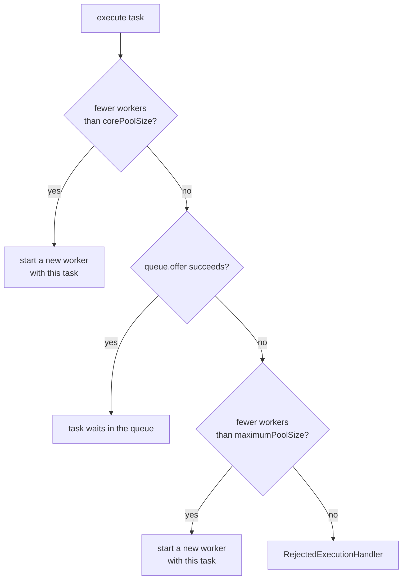

# java.util.concurrent: Executors, Locks, Atomics, and Synchronizers

The package `java.util.concurrent` and its subpackages `atomic` and `locks` hold the ready-made tools for concurrent programs: thread pools, locks, atomic variables, synchronizers (latch, barrier, semaphore), blocking queues, and concurrent collections. This page explains how each tool works inside, from the JDK 21 source, so that you can pick the right one and defend the choice. It is the home of the library thread-safety primitives, together with [Concurrency Basics](07-concurrency-basics.md), which covers `synchronized`, `volatile`, and the Java Memory Model. [Concurrency in LLD](../lld/fundamentals/09-concurrency-in-lld.md) shows how to apply these tools in a design round. [CompletableFuture](09-completablefuture.md) builds asynchronous pipelines on top of the executors described here. [Virtual Threads](10-virtual-threads.md) changes how you choose a pool for blocking work. See also `kb/operating-systems/03-synchronization.md` for the operating system view.

## Why It Matters

Java backend interviews ask about this package often: "Explain the parameters of `ThreadPoolExecutor`", "Why is `Executors.newFixedThreadPool` dangerous?", "What is the difference between `CountDownLatch` and `CyclicBarrier`?", "How does `ConcurrentHashMap` or `LongAdder` avoid contention?", "What is the ABA problem?". An answer that names the mechanism (the worker queue, the compare-and-set loop, the lock count in the synchronizer state) and the trade-off gets full credit. On the job, the same knowledge decides whether a service survives a traffic spike. An unbounded queue turns an overload into an `OutOfMemoryError`. A shared pool with blocking tasks turns a slow dependency into a full outage. A `ThreadLocal` that is never removed leaks data from one request into the next. Each section below has a deterministic demo that you can run and change.

## Core Concepts

**Task**: a unit of work. A `Runnable` is a task with no result. A `Callable<V>` is a task that returns a `V` and may throw a checked exception.

**Executor**: an object that runs tasks. The interface `Executor` has one method, `execute(Runnable)`. It separates *what to run* (the task) from *how to run it* (a new thread, a pooled thread, the caller's thread). `ExecutorService` adds lifecycle methods (`shutdown`, `awaitTermination`) and `submit`, which returns a `Future`.

**Thread pool**: a set of *worker* threads that take tasks from a queue and run them one after another. A pool avoids the cost of a thread for each task, and it bounds the number of threads. `ThreadPoolExecutor` is the main implementation.

**Future**: a handle to the result of an asynchronous task. `get()` blocks until the task completes, and then returns the result or throws the failure.

**AQS (`AbstractQueuedSynchronizer`)**: the base class of the internal `Sync` classes of `ReentrantLock`, `Semaphore`, `CountDownLatch`, and `ReentrantReadWriteLock`. It holds one `int` called *state* and a FIFO queue of waiting threads. A subclass decides what the state means (lock count, permit count, remaining count) and when an acquire succeeds. AQS parks and wakes the threads (JDK 21 source, `AbstractQueuedSynchronizer`).

**Compare-and-set (CAS)**: an atomic operation `compareAndSet(expected, new)`. If the variable holds `expected`, it stores `new` and returns `true`. If not, it changes nothing and returns `false`. The CPU provides the atomic step. CAS gives lock-free updates of one variable.

**Atomic variable**: a class such as `AtomicInteger` that offers atomic read-modify-write methods on one variable, built on CAS.

**Synchronizer**: an object that makes threads wait for each other or for a condition, such as a latch, a barrier, or a semaphore.

**Blocking queue**: a queue with operations that wait. `put` waits while the queue is full. `take` waits while the queue is empty. A bounded blocking queue gives *back-pressure*: a producer that runs faster than the consumers must wait.

**Concurrent collection**: a collection that several threads can use without an external lock. `ConcurrentHashMap` and `CopyOnWriteArrayList` are examples. Each call is atomic. A sequence of calls is not atomic together.

**Work stealing**: a scheduling method in which each worker has its own queue of tasks, and an idle worker takes (steals) a task from the queue of a busy worker. `ForkJoinPool` uses it.

**Memory consistency effects**: the package documents which actions happen-before which (the package javadoc, "Memory Consistency Properties"). Examples: actions before `executor.execute(r)` happen-before the run of `r`. Actions before `queue.put(x)` happen-before the actions after the matching `take()`. Actions before `latch.countDown()` happen-before the actions after a successful `latch.await()`. The result of a `Future` is visible to the thread that returns from `get()`. [Concurrency Basics](07-concurrency-basics.md) defines happens-before (JLS 17.4.5).

## How It Works

### Executors and thread pools

#### From `Thread` to `Executor`

Creating a thread for each task has three costs. A platform thread needs an operating system thread and a stack. Nothing limits the number of threads, so a burst of requests can exhaust memory. The caller has no handle for the result or the failure. An executor fixes all three: it reuses threads, it bounds them, and `submit` returns a `Future`. Effective Java, Item 80, recommends executors and tasks over direct use of threads.

#### `ThreadPoolExecutor`: the parameters

`ThreadPoolExecutor` has seven constructor parameters (JDK 21 javadoc and source):

| Parameter | Meaning |
|---|---|
| `corePoolSize` | The number of threads that the pool keeps, even when they are idle (unless `allowCoreThreadTimeOut(true)`) |
| `maximumPoolSize` | The upper limit for the number of threads |
| `keepAliveTime` and `unit` | How long a thread above the core size waits for work before it ends. With 0, such a thread ends as soon as it finds the queue empty. Core threads do not time out unless you call `allowCoreThreadTimeOut(true)`, which requires a keep-alive time greater than zero (it throws `IllegalArgumentException` otherwise) |
| `workQueue` | The `BlockingQueue<Runnable>` that holds tasks that wait for a thread |
| `threadFactory` | Creates the threads. Use it to name threads and to set the daemon flag and the uncaught-exception handler |
| `handler` | The `RejectedExecutionHandler` that runs when a task cannot be accepted. The default is `AbortPolicy` |

The pool packs its run state and its worker count into one `AtomicInteger` named `ctl`. The three high bits hold the run state (`RUNNING`, `SHUTDOWN`, `STOP`, `TIDYING`, `TERMINATED`), and the 29 low bits hold the worker count (source: `COUNT_BITS = Integer.SIZE - 3`). One CAS on `ctl` changes both together.

**What `execute` does with a task.** The source comment of `ThreadPoolExecutor.execute` lists three steps:

1. If fewer than `corePoolSize` workers run, start a new worker with the task as its first task. The pool does this even if other workers are idle.
2. Otherwise, try to put the task in the queue. After a successful `offer`, the pool checks the state again. If the pool is no longer running, it removes the task and rejects it. If no worker is left, it starts one.
3. If the queue is full (`offer` returns `false`), try to start a new worker up to `maximumPoolSize`. If that fails, the pool rejects the task.



The order surprises developers who expect the pool to add threads before it queues tasks. The pool grows beyond the core size only when the queue is full. With an unbounded queue, the queue never fills, so the pool never grows beyond `corePoolSize`, and `maximumPoolSize` has no effect. The `ThreadPoolExecutor` javadoc states this ("Unbounded queues"). The demo below uses 2 core threads, a maximum of 4, and a queue of capacity 2. Every task blocks until `main` releases it, so the pool state after each submission is fixed.

```java
import java.util.concurrent.ArrayBlockingQueue;
import java.util.concurrent.CountDownLatch;
import java.util.concurrent.RejectedExecutionException;
import java.util.concurrent.ThreadPoolExecutor;
import java.util.concurrent.TimeUnit;

public class PoolFlow {
    public static void main(String[] args) throws InterruptedException {
        ThreadPoolExecutor pool = new ThreadPoolExecutor(
                2, 4, 60, TimeUnit.SECONDS, new ArrayBlockingQueue<>(2));  // default: AbortPolicy
        CountDownLatch release = new CountDownLatch(1);
        Runnable blocked = () -> {
            try {
                release.await();            // the task holds its thread until main releases it
            } catch (InterruptedException e) {
                Thread.currentThread().interrupt();
            }
        };
        for (int i = 1; i <= 7; i++) {
            String result = "accepted";
            try {
                pool.execute(blocked);
            } catch (RejectedExecutionException e) {
                result = "rejected";
            }
            System.out.println("task " + i + " " + result + ": threads=" + pool.getPoolSize()
                    + " queued=" + pool.getQueue().size());
        }
        release.countDown();
        pool.shutdown();
        pool.awaitTermination(10, TimeUnit.SECONDS);
        System.out.println("completed=" + pool.getCompletedTaskCount()
                + " largest pool=" + pool.getLargestPoolSize());
    }
}
```

<!-- expected-output -->
```text
task 1 accepted: threads=1 queued=0
task 2 accepted: threads=2 queued=0
task 3 accepted: threads=2 queued=1
task 4 accepted: threads=2 queued=2
task 5 accepted: threads=3 queued=2
task 6 accepted: threads=4 queued=2
task 7 rejected: threads=4 queued=2
completed=6 largest pool=4
```

Reading the output: tasks 1 and 2 start the two core workers. Tasks 3 and 4 wait in the queue. Task 4 fills the queue, so task 5 and task 6 start two more workers (up to the maximum of 4). Task 7 finds no free worker and a full queue, so `AbortPolicy` throws `RejectedExecutionException`. The pool then runs the 6 accepted tasks.

**What a worker does.** A worker is a thread that runs `runWorker`. The loop calls `getTask()`, runs the task, and calls `getTask()` again. `getTask()` blocks on `workQueue.take()` for a core worker. For a worker above the core size (or when `allowCoreThreadTimeOut` is `true`), it calls `workQueue.poll(keepAliveTime, ...)`. If that call times out, the worker ends (source: `getTask`). Each worker is also an `AbstractQueuedSynchronizer` that serves as a non-reentrant lock. The worker holds its lock while it runs a task, so `shutdown()` can tell an idle worker (lock free, safe to interrupt) from a busy one.

#### Queue choice

The queue decides the behavior of the pool under load.

| Queue | Effect | Use it when |
|---|---|---|
| `SynchronousQueue` | Capacity 0. `offer` succeeds only if a worker waits in `poll` or `take`. Otherwise the pool starts a new thread, up to the maximum | You want a hand-off and a pool that grows with demand. `newCachedThreadPool` uses it |
| Bounded `ArrayBlockingQueue` or `LinkedBlockingQueue(n)` | Tasks wait. When the queue is full, the pool grows to the maximum, and then rejects | The normal choice for a service: it limits memory and it gives back-pressure with a rejection policy |
| Unbounded `LinkedBlockingQueue()` | The queue never fills. The pool never grows beyond the core size. Memory use grows with the backlog | Only when the number of submitted tasks has a known bound |
| `PriorityBlockingQueue` | Unbounded, ordered by priority | Tasks need priority order. Bound the input yourself |

#### Rejection policies

When the pool is shut down, or when both the queue and the pool are full, the pool calls the `RejectedExecutionHandler`. The JDK has four (JDK 21 source):

| Policy | Behavior |
|---|---|
| `AbortPolicy` (default) | Throws `RejectedExecutionException` |
| `CallerRunsPolicy` | Runs the task in the thread that called `execute`, unless the pool is shut down (then it drops the task). The caller is busy for the duration of the task, so it submits more slowly. This gives back-pressure |
| `DiscardPolicy` | Drops the new task without a signal |
| `DiscardOldestPolicy` | Removes the task at the head of the queue (`getQueue().poll()`), and retries `execute` with the new task |

The demo uses a pool with one thread and a queue with one slot. Task A holds the thread, task B waits in the queue, and task C meets a full queue.

```java
import java.util.ArrayList;
import java.util.Collections;
import java.util.List;
import java.util.concurrent.ArrayBlockingQueue;
import java.util.concurrent.CountDownLatch;
import java.util.concurrent.RejectedExecutionException;
import java.util.concurrent.RejectedExecutionHandler;
import java.util.concurrent.ThreadPoolExecutor;
import java.util.concurrent.TimeUnit;

public class Policies {
    static void run(String name, RejectedExecutionHandler handler) throws InterruptedException {
        // One thread, one queue slot. Task A runs, task B waits in the queue, task C overflows.
        ThreadPoolExecutor pool = new ThreadPoolExecutor(
                1, 1, 0, TimeUnit.SECONDS, new ArrayBlockingQueue<>(1), handler);
        List<String> ran = Collections.synchronizedList(new ArrayList<>());
        CountDownLatch release = new CountDownLatch(1);
        CountDownLatch aStarted = new CountDownLatch(1);
        Thread caller = Thread.currentThread();
        String outcome = "no exception";
        pool.execute(() -> {
            aStarted.countDown();
            try {
                release.await();
            } catch (InterruptedException e) {
                Thread.currentThread().interrupt();
            }
            ran.add("A");
        });
        aStarted.await();                       // A holds the only thread
        pool.execute(() -> ran.add("B"));       // B goes to the queue
        try {
            pool.execute(() -> ran.add("C" + (Thread.currentThread() == caller
                    ? " (in caller)" : "")));   // C meets a full queue and a full pool
        } catch (RejectedExecutionException e) {
            outcome = "RejectedExecutionException";
        }
        release.countDown();
        pool.shutdown();
        pool.awaitTermination(10, TimeUnit.SECONDS);
        System.out.println(name + ": " + outcome + ", ran " + ran);
    }

    public static void main(String[] args) throws InterruptedException {
        run("AbortPolicy      ", new ThreadPoolExecutor.AbortPolicy());
        run("DiscardPolicy    ", new ThreadPoolExecutor.DiscardPolicy());
        run("DiscardOldest    ", new ThreadPoolExecutor.DiscardOldestPolicy());
        run("CallerRunsPolicy ", new ThreadPoolExecutor.CallerRunsPolicy());
    }
}
```

<!-- expected-output -->
```text
AbortPolicy      : RejectedExecutionException, ran [A, B]
DiscardPolicy    : no exception, ran [A, B]
DiscardOldest    : no exception, ran [A, C]
CallerRunsPolicy : no exception, ran [C (in caller), A, B]
```

Reading the output: `AbortPolicy` rejects C. `DiscardPolicy` drops C and says nothing. `DiscardOldestPolicy` drops B (the task at the head of the queue) and keeps C. `CallerRunsPolicy` runs C in the calling thread, at once, before A and B finish.

Recommendation: for a service, use a bounded queue and decide the policy on purpose. `CallerRunsPolicy` slows the producer, so it fits an internal pipeline. It does not fit a request thread that must stay responsive, and it can run work on an event-loop thread. `AbortPolicy` fits a server that answers "busy" (for example HTTP 429 or 503). Silent discard hides data loss.

#### Why `Executors.newFixedThreadPool` uses an unbounded queue

The factory methods of `Executors` build a `ThreadPoolExecutor` with fixed arguments (JDK 21 source):

| Factory | core | max | queue | keep-alive |
|---|---|---|---|---|
| `newFixedThreadPool(n)` | n | n | `new LinkedBlockingQueue<>()` (capacity `Integer.MAX_VALUE`) | 0 |
| `newCachedThreadPool()` | 0 | `Integer.MAX_VALUE` | `new SynchronousQueue<>()` | 60 seconds |
| `newSingleThreadExecutor()` | 1 | 1 | `new LinkedBlockingQueue<>()` | 0. Wrapped so that the pool cannot be reconfigured |

For a fixed pool, `corePoolSize` equals `maximumPoolSize`. The pool cannot grow beyond n threads. If the queue were bounded, the pool would reject tasks as soon as n threads were busy and the queue was full. With core equal to maximum, the only way to make `execute` never reject a task is an unbounded queue, and the factory uses one. The cost is that nothing limits the backlog. If tasks arrive faster than n threads finish them, the queue grows until the JVM runs out of heap and throws `OutOfMemoryError`. The cached pool has the opposite problem. The `SynchronousQueue` holds no tasks, so a burst creates as many threads as there are concurrent tasks, up to `Integer.MAX_VALUE`, and the process can fail with `OutOfMemoryError: unable to create native thread`.

```java
import java.util.concurrent.ExecutionException;
import java.util.concurrent.ExecutorService;
import java.util.concurrent.Executors;
import java.util.concurrent.Future;
import java.util.concurrent.ThreadPoolExecutor;

public class FixedPoolQueue {
    public static void main(String[] args) throws InterruptedException {
        ExecutorService fixed = Executors.newFixedThreadPool(2);
        ThreadPoolExecutor tpe = (ThreadPoolExecutor) fixed;
        System.out.println("fixed: core=" + tpe.getCorePoolSize() + " max="
                + tpe.getMaximumPoolSize() + " queue=" + tpe.getQueue().getClass().getSimpleName()
                + " remaining=" + tpe.getQueue().remainingCapacity());
        ExecutorService cached = Executors.newCachedThreadPool();
        ThreadPoolExecutor c = (ThreadPoolExecutor) cached;
        System.out.println("cached: core=" + c.getCorePoolSize() + " max="
                + c.getMaximumPoolSize() + " queue=" + c.getQueue().getClass().getSimpleName()
                + " keepAlive=" + c.getKeepAliveTime(java.util.concurrent.TimeUnit.SECONDS) + "s");
        ExecutorService single = Executors.newSingleThreadExecutor();
        System.out.println("single is a ThreadPoolExecutor: "
                + (single instanceof ThreadPoolExecutor));

        // submit stores the failure in the Future, and get() reports it
        Future<?> f = fixed.submit(() -> {
            throw new IllegalStateException("boom");
        });
        try {
            f.get();
        } catch (ExecutionException e) {
            System.out.println("submit: get() throws ExecutionException, cause=" + e.getCause());
        }
        fixed.shutdown();
        cached.shutdown();
        single.shutdown();
    }
}
```

<!-- expected-output -->
```text
fixed: core=2 max=2 queue=LinkedBlockingQueue remaining=2147483647
cached: core=0 max=2147483647 queue=SynchronousQueue keepAlive=60s
single is a ThreadPoolExecutor: false
submit: get() throws ExecutionException, cause=java.lang.IllegalStateException: boom
```

Reading the output: the fixed pool has core and maximum 2 and an unbounded `LinkedBlockingQueue` (remaining capacity `Integer.MAX_VALUE`). The cached pool has core 0, maximum `Integer.MAX_VALUE`, a `SynchronousQueue`, and a keep-alive of 60 seconds. `newSingleThreadExecutor` does not return a `ThreadPoolExecutor`: it returns a wrapper, so you cannot cast it to change the pool. A failure in a `submit`ted task appears in `get()` as `ExecutionException`.

Recommendation: in production code, construct `ThreadPoolExecutor` directly. Give it a bounded queue, a maximum size, a named `ThreadFactory`, and a rejection policy. The `Executors` factories are fine for small programs and tests.

#### Sizing a pool

The right size depends on what the tasks wait for.

| Work | Rule | Reason |
|---|---|---|
| CPU-bound (computation, no waiting) | About `N_cpu` threads, or `N_cpu + 1` (Goetz et al., *Java Concurrency in Practice*, section 8.2) | More threads than cores only adds context switches. The one extra thread can use a core while another compute thread stops for a moment (for example on a page fault) |
| I/O-bound (the thread waits for a database or a network call) | `N_threads = N_cpu * U_cpu * (1 + W / C)` | `U_cpu` is the target CPU use (0 to 1). `W` is the wait time of a task. `C` is its compute time. A thread that waits 90% of the time needs 10 threads to keep one core busy |
| Mixed | Use separate pools for CPU work and I/O work | A slow dependency then blocks only the I/O pool |

Worked example (the numbers are assumed, not measured): 8 cores, a target use of 0.8, tasks that wait 90 ms for a database and compute for 10 ms. `W / C = 9`, so `N_threads = 8 * 0.8 * (1 + 9) = 64`. Measure `W` and `C` in the real system, and then load-test. The formula is a starting point. A downstream limit also caps the useful size: a database connection pool of 20 connections makes a 64-thread pool wait for connections. Little's law gives a second check: the average number of tasks in the system equals the arrival rate times the average time that a task spends in the system (`L = λ * T`; the usual notation writes `W` for the time, which this page already uses for the wait time). At 200 requests per second and 0.1 seconds for each request, about 20 tasks are in the system at any time, so about 20 threads are busy.

For blocking I/O on Java 21, virtual threads remove the need to size a pool for the waiting. See [Virtual Threads](10-virtual-threads.md).

#### A failure inside a task

If a task passed to `execute` throws an exception, the exception ends the worker (`completedAbruptly` in `runWorker`), the thread's uncaught-exception handler prints the stack trace, and the pool starts a replacement worker. If a task passed to `submit` throws, `FutureTask` catches the exception and stores it. Nobody sees it until a caller invokes `get()`, which throws `ExecutionException` with the original exception as the cause. A `submit` call whose `Future` is ignored hides every failure. The `FixedPoolQueue` demo above shows the `get()` side.

#### `ScheduledThreadPoolExecutor`

`ScheduledThreadPoolExecutor` (created by `Executors.newScheduledThreadPool`) runs a task after a delay or at a rate. It is a `ThreadPoolExecutor` with a fixed core size and an internal `DelayedWorkQueue`. `scheduleAtFixedRate` starts runs at fixed times: the start of run n is `initialDelay + n * period`. If a run takes longer than the period, later runs start late and do not overlap. `scheduleWithFixedDelay` waits the given delay after each run ends. If a run throws an exception, the javadoc says that subsequent executions are suppressed, so catch exceptions inside a periodic task.

#### Shutdown

| Method | Effect |
|---|---|
| `shutdown()` | The pool stops accepting tasks. Tasks in the queue still run. It returns at once |
| `shutdownNow()` | The pool stops accepting tasks, tries to stop running tasks by interrupting them, and returns the list of tasks that never started |
| `awaitTermination(t, unit)` | Blocks until the pool is terminated or the time runs out. Returns `true` if the pool terminated |
| `close()` (Java 19 and later) | `ExecutorService` extends `AutoCloseable`. `close()` calls `shutdown()` and waits for termination. If the waiting thread is interrupted, it calls `shutdownNow()` (JDK 21 source of the default method). Use try-with-resources |

`shutdownNow()` interrupts the workers. A task that ignores interruption keeps running. The standard pattern is: `shutdown()`, then `awaitTermination` with a limit, then `shutdownNow()` if the limit passes, then `awaitTermination` again. Non-daemon pool threads keep the JVM alive, so a program that forgets `shutdown()` does not exit.

```java
import java.util.List;
import java.util.concurrent.CountDownLatch;
import java.util.concurrent.ExecutorService;
import java.util.concurrent.Executors;
import java.util.concurrent.TimeUnit;
import java.util.concurrent.atomic.AtomicBoolean;
import java.util.concurrent.RejectedExecutionException;

public class Shutdown {
    public static void main(String[] args) throws InterruptedException {
        ExecutorService pool = Executors.newFixedThreadPool(1);
        CountDownLatch started = new CountDownLatch(1);
        CountDownLatch finished = new CountDownLatch(1);
        AtomicBoolean interrupted = new AtomicBoolean();
        pool.execute(() -> {
            started.countDown();
            try {
                Thread.sleep(60_000);               // a long task
            } catch (InterruptedException e) {
                interrupted.set(true);
            }
            finished.countDown();
        });
        for (int i = 0; i < 3; i++) {
            pool.execute(() -> System.out.println("never printed"));  // waits in the queue
        }
        started.await();
        pool.shutdown();
        System.out.println("after shutdown: isShutdown=" + pool.isShutdown()
                + " isTerminated=" + pool.isTerminated());
        try {
            pool.execute(() -> { });
        } catch (RejectedExecutionException e) {
            System.out.println("new task after shutdown: rejected");
        }
        System.out.println("awaitTermination(50 ms): "
                + pool.awaitTermination(50, TimeUnit.MILLISECONDS));
        List<Runnable> never = pool.shutdownNow();
        finished.await();
        System.out.println("shutdownNow returned " + never.size() + " queued tasks");
        System.out.println("running task was interrupted: " + interrupted.get());
        System.out.println("awaitTermination: " + pool.awaitTermination(10, TimeUnit.SECONDS));
    }
}
```

<!-- expected-output -->
```text
after shutdown: isShutdown=true isTerminated=false
new task after shutdown: rejected
awaitTermination(50 ms): false
shutdownNow returned 3 queued tasks
running task was interrupted: true
awaitTermination: true
```

Reading the output: after `shutdown()`, the pool is shut down but not terminated, because the long task still runs. A new task is rejected. `awaitTermination(50 ms)` times out and returns `false`. `shutdownNow()` returns the 3 queued tasks, which never run, and interrupts the running task. After that, the pool terminates.

### `Future`, `FutureTask`, and bulk submission

`ExecutorService.submit(Callable)` wraps the task in a `FutureTask` (a `RunnableFuture`), queues it, and returns it. The `Future` methods:

| Method | Behavior |
|---|---|
| `get()` | Waits for the result. Throws `ExecutionException` if the task threw, `CancellationException` if it was cancelled, `InterruptedException` if the waiting thread is interrupted |
| `get(timeout, unit)` | The same, and throws `TimeoutException` after the time. The task keeps running |
| `cancel(mayInterruptIfRunning)` | If the task has not started, it never runs. If it runs and the argument is `true`, the worker thread is interrupted. Returns `false` if the task already completed |
| `isDone()`, `isCancelled()` | `isDone()` is `true` after normal completion, failure, or cancellation |
| `resultNow()`, `exceptionNow()`, `state()` (Java 19) | Read the result without blocking. They throw `IllegalStateException` if the task is not done |

`invokeAll(tasks)` runs all tasks and returns a list of completed `Future`s in the order of the input. `invokeAny(tasks)` returns the result of one task that completed successfully and cancels the others. `ExecutorCompletionService` wraps an executor and returns futures in the order of completion, so you can process each result as soon as it is ready. A plain `Future` has no way to register a callback and no way to combine results. [CompletableFuture](09-completablefuture.md) adds both.

### Locks

The package `java.util.concurrent.locks` offers explicit locks. [Concurrency Basics](07-concurrency-basics.md) covers `synchronized`. The explicit locks add `tryLock`, timeouts, interruptible waiting, fairness, and several conditions.

#### How `ReentrantLock` works

`ReentrantLock` has a `Sync` field that extends `AbstractQueuedSynchronizer`. The AQS state holds the hold count: 0 means free, and n means that the owner thread holds the lock n times. `lock()` does the following (JDK 21 source):

1. If the state is 0, the thread tries a CAS from 0 to 1. On success, it records itself as the owner.
2. If the owner is the current thread, the thread increments the state (reentrancy).
3. Otherwise, the thread joins the AQS wait queue, a FIFO linked queue of nodes, and parks (`LockSupport.park`). A parked thread uses no CPU, and the thread state is `WAITING`.
4. `unlock()` decrements the state. At 0, it clears the owner and unparks the first waiter, which then retries the acquire.

**Fairness.** `new ReentrantLock(true)` makes a fair lock. In the fair `tryAcquire`, a thread acquires the lock only if the state is 0 and `hasQueuedPredecessors()` is `false`. No thread jumps the queue. The default lock is *non-fair*: a thread that calls `lock()` tries the CAS first, even if other threads wait. This is *barging*. Barging gives more throughput, because a running thread can take the lock before the woken waiter has been scheduled. The AQS javadoc states that the default barging strategy usually has the highest throughput and scalability, and that it does not guarantee fairness or freedom from starvation. A fair lock avoids starvation and costs throughput. The untimed `tryLock()` ignores fairness: it takes a free lock even if threads wait. To honor fairness, call `tryLock(0, TimeUnit.SECONDS)` (the javadoc says so).

**`tryLock`, timeout, and interruption.** `lock()` waits without a limit and ignores interruption while it waits (it restores the flag later). `lockInterruptibly()` throws `InterruptedException` if the thread is interrupted. `tryLock()` returns at once. `tryLock(time, unit)` waits up to the limit. These methods let a thread give up, which breaks the hold-and-wait condition of a deadlock. `synchronized` has none of them.

**The unlock rule.** The lock does not release itself. Call `unlock()` in a `finally` block, directly after `lock()`, and put `lock()` outside the `try`. If `lock()` is inside the `try` and fails, `finally` unlocks a lock that the thread does not own and throws `IllegalMonitorStateException`.

**`Condition`.** A `Condition` (from `lock.newCondition()`) is the explicit version of `wait` and `notify`. One lock can have several conditions, for example `notFull` and `notEmpty` for a bounded buffer. `await()` releases the lock completely (all holds), parks the thread, and reacquires the lock before it returns. `signal()` moves one waiting thread, and `signalAll()` moves all, from the condition queue to the lock queue. The caller must hold the lock, or the method throws `IllegalMonitorStateException`. A thread can wake without a signal, so wait in a `while` loop that rechecks the condition, as for `wait()`.

```java
import java.util.concurrent.CountDownLatch;
import java.util.concurrent.TimeUnit;
import java.util.concurrent.locks.Condition;
import java.util.concurrent.locks.ReentrantLock;

public class LockDemo {
    // A gate that threads wait at until another thread opens it. It uses one lock, one Condition.
    static class Gate {
        private final ReentrantLock lock = new ReentrantLock();
        private final Condition opened = lock.newCondition();
        private boolean open;                       // guarded by lock

        void await() throws InterruptedException {
            lock.lock();
            try {
                while (!open) {                     // loop: guards against spurious wakeups
                    opened.await();                 // releases the lock while it waits
                }
            } finally {
                lock.unlock();
            }
        }

        void open() {
            lock.lock();
            try {
                open = true;
                opened.signalAll();
            } finally {
                lock.unlock();
            }
        }
    }

    public static void main(String[] args) throws Exception {
        ReentrantLock lock = new ReentrantLock();
        lock.lock();
        lock.lock();                                // reentrant: the same thread may lock again
        System.out.println("hold count in main: " + lock.getHoldCount());

        boolean[] result = new boolean[2];
        Thread other = new Thread(() -> {
            result[0] = lock.tryLock();                                 // returns at once
            try {
                result[1] = lock.tryLock(50, TimeUnit.MILLISECONDS);    // waits up to 50 ms
            } catch (InterruptedException e) {
                Thread.currentThread().interrupt();
            }
        });
        other.start();
        other.join();
        System.out.println("other thread: tryLock()=" + result[0]
                + " tryLock(50 ms)=" + result[1]);
        lock.unlock();
        lock.unlock();
        System.out.println("locked after two unlocks: " + lock.isLocked());

        Gate gate = new Gate();
        CountDownLatch passed = new CountDownLatch(3);
        for (int i = 0; i < 3; i++) {
            new Thread(() -> {
                try {
                    gate.await();
                    passed.countDown();
                } catch (InterruptedException e) {
                    Thread.currentThread().interrupt();
                }
            }).start();
        }
        System.out.println("threads past the gate before open: " + (3 - passed.getCount()));
        gate.open();
        passed.await();
        System.out.println("all three passed the gate");
        System.out.println("fair lock? " + new ReentrantLock(true).isFair()
                + ", default lock fair? " + new ReentrantLock().isFair());
    }
}
```

<!-- expected-output -->
```text
hold count in main: 2
other thread: tryLock()=false tryLock(50 ms)=false
locked after two unlocks: false
threads past the gate before open: 0
all three passed the gate
fair lock? true, default lock fair? false
```

Reading the output: `main` holds the lock twice (hold count 2). The other thread cannot take it with `tryLock()` or after waiting 50 ms. The three waiting threads pass the gate only after `open()` signals the condition.

#### `ReentrantReadWriteLock`

A read-write lock holds a pair of locks. Many threads can hold the *read lock* together, as long as no thread holds the *write lock*. The write lock is exclusive. It pays off when reads are much more frequent than writes and each read holds the lock long enough that the lock cost does not dominate. The state is one `int` that the source splits into two halves: the high 16 bits count the read holds (`SHARED_SHIFT = 16`) and the low 16 bits count the write holds, so each count has a maximum of 65535 (`MAX_COUNT`).

Rules (JDK 21 javadoc):

- A thread that holds the write lock can take the read lock. It can then release the write lock and keep the read lock. This is *downgrading*.
- A thread that holds the read lock cannot take the write lock. This is *upgrading*, and it is not possible. `writeLock().lock()` from a reader waits for itself, forever: a deadlock. Release the read lock first, take the write lock, and recheck the condition.
- The non-fair mode does not order the threads, but a reader that sees a waiting writer at the head of the queue blocks. This prevents a stream of readers from starving a writer (source: `readerShouldBlock` calls `apparentlyFirstQueuedIsExclusive`). The fair mode uses queue order.

#### `StampedLock`

`StampedLock` (Java 8) has three modes and returns a `long` *stamp* from each lock call. You pass the stamp back to release the lock.

| Mode | Methods | Meaning |
|---|---|---|
| Write | `writeLock()`, `unlockWrite(stamp)` | Exclusive |
| Read | `readLock()`, `unlockRead(stamp)` | Shared |
| Optimistic read | `tryOptimisticRead()`, `validate(stamp)` | No lock is taken. The reader copies the fields it needs into local variables, calls `validate`, and if it returns `false` (a write happened) falls back to the read lock |

The optimistic read does not write to the lock state, so readers do not contend with each other, and they do not block a writer. The javadoc warns that values read in optimistic mode "may be wildly inconsistent" until validated. `StampedLock` is not reentrant (the javadoc says so), so a thread that calls `writeLock()` twice waits for itself. It also has no `Condition`. Use it only for short, side-effect-free read sections that you can validate.

```java
import java.util.concurrent.CountDownLatch;
import java.util.concurrent.locks.ReentrantReadWriteLock;
import java.util.concurrent.locks.StampedLock;

public class RwDemo {
    public static void main(String[] args) throws Exception {
        ReentrantReadWriteLock rw = new ReentrantReadWriteLock();

        // Three readers are inside the read lock at the same time. Each one waits for the others.
        CountDownLatch allInside = new CountDownLatch(3);
        Thread[] readers = new Thread[3];
        for (int i = 0; i < readers.length; i++) {
            readers[i] = new Thread(() -> {
                rw.readLock().lock();
                try {
                    allInside.countDown();
                    allInside.await();              // returns only if all three hold the read lock
                } catch (InterruptedException e) {
                    Thread.currentThread().interrupt();
                } finally {
                    rw.readLock().unlock();
                }
            });
            readers[i].start();
        }
        for (Thread t : readers) {
            t.join();
        }
        System.out.println("three readers held the read lock together");

        // No upgrade: a reader that asks for the write lock never gets it
        rw.readLock().lock();
        System.out.println("write lock while holding read lock: " + rw.writeLock().tryLock());
        rw.readLock().unlock();

        // Downgrade is allowed: take write, take read, release write
        rw.writeLock().lock();
        rw.readLock().lock();
        rw.writeLock().unlock();
        System.out.println("after downgrade: readLocks=" + rw.getReadLockCount()
                + " writeLocked=" + rw.isWriteLocked());
        rw.readLock().unlock();

        // StampedLock: an optimistic read does not lock. validate() tells whether a write came.
        StampedLock sl = new StampedLock();
        long stamp = sl.tryOptimisticRead();
        System.out.println("valid with no writer: " + sl.validate(stamp));
        long w = sl.writeLock();
        sl.unlockWrite(w);
        System.out.println("valid after a write: " + sl.validate(stamp));
    }
}
```

<!-- expected-output -->
```text
three readers held the read lock together
write lock while holding read lock: false
after downgrade: readLocks=1 writeLocked=false
valid with no writer: true
valid after a write: false
```

Reading the output: the three readers wait for each other inside the read lock, which proves that they hold it at the same time. `tryLock` on the write lock fails while the thread holds a read lock. The downgrade leaves one read lock and no write lock. An optimistic stamp stops being valid after any write.

### Atomics and compare-and-set

#### What a CAS does

`AtomicInteger` keeps its value in a `volatile int` and updates it with `Unsafe` methods. `incrementAndGet()` calls `U.getAndAddInt(this, VALUE, 1)`. The JDK 21 source of `Unsafe.getAndAddInt` is a loop: read the current value with volatile semantics, then `weakCompareAndSetInt(current, current + delta)`, and repeat if the CAS fails. The method has the annotation `@IntrinsicCandidate`, so the JIT compiler can replace the loop with one atomic CPU instruction where the CPU has one.

You can write the same loop for any update function. The method `updateAndGet(f)` does exactly this. The function `f` must have no side effects, because a failed CAS runs it again.

#### The ABA problem

CAS asks "is the value still `A`?". If the value changed from `A` to `B` and back to `A`, the CAS succeeds, although the state moved in between. For a counter this is harmless. For a lock-free stack it is a bug. Thread 1 reads the top node `A` and its next node `X`. Thread 2 pops `A`, pops `X`, and pushes `A` back. Thread 1's CAS from `A` to `X` succeeds, but `X` is no longer in the stack, so the stack is corrupt. The fix: pair the reference with a version number. `AtomicStampedReference` stores a reference and an `int` stamp, and its `compareAndSet` compares both. `AtomicMarkableReference` pairs the reference with a `boolean`. Garbage collection removes one cause of ABA, because the JVM does not reuse the address of an object that is still referenced. ABA still occurs when the code reuses objects (a node pool) or when equal values reappear (cached boxed values, a state that returns to `A`).

#### `LongAdder`

One `AtomicLong` under heavy write contention makes all threads CAS the same memory location, and most CASes fail and retry. `LongAdder` spreads the updates over several cells (JDK 21 source, `Striped64`). It has a `base` value and a `volatile Cell[] cells` array. While `cells` is `null` (no contention seen yet), `add(x)` tries a CAS on `base`. If that CAS fails, or if `cells` already exists, the thread picks a cell with its probe value (a per-thread hash) and does a CAS on that cell. If that also fails, `longAccumulate` retries, the thread moves to another cell (it changes its probe value), and the array doubles in size until its length reaches or passes the number of CPUs (source: `n >= NCPU` stops growth). Each `Cell` has the annotation `@Contended`, which adds padding so that two cells do not share a cache line. `sum()` adds `base` and all cells. It is not an atomic snapshot: updates that run during `sum()` may or may not be counted (javadoc).

| | `AtomicLong` | `LongAdder` |
|---|---|---|
| Update cost under contention | One hot memory location. CAS retries | Spread over cells. Few retries |
| Read cost | One volatile read. Exact | Sum of the cells. Not a snapshot while writers run |
| Memory | One object with one `long` field | A `base` field plus a `Cell` array that grows with contention, each cell padded to its own cache line |
| Atomic compound action (`compareAndSet`, `getAndIncrement` returns the value) | Yes | No |
| Use it for | A sequence number, an id, a flag, a CAS over the value | A statistics counter that many threads update and a thread reads from time to time |

```java
import java.util.concurrent.CountDownLatch;
import java.util.concurrent.atomic.AtomicInteger;
import java.util.concurrent.atomic.AtomicReference;
import java.util.concurrent.atomic.AtomicStampedReference;
import java.util.concurrent.atomic.LongAdder;

public class AtomicDemo {
    static int casIncrement(AtomicInteger a) {          // what updateAndGet does, written out
        while (true) {
            int current = a.get();
            int next = current + 1;
            if (a.compareAndSet(current, next)) {
                return next;
            }                                           // another thread won: read again, retry
        }
    }

    public static void main(String[] args) throws Exception {
        AtomicInteger counter = new AtomicInteger();
        AtomicInteger viaCas = new AtomicInteger();
        LongAdder adder = new LongAdder();
        Thread[] threads = new Thread[4];
        for (int i = 0; i < threads.length; i++) {
            threads[i] = new Thread(() -> {
                for (int n = 0; n < 10_000; n++) {
                    counter.incrementAndGet();
                    casIncrement(viaCas);
                    adder.increment();
                }
            });
            threads[i].start();
        }
        for (Thread t : threads) {
            t.join();
        }
        System.out.println("AtomicInteger=" + counter + " CAS loop=" + viaCas
                + " LongAdder=" + adder.sum());

        // The ABA problem. Thread 1 reads "A". Thread 2 changes A to B and back to A.
        // Thread 1's compareAndSet then succeeds, although the value changed in between.
        AtomicReference<String> ref = new AtomicReference<>("A");
        AtomicStampedReference<String> stamped = new AtomicStampedReference<>("A", 0);
        String seen = ref.get();
        int[] stampHolder = new int[1];
        String seenStamped = stamped.get(stampHolder);
        int seenStamp = stampHolder[0];

        Thread t2 = new Thread(() -> {
            ref.set("B");
            ref.set("A");
            stamped.set("B", 1);
            stamped.set("A", 2);
        });
        t2.start();
        t2.join();

        System.out.println("plain CAS A->C succeeds: " + ref.compareAndSet(seen, "C"));
        System.out.println("stamped CAS A->C succeeds: "
                + stamped.compareAndSet(seenStamped, "C", seenStamp, seenStamp + 1));
    }
}
```

<!-- expected-output -->
```text
AtomicInteger=40000 CAS loop=40000 LongAdder=40000
plain CAS A->C succeeds: true
stamped CAS A->C succeeds: false
```

Reading the output: the three counters reach 40000, because four threads add 10000 each and every update is atomic. The plain `AtomicReference` CAS succeeds after `A -> B -> A`, which is the ABA problem. The stamped CAS fails, because the stamp changed from 0 to 2.

### Synchronizers

| Class | Purpose | Reusable? | How it works (source) |
|---|---|---|---|
| `CountDownLatch(n)` | One or more threads wait until `n` events happen | No. The count only goes down | AQS state is the count. `countDown()` decrements it. At 0, all waiters wake. `await()` returns at once afterwards |
| `CyclicBarrier(n, action)` | `n` threads wait for each other at a meeting point | Yes. It resets after each round | A `ReentrantLock` and a `Condition` named `trip`. The last thread to arrive runs the optional `action`, starts a new generation, and wakes the rest |
| `Semaphore(permits)` | Limit the number of threads in a section, or count a resource | Yes | AQS state is the number of permits. `acquire()` decrements, `release()` increments. Any thread can release. Optional fairness |
| `Phaser` | A barrier with a changing number of parties and several phases | Yes | A 64-bit state packs the phase, the parties, and the unarrived count. Up to 65535 parties. Override `onAdvance` to end after a number of phases |
| `Exchanger<V>` | Two threads swap objects | Yes | A thread waits at the exchange point until a partner arrives |

`CountDownLatch` waits for *events*, and a thread that counts down does not wait. `CyclicBarrier` waits for *threads*, and every thread waits. If a thread at a `CyclicBarrier` is interrupted, times out, or if the barrier action throws, the barrier breaks and every waiting thread gets `BrokenBarrierException` (source: `breakBarrier`). A `Semaphore(1)` works as a lock that a different thread may release, but it does not record an owner and is not reentrant. A latch with count 1 works as a start gate (workers wait for one `countDown()`). A latch with count `n` works as a completion signal (one thread waits for `n` workers).

```java
import java.util.ArrayList;
import java.util.Collections;
import java.util.List;
import java.util.concurrent.BrokenBarrierException;
import java.util.concurrent.CountDownLatch;
import java.util.concurrent.CyclicBarrier;
import java.util.concurrent.Exchanger;
import java.util.concurrent.Phaser;
import java.util.concurrent.Semaphore;
import java.util.concurrent.atomic.AtomicInteger;

public class SyncDemo {
    public static void main(String[] args) throws Exception {
        // CountDownLatch: main waits until three workers finish. One use only.
        CountDownLatch done = new CountDownLatch(3);
        AtomicInteger work = new AtomicInteger();
        for (int i = 0; i < 3; i++) {
            new Thread(() -> {
                work.incrementAndGet();
                done.countDown();
            }).start();
        }
        done.await();
        System.out.println("latch: work done by " + work + " workers, count=" + done.getCount());

        // CyclicBarrier: three threads meet twice. The barrier action runs once per round.
        List<String> log = Collections.synchronizedList(new ArrayList<>());
        AtomicInteger round = new AtomicInteger();
        CyclicBarrier barrier = new CyclicBarrier(3,
                () -> log.add("round " + round.incrementAndGet() + " tripped"));
        Thread[] team = new Thread[3];
        for (int i = 0; i < team.length; i++) {
            team[i] = new Thread(() -> {
                try {
                    barrier.await();
                    barrier.await();                 // the same barrier is reused
                } catch (InterruptedException | BrokenBarrierException e) {
                    Thread.currentThread().interrupt();
                }
            });
            team[i].start();
        }
        for (Thread t : team) {
            t.join();
        }
        System.out.println("barrier: " + log + ", parties=" + barrier.getParties());

        // Semaphore: two permits
        Semaphore sem = new Semaphore(2);
        sem.acquire();
        sem.acquire();
        System.out.println("semaphore: third tryAcquire=" + sem.tryAcquire()
                + " available=" + sem.availablePermits());
        sem.release();
        System.out.println("semaphore: after release tryAcquire=" + sem.tryAcquire());

        // Phaser: three parties, two phases. Parties advance together.
        Phaser phaser = new Phaser(3);
        List<String> phases = Collections.synchronizedList(new ArrayList<>());
        Thread[] parties = new Thread[3];
        for (int i = 0; i < parties.length; i++) {
            parties[i] = new Thread(() -> {
                int p0 = phaser.arriveAndAwaitAdvance();         // returns the next phase number
                int p1 = phaser.arriveAndAwaitAdvance();
                phases.add(p0 + "," + p1);
                phaser.arriveAndDeregister();
            });
            parties[i].start();
        }
        for (Thread t : parties) {
            t.join();
        }
        System.out.println("phaser: each party saw " + new java.util.TreeSet<>(phases)
                + ", terminated=" + phaser.isTerminated());

        // Exchanger: two threads swap objects at a meeting point
        Exchanger<String> exchanger = new Exchanger<>();
        String[] got = new String[2];
        Thread a = new Thread(() -> {
            try {
                got[0] = exchanger.exchange("from A");
            } catch (InterruptedException e) {
                Thread.currentThread().interrupt();
            }
        });
        Thread b = new Thread(() -> {
            try {
                got[1] = exchanger.exchange("from B");
            } catch (InterruptedException e) {
                Thread.currentThread().interrupt();
            }
        });
        a.start();
        b.start();
        a.join();
        b.join();
        System.out.println("exchanger: A got '" + got[0] + "', B got '" + got[1] + "'");
    }
}
```

<!-- expected-output -->
```text
latch: work done by 3 workers, count=0
barrier: [round 1 tripped, round 2 tripped], parties=3
semaphore: third tryAcquire=false available=0
semaphore: after release tryAcquire=true
phaser: each party saw [1,2], terminated=true
exchanger: A got 'from B', B got 'from A'
```

Reading the output: the latch reaches 0 after three workers finish. The barrier trips twice, once for each round, and runs its action once for each round. The semaphore with two permits refuses a third `tryAcquire` and accepts one after a `release`. In the phaser, the two `arriveAndAwaitAdvance` calls of each party return 1 and 2: each call returns the number of the phase that starts after the advance, not the phase in which the party arrived. The JDK 21 source returns `nextPhase` (or the result of `internalAwaitAdvance`, which is also the new phase). The javadoc `@return` text says "the arrival phase number", but the same javadoc defines the method as equivalent to `awaitAdvance(arrive())`, and `awaitAdvance` returns "the next arrival phase number". The code and the demo settle it: the value is the next phase. If the phaser is terminated, the method returns a negative number. The phaser terminates when all parties deregister. The exchanger gives each thread the object of the other.

### Blocking queues and concurrent collections

#### The four method families

Every `BlockingQueue` method belongs to one of four families (`BlockingQueue` javadoc):

| | Throws an exception | Returns a special value | Blocks | Times out |
|---|---|---|---|---|
| Insert | `add(e)` | `offer(e)` | `put(e)` | `offer(e, time, unit)` |
| Remove | `remove()` | `poll()` | `take()` | `poll(time, unit)` |
| Examine | `element()` | `peek()` | | |

A `BlockingQueue` does not accept `null`, because `poll` returns `null` to mean "empty".

#### The implementations

| Class | Bounded? | Structure | Locking (JDK 21 source) |
|---|---|---|---|
| `ArrayBlockingQueue` | Yes (fixed) | Circular array | One `ReentrantLock` for all access, with two conditions `notEmpty` and `notFull`. Optional fair mode |
| `LinkedBlockingQueue` | Optional. Default `Integer.MAX_VALUE` | Linked nodes | Two locks: `putLock` for the tail and `takeLock` for the head, plus an `AtomicInteger count`. A producer and a consumer run at the same time |
| `LinkedBlockingDeque` | Optional | Doubly linked nodes | One lock |
| `PriorityBlockingQueue` | No | Binary heap in an array | One lock. `put` never blocks |
| `DelayQueue` | No | Priority queue of `Delayed` elements | One `ReentrantLock`. `take` returns an element only after its delay ended |
| `SynchronousQueue` | Capacity 0 | No storage. A hand-off | Lock-free (CAS). The non-fair mode is LIFO, and the fair mode is FIFO. JDK 22 rebuilt it on `LinkedTransferQueue` (`Transferer extends LinkedTransferQueue`, JDK-8301341), and JDK 21.0.2 and later updates carry the same code. JDK 21.0.0 and 21.0.1 use the older `TransferStack` (non-fair) and `TransferQueue` (fair) classes |
| `LinkedTransferQueue` | No | Linked nodes | Lock-free (CAS). `transfer(e)` waits until a consumer takes `e` |

**One lock versus two locks.** An `ArrayBlockingQueue` producer and consumer both take the single lock, so they never run in parallel, but the code is simple and the array needs no node allocation. A `LinkedBlockingQueue` producer takes only `putLock`, and a consumer takes only `takeLock`, so they proceed at the same time. The shared state is the `AtomicInteger count`. When a `put` changes the count from 0 to 1, it signals `notEmpty` (source: `if (c == 0) signalNotEmpty()`), and the signaled consumer can in turn signal the next. The price is one node allocation for each element, which creates garbage. Without a capacity argument, `LinkedBlockingQueue` has capacity `Integer.MAX_VALUE`, so it gives no back-pressure. [Stacks, Queues, and Deques](../dsa/foundations/03-stacks-queues-deques.md) states the same facts for problem solving, and [Concurrency in LLD](../lld/fundamentals/09-concurrency-in-lld.md) shows a producer-consumer design.

```java
import java.util.concurrent.ArrayBlockingQueue;
import java.util.concurrent.LinkedBlockingQueue;
import java.util.concurrent.PriorityBlockingQueue;
import java.util.concurrent.SynchronousQueue;
import java.util.concurrent.TimeUnit;

public class QueueDemo {
    public static void main(String[] args) throws Exception {
        ArrayBlockingQueue<String> q = new ArrayBlockingQueue<>(2);
        System.out.println("offer: " + q.offer("a") + " " + q.offer("b") + " " + q.offer("c"));
        try {
            q.add("c");                                   // the throwing family
        } catch (IllegalStateException e) {
            System.out.println("add on a full queue: IllegalStateException: " + e.getMessage());
        }
        System.out.println("offer with 20 ms timeout: " + q.offer("c", 20, TimeUnit.MILLISECONDS));
        System.out.println("poll: " + q.poll() + " " + q.poll() + " " + q.poll());
        System.out.println("poll with 20 ms timeout: " + q.poll(20, TimeUnit.MILLISECONDS));

        LinkedBlockingQueue<String> unbounded = new LinkedBlockingQueue<>();
        LinkedBlockingQueue<String> bounded = new LinkedBlockingQueue<>(100);
        System.out.println("LinkedBlockingQueue() remaining capacity: "
                + unbounded.remainingCapacity());
        System.out.println("LinkedBlockingQueue(100) remaining capacity: "
                + bounded.remainingCapacity());

        SynchronousQueue<String> hand = new SynchronousQueue<>();
        System.out.println("SynchronousQueue offer with no taker: " + hand.offer("x")
                + ", size=" + hand.size() + ", remaining=" + hand.remainingCapacity());

        PriorityBlockingQueue<Integer> pq = new PriorityBlockingQueue<>();
        pq.add(5);
        pq.add(1);
        pq.add(3);
        System.out.println("PriorityBlockingQueue take order: " + pq.take() + " " + pq.take()
                + " " + pq.take());
    }
}
```

<!-- expected-output -->
```text
offer: true true false
add on a full queue: IllegalStateException: Queue full
offer with 20 ms timeout: false
poll: a b null
poll with 20 ms timeout: null
LinkedBlockingQueue() remaining capacity: 2147483647
LinkedBlockingQueue(100) remaining capacity: 100
SynchronousQueue offer with no taker: false, size=0, remaining=0
PriorityBlockingQueue take order: 1 3 5
```

Reading the output: `offer` returns `false` on a full queue, `add` throws `IllegalStateException`, and the timed `offer` and `poll` give up after 20 ms. `poll` on an empty queue returns `null`. The default `LinkedBlockingQueue` can hold `Integer.MAX_VALUE` elements, and a capacity argument limits it. A `SynchronousQueue` has no storage, so `offer` without a waiting taker returns `false`. `PriorityBlockingQueue` returns the smallest element first.

#### Concurrent collections

| Class | Idea | Iterator |
|---|---|---|
| `ConcurrentHashMap` | Compare-and-set on empty bins, a lock on the head node of a bin, and counter cells for the size. No `null` keys or values. See [Collections Internals](04-collections-internals.md) for the mechanism | Weakly consistent: never throws `ConcurrentModificationException`, may or may not show later changes |
| `CopyOnWriteArrayList` | Each write copies the whole array under a lock (`synchronized (lock)` in JDK 21). Reads take no lock | A snapshot of the array when the iterator was created |
| `ConcurrentSkipListMap` | A sorted map made of linked lists on several levels, updated with CAS. It supports `floorKey`, `ceilingKey`, and range views. A concurrent substitute for `TreeMap` | Weakly consistent |
| `ConcurrentLinkedQueue` | A lock-free queue of linked nodes. It is a variation of the Michael and Scott algorithm (source comment). `size()` walks the list, so it costs O(n) | Weakly consistent |

`CopyOnWriteArrayList` suits a list that readers use very often and writers change rarely, such as a list of listeners. Every `add` copies the array, so a write-heavy list is slow.

A concurrent collection makes each call atomic. Two calls in a row are not atomic. Use the atomic compound methods: `putIfAbsent`, `computeIfAbsent`, `compute`, `merge`, `replace(key, old, new)`, and `remove(key, value)`. [Concurrency in LLD](../lld/fundamentals/09-concurrency-in-lld.md) shows the wrong `containsKey`-then-`put` form.

```java
import java.util.ArrayList;
import java.util.Iterator;
import java.util.List;
import java.util.concurrent.ConcurrentHashMap;
import java.util.concurrent.ConcurrentSkipListMap;
import java.util.concurrent.CopyOnWriteArrayList;

public class CollectionsDemo {
    public static void main(String[] args) throws Exception {
        // ConcurrentHashMap.merge is atomic for each key
        ConcurrentHashMap<String, Integer> counts = new ConcurrentHashMap<>();
        String[] words = {"a", "b", "a", "c", "a", "b"};
        Thread[] threads = new Thread[4];
        for (int i = 0; i < threads.length; i++) {
            threads[i] = new Thread(() -> {
                for (String w : words) {
                    counts.merge(w, 1, Integer::sum);
                }
            });
            threads[i].start();
        }
        for (Thread t : threads) {
            t.join();
        }
        System.out.println("counts: " + new java.util.TreeMap<>(counts));

        // Check-then-act on a thread-safe map is still two steps. computeIfAbsent is one step.
        ConcurrentHashMap<String, List<String>> groups = new ConcurrentHashMap<>();
        groups.computeIfAbsent("k", key -> new ArrayList<>()).add("v");
        System.out.println("groups: " + groups);

        // CopyOnWriteArrayList: the iterator reads a snapshot, so it never throws
        // ConcurrentModificationException and does not see later writes
        CopyOnWriteArrayList<Integer> cow = new CopyOnWriteArrayList<>(List.of(1, 2, 3));
        Iterator<Integer> it = cow.iterator();
        cow.add(4);
        int seen = 0;
        while (it.hasNext()) {
            it.next();
            seen++;
        }
        System.out.println("snapshot iterator saw " + seen + " of " + cow.size() + " elements");

        // The same loop on an ArrayList fails fast
        List<Integer> plain = new ArrayList<>(List.of(1, 2, 3));
        try {
            for (Integer x : plain) {
                if (x == 1) {
                    plain.add(4);
                }
            }
        } catch (java.util.ConcurrentModificationException e) {
            System.out.println("ArrayList: ConcurrentModificationException");
        }

        ConcurrentSkipListMap<Integer, String> skip = new ConcurrentSkipListMap<>();
        skip.put(30, "c");
        skip.put(10, "a");
        skip.put(20, "b");
        System.out.println("skip list: " + skip + " floorKey(25)=" + skip.floorKey(25));
    }
}
```

<!-- expected-output -->
```text
counts: {a=12, b=8, c=4}
groups: {k=[v]}
snapshot iterator saw 3 of 4 elements
ArrayList: ConcurrentModificationException
skip list: {10=a, 20=b, 30=c} floorKey(25)=20
```

Reading the output: four threads each merge 6 words, so `a` is counted 12 times, `b` 8 times, and `c` 4 times, with no lost update. The `CopyOnWriteArrayList` iterator reads the snapshot of 3 elements even though the list has 4 when the loop ends. The `ArrayList` loop fails fast with `ConcurrentModificationException`. The skip list keeps its keys sorted and answers `floorKey(25)` with 20.

### `ThreadLocal`

A `ThreadLocal<T>` gives each thread its own copy of a value. It is thread confinement ([Concurrency Basics](07-concurrency-basics.md), "Thread-safety strategies"). Typical uses: a per-request context (user id, trace id), a non-thread-safe helper such as a `SimpleDateFormat`, or a per-thread buffer.

**Where the value lives.** The value does not live in the `ThreadLocal` object. Each `Thread` has a field `threadLocals` that holds a `ThreadLocalMap`. The map is a hash table with open addressing and linear probing, with an initial capacity of 16. Its entries are `Entry extends WeakReference<ThreadLocal<?>>`: the *key* (the `ThreadLocal`) is a weak reference, and the *value* is a strong reference (JDK 21 source of `ThreadLocal`). The hash code of each `ThreadLocal` comes from a counter that adds `0x61c88647` for each new instance. `get()` looks up the map of the current thread with the `ThreadLocal` as the key. `set` and `remove` work on the same map.

**The leak.** If the code drops the last strong reference to the `ThreadLocal` object, the key weak reference clears at the next garbage collection. The entry stays in the map with a `null` key and a live value, until a later `get`, `set`, or `remove` on that thread probes the slot and removes the stale entry (source: `expungeStaleEntry`). A thread that ends takes its map with it. A pool thread does not end, so a value that you set and do not remove stays reachable from the thread for the life of the pool. It leaks memory, and a later task that runs on that thread can read the old value (a data leak between requests). The `ThreadLocalDemo` below shows the second effect.

Rule: call `remove()` in a `finally` block at the end of the task. A `ThreadLocal` in a class that a web container reloads (a servlet application) can also keep the old class loader alive.

```java
import java.util.concurrent.ExecutorService;
import java.util.concurrent.Executors;
import java.util.concurrent.Future;

public class ThreadLocalDemo {
    static final ThreadLocal<String> USER = new ThreadLocal<>();

    public static void main(String[] args) throws Exception {
        ExecutorService pool = Executors.newFixedThreadPool(1);   // one thread serves every task

        // Task 1 sets a value and does not remove it
        pool.submit(() -> USER.set("alice")).get();
        // Task 2 runs later on the same thread, and sees the value of task 1
        Future<String> leaked = pool.submit(() -> USER.get());
        System.out.println("task 2 sees: " + leaked.get());

        // The fix: set in try, remove in finally
        pool.submit(() -> {
            USER.set("bob");
            try {
                // ... work that reads USER.get() ...
            } finally {
                USER.remove();
            }
        }).get();
        Future<String> clean = pool.submit(() -> USER.get());
        System.out.println("task 4 sees: " + clean.get());

        // withInitial gives each thread its own value on its first get
        ThreadLocal<StringBuilder> buffer = ThreadLocal.withInitial(StringBuilder::new);
        buffer.get().append("main");
        Thread t = new Thread(() ->
                System.out.println("new thread buffer: '" + buffer.get() + "'"));
        t.start();
        t.join();
        System.out.println("main buffer: '" + buffer.get() + "'");
        pool.shutdown();
    }
}
```

<!-- expected-output -->
```text
task 2 sees: alice
task 4 sees: null
new thread buffer: ''
main buffer: 'main'
```

Reading the output: task 2 runs on the only pool thread and reads the value that task 1 left behind. After `remove()`, the next task sees `null`. `withInitial` gives each thread its own value, so the new thread starts with an empty buffer and `main` keeps its own.

`InheritableThreadLocal` copies the value from the parent thread into a new child thread when the child is created. A pool creates its threads once, so the values that the child sees are the ones from the thread that caused the creation, not from the submitter of the task. Virtual threads support `ThreadLocal`, but each virtual thread has its own map, and a million virtual threads mean a million maps. [Virtual Threads](10-virtual-threads.md) covers this and the replacement, scoped values.

### `ForkJoinPool` and work stealing

`ForkJoinPool` runs *recursive* tasks: a task splits itself into smaller tasks (*fork*), waits for them (*join*), and combines the results. The two task classes are `RecursiveTask<V>` (returns a value) and `RecursiveAction` (returns nothing). A good fit is a divide-and-conquer computation on data in memory, where the tasks do not block.

**Work stealing (JDK 21 source comments).** Each worker has its own double-ended queue (deque) of tasks. A worker pushes the tasks that it forks onto its own deque and takes its next task from the same end, in LIFO order (in the default mode). The newest task is the smallest piece of work of a divide-and-conquer split. An idle worker looks at the deques of other workers and steals from the opposite end, the *oldest* task, which is the largest piece of work. The pool scans the other queues in a randomized order. The source comment says that work stealing "generally leads to better throughput than work dealing". Tasks that a non-pool thread submits go to shared submission queues, and workers take them from there.

```text
worker 1 deque                worker 2 deque (idle)
   top   -> [ t5 ] newest  <-- worker 1 pushes and pops here (LIFO)
            [ t4 ]
            [ t3 ]
   base  -> [ t2 ] oldest  <-- worker 2 steals here
```

The standard code pattern forks one half and computes the other half in the current thread, then joins. The current thread does useful work instead of waiting in `join`, and the code pushes one task onto the deque for each split instead of two.

```java
import java.util.concurrent.ForkJoinPool;
import java.util.concurrent.RecursiveTask;

public class ForkJoinDemo {
    static class SumTask extends RecursiveTask<Long> {
        private static final int THRESHOLD = 1_000;
        private final int[] data;
        private final int from;
        private final int to;                          // exclusive

        SumTask(int[] data, int from, int to) {
            this.data = data;
            this.from = from;
            this.to = to;
        }

        @Override
        protected Long compute() {
            if (to - from <= THRESHOLD) {              // small enough: compute directly
                long sum = 0;
                for (int i = from; i < to; i++) {
                    sum += data[i];
                }
                return sum;
            }
            int mid = (from + to) >>> 1;
            SumTask left = new SumTask(data, from, mid);
            SumTask right = new SumTask(data, mid, to);
            left.fork();                               // push the left half on this worker's deque
            long rightSum = right.compute();           // run the right half in this thread
            return left.join() + rightSum;             // then take the result of the left half
        }
    }

    public static void main(String[] args) {
        int[] data = new int[1_000_000];
        for (int i = 0; i < data.length; i++) {
            data[i] = i % 100;
        }
        try (ForkJoinPool pool = new ForkJoinPool(4)) {
            long sum = pool.invoke(new SumTask(data, 0, data.length));
            System.out.println("sum=" + sum);
            System.out.println("parallelism=" + pool.getParallelism());
        }
        long expected = 0;
        for (int v : data) {
            expected += v;
        }
        System.out.println("matches sequential sum: " + (expected == 49_500_000L));
    }
}
```

<!-- expected-output -->
```text
sum=49500000
parallelism=4
matches sequential sum: true
```

Reading the output: the pool has parallelism 4. The task splits the array until a piece has at most 1000 elements, and the sum equals the sequential sum, 49 500 000 (10 000 repeats of the values 0 to 99, which add up to 4950 each, times 10 000).

**The common pool.** `ForkJoinPool.commonPool()` is a static shared pool. Its default parallelism is `Runtime.availableProcessors() - 1`, with a minimum of 1 (source of the private constructor). You change it with the system property `java.util.concurrent.ForkJoinPool.common.parallelism`. Parallel streams use the common pool, and so does `CompletableFuture.supplyAsync` without an executor. Blocking tasks on a shared pool delay all of those users. See [Functional Programming and Streams](12-functional-and-streams.md) and [CompletableFuture](09-completablefuture.md). If a task must block, wrap the blocking call in a `ForkJoinPool.ManagedBlocker` with `ForkJoinPool.managedBlock`, so that the pool can add a spare thread to keep up the parallelism. `CompletableFuture.get` and `join` do this when a pool thread calls them (source: `Signaller` calls `ForkJoinPool.managedBlock`).

`ForkJoinPool` implements `AutoCloseable` since Java 19 (through `ExecutorService`). Calling `close()` on the common pool has no effect (the javadoc says so).

### Version history

Changes from Java 19 on that touch the classes on this page (checked in the JDK javadoc and source, and on openjdk.org):

| Version | Change | Source |
|---|---|---|
| Java 19 | `ExecutorService` extends `AutoCloseable` (`close()`). `Future` gets `resultNow`, `exceptionNow`, and `state` | JDK javadoc, `@since 19` |
| Java 21 | Virtual threads are final. `Executors.newVirtualThreadPerTaskExecutor()` | JEP 444 |
| Java 22 | `SynchronousQueue` is rebuilt on `LinkedTransferQueue` (also in JDK 21.0.2 and later updates). `ForkJoinPool.invokeAllUninterruptibly` is added | JDK-8301341; `ForkJoinPool` javadoc, `@since 22` |
| Java 24 | Virtual threads can unmount while they block inside `synchronized`, which removes most pinning | JEP 491 |
| Java 25 | `ForkJoinPool` implements `ScheduledExecutorService` (`schedule`, `scheduleAtFixedRate`, `scheduleWithFixedDelay`) and adds `submitWithTimeout` and `cancelDelayedTasksOnShutdown`. Delayed tasks run through one delay-scheduler thread for each pool | JDK-8319447; `ForkJoinPool` javadoc, `@since 25` |

Structured concurrency and scoped values change how you organize concurrent subtasks and per-thread context. [Virtual Threads](10-virtual-threads.md) is their home and gives their status in each release.

## Trade-offs and When to Use

**Which lock?**

| Tool | Use it when | Does not give |
|---|---|---|
| `synchronized` | A short critical section, and you need none of the features below | Timeout, `tryLock`, interruptible wait, fairness, several conditions |
| `ReentrantLock` | You need `tryLock`, a timeout, an interruptible wait, fairness, or several `Condition`s | Automatic release. You must call `unlock()` in `finally` |
| `ReentrantReadWriteLock` | Reads outnumber writes, and the read section is not tiny | Upgrade from read to write. The overhead can exceed a plain lock for short sections |
| `StampedLock` | Very frequent, short, side-effect-free reads that you can validate | Reentrancy, `Condition`. Needs careful code |
| Atomic classes | One variable (a counter, a flag, one reference) | A condition over two variables |
| `LongAdder` | A write-heavy statistics counter | An exact snapshot while writers run |

**Which synchronizer?** One thread waits for several events: `CountDownLatch`. Several threads wait for each other and repeat: `CyclicBarrier`, or `Phaser` if the number of parties changes. Limit the concurrency to a resource (a connection, a rate): `Semaphore`. Two threads swap data: `Exchanger`.

**Which executor?**

| Need | Choice |
|---|---|
| CPU-bound work | `ThreadPoolExecutor` with about `N_cpu` threads and a bounded queue |
| Blocking I/O on Java 21 | A virtual-thread executor, or a bounded pool sized with the formula above. See [Virtual Threads](10-virtual-threads.md) |
| Recursive divide and conquer | `ForkJoinPool` |
| Delayed or periodic tasks | `ScheduledThreadPoolExecutor` |
| Asynchronous pipelines with composition | `CompletableFuture` on an explicit executor. See [CompletableFuture](09-completablefuture.md) |

**Which queue between producers and consumers?** Bounded `ArrayBlockingQueue` for a fixed memory limit and a simple design. Bounded `LinkedBlockingQueue` when producers and consumers must not block each other. `SynchronousQueue` for a direct hand-off. `PriorityBlockingQueue` or `DelayQueue` for ordered or timed work.

## Java Example

The class below builds a pool that is safe under overload: a bounded queue, a fixed number of threads, named threads, and `CallerRunsPolicy`. It submits 20 jobs to 2 threads and a queue of 4. When the queue is full, the calling thread runs a job itself, which slows the producer. The output does not depend on which thread runs which job.

```java
import java.util.ArrayList;
import java.util.List;
import java.util.concurrent.ArrayBlockingQueue;
import java.util.concurrent.Callable;
import java.util.concurrent.ExecutionException;
import java.util.concurrent.Future;
import java.util.concurrent.ThreadFactory;
import java.util.concurrent.ThreadPoolExecutor;
import java.util.concurrent.TimeUnit;
import java.util.concurrent.atomic.AtomicInteger;

public class PooledService {
    // A pool that is safe under overload: bounded queue, bounded threads, named threads,
    // and a rejection policy that slows the producer instead of dropping or crashing.
    static ThreadPoolExecutor newPool(String name, int threads, int queueSize) {
        AtomicInteger counter = new AtomicInteger();
        ThreadFactory factory = r -> new Thread(r, name + "-" + counter.incrementAndGet());
        return new ThreadPoolExecutor(threads, threads, 0L, TimeUnit.MILLISECONDS,
                new ArrayBlockingQueue<>(queueSize), factory,
                new ThreadPoolExecutor.CallerRunsPolicy());
    }

    public static void main(String[] args) throws Exception {
        ThreadPoolExecutor pool = newPool("report", 2, 4);
        try {
            List<Future<Integer>> futures = new ArrayList<>();
            for (int i = 1; i <= 20; i++) {
                int n = i;
                Callable<Integer> job = () -> n * n;     // some work that returns a value
                futures.add(pool.submit(job));           // if the pool is full, the caller runs it
            }
            long sum = 0;
            for (Future<Integer> f : futures) {
                sum += f.get();                          // wait for each result
            }
            System.out.println("sum of squares 1..20 = " + sum);
        } catch (ExecutionException e) {
            System.out.println("a job failed: " + e.getCause());
        } finally {
            pool.shutdown();
            pool.awaitTermination(10, TimeUnit.SECONDS);
        }
        System.out.println("max threads ever: " + pool.getLargestPoolSize()
                + ", queue capacity left: " + pool.getQueue().remainingCapacity());
    }
}
```

<!-- expected-output -->
```text
sum of squares 1..20 = 2870
max threads ever: 2, queue capacity left: 4
```

## Interview Angle

### Questions

??? question "Explain the parameters of `ThreadPoolExecutor` and what happens when you submit a task."

    The pool has a core size, a maximum size, a keep-alive time, a work queue, a thread factory, and a rejection handler. On `execute`, the pool does three things in order. If fewer than `corePoolSize` workers run, it starts a new worker for the task. Otherwise it offers the task to the queue. If the queue is full, it starts a new worker up to `maximumPoolSize`. If that fails, it calls the rejection handler.

    The trap is the order: the pool grows past the core size only after the queue is full. With an unbounded queue, the pool never grows past the core size, and the maximum has no effect. Threads above the core size end after the keep-alive time.

??? question "Why is `Executors.newFixedThreadPool` considered dangerous in production?"

    It creates a `ThreadPoolExecutor` with the core size equal to the maximum size and an unbounded `LinkedBlockingQueue` (capacity `Integer.MAX_VALUE`). The pool never rejects a task. If tasks arrive faster than the threads finish them, the queue grows without limit until the heap is full and the JVM throws `OutOfMemoryError`. There is also no back-pressure: callers never learn that the system is overloaded.

    `newCachedThreadPool` has the opposite problem. It has no limit on the number of threads, so a burst can create thousands of threads. In production, construct `ThreadPoolExecutor` with a bounded queue, a maximum size, named threads, and a rejection policy that you chose.

??? question "How do you size a thread pool?"

    It depends on what the tasks wait for. For CPU-bound tasks, use about the number of cores, or cores plus one. For I/O-bound tasks, the heuristic from *Java Concurrency in Practice* is `N_cpu * U_cpu * (1 + W/C)`, where `U_cpu` is the target CPU use, `W` is the wait time, and `C` is the compute time. Measure `W` and `C`, and then load-test, because a downstream limit (a database connection pool) can cap the useful size.

    Use separate pools for CPU work and I/O work, so that a slow dependency cannot starve the CPU work. On Java 21, blocking I/O can run on virtual threads, which removes the sizing question for the waiting threads.

??? question "What is the difference between `synchronized` and `ReentrantLock`?"

    Both are mutual-exclusion locks, both are reentrant, and both give the same visibility guarantees: an unlock happens-before the next lock of the same lock. `synchronized` is built into the language, releases the monitor automatically (also on an exception), and has shorter code. `ReentrantLock` adds `tryLock`, `tryLock` with a timeout, `lockInterruptibly`, an optional fair mode, several `Condition` objects, and methods to inspect the lock state. The cost is that you must call `unlock()` in a `finally` block.

    Use `synchronized` by default. Use `ReentrantLock` when you need one of its features. Also note that on Java 21, a virtual thread that blocks inside `synchronized` pins its carrier thread, and `ReentrantLock` does not. JEP 491 (Java 24) removes most of that pinning.

??? question "How does a CAS-based atomic class work, and what is the ABA problem?"

    A CAS is an atomic hardware operation that stores a new value only if the variable still holds an expected value. `AtomicInteger.incrementAndGet` reads the value, and then loops on `compareAndSet(current, current + 1)` until it succeeds. No thread blocks, and no lock exists, so there is no deadlock. Under high contention, many CASes fail and retry.

    The ABA problem: a thread reads `A`, another thread changes the value to `B` and back to `A`, and the first thread's CAS succeeds, although the state changed in between. It corrupts structures such as a lock-free stack. The fix is a version stamp: `AtomicStampedReference` compares both the reference and an `int` stamp.

??? question "When do you use `LongAdder` instead of `AtomicLong`?"

    Use `LongAdder` for a counter that many threads update often and that a thread reads rarely, such as a request counter. Under contention, `AtomicLong` makes all threads CAS one memory location, and most CASes fail. `LongAdder` keeps a `base` value and an array of cells. A thread that fails the CAS on `base` updates a cell chosen by its thread hash, so the threads rarely collide. `sum()` adds all cells, and it is not an atomic snapshot while writers run.

    Use `AtomicLong` when you need an exact current value or a CAS over the value, for example a sequence number.

??? question "What is the difference between `CountDownLatch` and `CyclicBarrier`?"

    A `CountDownLatch` is a one-shot gate. Some threads call `countDown()`, and other threads wait in `await()` until the count reaches 0. The threads that count down do not wait, and the latch cannot be reset. A `CyclicBarrier` makes a fixed number of threads wait for each other. Every thread calls `await()`, all of them continue when the last one arrives, and the barrier resets for the next round. It can run a barrier action once for each round. If one thread is interrupted or times out, the barrier breaks and the others get `BrokenBarrierException`.

    Use a latch for "wait until n things happened" and a barrier for "all threads reach a point together, again and again". `Phaser` generalizes the barrier to a changing number of parties.

??? question "Compare `ArrayBlockingQueue` and `LinkedBlockingQueue`."

    `ArrayBlockingQueue` is bounded, backed by a circular array, and uses one lock for all operations, so producers and consumers contend. It allocates no node for each element. `LinkedBlockingQueue` is optionally bounded (default `Integer.MAX_VALUE`), uses linked nodes, and uses two locks, one for the head and one for the tail, so a producer and a consumer run in parallel. It allocates a node for each element.

    For back-pressure, give `LinkedBlockingQueue` a capacity, because the default has none. Choose the array queue for a fixed memory limit and predictable footprint. Choose the linked queue when throughput with several producers and consumers matters.

??? question "How does `ForkJoinPool` work, and what is work stealing?"

    A `ForkJoinPool` runs recursive tasks: a task forks subtasks, joins them, and combines the results. Each worker has its own deque. A worker pushes the tasks it forks onto its deque and pops them in LIFO order. An idle worker steals the oldest task from the other end of another worker's deque. The oldest task is the largest piece, so one steal moves a lot of work and steals are rare.

    The common pool has a default parallelism of `availableProcessors() - 1` (at least 1), and it can add spare threads when a worker blocks in `ForkJoinPool.managedBlock`. Parallel streams and `CompletableFuture.supplyAsync` without an executor use it, so blocking tasks there delay everything else.

??? question "What goes wrong with `ThreadLocal` in a thread pool?"

    Pool threads live as long as the pool, so a `ThreadLocal` value that a task sets and does not remove stays attached to the thread. This leaks memory (the value is strongly reachable from the thread's `ThreadLocalMap`). It also leaks data: the next task that runs on the same thread can read the previous task's value, for example another user's id. The map holds the key as a weak reference, but the value as a strong reference, so a dropped `ThreadLocal` can leave a stale value until a later probe cleans the slot.

    The fix is `try { set } finally { remove() }` in every task, or a framework hook that clears the context after each request.

??? question "What is the difference between `submit` and `execute`, and what happens to an exception in each?"

    `execute(Runnable)` runs the task, and an exception that the task throws ends the worker thread, goes to the thread's uncaught-exception handler (which prints the stack trace), and the pool starts a replacement worker. `submit` wraps the task in a `FutureTask`, which catches the exception and stores it. The exception appears only when someone calls `get()`, as an `ExecutionException` whose cause is the original exception. If you ignore the `Future`, the failure disappears without a trace.

    Two details catch candidates. `ScheduledThreadPoolExecutor.execute` wraps the task in a `ScheduledFutureTask`, so there an exception from an `execute`d task is also stored in a future and nobody sees it. And `ThreadPoolExecutor.afterExecute(Runnable, Throwable)` is a hook that a subclass can override to log failures: it receives the exception for `execute`d tasks, but for `submit`ted tasks the `Throwable` is `null`, and the hook must read the `Future` to find the failure (the javadoc shows this code).

    Always keep the `Future` and call `get()` (or use `CompletableFuture` with a handler), or catch and log exceptions inside the task.

??? question "What is the difference between `shutdown()` and `shutdownNow()`?"

    `shutdown()` is an orderly stop: the pool refuses new tasks and finishes the running and queued tasks. `shutdownNow()` refuses new tasks, interrupts the running tasks, and returns the list of queued tasks that never started. Neither one waits. Call `awaitTermination` for that. A task that ignores interruption does not stop under `shutdownNow()`.

    The usual pattern: `shutdown()`, `awaitTermination(limit)`, and if that times out, `shutdownNow()` and one more `awaitTermination`. In Java 19 and later, `close()` does the first steps for you.

??? question "What are the limits of `ReentrantReadWriteLock`?"

    It does not support upgrading. A thread that holds the read lock and asks for the write lock waits for itself and deadlocks, because the write lock needs all read locks to be released. The workaround is to release the read lock, take the write lock, and recheck the condition. Downgrading (write to read) is allowed. Each count has a maximum of 65535. A read-write lock costs more than a plain lock, so it helps only when reads are frequent and the read section is not very short. `StampedLock` allows optimistic reads, and it is not reentrant.

### Follow-up Questions

??? question "A pool has core 2, max 10, and an unbounded queue. How many threads run under load?"

    Two. The queue never reports full, so step 3 of `execute` is never reached. The maximum of 10 has no effect.

??? question "Why does `tryLock()` on a fair `ReentrantLock` still barge?"

    The untimed `tryLock()` calls the non-fair acquire path. It takes the lock if the lock is free, even if threads wait. The javadoc says that `tryLock(0, TimeUnit.SECONDS)` honors the fairness setting.

??? question "Why must the function that you pass to `updateAndGet` have no side effects?"

    A failed CAS runs the function again with the new current value. A side effect (a log line, a counter, an I/O call) then runs several times.

??? question "How do you make sure that a `CyclicBarrier` does not hang if one worker fails?"

    A failed worker must not just return. If it throws before `await()`, the other parties wait forever. Catch the failure, and call `barrier.reset()` or let an interrupt or a timed `await(timeout, unit)` break the barrier, so that the other threads get `BrokenBarrierException`.

??? question "Why does a `CopyOnWriteArrayList` iterator never throw `ConcurrentModificationException`?"

    The iterator holds a reference to the array that existed when the iterator was created. Writers create a new array and never change the old one. The iterator reads a snapshot, so it does not see later changes, and its `remove` is not supported.

??? question "How does a `LinkedBlockingQueue` signal waiting consumers with two locks?"

    A producer that moves the count from 0 to 1 signals `notEmpty` under the `takeLock`. A consumer that takes an element and sees more elements left signals `notEmpty` again, so the signal cascades. The same pattern works for `notFull` with the `putLock`. The `count` is an `AtomicInteger` that both sides use.

### Red Flags

- "`Executors.newFixedThreadPool` is fine because it limits the threads." It limits threads and not the queue.
- "Set `maximumPoolSize` high to handle bursts" with an unbounded queue. The setting has no effect.
- "`AtomicInteger` uses `synchronized` inside" or "CAS is a lock". A CAS is one atomic CPU instruction (for example `LOCK CMPXCHG` on x86). No thread blocks, and no thread owns anything.
- "A fair lock is better." Fairness costs throughput. It prevents starvation only.
- "`ConcurrentHashMap` makes `if (!map.containsKey(k)) map.put(k, v)` safe." Two calls are not atomic.
- "Upgrade the read lock to a write lock." It deadlocks.
- Calling `lock()` inside the `try` block, or forgetting `unlock()` in `finally`.
- Ignoring the `Future` returned by `submit`.
- "`ThreadLocal` is thread-safe, so I do not need to remove it" in a pool.

## Common Mistakes

| Mistake | Why it hurts | Fix |
|---|---|---|
| Use `Executors.newFixedThreadPool` or `newCachedThreadPool` in a service | Unbounded queue or unbounded threads: `OutOfMemoryError` under overload | Build `ThreadPoolExecutor` with a bounded queue and a rejection policy |
| Run blocking calls on `ForkJoinPool.commonPool()` | Parallel streams and default `CompletableFuture` stages share it, so they all slow down | Use your own executor for blocking work |
| Block a pool thread on a task that needs a thread of the same pool | A pool-starvation deadlock: all threads wait, and no thread is left to run the inner task | Use a separate pool, or compose the stages without blocking |
| Forget `shutdown()` | Non-daemon workers keep the JVM alive | Use try-with-resources (Java 19+) or `shutdown` in `finally` |
| `submit` and ignore the `Future` | The exception is lost | Call `get()`, or log inside the task |
| `lock()` without `unlock()` in `finally` | An exception leaves the lock held and the next thread hangs | `lock(); try { ... } finally { unlock(); }` |
| Call `await()` of a `Condition` in an `if` | A spurious wakeup or a stolen signal breaks the condition | Wait in a `while` loop |
| Count down a latch only on the success path | An exception leaves the waiter stuck | Call `countDown()` in `finally` |
| Share one `Semaphore` permit logic without `finally` | A leaked permit shrinks the capacity for good | Release in `finally` after a successful `acquire` |
| Use `LongAdder.sum()` as a precise gate (`if (sum() < limit)`) | The value is not a snapshot, so the limit can be passed | Use `AtomicLong` or a lock for limits |
| Set a `ThreadLocal` in a pool and not remove it | Leaked memory and leaked data between tasks | `remove()` in `finally` |
| Use the `size()` of `ConcurrentLinkedQueue` in a loop | It costs O(n) | Use `isEmpty()` or `poll()` |
| Hold a lock while you call unknown code | The code can block or take another lock | Collect work inside the lock, run it after the unlock |

## Commonly Confused With

| Looks like | Difference | Deciding question |
|---|---|---|
| `execute` vs `submit` | `execute` takes a `Runnable`, returns nothing, and an exception reaches the uncaught-exception handler. `submit` returns a `Future` that stores the result or the exception | Do you need the result or the failure? |
| `shutdown` vs `shutdownNow` | The first drains the queue. The second interrupts running tasks and returns queued ones | Must the queued work finish? |
| `CountDownLatch` vs `CyclicBarrier` | A latch waits for events, one time. A barrier makes the threads wait for each other, many times | Does the same group meet again? |
| `Semaphore` vs `ReentrantLock` | A semaphore counts permits, and any thread can release. A lock has one owner | Do you limit a count, or protect an invariant? |
| `AtomicLong` vs `LongAdder` | Exact value and CAS vs low-contention counting | Do you read the value often, or only update it? |
| `ArrayBlockingQueue` vs `LinkedBlockingQueue` | One lock and an array, vs two locks and nodes | Do producers and consumers need to run in parallel? |
| `ConcurrentHashMap` vs `Collections.synchronizedMap` | Fine-grained locking and CAS vs one lock for the whole map. Iteration over the synchronized map needs a manual lock | Do many threads read and write at once? |
| `ReadWriteLock` vs `StampedLock` | Reentrant, with conditions, vs not reentrant, with optimistic reads | Do you need reentrancy? |
| `Future` vs `CompletableFuture` | `Future` can only block with `get`. `CompletableFuture` composes and takes callbacks | Do you chain steps? |
| `ForkJoinPool` vs `ThreadPoolExecutor` | Work stealing for recursive tasks vs a shared queue for independent tasks | Do tasks split into subtasks? |
| `ThreadLocal` vs `InheritableThreadLocal` | The second copies the parent's value into a new child thread | Does a child thread need the parent's context? |

## Quick Reference Card

- `execute`: core threads first, then the queue, then threads up to the maximum, then the rejection handler. An unbounded queue means the pool stays at the core size.
- `newFixedThreadPool`: unbounded queue. `newCachedThreadPool`: unbounded threads. Use `ThreadPoolExecutor` with a bounded queue.
- Policies: `AbortPolicy` (default) throws. `CallerRunsPolicy` slows the producer. `DiscardPolicy` drops silently. `DiscardOldestPolicy` drops the head of the queue.
- Sizing: CPU-bound about `N_cpu`. I/O-bound `N_cpu * U * (1 + W/C)`. Measure, then load-test.
- `submit` keeps the exception in the `Future`. `execute` kills the worker, and the pool replaces it.
- Shutdown: `shutdown`, `awaitTermination`, `shutdownNow`. `close()` since Java 19.
- `ReentrantLock`: AQS state is the hold count. Non-fair by default (barging). `tryLock()` ignores fairness. `unlock()` in `finally`.
- `Condition.await()` releases the lock. Wait in a `while` loop.
- Read-write lock: no upgrade, downgrade allowed. `StampedLock`: optimistic read, `validate`, not reentrant.
- CAS: compare, then set, in one atomic step. `AtomicInteger.incrementAndGet` loops on CAS. ABA needs a stamp (`AtomicStampedReference`).
- `LongAdder`: base plus cells. Fast under contention. `sum()` is not a snapshot.
- `CountDownLatch`: one shot. `CyclicBarrier`: reusable, breaks as a group. `Semaphore`: permits. `Phaser`: dynamic parties. `Exchanger`: swap.
- `ArrayBlockingQueue`: one lock. `LinkedBlockingQueue`: two locks, default capacity `Integer.MAX_VALUE`. `SynchronousQueue`: no storage.
- Concurrent collections make single calls atomic. Use `compute`, `merge`, `putIfAbsent` for compound actions.
- `ThreadLocal`: the map lives in the `Thread`. The key is weak, the value is strong. `remove()` in a pool.
- `ForkJoinPool`: a deque for each worker, LIFO for the owner, steal the oldest. Common pool: parallelism `availableProcessors() - 1` by default.

## Further Reading

- [`java.util.concurrent` package javadoc (Java 21)](https://docs.oracle.com/en/java/javase/21/docs/api/java.base/java/util/concurrent/package-summary.html). The overview of the classes and the memory consistency properties.
- [`ThreadPoolExecutor` javadoc (Java 21)](https://docs.oracle.com/en/java/javase/21/docs/api/java.base/java/util/concurrent/ThreadPoolExecutor.html). The queuing strategies, the core and maximum size rules, and the rejection policies.
- [`ThreadPoolExecutor` source (JDK 21u)](https://github.com/openjdk/jdk21u/blob/master/src/java.base/share/classes/java/util/concurrent/ThreadPoolExecutor.java). The `execute`, `getTask`, and `runWorker` methods quoted on this page.
- [`Executors` javadoc (Java 21)](https://docs.oracle.com/en/java/javase/21/docs/api/java.base/java/util/concurrent/Executors.html). The factory methods and their arguments.
- [`ReentrantLock` javadoc (Java 21)](https://docs.oracle.com/en/java/javase/21/docs/api/java.base/java/util/concurrent/locks/ReentrantLock.html). Fairness, `tryLock`, and the `try`/`finally` idiom.
- [`AbstractQueuedSynchronizer` javadoc (Java 21)](https://docs.oracle.com/en/java/javase/21/docs/api/java.base/java/util/concurrent/locks/AbstractQueuedSynchronizer.html). The state, the queue, and the barging discussion.
- [`ReentrantReadWriteLock` javadoc (Java 21)](https://docs.oracle.com/en/java/javase/21/docs/api/java.base/java/util/concurrent/locks/ReentrantReadWriteLock.html). Downgrading, no upgrading, and the example.
- [`StampedLock` javadoc (Java 21)](https://docs.oracle.com/en/java/javase/21/docs/api/java.base/java/util/concurrent/locks/StampedLock.html). The three modes and the optimistic read idiom.
- [`LongAdder` javadoc (Java 21)](https://docs.oracle.com/en/java/javase/21/docs/api/java.base/java/util/concurrent/atomic/LongAdder.html). Why it scales better than `AtomicLong`, and why `sum()` is not a snapshot.
- [`BlockingQueue` javadoc (Java 21)](https://docs.oracle.com/en/java/javase/21/docs/api/java.base/java/util/concurrent/BlockingQueue.html). The four method families and the happens-before guarantee.
- [`ForkJoinPool` javadoc (Java 21)](https://docs.oracle.com/en/java/javase/21/docs/api/java.base/java/util/concurrent/ForkJoinPool.html). The common pool, work stealing, and `ManagedBlocker`.
- [`ThreadLocal` javadoc (Java 21)](https://docs.oracle.com/en/java/javase/21/docs/api/java.base/java/lang/ThreadLocal.html). The contract of `get`, `set`, and `remove`.
- [JEP 444: Virtual Threads](https://openjdk.org/jeps/444) and [JEP 491: Synchronize Virtual Threads without Pinning](https://openjdk.org/jeps/491). The changes that affect the choice between pools and virtual threads.
- Lea. "A Java Fork/Join Framework". *Java Grande Conference*, 2000. The design of work stealing in `ForkJoinPool`.
- Lea. "The java.util.concurrent Synchronizer Framework". *Science of Computer Programming* 58(3), 2005. The design of AQS.
- Michael and Scott. "Simple, Fast, and Practical Non-Blocking and Blocking Concurrent Queue Algorithms". *PODC 1996*. The algorithm behind `ConcurrentLinkedQueue`.
- Goetz, Bloch, Bowbeer, Lea, Holmes, Peierls. *Java Concurrency in Practice*. Addison-Wesley, 2006. Chapters 6 to 8 (executors, cancellation, pool sizing), chapter 5 (building blocks), and chapter 13 (explicit locks).
- Bloch. *Effective Java*, 3rd edition. Addison-Wesley, 2018. Items 79 to 81: avoid excessive synchronization, prefer executors, tasks, and streams to threads, prefer concurrency utilities to `wait` and `notify`.
- [Concurrency Basics](07-concurrency-basics.md) and [Concurrency in LLD](../lld/fundamentals/09-concurrency-in-lld.md). The memory model and the design view.
