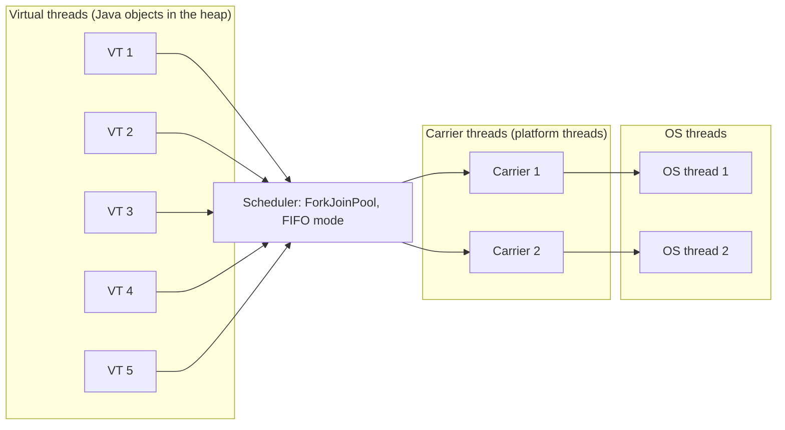
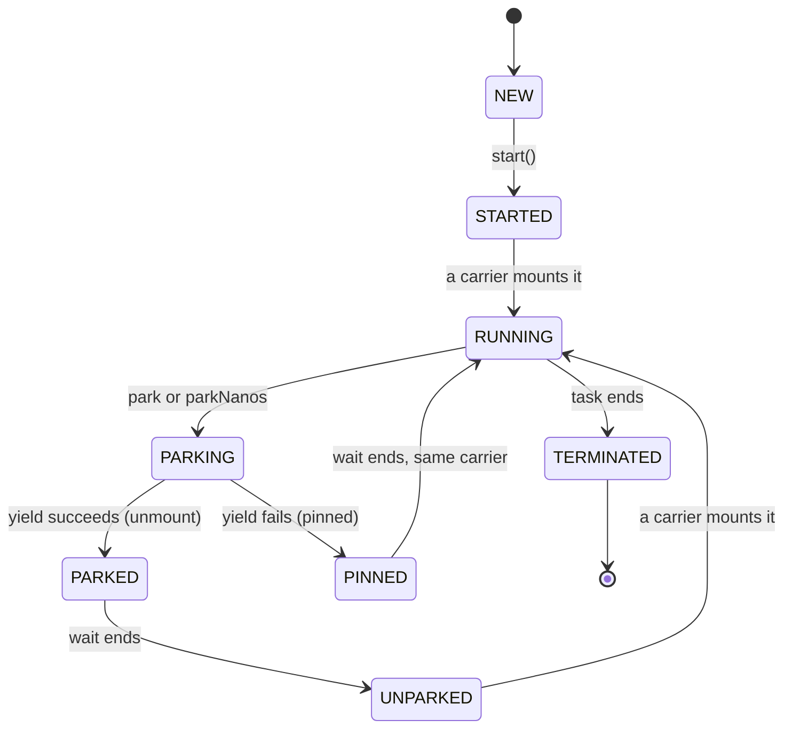

# Virtual Threads, Structured Concurrency, and Scoped Values

## Why It Matters

Java 21 made virtual threads final (JEP 444), and "What are virtual threads, and when do they not help?" is now a standard question in Java backend interviews. A strong answer names the carrier thread, the mount and unmount steps, pinning, and the rule that virtual threads give throughput for waiting work, not speed for CPU work. On the job, virtual threads let a service use one thread for each request with plain blocking code, without a thread pool that you must size and without a callback chain. In Spring Boot the change is one property, and the failures that follow (a pinned carrier, a small connection pool, a `ThreadLocal` that holds a large object) are the failures that interviewers ask about. This page explains the mechanism from the JEP and from the JDK 21 source. It also covers structured concurrency and scoped values, which were preview features in Java 21, and says what the later JDKs did with them (status checked on openjdk.org on 2026-10-22).

## Core Concepts

**Platform thread**: a `java.lang.Thread` that runs Java code on one operating system (OS) thread and keeps that OS thread for its whole lifetime (JEP 444). The OS limits the number of platform threads, because each one needs an OS thread. The thread basics are in [Concurrency Basics](07-concurrency-basics.md).

**Virtual thread**: a `java.lang.Thread` that runs Java code on an OS thread but does not keep the OS thread for its whole lifetime (JEP 444). The JDK schedules virtual threads, not the OS. The number of virtual threads can be much larger than the number of OS threads, because a virtual thread is a Java object whose stack lives in the heap while the thread waits.

**Carrier thread**: the platform thread that runs a virtual thread at a given moment. A virtual thread can run on different carriers during its life. `Thread.currentThread()` always returns the virtual thread, never the carrier (JEP 444).

**Mount and unmount**: the scheduler *mounts* a virtual thread on a carrier to run it. When the virtual thread blocks in an operation that supports it, the thread *unmounts*: the JVM copies its stack frames from the carrier into a heap object, and the carrier is free to run another virtual thread.

**Continuation**: the object that holds the paused stack of a virtual thread, with the operations *run* (mount and continue) and *yield* (unmount and pause). In the JDK 21 source, the class `jdk.internal.vm.Continuation` does this. It is an internal class, so application code does not use it directly.

**Scheduler**: the component that decides which virtual thread runs on which carrier. In JDK 21 it is one `ForkJoinPool` in first-in-first-out (FIFO) mode (JEP 444).

**Pinning**: the state in which a virtual thread cannot unmount while it blocks, so it keeps its carrier. In Java 21, a virtual thread is pinned when it runs inside a `synchronized` block or method, or when it runs a native method or a foreign function (JEP 444).

**Thread-per-request style**: a server design in which one thread handles one request from start to end, with blocking calls. Virtual threads make this style scale, because the thread is cheap.

**Structured concurrency**: an API that treats a group of related tasks, which run in different threads, as one unit of work with one lifetime, one error path, and one cancellation. It is a preview API in Java 21 (JEP 453) and still a preview API in JDK 27 (JEP 533).

**Scoped value**: an immutable value that a method shares with its callees, and with child threads in a structured scope, for a bounded time. It replaces most uses of `ThreadLocal`. It is a preview API in Java 21 (JEP 446) and final in Java 25 (JEP 506).

## How It Works

### The model: many virtual threads on few carriers



JEP 444 calls this *M:N scheduling*: a large number (M) of virtual threads runs on a smaller number (N) of OS threads. The older "green threads" of early Java used M:1 scheduling, and platform threads use 1:1 scheduling.

### Mount, unmount, and the continuation

A virtual thread has these steps in its life. The state names below come from the comment in `java.lang.VirtualThread` in the JDK 21 source.

1. `Thread.start()` moves the thread from NEW to STARTED, and submits a *run continuation* task to the scheduler.
2. A carrier takes the task and runs the continuation. The thread is now RUNNING and mounted.
3. The code calls a blocking operation, for example `Thread.sleep`, `ReentrantLock.lock`, `BlockingQueue.take`, or a socket read. The operation ends in `LockSupport.park` (or `parkNanos`). The state becomes PARKING.
4. The JVM *yields* the continuation. It copies the thread's stack frames to a *stack chunk* object in the heap. The state becomes PARKED (TIMED_PARKED for a timed wait), and the carrier is free.
5. When the wait ends (the timer fires, another thread calls `unpark`, or the I/O is ready), the JDK submits the continuation to the scheduler again. The state is UNPARKED.
6. A carrier (maybe a different one) mounts the thread, and the code continues after the blocking call.

If step 4 cannot copy the stack (the thread is pinned), the state becomes PINNED (TIMED_PINNED), and the thread parks on its carrier. The carrier then does nothing until the wait ends.



(The diagram omits the timed states and `Thread.yield`. The source comment lists all of them.)

A virtual thread's stack frames are heap objects while the thread is unmounted, so the garbage collector reclaims them when the thread ends. They grow and shrink with the call depth. Unlike a platform thread stack, a virtual thread stack is not a garbage collection root (JEP 444). One limit from the JEP: the G1 collector cannot allocate a stack chunk that is a humongous object. If a virtual thread's stack reaches half the G1 region size, the JVM can throw `StackOverflowError`. A G1 region is at least 1 MB, so that limit can be as low as 512 KB.

!!! note "Virtual threads are not faster threads"
    JEP 444 says it directly: "Virtual threads are not faster threads — they do not run code any faster than platform threads. They exist to provide scale (higher throughput), not speed (lower latency)." A virtual thread makes a waiting task cheap. It does not make a calculation shorter.

### The scheduler

The scheduler is a `ForkJoinPool` in FIFO (`asyncMode`) mode. It is not the common pool that parallel streams use. The common pool does not use `asyncMode`, so each of its workers runs its own forked tasks in last-in-first-out (LIFO) order. The JDK 21 source of `VirtualThread.createDefaultScheduler` reads three system properties:

| Property | Default in JDK 21 | Meaning |
|---|---|---|
| `jdk.virtualThreadScheduler.parallelism` | `Runtime.availableProcessors()` | The number of carriers that run virtual threads |
| `jdk.virtualThreadScheduler.maxPoolSize` | `max(parallelism, 256)` | The upper limit of carriers. The pool grows above `parallelism` when a blocking operation compensates for a captured carrier |
| `jdk.virtualThreadScheduler.minRunnable` | `max(parallelism / 2, 1)` | The minimum number of carriers that the pool keeps runnable when it compensates |

The scheduler has no time sharing (JEP 444). It does not force a virtual thread off its carrier because the thread used its time. A virtual thread leaves its carrier only when it blocks in an operation that unmounts, or when it calls `Thread.yield`. So a virtual thread that runs a CPU loop without blocking keeps its carrier until the loop ends. The program below shows it. It sets the scheduler to one carrier, so that a second virtual thread has no other carrier to run on. The properties must be set before the first virtual thread starts, because the JDK reads them once.

```java
import java.util.List;
import java.util.concurrent.CopyOnWriteArrayList;
import java.util.concurrent.CountDownLatch;

public class NoPreempt {
    public static void main(String[] args) throws Exception {
        System.setProperty("jdk.virtualThreadScheduler.parallelism", "1");
        System.setProperty("jdk.virtualThreadScheduler.maxPoolSize", "1");

        List<String> events = new CopyOnWriteArrayList<>();
        CountDownLatch busyStarted = new CountDownLatch(1);

        Thread busy = Thread.ofVirtual().unstarted(() -> {
            events.add("busy starts");
            busyStarted.countDown();
            long end = System.nanoTime() + 300_000_000L;
            while (System.nanoTime() < end) {
                // CPU work with no blocking call: the scheduler does not preempt it
            }
            events.add("busy ends");
        });
        Thread other = Thread.ofVirtual().unstarted(() -> events.add("other runs"));

        busy.start();
        busyStarted.await();
        other.start();
        busy.join();
        other.join();
        System.out.println(events);
    }
}
```

<!-- expected-output -->
```text
[busy starts, busy ends, other runs]
```

The second thread did not run during the 300 ms loop, although the thread was ready. With the default parallelism (the number of processors), a CPU-bound virtual thread blocks only one carrier. But if the number of CPU-bound virtual threads reaches the number of carriers, no other virtual thread runs, and that is why virtual threads do not help CPU-bound work.

### What unmounts and what does not

| Blocking operation | Java 21 behavior |
|---|---|
| `Thread.sleep`, `LockSupport.park`, `BlockingQueue.take`, `Future.get`, `ReentrantLock.lock`, `Semaphore.acquire`, `CountDownLatch.await` | The virtual thread unmounts. The carrier runs other work |
| Socket and `HttpClient` I/O, `java.net` and `java.nio.channels` | The virtual thread unmounts, and the JDK resumes it when the socket is ready (JEP 444, section "Networking") |
| File I/O | Many file system operations block the OS thread, because of OS limits (the thread is captured). The JDK compensates by temporarily adding a carrier (JEP 444) |
| `Object.wait` | Blocks the carrier. The JDK compensates by temporarily adding a carrier (JEP 444). JEP 491 removes this limit in Java 24 |
| Blocking inside `synchronized` | Pinned: the carrier blocks, with no compensation (JEP 444). JEP 491 removes this limit in Java 24 |
| Blocking inside a native method or a foreign function | Pinned (JEP 444). Still pinned in Java 24 and later (JEP 491) |

*Compensation* means that the operation asks the scheduler to add a carrier (up to `maxPoolSize`) for as long as the operation blocks one. The JEP states that the scheduler does not compensate for pinning.

### Pinning in Java 21

Pinning does not make a program wrong. It reduces scalability: while a pinned virtual thread blocks, its carrier does nothing. If as many virtual threads are pinned and blocked as there are carriers, no other virtual thread runs, and the application can stall.

The program below shows it. It uses one carrier. A holder virtual thread takes a lock and sleeps for 300 ms while it holds the lock. A second virtual thread only adds a line to a list. With `synchronized`, the holder is pinned while it sleeps, so the second thread cannot run on the only carrier until the holder wakes. With `ReentrantLock`, the sleep unmounts the holder, so the second thread runs at once. The output is for Java 21.

```java
import java.util.List;
import java.util.concurrent.CopyOnWriteArrayList;
import java.util.concurrent.CountDownLatch;
import java.util.concurrent.locks.ReentrantLock;

public class PinDemo {
    private static final Object MONITOR = new Object();
    private static final ReentrantLock LOCK = new ReentrantLock();

    public static void main(String[] args) throws Exception {
        // One carrier thread: a pinned virtual thread blocks every other virtual thread.
        // Set the properties before the first virtual thread starts.
        System.setProperty("jdk.virtualThreadScheduler.parallelism", "1");
        System.setProperty("jdk.virtualThreadScheduler.maxPoolSize", "1");

        System.out.println("synchronized: " + run(true));
        System.out.println("ReentrantLock: " + run(false));
    }

    private static List<String> run(boolean useSynchronized) throws Exception {
        List<String> events = new CopyOnWriteArrayList<>();
        CountDownLatch holderInside = new CountDownLatch(1);

        Thread holder = Thread.ofVirtual().unstarted(() -> {
            if (useSynchronized) {
                synchronized (MONITOR) {
                    sleepWhileHolding(events, holderInside);
                }
            } else {
                LOCK.lock();
                try {
                    sleepWhileHolding(events, holderInside);
                } finally {
                    LOCK.unlock();
                }
            }
        });
        Thread other = Thread.ofVirtual().unstarted(() -> events.add("other ran"));

        holder.start();
        holderInside.await();   // main is a platform thread, so it does not need a carrier
        other.start();
        holder.join();
        other.join();
        return events;
    }

    private static void sleepWhileHolding(List<String> events, CountDownLatch inside) {
        events.add("holder sleeps");
        inside.countDown();
        try {
            Thread.sleep(300);   // blocking call while the lock is held
        } catch (InterruptedException e) {
            Thread.currentThread().interrupt();
        }
        events.add("holder wakes");
    }
}
```

<!-- expected-output -->
```text
synchronized: [holder sleeps, holder wakes, other ran]
ReentrantLock: [holder sleeps, other ran, holder wakes]
```

How to find pinning in Java 21 (JEP 444):

- JDK Flight Recorder (JFR) records the event `jdk.VirtualThreadPinned` when a virtual thread blocks while pinned.
- The system property `-Djdk.tracePinnedThreads=full` prints a stack trace that marks native frames and frames that hold monitors, whenever a virtual thread blocks while pinned. The value `short` prints only the frames that cause the pinning.

How to fix pinning in Java 21: replace a `synchronized` block that runs often and guards a long blocking call (I/O, a remote call) with a `ReentrantLock`. JEP 444 says that a `synchronized` block that runs rarely (for example at startup) or guards only in-memory work needs no change.

### JEP 491 (Java 24): no pinning in `synchronized`

JEP 491, "Synchronize Virtual Threads without Pinning", has status "Closed / Delivered" in release 24 (openjdk.org, checked 2026-10-22). The JVM now lets a virtual thread acquire, hold, and release a monitor independently of its carrier:

- A virtual thread that blocks to acquire a monitor unmounts. When the monitor becomes free, the JVM submits the thread to the scheduler.
- `Object.wait` (and the timed variants) unmounts the virtual thread, and `notify` resubmits it.
- The `ReentrantLock` and `synchronized` APIs now differ only in their features, not in their effect on virtual threads. The JEP says to choose between them by which one solves the problem better. For new code, it repeats the advice of *Java Concurrency in Practice* (section 13.4): use `synchronized` where practical, and use `ReentrantLock` when you need its extra features (`tryLock`, timed or interruptible waits, several conditions, fairness). Code that already moved from `synchronized` to `ReentrantLock` does not need to move back.

What still pins in Java 24 and later (JEP 491): a virtual thread that calls native code (a native method or the foreign function and memory API) that calls back into Java code which blocks or waits for a monitor; blocking while the JVM loads a class; blocking inside a class initializer; and waiting for another thread to finish class initialization. JFR still records `jdk.VirtualThreadPinned`, now with the reason and the carrier. The property `jdk.tracePinnedThreads` is removed: setting it has no effect.

Recommendation: on Java 21, treat a `synchronized` block that holds a lock across blocking I/O as a defect, and use `ReentrantLock` there. On Java 24 or later (including Java 25, the current long-term-support release), you do not need that change for `synchronized`. The expected output above is from Java 21. The same `PinDemo` class, run five times on JDK 25.0.5 (Temurin build 25.0.5+8, run on 2026-10-22), printed this on every run:

```text
synchronized: [holder sleeps, other ran, holder wakes]
ReentrantLock: [holder sleeps, other ran, holder wakes]
```

On JDK 25 the holder unmounts while it sleeps inside `synchronized`, so the second thread runs on the only carrier, as JEP 491 states. The `NoPreempt` program printed the Java 21 output on JDK 25 as well, because JEP 491 did not add time sharing.

### Creating virtual threads

The JDK 21 javadoc of `Thread` lists the ways:

| Way | Result |
|---|---|
| `Thread.startVirtualThread(Runnable)` | Creates and starts one virtual thread |
| `Thread.ofVirtual().name("w-", 0).start(task)` | A `Thread.Builder.OfVirtual`: sets the name (with a counter) and starts, or `unstarted(task)` to start later |
| `Thread.ofVirtual().factory()` | A `ThreadFactory` that creates virtual threads, for APIs that take a factory |
| `Executors.newVirtualThreadPerTaskExecutor()` | An `ExecutorService` that starts a new virtual thread for each task, and does not pool |
| `Executors.newThreadPerTaskExecutor(factory)` | The same, with your own `ThreadFactory` |

A virtual thread has fixed properties (JDK 21 javadoc of `Thread`): it is always a daemon thread, so the JVM does not wait for it at exit. `setDaemon(false)` throws `IllegalArgumentException`. Its priority is always `NORM_PRIORITY`, and `setPriority` has no effect. It belongs to a group named `VirtualThreads`. Its name is the empty string unless you set it. A virtual thread is cheap, so create one for each task and let it end. `ExecutorService` is `AutoCloseable` since Java 19, so the `try`-with-resources block in the examples calls `close()`, which waits for all tasks to finish.

### `ThreadLocal` and virtual threads

Virtual threads support `ThreadLocal` and `InheritableThreadLocal` like platform threads. Since JEP 444, this support is always on. Each virtual thread has its own map of thread-local values. This has two effects:

1. A *thread-local cache* (the pattern "one `SimpleDateFormat` or one buffer for each pool thread") now creates one object for each virtual thread. With a million virtual threads, that is a million objects, and no sharing. JEP 444 warns that code that moves from a pool to a virtual thread for each task may degrade a lot, and says to use another caching strategy.
2. A thread-local value holds memory for the lifetime of the thread. A virtual thread is short, so the value usually goes away with the thread, but a large value for each of many concurrent threads adds up.

The program below counts how many times the `ThreadLocal` initializer runs. A pool of four platform threads creates four buffers for 1000 tasks. A virtual thread for each task creates 1000.

```java
import java.util.concurrent.ExecutorService;
import java.util.concurrent.Executors;
import java.util.concurrent.atomic.AtomicInteger;

public class TlDemo {
    private static final AtomicInteger CREATED = new AtomicInteger();

    // Stands for an expensive object, such as a date formatter or a buffer.
    private static final ThreadLocal<byte[]> BUFFER = ThreadLocal.withInitial(() -> {
        CREATED.incrementAndGet();
        return new byte[8 * 1024];
    });

    private static int runTasks(ExecutorService executor, int tasks) throws Exception {
        CREATED.set(0);
        try (executor) {                      // close() waits for all tasks to finish
            for (int i = 0; i < tasks; i++) {
                executor.submit(() -> BUFFER.get().length);
            }
        }
        return CREATED.get();
    }

    public static void main(String[] args) throws Exception {
        int platform = runTasks(Executors.newFixedThreadPool(4), 1_000);
        int virtual = runTasks(Executors.newVirtualThreadPerTaskExecutor(), 1_000);
        System.out.println("1000 tasks on a pool of 4 platform threads: " + platform + " buffers");
        System.out.println("1000 tasks on virtual threads: " + virtual + " buffers");
    }
}
```

<!-- expected-output -->
```text
1000 tasks on a pool of 4 platform threads: 4 buffers
1000 tasks on virtual threads: 1000 buffers
```

An `InheritableThreadLocal` is copied from the parent when a thread starts, and virtual threads copy it by default. `Thread.ofVirtual().inheritInheritableThreadLocals(false)` turns that off (the builder method exists in JDK 21). The carrier's thread locals are invisible to the virtual thread (JEP 444). For data that a method shares with its callees, use a scoped value (see below). For an expensive shared resource, use a shared thread-safe object or a pool, not a `ThreadLocal`.

### Limit concurrency with a `Semaphore`, not a pool

A thread pool limits how many tasks run at once, as a side effect. Old code used a pool of 20 threads to limit calls to a service that cannot take more than 20. With virtual threads, JEP 444 says: do not pool virtual threads to limit concurrency, because a pool shares an expensive resource and a virtual thread is not expensive. Use a construct made for the limit, for example a `Semaphore`. A virtual thread that waits on `Semaphore.acquire` unmounts, so waiting costs no carrier.

```java
import java.time.Duration;
import java.util.concurrent.Executors;
import java.util.concurrent.Semaphore;
import java.util.concurrent.atomic.AtomicInteger;

public class LimitDemo {
    public static void main(String[] args) throws Exception {
        Semaphore permits = new Semaphore(3);        // the downstream service takes 3 calls at once
        AtomicInteger inside = new AtomicInteger();
        AtomicInteger maxInside = new AtomicInteger();
        AtomicInteger completed = new AtomicInteger();

        try (var executor = Executors.newVirtualThreadPerTaskExecutor()) {
            for (int i = 0; i < 100; i++) {
                executor.submit(() -> {
                    permits.acquire();               // a waiting virtual thread unmounts
                    try {
                        int now = inside.incrementAndGet();
                        maxInside.accumulateAndGet(now, Math::max);
                        Thread.sleep(Duration.ofMillis(10));   // the downstream call
                        inside.decrementAndGet();
                    } finally {
                        permits.release();
                    }
                    completed.incrementAndGet();
                    return null;
                });
            }
        }
        System.out.println("completed=" + completed.get());
        System.out.println("never more than 3 at once: " + (maxInside.get() <= 3));
    }
}
```

<!-- expected-output -->
```text
completed=100
never more than 3 at once: true
```

### Structured concurrency (preview in Java 21)

Unstructured concurrency with `ExecutorService` has no link between a task and its parent. If the method that submitted two tasks fails or returns early, the tasks keep running (a *thread leak*), and if one task fails, the other task runs to the end for nothing. Structured concurrency adds one rule: *a task that splits into subtasks must wait for all of them before it returns*. The subtasks live inside a scope, like a local variable lives inside a block.

In Java 21 the API is `java.util.concurrent.StructuredTaskScope` (preview in Java 21, JEP 453):

- `new StructuredTaskScope.ShutdownOnFailure()` cancels the other subtasks when one subtask fails.
- `new StructuredTaskScope.ShutdownOnSuccess<T>()` cancels the other subtasks when one subtask succeeds, and returns that result ("first answer wins").
- `scope.fork(Callable)` starts a subtask in a new virtual thread and returns a `Subtask`. Since JEP 453, `fork` returns a `Subtask`, not a `Future`.
- `scope.join()` waits for all subtasks, or until the scope shuts down. `throwIfFailed()` throws an `ExecutionException` that wraps the first failure.
- `close()` (from `try`-with-resources) shuts down the scope and waits for all threads to end. If the owner forked subtasks and left the block without `join`, `close()` throws `IllegalStateException` ("Owner did not join after forking subtasks", tested on JDK 21) after it cancels the subtasks.

A preview feature compiles and runs only with `--enable-preview` (JEP 12). The program below uses both preview APIs of this page, so its block carries the `<!-- preview -->` marker. Run it with `java --enable-preview --source 21 Struct.java`.

<!-- preview -->
```java
import java.time.Duration;
import java.util.concurrent.ExecutionException;
import java.util.concurrent.StructuredTaskScope;
import java.util.concurrent.StructuredTaskScope.Subtask;
import java.util.concurrent.atomic.AtomicBoolean;

public class Struct {
    static final ScopedValue<String> USER = ScopedValue.newInstance();

    static String findUser() {
        return "user=" + USER.get();            // reads the binding of the caller
    }

    static String findOrders() {
        return "orders(" + USER.get() + ")";
    }

    public static void main(String[] args) throws Exception {
        // Success: both subtasks finish, and both see the scoped value.
        ScopedValue.where(USER, "ana").run(() -> {
            try (var scope = new StructuredTaskScope.ShutdownOnFailure()) {
                Subtask<String> user = scope.fork(Struct::findUser);
                Subtask<String> orders = scope.fork(Struct::findOrders);
                scope.join().throwIfFailed();
                System.out.println(user.get() + " " + orders.get());
            } catch (InterruptedException | ExecutionException e) {
                throw new IllegalStateException(e);
            }
        });
        System.out.println("outside the scope, bound=" + USER.isBound());

        // Failure: one subtask fails, the scope cancels the slow sibling.
        AtomicBoolean slowInterrupted = new AtomicBoolean();
        try (var scope = new StructuredTaskScope.ShutdownOnFailure()) {
            scope.fork(() -> {
                try {
                    Thread.sleep(Duration.ofSeconds(30));
                } catch (InterruptedException e) {
                    slowInterrupted.set(true);
                    throw e;
                }
                return "slow";
            });
            scope.fork(() -> {
                throw new IllegalArgumentException("payment failed");
            });
            scope.join().throwIfFailed();
        } catch (ExecutionException e) {
            System.out.println("failed: " + e.getCause().getMessage());
        }
        System.out.println("slow sibling interrupted: " + slowInterrupted.get());
    }
}
```

<!-- expected-output -->
```text
user=ana orders(ana)
outside the scope, bound=false
failed: payment failed
slow sibling interrupted: true
```

The first part forks two subtasks, and both read the scoped value `USER` that the caller bound. The second part shows the failure rule: the failed subtask makes `join().throwIfFailed()` throw, and the scope interrupts the slow sibling before it closes. After the `try` block, the program can safely read the flag, because `close()` waited for the sibling.

Status in later JDKs (openjdk.org, checked 2026-10-22):

| JDK | JEP | Status of structured concurrency |
|---|---|---|
| 19, 20 | 428, 437 | Incubator module |
| 21 | 453 | Preview. `fork` returns a `Subtask` |
| 22, 23, 24 | 462, 480, 499 | Second, third, and fourth preview (no big API change) |
| 25 | 505 | Fifth preview, with several API changes. Public constructors are replaced by static factory methods (`StructuredTaskScope.open()`), and policies are `Joiner` objects |
| 26 | 525 | Sixth preview, with minor changes |
| 27 | 533 | Seventh preview. Status "Closed / Delivered" in release 27. `StructuredTaskScope` and `Joiner` get a third type parameter for the exception of `join()`, `awaitAll()` is removed, and `onTimeout()` becomes `timeout()` |

Structured concurrency is therefore still a preview API in the newest JDK (27), after seven rounds. Code written for the Java 21 API (`new StructuredTaskScope.ShutdownOnFailure()`) does not compile on Java 25 or later without changes. Recommendation: do not put the preview API in production code. Know the idea, because interviews ask about it, and use `ExecutorService` with `try`-with-resources and `Future` until the API is final.

### Scoped values (preview in Java 21, final in Java 25)

A `ThreadLocal` is mutable, lives as long as the thread, and a child thread must copy it. A `ScopedValue` is immutable and exists only inside a `run` or `call` block that binds it (JEP 506). Code in the block, and the methods it calls, can read the value with `get()`. When the block ends, the binding ends. Child threads that a `StructuredTaskScope` starts inside the block inherit the binding without copying. The program above shows it: the subtasks call `USER.get()` and read `"ana"`, and after the block, `USER.isBound()` is `false`.

| | `ThreadLocal` | `ScopedValue` |
|---|---|---|
| Mutable | Yes, with `set` | No. A new binding for an inner scope hides the outer one, and the outer one returns when the inner scope ends |
| Lifetime | Until `remove()` or the end of the thread | The bound block |
| Child threads | `InheritableThreadLocal` copies the value | A structured scope shares the binding with no copy |
| Cost with many virtual threads | One map entry for each thread | Lower in space and time (JEP 506) |

Status: preview in Java 21 (JEP 446), 22 (JEP 464), 23 (JEP 481), and 24 (JEP 487). Final in Java 25 (JEP 506, "Closed / Delivered", release 25). The one change that JEP 506 lists from Java 24 is that `ScopedValue.orElse` no longer accepts `null`. The Java 21 label stays: on Java 21, a program that uses `ScopedValue` needs `--enable-preview`.

### Spring Boot support

Spring Boot 3.2 added support for virtual threads (Spring Boot 3.2 release notes). It needs Java 21 or later and one property:

```properties
spring.threads.virtual.enabled=true
```

The Spring Boot 3.2 release notes and the current (4.1) reference page "Task Execution and Scheduling" (both checked 2026-10-22) say that this property changes these things:

- Tomcat and Jetty run request processing on virtual threads, so a controller method runs in a virtual thread.
- The auto-configured `applicationTaskExecutor` (an `AsyncTaskExecutor`) is a `SimpleAsyncTaskExecutor` that starts a virtual thread for each task, instead of a `ThreadPoolTaskExecutor`. `@Async` methods, asynchronous request handling in Spring MVC, blocking execution in Spring WebFlux, Spring WebSocket message channels, and the JPA bootstrap executor use it, unless you define your own `Executor` bean. The `spring.task.execution.pool.*` properties no longer apply, because nothing is pooled. `TaskDecorator` beans and `spring.task.execution.thread-name-prefix` still apply.
- The auto-configured `taskScheduler` (for `@Scheduled`) is a `SimpleAsyncTaskScheduler` that runs each task on a virtual thread. It ignores the pool properties.
- The listener containers of Spring for Apache Kafka and Spring AMQP (RabbitMQ) get a virtual-thread executor.

One side effect follows from the daemon rule: a virtual thread does not keep the JVM alive. An application whose only work is `@Scheduled` tasks or message listeners, with no web server, can exit after startup. Spring Boot 3.2 added `spring.main.keep-alive=true` for this case: it keeps the JVM running even when all remaining threads are virtual or daemon threads.

The property name is the same in Spring Boot 3.2 to 3.5 and in the current reference documentation. On 2026-10-22, the Spring release API (`api.spring.io`) lists Spring Boot 4.1.1 as the current generally available version, and 3.5.16 and 4.0.8 as other generally available versions. The default value of the property is `false` in the application properties appendix.

What the property does not change:

- A *connection pool* still limits concurrency. HikariCP has a default `maximumPoolSize` of 10 (HikariCP README). A million virtual threads then wait on 10 connections. Size the pool for the database, not for the thread count.
- Code that runs on a platform thread, for example a `ThreadPoolTaskExecutor` bean that you define, stays on platform threads.
- On Java 21, a library that blocks inside `synchronized` (a JDBC driver or an HTTP client library, for example) pins the carrier. Find it with the JFR event `jdk.VirtualThreadPinned`, then upgrade the library, or move to Java 24 or later (JEP 491).
- Context that lives in a `ThreadLocal` (the Spring Security context, the logging MDC, the transaction context) stays in the thread that set it, as with platform threads. A task that `@Async` starts runs in a new virtual thread and does not see that context, unless a `TaskDecorator` copies it (Spring Boot applies a `TaskDecorator` bean to the auto-configured executor). Also check any custom `ThreadLocal` that holds a large object, because there is now one copy for each request.

Spring Boot code is not in this page's runnable examples, because the runner has no Spring libraries.

## Trade-offs and When to Use

| Option | Use it when | Strength | Weakness |
|---|---|---|---|
| Virtual thread for each task | Many concurrent tasks, mostly waiting on I/O (more than a few thousand, JEP 444). Thread-per-request servers | Simple blocking code. Readable stack traces and debugger. Scales with the number of waiting tasks | No gain for CPU-bound work. Needs a limit for scarce resources. Pinning on Java 21 |
| Platform thread pool | CPU-bound work (a pool of about the number of cores). Few long-lived threads | Predictable, limits the work in flight | A blocked thread wastes an OS thread. Pool size needs tuning |
| `CompletableFuture`, see [CompletableFuture](09-completablefuture.md) | A fixed graph of async steps, fan-out and fan-in | No thread blocks while a step waits | Hard to debug, a stack trace does not show the cause chain. Viral async style |
| Reactive streams (for example WebFlux) | You need back pressure and stream operators | Few threads, composition of streams | A different programming model. Hard stack traces |
| Parallel streams | CPU-bound data parallelism on a collection | Short code | Uses the common pool. Wrong for blocking tasks |

When virtual threads help (JEP 444): the number of concurrent tasks is high, and the work is not CPU-bound. When they do not help: a CPU-bound task (more threads than cores do not add throughput, whether virtual or platform), a task that needs strict limits on concurrency (add a `Semaphore`), and code that is blocked inside native frames. Little's Law, which the JEP cites, is why more threads give more throughput for waiting tasks: throughput equals the number of concurrent requests divided by the latency of each request, so for a given latency, the system can only raise throughput by running more requests at once.

## Java Example

The first program shows the API and the scale. It prints the fixed properties of a virtual thread, runs 10,000 tasks that each wait 100 ms, and names threads with a builder. The output does not depend on timing, because the program joins every thread before it prints the result.

```java
import java.time.Duration;
import java.util.concurrent.Executors;
import java.util.concurrent.atomic.AtomicInteger;

public class Basics {
    public static void main(String[] args) throws Exception {
        // 1. A virtual thread is a Thread with fixed properties.
        Thread vt = Thread.ofVirtual().name("worker-", 0).unstarted(() -> { });
        System.out.println("isVirtual=" + vt.isVirtual());
        System.out.println("isDaemon=" + vt.isDaemon());
        System.out.println("priority=" + vt.getPriority());
        System.out.println("name=" + vt.getName());
        vt.start();
        vt.join();
        System.out.println("state after join=" + vt.getState());

        // 2. 10,000 tasks that each wait 100 ms run at the same time.
        AtomicInteger done = new AtomicInteger();
        try (var executor = Executors.newVirtualThreadPerTaskExecutor()) {
            for (int i = 0; i < 10_000; i++) {
                executor.submit(() -> {
                    Thread.sleep(Duration.ofMillis(100));
                    done.incrementAndGet();
                    return null;
                });
            }
        } // close() waits for all tasks
        System.out.println("completed=" + done.get());

        // 3. Thread.startVirtualThread and a builder factory.
        var factory = Thread.ofVirtual().name("job-", 1).factory();
        Thread a = factory.newThread(() -> { });
        Thread b = factory.newThread(() -> { });
        System.out.println(a.getName() + " " + b.getName());
        Thread c = Thread.startVirtualThread(() -> { });
        c.join();
        System.out.println("started and finished: " + !c.isAlive());
    }
}
```

<!-- expected-output -->
```text
isVirtual=true
isDaemon=true
priority=5
name=worker-0
state after join=TERMINATED
completed=10000
job-1 job-2
started and finished: true
```

The second program, in the section on structured concurrency above, uses the Java 21 preview APIs. The other programs on this page show the scheduler, pinning, `ThreadLocal` cost, and the `Semaphore` limit. The classic coding problems in [Concurrency Coding Problems](11-concurrency-coding-problems.md) use platform threads, because they teach the primitives.

## Interview Angle

### Questions

??? question "What is a virtual thread, and how is it different from a platform thread?"

    A virtual thread (JEP 444, final in Java 21) is a `java.lang.Thread` that the JDK schedules, not the OS. A platform thread holds one OS thread for its whole life. A virtual thread holds an OS thread only while it runs, and it releases it when it blocks. So a JVM can run millions of virtual threads on a few OS threads.

    Both are `Thread` objects with the same API, the same memory model, and `ThreadLocal`. The difference is cost and count: a virtual thread is a heap object with a small, growable stack, so you create one for each task and do not pool it. Virtual threads are always daemon threads. They give throughput for waiting work, not faster execution. See [How It Works](#how-it-works).

??? question "How does the JVM run a virtual thread?"

    A scheduler (a `ForkJoinPool` in FIFO mode, with `availableProcessors()` carriers by default) mounts the virtual thread on a carrier thread, which is a platform thread. The code runs on the carrier. When the code blocks in an operation that supports it (sleep, lock, queue, socket I/O), the JVM unmounts the thread: it copies the stack frames into a heap object (a stack chunk), and the carrier runs another virtual thread. When the wait ends, the JDK submits the thread to the scheduler, and a carrier (maybe another) mounts it and continues.

    The parts: a continuation holds the paused stack, the scheduler picks carriers, and `park` and `unpark` are the points where the thread unmounts and is resubmitted. There is no time slicing, so a thread that does not block keeps its carrier.

??? question "When do virtual threads help, and when do they not?"

    They help when many tasks run at once and most of the time each task waits: a server that calls a database and other services for each request. The JEP says more than a few thousand concurrent tasks, and not CPU-bound. The code stays simple blocking code, and throughput rises because a waiting task costs no OS thread.

    They do not help CPU-bound work, because more threads than cores add nothing, and the scheduler does not preempt. They do not remove other limits: a connection pool of 10 still allows 10 concurrent queries. And on Java 21, long blocking inside `synchronized` pins the carrier. Use a platform pool with about one thread for each core for CPU work.

??? question "What is pinning? How do you find it and fix it?"

    Pinning means a virtual thread blocks and cannot unmount, so it keeps its carrier. In Java 21, the causes are blocking inside `synchronized` (a block or a method) and blocking inside a native frame (a native method or a foreign function). The scheduler does not compensate for pinning. If as many virtual threads are pinned and blocked as there are carriers, the application stalls.

    Find it with the JFR event `jdk.VirtualThreadPinned` or with `-Djdk.tracePinnedThreads=full` (Java 21). Fix it by replacing a frequently run `synchronized` block that guards blocking I/O with a `ReentrantLock`. JEP 491 (Java 24) removes the `synchronized` case: a virtual thread can unmount while it blocks on a monitor or in `Object.wait`. Native frames that call back into blocking Java code, class loading, and class initializers still pin. After JEP 491 the JEP's advice for new code is `synchronized` where practical and `ReentrantLock` only for its extra features, and code that already moved to `ReentrantLock` need not move back. See [Pinning in Java 21](#pinning-in-java-21).

??? question "Should you pool virtual threads? How do you limit concurrency?"

    No. A pool shares expensive resources, and a virtual thread is cheap, so JEP 444 says there is never a need to pool them. Create one for each task, for example with `Executors.newVirtualThreadPerTaskExecutor()`.

    To limit concurrent access to a scarce resource, use a `Semaphore` around the call. A virtual thread that waits on the semaphore unmounts, so the wait costs no carrier. A pool of 20 threads limited calls by accident in the platform-thread world, and a pool of virtual threads would hide the real limit.

??? question "How do virtual threads compare with `CompletableFuture` and reactive code?"

    All three aim at high concurrency without one OS thread per waiting task. `CompletableFuture` and reactive code do it with callbacks, so the code is asynchronous, the stack trace does not show the logical flow, and a debugger cannot step through the chain. Virtual threads keep the blocking style: sequential code, normal exceptions, normal stack traces, and normal debugging. JFR and the debugger work per virtual thread.

    The costs of virtual threads: no back pressure operators (use a `Semaphore` or a bounded queue), and no gain for CPU-bound work. `CompletableFuture` still fits a fixed graph of async steps ([CompletableFuture](09-completablefuture.md)). Reactive streams still fit when you need back pressure on a stream of events.

??? question "What changes for `ThreadLocal` with virtual threads?"

    It works the same way: each virtual thread has its own values, and `InheritableThreadLocal` copies the parent's values by default. What changes is the cost model. A thread-local cache on a pool thread is shared by many tasks, so it is cheap. On virtual threads, one thread runs one task, so each task creates its own copy, and a million concurrent tasks create a million copies.

    Fix it by caching in a shared thread-safe object or a bounded pool, or pass the data as a parameter. For context that a call chain needs to read, a scoped value is the better tool: it is immutable, bounded to a block, and cheaper (JEP 506). In a platform thread pool, also call `remove()` at the end of a task, as the concurrency page explains.

??? question "How do you enable virtual threads in Spring Boot, and what does it change?"

    Set `spring.threads.virtual.enabled=true` on Java 21 or later with Spring Boot 3.2 or later (the property has the same name in Spring Boot 4.x). Tomcat and Jetty then handle requests on virtual threads. The auto-configured `applicationTaskExecutor` becomes a `SimpleAsyncTaskExecutor` that starts a virtual thread for each task, and `@Async`, Spring MVC async handling, and WebFlux blocking execution use it. The `taskScheduler` for `@Scheduled` becomes a `SimpleAsyncTaskScheduler` on virtual threads, and the Kafka and RabbitMQ listener containers get a virtual-thread executor. The `spring.task.execution.pool.*` settings stop applying, because nothing is pooled.

    It does not change the size of the connection pool (HikariCP has a default `maximumPoolSize` of 10), it does not move your own `ThreadPoolTaskExecutor` beans to virtual threads, and on Java 21 a library that blocks inside `synchronized` still pins. Virtual threads are daemon threads, so an application without a web server (only listeners or `@Scheduled` jobs) can exit after startup: set `spring.main.keep-alive=true`. Check the pool size, check `ThreadLocal` context in `@Async` tasks (a `TaskDecorator` copies it), and test under load.

??? question "What is structured concurrency, and what is its status?"

    Structured concurrency treats a group of tasks in different threads as one unit of work. A `StructuredTaskScope` forks subtasks, `join()` waits for them, and leaving the scope waits for every thread to end. If one subtask fails, `ShutdownOnFailure` cancels the others. So there are no leaked threads, errors propagate to the parent, and a thread dump shows the parent-child relation.

    The status: it was a preview API in Java 21 (JEP 453). It is still a preview API in JDK 27 (JEP 533, the seventh preview), and the API changed between previews: JEP 505 (Java 25) replaced the public constructors with static factory methods and `Joiner` policies. You need `--enable-preview` to use it, so it does not belong in production code today. Until then, use `ExecutorService` with `try`-with-resources and `Future`.

??? question "What is the difference between `ThreadLocal` and `ScopedValue`?"

    A `ThreadLocal` is a mutable variable per thread that lives until `remove()` or until the thread ends. A `ScopedValue` is an immutable binding that exists only while a `ScopedValue.where(...).run(...)` block runs. Callees read it with `get()`. The binding ends with the block, so it cannot leak, and no code can change it. A nested binding hides the outer value for the inner block only.

    Child threads that a `StructuredTaskScope` starts inherit the binding without a copy. A scoped value costs less than a thread-local with many virtual threads (JEP 506). It was a preview API in Java 21 (JEP 446) and is final in Java 25 (JEP 506).

??? question "Do virtual threads change the Java memory model or the need for synchronization?"

    No. A virtual thread is a `Thread`, and the same rules apply: happens-before edges, `volatile`, `synchronized`, and `java.util.concurrent`. A race that exists with platform threads exists with virtual threads. Virtual threads can make races more likely, because you run many more threads at once.

    What changes is blocking: a blocking call unmounts the thread instead of blocking an OS thread. So code that used a small pool as a hidden limit on concurrency (for example, a pool of 10 threads that protects a non-thread-safe resource) loses that limit and needs an explicit lock or semaphore. See [Concurrency Basics](07-concurrency-basics.md).

??? question "A virtual thread runs a loop that never blocks. What happens to the other virtual threads?"

    The scheduler has no time sharing, so it does not preempt the thread. The thread keeps its carrier until the loop ends. Other virtual threads run on the other carriers. If as many such threads run as there are carriers, every other virtual thread waits, and the application looks hung.

    So run CPU-bound work on a bounded platform-thread pool, not on virtual threads. The same happens with pinning: a pinned thread that blocks keeps its carrier too.

??? question "How do you observe virtual threads in production?"

    JEP 444 does not extend the traditional thread dump (`jstack`, `jcmd <pid> Thread.print`) to virtual threads, because a dump of millions of threads in that format is not useful. It adds a new dump: `jcmd <pid> Thread.dump_to_file -format=json <file>`, which lists virtual threads together with platform threads, grouped. JFR records virtual-thread events, among them `jdk.VirtualThreadPinned`, and associates other events with the correct virtual thread. A debugger can step through a virtual thread. In Java 21, the property `-Djdk.tracePinnedThreads` prints a trace when a thread blocks while pinned.

### Follow-up Questions

??? question "Why does a virtual thread not keep the JVM alive?"

    A virtual thread is always a daemon thread. The JVM exits when the last non-daemon thread ends, so `main` must wait (with `join`, or with `close()` on the executor) for the virtual threads that it needs. `setDaemon(false)` on a virtual thread throws `IllegalArgumentException`. The same rule is why Spring Boot has `spring.main.keep-alive`: with virtual threads enabled, an application that has only listeners or scheduled tasks would otherwise exit.

??? question "What are the default number of carriers and the limit of the scheduler?"

    By default, `jdk.virtualThreadScheduler.parallelism` is `availableProcessors()`, and `jdk.virtualThreadScheduler.maxPoolSize` is the larger of the parallelism and 256 (JDK 21 source, `VirtualThread.createDefaultScheduler`). The pool grows above the parallelism only to compensate for operations that block a carrier, such as file I/O and `Object.wait` in Java 21. It does not grow for pinning.

??? question "Where do the frames of an exception thrown in a virtual thread come from?"

    The stack trace holds only the virtual thread's frames. The carrier's frames are not part of it, and the other way round (JEP 444). `Thread.currentThread()` returns the virtual thread, so code cannot see its carrier.

??? question "What did Java 24 to 25 change for virtual threads?"

    JEP 491 (Java 24) removed pinning in `synchronized` and `Object.wait`. Native frames, class loading, and class initializers still pin. JEP 506 (Java 25) made scoped values final. Structured concurrency stayed in preview (JEP 505 in Java 25, and JEP 533 in JDK 27). Java 25 is a long-term-support release, so many teams reach these changes by moving from 21 to 25.

??? question "Is a virtual thread the same as a coroutine or a goroutine?"

    The idea is the same: a user-mode thread that a runtime schedules on few OS threads (JEP 444 names goroutines in Go and processes in Erlang). Kotlin coroutines are different in how they work: the Kotlin compiler transforms each `suspend` function into a state machine, so only code marked `suspend` can pause, and a blocking JDK call inside a coroutine still blocks its OS thread. A virtual thread needs no keyword and no compiler change: the JVM saves the stack, so existing blocking code (JDBC, `java.net`, `Thread.sleep`) unmounts without changes. The limit of the JVM approach is that code that the JVM cannot unmount (native frames, and `synchronized` on Java 21) pins the carrier.

### Red Flags

- "Virtual threads are faster than platform threads." They are cheaper to create and to block, not faster to run.
- "Use a thread pool of virtual threads to limit concurrency." Pools of virtual threads are an anti-pattern (JEP 444). Use a `Semaphore`.
- "Virtual threads fix CPU-bound performance." They do not, and the scheduler does not preempt.
- "`synchronized` is always bad with virtual threads." That is true only on Java 21 to 23 for long blocking inside the block. JEP 491 removes the pinning in Java 24.
- "Structured concurrency and scoped values are final in Java 21." Both were preview APIs in Java 21. Scoped values are final in Java 25, and structured concurrency is still a preview API in JDK 27.
- "Turning on `spring.threads.virtual.enabled` removes the need to size the connection pool."

## Common Mistakes

| Mistake | Why it fails | Fix |
|---|---|---|
| Pool virtual threads (`newFixedThreadPool` with a virtual-thread factory) to limit concurrency | The pool adds queueing and hides the real limit. Virtual threads need no pool | `newVirtualThreadPerTaskExecutor()` and a `Semaphore` for the limit |
| Run CPU-bound work on virtual threads | No time sharing, and more threads than cores add no throughput | A bounded platform-thread pool, or a `ForkJoinPool` |
| Hold a `synchronized` lock across blocking I/O on Java 21 | The thread is pinned, so it blocks its carrier. If as many are pinned as there are carriers, the application stalls | `ReentrantLock`, or move to Java 24 or later (JEP 491) |
| A thread-local cache of an expensive object, moved to virtual threads | One object for each virtual thread | A shared thread-safe object, a bounded pool, or a scoped value for context |
| Forget that virtual threads are daemon threads | `main` returns and the JVM exits before the tasks end | `join()`, or `close()` on the executor |
| Size the connection pool by the number of virtual threads | The database is the limit. A million threads wait on 10 connections | Size the pool for the database, and add a timeout |
| Use a preview API (structured concurrency, Java 21 scoped values) in production | It needs `--enable-preview`, the class files are tied to the JDK version, and the API changes between releases | Use `ExecutorService` until the API is final. Use scoped values from Java 25 |
| Set the scheduler properties after the first virtual thread started | The JDK reads the properties once, when it creates the scheduler | Set them with `-D` on the command line |
| Assume `synchronized` still pins on Java 24 or later | JEP 491 removed that pinning | Check for the remaining causes (native frames, class initializers) |

## Commonly Confused With

| Looks like | Difference | Deciding question |
|---|---|---|
| Virtual thread and platform thread | A platform thread keeps an OS thread for its life. A virtual thread keeps a carrier only while it runs | Does the thread spend most of its time waiting? |
| Virtual thread and thread pool | A pool reuses a few expensive threads. A virtual thread is cheap, so you do not reuse it | Am I pooling to save threads or to limit concurrency? |
| Carrier thread and virtual thread | The carrier is the platform thread that runs the virtual thread at that moment. The virtual thread is the `Thread` you see in `currentThread()` | Which thread does `Thread.currentThread()` return? |
| Pinning and blocking | A blocked virtual thread can unmount. A pinned and blocked virtual thread cannot | Is the blocking call inside `synchronized` or a native frame (Java 21)? |
| `ThreadLocal` and `ScopedValue` | Mutable, thread lifetime, versus immutable, block lifetime | Does the data belong to a call tree or to a thread? |
| Virtual threads and `parallelStream()` | Virtual threads give concurrency for waiting tasks. Parallel streams give parallelism for CPU work in the common pool | Is the task waiting or computing? |
| Structured concurrency and `ExecutorService` | A scope waits for its subtasks and cancels them on failure. An executor has no link between a task and its submitter | Must the parent wait for, and cancel, the subtasks? |

## Quick Reference Card

- Virtual thread: a `Thread` that the JDK schedules on a `ForkJoinPool` (FIFO) of carrier threads. Final in Java 21 (JEP 444).
- It unmounts on `park`: sleep, locks, queues, socket I/O. Its stack moves to a heap object.
- Defaults: carriers equal to `availableProcessors()`, `maxPoolSize` is the larger of that and 256. No time sharing.
- Always daemon, priority 5, empty name by default. Create one for each task. Do not pool. Limit with a `Semaphore`.
- Throughput for waiting work, not speed for CPU work. More than a few thousand concurrent tasks, not CPU-bound.
- Pinned in Java 21: blocking inside `synchronized` or a native frame. Find it with JFR `jdk.VirtualThreadPinned` or `-Djdk.tracePinnedThreads=full`. Fix: `ReentrantLock`.
- JEP 491 (Java 24): no pinning in `synchronized` and `Object.wait`. Native frames, class loading, and class initializers still pin.
- `ThreadLocal` works, but a cache per thread means one copy for each virtual thread.
- Structured concurrency: preview in Java 21 (JEP 453), still preview in JDK 27 (JEP 533). Scoped values: preview in Java 21 (JEP 446), final in Java 25 (JEP 506).
- Spring Boot 3.2 and later: `spring.threads.virtual.enabled=true` (Tomcat or Jetty requests, `applicationTaskExecutor`, `taskScheduler`, Kafka and RabbitMQ listeners). It does not resize the connection pool. Without a web server, add `spring.main.keep-alive=true`.
- Thread dump: `jcmd <pid> Thread.dump_to_file -format=json <file>`.

## Further Reading

- [JEP 444: Virtual Threads](https://openjdk.org/jeps/444). The primary source for the model, the scheduler, pinning, and the advice not to pool.
- [JEP 491: Synchronize Virtual Threads without Pinning](https://openjdk.org/jeps/491). The Java 24 change, and the list of cases that still pin.
- [JEP 453: Structured Concurrency (Preview)](https://openjdk.org/jeps/453). The Java 21 API and the motivation.
- [JEP 505: Structured Concurrency (Fifth Preview)](https://openjdk.org/jeps/505), [JEP 525 (Sixth Preview)](https://openjdk.org/jeps/525), and [JEP 533 (Seventh Preview)](https://openjdk.org/jeps/533). The API changes after Java 21, and the current status.
- [JEP 446: Scoped Values (Preview)](https://openjdk.org/jeps/446) and [JEP 506: Scoped Values](https://openjdk.org/jeps/506). The Java 21 preview and the final API in Java 25.
- [JEP 12: Preview Features](https://openjdk.org/jeps/12). The definition of a preview feature and the `--enable-preview` rule.
- [`Thread` javadoc (Java 21)](https://docs.oracle.com/en/java/javase/21/docs/api/java.base/java/lang/Thread.html). The properties of a virtual thread and `Thread.Builder`.
- [`StructuredTaskScope` javadoc (Java 21)](https://docs.oracle.com/en/java/javase/21/docs/api/java.base/java/util/concurrent/StructuredTaskScope.html) and [`ScopedValue` javadoc (Java 21)](https://docs.oracle.com/en/java/javase/21/docs/api/java.base/java/lang/ScopedValue.html). The preview APIs of Java 21.
- [`VirtualThread.java` (JDK 21 source)](https://github.com/openjdk/jdk21u/blob/master/src/java.base/share/classes/java/lang/VirtualThread.java). The state machine and `createDefaultScheduler`.
- [Spring Boot 3.2 Release Notes](https://github.com/spring-projects/spring-boot/wiki/Spring-Boot-3.2-Release-Notes). The first release with `spring.threads.virtual.enabled`.
- [Spring Boot reference: Task Execution and Scheduling](https://docs.spring.io/spring-boot/reference/features/task-execution-and-scheduling.html). What the property does to the auto-configured executor.
- [Spring Boot application properties appendix](https://docs.spring.io/spring-boot/appendix/application-properties/index.html). The default of `spring.threads.virtual.enabled`.
- [HikariCP README](https://github.com/brettwooldridge/HikariCP). The default `maximumPoolSize` and the pool sizing notes.
- [Concurrency Basics](07-concurrency-basics.md), [java.util.concurrent](08-java-util-concurrent.md), [CompletableFuture](09-completablefuture.md), and [Concurrency Coding Problems](11-concurrency-coding-problems.md). The sibling pages.
