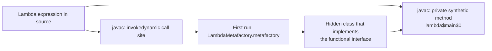
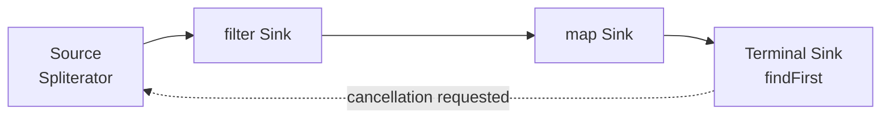
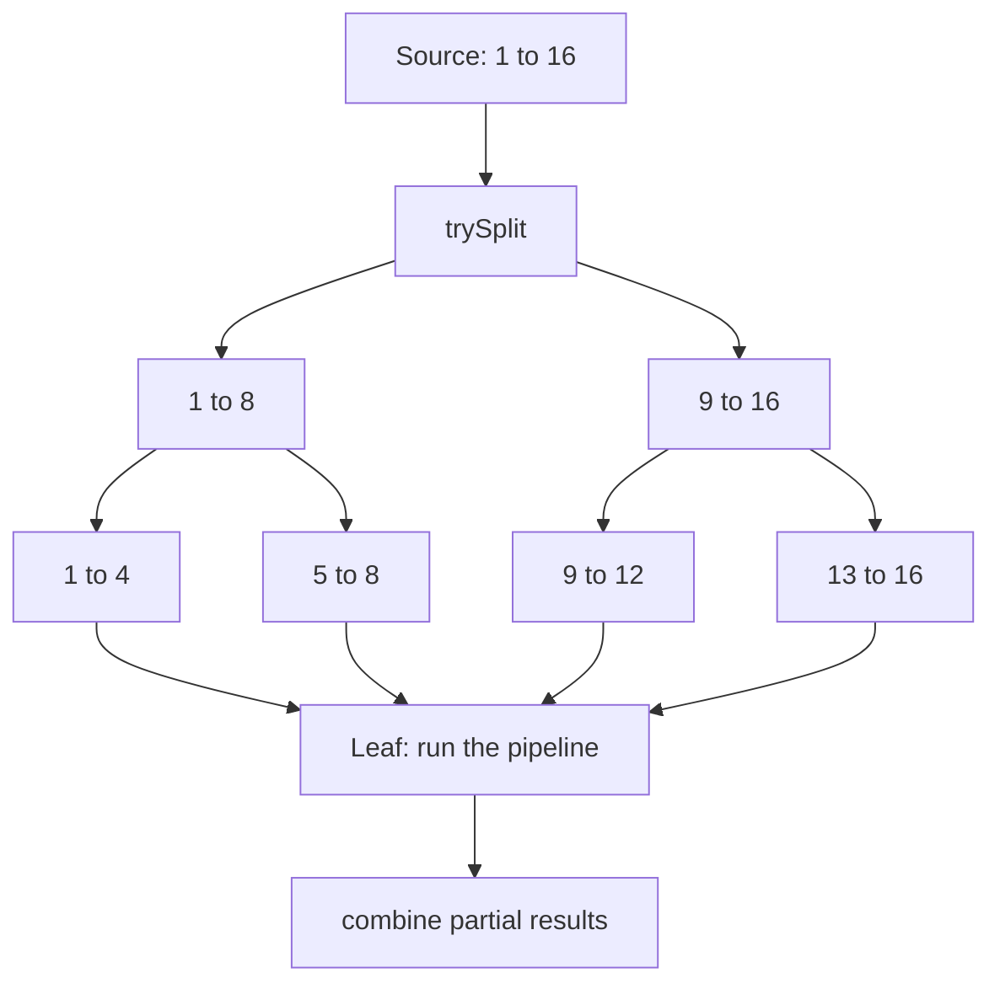

# Functional Programming and Streams

## Why It Matters

Interviewers ask what a lambda captures, why a stream does nothing until a terminal operation runs, how `groupingBy` and `toMap` differ, when `Optional` is the wrong tool, and why a parallel stream can be slower than a loop. On the job, streams and lambdas appear in almost every Java 8+ code base: in collection processing, in `CompletableFuture` chains, in Spring callbacks, and in test code. Misuse causes real bugs: a stream that is reused, a side effect in a `map` that runs zero or two times, a parallel stream that blocks the shared common pool and stalls unrelated requests. This page explains how each feature works inside, so that you can predict what a pipeline does. The page targets Java 21. For short stream idioms that solve DSA problems, see [the Java toolkit](../dsa/java-toolkit.md). This page does not repeat them.

## Core Concepts

**Functional interface**: an interface with exactly one abstract method, not counting the public methods that `Object` declares (JLS 9.8). The annotation `@FunctionalInterface` is optional. It makes the compiler reject an interface that has two abstract methods. `Runnable`, `Comparator`, and `Callable` are functional interfaces.

**Lambda expression**: a compact way to write an instance of a functional interface. `(a, b) -> a + b` has parameters, an arrow, and a body (JLS 15.27). A lambda has no type of its own. The compiler takes its type from the context (see target typing below).

**Target typing**: the compiler infers the type of a lambda from the place where the lambda appears: an assignment, a method argument, a return statement, or a cast. The same lambda text can be a `Function<String, Integer>` in one place and a `ToIntFunction<String>` in another. A lambda cannot be assigned to `Object` or `var`, because neither type is a functional interface.

**Capture**: a lambda body can use a local variable of the enclosing method. The lambda then holds a copy of the value. JLS 15.27.2 requires the variable to be `final` or *effectively final*: the code never assigns it after its initialization. A field is not a local variable, so a lambda can read and write fields.

**Method reference**: a short form of a lambda that only calls one existing method or constructor (JLS 15.13). `String::length` replaces `s -> s.length()`.

**Stream**: a sequence of elements that supports aggregate operations, described as a *pipeline*: one **source**, zero or more **intermediate operations**, and one **terminal operation** (package summary of `java.util.stream`). A stream is not a data structure. It does not store elements, and it does not change its source.

**Intermediate operation**: returns a new stream and is lazy. It does no work until the terminal operation starts. Examples: `filter`, `map`, `flatMap`, `sorted`, `distinct`, `limit`, `peek`.

**Terminal operation**: produces a result or a side effect and starts the traversal. After it returns, the stream is consumed. Examples: `collect`, `reduce`, `forEach`, `count`, `findFirst`, `anyMatch`.

**Stateless and stateful operation**: a stateless operation (`map`, `filter`) handles each element without knowledge of other elements. A stateful operation (`sorted`, `distinct`, `limit`, `skip`) may need to see other elements or to keep state.

**Short-circuiting operation**: an operation that can finish before it has read all elements. Intermediate: `limit`, `takeWhile`. Terminal: `findFirst`, `findAny`, `anyMatch`, `allMatch`, `noneMatch`.

**Collector**: an object that tells `collect` how to reduce a stream into a mutable container. It has a supplier, an accumulator, a combiner, and a finisher (see "How collectors work").

**Optional**: a container that holds one non-null value or is empty. It is meant as a return type for a method that may have no result.

## How It Works

### Functional interfaces in `java.util.function`

The package `java.util.function` gives general shapes, so that you rarely write your own functional interface. Learn the shape by the argument list and the result, not by the name.

| Interface | Method | Shape | Example |
|---|---|---|---|
| `Function<T, R>` | `R apply(T)` | one in, one out | `String::length` |
| `BiFunction<T, U, R>` | `R apply(T, U)` | two in, one out | `String::concat` |
| `UnaryOperator<T>` | `T apply(T)` | `Function<T, T>` | `String::trim` |
| `BinaryOperator<T>` | `T apply(T, T)` | `BiFunction<T, T, T>` | `Integer::sum` |
| `Supplier<T>` | `T get()` | nothing in, one out | `ArrayList::new` |
| `Consumer<T>` | `void accept(T)` | one in, nothing out | `System.out::println` |
| `BiConsumer<T, U>` | `void accept(T, U)` | two in, nothing out | `Map.forEach` |
| `Predicate<T>` | `boolean test(T)` | one in, boolean out | `String::isEmpty` |
| `BiPredicate<T, U>` | `boolean test(T, U)` | two in, boolean out | `String::startsWith` |

Primitive specializations avoid boxing. The prefix names the primitive: `IntFunction<R>`, `ToIntFunction<T>`, `IntPredicate`, `IntUnaryOperator`, `IntBinaryOperator`, `IntSupplier`, `IntConsumer`, and the `Long` and `Double` versions. `BooleanSupplier` exists, and there is no `BooleanFunction`. `ToIntFunction<T>` returns `int`. `IntFunction<R>` takes `int`.

Several interfaces have default or static methods that build new functions:

| Method | Meaning |
|---|---|
| `f.andThen(g)` | Runs `f`, then `g` on the result: `g(f(x))` |
| `f.compose(g)` | Runs `g`, then `f` on the result: `f(g(x))` |
| `Function.identity()` | Returns its argument |
| `p.and(q)`, `p.or(q)`, `p.negate()` | Combine predicates. `and` and `or` short-circuit |
| `Predicate.not(p)` (Java 11) | `not(String::isBlank)` replaces `s -> !s.isBlank()` |
| `Predicate.isEqual(x)` | A predicate that tests `Objects.equals(x, t)` |
| `BinaryOperator.minBy(c)`, `maxBy(c)` | A binary operator that picks the smaller or larger value |
| `Comparator.comparing(f).thenComparing(g).reversed()` | Builds a comparator from key extractors |

### Lambdas: target typing, capture, and `this`

**Target typing in practice.** The compiler picks the functional interface from the context. A lambda that does not match the target is a compile error. An overloaded method can make the choice ambiguous. `ExecutorService.submit` has overloads for `Runnable` and `Callable<T>`. A lambda body that is an expression statement and returns a value can fit both. The compiler then prefers the `Callable` overload (JLS 15.12.2.5; checked on JDK 21 with `submit(() -> compute())`). A block body that returns no value fits only `Runnable`. Cast the lambda or use a variable with an explicit type if the compiler reports an ambiguity.

**Capture and effectively final.** A lambda copies the value of each captured local variable when the lambda object is created. JLS 15.27.2 says that the restriction prohibits access to local variables that change, because capturing them would likely cause concurrency problems. The rule: the variable must be final or effectively final.

<!-- fragment -->
```java
void capture() {
    int count = 0;
    Runnable r = () -> count++;      // compile error: local variables referenced from a lambda
                                     // expression must be final or effectively final
    int total = 0;
    for (int i = 0; i < 3; i++) {
        total += i;                  // total changes, so it is not effectively final
    }
    Runnable p = () -> System.out.println(total);   // compile error
}
```

Fixes: copy the value into a new variable that never changes (`int snapshot = total;`), use a one-element array or an `AtomicInteger` as a mutable holder, or, for a sum, use a stream reduction. A holder hides a data race if two threads run the lambda: use `AtomicInteger`, not `int[1]`, for concurrent code. A field is not captured: the lambda reads `this.field` at each call.

**`this` and names.** The body of a lambda has the same scope as the enclosing code. `this` in a lambda is the enclosing instance (JLS 15.27.2), and a lambda parameter cannot reuse the name of a local variable of the enclosing method. An anonymous class is different: it has its own `this`, and its members can shadow outer names. See [language core](01-language-core.md) for inner classes, and for when a lambda holds a reference to the enclosing instance.

**What javac generates.** A lambda is not an anonymous inner class, and javac writes no class file for it. javac compiles the body into a private synthetic method of the enclosing class (named `lambda$main$0`, and static if the body does not use `this`). At the place of the lambda, javac emits an `invokedynamic` instruction. On the first execution, the JVM calls the bootstrap method `LambdaMetafactory.metafactory`, which creates a hidden class that implements the functional interface and calls the synthetic method. Later executions of the same call site reuse the linked call site. For a lambda that captures nothing, the call site returns one shared instance. JLS 15.27.4 allows this: the language does not say whether evaluating a lambda expression allocates a new object. Program 1 shows the observed behavior on JDK 21 (a non-capturing lambda is the same object each time, and a capturing lambda is a new object for each call). Do not write code that depends on either result.



**Checked exceptions.** A lambda body can throw a checked exception only if the functional interface method declares it. `Function.apply` declares none, so a body that calls a method that throws `IOException` does not compile. Catch the exception inside the lambda and wrap it in an unchecked exception, or write a small helper that wraps the checked call. `Callable.call` declares `throws Exception`. [Exceptions](03-exceptions.md) is the home of the patterns for checked exceptions in lambdas and streams.

### Method references: the four kinds

JLS 15.13 defines the forms. Four of them cover most code. Program 1 shows each one.

| Kind | Syntax | Equivalent lambda | The first parameter is |
|---|---|---|---|
| Static method | `Integer::parseInt` | `s -> Integer.parseInt(s)` | the first argument of the method |
| Bound instance method | `prefix::concat` | `s -> prefix.concat(s)` | the argument. The receiver is fixed when the reference is created |
| Unbound instance method | `String::length` | `s -> s.length()` | the receiver of the call |
| Constructor | `ArrayList::new` | `() -> new ArrayList<>()` | the first constructor argument |

JLS 15.13 also defines `super::method` and `int[]::new` (an array constructor reference). The difference between a bound and an unbound reference decides the behavior at creation: a bound reference evaluates its receiver expression once, when the reference is created, and throws `NullPointerException` right away if the receiver is `null`. A lambda `() -> missing.length()` evaluates the receiver at each call. An unbound reference such as `String::startsWith` takes the receiver from its first argument, so a two-argument functional interface `BiFunction<String, String, Boolean>` fits it.

Program 1 runs all four kinds and prints the creation-time and reuse behavior.

```java
import java.util.ArrayList;
import java.util.List;
import java.util.function.BiFunction;
import java.util.function.Function;
import java.util.function.IntFunction;
import java.util.function.Supplier;

public class P1 {
    private final String name = "P1";

    String describe(String suffix) {
        return name + suffix;
    }

    void run() {
        Function<String, String> bound = this::describe;        // bound: receiver is this
        System.out.println(bound.apply("-bound"));
    }

    public static void main(String[] args) {
        // 1. Static method reference: the arguments become the method arguments.
        Function<String, Integer> parse = Integer::parseInt;
        // 2. Bound instance reference: the receiver is evaluated once, at creation.
        String prefix = "id-";
        Function<String, String> concat = prefix::concat;
        // 3. Unbound instance reference: the first argument becomes the receiver.
        Function<String, Integer> length = String::length;
        BiFunction<String, String, Boolean> startsWith = String::startsWith;
        // 4. Constructor reference.
        Supplier<List<String>> newList = ArrayList::new;
        IntFunction<int[]> newArray = int[]::new;

        System.out.println(parse.apply("42") + 1);
        System.out.println(concat.apply("7"));
        System.out.println(length.apply("lambda"));
        System.out.println(startsWith.apply("stream", "str"));
        System.out.println(newList.get().size() + " " + newArray.apply(3).length);
        new P1().run();

        // A bound reference evaluates its receiver at creation.
        String missing = null;
        try {
            Supplier<Integer> s = missing::length;
            System.out.println("not reached");
        } catch (NullPointerException e) {
            System.out.println("NullPointerException at creation");
        }
        // A lambda evaluates the receiver at each call.
        Supplier<Integer> lazy = () -> missing.length();
        System.out.println("lambda created without error");

        // JLS 15.27.4: a non-capturing lambda may be reused. JDK 21 reuses it.
        System.out.println(make() == make());
        // A capturing lambda needs a new object for each distinct captured value.
        System.out.println(makeCapturing(1) == makeCapturing(1));
    }

    static Runnable make() {
        return () -> { };
    }

    static Runnable makeCapturing(int n) {
        return () -> System.out.println(n);
    }
}
```

<!-- expected-output -->
```text
43
id-7
6
true
0 3
P1-bound
NullPointerException at creation
lambda created without error
true
false
```

### How a stream pipeline runs

A pipeline is a linked list of stages. Each intermediate operation adds a stage and returns a new stream object. No element moves until the terminal operation runs. Then the terminal operation asks the last stage to wrap the stages into a chain of `Sink` objects, and it pushes each element of the source through the whole chain before it takes the next element (`AbstractPipeline.wrapSink` and `copyInto` in the JDK 21 source). This is why the output of Program 2 interleaves the stages: element `a` goes through `source` and `filter` before element `bb` starts. The stream does not run `filter` over all elements and then `map` over all elements.



If the pipeline has a short-circuiting terminal operation, the traversal checks `cancellationRequested` before each element (`copyIntoWithCancel`), so it stops early. In Program 2, `findFirst` stops after `bb`, and `ccc` and `dddd` never run through the pipeline.

A **stateful** operation such as `sorted` is a barrier. It must receive every upstream element before it sends one downstream. The second part of Program 2 shows this: all three elements pass the first `peek`, and only then does the first sorted element pass the second `peek`. `limit(1)` still stops the downstream work after one element, but it cannot undo the upstream work.

```java
import java.util.stream.Stream;

public class P2 {
    public static void main(String[] args) {
        System.out.println("-- build the pipeline (nothing runs)");
        Stream<String> pipeline = Stream.of("a", "bb", "ccc", "dddd")
            .peek(s -> System.out.println("source " + s))
            .filter(s -> {
                System.out.println("filter " + s);
                return s.length() > 1;
            })
            .map(s -> {
                System.out.println("map    " + s);
                return s.toUpperCase();
            });
        System.out.println("-- findFirst starts the work");
        System.out.println("result " + pipeline.findFirst().orElse("none"));

        System.out.println("-- sorted is a barrier");
        Stream.of(3, 1, 2)
            .peek(n -> System.out.println("before sorted " + n))
            .sorted()
            .peek(n -> System.out.println("after sorted  " + n))
            .limit(1)
            .forEach(n -> System.out.println("got " + n));
    }
}
```

<!-- expected-output -->
```text
-- build the pipeline (nothing runs)
-- findFirst starts the work
source a
filter a
source bb
filter bb
map    bb
result BB
-- sorted is a barrier
before sorted 3
before sorted 1
before sorted 2
after sorted  1
got 1
```

**Ordering.** A stream has an *encounter order* if its source has one (a `List`, an array, `Stream.of`) or if `sorted()` creates one. A stream has none if its source has none (a `HashSet`, a `HashMap` view). `map` and `filter` keep the order. `unordered()` removes the constraint. `forEach` on a parallel stream ignores the encounter order, and `forEachOrdered` keeps it. `findFirst` returns the first element in the encounter order if the stream has one, and `findAny` may return any element. `collect(Collectors.toList())` keeps the encounter order, also for a parallel stream.

**Stateful operations and memory.** `sorted` buffers all elements. `distinct` keeps a set of the elements that it has seen. `limit` and `skip` on an ordered parallel stream must track positions, which is expensive. An infinite stream with `sorted` and no earlier `limit` runs out of memory.

**Stream sources and size.** A source reports characteristics through its `Spliterator`: `SIZED`, `ORDERED`, `DISTINCT`, `SORTED`, and others. A pipeline uses them to skip work. If the source is `SIZED` and no stage changes the size, `count()` can return the size without a traversal. A `peek` before `count()` then does not run. A `filter` removes the `SIZED` flag, so the count then needs a traversal. The javadoc of `Stream.count` says that an implementation may skip the pipeline when it can compute the count directly, so never put required work in a `peek` or a `map` that a `count` follows. Since Java 9, this applies to `List.of(1, 2, 3).stream().peek(...).map(...).count()`: on JDK 21, the `peek` prints nothing.

### Collectors

`Stream.collect(Collector)` does a *mutable reduction*: it accumulates elements into a container. `Collectors` has factory methods for the common containers.

| Collector | Result | Notes |
|---|---|---|
| `toList()`, `toSet()` | `List`, `Set` | No guarantee about the type, the mutability, or the thread-safety of the result |
| `toUnmodifiableList()` | Unmodifiable `List` | Rejects `null` elements |
| `Stream.toList()` (Java 16, not a collector) | Unmodifiable `List` | Allows `null` elements. The list throws `UnsupportedOperationException` on `add` |
| `joining(sep, prefix, suffix)` | `String` | Elements must be `CharSequence` |
| `counting()` | `Long` | |
| `summingInt`, `averagingInt`, `summarizingInt` | `Integer`, `Double`, `IntSummaryStatistics` | `averagingInt` of an empty stream is `0.0` |
| `groupingBy(f)` | `Map<K, List<T>>` | Uses a `HashMap`. A classifier that returns `null` throws `NullPointerException` |
| `groupingBy(f, downstream)` | `Map<K, D>` | The downstream collector reduces each group |
| `groupingBy(f, mapFactory, downstream)` | The map that the factory makes | Pass `TreeMap::new` for sorted keys, `LinkedHashMap::new` for the encounter order |
| `partitioningBy(p)` | `Map<Boolean, List<T>>` | The map always has both keys, `false` and `true`, even if a group is empty |
| `toMap(k, v)` | `Map<K, V>` | Throws `IllegalStateException` on a duplicate key. Throws `NullPointerException` on a `null` value |
| `toMap(k, v, merge)` | `Map<K, V>` | `merge` resolves a duplicate key |
| `toMap(k, v, merge, mapSupplier)` | The map that the supplier makes | Gives control over the map type |
| `mapping`, `filtering`, `flatMapping` | The downstream result | Adapt the input of a downstream collector. `filtering` and `flatMapping` came in Java 9 |
| `collectingAndThen(c, f)` | `f(result of c)` | Post-processes a result, for example wraps it with `Collections.unmodifiableList` |
| `teeing(c1, c2, merger)` (Java 12) | The merger result | Runs two collectors in one pass and combines their results |
| `groupingByConcurrent` | `ConcurrentMap` | For parallel streams. It does not preserve the encounter order |

Program 3 shows `groupingBy` with a downstream collector, `partitioningBy`, `toMap` with a merge function and a map factory, `teeing`, and `collectingAndThen`. It uses `TreeMap` so that the output order is the same on every run.

```java
import java.util.List;
import java.util.Map;
import java.util.TreeMap;
import java.util.stream.Collectors;

public class P3 {
    record Order(String customer, String city, int amount) { }

    public static void main(String[] args) {
        List<Order> orders = List.of(
            new Order("ann", "pune", 120),
            new Order("bob", "pune", 80),
            new Order("ann", "delhi", 200),
            new Order("cy", "delhi", 50),
            new Order("bob", "pune", 40));

        Map<String, List<Integer>> amountsByCity = orders.stream().collect(
            Collectors.groupingBy(Order::city, TreeMap::new,
                Collectors.mapping(Order::amount, Collectors.toList())));
        System.out.println(amountsByCity);

        Map<String, Long> countByCustomer = orders.stream().collect(
            Collectors.groupingBy(Order::customer, TreeMap::new, Collectors.counting()));
        System.out.println(countByCustomer);

        Map<Boolean, List<String>> bigOrSmall = orders.stream().collect(
            Collectors.partitioningBy(o -> o.amount() >= 100,
                Collectors.mapping(Order::customer, Collectors.toList())));
        System.out.println(bigOrSmall);

        Map<String, Integer> totalByCustomer = orders.stream().collect(
            Collectors.toMap(Order::customer, Order::amount, Integer::sum, TreeMap::new));
        System.out.println(totalByCustomer);

        String stats = orders.stream().collect(Collectors.teeing(
            Collectors.summingInt(Order::amount),
            Collectors.counting(),
            (sum, n) -> "sum=" + sum + " count=" + n + " avg=" + (sum / n)));
        System.out.println(stats);

        Map<String, Integer> topPerCity = orders.stream().collect(
            Collectors.groupingBy(Order::city, TreeMap::new,
                Collectors.collectingAndThen(
                    Collectors.maxBy((a, b) -> Integer.compare(a.amount(), b.amount())),
                    best -> best.get().amount())));
        System.out.println(topPerCity);

        try {
            orders.stream().collect(Collectors.toMap(Order::customer, Order::amount));
        } catch (IllegalStateException e) {
            System.out.println(e.getMessage());
        }
    }
}
```

<!-- expected-output -->
```text
{delhi=[200, 50], pune=[120, 80, 40]}
{ann=2, bob=2, cy=1}
{false=[bob, cy, bob], true=[ann, ann]}
{ann=320, bob=120, cy=50}
sum=490 count=5 avg=98
{delhi=200, pune=120}
Duplicate key ann (attempted merging values 120 and 200)
```

**How collectors work.** A `Collector<T, A, R>` has four functions: `supplier()` creates the container `A`, `accumulator()` adds one element, `combiner()` merges two containers (a parallel stream gives each thread its own container and merges them), and `finisher()` converts `A` to the result `R`. Its `characteristics()` can contain `CONCURRENT` (several threads may call the accumulator on one container), `UNORDERED`, and `IDENTITY_FINISH` (skip the finisher). `Collector.of(...)` builds one. A correct combiner and an associative accumulator are required for parallel use.

```java
// Collect strings into a StringBuilder joined with commas, then finish with toString.
Collector<String, StringBuilder, String> commaJoiner = Collector.of(
    StringBuilder::new,
    (sb, s) -> sb.append(sb.length() == 0 ? "" : ",").append(s),
    (left, right) -> left.length() == 0 ? right
        : right.length() == 0 ? left : left.append(',').append(right),
    StringBuilder::toString);
String csv = Stream.of("a", "b", "c").collect(commaJoiner);   // "a,b,c"
```

**`reduce`.** `reduce(identity, accumulator)` folds elements into one value. The identity must be neutral for the operation (`0` for `+`, `1` for `*`), and the operation must be associative, because a parallel stream groups elements in a way that you do not control. `reduce(accumulator)` returns an `Optional`, because an empty stream has no identity. The three-argument form `reduce(identity, accumulator, combiner)` lets the result type differ from the element type. `collect` is the right tool when the result is a mutable container: `reduce` that copies a `List` or a `String` at each step costs O(n²).

### Primitive streams

`IntStream`, `LongStream`, and `DoubleStream` hold primitives, so they avoid the allocation and the memory of `Integer` objects. They have numeric terminal operations: `sum()`, `average()` (an `OptionalDouble`), `min()`, `max()` (an `OptionalInt`), and `summaryStatistics()`. `IntStream.range(a, b)` excludes `b`, and `rangeClosed(a, b)` includes it. `boxed()` converts to `Stream<Integer>`, `mapToObj` converts to `Stream<R>`, `mapToInt` converts a `Stream<T>` to an `IntStream`, and `asLongStream()` widens. `IntStream.sum()` returns `int` and can overflow: use `mapToLong` or `asLongStream()` before a sum that can exceed 2,147,483,647. Use primitive streams in hot paths. For `int[]` patterns in DSA code, see [the Java toolkit](../dsa/java-toolkit.md).

### `Optional`

`Optional<T>` (Java 8) is a value-based class. Its javadoc says that it is "primarily intended for use as a method return type where there is a clear need to represent 'no result,' and where using `null` is likely to cause errors". The javadoc also says that a variable of type `Optional` should never itself be `null`. `Optional` does not implement `Serializable`. Because it is value-based, the javadoc says to treat equal instances as interchangeable and not to synchronize on them, or unpredictable behavior may occur.

| Use | Verdict |
|---|---|
| Return type of a lookup that may find nothing | Intended use |
| Method parameter | Avoid. The caller must wrap the value, and the parameter can still be `null`. Use an overload or a nullable parameter with a documented contract |
| Field | Avoid. `Optional` is not serializable, and it adds an object for each field |
| Collection element, `Map` value | Avoid. Use an absent key or an empty collection |
| `Optional.get()` without a check | Avoid. It throws `NoSuchElementException`. Prefer `orElseThrow()` (Java 10), which says the same thing with a clearer name |
| `Optional<List<T>>` | Avoid. Return an empty list |

Methods: `map` and `flatMap` transform a present value (and `map` returns an empty `Optional` if the function returns `null`), `filter` keeps the value if the predicate passes, `or` (Java 9) supplies another `Optional`, `ifPresentOrElse` (Java 9), and `stream()` (Java 9) turns it into a stream of zero or one element. `orElse(x)` evaluates `x` always, even if the value is present. `orElseGet(supplier)` calls the supplier only if the value is absent. Use `orElseGet` if the default is expensive or has a side effect. Primitive variants `OptionalInt`, `OptionalLong`, and `OptionalDouble` avoid boxing.

Program 5 shows `map`, `filter`, `or`, `orElse` against `orElseGet`, and `ifPresentOrElse`.

```java
import java.util.Map;
import java.util.Optional;

public class P5 {
    static final Map<String, String> EMAILS = Map.of("ann", "ann@example.com", "bob", "");

    static Optional<String> findEmail(String user) {
        return Optional.ofNullable(EMAILS.get(user)).filter(e -> !e.isBlank());
    }

    static String expensiveDefault() {
        System.out.println("  computing default");
        return "none@example.com";
    }

    public static void main(String[] args) {
        System.out.println(findEmail("ann").map(String::toUpperCase).orElse("-"));
        System.out.println(findEmail("bob").isPresent());
        System.out.println(findEmail("zed").or(() -> findEmail("ann")).get());

        System.out.println("orElse:");
        System.out.println(findEmail("ann").orElse(expensiveDefault()));
        System.out.println("orElseGet:");
        System.out.println(findEmail("ann").orElseGet(P5::expensiveDefault));

        findEmail("zed").ifPresentOrElse(
            e -> System.out.println("send to " + e),
            () -> System.out.println("no address"));

        try {
            findEmail("zed").orElseThrow(() -> new IllegalStateException("no email"));
        } catch (IllegalStateException e) {
            System.out.println(e.getMessage());
        }
        System.out.println(findEmail("ann").stream().count());
        System.out.println(Optional.of(1).map(n -> (Integer) null).isPresent());
    }
}
```

<!-- expected-output -->
```text
ANN@EXAMPLE.COM
false
ann@example.com
orElse:
  computing default
ann@example.com
orElseGet:
ann@example.com
no address
no email
1
false
```

### Parallel streams

`collection.parallelStream()` or `stream.parallel()` marks the pipeline as parallel. The stream does not run on its own threads. It submits `ForkJoinTask` objects to `ForkJoinPool.commonPool()`, a JVM-wide pool. The calling thread also takes part in the work. By default, the parallelism of the common pool is `Runtime.availableProcessors() - 1`, and at least 1 (JDK 21 source, the `ForkJoinPool` constructor for the common pool). The system property `java.util.concurrent.ForkJoinPool.common.parallelism` changes it (`ForkJoinPool` javadoc). See [java.util.concurrent](08-java-util-concurrent.md) for thread pools and the fork/join framework.

**Splitting.** The terminal operation splits the source with `Spliterator.trySplit()` into parts. The task class `AbstractTask` keeps splitting until a part is no larger than `estimatedSize / (parallelism << 2)`, where `parallelism` is the parallelism of the common pool, or of the current pool if the code runs in a worker thread of another `ForkJoinPool`. So, for a source that splits in halves, it makes between four and eight times as many leaf tasks as the pool's parallelism (JDK 21 source, `AbstractTask.getLeafTarget` and `suggestTargetSize`). Each leaf runs the pipeline over its part with its own sink. The tasks then merge the leaf results with the combiner, in encounter order.



How well a source splits decides the speed. `ArrayList`, arrays, and `IntStream.range` split in the middle at O(1) cost and know their size. `HashSet` and `HashMap` split by index ranges of their bucket table: `trySplit` halves the range of bucket indexes, not the elements (JDK 21 source, `HashMap.KeySpliterator.trySplit`). The buckets are not filled evenly, so the parts can have different sizes, and the size of each part is only an estimate. `LinkedList`, `Stream.iterate`, and `BufferedReader.lines()` split poorly: their spliterators copy elements into batch arrays before they hand out a part.

**When a parallel stream is slower or wrong.**

| Cause | Effect | Fix |
|---|---|---|
| Few elements or a cheap operation | The cost of the task split and the merge is larger than the work | Use a sequential stream. Measure with JMH before you switch |
| A source that splits poorly (`LinkedList`, `iterate`) | The split copies elements | Copy to an `ArrayList` or an array first, or stay sequential |
| Boxed streams | Allocation and cache misses dominate | Use `IntStream` and the other primitive streams |
| Order-dependent operations on an ordered stream: `limit`, `skip`, `findFirst`, `distinct` | The stream must keep or restore the order | Call `unordered()` if the order does not matter, or stay sequential |
| A blocking call in the lambda (a database query, an HTTP call) | The call blocks a common-pool thread. All parallel streams and other users of the common pool wait | Use a dedicated executor with `CompletableFuture`, or a virtual thread (see [virtual threads](10-virtual-threads.md)) |
| A shared mutable accumulator | A data race gives a wrong result | Use a collector, or a thread-safe accumulator, or no sharing |
| A non-associative operation in `reduce` | The result depends on how the stream splits, so it differs between machines | Use an associative operation |
| Contention on a lock inside the lambda | The threads wait for each other | Remove the shared state |

**Side effects.** The package summary of `java.util.stream` says that a behavioral parameter should be *non-interfering* (it does not change the stream source) and, in general, stateless. A parallel stream turns a hidden race into a failure. Appending to a plain `ArrayList` from `forEach` on a parallel stream can lose elements or throw `ArrayIndexOutOfBoundsException`, and the output differs between runs. The code below is wrong on purpose.

<!-- fragment -->
```java
List<Integer> out = new ArrayList<>();
IntStream.range(0, 1000).parallel().forEach(out::add);   // data race: size is often not 1000
List<Integer> ok = IntStream.range(0, 1000).parallel().boxed().toList();   // correct
```

**A different pool.** A common trick runs the terminal operation from inside a task of a custom `ForkJoinPool` (`pool.submit(() -> stream.parallel().sum()).get()`), so that the stream uses that pool's threads and not the common pool. This is observed behavior on JDK 21, not documented behavior: the `java.util.stream` documentation does not say which pool a parallel stream uses. It works on JDK 21 because the stream tasks call `ForkJoinTask.fork()` (JDK 21 source, `AbstractTask.compute`), and the `fork` javadoc says that `fork` runs the task in the pool of the current task, or in the common pool if the caller is not a worker thread. A later JDK can change the stream implementation. Prefer sequential streams with your own executor for blocking work.

Program 4 shows parallel code that has a deterministic result. It prints results, not thread names or timings.

```java
import java.util.List;
import java.util.concurrent.ConcurrentHashMap;
import java.util.concurrent.atomic.LongAdder;
import java.util.stream.Collectors;
import java.util.stream.IntStream;
import java.util.stream.LongStream;
import java.util.stream.Stream;

public class P4 {
    public static void main(String[] args) {
        // A correct parallel reduction: the operation is associative and the identity is neutral.
        long sum = LongStream.rangeClosed(1, 1_000_000).parallel().sum();
        System.out.println(sum);

        // collect keeps the encounter order, even in parallel.
        List<Integer> squares = IntStream.rangeClosed(1, 8).parallel().map(n -> n * n)
            .boxed().collect(Collectors.toList());
        System.out.println(squares);

        // forEachOrdered keeps the order. forEach does not, so this demo does not print its order.
        StringBuilder ordered = new StringBuilder();
        IntStream.rangeClosed(1, 8).parallel().forEachOrdered(n -> ordered.append(n));
        System.out.println(ordered);

        // findFirst honors the encounter order. findAny may return any match.
        int first = Stream.of(5, 8, 3, 9, 4).parallel().filter(n -> n > 4).findFirst().get();
        System.out.println(first);

        // A shared accumulator that is thread-safe gives the same total on every run.
        LongAdder adder = new LongAdder();
        IntStream.range(0, 100_000).parallel().forEach(n -> adder.add(n % 3));
        System.out.println(adder.sum());

        // A concurrent collector builds a map without a merge step; the result map is the same.
        var counts = IntStream.range(0, 1000).parallel().boxed()
            .collect(Collectors.groupingByConcurrent(n -> n % 4, Collectors.counting()));
        System.out.println(new java.util.TreeMap<>(counts));
        // The javadoc promises a ConcurrentMap. The JDK 21 implementation uses ConcurrentHashMap.
        System.out.println(counts instanceof ConcurrentHashMap);
    }
}
```

<!-- expected-output -->
```text
500000500000
[1, 4, 9, 16, 25, 36, 49, 64]
12345678
5
99999
{0=250, 1=250, 2=250, 3=250}
true
```

!!! tip "Recommendation"
    Write sequential streams by default. Use a parallel stream only if all these conditions hold: the source splits well and has many elements, the work per element is CPU-bound and takes microseconds or more, the operations are stateless and non-interfering, and a benchmark on the target machine shows a gain. Never use a parallel stream for blocking I/O in a server.

### Java 22 to 25: stream gatherers

JEP 485 made stream gatherers final in Java 24 (preview in Java 22 and 23). A `Gatherer` is a custom intermediate operation, applied with `stream.gather(...)`. `java.util.stream.Gatherers` provides built-ins: `windowFixed`, `windowSliding`, `fold`, `scan`, and `mapConcurrent`. The pages of this KB target Java 21, where `gather` does not exist. See [modern Java](13-modern-java.md) for the Java 22 to 27 table.

## Trade-offs and When to Use

| Choice | Pros | Cons | Use when |
|---|---|---|---|
| Stream pipeline | Declarative, composes, one call (`parallel()`) makes it parallel | Harder to debug, allocates objects, cannot `break` or throw a checked exception | The task maps, filters, groups, or reduces a collection |
| Plain `for` loop | No pipeline objects, a debugger steps through it line by line, can `break` and `return` | More code for grouping and mapping | The loop has early exits, mutable state, or checked exceptions |
| Lambda | Short, shares the enclosing `this` | Cannot declare fields or have several methods | The target is a functional interface and the body is a few lines |
| Method reference | Names the operation, no parameter noise | Overloads can make the choice unclear | The lambda only forwards its arguments |
| Anonymous class | Own `this`, own state | Verbose, makes a class file | The code needs state or several methods |
| `Optional` return | The type tells the caller that no value is possible | Allocation, no use for fields or parameters | A lookup method may find nothing |
| `null` return | No allocation | The caller can forget the check | A hot internal method with a documented contract |
| `Collectors.toList()` | Familiar | The result type is not specified | You will not depend on mutability |
| `Stream.toList()` | Unmodifiable, allows `null` | Throws on `add` | A read-only result (Java 16+) |
| Parallel stream | Uses all cores for CPU-bound bulk work | Shared common pool, overhead, hidden races | Large, CPU-bound, stateless work |
| Executor or `CompletableFuture` | Own pool, control, handles blocking work | More code | I/O-bound or latency-sensitive work |

## Java Example

Program 6 combines the pieces: it groups orders, sorts the groups, and prints a report with `Optional` for the missing case. It runs on the Java source launcher (`java OrderReport.java`).

```java
import java.util.Comparator;
import java.util.List;
import java.util.Map;
import java.util.Optional;
import java.util.TreeMap;
import java.util.stream.Collectors;

public class OrderReport {
    record Order(String customer, String city, int amount) { }

    static Optional<Order> largest(List<Order> orders, String city) {
        return orders.stream()
            .filter(o -> o.city().equals(city))
            .max(Comparator.comparingInt(Order::amount));
    }

    public static void main(String[] args) {
        List<Order> orders = List.of(
            new Order("ann", "pune", 120),
            new Order("bob", "pune", 80),
            new Order("ann", "delhi", 200));

        Map<String, Integer> totalByCity = orders.stream().collect(
            Collectors.groupingBy(Order::city, TreeMap::new,
                Collectors.summingInt(Order::amount)));
        totalByCity.forEach((city, total) -> System.out.println(city + " " + total));

        for (String city : List.of("pune", "mumbai")) {
            String text = largest(orders, city)
                .map(o -> o.customer() + " " + o.amount())
                .orElse("no orders");
            System.out.println(city + " largest: " + text);
        }
    }
}
```

<!-- expected-output -->
```text
delhi 200
pune 200
pune largest: ann 120
mumbai largest: no orders
```

## Interview Angle

### Questions

??? question "What is a functional interface, and how does a lambda relate to it?"

    A functional interface has exactly one abstract method, not counting the public methods of `Object` (JLS 9.8). A lambda expression is an instance of a functional interface. The compiler takes the interface from the context (target typing), so the lambda `s -> s.length()` can be a `Function<String, Integer>` or a `ToIntFunction<String>`. `@FunctionalInterface` is optional and only makes the compiler check the rule.

    A lambda is not an anonymous inner class. javac turns the body into a private synthetic method and emits an `invokedynamic` call site. At run time, `LambdaMetafactory` creates the object. Two consequences: a lambda has no class file of its own, and `this` inside a lambda is the enclosing instance, not the lambda.

??? question "Why must a local variable used in a lambda be effectively final?"

    The lambda copies the value of the local variable when the lambda is created. If the variable could change afterwards, the lambda and the method would see different values, and if the lambda ran on another thread the copy could also race with the method. JLS 15.27.2 removes both problems with a rule: the variable must be final or never assigned after its initialization. The workaround is a holder object: `AtomicInteger` or a one-element array. The holder moves the mutable state to the heap, so you must make it thread-safe if several threads run the lambda. Fields do not have this restriction, because the lambda reads `this.field` at each call.

??? question "Name the four kinds of method reference, and say how they differ."

    Static (`Integer::parseInt`): the arguments become the method arguments. Bound instance (`prefix::concat`): the receiver is evaluated once, when the reference is created, and a `null` receiver throws `NullPointerException` at that point. Unbound instance (`String::length`): the first argument of the function becomes the receiver. Constructor (`ArrayList::new`): the arguments go to a constructor. `int[]::new` is the array form. A method reference is equivalent to a lambda that forwards its arguments, except that a bound reference evaluates the receiver at creation and the lambda evaluates it at each call.

??? question "Streams are lazy. What does that mean, and what happens in `list.stream().filter(f).map(g).findFirst()`?"

    Intermediate operations such as `filter` and `map` only add a stage to the pipeline. No element moves until a terminal operation runs. The terminal operation wraps the stages into a chain of sinks and pushes the elements one by one through the whole chain. `findFirst` is short-circuiting, so the traversal stops at the first element that passes `filter`. The code applies `g` to that one element only, and applies `f` to the elements up to and including the first match.

    Consequences: an operation with a side effect can run zero times (no terminal operation), fewer times than you expect (short-circuit), or be skipped (a `SIZED` source with `count()`). A stateful operation such as `sorted` is a barrier and buffers all elements, so it is not lazy per element.

??? question "What is the difference between `map` and `flatMap`, and between `reduce` and `collect`?"

    `map` turns each element into one element. `flatMap` turns each element into a stream and joins the streams, so it fits a one-to-many step: `orders.stream().flatMap(o -> o.items().stream())`. `mapMulti` (Java 16) does the same with a consumer, and avoids creating a stream for each element.

    `reduce` folds elements into an immutable value with an associative operation and an identity (`reduce(0, Integer::sum)`). `collect` does a mutable reduction into a container with a supplier, an accumulator, and a combiner. Use `collect` for lists, maps, and strings: a `reduce` that builds a `List` copies it at each step, and it is not safe in parallel.

??? question "How do `groupingBy`, `partitioningBy`, and `toMap` differ? What happens on a duplicate key?"

    `groupingBy(f)` builds a `Map<K, List<T>>` with any number of keys. `groupingBy(f, downstream)` reduces each group with a downstream collector, for example `counting()`. `partitioningBy(p)` is a special case with exactly two keys, `false` and `true`, and the map has both keys even if a group is empty. `toMap(k, v)` builds one value for each key. On a duplicate key, the two-argument `toMap` throws `IllegalStateException` ("Duplicate key ... attempted merging values ..."). Pass a merge function (`Integer::sum`) to resolve it. `toMap` also throws `NullPointerException` for a `null` value. To control the map type, pass a map supplier such as `TreeMap::new` or `LinkedHashMap::new`.

??? question "When would you use `Optional`, and when is it a mistake?"

    Use it as a return type for a method that can have no result, so that the caller must handle the empty case: `Optional<User> findById(long id)`. The javadoc states this intent. Chain `map`, `filter`, and `orElseGet` instead of `isPresent()` followed by `get()`.

    It is a mistake as a field (not serializable, extra object), as a method parameter (the caller can still pass `null`, and the code is noisy), as a collection element, and as a return type for a collection (return an empty collection). Do not call `get()` without a check. `orElse(x)` evaluates `x` even if a value is present, so use `orElseGet(() -> x)` when `x` is costly. Do not use `Optional` for a value that is never absent.

??? question "Are parallel streams always faster? When are they slower or dangerous?"

    No. A parallel stream splits the source with `Spliterator.trySplit`, runs the parts as `ForkJoinTask` objects in `ForkJoinPool.commonPool()` (parallelism `availableProcessors() - 1` by default, plus the calling thread), and merges the results. The split, the thread hand-off, and the merge cost time. The stream is slower when the data set is small, the work per element is cheap, the source splits badly (`LinkedList`, `Stream.iterate`), the stream is boxed, or the operations depend on order (`limit`, `findFirst`, `sorted`).

    It is dangerous in two ways. A lambda with a shared mutable state (an `ArrayList` that `forEach` fills) has a data race. A lambda that blocks (a database or HTTP call) blocks common-pool threads, and every other parallel stream and every `CompletableFuture` async stage that uses the common pool waits. Use parallel streams for large, CPU-bound, stateless work after a benchmark shows a gain.

??? question "What is wrong with `peek` and with side effects in `map`?"

    The javadoc says `peek` exists mainly to support debugging. The pipeline may run `peek` fewer or more times than you expect: a short-circuit can skip it, a `SIZED` source with `count()` can skip it, and a parallel stream can run it on several threads. `map` that writes to an outside list has the same problem, and in a parallel stream it has a race. Put logic in the terminal operation (`forEach`, `collect`), or build the result with a collector. A stream pipeline should compute a value from its input and not change anything else.

??? question "What changed for streams after Java 8, up to Java 21 and later?"

    Java 9: `takeWhile`, `dropWhile`, `ofNullable`, `iterate` with a predicate, and the collectors `filtering` and `flatMapping`. Java 10: `toUnmodifiableList` and its relatives, and `Optional.orElseThrow()`. Java 11: `Predicate.not` and `Optional.isEmpty`. Java 12: `Collectors.teeing`. Java 16: `Stream.toList()` and `mapMulti`. Java 24: stream gatherers (JEP 485), a custom intermediate operation. The pipeline model, laziness, and the parallel implementation did not change.

### Follow-up Questions

??? question "A lambda uses `this`. Does the lambda object keep the enclosing instance alive?"

    Yes if the body uses `this` or an instance member: the lambda object then holds a reference to the enclosing instance. On JDK 21, a lambda that does not use `this` does not hold it (observed, not guaranteed by the JLS). This matters for memory leaks when a long-lived object, such as a listener list, holds the lambda. See [language core](01-language-core.md) and [memory and GC](06-memory-and-gc.md).

??? question "How does the same lambda behave with `ExecutorService.submit(Runnable)` and `submit(Callable)`?"

    If the lambda body is an expression that returns a value, such as `() -> compute()`, it fits both `Runnable` (the value is discarded) and `Callable<T>`. The compiler prefers the `Callable` overload when both apply (JLS 15.12.2.5). A block body that returns no value fits only `Runnable`. If the call is still ambiguous, cast the lambda to the intended type.

??? question "How do you make a parallel stream use a thread pool other than the common pool?"

    The documented way is not to use a parallel stream for that work. Submit tasks to your own executor and combine the results with `CompletableFuture`. A trick runs the terminal operation from a task of a custom `ForkJoinPool`: `pool.submit(() -> list.parallelStream().map(f).toList()).get()`. On JDK 21 the stream tasks then fork into that pool, because `ForkJoinTask.fork` uses the pool of the current worker thread. This is observed behavior: the stream documentation does not promise it. Another option, `-Djava.util.concurrent.ForkJoinPool.common.parallelism=N`, changes the common pool for the whole JVM, so it also affects every other user of the pool. For blocking I/O, use an executor with virtual threads.

??? question "Why does `Collectors.toMap` reject a `null` value, but `HashMap.put` does not?"

    In the JDK 21 source, the two-argument `toMap` calls `Objects.requireNonNull` on each value and then `putIfAbsent`, because `putIfAbsent` cannot tell a `null` value from an absent key. The forms with a merge function accumulate with `Map.merge`, and the `Map.merge` javadoc says that it throws `NullPointerException` for a `null` value: `merge` uses a `null` result to mean "remove the key". `HashMap.put` has no such rule. If values can be `null`, collect with `Collectors.toCollection` or write the loop with `put`. `groupingBy` rejects a `null` key in the same way.

??? question "How does `Collectors.teeing` help, and what does it replace?"

    It runs two collectors on the same stream in one pass and merges their results with a function. Before Java 12, you either traversed the data twice (which fails for a one-shot stream) or wrote a custom collector. Example: count and sum together, then compute the average.

### Red Flags

- Saying that a lambda is "just an anonymous class". It is not: javac emits no class file, and `this` differs.
- Claiming that `peek` is a way to run logic or that stream operations run one after another over the whole collection.
- Using `parallelStream()` as a default speed-up, or using it for I/O.
- Writing `Optional` for a field or a parameter, or calling `get()` without a check.
- Using `forEach` to build a list (`forEach(list::add)`) instead of `collect`.
- Calling `Collectors.toList()` and then relying on the result being mutable or immutable.
- Reusing a stream and not knowing the exception (`IllegalStateException`: "stream has already been operated upon or closed").

## Common Mistakes

| Mistake | Why it fails | Fix |
|---|---|---|
| Reusing a stream | A terminal operation consumes the stream. The second use throws `IllegalStateException` | Create the stream again from the source, or keep a `Supplier<Stream<T>>` |
| Side effects in `map` or `filter` | The operation may run zero, one, or many times, and in a parallel stream it races | Do the side effect in `forEach`, or compute a value and collect it |
| Logic in `peek` | `peek` is for debugging. A `count()` on a `SIZED` source skips it | Use `map` or the terminal operation |
| `forEach(list::add)` | Not thread-safe in parallel, and it hides the intent | `collect(Collectors.toList())` or `toList()` |
| Duplicate keys in `toMap` | Throws `IllegalStateException` | Pass a merge function, or use `groupingBy` |
| `toMap` with a `null` value | Throws `NullPointerException` | Filter out the `null`, or use another collector |
| Boxing in a hot path | `Stream<Integer>` allocates an object for each value | `IntStream` and `mapToInt` |
| `IntStream.sum()` overflow | The sum has type `int` | `mapToLong` before `sum` |
| `Optional.get()` without a check | Throws `NoSuchElementException` | `orElseThrow`, `orElse`, or `ifPresent` |
| `orElse(expensive())` | The argument runs even if a value is present | `orElseGet(this::expensive)` |
| An infinite stream without `limit` | `iterate` and `generate` never end | `limit`, `takeWhile`, or a predicate in `iterate` |
| Parallel stream with blocking calls | Blocks the common pool for the whole JVM | A dedicated executor |
| Non-associative `reduce` in parallel | The result depends on the split | Use an associative operation, or stay sequential |
| A generic method in `println` | `System.out.println(stream.collect(teeing(...)))` can be ambiguous between `println(char[])` and `println(String)` | Assign the result to a variable first |
| A recursive lambda in a local variable | The initializer cannot use the variable that it initializes (compile error). A field has the same problem if the lambda uses its simple name: javac 21 reports "self-reference in initializer" | Write a named method, or store the lambda in a field and use a qualified name in the body (`Main.fact.applyAsInt(n - 1)`) |

<!-- fragment -->
```java
Stream<String> s = Stream.of("a", "b");
long n = s.count();
s.forEach(System.out::println);   // IllegalStateException: stream has already been operated
                                  // upon or closed
```

## Commonly Confused With

| Looks like | Difference | Deciding question |
|---|---|---|
| `map` vs `flatMap` | `map` makes one output for each input. `flatMap` makes a stream for each input and joins them | Does each element give zero, one, or many results? |
| `reduce` vs `collect` | `reduce` combines into an immutable value. `collect` fills a mutable container | Is the result a container? |
| `peek` vs `forEach` | `peek` is an intermediate debugging hook. `forEach` is terminal and may run side effects | Does the code end the pipeline? |
| `findFirst` vs `findAny` | `findFirst` honors the order. `findAny` may return any match, and is cheaper in parallel | Does the order matter? |
| `forEach` vs `forEachOrdered` | `forEach` may run in any order in parallel. `forEachOrdered` keeps the encounter order | Does the order of the effects matter? |
| `Stream.toList()` vs `Collectors.toList()` | The first returns an unmodifiable list and allows `null`. The second gives no guarantee | Do you need a read-only list? |
| `groupingBy` vs `partitioningBy` | `partitioningBy` always has the two keys `true` and `false` | Is the classifier a yes/no test? |
| `Optional.orElse` vs `orElseGet` | `orElse` evaluates its argument eagerly. `orElseGet` calls the supplier only if empty | Is the default costly? |
| `Function.andThen` vs `compose` | `f.andThen(g)` is `g(f(x))`. `f.compose(g)` is `f(g(x))` | Which function runs first? |
| `stream()` vs `parallelStream()` | The second marks the pipeline parallel on the common pool | Is the work large, CPU-bound, and stateless? |
| Lambda vs anonymous class | A lambda shares the enclosing `this`, and has no class file. An anonymous class has its own `this` | Does the code need its own state or `this`? |
| `Predicate.not(String::isBlank)` vs `String::isBlank.negate()` | A method reference has no methods: `String::isBlank.negate()` does not compile | Do you need to negate a method reference? |
| `IntStream.range` vs `rangeClosed` | `range` excludes the end | Is the end included? |

## Quick Reference Card

- A functional interface has one abstract method. A lambda is an instance of it, typed by the context.
- Captured locals must be effectively final. Fields are not captured.
- A lambda is a private synthetic method plus `invokedynamic`. It has no class file. `this` is the enclosing instance.
- Method references: static, bound, unbound, constructor. A bound receiver is evaluated once at creation.
- Streams: source, lazy intermediate operations, one terminal operation. The terminal operation starts the work. A stream runs once.
- Elements flow through all stages one by one. `sorted` is a barrier. Short-circuit operations stop early.
- `toMap` throws on a duplicate key, so pass a merge function. `partitioningBy` always has both keys.
- `Stream.toList()` is unmodifiable and allows `null`. `Collectors.toList()` promises nothing.
- Use `IntStream` for numbers. `sum()` of `int` can overflow.
- `Optional` is a return type, not a field or a parameter. `orElseGet` is lazy, `orElse` is not.
- Parallel streams: common pool, `trySplit`, four to eight leaf tasks for each unit of parallelism (JDK 21 source). Use them for large, CPU-bound, stateless work only. Never block in them.
- `peek` is for debugging. Side effects in `map` are bugs.

## Further Reading

- [JLS 21, section 15.27 (lambda expressions)](https://docs.oracle.com/javase/specs/jls/se21/html/jls-15.html#jls-15.27): target typing, the effectively final rule (15.27.2), `this`, and the evaluation rules (15.27.4).
- [JLS 21, section 15.13 (method references)](https://docs.oracle.com/javase/specs/jls/se21/html/jls-15.html#jls-15.13): the forms and the creation-time receiver evaluation.
- [JLS 21, section 9.8 (functional interfaces)](https://docs.oracle.com/javase/specs/jls/se21/html/jls-9.html#jls-9.8): the definition.
- [`java.util.stream` package summary (JDK 21)](https://docs.oracle.com/en/java/javase/21/docs/api/java.base/java/util/stream/package-summary.html): laziness, non-interference, side effects, ordering, reduction, associativity, and parallelism.
- [`java.util.function` package summary (JDK 21)](https://docs.oracle.com/en/java/javase/21/docs/api/java.base/java/util/function/package-summary.html): the list of functional interfaces.
- [`Collectors` javadoc (JDK 21)](https://docs.oracle.com/en/java/javase/21/docs/api/java.base/java/util/stream/Collectors.html): the behavior of each collector, including `toMap` and `groupingBy`.
- [`Optional` javadoc (JDK 21)](https://docs.oracle.com/en/java/javase/21/docs/api/java.base/java/util/Optional.html): the intended use as a return type.
- [`ForkJoinPool` javadoc (JDK 21)](https://docs.oracle.com/en/java/javase/21/docs/api/java.base/java/util/concurrent/ForkJoinPool.html): the common pool and its parallelism property.
- [`ForkJoinTask.fork` javadoc (JDK 21)](https://docs.oracle.com/en/java/javase/21/docs/api/java.base/java/util/concurrent/ForkJoinTask.html#fork()): `fork` uses the pool of the current task, which explains the custom-pool trick.
- [`LambdaMetafactory` javadoc (JDK 21)](https://docs.oracle.com/en/java/javase/21/docs/api/java.base/java/lang/invoke/LambdaMetafactory.html): how the JVM creates the lambda object.
- [JDK 21 source: `AbstractTask` and `AbstractPipeline`](https://github.com/openjdk/jdk21u/tree/master/src/java.base/share/classes/java/util/stream): the splitting rule and the sink chain.
- [JEP 485: Stream Gatherers](https://openjdk.org/jeps/485): the Java 24 custom intermediate operation.
