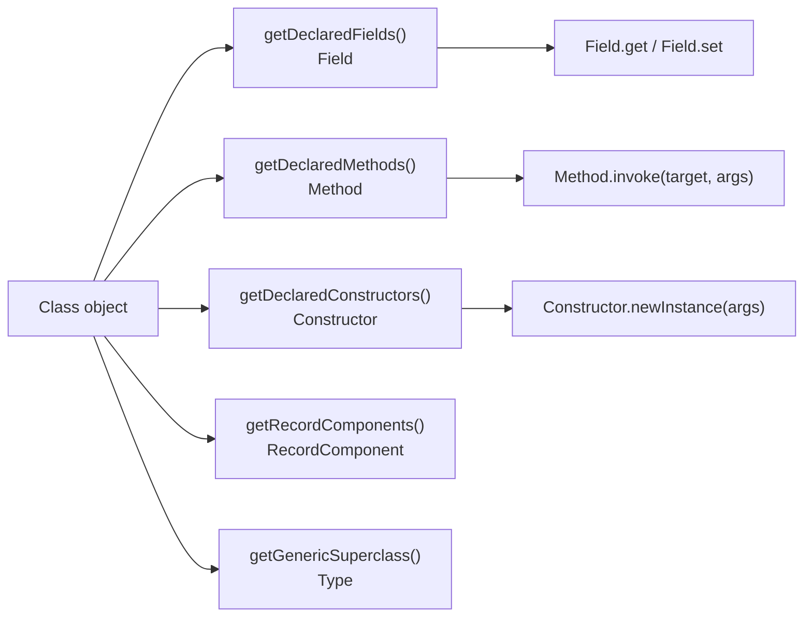
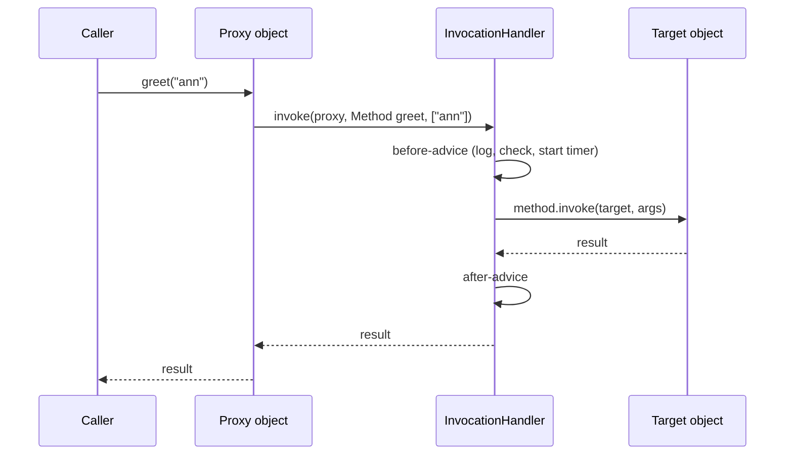

# Reflection and Annotations

## Why It Matters

Interviewers ask how Spring finds a `@Component`, how Hibernate sets a private field, how `@Transactional` works without a change to your class, and why `setAccessible` fails on a JDK class after Java 16. All these answers rest on three mechanisms: reflection (code that inspects and calls other code at run time), annotations (metadata that a framework reads), and dynamic proxies (objects that a library creates at run time to intercept calls). On the job, you meet them as an `InaccessibleObjectException` after a JDK upgrade, as a `@Transactional` method that does not start a transaction, as a slow serialization library, or as a processor that generates code at compile time. This page explains the reflection API, the strong encapsulation rules of Java 16 and 17, the cost of reflection and what `MethodHandle` changes, the annotation model, annotation processors, and `java.lang.reflect.Proxy`. It also shows how Spring combines them. The home of the Spring side is [Spring Core: IoC, Beans, and AOP](17-spring-core.md). This page gives the Java mechanism that Spring builds on.

## Core Concepts

**Reflection**: the ability of a running program to inspect its own types and members, and to use them, by name. The entry point is `java.lang.Class`. The members are `Field`, `Method`, `Constructor`, `Parameter`, and `RecordComponent` in `java.lang.reflect`.

**`Class` object**: the run-time representation of a type. The JVM creates one `Class` object for each loaded class (see [JVM architecture](05-jvm-architecture.md)). You get it from `Foo.class`, from `obj.getClass()`, or from `Class.forName("pkg.Foo")`. `Class.forName` loads the class and runs its static initializer.

**Deep reflection**: reflective access to a non-public member, which needs `setAccessible(true)`. **Strong encapsulation**: the module system rule that code outside a module cannot use the non-public members or the non-exported packages of that module, also by reflection, unless the module opens the package.

**Annotation**: metadata that you attach to a declaration or a type use, with `@Name(...)`. An annotation does nothing by itself. A compiler, a tool, or a library at run time reads it. An **annotation interface** is the type that declares the annotation, written `@interface`. A **meta-annotation** is an annotation that annotates an annotation interface (`@Retention`, `@Target`).

**Annotation processor**: a compiler plug-in that reads annotations during compilation and can generate files or report errors (`javax.annotation.processing`, JSR 269).

**Dynamic proxy**: an object of a class that the JVM generates at run time. The class implements a list of interfaces that you give, and it sends each method call to one `InvocationHandler`.

**`MethodHandle`**: a typed, directly executable reference to a method, constructor, or field (`java.lang.invoke`). The JVM checks access when you create the handle, not at each call.

## How It Works

### The reflection API



The methods on `Class` come in two forms. `getMethods()`, `getFields()`, and `getConstructors()` return only the public members, and `getMethods()` and `getFields()` include the inherited ones. `getDeclaredMethods()`, `getDeclaredFields()`, and `getDeclaredConstructors()` return all members that the class declares, with any access level, and none of the inherited ones. The order of the returned array is not specified, so sort it if the order matters. `getMethod(name, paramTypes...)` and `getDeclaredMethod(...)` find one method by name and exact parameter types.

`Method.invoke(target, args)` calls the method. Rules: pass `null` as the target for a static method. The arguments are `Object`, so primitive arguments are boxed and the result is boxed. If the method throws, `invoke` wraps the exception in `InvocationTargetException`, and the original exception is `getCause()`. If the caller has no access, `invoke` throws `IllegalAccessException`. `Constructor.newInstance` and `Field.get` and `Field.set` follow the same pattern.

`Class.getMethod` returns a new `Method` object on each call (on JDK 21, `Z.class.getMethod("main", String[].class) == Z.class.getMethod("main", String[].class)` is `false`). Look up a member once and keep the `Method` object in a field, if the code calls it often.

Program 1 shows the common operations: the declared methods, a constructor call, a private method call after `setAccessible`, the wrapped exception, a `final` field write, a record, the encapsulation error for `String.value`, and a generic type token.

```java
import java.lang.reflect.Constructor;
import java.lang.reflect.Field;
import java.lang.reflect.InaccessibleObjectException;
import java.lang.reflect.InvocationTargetException;
import java.lang.reflect.Method;
import java.lang.reflect.Modifier;
import java.lang.reflect.ParameterizedType;
import java.lang.reflect.RecordComponent;
import java.util.ArrayList;
import java.util.Comparator;
import java.util.List;

public class R1 {
    static class Account {
        private final String id;
        private long balance;
        static final int LIMIT = 100;

        public Account(String id, long balance) {
            this.id = id;
            this.balance = balance;
        }

        public long balance() {
            return balance;
        }

        private void audit(String note) {
            System.out.println("audit " + id + ": " + note);
        }

        public void withdraw(long amount) {
            if (amount > balance) {
                throw new IllegalStateException("insufficient funds");
            }
            balance -= amount;
        }
    }

    record Point(int x, int y) { }

    static abstract class TypeToken<T> {
        String typeArgument() {
            ParameterizedType p = (ParameterizedType) getClass().getGenericSuperclass();
            return p.getActualTypeArguments()[0].getTypeName();
        }
    }

    public static void main(String[] args) throws Exception {
        Class<?> c = Account.class;                       // also: obj.getClass(), Class.forName
        System.out.println(c.getSimpleName() + " " + Modifier.toString(c.getModifiers()));

        // getDeclaredMethods does not promise an order, so sort the names.
        List<String> names = new ArrayList<>();
        for (Method m : c.getDeclaredMethods()) {
            names.add(Modifier.toString(m.getModifiers()) + " " + m.getName());
        }
        names.sort(Comparator.naturalOrder());
        System.out.println(names);

        Constructor<?> ctor = c.getConstructor(String.class, long.class);
        Object acc = ctor.newInstance("A-1", 50L);

        Method balance = c.getMethod("balance");
        System.out.println(balance.invoke(acc));

        // A private method needs setAccessible. Same module: allowed.
        Method audit = c.getDeclaredMethod("audit", String.class);
        audit.setAccessible(true);
        audit.invoke(acc, "checked");

        // An exception from the target method arrives wrapped.
        Method withdraw = c.getMethod("withdraw", long.class);
        try {
            withdraw.invoke(acc, 500L);
        } catch (InvocationTargetException e) {
            System.out.println("cause: " + e.getCause().getMessage());
        }

        // A private final instance field can be changed after setAccessible(true).
        Field id = c.getDeclaredField("id");
        id.setAccessible(true);
        id.set(acc, "A-2");
        System.out.println(id.get(acc));

        // A static final field cannot.
        Field limit = c.getDeclaredField("LIMIT");
        limit.setAccessible(true);
        try {
            limit.set(null, 5);
        } catch (IllegalAccessException e) {
            System.out.println("static final: IllegalAccessException");
        }

        // A record field cannot be changed, even with setAccessible(true).
        Field x = Point.class.getDeclaredField("x");
        x.setAccessible(true);
        try {
            x.set(new Point(1, 2), 9);
        } catch (IllegalAccessException e) {
            System.out.println("record field: IllegalAccessException");
        }
        for (RecordComponent rc : Point.class.getRecordComponents()) {
            System.out.println(rc.getName() + " " + rc.getType().getName());
        }

        // Strong encapsulation: java.base does not open java.lang to this code.
        Field value = String.class.getDeclaredField("value");
        try {
            value.setAccessible(true);
        } catch (InaccessibleObjectException e) {
            System.out.println("InaccessibleObjectException for String.value");
        }

        // Generic type information survives in a subclass signature.
        System.out.println(new TypeToken<List<String>>() { }.typeArgument());
    }
}
```

<!-- expected-output -->
```text
Account static
[private audit, public balance, public withdraw]
50
audit A-1: checked
cause: insufficient funds
A-2
static final: IllegalAccessException
record field: IllegalAccessException
x int
y int
InaccessibleObjectException for String.value
java.util.List<java.lang.String>
```

**Generic type information.** Type erasure removes type arguments from objects (see [generics](02-generics.md)), but the class file keeps the generic signature of a field, a method, and a superclass. `getGenericSuperclass()` returns it. The anonymous subclass `new TypeToken<List<String>>() { }` stores `List<String>` in its superclass signature. Libraries such as Jackson (`TypeReference`) and Guice use this trick to get a generic type at run time.

**Records.** `Class.getRecordComponents()` (Java 16) returns the components of a record in declaration order. Serialization libraries use it to find the canonical constructor.

**Parameter names.** `Parameter.getName()` returns `arg0` and `arg1` unless the class was compiled with `javac -parameters`. Frameworks that bind a request parameter by the Java parameter name need this flag, or they must read the names from debug information.

### `setAccessible` and strong encapsulation (JEP 396 and JEP 403)

`AccessibleObject.setAccessible(true)` turns off the language access checks (such as `private`) for one `Field`, `Method`, or `Constructor` object. The JDK 21 javadoc says when a caller in class `C` may enable access to a member of class `D`. Any of these conditions is enough:

1. `C` and `D` are in the same module.
2. The member is `public`, and `D` is `public` in a package that the module of `D` exports to the module of `C`.
3. The member is `protected static`, `D` is public in an exported package, and `C` is a subclass of `D`.
4. The package of `D` is open to the module of `C`. All packages in an unnamed module (the class path) and in an open module are open to all modules.

If none holds, `setAccessible` throws `InaccessibleObjectException`. `trySetAccessible()` returns `false` instead. Program 1 shows this for `String.value`: `java.base` does not open `java.lang` to application code.

The rules came in two steps.

| Java | JEP | Change |
|---|---|---|
| 9 to 15 | 261 | JEP 261 (the module system) added the option `--illegal-access` with the default `permit`: code on the class path could use deep reflection on the packages of the JDK that existed in JDK 8. The JVM printed one warning, for the first illegal reflective access only. `warn` printed a warning for each access, `debug` added a stack trace, and `deny` blocked the access |
| 16 | 396 | The default of `--illegal-access` became `deny`. Reflective access to JDK internals failed unless the program opted in. `permit`, `warn`, and `debug` still worked |
| 17 | 403 | JDK 17 removed the effect of `--illegal-access`: the option only prints a warning, whatever its value. Only `--add-opens` (or the `Add-Opens` manifest attribute) opens a package |

`sun.misc.Unsafe` is not affected by these two JEPs: the module `jdk.unsupported` still exports and opens `sun.misc` and `sun.reflect` (JEP 403). Later JDKs restrict `Unsafe` in a different way: JEP 471 (Java 23) deprecated its memory-access methods for removal, and JEP 498 (Java 24) makes the JVM print a warning on the first call to one of them. The way to opt in for a package is:

```text
java --add-opens java.base/java.lang=ALL-UNNAMED -jar app.jar
```

`--add-opens module/package=target` opens the package for deep reflection at run time. `ALL-UNNAMED` means all class-path code. `--add-exports` exports a package for compile-time and run-time access to its public types, but does not allow `setAccessible` on non-public members. With this option on JDK 21, the call `setAccessible(true)` on `String.value` succeeds (checked with the source launcher).

**Your own modules.** A framework such as Spring, Hibernate, or Jackson needs deep reflection on your classes. On the class path, every package is open, so this works with no setup. If your code is in a named module, `module-info.java` must say `opens com.example.model;` (or `opens com.example.model to com.fasterxml.jackson.databind;`), or declare the whole module `open module com.example { }`.

**Final fields.** After `setAccessible(true)`, `Field.set` can change a `final` instance field of an ordinary class. It cannot change a `static final` field, a final field of a record, or a final field of a hidden class (`Field.set` javadoc, JDK 21). Program 1 shows the `static final` and the record failures. The JIT compiler may have inlined the old value of a final field, so other code may not see the change (JLS 17.5.3). JEP 500 (status "Closed / Delivered", Java 26) starts to close the remaining gap: a deep-reflection write to a `final` field still works in Java 26, but in the default mode `warn` the JVM prints a warning (at most one for each module), and the JEP states that a future release will block it. The option `--enable-final-field-mutation=ALL-UNNAMED` allows it, and `--illegal-final-field-mutation=deny` makes it throw `IllegalAccessException` now, to find the affected code. A future release will make `deny` the default. See [modern Java](13-modern-java.md) for the Java 22 to 27 table. Code that targets Java 21 only is not affected today, but libraries that write final fields (some mappers and serializers) must change.

### Performance of reflection, and `MethodHandle`

A reflective call costs more than a direct call for four reasons: the arguments travel in an `Object[]` and are boxed, the JIT compiler usually cannot inline through `Method.invoke`, the code must check the receiver and the argument types at each call, and a lookup such as `getMethod` costs more than a call. The two common fixes are to look up the member once and reuse it, and to call `setAccessible(true)` once so that the access check does not repeat.

Before Java 18, the JDK used a native accessor for the first calls of a method and then generated bytecode for it (the JDK source calls this *inflation*). JEP 416 (Java 18) replaced both with `java.lang.invoke` method handles. The public API did not change. The JEP reports that microbenchmarks became 43 to 57 percent faster when the `Method`, `Constructor`, or `Field` object is in a `static final` field (so the JIT compiler can treat it as a constant), and that field access in non-constant fields became 51 to 77 percent slower. The JEP's real-world benchmarks (a Jackson benchmark, an XStream converter, and a Kryo field serializer) showed no significant degradation. These are the JEP's numbers for its benchmarks. They are not a promise for your code: measure with JMH.

A `MethodHandle` has a different cost model. You get it from `MethodHandles.Lookup` (`findVirtual`, `findStatic`, `findConstructor`, `findGetter`), and the lookup checks access once, against the access rights of the `Lookup` object. `invokeExact` is *signature polymorphic*: the compiler writes the call site type from the static types of the arguments and the cast of the result, and the call fails with `WrongMethodTypeException` if the type does not match exactly. If the handle is in a `static final` field, the JIT compiler treats it as a constant and can inline the target, so the call can approach the speed of a direct call. `invoke` adapts the types (boxing and widening) and costs a little more. `bindTo` fixes the receiver, and `MethodHandles.insertArguments` fixes more arguments. `VarHandle` does the same for fields and arrays, with the memory-ordering modes that `java.util.concurrent` uses (see [java.util.concurrent](08-java-util-concurrent.md)).

```java
import java.lang.invoke.MethodHandle;
import java.lang.invoke.MethodHandles;
import java.lang.invoke.MethodType;
import java.lang.reflect.Method;

public class R4 {
    static class Calc {
        int add(int a, int b) {
            return a + b;
        }

        static int twice(int a) {
            return 2 * a;
        }
    }

    // A static final MethodHandle is a constant for the JIT compiler, so it can inline the call.
    static final MethodHandle ADD;
    static final MethodHandle TWICE;

    static {
        try {
            MethodHandles.Lookup lookup = MethodHandles.lookup();
            ADD = lookup.findVirtual(Calc.class, "add",
                MethodType.methodType(int.class, int.class, int.class));
            TWICE = lookup.findStatic(Calc.class, "twice",
                MethodType.methodType(int.class, int.class));
        } catch (ReflectiveOperationException e) {
            throw new ExceptionInInitializerError(e);
        }
    }

    public static void main(String[] args) throws Throwable {
        Calc calc = new Calc();

        // invokeExact needs the exact static types: (Calc, int, int) -> int.
        int sum = (int) ADD.invokeExact(calc, 2, 3);
        System.out.println(sum);
        System.out.println((int) TWICE.invokeExact(21));

        // invoke adapts types (boxing, widening) at a small cost.
        Object boxed = ADD.invoke(calc, 4, (short) 5);
        System.out.println(boxed);

        // bindTo fixes the receiver. insertArguments fixes more.
        MethodHandle addToCalc = ADD.bindTo(calc);
        MethodHandle addTen = MethodHandles.insertArguments(addToCalc, 0, 10);
        System.out.println((int) addTen.invokeExact(5));

        // The same call through core reflection.
        Method m = Calc.class.getDeclaredMethod("add", int.class, int.class);
        System.out.println(m.invoke(calc, 6, 7));

        try {
            int wrong = (int) ADD.invokeExact(calc, 2, 3L);   // long argument: wrong type
            System.out.println(wrong);
        } catch (java.lang.invoke.WrongMethodTypeException e) {
            System.out.println("WrongMethodTypeException");
        }
    }
}
```

<!-- expected-output -->
```text
5
42
9
15
13
WrongMethodTypeException
```

| | Core reflection (`Method`) | `MethodHandle` |
|---|---|---|
| Access check | At each call, against the caller class, unless `setAccessible(true)` turned the check off | At lookup, with the `Lookup` object's rights |
| Call | `invoke(Object, Object...)`: boxing, an array | `invokeExact` with the exact static types: no boxing |
| Inlining by the JIT compiler | Rare | Yes, if the handle is a constant (`static final`) |
| Typical use | Frameworks that discover members at run time | Code that you write for a fixed target, and the engine of lambdas and `invokedynamic` |
| Exceptions | Wrapped in `InvocationTargetException` | The original exception, thrown by `invokeExact` as `Throwable` |

### Annotations

An annotation interface declares **elements**, which look like methods: `String message() default "...";`. An element can have a primitive, `String`, `Class`, an enum, another annotation, or a one-dimensional array of these. An element cannot be `null`. An element named `value` allows the short form `@Role("admin")`. Every annotation interface implicitly extends `java.lang.annotation.Annotation`.

The meta-annotations control the use of an annotation interface:

| Meta-annotation | Meaning |
|---|---|
| `@Retention(SOURCE)` | The compiler discards the annotation. Example: `@Override` |
| `@Retention(CLASS)` | The class file keeps it, but the JVM does not load it for reflection. This is the default if there is no `@Retention` |
| `@Retention(RUNTIME)` | The class file keeps it and reflection can read it. Frameworks need this |
| `@Target({...})` | The places where the annotation is allowed (`TYPE`, `FIELD`, `METHOD`, `PARAMETER`, `CONSTRUCTOR`, `TYPE_USE`, `TYPE_PARAMETER`, and others). With no `@Target`, it applies to all declaration contexts |
| `@Documented` | Javadoc includes the annotation in the documentation of the annotated element |
| `@Inherited` | A class inherits the annotation from its superclass. It has no effect on interfaces and on methods |
| `@Repeatable(Container.class)` | The annotation may appear more than once on one element. The container annotation holds the repeats |

Type annotations (`ElementType.TYPE_USE`, Java 8) put an annotation on a use of a type, for example `List<@NonNull String>`. Bean Validation and static analyzers use them.

Reading annotations at run time: the interface `AnnotatedElement` (implemented by `Class`, `Field`, `Method`, `Constructor`, `Parameter`) has `getAnnotation(type)`, `isAnnotationPresent(type)`, `getAnnotations()`, `getDeclaredAnnotations()`, and `getAnnotationsByType(type)`. `getAnnotation` also finds an `@Inherited` annotation on a superclass. `getDeclaredAnnotation` does not. `getParameterAnnotations()` on a `Method` returns the annotations of each parameter.

**Repeatable annotations.** When `@Role("admin") @Role("auditor")` appears on a class, the compiler wraps the repeats in the container, `@Roles({@Role("admin"), @Role("auditor")})`. So `isAnnotationPresent(Role.class)` returns `false`, `isAnnotationPresent(Roles.class)` returns `true`, and `getAnnotationsByType(Role.class)` returns both. Use `getAnnotationsByType` to read a repeatable annotation without caring which form the source used.

**An annotation instance is a proxy.** The call `field.getAnnotation(Range.class)` returns an object that the JDK builds with `java.lang.reflect.Proxy` (`AnnotationParser` in the JDK 21 source). The `min()` call reads from a map of the element values. Program 2 prints `true` for `Proxy.isProxyClass(range.getClass())`.

Program 2 builds a small validator: it reads `@NotBlank` and `@Range` from the fields of an object, and it reads a repeatable `@Role`.

```java
import java.lang.annotation.Documented;
import java.lang.annotation.ElementType;
import java.lang.annotation.Repeatable;
import java.lang.annotation.Retention;
import java.lang.annotation.RetentionPolicy;
import java.lang.annotation.Target;
import java.lang.reflect.Field;
import java.lang.reflect.Proxy;
import java.util.ArrayList;
import java.util.Arrays;
import java.util.List;

public class R2 {
    @Retention(RetentionPolicy.RUNTIME)
    @Target(ElementType.FIELD)
    @interface NotBlank {
        String message() default "must not be blank";
    }

    @Retention(RetentionPolicy.RUNTIME)
    @Target(ElementType.FIELD)
    @interface Range {
        int min() default 0;
        int max() default Integer.MAX_VALUE;
    }

    @Retention(RetentionPolicy.RUNTIME)
    @Target(ElementType.TYPE)
    @Repeatable(Roles.class)
    @interface Role {
        String value();
    }

    @Retention(RetentionPolicy.RUNTIME)
    @Target(ElementType.TYPE)
    @interface Roles {
        Role[] value();
    }

    @Retention(RetentionPolicy.SOURCE)
    @interface SourceOnly { }

    @Retention(RetentionPolicy.CLASS)
    @interface ClassOnly { }

    @Role("admin")
    @Role("auditor")
    @SourceOnly
    @ClassOnly
    static class SignupForm {
        @NotBlank String name;
        @Range(min = 18, max = 120) int age;
        @NotBlank(message = "email is required") String email;

        SignupForm(String name, int age, String email) {
            this.name = name;
            this.age = age;
            this.email = email;
        }
    }

    static List<String> validate(Object target) throws IllegalAccessException {
        List<String> errors = new ArrayList<>();
        for (Field f : target.getClass().getDeclaredFields()) {
            f.setAccessible(true);
            NotBlank nb = f.getAnnotation(NotBlank.class);
            if (nb != null) {
                Object v = f.get(target);
                if (v == null || v.toString().isBlank()) {
                    errors.add(f.getName() + ": " + nb.message());
                }
            }
            Range r = f.getAnnotation(Range.class);
            if (r != null) {
                int v = f.getInt(target);
                if (v < r.min() || v > r.max()) {
                    errors.add(f.getName() + ": must be in [" + r.min() + ", " + r.max() + "]");
                }
            }
        }
        return errors;
    }

    public static void main(String[] args) throws Exception {
        System.out.println(validate(new SignupForm("Ann", 30, "ann@example.com")));
        System.out.println(validate(new SignupForm(" ", 12, "")));

        Class<?> c = SignupForm.class;
        System.out.println(c.getAnnotations().length);                  // only RUNTIME ones
        System.out.println(c.isAnnotationPresent(Roles.class));         // the container
        System.out.println(c.isAnnotationPresent(Role.class));          // not directly present
        System.out.println(Arrays.stream(c.getAnnotationsByType(Role.class))
            .map(Role::value).toList());

        Range range = c.getDeclaredField("age").getAnnotation(Range.class);
        System.out.println(range.min() + ".." + range.max());
        System.out.println(Proxy.isProxyClass(range.getClass()));       // annotations are proxies
        System.out.println(range.annotationType().getSimpleName());
    }
}
```

<!-- expected-output -->
```text
[]
[name: must not be blank, age: must be in [18, 120], email: email is required]
1
true
false
[admin, auditor]
18..120
true
Range
```

**Retention in the program.** The class `SignupForm` has four annotations: two `@Role` (merged into the container `@Roles`), one `@SourceOnly`, and one `@ClassOnly`. Reflection finds one: the `@Roles` container. The `SOURCE` and `CLASS` annotations are not visible at run time.

### Annotation processors

An annotation processor runs inside `javac`, before the compiler generates class files. The compiler does this in **rounds**. In a round, it gives the processor the elements (classes, methods, fields) that carry its annotations as `Element` objects (a model of the source, not loaded classes). The processor can write new source files through the `Filer`, and report notes, warnings, and errors through the `Messager`. If a round generates new source, the compiler runs another round on the new files. The last round has `RoundEnvironment.processingOver()` set to `true`.

The standard API cannot change an existing class. A processor adds new classes, and your code uses the generated classes. Examples of this design: MapStruct (generates mapper implementations), Dagger (generates the dependency graph), AutoValue and Immutables (generate value classes), and the Hibernate JPA metamodel generator (generates `User_` classes with typed attribute names).

Processor discovery: a jar lists the processor class in `META-INF/services/javax.annotation.processing.Processor`, or the build passes `-processor Name` or `--processor-path`. The default changed between JDK 21 and JDK 23:

- **JDK 21 and 22.** javac runs the processors that it finds on the class path (*implicit processing*). JDK 21 prints this note while it does this (javac 21 output): "Annotation processing is enabled because one or more processors were found on the class path. A future release of javac may disable annotation processing unless at least one processor is specified by name (-processor), or a search path is specified (--processor-path, --processor-module-path), or annotation processing is enabled explicitly (-proc:only, -proc:full)."
- **JDK 23 and later.** javac disables implicit processing (JDK-8321314, release note JDK-8338926 "Annotation processing in javac disabled by default"). A processor on the class path does not run. Processing runs only if the build names a processor (`-processor`), sets a processor search path (`--processor-path`, `--processor-module-path`), or requests processing (`-proc:only`, `-proc:full`). The release note says that `-proc:full` restores the old behavior, and that Maven users can set `-Dmaven.compiler.proc=full`.

The option `-proc:none` turns processing off, and `-proc:full` turns it on explicitly. Recommendation: put processors on the processor path (for example, Maven `annotationProcessorPaths` or the Gradle `annotationProcessor` configuration), so that the build works in the same way on JDK 21 and on JDK 23+ (see [Build Tools: Maven and Gradle](23-build-tools.md)).

This processor prints a warning for each element that has `@Todo`. The first block is a complete file with the annotation and the processor. The processor class must be public and have a public no-argument constructor, because `javac` loads it by name.

```java
import java.lang.annotation.ElementType;
import java.lang.annotation.Retention;
import java.lang.annotation.RetentionPolicy;
import java.lang.annotation.Target;
import java.util.Set;
import javax.annotation.processing.AbstractProcessor;
import javax.annotation.processing.RoundEnvironment;
import javax.annotation.processing.SupportedAnnotationTypes;
import javax.lang.model.SourceVersion;
import javax.lang.model.element.Element;
import javax.lang.model.element.TypeElement;
import javax.tools.Diagnostic;

@Retention(RetentionPolicy.SOURCE)
@Target({ElementType.TYPE, ElementType.METHOD})
@interface Todo {
    String value();
}

@SupportedAnnotationTypes("Todo")
public class TodoProcessor extends AbstractProcessor {
    @Override
    public SourceVersion getSupportedSourceVersion() {
        return SourceVersion.latestSupported();
    }

    @Override
    public boolean process(Set<? extends TypeElement> annotations, RoundEnvironment round) {
        for (Element e : round.getElementsAnnotatedWith(Todo.class)) {
            String text = e.getAnnotation(Todo.class).value();
            processingEnv.getMessager().printMessage(
                Diagnostic.Kind.WARNING, "TODO: " + text, e);
        }
        return false;
    }
}
```

A class that uses `@Todo`, in the file `Service.java`. It compiles only together with the annotation type `Todo` from the first block:

<!-- fragment -->
```java
public class Service {
    @Todo("add retries")
    void call() { }
}
```

Compile the processor first. Then compile `Service.java` with the processor on the processor path, and with `out` on the class path so that javac finds the annotation type `Todo` (output from javac 21):

```text
javac -d out TodoProcessor.java
javac -proc:full -processorpath out -processor TodoProcessor -cp out -d out2 Service.java

Service.java:3: warning: TODO: add retries
    void call() { }
         ^
1 warning
```

**Lombok.** Lombok (`@Getter`, `@Builder`, `@Value`) is started as an annotation processor, but it does not follow the standard rule. It changes the syntax tree of the class that javac is compiling, so the generated methods appear in the same class. To do this, it uses packages of the `jdk.compiler` module that the module does not export, such as `com.sun.tools.javac.tree` (Lombok issue tracker, issue 985, which lists the `--add-opens` options for these packages). This is why Lombok depends on the javac version, why it needs special support in each IDE, and why a record or a sealed type (Java 16+) removes the need for Lombok in many classes (see [modern Java](13-modern-java.md)).

### Dynamic proxies

`Proxy.newProxyInstance(loader, interfaces, handler)` returns an object of a generated class. The class implements all the `interfaces` and extends `java.lang.reflect.Proxy`. Each interface method call goes to `handler.invoke(proxy, method, args)`, and the return value of `invoke` is the result of the call. The JVM caches the generated class for one class loader and one list of interfaces. The package and the module name of the generated class are unspecified (`Proxy` javadoc).



Rules and edge cases:

- A proxy needs interfaces. It cannot proxy a class, because the proxy class already extends `java.lang.reflect.Proxy` and Java has no multiple inheritance.
- The calls `equals`, `hashCode`, and `toString` also go to the handler. Handle them, or call them on the target, or they behave in a way that the caller does not expect.
- A default method of an interface goes to the handler too. `InvocationHandler.invokeDefault(proxy, method, args)` (Java 16) calls the default implementation. Before Java 16, code used a private-lookup trick.
- If the handler throws a checked exception that the interface method does not declare, the proxy wraps it in `UndeclaredThrowableException`. An unchecked exception and a declared checked exception pass through. If the handler uses `method.invoke`, it must unwrap `InvocationTargetException` and throw the cause, or the caller sees the wrong exception type.
- If the handler returns `null` for a method with a primitive return type, the caller gets a `NullPointerException`.
- A call from inside the target to another method of the target (`this.other()`) does not go through the proxy. This is the self-invocation problem.

Program 3 builds a logging proxy for an interface with a default method, and shows the unwrapped exception, the self-invocation of the default method through the proxy, and `UndeclaredThrowableException`.

```java
import java.lang.reflect.InvocationHandler;
import java.lang.reflect.InvocationTargetException;
import java.lang.reflect.Method;
import java.lang.reflect.Proxy;
import java.lang.reflect.UndeclaredThrowableException;
import java.io.IOException;
import java.util.ArrayList;
import java.util.List;

public class R3 {
    interface Greeter {
        String greet(String name);

        void fail() throws IOException;

        default String shout(String name) {
            return greet(name).toUpperCase();
        }
    }

    interface Mailer {
        void send(String to) throws IOException;
    }

    static class RealGreeter implements Greeter {
        public String greet(String name) {
            return "hello " + name;
        }

        public void fail() throws IOException {
            throw new IOException("disk");
        }
    }

    static class LoggingHandler implements InvocationHandler {
        private final Object target;
        final List<String> log = new ArrayList<>();

        LoggingHandler(Object target) {
            this.target = target;
        }

        @Override
        public Object invoke(Object proxy, Method method, Object[] args) throws Throwable {
            if (method.isDefault()) {
                log.add("default " + method.getName());
                return InvocationHandler.invokeDefault(proxy, method, args);
            }
            log.add("call " + method.getName());
            try {
                return method.invoke(target, args);
            } catch (InvocationTargetException e) {
                throw e.getCause();             // unwrap, so the caller sees the real exception
            }
        }
    }

    @SuppressWarnings("unchecked")
    static <T> T logging(Class<T> type, LoggingHandler handler) {
        return (T) Proxy.newProxyInstance(type.getClassLoader(), new Class<?>[] {type}, handler);
    }

    public static void main(String[] args) throws Exception {
        LoggingHandler handler = new LoggingHandler(new RealGreeter());
        Greeter g = logging(Greeter.class, handler);

        System.out.println(g.greet("ann"));
        System.out.println(g.shout("bob"));
        try {
            g.fail();
        } catch (IOException e) {
            System.out.println("caught " + e.getMessage());
        }
        System.out.println(handler.log);
        System.out.println(Proxy.isProxyClass(g.getClass()) + " " + (g instanceof Greeter));
        System.out.println(g.getClass() == RealGreeter.class);

        // A checked exception that the interface method does not declare is wrapped.
        Mailer m = (Mailer) Proxy.newProxyInstance(Mailer.class.getClassLoader(),
            new Class<?>[] {Mailer.class}, (p, method, a) -> {
                throw new Exception("not declared");
            });
        try {
            m.send("x");
        } catch (UndeclaredThrowableException e) {
            System.out.println("wrapped: " + e.getCause().getMessage());
        }
    }
}
```

<!-- expected-output -->
```text
hello ann
HELLO BOB
caught disk
[call greet, default shout, call greet, call fail]
true true
false
wrapped: not declared
```

In the output, the log shows `default shout`, followed by `call greet`. `invokeDefault` runs the default method with the proxy as `this`, so the call to `greet` goes through the handler again. A call inside the target class is different: `this` is the target, and the call skips the proxy.

### How Spring uses proxies and annotations

Spring combines the three mechanisms. This section gives the Java view. [Spring Core: IoC, Beans, and AOP](17-spring-core.md) explains the container and AOP in detail, and [Spring Data and Transactions](19-spring-data-and-transactions.md) explains the `@Transactional` pitfalls.

**Annotations.** Spring reads annotations such as `@Component`, `@Autowired`, and `@Transactional` from the class metadata. Component scanning reads the bytes of the class files and does not load each candidate class. Spring uses its repackaged copy of the ASM bytecode library for this (`org.springframework.asm`). Spring Framework 7.0 adds a reader based on the Class-File API (JEP 484) and uses it automatically on Java 24 and later (Spring blog, "Spring Framework 7.0.0-M4 Available Now"). Spring then uses reflection to call constructors, to set `@Autowired` fields, and to call methods such as `@PostConstruct` methods.

**Proxies for AOP.** For a bean that needs advice (`@Transactional`, `@Cacheable`, `@Async`, `@Aspect`), Spring registers a proxy as the bean. Other beans receive the proxy. The proxy runs the advice and then calls the real bean. Spring has two proxy types (Spring Framework reference, "Proxying Mechanisms"):

| | JDK dynamic proxy | CGLIB proxy |
|---|---|---|
| What it generates | A class that implements the interfaces of the target | A subclass of the target class |
| Needs | At least one interface | A non-final class, and non-final methods to advise |
| Cannot advise | Methods that the interfaces do not declare | `final` methods, `private` methods, and package-private methods of a parent class in another package (the subclass cannot override them). A `final` class cannot be proxied |
| The proxy is a | The interface type, not the target class | A subtype of the target class |
| Spring default | Used if the target has interfaces and `proxyTargetClass` is false | Used if the target has no interface, or `proxyTargetClass` is true |
| Spring Boot | | Spring Boot auto-configuration uses CGLIB by default, also for a target with interfaces. Set `spring.aop.proxy-target-class=false` for JDK proxies (Spring Boot reference, "Aspect-Oriented Programming", and the `AopAutoConfiguration` javadoc). Spring Boot 3.x and 4.x have the same default |

Spring repackages CGLIB inside `spring-core` and uses Objenesis to create the proxy instance without running a constructor of the target. Spring Framework 7.0 adds `@Proxyable(INTERFACES)` and `@Proxyable(TARGET_CLASS)`, which choose the proxy type for one bean and override the global default. The self-invocation limit applies to both types: a call from one method of the bean to another method of the same bean uses `this`, which is the target, so the advice does not run. Hibernate uses the same subclass technique for lazy-loading proxies of entities. Its bytecode provider is Byte Buddy, the default since Hibernate 5.3 (Hibernate `BytecodeSettings` javadoc). The Jakarta Persistence specification requires that an entity class is not `final`, and a `final` entity class prevents a subclass proxy (see [JDBC, JPA, and Hibernate](16-jdbc-jpa-and-hibernate.md)).

**Reflection and native images.** Reflection is hard to analyze before run time. GraalVM native images need configuration that lists the reflective use, and Spring Framework 6 and Spring Boot 3 (and later versions) generate part of this at build time (ahead-of-time processing) to avoid run-time reflection. Spring Boot 3.x and the current Spring Boot 4.x require Java 17 or later (Spring Boot "System Requirements"), so the strong encapsulation rules of Java 17 apply to every Spring Boot 3 and 4 application.

## Trade-offs and When to Use

| Mechanism | Pros | Cons | Use when |
|---|---|---|---|
| Plain code | Checked by the compiler, fastest, easy to read | You write the repeated code | The types are known at compile time |
| Core reflection | Works with types that you find at run time | No compile-time check, slower, breaks encapsulation | A framework or a test tool must work with unknown classes |
| `MethodHandle` | Access check once, can be inlined | A harder API | A hot path calls a target that you find once |
| Annotation read at run time | Flexible, no code generation | Reflection cost, errors appear at run time | A framework configures behavior per class or method |
| Annotation processor | Errors at compile time, no run-time reflection, generated code is plain Java | Build setup, cannot change existing classes (standard API) | The code can be generated from annotated declarations |
| JDK dynamic proxy | Standard, no library | Interfaces only, handler call per method | The target has an interface and you need interception |
| CGLIB or Byte Buddy subclass | Works for classes | `final` limits, a library dependency | The target has no interface |
| Compile-time weaving (AspectJ) | No proxy, self-invocation works | Special compiler or agent | Advice must apply to internal calls |

## Java Example

Program 3 above shows a complete dynamic proxy, and Program 2 shows a complete annotation reader. The next program uses reflection to copy the equal-named fields between two objects. It is a small version of what a mapper does.

```java
import java.lang.reflect.Field;
import java.lang.reflect.Modifier;

public class FieldCopier {
    static class Source {
        String name = "ann";
        int age = 30;
        String internal = "x";
    }

    static class Target {
        String name;
        int age;
        long age2;
    }

    static void copy(Object from, Object to) throws ReflectiveOperationException {
        for (Field f : from.getClass().getDeclaredFields()) {
            if (Modifier.isStatic(f.getModifiers())) {
                continue;
            }
            Field g;
            try {
                g = to.getClass().getDeclaredField(f.getName());
            } catch (NoSuchFieldException e) {
                continue;
            }
            if (g.getType() != f.getType()) {
                continue;
            }
            f.setAccessible(true);
            g.setAccessible(true);
            g.set(to, f.get(from));
        }
    }

    public static void main(String[] args) throws Exception {
        Target t = new Target();
        copy(new Source(), t);
        System.out.println(t.name + " " + t.age + " " + t.age2);
    }
}
```

<!-- expected-output -->
```text
ann 30 0
```

## Interview Angle

### Questions

??? question "What is reflection, and what is it used for?"

    Reflection lets a running program inspect types and members by name and use them: read the fields of a class, call a method, create an object with a constructor, and read annotations. The entry point is the `Class` object. Frameworks use it because they cannot know your classes at compile time. Spring creates beans and injects fields, Hibernate and Jackson read and write fields, JUnit finds `@Test` methods, and dependency injection and serialization tools all rely on it.

    The costs: no compile-time check (a wrong name fails at run time), slower calls than direct calls, and a break of encapsulation, because `setAccessible(true)` reaches private members. Since Java 16, the module system also stops deep reflection into JDK internals.

??? question "Why does `setAccessible(true)` throw `InaccessibleObjectException` on a JDK class, and how do you fix it?"

    Since Java 9, the module system encapsulates the JDK. A package in `java.base` is not open to your code, so deep reflection on a private member fails. Java 9 to 15 allowed it by default for the packages that existed in JDK 8 (`--illegal-access=permit`, from JEP 261), with one warning at the first illegal access. JEP 396 changed the default to `deny` in Java 16, and JEP 403 removed the `--illegal-access` option's effect in Java 17. The fix is a command-line option that opens the package: `--add-opens java.base/java.lang=ALL-UNNAMED`. The better fix is to stop depending on the internals: upgrade the library, or use the public API. A library that needs the option is a risk when you upgrade the JDK.

??? question "How much slower is reflection, and how do you make it faster?"

    A reflective call boxes the arguments into an `Object[]`, checks the types, and is usually not inlined by the JIT compiler, so it costs more than a direct call. A lookup like `getMethod` costs more still, and returns a new object each time. Fixes: look up once and keep the `Method` in a field (a `static final` field helps the JIT compiler since Java 18, JEP 416), call `setAccessible(true)` once, or use a `MethodHandle` in a `static final` field and call `invokeExact`, which the JIT compiler can inline. The right answer includes "measure": the cost of reflection is often small next to I/O in a framework.

??? question "What is the difference between `getMethods()` and `getDeclaredMethods()`?"

    `getMethods()` returns the public methods of the class, including the inherited ones from superclasses and interfaces. `getDeclaredMethods()` returns all methods that the class itself declares, with any access level, and not the inherited ones. To find a private method of a parent class, walk up with `getSuperclass()` and call `getDeclaredMethods()` on each class. The order of both arrays is not specified.

??? question "Explain `@Retention`, `@Target`, `@Inherited`, and `@Repeatable`."

    `@Retention` says how long the annotation lives: `SOURCE` (only in source, like `@Override`), `CLASS` (in the class file, not visible to reflection, the default), or `RUNTIME` (visible to reflection, needed by frameworks). `@Target` limits the places where the annotation is legal. `@Inherited` makes a class annotation visible on subclasses, through `getAnnotation`. It does not work for interfaces or methods. `@Repeatable(Container.class)` lets the annotation appear several times. The compiler wraps the repeats in the container annotation, so you read them with `getAnnotationsByType`.

    A common bug: an annotation without `@Retention(RUNTIME)` returns `null` from `getAnnotation`, because the default retention is `CLASS`.

??? question "What is an annotation processor, and how is it different from reading annotations with reflection?"

    A processor is a `javac` plug-in (JSR 269). It reads annotated source elements during compilation, and generates new source files or reports errors. It runs at build time, so the generated code is plain Java with no run-time reflection and the errors appear at compile time. Examples: MapStruct, Dagger, AutoValue. Reflection reads annotations while the program runs, which is flexible but costs time at run time and fails late. A standard processor cannot change an existing class. Lombok does change it, through internal compiler APIs, so it is not a standard processor in effect.

??? question "How does a JDK dynamic proxy work, and what are its limits?"

    `Proxy.newProxyInstance` generates, at run time, a class that implements the interfaces that you give and extends `java.lang.reflect.Proxy`. Each interface method call goes to `InvocationHandler.invoke(proxy, method, args)`, where you add behavior and call the target. The limits: only interfaces can be proxied (the class already extends `Proxy`), `equals`, `hashCode`, and `toString` also reach the handler, and a call from the target to its own method does not go through the proxy. A checked exception that the interface does not declare becomes `UndeclaredThrowableException`.

??? question "How does Spring implement `@Transactional`, and what is the difference between a JDK proxy and a CGLIB proxy there?"

    Spring wraps the bean in a proxy. The proxy starts a transaction before the call and commits or rolls back after it. Other beans get the proxy, not the target. A JDK dynamic proxy implements the interfaces of the target, and the injection point must use the interface type. A CGLIB proxy is a generated subclass of the target class, so it works for classes with no interface, but it cannot advise `final` or `private` methods and the class must not be `final`. Spring Framework uses a JDK proxy for a target with interfaces unless `proxyTargetClass` is true. Spring Boot auto-configuration makes CGLIB the default (`spring.aop.proxy-target-class` defaults to `true`), so a Spring Boot application gets CGLIB proxies even for beans with interfaces. Since Spring Framework 6.0, a CGLIB proxy also applies `@Transactional` to `protected` and package-private methods, while a JDK proxy can only intercept interface methods. Both proxy types have the self-invocation limit: a call from one method of the bean to another goes to `this`, so the advice does not run. The fixes, from the Spring reference: move the method to another bean, inject the bean into itself and call the method through that reference (the proxy), or use AspectJ compile-time or load-time weaving. `AopContext.currentProxy()` also works, but the Spring reference discourages it because it couples the class to Spring AOP. See [Spring Data and Transactions](19-spring-data-and-transactions.md).

### Follow-up Questions

??? question "Does `Field.set` work on a `final` field?"

    On JDK 21, `setAccessible(true)` then `set` works for a final instance field of an ordinary class. It fails with `IllegalAccessException` for a `static final` field, a field of a record, and a field of a hidden class. The JIT compiler can have inlined the old value, so other code may not see the change. In Java 26, JEP 500 prints a warning for the write that still works and plans to block it by default in a later release.

??? question "Why does `getAnnotation` return an object whose class is `$Proxy`-like?"

    The JDK builds an annotation instance with a dynamic proxy. Its handler returns the element values from a map and implements `equals`, `hashCode`, and `toString` for annotations. `Proxy.isProxyClass(annotation.getClass())` is `true` on JDK 21 (implementation detail).

??? question "How do you get `List<String>` at run time if generics are erased?"

    The class file keeps generic signatures for fields, method signatures, and superclasses. A type token captures the type argument in an anonymous subclass: `new TypeReference<List<String>>() { }`, then `getGenericSuperclass()` returns a `ParameterizedType`. A local variable's or an object's type argument is not available.

??? question "How would you intercept calls to a class that has no interface?"

    Use a subclass proxy: CGLIB (inside Spring), Byte Buddy (Hibernate, Mockito), or compile-time or load-time weaving with AspectJ. A JDK proxy cannot do it. The class and the methods must not be `final` for a subclass proxy.

??? question "What changed for annotation processing between JDK 21 and JDK 23?"

    Before JDK 23, javac ran every processor that it found on the class path. JDK 21 and 22 still did this, but printed a note that a future release may stop unless you name the processor (`-processor`), set a processor path (`--processor-path`, `--processor-module-path`), or request processing (`-proc:only`, `-proc:full`). JDK 23 made that change (JDK-8321314): a processor on the class path no longer runs by default. A build that relied on it, for example with Lombok or MapStruct on the plain compile class path, compiles on JDK 23 without the generated code, and the errors then appear as missing classes or methods. The fixes: declare the processors on the processor path (Maven `annotationProcessorPaths`, the Gradle `annotationProcessor` configuration), or pass `-proc:full` to restore the old behavior.

### Red Flags

- Saying that `setAccessible(true)` always works, with no mention of modules and `--add-opens`.
- Saying that Spring uses CGLIB for every bean, or JDK proxies for every bean, without the rule: interfaces, `proxyTargetClass`, and the Spring Boot default.
- Forgetting the self-invocation limit when explaining `@Transactional`.
- Reading a custom annotation at run time and not knowing about `@Retention(RUNTIME)`.
- Saying that a proxy can wrap a class with a JDK `Proxy`.
- Saying that reflection is always slow, without the `MethodHandle` and JIT context, or that it has no cost.

## Common Mistakes

| Mistake | Why it fails | Fix |
|---|---|---|
| Custom annotation without `@Retention(RUNTIME)` | The default is `CLASS`, so `getAnnotation` returns `null` | Add `@Retention(RetentionPolicy.RUNTIME)` |
| Forgetting `@Target` | The annotation is legal in places where it has no meaning | State the targets |
| Calling `getMethod` in a loop | Each call returns a new `Method` and does a lookup | Look up once, keep the object |
| Ignoring `InvocationTargetException` | The real exception is `getCause()`. Catching `Exception` hides it | Unwrap the cause |
| `setAccessible(true)` on JDK internals | `InaccessibleObjectException` in Java 16 and later | Use the public API, or `--add-opens` if you must |
| Writing a `final` field by reflection | Fails for `static final` and records. A warning in Java 26 and an exception later. The JIT compiler may have inlined the value | Do not mutate final fields. Use a constructor or a builder |
| Reading `@Repeatable` with `getAnnotation` | The compiler wrapped the repeats in the container | `getAnnotationsByType` |
| A proxy handler that does not handle `toString`, `equals`, or `hashCode` | These calls go to the handler too | Handle them or forward them to the target |
| Throwing a checked exception in a handler | `UndeclaredThrowableException` | Throw only the declared checked exceptions |
| `method.invoke(target, args)` in a handler without unwrapping | The caller sees `InvocationTargetException` | `throw e.getCause()` |
| `@Transactional` on a `private` or `final` method, or a self-call | No proxy advice | Make the method non-final and public (a CGLIB proxy since Spring Framework 6.0 also accepts `protected` and package-private), and call it through another bean |
| Compiling with processors on the class path | JDK 21 and 22 print a note. JDK 23 and later do not run the processor | Use `--processor-path` (or the build tool's processor path) or `-proc:full` |
| Using reflection where plain code works | Slower, unchecked | Use plain code or an interface |
| Reading parameter names without `-parameters` | `Parameter.getName()` returns `arg0` | Compile with `-parameters`, or use an annotation for the name |

## Commonly Confused With

| Looks like | Difference | Deciding question |
|---|---|---|
| `getMethods` vs `getDeclaredMethods` | Public, with inherited vs all declared, without inherited | Do you need inherited or private members? |
| `Class.forName` vs `X.class` | `forName` loads and initializes by a name at run time. `X.class` is a class literal: the compiler checks the name, and evaluating it does not initialize the class (JLS 12.4.1) | Do you know the type at compile time? |
| `setAccessible` vs `--add-opens` | One call enables a member. The option opens a package to a module so that the call may succeed | Is the failure an `InaccessibleObjectException`? |
| `--add-opens` vs `--add-exports` | `opens` allows deep reflection. `exports` allows access to public types | Do you need private members? |
| `Method.invoke` vs `MethodHandle.invokeExact` | Boxed, array-based, wrapped exceptions vs exact types, original exceptions, inlinable | Is the call hot, and is the target fixed? |
| JDK proxy vs CGLIB proxy | Interface implementation vs subclass | Does the target have an interface, and is the class final? |
| Annotation processor vs run-time annotation reading | Build-time, generates code vs run-time, uses reflection | Can the work happen at compile time? |
| `@Retention(CLASS)` vs `RUNTIME` | `CLASS` stays in the class file only. `RUNTIME` is visible to reflection | Does code read the annotation while the program runs? |
| Lombok vs a standard processor | Lombok changes the class that it annotates. A standard processor only adds files | Does the tool edit an existing class? |
| Reflection vs `MethodHandle` vs `VarHandle` | Members by name at run time; typed handle to a method; typed handle to a variable with memory modes | Is it a method, or a variable under concurrency? |
| Proxy vs decorator | A proxy class is generated at run time for any interface. A decorator is a class that you write | Do you write one wrapper or many? |

## Quick Reference Card

- `Class` gives `Field`, `Method`, and `Constructor`. `getX` returns public members with inherited ones. `getDeclaredX` returns all declared members, with no inherited ones.
- `Method.invoke` boxes arguments and wraps the exception in `InvocationTargetException`. Look up once.
- `setAccessible(true)` works if the same module, an exported public member, or an open package. Java 16 (JEP 396) denied illegal access by default. Java 17 (JEP 403) removed the `--illegal-access` effect. Use `--add-opens`.
- Final fields: `static final`, record, and hidden-class fields cannot be written. Java 26 (JEP 500) warns about the other writes.
- JEP 416 (Java 18) made core reflection use method handles. `static final` `MethodHandle` plus `invokeExact` can be inlined.
- Annotations: default retention is `CLASS`. Frameworks need `RUNTIME`. `@Repeatable` uses a container. `@Inherited` works for classes only.
- Annotation processors run in `javac` in rounds and generate files. JDK 23 stopped running processors found only on the class path: use `--processor-path` or `-proc:full`.
- JDK proxy: interfaces only, handler gets every call, including `equals`, `hashCode`, `toString`, and default methods. Undeclared checked exception becomes `UndeclaredThrowableException`.
- Spring: JDK proxy for interfaces, CGLIB for classes. Spring Boot defaults to CGLIB (`spring.aop.proxy-target-class=true`). Both have the self-invocation limit.

## Further Reading

- [`java.lang.reflect` package and `Class` javadoc (JDK 21)](https://docs.oracle.com/en/java/javase/21/docs/api/java.base/java/lang/reflect/package-summary.html): the API and the rules for each member type.
- [`AccessibleObject.setAccessible` javadoc (JDK 21)](https://docs.oracle.com/en/java/javase/21/docs/api/java.base/java/lang/reflect/AccessibleObject.html): the exact rules for access.
- [`Field.set` javadoc (JDK 21)](https://docs.oracle.com/en/java/javase/21/docs/api/java.base/java/lang/reflect/Field.html#set(java.lang.Object,java.lang.Object)): when a `final` field can be written (non-static, not a record, not a hidden class).
- [JEP 261: Module System](https://openjdk.org/jeps/261): the `--illegal-access` option and its `permit` default in Java 9 to 15.
- [JEP 396: Strongly Encapsulate JDK Internals by Default](https://openjdk.org/jeps/396): the Java 16 change.
- [JEP 403: Strongly Encapsulate JDK Internals](https://openjdk.org/jeps/403): the Java 17 removal of `--illegal-access`, and what stays open.
- [JEP 416: Reimplement Core Reflection with Method Handles](https://openjdk.org/jeps/416): the Java 18 change, with the benchmark results.
- [JEP 500: Prepare to Make Final Mean Final](https://openjdk.org/jeps/500): the Java 26 warning for final field mutation and its options.
- [`java.lang.invoke` package javadoc (JDK 21)](https://docs.oracle.com/en/java/javase/21/docs/api/java.base/java/lang/invoke/package-summary.html): method handles, `invokeExact`, and signature polymorphism.
- [`java.lang.reflect.Proxy` and `InvocationHandler` javadoc (JDK 21)](https://docs.oracle.com/en/java/javase/21/docs/api/java.base/java/lang/reflect/Proxy.html): the proxy class rules, and `invokeDefault`.
- [JLS 21, chapter 9.6 (annotation interfaces)](https://docs.oracle.com/javase/specs/jls/se21/html/jls-9.html#jls-9.6): element types, defaults, and the meta-annotations.
- [`javax.annotation.processing` package javadoc (JDK 21)](https://docs.oracle.com/en/java/javase/21/docs/api/java.compiler/javax/annotation/processing/package-summary.html): the processor API and the round model.
- [Spring Framework reference: Proxying Mechanisms](https://docs.spring.io/spring-framework/reference/core/aop/proxying.html): JDK proxy and CGLIB in Spring AOP, their limits, `@Proxyable`, and the self-invocation fixes.
- [Spring Boot reference: Aspect-Oriented Programming](https://docs.spring.io/spring-boot/reference/features/aop.html): the CGLIB default and `spring.aop.proxy-target-class`.
- [JDK-8338926: release note "Annotation processing in javac disabled by default"](https://bugs.openjdk.org/browse/JDK-8338926): the JDK 23 change and `-proc:full`.
- [Lombok issue 985](https://github.com/projectlombok/lombok/issues/985): the non-exported javac packages that Lombok uses.
