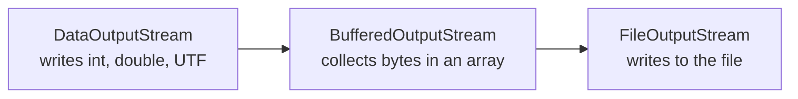
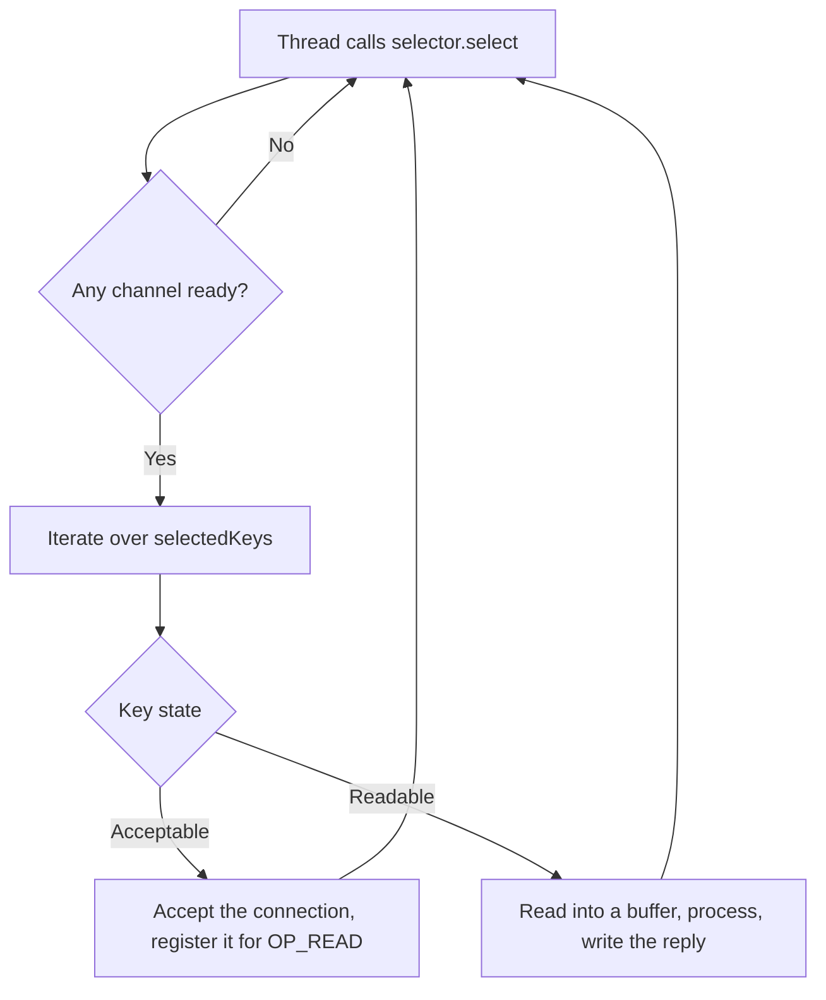

# I/O, NIO, and Serialization

## Why It Matters

Input and output code appears in every backend service: reading a request body, writing a log file, streaming an upload. Interviews ask about it rarely and in four forms: the difference between a byte stream and a character stream, why a `BufferedInputStream` speeds up reading, how NIO buffers and channels differ from streams, and why Java serialization is dangerous. The last form matters most. Deserialization of untrusted data is a remote-code-execution vector, and a Java developer must know why, and what the filters from JEP 290 and JEP 415 do. On the job, the same topics explain slow file copies, garbled non-ASCII text, `ClassCastException` after a version change, and security findings about `ObjectInputStream`. This page covers `java.io`, `java.nio.file`, buffers and channels, memory-mapped files, and Java serialization. Exceptions and `try-with-resources` are in [exceptions](03-exceptions.md). Threads that block on I/O, and virtual threads that make blocking I/O cheap, are in [virtual threads](10-virtual-threads.md).

## Core Concepts

**Stream**: a sequence of data that a program reads or writes in order. In `java.io`, a stream has no position that the program can set. (This is not a `java.util.stream.Stream`, which is a pipeline of operations.)

**Byte stream**: a stream of 8-bit values. The root classes are `InputStream` and `OutputStream`.

**Character stream**: a stream of 16-bit Java `char` values. The root classes are `Reader` and `Writer`. A character stream that reads from a byte source uses a **charset** (a mapping between characters and bytes, such as UTF-8) to decode the bytes. `InputStreamReader` and `OutputStreamWriter` are the bridges from byte streams to character streams.

**Decorator**: a stream class that wraps another stream of the same family and adds one behavior. `BufferedInputStream`, `DataInputStream`, `GZIPInputStream`, and `ObjectInputStream` are decorators. The wrapped stream is the **source** (for input) or the **sink** (for output). This is the Decorator design pattern. Each wrapper holds a reference to the inner stream and forwards calls to it.

**Buffering**: collecting many small reads or writes in an in-memory array, so that the program makes fewer calls to the operating system. A system call costs far more than a copy inside the JVM.

**Path**: an object in `java.nio.file` that represents a location in a file system. A `Path` is immutable, and most of its methods do not access the disk.

**Buffer**: a fixed-size block of memory with a `position`, a `limit`, and a `capacity`. A buffer holds data of one primitive type. `ByteBuffer` is the most common.

**Channel**: a connection to an entity that can do I/O (a file, a socket). A program reads from a channel into a buffer, or writes from a buffer into a channel. A channel is bidirectional where the underlying entity allows it.

**Selector**: an object that watches many non-blocking channels, and tells one thread which of them are ready.

**Serialization**: converting an object graph into a byte sequence. **Deserialization** is the reverse. In Java, the `Serializable` interface marks a class as eligible for the platform's built-in mechanism.

## How It Works

### Byte streams, character streams, and the decorator chain

`InputStream.read()` returns one byte as an `int` from 0 to 255, or -1 at the end of the stream. `read(byte[])` fills an array and returns the number of bytes read, which can be less than the array length. A program must use the returned count. `OutputStream.write` has the same two forms.

The classes combine in chains. Each decorator adds one behavior:



| Class | Family | Behavior it adds |
|---|---|---|
| `FileInputStream`, `FileOutputStream` | Byte | The source or sink: a file |
| `ByteArrayInputStream`, `ByteArrayOutputStream` | Byte | The source or sink: a byte array in memory |
| `BufferedInputStream`, `BufferedOutputStream` | Byte | An internal array (8192 bytes by default) |
| `DataInputStream`, `DataOutputStream` | Byte | Read and write primitives and modified UTF-8 strings |
| `ObjectInputStream`, `ObjectOutputStream` | Byte | Java serialization |
| `InputStreamReader`, `OutputStreamWriter` | Bridge | Convert between bytes and characters with a charset |
| `FileReader`, `FileWriter` | Character | Shortcuts for a reader or writer on a file |
| `BufferedReader`, `BufferedWriter` | Character | An internal array, and `readLine` or `newLine` |
| `PrintWriter`, `PrintStream` | Character, byte | `print` and `println` for all types. These classes do not throw `IOException` |

The default buffer size of `BufferedInputStream` and `BufferedOutputStream` is 8192 bytes (JDK 21 source, `java.io.BufferedInputStream`). A `BufferedReader` buffers 8192 characters by default.

**Why buffering matters.** An unbuffered `FileInputStream.read()` makes one native call for each byte. A `BufferedInputStream` makes one native call for each 8192 bytes, and returns later bytes from its array. The speed gain depends on the system, so measure it before you quote a number. If a program already reads in large blocks (`read(byte[8192])` or `InputStream.transferTo`), an extra buffer adds a copy and no benefit.

**Flush and close.** A buffered output stream holds bytes in memory until the buffer is full, `flush` runs, or `close` runs. `close` on a decorator flushes it and then closes the wrapped stream. Therefore a program closes only the outermost stream. If a program forgets to close or flush, the last bytes are lost. The demo below prints the sink size before and after `close` to show this. Use `try-with-resources` for every stream (see [exceptions](03-exceptions.md)).

**Charsets.** A character stream needs a charset to turn characters into bytes. Before JDK 18, the default charset depended on the operating system and the locale. JEP 400 (JDK 18) changed the default charset of the standard Java APIs to UTF-8. `System.out` and `System.err` are excluded: their charset follows the console (JEP 400). The property `native.encoding` still reports the charset of the environment. Recommendation: pass the charset explicitly (`StandardCharsets.UTF_8`) in every constructor that accepts one. Code then behaves the same on every machine and on every JDK version. `FileReader` and `FileWriter` accept a `Charset` argument since JDK 11.

```java
import java.io.BufferedInputStream;
import java.io.BufferedOutputStream;
import java.io.BufferedReader;
import java.io.ByteArrayInputStream;
import java.io.ByteArrayOutputStream;
import java.io.DataInputStream;
import java.io.DataOutputStream;
import java.io.IOException;
import java.io.InputStreamReader;
import java.io.OutputStreamWriter;
import java.io.PrintWriter;
import java.nio.charset.StandardCharsets;

public class StreamDecorators {
    public static void main(String[] args) throws IOException {
        ByteArrayOutputStream sink = new ByteArrayOutputStream();

        // Decorator chain: DataOutputStream -> BufferedOutputStream -> sink
        try (DataOutputStream out =
                 new DataOutputStream(new BufferedOutputStream(sink, 8192))) {
            out.writeInt(258);
            out.writeUTF("héllo");
            out.writeDouble(1.5);
            System.out.println("bytes in sink before close = " + sink.size());
        }
        byte[] bytes = sink.toByteArray();
        System.out.println("bytes in sink after close  = " + bytes.length);

        try (DataInputStream in =
                 new DataInputStream(new BufferedInputStream(new ByteArrayInputStream(bytes)))) {
            System.out.println(in.readInt() + " " + in.readUTF() + " " + in.readDouble());
        }

        // Character streams: an explicit charset turns characters into bytes
        String text = "é\nline two\n";
        ByteArrayOutputStream raw = new ByteArrayOutputStream();
        try (PrintWriter w = new PrintWriter(
                 new OutputStreamWriter(raw, StandardCharsets.UTF_8))) {
            w.print(text);
        }
        System.out.println("UTF-8 bytes = " + raw.size());
        System.out.println("UTF-16 bytes = " + text.getBytes(StandardCharsets.UTF_16LE).length);

        try (BufferedReader r = new BufferedReader(new InputStreamReader(
                 new ByteArrayInputStream(raw.toByteArray()), StandardCharsets.UTF_8))) {
            String line;
            while ((line = r.readLine()) != null) {
                System.out.println("read: " + line);
            }
        }

        // Wrong charset: the bytes are the same, the characters differ
        String wrong = new String(raw.toByteArray(), StandardCharsets.ISO_8859_1);
        System.out.println("decoded as ISO-8859-1: " + wrong.length() + " chars");
    }
}
```

<!-- expected-output -->
```text
bytes in sink before close = 0
bytes in sink after close  = 20
258 héllo 1.5
UTF-8 bytes = 12
UTF-16 bytes = 22
read: é
read: line two
decoded as ISO-8859-1: 12 chars
```

Read the output. The sink holds 0 bytes before `close`, because the `BufferedOutputStream` keeps all 20 bytes in its array until `close` flushes them. The 20 bytes are 4 (`int`), 2 + 6 (`writeUTF` writes a 2-byte length and the modified UTF-8 form of "héllo", where `é` takes 2 bytes), and 8 (`double`). The letter `é` takes 2 bytes in UTF-8 and 2 in UTF-16, but the text length differs because UTF-16 also spends 2 bytes on each ASCII letter. The last line shows a classic bug: if a program decodes UTF-8 bytes as ISO-8859-1, each byte becomes one character, so the 12 bytes become 12 characters, and `é` becomes two wrong characters.

### `java.nio.file`: `Path` and `Files`

`java.nio.file` (since Java 7) replaces `java.io.File`. `File` reports most failures as a `false` return value. `Files` methods throw an `IOException` subclass that names the cause (`NoSuchFileException`, `FileAlreadyExistsException`, `AccessDeniedException`).

| Task | Method | Note |
|---|---|---|
| Build a path | `Path.of("a", "b")` | `Paths.get` is the older form |
| Join | `base.resolve(other)` | If `other` is absolute, the result is `other` |
| Compute a relative path | `base.relativize(other)` | Both paths must be of the same kind (both absolute or both relative) |
| Remove `.` and `..` | `path.normalize()` | Works on names only. It does not check the disk and does not follow symbolic links |
| Read a small file | `Files.readString`, `Files.readAllLines`, `Files.readAllBytes` | Reads the whole file into memory. The file must fit in the heap |
| Read a large text file | `Files.lines(path)` or `Files.newBufferedReader(path)` | `Files.lines` returns a lazy `Stream<String>`. Close it |
| Write | `Files.write`, `Files.writeString`, `Files.newBufferedWriter` | Default options: create, truncate, write. Pass `APPEND` to add at the end |
| Copy and move | `Files.copy`, `Files.move` | Fail if the target exists, unless you pass `REPLACE_EXISTING` |
| Atomic replace | `Files.move(tmp, target, ATOMIC_MOVE)` | Write a temporary file in the same directory, then move it. A reader sees the old or the new file, never half of one. Support depends on the file system |
| List a directory | `Files.list(dir)` | One level. Returns a `Stream<Path>`. Close it |
| Walk a tree | `Files.walk(dir)`, `Files.walkFileTree` | Close the stream. `walkFileTree` gives a visitor for pre- and post-directory events |
| Temporary file | `Files.createTempFile`, `Files.createTempDirectory` | Uses `java.io.tmpdir` unless you pass a directory |

Streams that `Files.lines`, `Files.list`, and `Files.walk` return hold an open directory or file handle. A program that does not close them leaks the handle. Use `try-with-resources`.

```java
import java.io.IOException;
import java.nio.ByteBuffer;
import java.nio.MappedByteBuffer;
import java.nio.channels.FileChannel;
import java.nio.charset.StandardCharsets;
import java.nio.file.Files;
import java.nio.file.Path;
import java.nio.file.StandardOpenOption;
import java.util.List;
import java.util.stream.Stream;

public class NioDemo {
    public static void main(String[] args) throws IOException {
        // Path operations do not touch the file system
        Path base = Path.of("/data/app");
        Path p = base.resolve("../logs/./today.txt");
        System.out.println(p);
        System.out.println(p.normalize());
        System.out.println(base.relativize(Path.of("/data/app/logs/a.txt")));
        System.out.println(p.getFileName() + " " + p.getNameCount());

        Path dir = Files.createTempDirectory(Path.of("."), "nio-demo");
        try {
            Path file = dir.resolve("notes.txt");
            Files.write(file, List.of("alpha", "beta", "gamma"));
            System.out.println(Files.readAllLines(file));
            System.out.println("size = " + Files.size(file));
            Files.writeString(file, "delta\n", StandardOpenOption.APPEND);
            try (Stream<String> lines = Files.lines(file)) {
                System.out.println("lines = " + lines.count());
            }
            Path copy = dir.resolve("copy.txt");
            Files.copy(file, copy);
            try {
                Files.copy(file, copy);
            } catch (java.nio.file.FileAlreadyExistsException e) {
                System.out.println("copy refused: FileAlreadyExistsException");
            }

            // Buffer state: position, limit, capacity
            ByteBuffer buf = ByteBuffer.allocate(16);
            buf.put("abcdef".getBytes(StandardCharsets.US_ASCII));
            System.out.println("after put   pos=" + buf.position() + " lim=" + buf.limit());
            buf.flip();
            System.out.println("after flip  pos=" + buf.position() + " lim=" + buf.limit());
            byte first = buf.get();
            buf.compact();
            System.out.println("after compact pos=" + buf.position() + " lim=" + buf.limit()
                + " first=" + (char) first);

            // Channel read into a buffer, then a memory-mapped write
            try (FileChannel ch = FileChannel.open(file, StandardOpenOption.READ,
                    StandardOpenOption.WRITE)) {
                ByteBuffer in = ByteBuffer.allocate(5);
                int n = ch.read(in);
                in.flip();
                System.out.println("read " + n + " bytes: "
                    + StandardCharsets.UTF_8.decode(in));
                MappedByteBuffer map = ch.map(FileChannel.MapMode.READ_WRITE, 0, ch.size());
                map.put(0, (byte) 'A');
                map.force();
            }
            System.out.println(Files.readAllLines(file).get(0));
        } finally {
            try (Stream<Path> walk = Files.walk(dir)) {
                walk.sorted(java.util.Comparator.reverseOrder()).forEach(q -> q.toFile().delete());
            }
        }
    }
}
```

<!-- expected-output -->
```text
/data/app/../logs/./today.txt
/data/logs/today.txt
logs/a.txt
today.txt 6
[alpha, beta, gamma]
size = 17
lines = 4
copy refused: FileAlreadyExistsException
after put   pos=6 lim=16
after flip  pos=0 lim=6
after compact pos=5 lim=16 first=a
read 5 bytes: alpha
Alpha
```

The first four lines show `Path` methods. They work on names and do not touch the disk. The demo creates its temporary directory in the working directory, to run in restricted environments. The buffer lines are explained in the next section.

### NIO buffers and channels

`java.nio` (since Java 1.4) works with blocks of data and not with single bytes. A **channel** moves data between a file or socket and a **buffer**. The program, not the stream, decides how many bytes to move at each step.

A buffer has three indexes that always satisfy `0 <= position <= limit <= capacity` (`java.nio.Buffer` javadoc):

- `capacity`: the number of elements. It does not change.
- `limit`: the index of the first element that the program must not read or write.
- `position`: the index of the next element to read or write.

A buffer is in **write mode** (the program puts data in) or **read mode** (the program takes data out). The methods that switch the mode:

| Method | Effect | Use |
|---|---|---|
| `flip()` | `limit = position`, `position = 0` | After writing into the buffer, before reading from it |
| `clear()` | `position = 0`, `limit = capacity` | After reading everything, before writing again. It does not erase the data |
| `compact()` | Copies the unread bytes to the start, sets `position` after them, `limit = capacity` | After a partial read, to keep the unread bytes and add more |
| `rewind()` | `position = 0`, `limit` unchanged | To read the same data again |

```text
allocate(16), put 6 bytes:   [a b c d e f . . . . . . . . . .]
                                          ^position=6            limit=16
flip():                      [a b c d e f . . . . . . . . . .]
                              ^position=0  ^limit=6
get() one byte, compact():   [b c d e f f . . . . . . . . . .]
                                        ^position=5              limit=16
```

In the compact line, the last `f` is a leftover that the next `put` overwrites. A frequent bug is to forget `flip()`. The program then reads from the position after the data, and sees zero bytes or a `BufferUnderflowException`.

**Heap and direct buffers.** `ByteBuffer.allocate(n)` creates a **heap buffer**, backed by a `byte[]` in the Java heap. `ByteBuffer.allocateDirect(n)` creates a **direct buffer**, whose memory is outside the Java heap. The `ByteBuffer` javadoc says that for a direct buffer the JVM "will make a best effort to perform native I/O operations directly upon it", that is, it tries to avoid copying the content to or from an intermediate buffer. The same javadoc says that direct buffers "typically have somewhat higher allocation and deallocation costs", that their contents "may reside outside of the normal garbage-collected heap" (so their effect on memory use might not be obvious), and that it is best to allocate them "only when they yield a measurable gain in program performance". The JVM option `-XX:MaxDirectMemorySize` limits the total. Recommendation: follow the javadoc. Use direct buffers for large, long-lived buffers that take part in channel I/O, and only after a measurement shows a gain. Use heap buffers otherwise. Memory use and garbage collection are in [memory and GC](06-memory-and-gc.md).

**Channels.** `FileChannel` reads and writes at a position, can truncate a file, transfers bytes between channels (`transferTo` and `transferFrom`), and can lock a region of a file. The `transferTo` javadoc says that the method is "potentially much more efficient" than a loop that reads from this channel and writes to the target, because "many operating systems can transfer bytes directly from the filesystem cache to the target channel without actually copying them". The gain depends on the operating system and on the target channel, so measure it. `SocketChannel` and `ServerSocketChannel` do network I/O, and can run in non-blocking mode.

**Streams versus channels.**

| Property | `java.io` streams | `java.nio` channels |
|---|---|---|
| Unit | Byte or character | Buffer (block) |
| Direction | One way for each object | Two ways where the entity allows it (`FileChannel`, `SocketChannel`) |
| Position | None. The program reads forward | `FileChannel` has a settable position |
| Blocking | Always blocking | Blocking, or non-blocking for socket channels |
| Many connections in one thread | No | Yes, with a `Selector` |

### Selectors in brief

A blocking server needs one thread for each connection, because `read` blocks the thread until data arrives. With a **selector**, one thread registers many non-blocking channels, and calls `select()`. The call blocks until at least one channel is ready for an operation that the thread registered (accept, connect, read, or write). Then `selectedKeys()` gives the ready channels.



The JDK selector uses the best mechanism of the operating system (for example `epoll` on Linux). This is the base of Netty and of the event loops in non-blocking servers. The sketch below compiles but is not run here, because a server needs a socket.

```java
import java.io.IOException;
import java.net.InetSocketAddress;
import java.nio.ByteBuffer;
import java.nio.channels.SelectionKey;
import java.nio.channels.Selector;
import java.nio.channels.ServerSocketChannel;
import java.nio.channels.SocketChannel;
import java.util.Iterator;

public class EchoServer {
    public static void serve(int port) throws IOException {
        try (Selector selector = Selector.open();
             ServerSocketChannel server = ServerSocketChannel.open()) {
            server.bind(new InetSocketAddress(port));
            server.configureBlocking(false);
            server.register(selector, SelectionKey.OP_ACCEPT);
            ByteBuffer buf = ByteBuffer.allocate(1024);

            while (selector.isOpen()) {
                selector.select();                       // blocks until a channel is ready
                Iterator<SelectionKey> it = selector.selectedKeys().iterator();
                while (it.hasNext()) {
                    SelectionKey key = it.next();
                    it.remove();                         // the selector does not clear this set
                    if (key.isAcceptable()) {
                        SocketChannel client = server.accept();
                        client.configureBlocking(false);
                        client.register(selector, SelectionKey.OP_READ);
                    } else if (key.isReadable()) {
                        SocketChannel client = (SocketChannel) key.channel();
                        buf.clear();
                        if (client.read(buf) < 0) {      // -1: the peer closed the connection
                            client.close();
                            continue;
                        }
                        buf.flip();
                        client.write(buf);               // a real server handles partial writes
                    }
                }
            }
        }
    }
}
```

The code removes each key from `selectedKeys()`, because the selector adds keys to that set but never removes them. If a program does not remove the key, the loop handles the same event again. Application code seldom uses selectors directly. A framework (Netty, Vert.x, Tomcat's NIO connector) does. Since Java 21, virtual threads make blocking code cheap enough for many servers; see [virtual threads](10-virtual-threads.md).

### Memory-mapped files

`FileChannel.map(mode, position, size)` returns a `MappedByteBuffer`: a buffer whose content is a region of the file, mapped into the address space of the process. The operating system loads the pages when the program touches them and writes changed pages back later. The program reads and writes the file with `get` and `put`, with no `read` or `write` calls. `force()` asks the system to write the changes to the storage device.

Use a mapped file for large files with random access (an index, a database file). Limits, from the `FileChannel.map` javadoc for JDK 21:

- The `size` argument must not be greater than `Integer.MAX_VALUE`, so one mapping covers at most 2 GB. A larger file needs several mappings.
- The program cannot unmap the buffer explicitly. The javadoc says that the buffer and the mapping "will remain valid until the buffer itself is garbage-collected", and that closing the channel does not end the mapping. A consequence: operations that need the mapping gone can fail until a garbage collection releases it. The bug report JDK-4724038 ("Add unmap method to MappedByteBuffer") describes `File.delete` failing, and truncating a file to less than the mapped size failing, until the mapping was released, on Windows. How a file system treats a mapped file depends on the operating system, so do not rely on deleting a mapped file.
- Whether changes to the size or content of the file by another program reach the buffer is unspecified. If the file shrinks while mapped, an access to the missing part throws an unspecified exception, at the access or later (`ByteBuffer` and `FileChannel` javadoc).

Java 22 made the Foreign Function and Memory API final (JEP 454). It adds `FileChannel.map(mode, offset, size, Arena)`, which returns a `MemorySegment` with a 64-bit size and a defined lifetime: the mapping ends when the `Arena` closes. In Java 21 this API is a preview feature (JEP 442, the third preview, Closed / Delivered in release 21), so Java 21 code without `--enable-preview` uses `MappedByteBuffer`.

### Java serialization

#### The mechanism

A class opts in with `implements java.io.Serializable`. The interface has no methods (a **marker interface**). `ObjectOutputStream.writeObject(o)` writes the class descriptor of `o` (class name, `serialVersionUID`, field names and types) and then the values of the fields. For each field that holds an object, it writes that object too. The result is the **object graph**. The stream marks each object once, so shared references and cycles survive a round trip.

Rules from the `Serializable` javadoc and the Java Object Serialization Specification:

- The runtime writes all non-static, non-transient fields. A `transient` field gets the default value on read (`null`, `0`, `false`). A `static` field belongs to the class and is not part of the object.
- Deserialization does not call the constructor of the serializable class. It creates the object without a constructor call, and sets the fields from the stream. This bypasses any check in the constructor, so the invariants of the class can break.
- The constructor of the first non-serializable superclass runs. That class needs an accessible no-argument constructor, or the runtime throws an error.
- A field of a non-serializable type makes `writeObject` throw `NotSerializableException`, unless the field is `transient`.
- Enum constants serialize by name, so deserialization returns the same constant. Records serialize by their components, and deserialization calls the canonical constructor, so the compact constructor validation runs. Records ignore `writeObject`, `readObject`, and similar methods (`Serializable` javadoc).

#### `serialVersionUID`

The `serialVersionUID` is a `long` that identifies the version of a class. When `ObjectInputStream` reads an object, it compares the value in the stream with the value of the local class. If they differ, it throws `InvalidClassException`.

If a class does not declare the field, the runtime computes a value from the class details (name, interfaces, fields, methods). The `Serializable` javadoc says that the computation is "highly sensitive to class details that may vary depending on compiler implementations", so a recompile can change it, and it strongly recommends that every serializable class declare the field. Declare it as `private static final long serialVersionUID = 1L;`.

If the declared value stays the same, the runtime accepts compatible changes: adding a field (old streams give the default value), or removing one (the runtime ignores the extra data). Incompatible changes are: changing the type of a field, moving a class in the hierarchy, and changing a class from `Serializable` to `Externalizable`. Change the number only when you want to reject all old data.

#### Customizing the mechanism

| Hook | Signature | Purpose |
|---|---|---|
| `writeObject` | `private void writeObject(ObjectOutputStream)` | Write extra data, or transform fields. Call `defaultWriteObject` first |
| `readObject` | `private void readObject(ObjectInputStream)` | Read the extra data. Validate the fields here |
| `writeReplace` | `Object writeReplace()` | Write another object in place of this one (the serialization proxy pattern) |
| `readResolve` | `Object readResolve()` | Return another object after the read, for example the singleton instance |
| `Externalizable` | `writeExternal`, `readExternal` | Full control of the format. Needs a public no-argument constructor |

*Effective Java* (3rd edition, items 85 to 90) gives the design rules: prefer alternatives to Java serialization (item 85), implement `Serializable` with great caution (item 86), consider a custom serialized form (item 87), write `readObject` methods defensively (item 88), prefer enum types to `readResolve` for instance control (item 89), and consider serialization proxies (item 90).

```java
import java.io.ByteArrayInputStream;
import java.io.ByteArrayOutputStream;
import java.io.IOException;
import java.io.InvalidClassException;
import java.io.ObjectInputFilter;
import java.io.ObjectInputStream;
import java.io.ObjectOutputStream;
import java.io.Serializable;
import java.util.List;

public class SerializationDemo {
    static class Session implements Serializable {
        private static final long serialVersionUID = 1L;
        final String user;
        transient String password;      // not written
        final String[] roles;

        Session(String user, String password, String... roles) {
            this.user = user;
            this.password = password;
            this.roles = roles;
        }
    }

    // An unrelated serializable class, standing in for an attacker's class
    static class Gadget implements Serializable {
        private static final long serialVersionUID = 1L;
        private void readObject(ObjectInputStream in)
                throws IOException, ClassNotFoundException {
            in.defaultReadObject();
            System.out.println("Gadget.readObject ran");
        }
    }

    static byte[] write(Object o) throws IOException {
        ByteArrayOutputStream bos = new ByteArrayOutputStream();
        try (ObjectOutputStream out = new ObjectOutputStream(bos)) {
            out.writeObject(o);
        }
        return bos.toByteArray();
    }

    static Object read(byte[] data, ObjectInputFilter filter)
            throws IOException, ClassNotFoundException {
        try (ObjectInputStream in = new ObjectInputStream(new ByteArrayInputStream(data))) {
            if (filter != null) {
                in.setObjectInputFilter(filter);
            }
            return in.readObject();
        }
    }

    public static void main(String[] args) throws Exception {
        Session s = new Session("ana", "secret", "admin");
        Session copy = (Session) read(write(s), null);
        System.out.println(copy.user + " " + copy.password + " " + List.of(copy.roles));

        // Without a filter, the readObject method of any serializable class on the
        // class path runs during deserialization
        read(write(new Gadget()), null);

        // An allow-list filter rejects the class before the JVM creates the object
        ObjectInputFilter allowList = ObjectInputFilter.Config.createFilter(
            "SerializationDemo$Session;java.lang.String;!*");
        System.out.println("Session allowed: "
            + (read(write(s), allowList) instanceof Session));
        try {
            read(write(new Gadget()), allowList);
        } catch (InvalidClassException e) {
            System.out.println("Gadget rejected: InvalidClassException");
        }

        // A limit filter stops a stream that is too deep
        ObjectInputFilter limit = ObjectInputFilter.Config.createFilter("maxbytes=20");
        try {
            read(write(s), limit);
        } catch (InvalidClassException e) {
            System.out.println("Too large: InvalidClassException");
        }
    }
}
```

<!-- expected-output -->
```text
ana null [admin]
Gadget.readObject ran
Session allowed: true
Gadget rejected: InvalidClassException
Too large: InvalidClassException
```

Read the output. The `transient` field comes back as `null`. The `Gadget` class prints a line from its own `readObject` during deserialization, so an application that calls `readObject` on a stream runs the code of every serializable class on its class path that the stream names. The allow-list filter rejects `Gadget` before the JVM runs that code. The last filter rejects the stream because it is larger than 20 bytes.

#### Why deserialization is dangerous

`ObjectInputStream.readObject` instantiates the classes that the stream names, and runs their `readObject` and `readResolve` methods, before the application can check the type of the result. A cast such as `(Session) in.readObject()` runs after the damage. An attacker who controls the bytes chooses which classes the JVM creates. A **gadget chain** is a sequence of classes, found in libraries on the class path, whose `readObject`, `hashCode`, or `compareTo` methods call each other and end in a dangerous operation, such as running a command. The attacker needs no flaw in the application code: only a vulnerable class on the class path, and a place that deserializes input from outside. Public chains exist for widely used libraries. Other attacks need no gadget: a small stream can force a large memory or CPU use (a deeply nested graph, a very large array).

Recommendation: do not deserialize data from an untrusted source with `ObjectInputStream`. The OWASP deserialization cheat sheet gives the same advice. If a program must do it, use a filter.

#### Serialization filters (JEP 290 and JEP 415)

**JEP 290** (JDK 9, also backported to the 8u update line) added `java.io.ObjectInputFilter`. A filter receives a `FilterInfo` for each class, array, and step of the stream, and returns `ALLOWED`, `REJECTED`, or `UNDECIDED`. A filter can check the class name, the array length, the depth of the graph, the number of references, and the size of the stream in bytes.

A pattern filter is a string, with parts separated by `;`:

| Part | Meaning |
|---|---|
| `com.app.Session` | Allow the exact class |
| `com.app.*` | Allow all classes of the package `com.app` |
| `com.app.**` | Allow the package and its subpackages |
| `!com.evil.**` | Reject the package and its subpackages (a leading `!` rejects) |
| `maxdepth=N`, `maxrefs=N`, `maxbytes=N`, `maxarray=N` | Limits. Checked before the class patterns |
| `!*` at the end | Reject everything that no earlier pattern named |

The runtime tests the class patterns from left to right, and the first match decides. If no pattern matches, the result is `UNDECIDED`, and the stream is allowed. An allow-list therefore needs `!*` as its last pattern.

You can set a filter in two ways: for one stream with `ObjectInputStream.setObjectInputFilter`, or for the whole JVM with the system property `-Djdk.serialFilter=...` (or the security property of the same name in `conf/security/java.security`; the system property wins). The first form fits one deserialization site. The second form is a safety net.

**JEP 415** (JDK 17) fixes a weakness of that design: one JVM-wide filter fits no code path well, and library code that creates its own `ObjectInputStream` cannot set a filter for the application. JEP 415 adds a **filter factory**: a `BinaryOperator<ObjectInputFilter>` that the JVM calls once for each new `ObjectInputStream` (with the current filter and a `null` requested filter), and again each time `setObjectInputFilter` runs (with the current filter and the requested filter). The factory returns the filter for that stream. A program sets it with `ObjectInputFilter.Config.setSerialFilterFactory` (once, before the first deserialization) or with `-Djdk.serialFilterFactory=<class name>`. Without a factory, a built-in one gives the behavior of JEP 290: the JVM-wide filter and the stream filter combine.

```java
import java.io.ByteArrayInputStream;
import java.io.ByteArrayOutputStream;
import java.io.IOException;
import java.io.InvalidClassException;
import java.io.ObjectInputFilter;
import java.io.ObjectInputStream;
import java.io.ObjectOutputStream;
import java.util.Date;

public class FilterFactoryDemo {
    static Object roundTrip(Object o) throws IOException, ClassNotFoundException {
        ByteArrayOutputStream bos = new ByteArrayOutputStream();
        try (ObjectOutputStream out = new ObjectOutputStream(bos)) {
            out.writeObject(o);
        }
        try (ObjectInputStream in =
                 new ObjectInputStream(new ByteArrayInputStream(bos.toByteArray()))) {
            return in.readObject();
        }
    }

    public static void main(String[] args) throws Exception {
        // The factory runs once for each ObjectInputStream. This one ignores the
        // current filter and rejects every class that the allow list does not name.
        ObjectInputFilter allowList = ObjectInputFilter.Config.createFilter(
            "java.lang.String;java.lang.Integer;java.lang.Number");
        ObjectInputFilter.Config.setSerialFilterFactory((current, requested) -> {
            // The JVM passes requested == null when it creates the stream
            ObjectInputFilter combined = requested == null
                ? allowList : ObjectInputFilter.merge(requested, allowList);
            return ObjectInputFilter.rejectUndecidedClass(combined);
        });

        System.out.println(roundTrip("text"));
        System.out.println(roundTrip(42));
        try {
            roundTrip(new Date(0));
        } catch (InvalidClassException e) {
            System.out.println("Date rejected: " + e.getMessage());
        }
    }
}
```

<!-- expected-output -->
```text
text
42
Date rejected: filter status: REJECTED
```

The `null` check in the factory is needed: the JVM calls the factory when it creates the stream, before any code can set a stream filter, and `ObjectInputFilter.merge` throws `NullPointerException` for a `null` filter. `rejectUndecidedClass` turns `UNDECIDED` into `REJECTED` for classes, so the allow list does not need `!*`.

Filters reduce the risk, but a pattern list is only as good as its author. A filter that allows a whole library package can still allow a gadget class. The safe design is to avoid Java serialization for data that crosses a trust boundary.

Status on openjdk.org, checked on 2026-10-22: JEP 290 (release 9) and JEP 415 (release 17) are "Closed / Delivered". In the JEP index, these two are the only delivered JEPs with serialization or deserialization in the title, and no JEP numbered after 415 is tagged `core / io:serialization`. JEP 154 ("Remove Serialization") is "Withdrawn". So no JEP in Java 22 to 25 changes the filter design. A JEP is not the only way to change behavior, so read the release notes of your JDK for smaller changes.

### Alternatives to Java serialization

| Format | Schema | Size | Cross-language | Main risk or cost |
|---|---|---|---|---|
| Java serialization | Class definition | Large (class descriptors in the stream) | No | Deserialization attacks. Tight coupling to the class layout |
| JSON (Jackson, Gson) | Optional | Large (text) | Yes | Polymorphic type handling can be unsafe if you enable it. No built-in schema |
| Protocol Buffers | `.proto` file | Small (binary) | Yes | Needs a code generation step. Not human-readable |
| Avro | Schema, with the data or in a registry | Small | Yes | Needs the writer schema to read data |

Recommendation: use JSON for public APIs and configuration, and Protocol Buffers or Avro for high-volume internal messages, where size and schema evolution matter. These formats carry data only. They do not create arbitrary classes from the stream. Jackson's default typing, which writes class names into the JSON, can bring back the same class of attack, so keep it off for untrusted input. How a service uses these formats in REST APIs is in `kb/api-design/` (planned) and in `kb/java/20-spring-web-and-rest.md`.

## Trade-offs and When to Use

| Need | Use | Reason |
|---|---|---|
| Read or write a small text file | `Files.readString`, `Files.writeString` | One call. The file must fit in memory |
| Read a large text file line by line | `Files.newBufferedReader` or `Files.lines` | Constant memory |
| Copy a file | `Files.copy`, or `FileChannel.transferTo` | The JDK may avoid user-space copies |
| Read bytes from a stream in a loop | `read(byte[])` or `transferTo`, wrapped in `BufferedInputStream` if you read small pieces | Fewer system calls |
| Many idle connections on few threads | A framework on top of `Selector` (Netty), or virtual threads with blocking I/O | One thread for each connection is expensive with platform threads |
| Random access to a large file | `FileChannel`, or `MappedByteBuffer` | Skips copies, and uses the page cache of the operating system |
| Atomic file update | Temporary file in the same directory, then `ATOMIC_MOVE` | A crash leaves the old file intact |
| Send an object over a network or store it | JSON, Protobuf, or Avro | No gadget chains, language-neutral, evolvable |
| Cache an object in a local, trusted, short-lived store | Java serialization works, with a fixed `serialVersionUID` and a filter | Only when you control both ends and the data never leaves your trust boundary |

## Java Example

The demos in the sections above run as shown: each is a complete file that you can save and run with `java File.java`. They print the same output on every run. The program in the next block is the safest pattern for the most common task: copy a stream with a size limit.

```java
import java.io.ByteArrayInputStream;
import java.io.ByteArrayOutputStream;
import java.io.IOException;
import java.io.InputStream;
import java.io.OutputStream;

public class BoundedCopy {
    /** Copies at most maxBytes bytes. Throws if the source has more. */
    static long copy(InputStream in, OutputStream out, long maxBytes) throws IOException {
        byte[] block = new byte[8192];
        long total = 0;
        int n;
        while ((n = in.read(block)) != -1) {
            total += n;
            if (total > maxBytes) {
                throw new IOException("input larger than " + maxBytes + " bytes");
            }
            out.write(block, 0, n);   // write only the n bytes that read returned
        }
        return total;
    }

    public static void main(String[] args) throws IOException {
        ByteArrayOutputStream out = new ByteArrayOutputStream();
        System.out.println(copy(new ByteArrayInputStream(new byte[20_000]), out, 50_000));
        try {
            copy(new ByteArrayInputStream(new byte[20_000]), new ByteArrayOutputStream(), 10_000);
        } catch (IOException e) {
            System.out.println(e.getMessage());
        }
    }
}
```

<!-- expected-output -->
```text
20000
input larger than 10000 bytes
```

The loop uses the count `n` that `read` returns. A common bug writes the whole array on every pass, which adds garbage bytes after a short read. The size limit protects a service from a client that sends an endless body.

## Interview Angle

### Questions

??? question "What is the difference between a byte stream and a character stream, and when does the difference cause bugs?"

    A byte stream (`InputStream`, `OutputStream`) moves raw 8-bit values. A character stream (`Reader`, `Writer`) moves `char` values and uses a charset to convert between characters and bytes. Use a byte stream for binary data (images, archives, serialized objects) and a character stream for text.

    The bug appears at the conversion. If the writer and the reader use different charsets, the characters change: UTF-8 bytes read as ISO-8859-1 give extra characters. Before JDK 18 the default charset depended on the operating system, so the same program behaved differently on two machines. JDK 18 (JEP 400) made UTF-8 the default for the standard APIs, but `System.out` still follows the console. The fix: pass `StandardCharsets.UTF_8` explicitly.

??? question "Why do you wrap a `FileInputStream` in a `BufferedInputStream`? What happens if you forget to close or flush a buffered output stream?"

    An unbuffered `read()` on a `FileInputStream` makes one system call for each byte. A `BufferedInputStream` reads a block (8192 bytes by default) in one call, and returns later bytes from memory. Fewer system calls means less time, and a measurement shows the exact gain. If the code already reads large blocks, the buffer adds nothing.

    A `BufferedOutputStream` holds bytes until its buffer is full, `flush` runs, or `close` runs. If the program ends without either, the last bytes are lost. `close` on the outermost stream flushes the buffer and closes the inner stream, so use `try-with-resources` on the outermost stream.

??? question "How do NIO buffers and channels differ from streams? Explain `flip()`."

    A stream moves bytes one way, in order, and blocks. A channel moves data between a file or socket and a buffer, can work in both directions, and socket channels can run in non-blocking mode and register with a `Selector`, so one thread serves many connections. A `FileChannel` has a position that the program can set.

    A buffer has a position, a limit, and a capacity. After you put data into a buffer, `position` is after the data. `flip()` sets `limit = position` and `position = 0`, so a read starts at the first byte and stops at the end of the data. `clear()` resets the buffer for new writes, and `compact()` keeps the unread bytes. Forgetting `flip()` is the most common buffer bug.

??? question "Why is Java deserialization dangerous, and how do you protect a service?"

    `ObjectInputStream.readObject` creates the classes that the byte stream names and runs their `readObject` methods before the application can check the type. An attacker who controls the bytes can choose classes from the class path whose methods chain into a harmful operation (a gadget chain), or can send a stream that uses much memory or CPU.

    Protection, in order of strength: (1) do not deserialize untrusted data with Java serialization, and use JSON or Protobuf; (2) if you must, set a serialization filter with an allow list of classes and limits (`maxdepth`, `maxbytes`, `maxarray`, `maxrefs`), with `ObjectInputStream.setObjectInputFilter` or `-Djdk.serialFilter` (JEP 290, JDK 9); (3) on JDK 17 or later, use a filter factory (JEP 415) to set a filter per stream context, including library code; (4) keep dependencies current and remove unused libraries, because gadgets live in libraries. A filter lowers the risk. It does not remove the need for (1).

??? question "What does `serialVersionUID` do, and what happens if you leave it out?"

    It identifies the version of a serializable class. `ObjectInputStream` compares the value in the stream with the local class, and throws `InvalidClassException` if they differ. If you do not declare it, the runtime computes it from class details, and a recompile or a harmless change (adding a method) can change the value, so old data fails to load. The javadoc strongly recommends that every serializable class declare `private static final long serialVersionUID`. Keep the value when a change is compatible (adding a field). Change it when the change is incompatible and old data must be rejected.

### Follow-up Questions

??? question "A class implements `Serializable`. Does deserialization call its constructor?"

    No. The runtime creates the object without calling a constructor of the serializable class, and sets the fields from the stream. It calls the no-argument constructor of the first superclass that is not serializable. The effect: checks in the constructor do not run, so a class with invariants needs a defensive `readObject`, or a serialization proxy (*Effective Java*, items 88 and 90). Records are different: deserialization calls the canonical constructor.

??? question "How do you keep a singleton a singleton after deserialization?"

    Deserialization creates a new instance, which breaks the singleton. Two fixes: write `readResolve()` that returns the single instance, or (the better fix, *Effective Java* item 89) implement the singleton as a single-element `enum`, because the JVM guarantees that deserialization of an enum constant returns the same constant.

??? question "Why does `Files.lines` need a `try-with-resources`?"

    The returned stream holds an open file handle. A stream pipeline does not close it when the terminal operation finishes. If the program does not call `close`, the handle can stay open for a long time, and a long-running service can run out of file descriptors.

??? question "When would you use a `MappedByteBuffer`?"

    For large files with random access, because the operating system pages the data in and the program avoids `read` calls and extra copies. The limits: one mapping holds at most 2 GB, the program cannot unmap the buffer explicitly, and if the file shrinks, an access can throw an unspecified exception at a `get` or `put`. In Java 22 and later, the `MemorySegment` form of `FileChannel.map` (JEP 454) removes the size and unmap limits.

### Red Flags

- "Serialization is how you save objects" with no mention of the security risk or of a filter.
- "A cast after `readObject` makes it safe." The dangerous code runs inside `readObject`, before the cast.
- Ignoring the return value of `InputStream.read(byte[])` and writing the full array.
- Using `FileReader` or `new String(bytes)` with no charset and claiming that "it works on my machine".
- Closing the inner stream and not the outer one, or never closing a `Files.lines` stream.
- Saying that NIO is always faster than `java.io`. For a single sequential file copy, a buffered stream and a channel have similar speed.

## Common Mistakes

| Mistake | Effect | Fix |
|---|---|---|
| Missing `flush` or `close` on a buffered writer | The last bytes are lost | Use `try-with-resources` |
| Relying on the default charset | Different output on different machines (JDK 17 and earlier) | Pass `StandardCharsets.UTF_8` |
| Writing the whole array after `read(byte[])` | Garbage bytes after a short read | Write only the first `n` bytes |
| `Files.readAllBytes` on a large file | `OutOfMemoryError` | Stream with `newInputStream`, `newBufferedReader`, or a channel |
| Forgetting `flip()` before reading a buffer | Zero bytes or `BufferUnderflowException` | Call `flip()` after the last `put` |
| Not removing the key from `selectedKeys()` | The loop handles one event many times | Call `it.remove()` |
| Omitting `serialVersionUID` | `InvalidClassException` after a recompile | Declare it |
| Deserializing a request body with `ObjectInputStream` | Remote code execution risk | Use JSON, or set a filter |
| Serializing a class with a field of a non-serializable type | `NotSerializableException` | Mark it `transient`, or make the type serializable |
| Rewriting a file in place | A crash leaves a half-written file | Write a temporary file, then `ATOMIC_MOVE` |

## Commonly Confused With

| Looks like | Difference | Deciding question |
|---|---|---|
| `java.io.File` and `java.nio.file.Path` | `File` reports most failures with a return value and has fewer operations. `Path` with `Files` throws specific exceptions | New code? Use `Path` |
| `InputStream` and `Reader` | Bytes versus characters | Is the data text? Use a `Reader` with an explicit charset |
| `java.io` stream and `java.util.stream.Stream` | One moves bytes or characters. The other is a pipeline over elements | Does the code do I/O or a transformation? |
| Heap `ByteBuffer` and direct `ByteBuffer` | Memory in the Java heap versus memory outside it | Is the buffer large, long-lived, and used for channel I/O? |
| `transient` and `static` | Both are skipped by serialization. `transient` is a per-object field. `static` belongs to the class | Does each object have its own value? |
| `Serializable` and `Externalizable` | The first uses the default mechanism. The second needs the class to write and read each field | Do you need to control the format fully? |
| JEP 290 filter and JEP 415 filter factory | A JVM-wide or per-stream filter versus a function that picks a filter for each stream | Does one filter fit all streams in the JVM? |
| Blocking I/O and non-blocking I/O | A thread waits in `read` versus the call returns at once | Do you need many connections on few threads? |

## Quick Reference Card

- A byte stream moves bytes. A character stream moves characters through a charset. Pass the charset explicitly. JDK 18 and later default to UTF-8 (JEP 400).
- A decorator wraps a stream and adds one behavior. Close only the outermost stream. `BufferedInputStream` uses an 8192-byte buffer by default.
- `read(byte[])` returns the count of bytes read. Use the count.
- `Files` and `Path` replace `File`. Close the streams that `Files.lines`, `Files.list`, and `Files.walk` return.
- Buffer: `0 <= position <= limit <= capacity`. `flip` after writing. `clear` or `compact` before writing again.
- A selector lets one thread serve many non-blocking channels. Remove each key after you handle it.
- A `MappedByteBuffer` maps at most 2 GB (`Integer.MAX_VALUE`) in one mapping, and the program cannot unmap it. Java 22 added `MemorySegment` mapping (JEP 454).
- Serialization writes non-static, non-transient fields, and does not call the constructor of the serializable class. Declare `private static final long serialVersionUID`.
- Never trust bytes from outside with `ObjectInputStream`: the cast comes after the attack. Use JSON or Protobuf. If you must deserialize, filter: `jdk.serialFilter` (JEP 290, JDK 9), filter factory (JEP 415, JDK 17). An allow list ends with `!*`.

## Further Reading

- [JEP 290: Filter Incoming Serialization Data](https://openjdk.org/jeps/290): the pattern syntax, the limits, and the API. Read it to write a correct filter.
- [JEP 415: Context-Specific Deserialization Filters](https://openjdk.org/jeps/415): the filter factory, with a worked example.
- [JEP 400: UTF-8 by Default](https://openjdk.org/jeps/400): what changed in the default charset, and what did not.
- [JEP 454: Foreign Function and Memory API](https://openjdk.org/jeps/454): the final API that replaces `MappedByteBuffer` limits.
- [`java.io.Serializable` (JDK 21 javadoc)](https://docs.oracle.com/en/java/javase/21/docs/api/java.base/java/io/Serializable.html): the rules for `serialVersionUID`, records, enums, and the special methods.
- [`java.io.ObjectInputFilter` (JDK 21 javadoc)](https://docs.oracle.com/en/java/javase/21/docs/api/java.base/java/io/ObjectInputFilter.html): the pattern syntax and the `Config` methods.
- [`java.nio.Buffer` (JDK 21 javadoc)](https://docs.oracle.com/en/java/javase/21/docs/api/java.base/java/nio/Buffer.html): the invariants of position, limit, and capacity, and the semantics of `flip`, `clear`, and `compact`.
- [`java.nio.channels.FileChannel` (JDK 21 javadoc)](https://docs.oracle.com/en/java/javase/21/docs/api/java.base/java/nio/channels/FileChannel.html): `map`, `transferTo`, and the mapped-file limits.
- [OWASP Deserialization Cheat Sheet](https://cheatsheetseries.owasp.org/cheatsheets/Deserialization_Cheat_Sheet.html): practical guidance on safe deserialization.
- Joshua Bloch, *Effective Java*, 3rd edition, items 85 to 90: the design rules for serialization.
