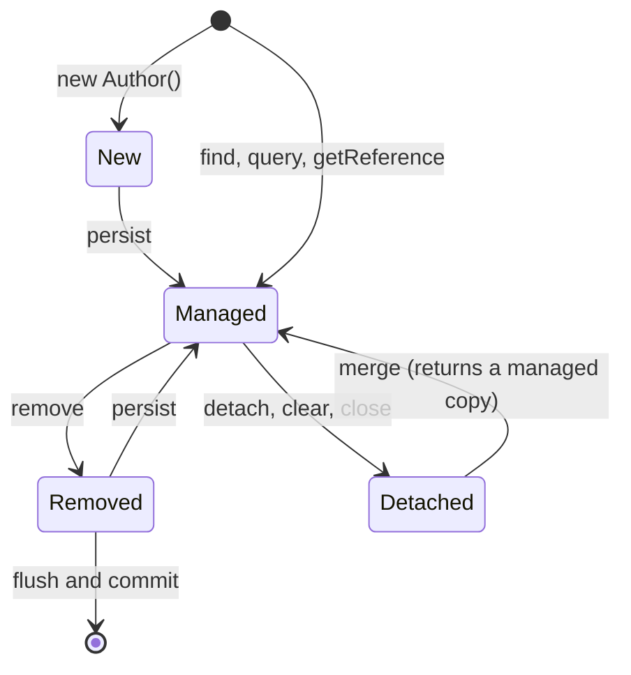
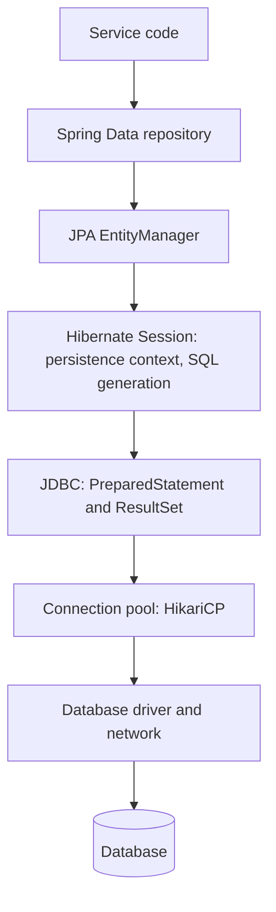

# JDBC, JPA, and Hibernate

## Why It Matters

Persistence questions appear in nearly every Java backend interview: "What is the N+1 problem?", "What is the difference between `LAZY` and `EAGER`?", "Why do you get a `LazyInitializationException`?", "What does the first-level cache do?", "How does optimistic locking work?". On the job, most slow endpoints in a Spring service trace back to the same few causes: a query per row, a connection that a thread holds too long, or a lazy load that runs where nobody expects it. This page explains the stack from the bottom: JDBC (the API that every database library uses), the connection pool, and then JPA and Hibernate (the object-relational mapping layer). Every behavior that the page states was run on Hibernate ORM 7.4.5.Final and H2 2.4.240 unless the text says otherwise. Spring Data repositories and `@Transactional` are in [Spring Data and transactions](19-spring-data-and-transactions.md). The theory of the N+1 problem, indexes, and query plans has its home in `kb/databases/05-query-execution-and-tuning.md`. This page explains how JPA causes the N+1 problem and how to remove it.

!!! info "Versions"
    Spring Boot 4.1.1 is the current release on spring.io (checked 2026-10-22). It manages Spring Framework 7.0.9, Hibernate ORM 7.4.5.Final, Jakarta Persistence 3.2.0, and HikariCP 7.0.2. Spring Boot 3.5.16 is the newest 3.x release. It manages Spring Framework 6.2.19, Hibernate ORM 6.6.53.Final, Jakarta Persistence 3.1.0, and HikariCP 6.3.3. Where the two lines differ for an interview topic, the text says so. Code that needs Hibernate, Spring, or a JDBC driver carries the `<!-- fragment -->` marker, because the KB runner has no such jars.

## Core Concepts

### JDBC

**JDBC** (Java Database Connectivity): the standard API in the `java.sql` and `javax.sql` packages for SQL access. A vendor supplies a **driver** that implements the API for one database. Every higher layer (Hibernate, Spring `JdbcTemplate`, jOOQ) calls JDBC.

**`Connection`**: one session with the database. It holds the transaction state. Do not use one connection from two threads at the same time: both threads would share one transaction, and their statements would mix in it.

**`Statement`**, **`PreparedStatement`**: objects that send SQL through a connection. A `PreparedStatement` takes SQL text with `?` placeholders and binds the values separately.

**`ResultSet`**: a cursor over the rows that a query returns.

**`DataSource`**: the factory for connections (`javax.sql.DataSource`). Application code asks the `DataSource` for a connection and does not call `DriverManager` directly. A pooled `DataSource` hands out connections from a pool.

**Connection pool**: a set of open connections that threads borrow and return. Opening a connection costs a network round trip and an authentication step on the server, so a service reuses connections. HikariCP is the default pool in Spring Boot.

### JPA and Hibernate

**ORM** (object-relational mapping): code that maps rows to objects and objects to rows.

**JPA** (Jakarta Persistence): the specification for ORM in Java. It defines annotations (`@Entity`, `@Id`, `@OneToMany`), the `EntityManager` API, and the query language JPQL. The current version is Jakarta Persistence 3.2. JPA is an interface: it does nothing without a provider.

**Hibernate ORM**: the most used JPA provider. It also has features that JPA does not define: `Session`, `@BatchSize`, the second-level cache regions, and statistics.

**Entity**: a class that is mapped to a table. Each instance with an identifier maps to one row.

**Persistence context**: the set of entity instances that one `EntityManager` currently manages. Within it, each database row has at most one instance. Hibernate calls its own implementation the `Session` and the persistence context the **first-level cache**.

**Flush**: the step in which Hibernate sends the pending SQL (`INSERT`, `UPDATE`, `DELETE`) to the database. A flush does not commit.

**Dirty checking**: the comparison, at flush time, of each managed entity with the snapshot that Hibernate took when it loaded the entity. Hibernate writes an `UPDATE` for each entity that differs.

**Proxy**: a generated subclass of an entity class (Hibernate uses Byte Buddy) that loads the real row on the first call of a method other than `getId`. Hibernate uses proxies for lazy `@ManyToOne` and `@OneToOne` associations and for `EntityManager.getReference`.

**Fetch type**: `LAZY` loads an association when the code first uses it. `EAGER` loads it together with the owner.

### Entity states

The JPA specification (section 3.2 of Jakarta Persistence) defines four states. Hibernate documents the same four and calls the first "transient".

| State | Has identifier? | Managed by a persistence context? | Has a row? |
|---|---|---|---|
| New (transient) | Not yet (or not assigned by the database) | No | No |
| Managed (persistent) | Yes | Yes | Yes (after flush) |
| Detached | Yes | No (the context closed, or `detach` or `clear` removed it) | Yes |
| Removed | Yes | Yes, scheduled for deletion | Yes, until flush |



## How It Works

### The stack from the application to the database



Each layer hides the one below it, and each layer can hide a cost. A repository call can run zero, one, or many SQL statements. The rest of this page shows how to see them and how to control them.

### JDBC in detail

#### Statement versus PreparedStatement and SQL injection

**SQL injection** happens when user input becomes part of the SQL text, so the input can change the meaning of the statement. A `Statement` that concatenates input is open to it. A `PreparedStatement` keeps the SQL text fixed and sends the values as parameters. The database treats a parameter as a value and never as SQL syntax.

The program below ran against H2 2.4.240. The input `x' OR '1'='1` makes the concatenated query match every row. The prepared query treats the same input as a name that no row has.

<!-- fragment -->
```java
import java.sql.*;
import java.util.*;

class InjectionDemo {
    public static void main(String[] args) throws Exception {
        String url = "jdbc:h2:mem:j;DB_CLOSE_DELAY=-1";   // needs the H2 driver on the classpath
        try (Connection c = DriverManager.getConnection(url)) {
            try (Statement s = c.createStatement()) {
                s.execute("create table users(id int primary key, name varchar(50))");
                s.execute("insert into users values (1,'alice'),(2,'bob')");
            }
            String input = "x' OR '1'='1";
            String concat = "select name from users where name = '" + input + "'";
            try (Statement s = c.createStatement(); ResultSet rs = s.executeQuery(concat)) {
                List<String> names = new ArrayList<>();
                while (rs.next()) names.add(rs.getString(1));
                System.out.println("concatenated: " + names);
            }
            String sql = "select name from users where name = ?";
            try (PreparedStatement ps = c.prepareStatement(sql)) {
                ps.setString(1, input);
                try (ResultSet rs = ps.executeQuery()) {
                    List<String> names = new ArrayList<>();
                    while (rs.next()) names.add(rs.getString(1));
                    System.out.println("prepared: " + names);
                }
            }
        }
    }
}
```

Output of the run:

```text
concatenated: [alice, bob]
prepared: []
```

Rules for placeholders:

- A placeholder stands for a value. It cannot stand for a table name, a column name, or a sort direction. For these, choose the text from a fixed list in your code (an allow-list). Never paste user input.
- How the driver sends the parameter depends on the driver. Some drivers send the SQL and the values to the server separately. Other drivers escape the values and build the final text on the client. Both stop injection if you use placeholders. State this difference if an interviewer asks "how does it work": the guarantee comes from the API contract, and the mechanism is driver-specific.
- A prepared statement also lets the database reuse a parsed plan, which is a second, smaller benefit.
- JPQL and HQL have the same risk. `em.createQuery("... where a.name = '" + input + "'")` is injectable. Use named parameters: `setParameter("name", input)`.

#### Batching

A **batch** sends many parameter sets in one round trip. `addBatch` queues a set. `executeBatch` sends the queue and returns an `int[]` with one update count per set. The count can be `Statement.SUCCESS_NO_INFO` (-2) if the driver cannot report it. If a statement fails, the driver throws `BatchUpdateException`. Whether the driver really sends one network message depends on the driver and its settings. Check the driver documentation (for example, MySQL Connector/J has the property `rewriteBatchedStatements`, and the PostgreSQL driver has `reWriteBatchedInserts`).

<!-- fragment -->
```java
import java.sql.*;
import java.util.Arrays;

class BatchDemo {
    public static void main(String[] args) throws Exception {
        try (Connection c = DriverManager.getConnection("jdbc:h2:mem:b;DB_CLOSE_DELAY=-1")) {
            try (Statement s = c.createStatement()) {
                s.execute("create table users(id int primary key, name varchar(50))");
            }
            c.setAutoCommit(false);                       // one transaction for the whole batch
            try (PreparedStatement ps = c.prepareStatement("insert into users values (?, ?)")) {
                for (int i = 10; i < 15; i++) {
                    ps.setInt(1, i);
                    ps.setString(2, "u" + i);
                    ps.addBatch();
                }
                int[] counts = ps.executeBatch();
                c.commit();
                System.out.println("batch counts: " + Arrays.toString(counts));
            }
        }
    }
}
```

Output of the run: `batch counts: [1, 1, 1, 1, 1]`.

#### Transactions

By default, a JDBC connection is in **auto-commit** mode (JDBC specification): each statement commits when it completes. To group statements, call `setAutoCommit(false)`, run the statements, and then call `commit()` or `rollback()`. The connection holds the transaction, so every statement of one transaction must use the same connection. This is why frameworks bind a connection to the current thread for the duration of a transaction (see the Spring page). `setTransactionIsolation` sets the isolation level for the connection. The levels and their anomalies are in `kb/databases/04-transactions-and-isolation.md`.

<!-- fragment -->
```java
import java.sql.*;

class TransactionDemo {
    public static void main(String[] args) throws Exception {
        try (Connection c = DriverManager.getConnection("jdbc:h2:mem:tx;DB_CLOSE_DELAY=-1")) {
            try (Statement s = c.createStatement()) {
                s.execute("create table users(id int primary key, role varchar(10))");
                s.execute("insert into users values (1, 'user')");
            }
            c.setAutoCommit(false);
            try (Statement s = c.createStatement()) {
                s.executeUpdate("update users set role = 'admin' where id = 1");
                s.executeUpdate("insert into users values (1, 'dup')");   // primary key violation
                c.commit();
            } catch (SQLException e) {
                c.rollback();                                              // undo the update too
                System.out.println("rolled back, error code " + e.getErrorCode());
            }
            try (Statement s = c.createStatement();
                 ResultSet rs = s.executeQuery("select role from users where id = 1")) {
                rs.next();
                System.out.println("role after rollback: " + rs.getString(1));
            }
        }
    }
}
```

Output of the run:

```text
rolled back, error code 23505
role after rollback: user
```

The first update ran, the second failed, and `rollback` undid both. `SQLException` is a checked exception. Spring translates it into the unchecked `DataAccessException` hierarchy (see [exceptions](03-exceptions.md)).

#### Connection pools and HikariCP

A **pool** keeps connections open. `dataSource.getConnection()` returns a proxy for a pooled connection. Its `close()` returns the connection to the pool and does not close the socket. If a thread forgets to close it, the connection stays out of the pool (a **leak**). If all connections are out, the next caller waits. After `connectionTimeout` the pool throws `SQLTransientConnectionException`.

HikariCP defaults (from the HikariCP README, checked on 2026-10-22):

| Setting | Default | Meaning |
|---|---|---|
| `maximumPoolSize` | 10 | Maximum connections, idle plus in use |
| `minimumIdle` | same as `maximumPoolSize` | Idle connections that the pool tries to keep. The pool has a fixed size unless you lower this value |
| `connectionTimeout` | 30,000 ms | How long a caller waits for a connection |
| `idleTimeout` | 600,000 ms | How long an idle connection above `minimumIdle` may live |
| `maxLifetime` | 1,800,000 ms | The maximum age of a connection. Set it a few seconds below any limit that the database or a firewall enforces |
| `keepaliveTime` | 120,000 ms | The interval for a liveness check on idle connections |
| `leakDetectionThreshold` | 0 (off) | The time after which the pool logs a stack trace for a connection that no thread returned |

In Spring Boot, set these with `spring.datasource.hikari.*`. Boot chooses HikariCP if it is on the classpath (Spring Boot reference, "SQL Databases").

Pool sizing rules:

- A bigger pool is not faster. The HikariCP documentation warns that excess connections can reduce performance, because the database must switch between more active sessions. See the HikariCP wiki page "About Pool Sizing".
- The pool is a limit on database concurrency for the whole instance. If a service has 200 request threads and a pool of 10, at most 10 requests use the database at the same time. The other requests wait for a connection.
- The total of all instances must stay below the database's own connection limit.
- A thread that holds a connection while it calls a slow external service wastes a scarce resource. Keep transactions short, and do not call remote services inside them.
- HikariCP does not cache prepared statements. Its README calls a statement cache in the pool an anti-pattern and recommends the cache of the JDBC driver.

### JPA and Hibernate in detail

#### The persistence context and the first-level cache

An `EntityManager` owns one persistence context. Rules:

1. `find(Author.class, 2L)` first looks in the context. If the instance is there, the call returns it and sends no SQL. If not, Hibernate runs a `SELECT`, creates the instance, stores it in the context, and returns it.
2. The context keeps one instance for each (entity type, identifier). Two `find` calls with the same identifier return the same object (`==` is true).
3. Hibernate stores a snapshot of each loaded entity. At flush, it compares the snapshot with the current state (dirty checking).
4. Writes are **write-behind**: `persist` and field changes only mark the context. Hibernate sends the SQL at flush time.
5. The context lives as long as the `EntityManager`. In Spring, the transaction normally scopes it (see the Spring page).

This is the **identity map** and **unit of work** of Fowler's *Patterns of Enterprise Application Architecture*. The LLD page on [architectural patterns](../lld/fundamentals/10-architectural-patterns.md) explains the unit of work and the repository pattern. A Spring Data repository is a repository in that sense: it looks like a collection of aggregate roots. The `EntityManager` that sits behind it is the unit of work that tracks the changes and writes them together.

The program below prints what Hibernate did. It reports the number of prepared statements from Hibernate's `Statistics` (the property `hibernate.generate_statistics`), so the numbers are exact and do not depend on log formatting.

<!-- fragment -->
```java
import jakarta.persistence.*;
import java.util.ArrayList;
import java.util.List;

@Entity
class Author {
    @Id @GeneratedValue(strategy = GenerationType.IDENTITY)
    private Long id;
    private String name;
    @Version
    private Long version;
    @OneToMany(mappedBy = "author", cascade = CascadeType.ALL)
    private List<Book> books = new ArrayList<>();

    protected Author() {}
    Author(String name) { this.name = name; }
    Long getId() { return id; }
    String getName() { return name; }
    void setName(String name) { this.name = name; }
    List<Book> getBooks() { return books; }
    void addBook(Book b) { books.add(b); b.setAuthor(this); }
}

@Entity
class Book {
    @Id @GeneratedValue(strategy = GenerationType.IDENTITY)
    private Long id;
    private String title;
    @ManyToOne(fetch = FetchType.LAZY)
    private Author author;

    protected Book() {}
    Book(String title) { this.title = title; }
    String getTitle() { return title; }
    Author getAuthor() { return author; }
    void setAuthor(Author a) { this.author = a; }
}
```

The next block is the setup for the examples in this section. Put `Author` and `Book` in the package `jpa`, because the setup scans that package. It creates an `EntityManagerFactory` over H2 with Spring's `LocalContainerEntityManagerFactoryBean` and inserts three authors with two books each.

<!-- fragment -->
```java
import jakarta.persistence.*;
import java.util.*;
import org.hibernate.SessionFactory;
import org.hibernate.stat.Statistics;
import org.springframework.jdbc.datasource.DriverManagerDataSource;
import org.springframework.orm.jpa.LocalContainerEntityManagerFactoryBean;
import org.springframework.orm.jpa.vendor.HibernateJpaVendorAdapter;

class Setup {
    static EntityManagerFactory emf;
    static Statistics stats;

    static void init() {
        var ds = new DriverManagerDataSource("jdbc:h2:mem:t;DB_CLOSE_DELAY=-1", "sa", "");
        var f = new LocalContainerEntityManagerFactoryBean();
        f.setDataSource(ds);
        f.setPackagesToScan("jpa");                      // the package that holds Author and Book
        f.setJpaVendorAdapter(new HibernateJpaVendorAdapter());
        Properties p = new Properties();
        p.put("hibernate.hbm2ddl.auto", "create");
        p.put("hibernate.generate_statistics", "true");
        f.setJpaProperties(p);
        f.afterPropertiesSet();
        emf = f.getObject();
        stats = emf.unwrap(SessionFactory.class).getStatistics();

        EntityManager em = emf.createEntityManager();
        em.getTransaction().begin();
        for (int i = 0; i < 3; i++) {
            Author a = new Author("a" + i);
            a.addBook(new Book("b" + i + "x"));
            a.addBook(new Book("b" + i + "y"));
            em.persist(a);                                // cascades to the books
        }
        em.getTransaction().commit();
        em.close();
        stats.clear();
    }
}
```

The next block shows the identity map and dirty checking. It calls `find` twice for the same id, changes the name, and reads the counters before and after the commit.

<!-- fragment -->
```java
import jakarta.persistence.*;
import org.hibernate.stat.Statistics;

class FirstLevelCacheDemo {
    static void run(EntityManagerFactory emf, Statistics stats) {
        stats.clear();
        EntityManager em = emf.createEntityManager();
        em.getTransaction().begin();
        Author first = em.find(Author.class, 1L);        // SELECT
        Author second = em.find(Author.class, 1L);       // served from the persistence context
        System.out.println("same instance = " + (first == second)
                + ", statements = " + stats.getPrepareStatementCount());
        first.setName("renamed");                         // changes only the object in memory
        System.out.println("before commit: entity updates = " + stats.getEntityUpdateCount());
        em.getTransaction().commit();                     // flush: dirty checking finds the change
        System.out.println("after commit: entity updates = " + stats.getEntityUpdateCount());
        em.close();
    }
}
```

Output of the run (Hibernate 7.4.5, three authors, two books each):

```text
same instance = true, statements = 1
before commit: entity updates = 0
after commit: entity updates = 1
```

The second `find` ran no SQL. The name change ran no SQL until the commit flushed the context. Nobody called `save` or `merge`: dirty checking found the change and wrote one `UPDATE`.

#### Entity operations

| Call | What it does |
|---|---|
| `persist(e)` | Makes a new entity managed. The row is written at flush (or at once, if the identifier generator is `IDENTITY`, because the database must create the key). `persist` on a detached entity throws |
| `find(type, id)` | Returns the managed instance, or `null`. Runs a `SELECT` if the context has no instance. An `EAGER` association loads with it |
| `getReference(type, id)` | Returns a proxy with the identifier and runs no SQL. The first call of another method loads the row. If the row does not exist, that call throws `EntityNotFoundException`. Use it to set a foreign key without a read |
| `merge(e)` | Copies the state of a detached (or new) entity onto a managed instance and **returns that managed instance**. The argument stays detached. If the context has no instance for the identifier, `merge` loads it with a `SELECT` |
| `remove(e)` | Schedules the deletion of a managed entity. The `DELETE` runs at flush |
| `detach(e)`, `clear()` | Removes one instance, or all instances, from the context. Pending changes of these instances are lost |
| `refresh(e)` | Reloads the state from the database and overwrites changes in memory |
| `flush()` | Sends the pending SQL now |

Observed: `getReference` ran 0 statements and the first `getName()` ran 1. `merge` of a detached copy returned a different instance than the argument.

#### Flush and flush modes

The JPA flush mode is `FlushModeType.AUTO` (default) or `COMMIT`. Hibernate also has `MANUAL` and `ALWAYS`. With `AUTO`, Hibernate flushes before a commit, before a JPQL or HQL query whose tables overlap with the pending changes, and before every native SQL query that runs through the `EntityManager` API. Hibernate cannot parse native SQL to find the tables, so the user guide says: "When executing a native SQL query, a flush is always triggered when using the EntityManager API" (Hibernate user guide, chapter "Flushing"). With Hibernate's native `Session` API, a native query can declare the entities that it touches (`addSynchronizedEntityClass`), and Hibernate uses that declaration to decide on the flush. This gives **read-your-writes** inside a transaction. With `COMMIT`, the context flushes only at commit, and the effect of earlier changes on a query is unspecified in JPA.

Observed: after `x.setName("zzz")`, a `count` query for name `zzz` returned 1 under `AUTO` (the flush ran before the query) and 0 under `COMMIT`.

`MANUAL` flushes only when the code calls `flush()`. Spring sets `MANUAL` for a `@Transactional(readOnly = true)` method that uses Hibernate. The observed effect: a changed entity was not written (see the Spring page).

Dirty checking has a cost. For each managed entity, the flush compares every persistent field with the snapshot. If a transaction loads 100,000 entities and only reads them, the flush still compares 100,000 snapshots, unless the flush mode is `MANUAL` or the entities are read-only. For bulk reads, use a DTO projection (see below).

`IDENTITY` ids and batching: Hibernate must run each `INSERT` at once to learn the generated key. For that reason, the Hibernate user guide states: "Hibernate disables insert batching at the JDBC level transparently if you use an identity identifier generator" (chapter "Batching"). JDBC batching is off by default: `hibernate.jdbc.batch_size` defaults to 0, and any positive value enables it (Hibernate settings reference). To batch inserts, use `GenerationType.SEQUENCE`, set `hibernate.jdbc.batch_size`, and call `flush()` and `clear()` every N entities to keep the context small.

#### Lazy and eager loading

The JPA specification gives these defaults:

| Mapping | Default fetch type |
|---|---|
| `@Basic` field | `EAGER` |
| `@ManyToOne`, `@OneToOne` | `EAGER` |
| `@OneToMany`, `@ManyToMany`, `@ElementCollection` | `LAZY` |

Recommendation: set every `@ManyToOne` and `@OneToOne` to `FetchType.LAZY`, and choose the loading strategy for each use case in the query. The Hibernate user guide gives the reason: an `EAGER` association that a query does not `JOIN FETCH` makes Hibernate run a secondary `SELECT`, and this can lead to the N+1 problem. The fetch type on the mapping is a global rule for every query, and each use case needs different data.

Observed with an `@ManyToOne` that has the default `EAGER` and three rows that point to three authors: `select e from Eager e` ran 4 statements (1 query plus 3 loads), while `find(Eager.class, 1L)` ran 1 statement (Hibernate joined the author). A JPQL query does not apply the join that `find` applies.

How lazy loading works:

- A lazy collection is a Hibernate collection wrapper (`PersistentBag`, `PersistentSet`). It holds no data until the first call that needs it, for example `size()` or `iterator()`.
- A lazy `@ManyToOne` is a proxy: a generated subclass of the entity. Calling `getId()` does not load the row. Calling any other method does.
- The load needs an open `Session`. If the context is closed, Hibernate throws `LazyInitializationException`.

<!-- fragment -->
```java
import jakarta.persistence.*;
import org.hibernate.Hibernate;

class LazyDemo {
    static void run(EntityManagerFactory emf) {
        EntityManager em = emf.createEntityManager();
        Author a = em.find(Author.class, 1L);
        em.close();                                  // the entity is now detached
        try {
            a.getBooks().size();                     // the collection was never loaded
        } catch (RuntimeException e) {
            System.out.println(e.getClass().getName());
        }
        // org.hibernate.LazyInitializationException
    }

    static int loadInside(EntityManagerFactory emf) {
        EntityManager em = emf.createEntityManager();
        try {
            Author a = em.find(Author.class, 1L);
            Hibernate.initialize(a.getBooks());      // loads it while the context is open
            return a.getBooks().size();
        } finally {
            em.close();
        }
    }
}
```

Fixes for `LazyInitializationException`, from best to worst:

1. Load what the use case needs in the query (`JOIN FETCH`, an entity graph, or a DTO projection).
2. Read the lazy data inside the transaction, for example in the service method, and return a DTO to the caller.
3. Call `Hibernate.initialize` for one association inside the transaction.
4. Keep the persistence context open for the whole web request (open-session-in-view, below). The Boot default does this, and many teams switch it off.
5. The property `hibernate.enable_lazy_load_no_trans` (default `false`) makes each lazy load outside a persistence context open a temporary one. It hides the error and runs each lazy load as a separate unit of work, outside any transaction. The Hibernate settings reference marks it "unsafe" and says that it "can easily break transaction isolation or lead to data aliasing". Do not use it.

Do not solve the exception by changing `LAZY` to `EAGER` on the mapping. This makes every query load the association.

#### The N+1 problem and its fixes

**N+1**: one query loads N parent rows, and then the code touches a lazy association of each parent, so Hibernate runs N more queries. The total is 1 + N queries where one query with a join could do the work. The database has the general theory and the detection of the problem in `kb/databases/05-query-execution-and-tuning.md`. Here is how JPA produces it.

The next program loads the three authors and counts their books. `stats.getPrepareStatementCount()` gives the statements that Hibernate ran for each variant.

<!-- fragment -->
```java
import jakarta.persistence.*;
import java.util.List;
import org.hibernate.stat.Statistics;

class NPlusOneDemo {
    static int count(List<Author> authors) {
        int n = 0;
        for (Author a : authors) n += a.getBooks().size();
        return n;
    }

    static void run(EntityManagerFactory emf, Statistics stats) {
        // 1. The problem: one query, then one query for the books of each author.
        stats.clear();
        EntityManager em = emf.createEntityManager();
        List<Author> authors = em.createQuery("select a from Author a", Author.class)
                .getResultList();
        int n = count(authors);
        System.out.println("N+1: books=" + n + " statements=" + stats.getPrepareStatementCount());
        em.close();
        stats.clear();

        // 2. Fix: JOIN FETCH loads the authors and their books in one query.
        em = emf.createEntityManager();
        authors = em.createQuery("select a from Author a join fetch a.books", Author.class)
                .getResultList();
        n = count(authors);
        System.out.println("join fetch: books=" + n
                + " statements=" + stats.getPrepareStatementCount());
        em.close();
        stats.clear();

        // 3. Fix: an entity graph gives the same plan without changing the JPQL.
        em = emf.createEntityManager();
        EntityGraph<Author> graph = em.createEntityGraph(Author.class);
        graph.addAttributeNodes("books");
        authors = em.createQuery("select a from Author a", Author.class)
                .setHint("jakarta.persistence.fetchgraph", graph)
                .getResultList();
        n = count(authors);
        System.out.println("entity graph: books=" + n
                + " statements=" + stats.getPrepareStatementCount());
        em.close();
        stats.clear();
    }
}
```

Observed output (three authors, two books each):

```text
N+1: books=6 statements=4
join fetch: books=6 statements=1
entity graph: books=6 statements=1
```

The first variant ran 1 + 3 = 4 statements. With 1,000 authors, it runs 1,001. The same problem appears for a lazy `@ManyToOne`: loading 6 books and calling `getAuthor().getName()` on each ran 1 + 3 = 4 statements, one load for each distinct author.

The fixes, with when to use each:

| Fix | How | Strengths | Limits |
|---|---|---|---|
| `JOIN FETCH` | `select a from Author a join fetch a.books` | One query. Clear in the JPQL | Fixed in the query text. Pagination problem (below). Cannot fetch two `List` collections |
| Entity graph | `@EntityGraph(attributePaths = "books")` on a Spring Data method, or the `jakarta.persistence.fetchgraph` hint | Separates the fetch plan from the query. Works with derived queries | Same limits as a join for collections |
| Batch fetching | `@BatchSize(size = 10)` on the collection, or `hibernate.default_batch_fetch_size` | No query change. Turns N queries into N / size queries. Works for pagination | Still more than one query. Hibernate-specific. By default only annotated associations use it (Hibernate settings reference) |
| DTO projection | `select new Dto(a.name, b.title) ...` or an interface projection | Loads only the columns that the screen needs. No entities, so no dirty checking | Not managed, so no updates through it |
| Subselect fetch | `@Fetch(FetchMode.SUBSELECT)` | Loads the collections of all loaded parents in one more query | Re-runs the original query as a subquery |

Batch fetching, observed: an `@BatchSize(size = 10)` on a collection of 5 parents turned the 5 collection loads into 1. The total was 2 statements (the parent query plus one batch).

**Pitfalls of `JOIN FETCH`:**

- **Duplicate parents.** A join returns the parent once for each child row. Before Hibernate 6, the query needed `select distinct`: Hibernate then removed the duplicate instances in memory (and also sent `DISTINCT` to the database unless the query hint `hibernate.query.passDistinctThrough` was `false`). Since Hibernate 6, Hibernate removes duplicate entity instances from the result automatically. Observed on 7.4.5: `join fetch` without `distinct` returned 10 authors for 10 authors with 20 books.
- **Pagination.** A database limit applies to rows. A join multiplies the rows, so a plain `LIMIT 3` on the join would return 3 rows: perhaps one author with an incomplete list of books. What Hibernate does depends on the version:

    | Version | What Hibernate does with `join fetch` plus `setFirstResult` or `setMaxResults` |
    |---|---|
    | Hibernate 6.x and 7.0 to 7.3 (Spring Boot 3.5 uses 6.6) | Sends the query without a limit, loads every row, and applies the limit to the root entities in memory. It logs the warning `HHH90003004: firstResult/maxResults specified with collection fetch; applying in memory`. With `hibernate.query.fail_on_pagination_over_collection_fetch=true`, it throws instead |
    | Hibernate 7.4 (Spring Boot 4.1) | Applies the limit in the database, inside a derived table that selects the page of root rows, then joins the collection to that page. The Hibernate 7.4 "What's New" guide says: "It is now perfectly safe to combine a HQL `limit` or pagination using `setMaxResults()` with a collection `join fetch`". This needs a database that supports a limit inside a subquery (the guide names Sybase ASE as the exception). If Hibernate cannot rewrite the query, it falls back to the in-memory limit and the `HHH90003004` warning. The query hint `org.hibernate.limitInMemory` restores the old behavior |

    Observed on 7.4.5 with H2 (10 authors, 2 books each): `select a from Author a join fetch a.books` with `setMaxResults(3)` ran one statement, logged no warning, and returned 3 authors with 2 books each. The SQL was:

    ```text
    select ... from (select a1_0.id,a1_0.version,a1_0.name from Author a1_0
        where exists(select 1 from Book b1_0 where a1_0.id=b1_0.author_id)
        offset ? rows fetch first ? rows only) a1_0(id,version,name)
      join Book b1_0 on a1_0.id=b1_0.author_id
    ```

    With `order by b.title` (an order by an attribute of the fetched collection), Hibernate 7.4.5 did not rewrite the query. It logged `HHH90003004`, loaded all 20 rows, and returned 3 authors. With `fail_on_pagination_over_collection_fetch=true`, the same query threw `HibernateException`.

    A defect observed on 7.4.5: when the same JPQL string first ran without a limit, a later run of that string with `setMaxResults(3)` reused the cached query plan. It sent the query without any limit and returned all 10 authors, with no warning, even with `fail_on_pagination_over_collection_fetch=true`. With `hibernate.query.plan_cache_enabled=false`, the same sequence returned 3 authors. The reverse order had no error: a paged run first, then an unpaged run of the same string, returned 3 authors and then all 10. No Hibernate issue for this defect was found on 2026-10-22. Recommendation: write a test that runs each paged fetch query after an unpaged run of the same string, and checks the page size.

    Recommendation: to paginate parents with children in a way that does not depend on the Hibernate version, load the page of parent ids first, then load the parents and their children with `where a.id in :ids` and a `join fetch`, or with batch fetching.

- **Two bag collections.** A **bag** is an unordered `List` without an index column. Hibernate refuses to fetch two bags in one query, because the join would produce a cartesian product of the two collections. Observed: `join fetch s.items join fetch s.tags` threw `MultipleBagFetchException` (wrapped in `IllegalArgumentException` by the `EntityManager`). Fix it with `Set` collections, with separate queries, or with batch fetching. A `Set` still multiplies the rows: if the two collections have 100 elements each, the join returns 10,000 rows.

**Projections.** For read-only screens, a projection avoids the entity machinery. The next block shows a JPQL constructor expression with a Java record.

<!-- fragment -->
```java
import jakarta.persistence.EntityManager;
import java.util.List;

record AuthorBook(String author, String title) {}

class ProjectionDemo {
    static List<AuthorBook> load(EntityManager em) {
        return em.createQuery(
                "select new AuthorBook(a.name, b.title) from Author a join a.books b",
                AuthorBook.class).getResultList();
    }
}
```

#### Caches

| | First-level cache | Second-level cache |
|---|---|---|
| Scope | One `EntityManager` (one persistence context) | The whole `EntityManagerFactory`, shared by all sessions |
| Default | Always on. Cannot be switched off | Off unless a cache provider is configured (Hibernate settings reference: `hibernate.cache.use_second_level_cache` is true only when a `RegionFactory` other than `NoCachingRegionFactory` is set) |
| What it stores | Entity instances (the real objects) | The "disassembled" state of an entity: a tuple of attribute values (Hibernate settings reference). Entities are not stored as objects by default. A hit builds a new instance from the tuple |
| Hit by | `find` by id, and navigation to an already loaded entity. A JPQL query always goes to the database, but the result reuses the instances that the context holds | `find` by id and association loads. Not hit by JPQL queries unless the query cache is on |
| Needs | Nothing | A provider (JCache, Infinispan), `@Cacheable` and Hibernate `@Cache` on the entity, and a concurrency strategy |

Second-level cache details (Hibernate user guide, chapter "Caching"):

- The concurrency strategies are `read-only`, `nonstrict-read-write`, `read-write`, and `transactional`. `read-write` and `transactional` update the cache as part of the write. `nonstrict-read-write` only invalidates the entry, and the guide warns that it "offers a weaker consistency guarantee since stale updates are possible", so it does not suit entities that change often.
- The **query cache** caches the result of a query for a set of parameter values. It is off by default (`hibernate.cache.use_query_cache`). After you enable it, each query still needs the hint `org.hibernate.cacheable` (or `setCacheable(true)` on a Hibernate query). For an entity in the result, the default layout (`AUTO`) stores only the identifier if the entity is itself in the second-level cache, and the full data if not. Hibernate keeps a timestamp of the last committed update for each table (the region `default-update-timestamps-region`) and does not serve a cached result that is older than an update to one of its tables. So the query cache helps only for rarely changed data.
- Use the second-level cache only for data that is read often and changed rarely, such as reference data. Each application instance has its own copy unless the provider distributes it, so a change on one node can leave stale data on another until the provider invalidates it.
- Check hit rates with `Statistics` before and after. A cache that has a low hit rate costs memory and invalidation work.

The second-level cache is not run in this page's experiments, because it needs a provider. The statements in the list come from the Hibernate documentation.

#### Optimistic locking with `@Version`

**Optimistic locking** assumes that conflicts are rare. It does not hold a database lock while the user thinks. It detects a conflict at write time. A field with `@Version` (a `Long`, `Integer`, `Short`, or timestamp) holds a counter that Hibernate increments on each update. The `UPDATE` carries the version that the entity was loaded with:

```text
update author set name = ?, version = ? where id = ? and version = ?
```

If another transaction updated the row first, the `where` clause matches 0 rows. Hibernate sees update count 0 and throws `OptimisticLockException` (the JPA exception) through the `EntityManager` API. Its cause is Hibernate's own `StaleObjectStateException`. In a Spring application, the exception that the caller sees is `ObjectOptimisticLockingFailureException`. Observed with Spring 7.0.9: both a repository `save` of a stale copy and a commit of a `TransactionTemplate` whose flush found a changed version threw `ObjectOptimisticLockingFailureException` with the cause `StaleObjectStateException`. Catch the Spring type, or its parent `OptimisticLockingFailureException`.

<!-- fragment -->
```java
import jakarta.persistence.*;

class OptimisticDemo {
    static void run(EntityManagerFactory emf) {
        EntityManager em1 = emf.createEntityManager();
        EntityManager em2 = emf.createEntityManager();
        em1.getTransaction().begin();
        em2.getTransaction().begin();
        em1.find(Author.class, 3L).setName("one");   // both sessions load version 0
        em2.find(Author.class, 3L).setName("two");
        em1.getTransaction().commit();               // version becomes 1
        try {
            em2.getTransaction().commit();           // update ... where version = 0 matches no row
        } catch (RollbackException e) {
            System.out.println(e.getCause().getClass().getName());
        }
        // jakarta.persistence.OptimisticLockException
        em1.close();
        em2.close();
    }
}
```

Observed on 7.4.5: the second commit threw `RollbackException` with the cause `OptimisticLockException`. The same exception came from `merge` of a detached copy with an old version: a web form that loads an entity, shows it, and saves it later carries the version in a hidden field, and the `merge` throws if the row changed in between.

How to handle the exception: the caller retries the whole transaction (reload, apply the change again) or reports the conflict to the user. Do not catch it inside the failed transaction and continue, because the transaction is marked for rollback.

Optimistic against pessimistic:

| | Optimistic (`@Version`) | Pessimistic (`LockModeType.PESSIMISTIC_WRITE`) |
|---|---|---|
| Mechanism | Version check in the `UPDATE` | `SELECT ... FOR UPDATE` locks the row until the transaction ends |
| Holds a lock while waiting | No | Yes |
| Cost | A retry when a conflict occurs | Waiting threads, and deadlock risk if the lock order differs |
| Best for | Low contention, user think time, web forms | High contention on a few rows (a counter, an inventory row) |

#### Open session in view (OSIV)

**Open session in view** keeps the `EntityManager` open for the whole web request, so that lazy associations load in the controller or in the view after the service method ended. In Spring Boot, the property `spring.jpa.open-in-view` registers `OpenEntityManagerInViewInterceptor`. Its default is `true` (checked in the Spring Boot 4.1.1 configuration metadata). If the property is not set, Boot logs a warning at startup that database queries may run during view rendering. Setting it to `false` closes the context when the transaction ends.

The debate:

| For | Against |
|---|---|
| No `LazyInitializationException` in controllers and views. Less code in small applications | Lazy loads run outside the service transaction, so queries run in auto-commit mode and the service no longer controls them |
| | N+1 queries hide in serialization or in the view, where nobody looks for them |
| | The persistence context, and with it the entities, live until the response ends. Depending on the connection handling, a connection can stay allocated longer. Assumption: under load this makes pool exhaustion more likely |
| | The service layer is no longer the boundary of the data that the caller sees |

Recommendation: set `spring.jpa.open-in-view=false`, load the data in the service (with `JOIN FETCH`, a graph, or a DTO), and return DTOs. This follows the rule of the layered architecture: the controller does not talk to the persistence layer.

## Trade-offs and When to Use

| Option | Strengths | Weaknesses | Use when |
|---|---|---|---|
| Plain JDBC | Full control over SQL. No hidden queries. Smallest overhead | Boilerplate for mapping and resource handling. Checked `SQLException` | A hot path, a bulk job, a tiny tool |
| Spring `JdbcTemplate` | Removes the boilerplate. Exception translation. Same SQL control | Manual mapping, no change tracking | Reporting queries, simple data access |
| JPA with Hibernate | Maps objects. Dirty checking. Caches. Portable across databases | Hidden SQL. Needs knowledge of the persistence context. N+1 risk | A domain model with many writes and relations (a typical CRUD service) |
| Query DSL (jOOQ, Querydsl) | Type-checked SQL. Complex queries stay readable | Another dependency. No persistence context, so no change tracking by the framework | Complex reads, reporting |
| DTO projections on JPA | Read exactly the needed columns | Not managed. No updates | Read-only screens, lists |

Recommendation: use JPA for writes on a domain model, and a projection or a plain SQL query for reports and bulk reads. Mixing both in one application is normal.

## Java Example

The N+1 program in the section above is the main demonstration of this page. The program below walks one entity through the four states. It needs Hibernate, Spring ORM, H2, and the `Author` class from earlier.

<!-- fragment -->
```java
import jakarta.persistence.*;

class StatesDemo {
    static void run(EntityManagerFactory emf) {
        EntityManager em = emf.createEntityManager();
        em.getTransaction().begin();

        Author a = new Author("state");
        System.out.println("new: managed=" + em.contains(a));          // false
        em.persist(a);
        System.out.println("persisted: managed=" + em.contains(a));    // true
        em.getTransaction().commit();

        em.detach(a);
        System.out.println("detached: managed=" + em.contains(a));     // false

        a.setName("changed while detached");                           // no effect on the database
        em.getTransaction().begin();
        Author managed = em.merge(a);                  // copies state, returns a managed copy
        System.out.println("merge returns another instance: " + (managed != a));
        em.getTransaction().commit();

        em.getTransaction().begin();
        em.remove(managed);
        System.out.println("removed: managed=" + em.contains(managed)); // false after remove
        em.getTransaction().commit();
        em.close();
    }
}
```

Observed output of the same calls on 7.4.5:

```text
new: managed=false
persisted: managed=true
detached: managed=false
merge returns another instance: true
removed: managed=false
```

## Interview Angle

### Questions

??? question "What is the difference between `Statement` and `PreparedStatement`, and why does it matter for security?"

    A `PreparedStatement` takes SQL with `?` placeholders and binds the values through setters. The database treats a bound value as data, never as SQL syntax, so input such as `x' OR '1'='1` is only a string to compare. A `Statement` that builds SQL by string concatenation lets the input change the statement, which is SQL injection. Placeholders also let the database reuse a parsed plan. The limit: placeholders replace values only, so for a table name or a sort column, pick the text from an allow-list in code. JPQL has the same risk when the query string is concatenated, so use named parameters there too.

??? question "What is the persistence context, and what does it do?"

    The persistence context is the set of entity instances that one `EntityManager` (a Hibernate `Session`) manages. It keeps one instance for each row, so two `find` calls with the same id return the same object. It also keeps a snapshot of each loaded entity and compares it at flush time to find changes (dirty checking), so a change to a managed entity becomes an `UPDATE` without an explicit `save`. Writes are delayed until flush. The trade-off: a long-lived context holds many instances and slows every flush, so keep it short and scoped to a transaction.

??? question "Name the four entity states and the operations that change them."

    New (transient): the object has no row and no context. Managed: a context tracks it. `persist` moves a new entity to managed. `find` and queries return managed instances. Detached: the context closed, or `detach` or `clear` ran. The object keeps its id, but nobody tracks changes. `merge` copies the state of a detached object onto a managed instance and returns that instance. The argument stays detached. Removed: `remove` schedules the deletion, and the row goes at flush. A common error is to keep using the argument of `merge` and expect it to be managed.

??? question "What is the difference between `LAZY` and `EAGER`, and what are the defaults?"

    `LAZY` loads an association when the code first uses it. `EAGER` loads it with the owner. In JPA, `@ManyToOne` and `@OneToOne` are `EAGER` by default, and `@OneToMany` and `@ManyToMany` are `LAZY`. Recommendation: set all associations to `LAZY` and choose what to load for each use case with `JOIN FETCH`, an entity graph, or a projection. An `EAGER` mapping applies to every query, and a JPQL query does not join it, so Hibernate runs a secondary select for each referenced entity that is not yet in the persistence context. I measured 4 statements for a query that loaded 3 rows that pointed to 3 different authors through an eager `@ManyToOne`. `find` by id joins the eager association instead, so the cost depends on how the entity is loaded.

??? question "Why do you get a `LazyInitializationException`, and how do you fix it?"

    A lazy association loads through the `Session`. If the code touches it after the session closed, Hibernate has no way to load it and throws the exception. Typical cause: a service returns an entity and the controller or the JSON serializer reads a lazy collection. The fix is to load the needed data while the transaction is open: use `JOIN FETCH` or an entity graph in the query, or map the result to a DTO in the service. `Hibernate.initialize` inside the transaction works for one association. Do not switch the association to `EAGER` or enable `enable_lazy_load_no_trans` to silence the error. Both hide the cost.

??? question "What is the N+1 problem in JPA? How do you find it and fix it?"

    One query loads N parents. The code then touches a lazy association on each parent, and Hibernate runs one more query for each, so the total is 1 + N. In my run, 3 authors produced 4 statements. Find it by counting statements: Hibernate `Statistics`, SQL logging, or a test that asserts the statement count. Fix it with `JOIN FETCH`, an entity graph, `@BatchSize` (which turns N queries into N / size), or a DTO projection that reads the needed columns in one query. The home of the general theory is the database page on query tuning.

??? question "What can go wrong with `JOIN FETCH`?"

    First, pagination. The join multiplies rows, so a plain SQL limit would cut a parent's collection. Hibernate 6 and Hibernate 7 before 7.4 load all rows, apply the limit to the parents in memory, and log `HHH90003004`; with `hibernate.query.fail_on_pagination_over_collection_fetch=true` they throw. Hibernate 7.4 (Spring Boot 4.1) puts the limit in a derived table that selects the page of parents and joins the children to it, so the database does the paging. In my run on 7.4.5, `setMaxResults(3)` returned 3 complete authors in one statement. It still falls back to the in-memory limit when it cannot rewrite the query, for example with an order by a column of the fetched collection. Second, fetching two `List` collections in one query throws `MultipleBagFetchException`, because the result would be a cartesian product. Use a `Set`, separate queries, or batch fetching. Third, before Hibernate 6 you needed `distinct` to remove duplicate parents. Hibernate 6 and later removes duplicate instances itself. Fourth, a fetch join loads the whole collection. Do not filter the fetched children in the `where` clause, because the managed collection would then be incomplete. For pagination that works on every version, load the page of parent ids first, then fetch the parents and children for those ids.

??? question "What is the difference between the first-level and the second-level cache?"

    The first-level cache is the persistence context. It belongs to one `EntityManager`, it is always on, and it holds the real entity instances. The second-level cache belongs to the `EntityManagerFactory`, so all sessions share it. It is off unless you configure a provider such as JCache or Infinispan and mark entities as cacheable. It stores the disassembled attribute values, and it needs a concurrency strategy (`read-only`, `nonstrict-read-write`, `read-write`, `transactional`). Use it for read-mostly reference data. It adds stale-data risk across nodes and invalidation cost, so measure the hit rate first.

??? question "How does optimistic locking with `@Version` work?"

    The entity has a `@Version` field. Hibernate increments it on each update. The `UPDATE` has `where id = ? and version = ?` with the version that the entity was loaded with. If another transaction committed first, the row's version differs, 0 rows match, and Hibernate throws `OptimisticLockException`. Spring translates it to `ObjectOptimisticLockingFailureException`. The caller retries the whole transaction or tells the user. It holds no lock while the user thinks, so it suits low contention. For hot rows, pessimistic locking (`SELECT ... FOR UPDATE`) avoids repeated retries but makes threads wait.

??? question "What is open session in view, and would you enable it?"

    It keeps the `EntityManager` open for the whole web request, so lazy loads work in the controller and the view. Spring Boot enables it by default (`spring.jpa.open-in-view=true`). The cost: lazy loads run outside the service transaction, N+1 queries hide in serialization, and the context lives until the response ends. I would disable it, load the needed data in the service with `JOIN FETCH` or a graph, and return DTOs. In a small internal application with few users, leaving it on is a defensible choice, as long as the team knows what it hides.

??? question "How big should a connection pool be?"

    Smaller than most people expect. HikariCP defaults to 10 connections. A pool limits the number of concurrent statements on the database for one instance, and extra connections can reduce throughput because the database switches between more active sessions. Size it from the database's capacity divided by the number of application instances, and measure. Keep transactions short, so a connection returns quickly. If threads wait for connections, look first for long transactions or leaks (`leakDetectionThreshold`) before you raise the size.

??? question "When does Hibernate flush, and what is the effect of `FlushModeType.COMMIT`?"

    With the default `AUTO` mode, Hibernate flushes before commit, before a JPQL or HQL query that touches tables with pending changes, and before a native query without a registered synchronization. This lets a query see the changes of the same transaction. With `COMMIT`, the context flushes only at commit. In my test, a count query saw the renamed entity under `AUTO` (1) and did not under `COMMIT` (0). `MANUAL` flushes only on an explicit `flush()`, and Spring uses it for read-only transactions.

### Follow-up Questions

??? question "Why does `persist` of an entity with `GenerationType.IDENTITY` run its `INSERT` at once, and what does that cost?"

    The database creates the key during the `INSERT`, and Hibernate must have the id to put the entity in the persistence context. So Hibernate cannot delay the statement to flush time. For the same reason, Hibernate disables JDBC insert batching for identity ids. Use `SEQUENCE` with `hibernate.jdbc.batch_size` for bulk inserts.

??? question "What does `getReference` return, and when would you use it?"

    It returns a proxy that holds only the id and runs no SQL. The first call of another method loads the row, and throws `EntityNotFoundException` if the row does not exist. Use it to set a foreign key (`book.setAuthor(em.getReference(Author.class, id))`) when you do not need the author's data.

??? question "Does `@Transactional(readOnly = true)` stop writes?"

    Not by itself. With Hibernate, Spring sets the flush mode to `MANUAL`, so changed entities are not flushed. If the transaction opened its own `EntityManager` (no open session in view), Spring also makes the `Session` default read-only, and Hibernate skips the loaded entities in dirty checking. I observed that a change inside a read-only transaction was not written. Spring also calls `Connection.setReadOnly(true)`, which the driver may pass to the database as a hint. A native update or a bulk JPQL update can still run. The effect depends on the transaction manager and the database. See the Spring page.

??? question "Why should entities not implement `equals` and `hashCode` with the generated id?"

    The id is `null` until the entity is persisted, so the hash code changes at `persist`, and an entity in a `HashSet` is lost. Use a business key that does not change, or a fixed rule (for example `equals` on the id only when it is not null, and a constant `hashCode`). The same rule is in [language core](01-language-core.md) for mutable keys.

### Red Flags

- "JPA and Hibernate are the same thing." JPA is the specification, and Hibernate is one implementation.
- "Fix `LazyInitializationException` by making the mapping `EAGER`." This loads the association for every query.
- "`@Transactional` and `save` are needed to write a changed entity." A managed entity is written by dirty checking at flush.
- "`JOIN FETCH` always solves N+1." Before Hibernate 7.4 it turns pagination into an in-memory operation, and it fails with two bags.
- "String concatenation in JPQL is safe because it is JPQL." JPQL is injectable like SQL.
- "A bigger pool is always faster."
- Using `FetchType.EAGER` on collections as a default.
- No knowledge of how many SQL statements a repository call runs.

## Common Mistakes

| Mistake | Why it hurts | Fix |
|---|---|---|
| `@ManyToOne` or `@OneToOne` left at the default `EAGER` | Every query can trigger extra selects | Set `fetch = FetchType.LAZY` and fetch per use case |
| Returning entities from a controller | Serialization touches lazy fields (`LazyInitializationException`, or hidden N+1 under OSIV) | Return DTOs |
| `JOIN FETCH` plus `setMaxResults` on a collection | Before Hibernate 7.4 (and in the 7.4 fallback cases), Hibernate loads all rows and cuts in memory | Check the SQL and the `HHH90003004` warning. Page the parent ids first, or set `fail_on_pagination_over_collection_fetch=true` to catch it |
| Missing `mappedBy` on a bidirectional `@OneToMany` | Hibernate creates an extra join table and extra SQL | Mark the inverse side with `mappedBy` |
| `toString`, `equals`, or Lombok `@Data` on entities that walk associations | Triggers lazy loads or infinite recursion | Exclude associations from `toString` and `equals` |
| Large `persist` loops with `IDENTITY` ids | One round trip per row, no batching | `SEQUENCE`, `hibernate.jdbc.batch_size`, and `flush` plus `clear` every N rows |
| Bulk JPQL `update` then reading the same entity | A bulk update bypasses the context. The managed entity keeps the old value (see the Spring page for the observed case) | Flush before, and clear after the bulk statement |
| Calling a remote service inside a transaction | The thread holds a pooled connection while it waits | Do remote calls outside the transaction |
| Catching `OptimisticLockException` and continuing in the same transaction | The transaction is marked for rollback | Retry the whole transaction |
| Concatenating input into JPQL or SQL | SQL injection | Named parameters |
| Treating the second-level cache as a free speed-up | Stale reads on several nodes, invalidation cost | Cache only read-mostly data and measure hit rates |

## Commonly Confused With

| Looks like | Difference | Deciding question |
|---|---|---|
| JPA vs Hibernate | JPA is the API and the specification. Hibernate implements it and adds its own features (`Session`, `@BatchSize`) | Does the class come from `jakarta.persistence` or from `org.hibernate`? |
| `persist` vs `merge` | `persist` makes a new instance managed. `merge` copies a detached state onto a managed instance and returns it | Is the object new, or does it come from an earlier session? |
| `flush` vs `commit` | `flush` sends SQL inside the transaction. `commit` ends the transaction and makes the changes permanent | Can another transaction see the data yet? Only after commit |
| `find` vs `getReference` | `find` loads the row at once, `getReference` returns a proxy and loads on first use | Do I need the data, or only the id as a foreign key? |
| `JOIN` vs `JOIN FETCH` | A plain join filters rows and does not load the association. `JOIN FETCH` also initializes the association | Will the code read the association after the query? |
| First-level vs second-level cache | Per `EntityManager`, always on, real objects. Per factory, optional, attribute values | Is the data shared between sessions? |
| Optimistic vs pessimistic locking | A version check at write time. A database lock from read time | Are conflicts rare? |
| `Statement` vs `PreparedStatement` | Concatenated text vs bound parameters | Does user input reach the SQL text? |
| Connection vs `EntityManager` | A session with the database vs a persistence context. One transaction can use one of each | Which one has the cache and the dirty check? |

## Quick Reference Card

- JDBC: `DataSource` gives pooled connections. Use `PreparedStatement` with placeholders. Placeholders cannot replace identifiers. `setAutoCommit(false)` starts a transaction. `close()` on a pooled connection returns it.
- HikariCP defaults: 10 connections, 30 s connection timeout, 30 min max lifetime. Small pools are normal.
- JPA is the specification. Hibernate is the provider. Spring Boot 4.1.1 uses Hibernate 7.4 and Jakarta Persistence 3.2.
- States: new, managed, detached, removed. `persist` for new, `merge` for detached (use its return value), `remove` for managed.
- The persistence context is the first-level cache. It has one instance for each row. Dirty checking turns changes into `UPDATE` at flush. `AUTO` flushes before queries that overlap.
- Defaults: `@ManyToOne` and `@OneToOne` are `EAGER`. Collections are `LAZY`. Set all to `LAZY`.
- `LazyInitializationException`: you read a lazy field after the session closed. Fetch in the query, or return a DTO.
- N+1: 1 + N queries. Fix with `JOIN FETCH`, an entity graph, `@BatchSize`, or a DTO. Count the statements to prove it.
- `JOIN FETCH` limits: with a collection fetch, pagination runs in memory before Hibernate 7.4 (warning `HHH90003004`); 7.4 pages the parents in a derived table. Two bags throw `MultipleBagFetchException`. `distinct` is not needed since Hibernate 6.
- Second-level cache: off by default, needs a provider, read-mostly data only. The query cache is off by default.
- `@Version`: `update ... where version = ?`. 0 rows means `OptimisticLockException`. Retry the transaction.
- Open session in view is `true` by default in Spring Boot. Set `spring.jpa.open-in-view=false`.
- `IDENTITY` ids disable insert batching. JDBC batching is off until `hibernate.jdbc.batch_size` is positive.

## Further Reading

- [Jakarta Persistence 3.2 specification](https://jakarta.ee/specifications/persistence/3.2/): the entity states (chapter 3), the default fetch types, and `FlushModeType`.
- [Hibernate ORM 7.4 user guide](https://docs.hibernate.org/orm/7.4/userguide/html_single/): the chapters "Fetching", "Flushing", "Batching", and "Caching" state the behaviors above.
- [Hibernate ORM 7.4 settings reference](https://docs.hibernate.org/orm/7.4/userguide/html_single/#settings) (appendix of the same guide): the defaults of `hibernate.default_batch_fetch_size`, `hibernate.cache.use_second_level_cache`, `hibernate.jdbc.batch_size`, and `hibernate.enable_lazy_load_no_trans`.
- [What's New in Hibernate ORM 7.4](https://docs.hibernate.org/orm/7.4/whats-new/whats-new.html): pagination with a collection `join fetch` in the database, and the `org.hibernate.limitInMemory` hint.
- [PostgreSQL JDBC driver, connection parameters](https://jdbc.postgresql.org/documentation/use/): `reWriteBatchedInserts`.
- [MySQL Connector/J, performance extensions](https://dev.mysql.com/doc/connector-j/en/connector-j-connp-props-performance-extensions.html): `rewriteBatchedStatements`.
- [HikariCP README](https://github.com/brettwooldridge/HikariCP): the configuration defaults and the statement-cache advice. The wiki page "About Pool Sizing" explains the sizing argument.
- [Spring Boot reference, "SQL Databases"](https://docs.spring.io/spring-boot/reference/data/sql.html): the choice of connection pool, entity scanning, and open-session-in-view.
- [JDBC API in the JDK 21 javadoc, `java.sql`](https://docs.oracle.com/en/java/javase/21/docs/api/java.sql/java/sql/package-summary.html): `Connection`, `PreparedStatement`, and `Statement.SUCCESS_NO_INFO`.
- Martin Fowler, *Patterns of Enterprise Application Architecture*: the Unit of Work, Identity Map, and Repository patterns that the `EntityManager` implements.
- Vlad Mihalcea, *High-Performance Java Persistence*: a book-length treatment of fetching, batching, and caching with Hibernate.
