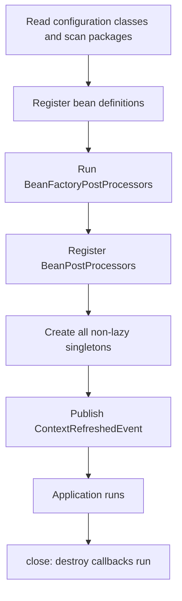
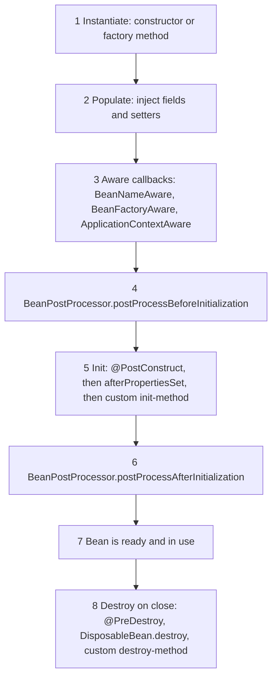

# Spring Core: IoC, Beans, and AOP

## Why It Matters

"How does Spring create and wire beans?" and "Why does `@Transactional` not work when I call the method from the same class?" are among the most common Spring interview questions. Both have the same root: the container builds your objects, wraps some of them in proxies, and hands the proxies to other beans. On the job, the same knowledge explains startup failures (`NoUniqueBeanDefinitionException`, `BeanCurrentlyInCreationException`), a prototype bean that never changes, a constructor that runs before a dependency is injected, and an aspect that does nothing and reports no error. This page covers Spring Framework 7.0, which Spring Boot 4.1 uses (see [Spring Boot](18-spring-boot.md)). It states where Spring Framework 6.x and Spring Boot 3.x differ when the difference matters. The design principle behind injection is in [SOLID](../lld/fundamentals/02-solid.md). The Proxy pattern is in [structural patterns](../lld/fundamentals/07-structural-patterns.md). The JDK proxy and CGLIB mechanics are in [reflection and annotations](14-reflection-and-annotations.md). Transactions, which depend on AOP, are in [Spring Data and transactions](19-spring-data-and-transactions.md).

## Core Concepts

**Inversion of Control (IoC)**: a design in which a framework creates objects and calls your code, instead of your code creating objects and calling the framework. In Spring, the container controls the creation and the wiring of objects.

**Dependency injection (DI)**: the technique that Spring uses for IoC. An object declares what it needs, and the container supplies it. The [SOLID page](../lld/fundamentals/02-solid.md) explains why dependency injection and the dependency inversion principle are different things.

**Bean**: an object that the Spring container creates, wires, and manages. An object that you create with `new` yourself is not a bean.

**Container**: the Spring runtime that holds the bean definitions and creates the beans. The two container interfaces are `BeanFactory` (the basic one: it creates beans and resolves dependencies) and `ApplicationContext` (it extends `BeanFactory` and adds events, message sources, resource loading, environment and property access, and automatic registration of post-processors). Applications use an `ApplicationContext`.

**Bean definition**: the recipe for a bean. It holds the class (or factory method), the scope, the constructor arguments, the dependencies, and the init and destroy method names. The container reads the definitions first and creates the objects later.

**Scope**: the rule that says how many instances of a bean exist and how long each lives. The default scope is `singleton`: one instance for each container.

**`BeanFactoryPostProcessor`**: an extension point that changes the bean definitions before the container creates any ordinary bean. It processes definitions, not objects.

**`BeanPostProcessor`**: an extension point that the container calls for every bean after it creates the object. It can change the object or replace it with a proxy. Spring itself implements `@Autowired`, `@PostConstruct`, and AOP proxying as `BeanPostProcessor`s.

**Aspect-oriented programming (AOP)**: a way to add behavior (logging, security, transactions) to many methods without editing each method. Terms (Spring Framework reference, "AOP Concepts"):

| Term | Meaning |
|---|---|
| Aspect | A module that holds cross-cutting logic, usually a class with `@Aspect` |
| Join point | A point in the program where advice can run. In Spring AOP, a join point is always a method execution on a Spring bean |
| Pointcut | An expression that selects join points, for example `execution(* com.shop.service.*.*(..))` |
| Advice | The code that runs at a join point: before, after, or around the method |
| Weaving | Linking the aspect with the target. Spring AOP weaves at run time with proxies. AspectJ can weave at compile time or class load time |
| Proxy | The object that Spring puts in front of the target bean. It runs the advice and then calls the target |

## How It Works

### Injection styles and why the constructor wins

Spring supports three injection points (Spring Framework reference, "Dependency Injection"):

| Style | Example | Notes |
|---|---|---|
| Constructor | `OrderService(OrderRepository repo)` | If a class has exactly one constructor, Spring uses it, and `@Autowired` is not needed (since Spring 4.3). Fields can be `final` |
| Setter | `@Autowired void setRepo(OrderRepository r)` | The container calls it after the constructor. Suited to optional or re-configurable dependencies |
| Field | `@Autowired private OrderRepository repo;` | Spring sets the field with reflection. The class cannot be created in a plain unit test without reflection or a Spring test context |

The Spring reference recommends constructor injection for mandatory dependencies, and setter injection for optional ones. The reasons:

1. **The object is never half built.** A constructor takes all mandatory dependencies, so the object is complete when it exists. With field injection, `new OrderService()` yields an object with `null` fields.
2. **Dependencies can be `final`.** The compiler enforces that they are set once, and the class is thread-safe to publish without extra care for these fields.
3. **Unit tests need no container.** `new OrderService(fakeRepo)` works.
4. **Too many constructor parameters are visible.** A constructor with eight parameters shows that the class does too much (a single-responsibility smell). Field injection hides this.
5. **Cycles fail early.** A constructor cycle cannot start, so the design error shows at startup (see "Circular dependencies" below).

Oliver Drotbohm's article "Why field injection is evil" lists the same reasons. Field injection is common in older code and works, but it ties the class to the container.

#### Choosing among several candidates

If the container finds more than one bean of the required type, and nothing below selects one, injection fails with `NoUniqueBeanDefinitionException`. The container narrows the candidates in this order:

1. A `@Qualifier("name")` on the injection point filters the candidates first: only the beans with that qualifier value or bean name remain. A qualifier therefore wins over `@Primary` (a test on Spring Framework 7.0.9 confirms it).
2. Among the remaining candidates, a bean that is marked `@Primary` wins. A bean marked `@Fallback` (Spring Framework 6.2 and later) is used only if no other candidate exists.
3. Then the container matches the parameter name (or field name) with a bean name. In the same test, a `@Primary` bean won over a parameter whose name matched another bean. Since Spring Framework 6.2, a name match wins over `@jakarta.annotation.Priority` ranking (Spring Framework 6.2 release notes).

The name match needs the `-parameters` compiler flag for constructor and method parameters, because Spring Framework 6.1 removed `LocalVariableTableParameterNameDiscoverer` and no longer reads parameter names from debug information (Spring Framework 6.1 release notes). Without the flag, a parameter named like a bean fails with `NoUniqueBeanDefinitionException`. The Spring Boot parent POM and the Spring Boot Gradle plugin turn the flag on.

To inject all candidates, declare `List<PaymentGateway>` or `Map<String, PaymentGateway>`. The container injects every matching bean, in `@Order` order for the list.

### Starting the container

`AnnotationConfigApplicationContext` (and, in Spring Boot, `SpringApplication`) calls `AbstractApplicationContext.refresh()`. The steps that matter:



Two consequences follow:

- **Singletons are created eagerly at startup.** A wiring error (a missing bean, a cycle) shows when the application starts, not at the first request. `@Lazy` on a bean defers creation to the first use.
- **A `BeanFactoryPostProcessor` runs before ordinary beans exist.** If a `@Bean` method that returns a `BeanFactoryPostProcessor` or a `BeanPostProcessor` is not `static`, the container must create the surrounding `@Configuration` object very early, and other beans in that class may miss some post-processing. Declare these methods `static`.

### Bean definition sources

| Source | How | Use when |
|---|---|---|
| Component scanning | `@Component` and its specializations `@Service`, `@Repository`, `@Controller` on your own classes. `@ComponentScan` finds them. `@Repository` also marks the class for persistence exception translation | The class is yours |
| `@Bean` method | A method in a `@Configuration` class returns the object. The method name is the bean name | The class belongs to a library, or the creation needs logic |
| `@Import` | Imports other configuration classes, `ImportSelector`s, or `ImportBeanDefinitionRegistrar`s | You build a reusable module or an auto-configuration |
| `BeanRegistrar` (Spring Framework 7.0 and later) | A class that implements `BeanRegistrar` registers beans in code, with loops and conditions. You add it with `@Import` | The number or the kind of beans depends on logic |
| XML | `<bean>` elements | Older applications |

#### Full and lite configuration mode

A class with `@Configuration` is in **full mode**: Spring creates a CGLIB subclass of it, and a call from one `@Bean` method to another goes through the container, so the second call returns the existing singleton. With `@Configuration(proxyBeanMethods = false)`, or with `@Component` as the class annotation, the class is in **lite mode**: `@Bean` methods are plain Java methods, and a call between them creates a new object each time. Spring Boot's own auto-configuration classes use `proxyBeanMethods = false` to avoid the CGLIB subclass.

<!-- fragment -->
```java
import org.springframework.context.annotation.AnnotationConfigApplicationContext;
import org.springframework.context.annotation.Bean;
import org.springframework.context.annotation.Configuration;

public class ConfigModeDemo {
    public static void main(String[] args) {
        try (var ctx = new AnnotationConfigApplicationContext(Full.class, Lite.class)) {
            System.out.println("Full config class is a CGLIB subclass: "
                    + ctx.getBean(Full.class).getClass().getName().contains("$$SpringCGLIB$$"));
            System.out.println("Lite config class is a CGLIB subclass: "
                    + ctx.getBean(Lite.class).getClass().getName().contains("$$SpringCGLIB$$"));
            System.out.println("Full: same Repo in both services: "
                    + (ctx.getBean("fullA", Service.class).repo
                    == ctx.getBean("fullB", Service.class).repo));
            System.out.println("Lite: same Repo in both services: "
                    + (ctx.getBean("liteA", Service.class).repo
                    == ctx.getBean("liteB", Service.class).repo));
        }
    }

    static class Repo { }

    static class Service {
        final Repo repo;

        Service(Repo repo) {
            this.repo = repo;
        }
    }

    @Configuration // proxyBeanMethods = true (default): the container intercepts repo()
    static class Full {
        @Bean Repo repo() { return new Repo(); }
        @Bean Service fullA() { return new Service(repo()); }
        @Bean Service fullB() { return new Service(repo()); }
    }

    @Configuration(proxyBeanMethods = false) // repo() is a plain Java call
    static class Lite {
        @Bean Repo liteRepo() { return new Repo(); }
        @Bean Service liteA() { return new Service(liteRepo()); }
        @Bean Service liteB() { return new Service(liteRepo()); }
    }
}
```

Output from a real run (Spring Framework 7.0.9, Java 21):

```text
Full config class is a CGLIB subclass: true
Lite config class is a CGLIB subclass: false
Full: same Repo in both services: true
Lite: same Repo in both services: false
```

### Scopes

| Scope | Instances | Notes |
|---|---|---|
| `singleton` (default) | One for each container | Shared by all threads, so it must be thread-safe. Keep it free of request state |
| `prototype` | A new instance for each request to the container | The container creates and wires it and then forgets it. Spring does **not** call destroy callbacks of a prototype |
| `request` | One for each HTTP request | Web-aware context only |
| `session` | One for each HTTP session | Web-aware context only |
| `application` | One for each `ServletContext` | Web-aware context only |
| `websocket` | One for each WebSocket session | Web-aware context only |

"Singleton" in Spring is not the GoF Singleton pattern. The GoF pattern gives one instance for each class loader. A Spring singleton gives one instance for each bean definition for each container. Two beans of the same class with different names are two instances.

#### The prototype-in-singleton problem

The container injects dependencies once, when it creates the singleton. If a singleton holds a prototype bean, the singleton gets one instance, and keeps it. The prototype scope then has no effect.

Three fixes:

| Fix | How | Cost |
|---|---|---|
| `ObjectProvider<T>` (or `Provider<T>` from `jakarta.inject`) | Inject the provider, and call `getObject()` for each use | Explicit and testable. The code depends on a Spring type |
| Scoped proxy | `@Scope(value = "prototype", proxyMode = ScopedProxyMode.TARGET_CLASS)`. Spring injects a CGLIB proxy that looks up a target for each method call | Looks like a normal field. Each method call gets a new target, so two calls do not share state |
| `@Lookup` method | An abstract (or overridable) method that Spring overrides to call `getBean` | Uses CGLIB subclassing. The class and method cannot be `final`. It works only for beans that the container instantiates from the class (component scanning), not for objects that a `@Bean` method returns: there, a test on Spring Framework 7.0.9 shows that the method keeps its own body and returns `null` |

The same problem exists for `request` and `session` beans that a singleton uses. A scoped proxy (`proxyMode`) is the standard fix, because the singleton needs a stable reference that resolves to the current request's bean for each call.

<!-- fragment -->
```java
import java.util.concurrent.atomic.AtomicInteger;
import org.springframework.beans.factory.ObjectProvider;
import org.springframework.beans.factory.annotation.Qualifier;
import org.springframework.context.annotation.AnnotationConfigApplicationContext;
import org.springframework.context.annotation.Bean;
import org.springframework.context.annotation.Configuration;
import org.springframework.context.annotation.Scope;
import org.springframework.context.annotation.ScopedProxyMode;

public class ScopeDemo {
    static final AtomicInteger COUNTER = new AtomicInteger();

    public static void main(String[] args) {
        var ctx = new AnnotationConfigApplicationContext(Config.class);

        var a = ctx.getBean("ticket", Ticket.class);
        var b = ctx.getBean("ticket", Ticket.class);
        System.out.println("getBean twice: " + a.id + " and " + b.id);

        var wrong = ctx.getBean(WrongService.class);
        System.out.println("direct injection: " + wrong.ticketId() + " and " + wrong.ticketId());

        var right = ctx.getBean(RightService.class);
        System.out.println("ObjectProvider:   " + right.ticketId() + " and " + right.ticketId());

        var p = ctx.getBean(ProxiedService.class);
        System.out.println("scoped proxy:     " + p.ticketId() + " and " + p.ticketId());

        var again = ctx.getBean(RightService.class);
        System.out.println("singleton is same object: " + (again == right));
        ctx.close();
    }

    @Configuration
    static class Config {
        @Bean
        @Scope("prototype")
        Ticket ticket() {
            return new Ticket();
        }

        @Bean
        @Scope(value = "prototype", proxyMode = ScopedProxyMode.TARGET_CLASS)
        Ticket proxiedTicket() {
            return new Ticket();
        }

        @Bean
        ProxiedService proxiedService(@Qualifier("proxiedTicket") Ticket ticket) {
            return new ProxiedService(ticket);
        }

        @Bean
        WrongService wrongService(@Qualifier("ticket") Ticket ticket) {
            return new WrongService(ticket);
        }

        @Bean
        RightService rightService(@Qualifier("ticket") ObjectProvider<Ticket> tickets) {
            return new RightService(tickets);
        }
    }

    static class Ticket {
        final int id = COUNTER.incrementAndGet();

        int id() { // CGLIB proxies forward method calls, not field reads
            return id;
        }
    }

    static class WrongService {
        private final Ticket ticket; // injected once, when the singleton is created

        WrongService(Ticket ticket) {
            this.ticket = ticket;
        }

        int ticketId() {
            return ticket.id;
        }
    }

    static class ProxiedService {
        private final Ticket ticket; // a CGLIB proxy: each call gets a new Ticket

        ProxiedService(Ticket ticket) {
            this.ticket = ticket;
        }

        int ticketId() {
            return ticket.id();
        }
    }

    static class RightService {
        private final ObjectProvider<Ticket> tickets;

        RightService(ObjectProvider<Ticket> tickets) {
            this.tickets = tickets;
        }

        int ticketId() {
            return tickets.getObject().id; // asks the container for a new Ticket each time
        }
    }
}
```

Output from a real run (the counter starts at 1, and the container creates one `Ticket` for the direct injection when it builds `WrongService`):

```text
getBean twice: 2 and 3
direct injection: 1 and 1
ObjectProvider:   4 and 5
scoped proxy:     6 and 7
singleton is same object: true
```

Read the output:

- `getBean twice: 2 and 3`: each `getBean` call returns a new prototype.
- `direct injection: 1 and 1`: `WrongService` received `Ticket` number 1 once, at startup, and keeps it.
- `ObjectProvider: 4 and 5` and `scoped proxy: 6 and 7`: each call gets a fresh `Ticket`.

### The bean lifecycle

For a singleton, the container runs these steps in this order. `AbstractAutowireCapableBeanFactory.doCreateBean` contains the sequence.



Notes on the steps:

- **Step 3.** The `Aware` interfaces give a bean access to container objects. `ApplicationContextAware` is applied by a `BeanPostProcessor` (`ApplicationContextAwareProcessor`), so it runs together with the "before initialization" callbacks.
- **Step 4 and the order of post-processors.** `@PostConstruct` is handled by a `BeanPostProcessor` too (`CommonAnnotationBeanPostProcessor`). The container registers the post-processors in this order: those that implement `PriorityOrdered`, then those that implement `Ordered`, then the rest. At the end, `PostProcessorRegistrationDelegate.registerBeanPostProcessors` registers the internal post-processors (those that implement `MergedBeanDefinitionPostProcessor`, such as `CommonAnnotationBeanPostProcessor` and `AutowiredAnnotationBeanPostProcessor`) again, which moves them to the end of the chain. So the "before initialization" step of your own post-processor runs before `@PostConstruct`, although `CommonAnnotationBeanPostProcessor` implements `PriorityOrdered`. The demo below shows this.
- **Step 6 is where proxies appear.** `AbstractAutoProxyCreator`, which implements the AOP support, is a `BeanPostProcessor`. In its "after initialization" step, it replaces the bean with a proxy if an aspect matches. The bean in the container is then the proxy. The init callbacks ran on the target, before the proxy existed.
- **Step 8.** The container calls destroy callbacks when the context closes, for singletons only. A JVM shutdown hook (`registerShutdownHook`, which Spring Boot registers) triggers the close.
- **Initialization is the place for work that needs injected dependencies.** In the constructor, field and setter dependencies are not set yet. `@PostConstruct` is the Jakarta Annotations annotation (`jakarta.annotation.PostConstruct`). Spring 5 and Boot 2.x used `javax.annotation.PostConstruct`. Spring Framework 6 uses the `jakarta` annotation. Spring Framework 6.1 and 6.2 also detect the `javax` one if its jar is on the classpath (6.0 does not; checked in the `CommonAnnotationBeanPostProcessor` class of each version). Spring Framework 7.0 removed the `javax.annotation` and `javax.inject` support (Spring Framework 7.0 release notes).

<!-- fragment -->
```java
import jakarta.annotation.PostConstruct;
import jakarta.annotation.PreDestroy;
import org.springframework.beans.BeansException;
import org.springframework.beans.factory.BeanNameAware;
import org.springframework.beans.factory.DisposableBean;
import org.springframework.beans.factory.InitializingBean;
import org.springframework.beans.factory.annotation.Autowired;
import org.springframework.beans.factory.config.BeanPostProcessor;
import org.springframework.context.annotation.AnnotationConfigApplicationContext;
import org.springframework.context.annotation.Bean;
import org.springframework.context.annotation.Configuration;

public class LifecycleDemo {
    public static void main(String[] args) {
        System.out.println("-- start the context");
        var ctx = new AnnotationConfigApplicationContext(AppConfig.class);
        System.out.println("-- context is ready, bean is in use");
        ctx.getBean(Greeter.class).greet();
        System.out.println("-- close the context");
        ctx.close();
    }

    @Configuration
    static class AppConfig {
        @Bean
        static BeanPostProcessor tracer() { // static: the container needs it very early
            return new Tracer();
        }

        @Bean(initMethod = "customInit", destroyMethod = "customDestroy")
        Greeter greeter() {
            return new Greeter();
        }

        @Bean
        Clock clock() {
            return new Clock();
        }
    }

    static class Clock { }

    static class Tracer implements BeanPostProcessor {
        @Override
        public Object postProcessBeforeInitialization(Object bean, String name)
                throws BeansException {
            if (bean instanceof Greeter) System.out.println("4. BPP before-init for " + name);
            return bean;
        }

        @Override
        public Object postProcessAfterInitialization(Object bean, String name)
                throws BeansException {
            if (bean instanceof Greeter) System.out.println("8. BPP after-init for " + name);
            return bean;
        }
    }

    static class Greeter implements BeanNameAware, InitializingBean, DisposableBean {
        private Clock clock;

        Greeter() {
            System.out.println("1. constructor runs (clock is null: " + (clock == null) + ")");
        }

        @Autowired
        void setClock(Clock clock) {
            this.clock = clock;
            System.out.println("2. dependency injected");
        }

        @Override
        public void setBeanName(String name) {
            System.out.println("3. BeanNameAware gets name '" + name + "'");
        }

        @PostConstruct
        void postConstruct() {
            System.out.println("5. @PostConstruct");
        }

        @Override
        public void afterPropertiesSet() {
            System.out.println("6. InitializingBean.afterPropertiesSet");
        }

        void customInit() {
            System.out.println("7. @Bean initMethod");
        }

        void greet() {
            System.out.println("   greet() called");
        }

        @PreDestroy
        void preDestroy() {
            System.out.println("9. @PreDestroy");
        }

        @Override
        public void destroy() {
            System.out.println("10. DisposableBean.destroy");
        }

        void customDestroy() {
            System.out.println("11. @Bean destroyMethod");
        }
    }
}
```

Output from a real run:

```text
-- start the context
1. constructor runs (clock is null: true)
2. dependency injected
3. BeanNameAware gets name 'greeter'
4. BPP before-init for greeter
5. @PostConstruct
6. InitializingBean.afterPropertiesSet
7. @Bean initMethod
8. BPP after-init for greeter
-- context is ready, bean is in use
   greet() called
-- close the context
9. @PreDestroy
10. DisposableBean.destroy
11. @Bean destroyMethod
```

The numbers follow the order of the callbacks. Step 1 shows that the constructor runs while the field `clock` is still `null`. The `@Bean(initMethod = ...)` callback runs after the `InitializingBean` callback and before the "after initialization" post-processor.

### Circular dependencies

A **circular dependency** exists when bean A needs bean B and bean B needs bean A.

- **Constructor cycle.** A needs B to be constructed, and B needs A to be constructed. Neither object can exist first, so the container fails with `BeanCurrentlyInCreationException`.
- **Setter or field cycle.** Spring can create A, hand out a reference to the half-built A, build B with that reference, and finish A. This works through three maps in `DefaultSingletonBeanRegistry`: `singletonObjects` (finished beans), `earlySingletonObjects` (early references), and `singletonFactories` (factories that make an early reference). A bean that is "currently in creation" registers a factory in `singletonFactories`. When B asks for A, the container takes the early reference from this factory. If an aspect must proxy A, the factory returns the proxy, so B receives the same object that the container finally exposes.

**Spring Boot 2.6 and later prohibit circular references by default.** `SpringApplication` sets `allowCircularReferences` to `false`. The property `spring.main.allow-circular-references=true` turns the old behavior back on (Spring Boot 2.6 release notes). Plain Spring Framework still allows setter and field cycles by default (`setAllowCircularReferences(true)`).

<!-- fragment -->
```java
import org.springframework.context.annotation.AnnotationConfigApplicationContext;
import org.springframework.context.annotation.Bean;
import org.springframework.context.annotation.Configuration;
import org.springframework.context.annotation.Lazy;
import org.springframework.beans.factory.annotation.Autowired;

public class CircularDemo {
    public static void main(String[] args) {
        System.out.println("setter cycle, default settings: " + start(SetterCycle.class, true));
        System.out.println("setter cycle, cycles forbidden:  " + start(SetterCycle.class, false));
        System.out.println("constructor cycle, default:      " + start(CtorCycle.class, true));
        System.out.println("constructor cycle + @Lazy:       " + start(LazyCycle.class, true));
    }

    static String start(Class<?> config, boolean allowCycles) {
        var ctx = new AnnotationConfigApplicationContext();
        ctx.setAllowCircularReferences(allowCycles);
        ctx.register(config);
        try {
            ctx.refresh();
            return "OK";
        } catch (RuntimeException e) {
            Throwable root = e;
            while (root.getCause() != null) root = root.getCause();
            return root.getClass().getSimpleName();
        } finally {
            ctx.close();
        }
    }

    static class A { @Autowired B b; }
    static class B { @Autowired A a; }

    @Configuration
    static class SetterCycle {
        @Bean A a() { return new A(); }
        @Bean B b() { return new B(); }
    }

    static class C { C(D d) { } }
    static class D { D(C c) { } }

    @Configuration
    static class CtorCycle {
        @Bean C c(D d) { return new C(d); }
        @Bean D d(C c) { return new D(c); }
    }

    static class E { E(F f) { } }
    static class F { F(@Lazy E e) { } }

    @Configuration
    static class LazyCycle {
        @Bean E e(F f) { return new E(f); }
        @Bean F f(@Lazy E e) { return new F(e); }
    }
}
```

Output from a real run:

```text
setter cycle, default settings: OK
setter cycle, cycles forbidden:  BeanCurrentlyInCreationException
constructor cycle, default:      BeanCurrentlyInCreationException
constructor cycle + @Lazy:       OK
```

A Spring Boot 4.1.1 application with a field cycle between two `@Component` classes fails at startup with `BeanCurrentlyInCreationException`, and starts with `--spring.main.allow-circular-references=true`.

Fixes, best first:

1. **Redesign.** A cycle shows that two classes know too much about each other. Move the shared logic into a third bean that both use, or invert one direction with an event (see "Events" below).
2. **`@Lazy` on one injection point.** Spring injects a lazy-resolution proxy, and the real bean is looked up at the first call. The demo shows that this breaks a constructor cycle.
3. **Setter injection with `allow-circular-references=true`.** This hides the design problem. Use it only as a temporary measure.

### AOP: how a proxy intercepts a call

1. At startup, `@EnableAspectJAutoProxy` (Spring Boot enables it through `AopAutoConfiguration` if the AspectJ library is on the classpath) registers `AnnotationAwareAspectJAutoProxyCreator`, a `BeanPostProcessor`.
2. For each bean, the post-processor checks every `Advisor` (an aspect's advice together with its pointcut). If a pointcut matches any method of the bean, it wraps the bean in a proxy.
3. Other beans receive the proxy through injection. The proxy holds the target and the chain of advice.
4. When a caller invokes a method on the proxy, the proxy runs the matching advice chain, and the last step calls the method on the target.

Proxy types, in short: if the target class implements an interface and `proxyTargetClass` is false, Spring makes a JDK dynamic proxy. Otherwise Spring makes a CGLIB subclass. **Spring Boot sets `spring.aop.proxy-target-class=true`, so it uses CGLIB by default.** Both defaults show in the demo below. The table, the limits (`final`, `private`), and Spring Framework 7's `@Proxyable` are in the [reflection page](14-reflection-and-annotations.md#how-spring-uses-proxies-and-annotations).

Practical consequence of a JDK proxy: the proxy implements the interfaces only. Injecting the bean by its concrete class (`@Autowired OrderServiceImpl s`) fails, because the proxy is not an `OrderServiceImpl`. Inject by interface, or use CGLIB.

#### Pointcut expressions

| Designator | Selects | Example |
|---|---|---|
| `execution(...)` | Method execution by signature. The most used | `execution(* com.shop.service.*.*(..))` |
| `within(...)` | All methods of the types in a package or type | `within(com.shop.service..*)` |
| `@annotation(...)` | Methods that carry an annotation | `@annotation(com.shop.Audited)` |
| `@within(...)` | Methods of classes that carry an annotation | `@within(org.springframework.stereotype.Service)` |
| `args(...)` | Methods whose arguments have given types | `args(java.lang.String,..)` |
| `this(...)` and `target(...)` | The proxy type and the target type | `target(com.shop.OrderService)` |
| `bean(...)` | A bean by name (Spring-specific) | `bean(*Service)` |

Combine expressions with `&&`, `||`, and `!`. Name a reusable expression with `@Pointcut`.

#### Advice types and their order

| Annotation | Runs | Can change the result? |
|---|---|---|
| `@Before` | Before the method. If it throws, the method does not run | No |
| `@AfterReturning` | After the method returns normally | It can see the return value (`returning = "r"`) but cannot replace it |
| `@AfterThrowing` | After the method throws | It can see the exception. The exception continues |
| `@After` | After the method, whether it returns or throws (like `finally`) | No |
| `@Around` | Around the call. The advice decides whether to call `proceed()`, and it can change the arguments, the result, or the exception | Yes. The strongest advice. Use the weakest advice that does the job |

<!-- fragment -->
```java
import org.aspectj.lang.JoinPoint;
import org.aspectj.lang.ProceedingJoinPoint;
import org.aspectj.lang.annotation.After;
import org.aspectj.lang.annotation.AfterReturning;
import org.aspectj.lang.annotation.AfterThrowing;
import org.aspectj.lang.annotation.Around;
import org.aspectj.lang.annotation.Aspect;
import org.aspectj.lang.annotation.Before;
import org.aspectj.lang.annotation.Pointcut;
import org.springframework.context.annotation.AnnotationConfigApplicationContext;
import org.springframework.context.annotation.Bean;
import org.springframework.context.annotation.Configuration;
import org.springframework.context.annotation.EnableAspectJAutoProxy;

public class AdviceDemo {
    public static void main(String[] args) {
        try (var ctx = new AnnotationConfigApplicationContext(Config.class)) {
            var svc = ctx.getBean(Service.class);
            System.out.println("-- normal call");
            System.out.println("   result: " + svc.work(false));
            System.out.println("-- failing call");
            try {
                svc.work(true);
            } catch (IllegalStateException e) {
                System.out.println("   caller sees: " + e.getMessage());
            }
        }
    }

    static class Service {
        String work(boolean fail) {
            System.out.println("   target method runs");
            if (fail) throw new IllegalStateException("boom");
            return "ok";
        }
    }

    @Aspect
    static class AllAdvice {
        @Pointcut("execution(String AdviceDemo.Service.work(..))")
        void work() { }

        @Around("work()")
        Object around(ProceedingJoinPoint pjp) throws Throwable {
            System.out.println("   @Around: before proceed");
            try {
                return pjp.proceed();
            } finally {
                System.out.println("   @Around: after proceed");
            }
        }

        @Before("work()")
        void before(JoinPoint jp) { System.out.println("   @Before"); }

        @AfterReturning(pointcut = "work()", returning = "r")
        void afterReturning(Object r) { System.out.println("   @AfterReturning " + r); }

        @AfterThrowing(pointcut = "work()", throwing = "t")
        void afterThrowing(Throwable t) {
            System.out.println("   @AfterThrowing " + t.getMessage());
        }

        @After("work()")
        void after() { System.out.println("   @After (finally)"); }
    }

    @Configuration
    @EnableAspectJAutoProxy
    static class Config {
        @Bean Service service() { return new Service(); }
        @Bean AllAdvice advice() { return new AllAdvice(); }
    }
}
```

Output from a real run:

```text
-- normal call
   @Around: before proceed
   @Before
   target method runs
   @AfterReturning ok
   @After (finally)
   @Around: after proceed
   result: ok
-- failing call
   @Around: before proceed
   @Before
   target method runs
   @AfterThrowing boom
   @After (finally)
   @Around: after proceed
   caller sees: boom
```

In one aspect, with advice of different types, the order on the way in is `@Around`, then `@Before`. On the way out, `@AfterReturning` or `@AfterThrowing` runs first, then `@After`, then the rest of `@Around`. This matches the Spring reference since Spring 5.2.7. When two different aspects match, `@Order` on the aspect (or the `Ordered` interface) sets the order: the lower number is the outer layer.

#### Why an internal call skips the proxy

A caller outside the bean holds the proxy. When the proxy calls the target, the target runs with `this` set to the **target**, not to the proxy. A call such as `this.audit()` inside the target is then a plain Java call on the target. It never passes through the proxy, so no advice runs. The same is true for `@Transactional`, `@Cacheable`, and `@Async`, because they all use proxies.

<!-- fragment -->
```java
import java.util.ArrayList;
import java.util.List;
import org.aspectj.lang.ProceedingJoinPoint;
import org.aspectj.lang.annotation.Around;
import org.aspectj.lang.annotation.Aspect;
import org.springframework.aop.support.AopUtils;
import org.springframework.context.annotation.AnnotationConfigApplicationContext;
import org.springframework.context.annotation.Bean;
import org.springframework.context.annotation.Configuration;
import org.springframework.context.annotation.EnableAspectJAutoProxy;

public class AopDemo {
    static final List<String> ADVISED = new ArrayList<>();
    static int auditBodyRuns;

    public static void main(String[] args) {
        run("proxyTargetClass = false", JdkIfPossible.class);
        run("proxyTargetClass = true", Cglib.class);
    }

    static void run(String title, Class<?> config) {
        ADVISED.clear();
        auditBodyRuns = 0;
        try (var ctx = new AnnotationConfigApplicationContext(config)) {
            var svc = ctx.getBean(OrderService.class);
            svc.placeOrder(); // the body calls this.audit()
            svc.audit();      // an external call
            System.out.println("== " + title);
            System.out.println("JDK proxy: " + AopUtils.isJdkDynamicProxy(svc)
                    + ", CGLIB proxy: " + AopUtils.isCglibProxy(svc));
            System.out.println("audit body ran " + auditBodyRuns + " times, advice ran for "
                    + ADVISED);
        }
    }

    interface OrderService {
        void placeOrder();

        void audit();
    }

    static class OrderServiceImpl implements OrderService {
        @Override
        public void placeOrder() {
            this.audit(); // internal call: goes to the target, not the proxy
        }

        @Override
        public void audit() {
            auditBodyRuns++;
        }
    }

    @Aspect
    static class LogAspect {
        @Around("execution(* AopDemo.OrderService.*(..))")
        Object log(ProceedingJoinPoint pjp) throws Throwable {
            ADVISED.add(pjp.getSignature().getName());
            return pjp.proceed();
        }
    }

    @Configuration
    @EnableAspectJAutoProxy
    static class JdkIfPossible {
        @Bean OrderService orderService() { return new OrderServiceImpl(); }
        @Bean LogAspect logAspect() { return new LogAspect(); }
    }

    @Configuration
    @EnableAspectJAutoProxy(proxyTargetClass = true)
    static class Cglib {
        @Bean OrderService orderService() { return new OrderServiceImpl(); }
        @Bean LogAspect logAspect() { return new LogAspect(); }
    }
}
```

Output from a real run (Spring Framework 7.0.9, Java 21). The `audit` body runs twice: once through `this.audit()` inside `placeOrder`, and once through the external call. With both proxy types, the advice runs for the two external calls (`placeOrder` and `audit`) and not for the inner `this.audit()`:

```text
== proxyTargetClass = false
JDK proxy: true, CGLIB proxy: false
audit body ran 2 times, advice ran for [placeOrder, audit]
== proxyTargetClass = true
JDK proxy: false, CGLIB proxy: true
audit body ran 2 times, advice ran for [placeOrder, audit]
```

Four ways to fix it, in recommended order:

1. **Move the method to another bean** and inject that bean. The call then goes through that bean's proxy. This is the cleanest design.
2. **Self-injection with `@Lazy`**: inject the bean's own proxy into a field and call `self.audit()`. It works, but it is an unusual pattern.
3. **`AopContext.currentProxy()`** with `@EnableAspectJAutoProxy(exposeProxy = true)`: the code reads the current proxy from a thread-local. It couples the business code to Spring AOP.
4. **AspectJ weaving** (compile time or load time) changes the bytecode of the class itself, so no proxy is involved and self-calls are advised. It needs a build plugin or a Java agent.

<!-- fragment -->
```java
import org.aspectj.lang.ProceedingJoinPoint;
import org.aspectj.lang.annotation.Around;
import org.aspectj.lang.annotation.Aspect;
import org.springframework.aop.framework.AopContext;
import org.springframework.beans.factory.annotation.Autowired;
import org.springframework.context.annotation.AnnotationConfigApplicationContext;
import org.springframework.context.annotation.Bean;
import org.springframework.context.annotation.Configuration;
import org.springframework.context.annotation.EnableAspectJAutoProxy;
import org.springframework.context.annotation.Lazy;

public class SelfCallFixDemo {
    public static void main(String[] args) {
        try (var ctx = new AnnotationConfigApplicationContext(Config.class)) {
            System.out.println("-- bug: this.audit()");
            ctx.getBean(Broken.class).placeOrder();
            System.out.println("-- fix 1: self-injection");
            ctx.getBean(SelfInjected.class).placeOrder();
            System.out.println("-- fix 2: AopContext.currentProxy()");
            ctx.getBean(ExposedProxy.class).placeOrder();
            System.out.println("-- fix 3: move audit() to another bean");
            ctx.getBean(Caller.class).placeOrder();
        }
    }

    @Aspect
    static class Audited {
        @Around("execution(* SelfCallFixDemo..audit(..))")
        Object around(ProceedingJoinPoint pjp) throws Throwable {
            System.out.println("   >> advice around audit");
            return pjp.proceed();
        }
    }

    static class Broken {
        void placeOrder() { this.audit(); }
        void audit() { System.out.println("   audit"); }
    }

    static class SelfInjected {
        @Autowired @Lazy private SelfInjected self; // injects the proxy of this bean

        void placeOrder() { self.audit(); }
        void audit() { System.out.println("   audit"); }
    }

    static class ExposedProxy {
        void placeOrder() { ((ExposedProxy) AopContext.currentProxy()).audit(); }
        void audit() { System.out.println("   audit"); }
    }

    static class Auditor {
        void audit() { System.out.println("   audit"); }
    }

    static class Caller {
        private final Auditor auditor;

        Caller(Auditor auditor) { this.auditor = auditor; }

        void placeOrder() { auditor.audit(); }
    }

    @Configuration
    @EnableAspectJAutoProxy(proxyTargetClass = true, exposeProxy = true)
    static class Config {
        @Bean Audited audited() { return new Audited(); }
        @Bean Broken broken() { return new Broken(); }
        @Bean SelfInjected selfInjected() { return new SelfInjected(); }
        @Bean ExposedProxy exposedProxy() { return new ExposedProxy(); }
        @Bean Auditor auditor() { return new Auditor(); }
        @Bean Caller caller(Auditor auditor) { return new Caller(auditor); }
    }
}
```

```text
-- bug: this.audit()
   audit
-- fix 1: self-injection
   >> advice around audit
   audit
-- fix 2: AopContext.currentProxy()
   >> advice around audit
   audit
-- fix 3: move audit() to another bean
   >> advice around audit
   audit
```

Other limits of Spring AOP, from the same cause (the proxy):

- It advises only calls to Spring beans, and only method executions. It cannot advise field access, constructor calls, or objects that you create with `new`.
- A JDK proxy intercepts only the methods that the interfaces declare. A CGLIB proxy intercepts `public`, `protected`, and package-private methods (the demos on this page advise package-private methods), but not `final` methods, because a subclass cannot override them (Spring Framework reference, "Proxying Mechanisms").
- A `private` method cannot be advised by a proxy-based aspect, because the proxy cannot override it. A package-private method in a parent class from another package is effectively private for the proxy.

### Events

The `ApplicationContext` is also an event bus (`ApplicationEventPublisher`). A bean publishes an event, and listener beans receive it. Since Spring 4.2, an event can be any object, and a listener is a method with `@EventListener`.

Properties of the default mechanism:

- **Listeners run synchronously in the publisher's thread.** `publishEvent` returns after all listeners finish. If a listener throws, the exception propagates to the publisher. The demo below prints the thread to show this.
- **Spring publishes its own events.** `ContextRefreshedEvent`, `ContextStartedEvent`, `ContextStoppedEvent`, and `ContextClosedEvent` come from the container. Spring Boot adds `ApplicationStartedEvent`, `ApplicationReadyEvent`, and `ApplicationFailedEvent`.
- **Make a listener asynchronous** with `@Async` on the listener method (it needs `@EnableAsync`, and it uses a proxy, so the self-invocation rule applies), or give the `ApplicationEventMulticaster` a task executor. An async listener runs in another thread, so it does not share the publisher's transaction, and its exceptions do not reach the publisher.
- **Transactions.** A plain `@EventListener` runs inside the publisher's transaction, before it commits. To run a listener after commit, use `@TransactionalEventListener`. The [Spring Data and transactions page](19-spring-data-and-transactions.md) covers it.
- **Order.** `@Order` on the listener method sets the order among synchronous listeners.

An event decouples the publisher from the listeners inside one JVM. It is not a message queue: it has no persistence, no retry, and no delivery to another process. For that, use a broker (see the HLD messaging pages).

<!-- fragment -->
```java
import org.springframework.context.ApplicationEventPublisher;
import org.springframework.context.annotation.AnnotationConfigApplicationContext;
import org.springframework.context.annotation.Bean;
import org.springframework.context.annotation.Configuration;
import org.springframework.context.event.ContextRefreshedEvent;
import org.springframework.context.event.EventListener;

public class EventDemo {
    record OrderPlaced(String orderId) { }

    public static void main(String[] args) {
        try (var ctx = new AnnotationConfigApplicationContext(Config.class)) {
            System.out.println("publishing from " + Thread.currentThread().getName());
            ctx.getBean(OrderService.class).place("A-1");
            System.out.println("publish() returned");
        }
    }

    static class OrderService {
        private final ApplicationEventPublisher publisher;

        OrderService(ApplicationEventPublisher publisher) {
            this.publisher = publisher;
        }

        void place(String id) {
            publisher.publishEvent(new OrderPlaced(id)); // plain object as event (since 4.2)
        }
    }

    static class Listeners {
        @EventListener
        void onPlaced(OrderPlaced e) {
            System.out.println("  listener runs on " + Thread.currentThread().getName()
                    + " for " + e.orderId());
        }

        @EventListener
        void onRefresh(ContextRefreshedEvent e) {
            System.out.println("  container event: context refreshed");
        }
    }

    @Configuration
    static class Config {
        @Bean OrderService orderService(ApplicationEventPublisher p) { return new OrderService(p); }
        @Bean Listeners listeners() { return new Listeners(); }
    }
}
```

Output from a real run (the `main` thread name is stable in this program):

```text
  container event: context refreshed
publishing from main
  listener runs on main for A-1
publish() returned
```

### Version notes

- **Spring Framework 7.0 and Spring Boot 4.x** need Java 17 or later (Spring Framework 7.0 recommends Java 25) and use the `jakarta.*` packages with a Jakarta EE 11 baseline (Spring Framework 7.0 release notes). Spring Boot 4.1.1 uses Spring Framework 7.0.9. Spring Boot 3.x uses Spring Framework 6.x and Jakarta EE 9 or 10.
- **Logging and null-safety.** Spring Framework 7.0 removed the `spring-jcl` module in favor of Apache Commons Logging 1.3, and annotates its API with JSpecify (`org.jspecify.annotations.Nullable`). Maven and Gradle bring both jars as dependencies of `spring-core`.
- **`javax` to `jakarta`.** From Spring Framework 6 and Spring Boot 3, `@PostConstruct` is `jakarta.annotation.PostConstruct`, and `@Inject` is `jakarta.inject.Inject`. Spring Framework 7.0 no longer processes the `javax` variants.
- **Proxy defaults.** Spring Framework 7.0 adds `@Proxyable` to choose the proxy type for one bean (see the [reflection page](14-reflection-and-annotations.md#how-spring-uses-proxies-and-annotations)).

## Trade-offs and When to Use

| Decision | Option A | Option B | Recommendation |
|---|---|---|---|
| Injection style | Constructor: complete object, `final` fields, easy tests | Setter: allows optional and re-configurable dependencies. Field: shortest code, but needs a container in tests | Constructor for mandatory dependencies. Setter for optional ones. Do not use field injection in new code |
| Bean registration | `@Component` scanning: little code, the class carries the annotation | `@Bean` method: works for library classes, allows logic and conditions | Scanning for your classes. `@Bean` for third-party classes and for conditional creation |
| Cross-cutting logic | Spring AOP (proxy): simple, no build change, only bean method calls | AspectJ weaving: any join point, self-calls work, needs a compiler plugin or agent | Spring AOP unless you need self-calls or non-bean join points |
| Proxy type | JDK proxy: needs an interface, the type is the interface | CGLIB: works for classes, class and methods must not be `final` | Follow the Spring Boot default (CGLIB). Inject by interface when you can |
| Singleton versus prototype | Singleton: one shared object, cheap, must be stateless | Prototype: a new object per request, the container does not manage the destroy | Singleton for services. Prototype for stateful helper objects, with `ObjectProvider` |
| Event versus direct call | Event: publisher knows no listeners, easy to add listeners | Direct call: the flow is visible in the code, easier to debug | Direct call by default. Events when several unrelated parts react to one fact |
| Circular dependency | Redesign | `@Lazy` or `allow-circular-references=true` | Redesign. Use `@Lazy` as a bridge |
| Component scanning cost | Scans the classpath at startup | Explicit `@Import` list | Scanning is fine for most applications. Ahead-of-time processing (see the Spring Boot page) replaces it for native images |

## Java Example

The Spring demos above need Spring jars. This pure-JDK program shows the same ideas in about 100 lines: constructor injection by reflection, a singleton cache, a post-processor that wraps a bean in a JDK proxy, the self-invocation limit, and cycle detection. It is a teaching model. The real container adds scopes, definitions, lifecycle callbacks, and early references for setter cycles.

```java
import java.lang.reflect.Constructor;
import java.lang.reflect.InvocationTargetException;
import java.lang.reflect.Proxy;
import java.util.HashMap;
import java.util.HashSet;
import java.util.LinkedHashMap;
import java.util.Map;
import java.util.Set;
import java.util.function.UnaryOperator;

public class MiniContainer {
    private final Map<Class<?>, Class<?>> definitions = new LinkedHashMap<>();
    private final Map<Class<?>, Object> singletons = new HashMap<>();
    private final Set<Class<?>> inCreation = new HashSet<>();
    private UnaryOperator<Object> postProcessor = bean -> bean;

    void register(Class<?> type, Class<?> impl) {
        definitions.put(type, impl);
    }

    void setPostProcessor(UnaryOperator<Object> postProcessor) {
        this.postProcessor = postProcessor;
    }

    @SuppressWarnings("unchecked")
    <T> T getBean(Class<T> type) {
        Object bean = singletons.get(type);
        if (bean != null) return (T) bean;
        if (!inCreation.add(type)) {
            throw new IllegalStateException("circular dependency: " + type.getSimpleName());
        }
        try {
            Class<?> impl = definitions.get(type);
            Constructor<?> ctor = impl.getDeclaredConstructors()[0];  // one constructor
            Object[] args = new Object[ctor.getParameterCount()];
            for (int i = 0; i < args.length; i++) {
                args[i] = getBean(ctor.getParameterTypes()[i]);       // resolve recursively
            }
            ctor.setAccessible(true);
            Object raw = ctor.newInstance(args);
            Object finalBean = postProcessor.apply(raw);              // like a BeanPostProcessor
            singletons.put(type, finalBean);                          // singleton scope
            return (T) finalBean;
        } catch (InstantiationException | IllegalAccessException | InvocationTargetException e) {
            throw new IllegalStateException(e);
        } finally {
            inCreation.remove(type);
        }
    }

    interface Repo { String find(); }
    interface Service { String run(); String helper(); }

    static class RepoImpl implements Repo {
        public String find() { return "data"; }
    }

    static class ServiceImpl implements Service {
        private final Repo repo;

        ServiceImpl(Repo repo) { this.repo = repo; }

        public String run() { return "run:" + helper() + ":" + repo.find(); } // this.helper()
        public String helper() { return "helper"; }
    }

    static class A { A(B b) { } }
    static class B { B(A a) { } }

    public static void main(String[] args) {
        var c = new MiniContainer();
        c.register(Repo.class, RepoImpl.class);
        c.register(Service.class, ServiceImpl.class);
        System.out.println("singleton: " + (c.getBean(Service.class) == c.getBean(Service.class)));

        var calls = new java.util.ArrayList<String>();
        c.setPostProcessor(bean -> {
            if (!(bean instanceof Service)) return bean;
            return Proxy.newProxyInstance(Service.class.getClassLoader(),
                    new Class<?>[] {Service.class}, (proxy, method, a) -> {
                        calls.add(method.getName());      // the "advice"
                        return method.invoke(bean, a);
                    });
        });
        c.singletons.clear();
        Service svc = c.getBean(Service.class);
        System.out.println(svc.run() + " is a JDK proxy: " + Proxy.isProxyClass(svc.getClass()));
        System.out.println("advised calls: " + calls + " (helper() was not advised)");

        c.register(A.class, A.class);
        c.register(B.class, B.class);
        try {
            c.getBean(A.class);
        } catch (IllegalStateException e) {
            System.out.println(e.getMessage());
        }
    }
}
```

<!-- expected-output -->
```text
singleton: true
run:helper:data is a JDK proxy: true
advised calls: [run] (helper() was not advised)
circular dependency: A
```

Read the output. The singleton check shows that the cache returns one object. The proxy wraps `ServiceImpl`, so `run` is recorded as an advised call, but `helper`, which `run` calls through `this`, is not recorded: the call goes to the target. This is the self-invocation rule. The cycle check shows that constructor injection cannot create A before B and B before A.

## Interview Angle

### Questions

??? question "What is the difference between IoC and dependency injection?"

    **Inversion of Control** is the broad design idea: a framework controls the flow, and creates and calls your objects. **Dependency injection** is one technique that applies IoC to object creation: an object declares its dependencies, and the container supplies them, through the constructor, a setter, or a field. The first is a principle. The second is a mechanism. A servlet container that calls your servlet's `service` method, or a template method that calls your hook method, is IoC but not DI. The alternative to DI for finding dependencies is dependency lookup (a service locator): the object asks a registry for its dependency, so it depends on the registry. With DI, the object does not know where its dependencies come from (Martin Fowler, "Inversion of Control Containers and the Dependency Injection pattern"). The reason to care is testability and flexibility: a class that receives its dependencies can run with a fake in a unit test, and a configuration change can replace an implementation without a code change. The related design principle, dependency inversion, is a third idea (see the SOLID page).

??? question "Why is constructor injection preferred over field injection?"

    A constructor guarantees that the object has all mandatory dependencies when it exists, so it is never half built. The fields can be `final`, which makes the dependencies immutable and safe to publish. A unit test creates the class with `new` and a fake, without a container or reflection. A constructor with many parameters exposes a class that has too many responsibilities. A circular dependency through constructors fails at startup, so the error shows early. Field injection is shorter, but it hides all of these. The trade-off: constructor injection cannot express an optional dependency well (use setter injection, or a constructor parameter of type `ObjectProvider<T>` or `Optional<T>`), and a long parameter list looks heavy, which is a design signal and not a drawback.

??? question "Describe the lifecycle of a singleton bean."

    The container (1) instantiates the bean with the constructor or a factory method, (2) injects dependencies into fields and setters, (3) calls the `Aware` callbacks (`BeanNameAware`, `BeanClassLoaderAware`, `BeanFactoryAware` directly; `ApplicationContextAware` through a post-processor in the next step), (4) runs `BeanPostProcessor.postProcessBeforeInitialization`, (5) runs the init callbacks in this order: `@PostConstruct`, `InitializingBean.afterPropertiesSet`, and the custom init method, (6) runs `postProcessAfterInitialization`, which is where AOP replaces the bean with a proxy, and (7) the bean is ready. When the context closes, the container runs `@PreDestroy`, then `DisposableBean.destroy`, then the custom destroy method. Edge cases: the constructor runs before injection, so use `@PostConstruct` for logic that needs dependencies. The init callbacks run on the target, not on the proxy, so a `@Transactional` method that `@PostConstruct` calls on `this` runs without a transaction. Your own post-processors run before `@PostConstruct`, because the container moves its internal annotation post-processors to the end of the chain. Spring does not call destroy callbacks for prototype beans.

??? question "What are the bean scopes? What goes wrong if you inject a prototype bean into a singleton?"

    The scopes are `singleton` (default), `prototype`, and the web scopes `request`, `session`, `application`, and `websocket`. The container injects dependencies once, when it creates the singleton, so a singleton that holds a prototype gets one instance and keeps it. The prototype scope then has no effect. Three fixes: inject an `ObjectProvider<T>` and call `getObject()` for each use; declare the prototype with `@Scope(value = "prototype", proxyMode = ScopedProxyMode.TARGET_CLASS)` so that the singleton holds a proxy that resolves a target for each call; or use a `@Lookup` method. The same fix applies to a request-scoped bean inside a singleton. A related trap: a Spring singleton is shared by all threads, so a singleton with mutable state needs thread-safety.

??? question "How does Spring resolve circular dependencies? What changed in Spring Boot 2.6?"

    A constructor cycle cannot be resolved, and fails with `BeanCurrentlyInCreationException`. For setter and field injection, Spring uses three maps in `DefaultSingletonBeanRegistry`: finished singletons, early references, and singleton factories. A bean in creation registers a factory for an early reference to itself, and its partner receives this early reference. If an aspect must proxy the bean, the auto-proxy creator returns the proxy as the early reference, so the partner receives the same object that the container finally exposes. Spring Boot 2.6 turned setter and field cycles off by default (`spring.main.allow-circular-references` is `false`), because a cycle shows a design problem: two classes depend on each other, and one of them receives a partner that is not fully initialized yet. Plain Spring Framework still allows them. The best fix is to remove the cycle: extract a third bean or publish an event. `@Lazy` on one injection point is the quick bridge: Spring injects a proxy that resolves the real bean at the first call, which also breaks a constructor cycle.

??? question "How does Spring AOP work? What is the difference between JDK dynamic proxies and CGLIB?"

    Spring AOP is proxy-based and works at run time. An auto-proxy creator, which is a `BeanPostProcessor`, checks each bean after initialization. If a pointcut matches, the creator replaces the bean with a proxy that runs the advice chain and then calls the target. A JDK dynamic proxy implements the target's interfaces, so it needs an interface, and the proxy is not an instance of the target class. A CGLIB proxy is a subclass of the target class, so the class and the advised methods must not be `final`. A CGLIB proxy intercepts `public`, `protected`, and package-private methods. A JDK proxy intercepts only interface methods. Spring uses a JDK proxy if the target has an interface and `proxyTargetClass` is false. Spring Boot sets `spring.aop.proxy-target-class=true`, so it uses CGLIB by default, also for beans with interfaces. Spring Framework 7.0 adds `@Proxyable` to choose the type for one bean. Limits: only method executions on Spring beans, no `private` or `final` methods, and internal calls skip the proxy.

??? question "Why does `@Transactional` (or any aspect) not apply when a method calls another method of the same class?"

    The caller outside the bean holds the proxy, and the proxy calls the target. Inside the target, `this` is the target, so `this.other()` is a plain Java call that does not pass through the proxy and does not run any advice. Fixes: move the method to another bean (best), inject the bean into itself with `@Lazy`, call `AopContext.currentProxy()` (needs `exposeProxy = true`), or use AspectJ weaving, which changes the class bytecode and needs no proxy. A related limit has a different cause: `@Transactional` on a `private` method has no effect, because a proxy cannot override a `private` method. A CGLIB proxy can intercept `protected` and package-private methods (Spring Framework 6.0 and later for `@Transactional`), and a JDK proxy only interface methods.

??? question "What is the difference between `BeanFactory` and `ApplicationContext`?"

    `BeanFactory` is the basic container interface: it creates beans lazily and resolves dependencies. `ApplicationContext` extends it and adds eager creation of singletons, automatic registration of `BeanPostProcessor`s and `BeanFactoryPostProcessor`s, event publication, `MessageSource` internationalization, resource loading, and the `Environment` with property sources. Applications use `ApplicationContext`. The only reason to use a plain `BeanFactory` is a very constrained environment.

??? question "What is the difference between `BeanFactoryPostProcessor` and `BeanPostProcessor`?"

    A `BeanFactoryPostProcessor` runs once, before any ordinary bean exists, and changes bean **definitions** (for example, it resolves `${...}` placeholders in definitions). Another example is `ConfigurationClassPostProcessor`, which reads `@Configuration` classes and registers their `@Bean` definitions. A `BeanPostProcessor` runs for each bean **instance** after the container creates it, and can change the object or replace it with a proxy. `@Autowired`, `@PostConstruct`, and AOP proxying are `BeanPostProcessor`s. A `@Bean` method that returns either type should be `static`, so that the container does not have to create the configuration object early.

??? question "What are the differences among `@Component`, `@Service`, `@Repository`, and `@Bean`?"

    `@Component` marks a class for component scanning. `@Service` is a specialization that adds meaning and no behavior. `@Controller` is also a specialization, and Spring MVC uses it to detect request handlers. `@Repository` also enables exception translation: `PersistenceExceptionTranslationPostProcessor` wraps the bean in a proxy that turns a persistence exception into a `DataAccessException`. `@Bean` is on a method in a configuration class, and the method returns the object. Use `@Bean` for classes that you do not own and for creation that needs logic or conditions.

??? question "What happens with a `@Configuration` class versus a `@Component` class that has `@Bean` methods?"

    A `@Configuration` class runs in full mode: Spring creates a CGLIB subclass, so a call from one `@Bean` method to another returns the existing singleton. In a `@Component` class, or with `proxyBeanMethods = false`, the class runs in lite mode, and a call between `@Bean` methods creates a new object each time. The demo on this page shows both results. Spring Boot's auto-configuration uses `proxyBeanMethods = false`, and the recommendation is to pass dependencies as method parameters, which works in both modes.

??? question "Are Spring events synchronous? How do you make a listener asynchronous?"

    By default, listeners run synchronously in the publisher's thread. `publishEvent` returns after all listeners finish, and a listener exception reaches the publisher. A plain `@EventListener` runs inside the publisher's transaction. To make a listener asynchronous, add `@Async` (and `@EnableAsync`), or give the multicaster an executor. An async listener runs outside the publisher's transaction, and it can start before that transaction commits, so it may not find the data that the publisher wrote. Use `@TransactionalEventListener` to run after commit. An event is not a message queue: it has no persistence and no retry.

### Follow-up Questions

- "How would you inject a different implementation for each environment?" Use `@Profile` on the beans, or `@ConditionalOnProperty`. See the profile section on the [Spring Boot page](18-spring-boot.md).
- "How does `@Autowired` find the bean?" `AutowiredAnnotationBeanPostProcessor` finds the candidates by type, keeps those that match a `@Qualifier`, then prefers a `@Primary` bean, then a bean whose name matches the parameter or field name, then `@Priority` ranking. `@Fallback` beans count only if nothing else matches.
- "What does `@Lazy` on a class do?" The container does not create the singleton at startup. It creates the bean at first use.
- "What is a scoped proxy?" A CGLIB or JDK proxy that the singleton holds. For each method call, it asks the container for the bean in the current scope.
- "Why must `@Bean` post-processor methods be `static`?" The container needs the post-processor before it creates the configuration object.
- "Can an aspect advise another aspect, or a `private` method?" Spring does not advise aspects, because it excludes them from auto-proxying. A proxy cannot advise a `private` method.
- "What does `@Order` do?" It sets the order of aspects, listeners, and list injection. The lower value comes first.

### Red Flags

- Saying that Spring singleton means the GoF Singleton pattern.
- Using field injection in a code sample without comment, or saying that it "has no downside".
- Saying that `@PostConstruct` runs "when the constructor runs".
- Putting state (a counter, a user, a request) in a singleton bean, without thread-safety.
- Explaining AOP as "Spring edits the bytecode" (that is AspectJ weaving, not Spring AOP).
- Not knowing why an internal call skips the aspect.
- Fixing a circular dependency by turning on `allow-circular-references` without asking why the cycle exists.

## Common Mistakes

| Mistake | Why it hurts | Fix |
|---|---|---|
| A prototype bean injected into a singleton and expected to be new for each call | The singleton keeps the first instance | `ObjectProvider`, a scoped proxy, or `@Lookup` |
| State in a singleton service (a field that stores the current user or request) | Threads share it, so requests overwrite each other | Keep services stateless. Pass state as arguments, or use a request-scoped bean through a proxy |
| Calling an advised method through `this` | The proxy is skipped, so the transaction, cache, or async advice does not run | Move the method to another bean, or see the fixes above |
| Injecting by concrete class when a JDK proxy is in use | The proxy is not an instance of the class, so injection fails | Inject by interface, or use CGLIB |
| `final` class or `final` method on a bean that needs a CGLIB proxy | The proxy cannot override it, so advice is skipped (or startup fails for a `final` class) | Remove `final`, or use an interface and a JDK proxy |
| Expensive work or a call to another bean in a constructor | The dependencies are not ready, and the failure shows only at startup | Use `@PostConstruct`, or a `SmartLifecycle` or `ApplicationReadyEvent` listener for work that can wait |
| Non-`static` `@Bean` method for a `BeanPostProcessor` or `BeanFactoryPostProcessor` | The container creates the configuration object too early, and other beans miss processing | Declare the method `static` |
| Cycle "fixed" with `allow-circular-references=true` | The design problem stays. One of the two beans receives a reference to a partner that is not fully initialized yet | Extract a third bean, or use an event |
| Relying on `prototype` destroy callbacks | Spring does not call them | Release resources yourself, or use a managed scope |
| Many `@Autowired` fields in a class | The class does too much, and the dependencies are hidden | Constructor injection makes the size visible. Split the class |
| `javax.annotation.PostConstruct` in a Spring Framework 6 or 7 project | Spring Framework 7.0 removed the `javax` support, so the method never runs. Spring Framework 6.0 also ignores it. Spring Framework 6.1 and 6.2 detect it only if the `javax.annotation-api` jar is on the classpath | Use `jakarta.annotation.PostConstruct` |

## Commonly Confused With

| Looks like | Difference | Deciding question |
|---|---|---|
| `BeanFactory` versus `ApplicationContext` | `ApplicationContext` adds eager singletons, events, post-processor registration, and messages | Is this application code? Use `ApplicationContext` |
| `@Component` versus `@Bean` | `@Component` is on a class and is found by scanning. `@Bean` is on a factory method | Do you own the class and need no creation logic? `@Component` |
| `@Configuration` versus `@Component` with `@Bean` methods | Full mode (CGLIB, inter-bean calls return singletons) versus lite mode (plain calls) | Do your `@Bean` methods call each other? Use `@Configuration` or pass parameters |
| `@Autowired` versus `@Resource` versus `@Inject` | `@Autowired` is Spring's: by type, then name. `@Resource` (Jakarta Annotations) matches by name first. `@Inject` (Jakarta Inject) behaves like `@Autowired` with `required = true` | Do you want to stay portable? `@Inject`. Otherwise `@Autowired` |
| `@Primary` versus `@Qualifier` | `@Primary` marks a default bean on the definition. `@Qualifier` selects at the injection point | Is there one default and a few exceptions? `@Primary` plus `@Qualifier` for the exceptions |
| Spring singleton versus the GoF Singleton | One instance for each container and bean definition versus one for each class loader | Can two beans of one class exist? In Spring, yes |
| `BeanFactoryPostProcessor` versus `BeanPostProcessor` | Changes definitions before creation versus changes instances after creation | Do you change a definition or an object? |
| `@PostConstruct` versus `afterPropertiesSet` versus `initMethod` | Three init hooks with a fixed order: annotation, interface, custom method | Which one avoids a Spring dependency in the class? `@PostConstruct` (a Jakarta annotation) or `initMethod` |
| Spring AOP versus AspectJ | Proxy at run time, method executions on beans versus bytecode weaving, any join point | Do you need self-calls or non-bean objects? AspectJ |
| `@EventListener` versus `@TransactionalEventListener` | Runs at publish time versus runs at a transaction phase (default: after commit) | Must the listener see committed data? `@TransactionalEventListener` |
| Spring events versus a message queue | In-JVM, synchronous by default, no persistence versus durable, cross-process, retries | Must the message survive a crash or reach another service? Use a broker |

## Quick Reference Card

- **IoC** is the idea. **DI** is the technique: constructor (default), setter (optional), field (avoid).
- **Container** startup: definitions, `BeanFactoryPostProcessor`s, register `BeanPostProcessor`s, create singletons eagerly, publish `ContextRefreshedEvent`.
- **Scopes**: `singleton` (default, shared, must be thread-safe), `prototype` (new each time, no destroy callbacks), `request`, `session`, `application`, `websocket`.
- **Prototype in singleton**: injected once. Use `ObjectProvider`, a scoped proxy, or `@Lookup`.
- **Lifecycle**: constructor, injection, `Aware`, `BPP` before, `@PostConstruct`, `afterPropertiesSet`, `initMethod`, `BPP` after (proxy created here), use, `@PreDestroy`, `destroy`, `destroyMethod`.
- **Circular**: a constructor cycle fails. Setter and field cycles use early references. Spring Boot 2.6 and later forbid them (`spring.main.allow-circular-references`).
- **Full versus lite**: `@Configuration` is CGLIB-proxied (inter-bean calls return singletons). `proxyBeanMethods = false` is not.
- **AOP**: proxy created in a `BeanPostProcessor`. JDK proxy (interface) or CGLIB (subclass). Spring Boot defaults to CGLIB.
- **Advice**: `@Around` (outer), `@Before`, `@AfterReturning`/`@AfterThrowing`, `@After`.
- **Self-invocation**: `this.x()` skips the proxy. Fix by moving the method, self-injection with `@Lazy`, `AopContext.currentProxy()`, or AspectJ.
- **Events**: synchronous in the publisher's thread by default. `@Async` for asynchronous. `@TransactionalEventListener` for after commit.
- **Versions**: Spring Framework 7.0 (Spring Boot 4.1) uses `jakarta.*` and needs Java 17 or later.

## Further Reading

- Spring Framework reference, "The IoC Container": https://docs.spring.io/spring-framework/reference/core/beans.html. The primary source for injection, scopes, lifecycle callbacks, and `BeanPostProcessor`.
- Spring Framework reference, "Aspect Oriented Programming with Spring": https://docs.spring.io/spring-framework/reference/core/aop.html. Pointcut designators, advice types and order, proxy mechanisms, and the self-invocation limit.
- Spring Framework reference, "Proxying Mechanisms": https://docs.spring.io/spring-framework/reference/core/aop/proxying.html. JDK versus CGLIB, and the self-invocation explanation.
- Spring Boot 2.6 release notes: https://github.com/spring-projects/spring-boot/wiki/Spring-Boot-2.6-Release-Notes. The change that prohibits circular references by default.
- Spring Framework 6.1 release notes: https://github.com/spring-projects/spring-framework/wiki/Spring-Framework-6.1-Release-Notes. The removal of `LocalVariableTableParameterNameDiscoverer` and the `-parameters` flag.
- Spring Framework 6.2 release notes: https://github.com/spring-projects/spring-framework/wiki/Spring-Framework-6.2-Release-Notes. The revised autowiring order and `@Fallback`.
- Spring Framework 7.0 release notes: https://github.com/spring-projects/spring-framework/wiki/Spring-Framework-7.0-Release-Notes. The Java 17 and Jakarta EE 11 baseline, `BeanRegistrar`, `@Proxyable`, and the removal of `javax` annotation support.
- `DefaultSingletonBeanRegistry` source: https://github.com/spring-projects/spring-framework/blob/main/spring-beans/src/main/java/org/springframework/beans/factory/support/DefaultSingletonBeanRegistry.java. The three singleton maps.
- Martin Fowler, "Inversion of Control Containers and the Dependency Injection pattern": https://martinfowler.com/articles/injection.html. The origin of the term DI.
- Oliver Drotbohm, "Why field injection is evil": https://odrotbohm.de/2013/11/why-field-injection-is-evil/. The case for constructor injection from a Spring team member.
