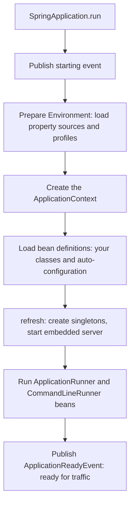

# Spring Boot

## Why It Matters

Spring Boot is the default way to build Java backend services, so most Spring interviews ask how it works: "How does auto-configuration work?", "Where does a property value come from when it is set in three places?", "How do you test only the web layer?". On the job, the same knowledge decides how fast you find out why a bean is missing (a condition did not match), why a setting has no effect (a source with higher precedence overrides it), and why a service drops requests during a deploy (no graceful shutdown or no readiness probe). This page covers Spring Boot 4.1 (the current generally available release as of 2026-10-22, with Spring Framework 7.0.9) and marks where Spring Boot 3.x differs. The container concepts that Boot builds on (beans, scopes, lifecycle, proxies) are in [Spring Core](17-spring-core.md). Web, data, and security starters have their own pages: [Spring Web and REST](20-spring-web-and-rest.md), [Spring Data and transactions](19-spring-data-and-transactions.md), and [Spring Security](21-spring-security.md).

## Core Concepts

**Spring Boot**: a layer on top of Spring Framework that starts an application with conventions: it finds the libraries on the classpath, configures beans for them, reads configuration from standard places, and packages the result as one runnable file.

**Auto-configuration**: configuration classes that Boot applies when conditions are true, for example "a `DataSource` class is on the classpath and the application defines no `DataSource` bean". Each class backs off if the application defines its own bean.

**Starter**: a dependency descriptor (a POM with no code of its own) that pulls the set of libraries for one purpose. `spring-boot-starter-webmvc` pulls Spring MVC, Jackson, and an embedded Tomcat (from its POM on Maven Central).

**Condition**: a test that Spring evaluates when it registers a bean definition. `@ConditionalOnClass`, `@ConditionalOnMissingBean`, and `@ConditionalOnProperty` are the common ones.

**`Environment`**: the Spring object that gives access to properties and profiles. It holds an ordered list of **property sources**. When two sources define the same key, the one with higher precedence wins.

**Profile**: a named group of beans and properties that you activate for one environment (`dev`, `prod`).

**Actuator**: a Boot module that adds production endpoints (health, metrics, loggers, and others) to a running application.

**Slice test**: a test that loads only the part of the context that one layer needs (the web layer, the JPA layer), so it starts faster than a full test.

**Fat jar** (or executable jar): one jar that holds the application classes and all dependency jars, with a launcher that starts the application with `java -jar`.

## How It Works

### What `SpringApplication.run` does



The `Environment` exists before the context, so conditions and `@Value` can read properties while the context starts. A web application creates the embedded server during `refresh`. `ApplicationRunner` and `CommandLineRunner` beans run after the context is ready, before `ApplicationReadyEvent`.

### `@SpringBootApplication`

The annotation is a shortcut for three annotations (Spring Boot API documentation):

| Annotation | Effect |
|---|---|
| `@SpringBootConfiguration` | Marks the class as a configuration class (a specialization of `@Configuration`) |
| `@EnableAutoConfiguration` | Turns on auto-configuration |
| `@ComponentScan` | Scans the package of the annotated class and its sub-packages for `@Component` classes. Its exclude filters skip auto-configuration classes and test configuration |

Because the scan starts at the package of the main class, put the main class in the root package of the application. A main class in the default (empty) package scans the whole classpath.

### Auto-configuration

**How Boot finds the classes.** `@EnableAutoConfiguration` imports `AutoConfigurationImportSelector`. The selector reads every file named `META-INF/spring/org.springframework.boot.autoconfigure.AutoConfiguration.imports` on the classpath. Each file lists one class name per line. The selector is a *deferred* import selector: Spring processes it after all of the application's own configuration, so the application's beans are already registered when the conditions of the auto-configuration classes run. This order makes "back off if the user defines a bean" work.

```text
starter.GreetingAutoConfiguration
```

In Spring Boot 2.6 and earlier, the list was in `META-INF/spring.factories` under the key `org.springframework.boot.autoconfigure.EnableAutoConfiguration`. Spring Boot 2.7 introduced the `.imports` file and still read the `spring.factories` entry. Spring Boot 3.0 removed support for the `spring.factories` entry (Spring Boot 3.0 Migration Guide). A library that targets Boot 3 or 4 must use the `.imports` file.

**Conditions.** Each auto-configuration class and each of its `@Bean` methods carries conditions:

| Annotation | True when | Typical use |
|---|---|---|
| `@ConditionalOnClass` / `@ConditionalOnMissingClass` | A class is (or is not) on the classpath | Configure a library only if it is present |
| `@ConditionalOnBean` / `@ConditionalOnMissingBean` | A bean of a type or name exists (or is missing) | Back off when the application defines its own bean |
| `@ConditionalOnProperty` | A property has a given value | Feature switches (`greeting.enabled`) |
| `@ConditionalOnResource` | A resource exists | Configure only if a file is present |
| `@ConditionalOnWebApplication` / `@ConditionalOnNotWebApplication` | The application is (or is not) a web application | Web-only beans |
| `@ConditionalOnExpression` | A SpEL expression is true | Complex rules |
| `@ConditionalOnCloudPlatform` | A cloud platform (Kubernetes) is active | Platform-specific beans |
| `@ConditionalOnSingleCandidate` | Exactly one bean of a type exists, or one of them is `@Primary` | Configure something around the one `DataSource` |
| `@ConditionalOnThreading` | Platform threads or virtual threads are in use (`spring.threads.virtual.enabled`) | Choose an executor for virtual threads |

`@ConditionalOnClass` on a class level is safe if the class is missing, because Spring reads the annotation from the class file with ASM and does not load the class. On a `@Bean` method, the JVM may need the class when it loads the configuration class, so put such beans in a separate nested configuration class that carries the condition (Spring Boot reference, "Creating Your Own Auto-configuration"). `@ConditionalOnBean` depends on the order of registration, so use it only inside auto-configuration classes, which run last.

**Ordering and backing off.** `@AutoConfiguration(before = ..., after = ...)` orders auto-configuration classes. `@ConditionalOnMissingBean` on a `@Bean` method makes it a default: the application defines a bean of that type, and the default does not register.

<!-- fragment -->
```java
package starter;

import org.springframework.boot.autoconfigure.AutoConfiguration;
import org.springframework.boot.autoconfigure.condition.ConditionalOnMissingBean;
import org.springframework.boot.autoconfigure.condition.ConditionalOnProperty;
import org.springframework.context.annotation.Bean;

@AutoConfiguration
@ConditionalOnProperty(prefix = "greeting", name = "enabled", matchIfMissing = true)
public class GreetingAutoConfiguration {

    public interface Greeter {
        String greet(String name);
    }

    @Bean
    @ConditionalOnMissingBean // backs off if the application defines its own Greeter
    Greeter defaultGreeter() {
        return name -> "Hello, " + name + " (from the auto-configuration)";
    }
}
```

The next program shows the whole path: a main class, a `@ConfigurationProperties` record, a profile, and the auto-configuration above on the classpath (registered in the `.imports` file). It runs five times with different arguments.

<!-- fragment -->
```java
package demo;

import java.time.Duration;
import java.util.Map;
import org.springframework.beans.factory.annotation.Value;
import org.springframework.boot.Banner;
import org.springframework.boot.SpringApplication;
import org.springframework.boot.WebApplicationType;
import org.springframework.boot.autoconfigure.SpringBootApplication;
import org.springframework.boot.context.properties.ConfigurationProperties;
import org.springframework.boot.context.properties.EnableConfigurationProperties;
import org.springframework.context.ConfigurableApplicationContext;
import org.springframework.context.annotation.Bean;
import org.springframework.context.annotation.Profile;
import starter.GreetingAutoConfiguration.Greeter;

@SpringBootApplication
@EnableConfigurationProperties(Demo.AppProperties.class)
public class Demo {

    @ConfigurationProperties(prefix = "app")
    record AppProperties(String name, int maxRetries, Duration timeout) { }

    @Bean
    @Profile("custom")
    Greeter customGreeter() {
        return name -> "Hi " + name + " (from the application)";
    }

    @Value("${app.name}")
    String nameFromValue;

    public static void main(String[] args) {
        run("no profile");
        run("dev profile", "--spring.profiles.active=dev");
        run("dev + command line", "--spring.profiles.active=dev", "--app.max-retries=9");
        run("custom profile", "--spring.profiles.active=custom");
        run("greeting disabled", "--greeting.enabled=false");
    }

    static void run(String title, String... args) {
        var app = new SpringApplication(Demo.class);
        app.setWebApplicationType(WebApplicationType.NONE);
        app.setBannerMode(Banner.Mode.OFF);
        app.setDefaultProperties(Map.of("logging.level.root", "OFF"));
        try (ConfigurableApplicationContext ctx = app.run(args)) {
            var props = ctx.getBean(AppProperties.class);
            System.out.println("== " + title);
            System.out.println("  properties: " + props);
            System.out.println("  @Value name: " + ctx.getBean(Demo.class).nameFromValue);
            var greeters = ctx.getBeansOfType(Greeter.class).values();
            System.out.println("  greeter: " + (greeters.isEmpty()
                    ? "none"
                    : greeters.iterator().next().greet("Ana")));
        }
    }
}
```

The files on the classpath:

```properties
# application.properties
app.name=from-application-properties
app.max-retries=3
app.timeout=5s
```

```properties
# application-dev.properties
app.name=from-application-dev-properties
app.timeout=30s
```

Output from a real run (Spring Boot 4.1.1, Java 21, no web server):

```text
== no profile
  properties: AppProperties[name=from-application-properties, maxRetries=3, timeout=PT5S]
  @Value name: from-application-properties
  greeter: Hello, Ana (from the auto-configuration)
== dev profile
  properties: AppProperties[name=from-application-dev-properties, maxRetries=3, timeout=PT30S]
  @Value name: from-application-dev-properties
  greeter: Hello, Ana (from the auto-configuration)
== dev + command line
  properties: AppProperties[name=from-application-dev-properties, maxRetries=9, timeout=PT30S]
  @Value name: from-application-dev-properties
  greeter: Hello, Ana (from the auto-configuration)
== custom profile
  properties: AppProperties[name=from-application-properties, maxRetries=3, timeout=PT5S]
  @Value name: from-application-properties
  greeter: Hi Ana (from the application)
== greeting disabled
  properties: AppProperties[name=from-application-properties, maxRetries=3, timeout=PT5S]
  @Value name: from-application-properties
  greeter: none
```

Read the output:

- **Run 1.** The values come from `application.properties`. The auto-configuration registered the `Greeter`, because the application defined none.
- **Run 2.** The profile `dev` loads `application-dev.properties`. It overrides `name` and `timeout`. `max-retries` stays at 3, because the profile file does not set it.
- **Run 3.** The command-line argument `--app.max-retries=9` overrides the file value, and the dev profile values stay.
- **Run 4.** The profile `custom` activates the application's own `Greeter`. The auto-configuration backs off (`@ConditionalOnMissingBean`).
- **Run 5.** `--greeting.enabled=false` makes `@ConditionalOnProperty` false, so no `Greeter` exists.

**Testing an auto-configuration.** `ApplicationContextRunner` starts a small context with only the configuration that you give it. It is the standard way to test conditions.

<!-- fragment -->
```java
import org.springframework.boot.autoconfigure.AutoConfigurations;
import org.springframework.boot.test.context.runner.ApplicationContextRunner;
import org.springframework.context.annotation.Bean;
import org.springframework.context.annotation.Configuration;
import starter.GreetingAutoConfiguration;
import starter.GreetingAutoConfiguration.Greeter;

public class RunnerDemo {
    public static void main(String[] args) {
        var runner = new ApplicationContextRunner()
                .withConfiguration(AutoConfigurations.of(GreetingAutoConfiguration.class));

        runner.run(ctx -> System.out.println("default: "
                + ctx.getBean(Greeter.class).greet("Ana")));

        runner.withPropertyValues("greeting.enabled=false")
                .run(ctx -> System.out.println("disabled: has Greeter = "
                        + ctx.getBeanNamesForType(Greeter.class).length));

        runner.withUserConfiguration(Custom.class)
                .run(ctx -> System.out.println("user bean wins: "
                        + ctx.getBean(Greeter.class).greet("Ana")));
    }

    @Configuration
    static class Custom {
        @Bean
        Greeter myGreeter() {
            return name -> "Custom hello, " + name;
        }
    }
}
```

```text
default: Hello, Ana (from the auto-configuration)
disabled: has Greeter = 0
user bean wins: Custom hello, Ana
```

**Debugging.** To see which conditions matched, start the application with `--debug` (or `debug=true`). Boot prints the *condition evaluation report* with "Positive matches", "Negative matches" (with the failed condition), "Exclusions", and "Unconditional classes". The Actuator endpoint `/actuator/conditions` shows the same data. To disable one auto-configuration, use `@SpringBootApplication(exclude = ...)` or the property `spring.autoconfigure.exclude`.

**Spring Boot 4 splits auto-configuration into modules.** In Spring Boot 3.x, the single `spring-boot-autoconfigure` jar held the auto-configuration for most technologies (156 entries in the `.imports` file of the 3.5.0 jar). In Spring Boot 4.0 and later, each technology has its own module with its own `.imports` file (for example `spring-boot-webmvc`, `spring-boot-data-jpa`, `spring-boot-actuator-autoconfigure`), and `spring-boot-autoconfigure` keeps only 12 core entries (Spring Boot 4.1.1 jar). The visible effects in an interview: package names changed (see below), and a project needs the module or starter for a technology, not only the core jar.

### Starters

A starter is a POM that declares dependencies. It contains no auto-configuration code, and by convention, it has the name `spring-boot-starter-*`. The auto-configuration is in separate modules (`*-autoconfigure` in a custom starter). Examples:

| Starter | Brings |
|---|---|
| `spring-boot-starter` | The core: logging, YAML support, auto-configuration |
| `spring-boot-starter-webmvc` | Spring MVC, Jackson, embedded Tomcat |
| `spring-boot-starter-data-jpa` | Spring Data JPA, Hibernate, a connection pool |
| `spring-boot-starter-actuator` | Actuator endpoints and Micrometer |
| `spring-boot-starter-test` | JUnit, AssertJ, Mockito, Spring Test, and the test support |

In Spring Boot 4.0, `spring-boot-starter-web` is deprecated in favor of `spring-boot-starter-webmvc` (the POM description in Maven Central says so). Spring Boot 3.x uses `spring-boot-starter-web`.

**Version management.** The `spring-boot-starter-parent` POM (or the `spring-boot-dependencies` BOM) fixes the versions of the libraries that Boot supports. A project that uses it declares starters without versions. Boot 4.1.1 manages Spring Framework 7.0.9, Tomcat 11.0.24, and Hibernate 7.4.5.Final (from `spring-boot-dependencies-4.1.1.pom`). The [build tools page](23-build-tools.md) explains BOMs.

**A custom starter** has two modules: an `autoconfigure` module with the `@AutoConfiguration` class and the `.imports` file, and a `starter` module with only a POM that depends on it. The auto-configuration class in this page's demo is the core of such a module.

### Externalized configuration

#### Property source precedence

Boot builds the `Environment` from many sources. The Spring Boot reference lists them from **lowest** to **highest** precedence (the later source wins):

1. Default properties (`SpringApplication.setDefaultProperties`)
2. `@PropertySource` annotations on `@Configuration` classes
3. Config data, such as `application.properties` and `application.yaml`
4. `RandomValuePropertySource` (`random.*`)
5. OS environment variables
6. Java system properties (`-Dkey=value`)
7. JNDI attributes
8. `ServletContext` and `ServletConfig` init parameters
9. `SPRING_APPLICATION_JSON` (inline JSON in an environment variable or system property)
10. Command-line arguments (`--key=value`)
11. The `properties` attribute of `@SpringBootTest` and the slice test annotations
12. `@DynamicPropertySource` in tests
13. `@TestPropertySource` in tests
14. Devtools global settings, when Devtools is active

The rule of thumb: the closer a setting is to the launch of the process, the higher its precedence. A command-line argument beats an environment variable, which beats a file in the jar.

**Order of the config data files** (lowest to highest): `application.properties` inside the jar, profile-specific `application-{profile}.properties` inside the jar, `application.properties` outside the jar, profile-specific files outside the jar. A profile-specific file overrides the general file at the same location. If a `.properties` file and a `.yaml` file with the same name are in the same location, the `.properties` file wins. `spring.config.import=optional:file:./extra.properties` loads more files, and the imported values override the file that imports them. The default search locations include the classpath root, the classpath `/config` package, the current directory, and the `config/` sub-directory of the current directory.

**Environment variables and relaxed binding.** Boot binds property names leniently. The property `app.max-retries` (the canonical kebab-case form) can come from `app.maxRetries`, `app.max_retries`, or, as an environment variable, `APP_MAXRETRIES` or `APP_MAX_RETRIES`. Use the kebab-case form in `.properties` and `.yaml` files. For an environment variable, the Spring Boot reference gives this rule: replace dots with underscores, remove dashes, and convert to upper case, so `app.max-retries` becomes `APP_MAXRETRIES`. A test with the demo program on Spring Boot 4.1.1 shows that `APP_MAX_RETRIES=7` also binds to `maxRetries`, but the documented form is `APP_MAXRETRIES`. Relaxed binding applies to `@ConfigurationProperties`. For `@Value`, the rules are stricter (see below).

#### Profiles

A profile selects beans and properties for one environment.

- Activate with `spring.profiles.active=dev,metrics` (property, environment variable `SPRING_PROFILES_ACTIVE`, or command-line argument). `spring.profiles.default` applies only when no profile is active.
- Mark beans with `@Profile("dev")` or `@Profile("!prod")`. `@Profile` also works on `@Configuration` classes and on `@Bean` methods.
- Load `application-{profile}.properties` for each active profile. Later active profiles override earlier ones.
- In a multi-document YAML file or properties file, `spring.config.activate.on-profile=prod` restricts a document to one profile.
- A **profile group** (`spring.profiles.group.prod=proddb,prodmq`) activates several profiles with one name.
- Recommendation: do not put secrets in a profile file in the repository. Pass them as environment variables or from a secret store (`spring.config.import=configtree:/run/secrets/`).

```yaml
# application.yaml: one file, several documents
app:
  name: demo
---
spring:
  config:
    activate:
      on-profile: prod
app:
  name: demo-prod
```

#### `@ConfigurationProperties` versus `@Value`

| | `@ConfigurationProperties` | `@Value` |
|---|---|---|
| What it binds | A group of properties with one prefix into one typed object (a class or a record) | One property into one field or parameter |
| Binding of names | Relaxed: `max-retries`, `maxRetries`, `MAX_RETRIES` all match | Strict for the exact key in the expression. Relaxed matching works only for the canonical kebab-case key |
| Type conversion | Rich: `Duration`, `DataSize`, lists, maps, nested objects | Converts one value with the conversion service (Boot registers its converters, so `Duration` works). No nested objects |
| Validation | `@Validated` with Jakarta Bean Validation on the properties class | None |
| SpEL | Not supported | `#{...}` supported |
| IDE and tooling | Generates metadata for completion (`spring-boot-configuration-processor`) | No metadata |
| Immutability | Records and constructor binding give immutable objects | Fields or constructor parameters |
| Testing | Create the properties object with `new` | A `@Value` field needs a Spring context or reflection. A `@Value` constructor parameter can be passed with `new` |

Recommendation: use `@ConfigurationProperties` for any group of two or more related settings, and `@Value` for a single value or a SpEL expression. A `@ConfigurationProperties` class must be registered: with `@EnableConfigurationProperties(AppProperties.class)` (as in the demo), with `@ConfigurationPropertiesScan`, or by making it a `@Component`. A record with one constructor uses constructor binding by default (Spring Boot 3.0 and later).

### Actuator

Add `spring-boot-starter-actuator`. Endpoints appear under `/actuator` (`management.endpoints.web.base-path`).

| Endpoint | Shows | Notes |
|---|---|---|
| `health` | Status (`UP`, `DOWN`) of the application and its components | Exposed over HTTP by default. Details are hidden by default |
| `info` | Build and git information, custom entries | |
| `metrics` | Micrometer metrics (JVM, HTTP, pool) | `prometheus` endpoint (with the Prometheus registry) publishes the same data for scraping |
| `env`, `configprops` | All property sources and their values, and all `@ConfigurationProperties` | Sensitive. All values are masked by default (`show-values` is `never`, checked in the 4.1.1 metadata), and the property names and structure are still visible |
| `beans`, `conditions`, `mappings` | The beans, the condition evaluation report, the request mappings | Debugging |
| `loggers` | Log levels, and changes them at run time | A POST changes a level |
| `threaddump`, `heapdump` | A thread dump, a heap dump | `heapdump` needs explicit access |
| `shutdown` | Stops the application | Off by default |

**Exposure and access.** Boot separates two settings:

- **Exposure** decides which endpoints a technology (HTTP or JMX) publishes. In Spring Boot 3.5 and 4.1, `management.endpoints.web.exposure.include` defaults to `health`, and so does the JMX default (checked in the `spring-configuration-metadata.json` of both versions). Set `include=*` to expose all, and `exclude` to remove some.
- **Access** decides what an endpoint allows (`none`, `read-only`, `unrestricted`). Since Spring Boot 3.4, `management.endpoint.<id>.access` and `management.endpoints.access.default` replace the older `management.endpoint.<id>.enabled` property. By default, access is unrestricted except for `shutdown` and `heapdump`. The reference documentation for 4.1.1 states this default.

Security: expose few endpoints, put the management endpoints on another port (`management.server.port`) that the network does not publish, and protect the rest with [Spring Security](21-spring-security.md). `env`, `heapdump`, and `threaddump` can leak secrets.

**Health, probes, and groups.** `health` aggregates `HealthIndicator` beans: a database, disk space, and a broker each add a component. The overall status is the worst component status. In Spring Boot 4.x, `management.endpoint.health.probes.enabled` is `true` by default (Spring Boot 4.0 Migration Guide, and the 4.1.1 metadata), so every application exposes the groups `liveness` (`/actuator/health/liveness`: is the process alive; restart it if not) and `readiness` (`/actuator/health/readiness`: can it take traffic; remove it from the load balancer if not). In Spring Boot 3.x, Boot enables these groups automatically only when it detects Kubernetes, and you set `management.endpoint.health.probes.enabled=true` elsewhere. Do not put an external dependency (the database) in the liveness group: a database outage would restart every pod.

<!-- fragment -->
```java
package demo;

import java.io.File;
import org.springframework.boot.health.contributor.Health;
import org.springframework.boot.health.contributor.HealthIndicator;
import org.springframework.stereotype.Component;

@Component // Boot drops the suffix "HealthIndicator", so the health component is named "disk"
class DiskHealthIndicator implements HealthIndicator {
    private static final long MIN_FREE_BYTES = 100L * 1024 * 1024;

    @Override
    public Health health() {
        long free = new File(".").getUsableSpace();
        if (free < MIN_FREE_BYTES) {
            return Health.down().withDetail("freeBytes", free).build();
        }
        return Health.up().withDetail("freeBytes", free).build();
    }
}
```

**Package change in Spring Boot 4.** The health API moved. In Spring Boot 3.x, `HealthIndicator` and `Health` are in `org.springframework.boot.actuate.health`. In Spring Boot 4.x, they are in `org.springframework.boot.health.contributor` (module `spring-boot-health`). Code that compiled on Boot 3 does not compile on Boot 4 without changing the imports.

### Embedded servers

A web application contains its own server, so the application starts with `java -jar` and no external server. Spring Boot 4.x supports Tomcat (the default, Tomcat 11 in Boot 4.1.1) and Jetty. Spring Boot 4.0 dropped Undertow, because Boot 4 requires Servlet 6.1 and Undertow is not compatible with it (Spring Boot 4.0 Migration Guide). Spring Boot 3.x supports Tomcat 10.1, Jetty, and Undertow.

To switch from Tomcat, exclude `spring-boot-starter-tomcat` from the web starter and add the Jetty starter. Defaults from the Boot 4.1.1 metadata: `server.port` is 8080, `server.tomcat.threads.max` is 200, `server.tomcat.max-connections` is 8192, and `server.tomcat.accept-count` is 100. The request thread pool size limits concurrency for blocking code. `spring.threads.virtual.enabled=true` (Spring Boot 3.2 and later; the default is `false`) runs request handling on virtual threads. See [virtual threads](10-virtual-threads.md).

### Graceful shutdown

When the process receives `SIGTERM`, Spring closes the context. With **graceful shutdown**, the server stops accepting new requests, and it lets requests in flight finish before the rest of the context closes.

- `server.shutdown=graceful` is the default in Spring Boot 3.4 and later (the metadata of 3.3.0 shows `immediate`, and 3.4.0 shows `graceful`). In Spring Boot 3.3 and earlier, you set it yourself.
- `spring.lifecycle.timeout-per-shutdown-phase` sets the wait for each phase. The default is `30s` (Boot 4.1.1 metadata). After the timeout, the shutdown continues and ends the requests.
- It works for Tomcat, Jetty, and Reactor Netty (and Undertow in Spring Boot 3.x).
- On Kubernetes, the deletion of a pod starts several actions in parallel: the shutdown of the container, the removal of the pod from the service endpoints, and the removal from load balancers. For a short window, traffic can still reach a pod that has begun to shut down. A `preStop` hook that sleeps (for example 10 seconds; Kubernetes 1.32 and later has a built-in `sleep` action) keeps the application serving during that window. When the hook ends, Kubernetes sends `SIGTERM`, and graceful shutdown begins. Kubernetes sends `SIGKILL` when the termination grace period (default 30 seconds) ends, so set `terminationGracePeriodSeconds` larger than the `preStop` delay plus the Spring timeout (Spring Boot how-to, "Kubernetes Container Lifecycle").
- During the graceful shutdown phase, Boot sets the readiness state to `REFUSING_TRAFFIC`, and the server rejects new requests. The HTTP probes are also rejected in this phase, so the readiness probe fails because the request fails, not because it reports a state (Spring Boot reference, "Endpoints", application lifecycle table).
- A stop from an IDE may be immediate if the IDE does not send `SIGTERM`.

```yaml
server:
  shutdown: graceful
spring:
  lifecycle:
    timeout-per-shutdown-phase: 20s
management:
  endpoint:
    health:
      probes:
        enabled: true # the default in Spring Boot 4.x; needed outside Kubernetes on 3.x
```

### Packaging

**Fat jar.** The Spring Boot Maven plugin (`spring-boot-maven-plugin`) or Gradle plugin repackages the jar. The result has this layout:

```text
app.jar
  META-INF/MANIFEST.MF        Main-Class: JarLauncher, Start-Class: your main class
  BOOT-INF/classes/           your classes and resources
  BOOT-INF/lib/               all dependency jars, as nested jars
  BOOT-INF/layers.idx         the layer index
  org/springframework/boot/loader/...   the launcher classes
```

`java -jar app.jar` starts `JarLauncher`. It builds a class loader that reads the nested jars and then calls your `main` method. A plain JVM cannot load a jar inside a jar, which is why the launcher exists.

**Layered jars.** The plugin writes `BOOT-INF/layers.idx`, which splits the jar into four layers (Spring Boot reference): `dependencies`, `spring-boot-loader`, `snapshot-dependencies`, and `application`. Dependencies change rarely, and application code changes with each commit. If each layer is a separate Docker layer, a rebuild after a code change pushes only the small `application` layer. The command to extract the layers for a Dockerfile in Spring Boot 3.3 and later, and 4.x:

```text
java -Djarmode=tools -jar application.jar extract --layers --destination extracted
```

Older Dockerfiles use `java -Djarmode=layertools -jar app.jar extract`. Spring Boot 3.3 deprecated the `layertools` jarmode in favor of `tools extract --layers` (Spring Boot 3.3 release notes). The `spring-boot-jarmode-tools` jar still registers `layertools` in 3.5.0 and 4.0.0, and no longer registers it in 4.1.1, so on Spring Boot 4.1 only `tools` works.

Alternatives: `mvn spring-boot:build-image` builds an OCI image with Cloud Native Buildpacks and needs no Dockerfile. A plain `COPY app.jar` works but creates one large layer.

### Startup time and native images

Startup time matters for scale-to-zero, short-lived jobs, and rolling deploys. What takes time in a Boot application: loading and scanning classes, evaluating hundreds of conditions, creating beans and proxies, and starting the server.

| Technique | Effect | Cost |
|---|---|---|
| `spring.main.lazy-initialization=true` (default `false`) | Creates beans at first use, so startup is shorter | The first request is slower, and wiring errors show late |
| Exclude unused auto-configuration, remove unused starters | Fewer conditions and beans | Maintenance |
| Class Data Sharing (CDS) and AOT cache | Faster class loading and a shorter JVM start | Needs a training run in the build (Spring Boot 3.3 and later support CDS) |
| Spring AOT processing (`process-aot`) | At build time, Spring runs the container analysis and generates code, so less reflection happens at run time | Part of the native image build. Also usable on the JVM |
| GraalVM native image | Starts in milliseconds and uses less memory | Long build, closed-world assumption (no dynamic class loading, reflection needs hints), lower peak throughput than a warmed-up JIT in many workloads, and harder debugging |
| Coordinated Restore at Checkpoint (CRaC) | Restores a warmed-up JVM snapshot | Needs a JDK with CRaC, and resources must support checkpoint |

Spring Boot 3.0 added native image support through Spring AOT. Reflection, resources, and proxies that the application needs at run time are registered as *runtime hints* (`RuntimeHintsRegistrar`). Pick a native image for fast cold start or for memory limits. Keep the JVM for long-running services where peak throughput matters.

### Testing slices

`spring-boot-starter-test` provides the test support. `@SpringBootTest` loads the full application context. A **slice** loads only one layer, with only the auto-configuration that the layer needs.

| Annotation | Loads | Does not load |
|---|---|---|
| `@SpringBootTest` | The full context. `webEnvironment` chooses `MOCK` (default, no real server), `RANDOM_PORT`, `DEFINED_PORT`, or `NONE` | Nothing is excluded |
| `@WebMvcTest(Controller.class)` | MVC infrastructure, `@Controller`, `@ControllerAdvice`, converters, filters, and `MockMvc` | `@Service`, `@Repository`, `@Component` beans. Mock them with `@MockitoBean` |
| `@DataJpaTest` | Entities, Spring Data repositories, `TestEntityManager`, an embedded database (replaces the real one by default), and a transaction that rolls back after each test | Controllers, services |
| `@JsonTest`, `@RestClientTest`, `@DataJdbcTest` | JSON serialization, `RestClient` calls with a mock server, JDBC | Everything else |

Choose the smallest slice that tests the behavior. Slices start faster, and they show which layer fails. Use `@SpringBootTest` for a few end-to-end tests. Spring caches an application context across test classes that have the same configuration, so many different `@MockitoBean` sets and property overrides create many contexts and slow the suite.

<!-- fragment -->
```java
package demo;

import static org.springframework.test.web.servlet.request.MockMvcRequestBuilders.get;
import static org.springframework.test.web.servlet.result.MockMvcResultMatchers.content;
import static org.springframework.test.web.servlet.result.MockMvcResultMatchers.status;

import jakarta.persistence.Entity;
import jakarta.persistence.Id;
import org.junit.jupiter.api.Test;
import org.springframework.beans.factory.annotation.Autowired;
import org.springframework.boot.data.jpa.test.autoconfigure.DataJpaTest;
import org.springframework.boot.jpa.test.autoconfigure.TestEntityManager;
import org.springframework.boot.test.context.SpringBootTest;
import org.springframework.boot.webmvc.test.autoconfigure.AutoConfigureMockMvc;
import org.springframework.boot.webmvc.test.autoconfigure.WebMvcTest;
import org.springframework.test.context.bean.override.mockito.MockitoBean;
import org.springframework.test.web.servlet.MockMvc;
import org.springframework.web.bind.annotation.GetMapping;
import org.springframework.web.bind.annotation.RestController;

@RestController
class HelloController {
    private final GreetingService service;

    HelloController(GreetingService service) {
        this.service = service;
    }

    @GetMapping("/hello")
    String hello() {
        return service.greet();
    }
}

interface GreetingService {
    String greet();
}

@Entity
class Customer {
    @Id Long id;
    String name;
}

@WebMvcTest(HelloController.class)          // web layer only: controllers, converters, filters
class HelloControllerTest {
    @Autowired MockMvc mvc;
    @MockitoBean GreetingService service;   // Boot 3.x: @MockBean (removed in Boot 4)

    @Test
    void returnsGreeting() throws Exception {
        org.mockito.Mockito.when(service.greet()).thenReturn("hi");
        mvc.perform(get("/hello")).andExpect(status().isOk()).andExpect(content().string("hi"));
    }
}

@DataJpaTest                                // JPA only: entities, repositories, embedded database
class CustomerRepositoryTest {
    @Autowired TestEntityManager em;

    @Test
    void persistsCustomer() {
        var c = new Customer();
        c.id = 1L;
        em.persistAndFlush(c);
    }
}

@SpringBootTest                             // the full application context
@AutoConfigureMockMvc
class FullStackTest {
    @Autowired MockMvc mvc;

    @Test
    void contextLoads() { }
}
```

**Spring Boot 4 differences for tests.** `@MockBean` and `@SpyBean` do not exist in the Spring Boot 4 test jar. Use `@MockitoBean` and `@MockitoSpyBean` from Spring Framework (`org.springframework.test.context.bean.override.mockito`, since Spring Framework 6.2). The annotations moved to module-specific packages: `@WebMvcTest` is `org.springframework.boot.webmvc.test.autoconfigure.WebMvcTest` (module `spring-boot-webmvc-test`), and `@DataJpaTest` is `org.springframework.boot.data.jpa.test.autoconfigure.DataJpaTest`. In Spring Boot 3.x, both are in `org.springframework.boot.test.autoconfigure...` packages (`...web.servlet.WebMvcTest` and `...orm.jpa.DataJpaTest`). `@SpringBootTest` stays in `org.springframework.boot.test.context`. A `@SpringBootTest` with a mock web environment needs `@AutoConfigureMockMvc` to inject `MockMvc`.

## Trade-offs and When to Use

| Decision | Option A | Option B | Recommendation |
|---|---|---|---|
| Configuration binding | `@ConfigurationProperties`: typed, validated, relaxed | `@Value`: one value, SpEL | `@ConfigurationProperties` for groups, `@Value` for a single value |
| Where config lives | In the jar (`application.properties`) | Outside: environment variables, config server, mounted files | Defaults in the jar. Environment-specific values and secrets outside |
| Profiles versus properties | Profile files per environment | One file and environment variables | Few profiles (`dev`, `test`, `prod`). Do not encode secrets or many switches in profile names |
| Packaging | Fat jar with `java -jar` | Layered jar in a container image or buildpack image | Layered image for containers. Plain fat jar for a VM |
| JVM versus native image | JIT: peak throughput, easy debugging, slower start | Native: fast start, low memory, long build, restrictions | JVM by default. Native for scale-to-zero or tight memory |
| Test scope | Slice tests: fast, targeted | `@SpringBootTest`: realistic, slow | Many slices, few full tests |
| Auto-configuration versus manual config | Auto: little code, conventions | Manual `@Bean`: explicit control | Use auto-configuration, and define your own bean where the default is wrong (the default backs off) |
| Actuator exposure | Expose all | Expose a short list on a separate port | The short list. `include=*` only on a protected port |
| Boot 4 versus Boot 3.5 for a new project | Boot 4.1: current, Framework 7, Jackson 3 default, modular. Open-source support until 2027-07-31 | Boot 3.5: last 3.x minor. Open-source support ended on 2026-06-30, and only commercial support continues (to 2032-06-30) | Boot 4.1 for new projects. A 3.5 application without a commercial support contract gets no more open-source patches, so plan the upgrade (dates from the spring.io project API) |

## Java Example

The examples above are the runnable parts of this page: the auto-configuration, the application with properties and profiles (five runs with the output shown), the `ApplicationContextRunner` test, the health indicator, and the slice tests. All use Spring Boot 4.1.1 and Spring Framework 7.0.9. The blocks carry the `fragment` marker, because the page checker has no Spring jars. Every block was compiled against these jars with Java 21 (the slice tests compile only, because they need a test runtime and a database). The `Demo` and `RunnerDemo` programs were run, and their output is shown above.

## Interview Angle

### Questions

??? question "How does Spring Boot auto-configuration work?"

    `@SpringBootApplication` includes `@EnableAutoConfiguration`, which imports `AutoConfigurationImportSelector`. The selector reads the `META-INF/spring/org.springframework.boot.autoconfigure.AutoConfiguration.imports` files from every jar on the classpath and gets a list of candidate configuration classes. Each class carries conditions (`@ConditionalOnClass`, `@ConditionalOnMissingBean`, `@ConditionalOnProperty`), and Spring evaluates them while it registers bean definitions. The selector runs after the application's own configuration, so a bean that the application defines makes `@ConditionalOnMissingBean` false, and the default backs off. Starters supply the classes that make the `@ConditionalOnClass` conditions true. To see the result, run with `--debug` for the condition evaluation report, or open `/actuator/conditions`. Since Boot 3.0 the list is in the `.imports` file, not in `spring.factories`. In Boot 4, each technology has its own module and `.imports` file.

??? question "In which order does Spring Boot resolve a property that is set in several places?"

    From the highest precedence: test annotations (`@TestPropertySource`, `@DynamicPropertySource`, and the `properties` attribute), command-line arguments, `SPRING_APPLICATION_JSON`, servlet init parameters, JNDI, Java system properties, OS environment variables, `random.*`, config data files, `@PropertySource`, and default properties. Among config data files, files outside the jar beat files inside it, and profile-specific files beat the general files at the same location. For the same name, `.properties` beats `.yaml`. A short rule: the closer a setting is to the process launch, the higher its precedence. So a `--server.port=9000` argument overrides `SERVER_PORT=8081`, which overrides `server.port=8080` in `application.properties`. In the demo on this page, `--app.max-retries=9` beat the file value.

??? question "What is the difference between `@ConfigurationProperties` and `@Value`?"

    `@ConfigurationProperties` binds a group of properties with one prefix into a typed object (a class or an immutable record), with relaxed name matching (`max-retries`, `maxRetries`, `MAX_RETRIES`), rich conversion (`Duration`, `DataSize`, collections), optional validation with `@Validated`, and metadata for IDE completion. `@Value` injects one property, supports SpEL, and has limited relaxed binding: if the placeholder uses the canonical kebab-case key, Boot also matches the camel-case and environment-variable forms; with any other key, it does not. Use `@ConfigurationProperties` for related settings because it is type-safe and easy to test. Use `@Value` for a single value or an expression. Neither one refreshes at run time without extra support (Spring Cloud's refresh scope, or a restart).

??? question "How do profiles work? How would you configure different databases for dev and prod?"

    A profile is a named group of beans and properties. Activate it with `spring.profiles.active` (property, environment variable, or argument). Boot loads `application-{profile}.properties` after the general file, and the profile values override. Beans with `@Profile("dev")` register only when that profile is active. For the database: keep the common settings in `application.properties`, put the dev URL in `application-dev.properties` (or use an embedded database), and give the production URL, user, and password through environment variables or a secret store on the production host. Do not commit production secrets in a profile file. For features with many switches, a `@ConditionalOnProperty` flag is clearer than a new profile.

??? question "What does `@SpringBootApplication` do?"

    It combines three annotations: `@SpringBootConfiguration` (a `@Configuration` class), `@EnableAutoConfiguration` (turns on auto-configuration), and `@ComponentScan` (scans the package of the class and its sub-packages). The scan has exclude filters that skip auto-configuration classes and test configuration. The consequence: put the main class in the root package, and keep the application packages below it, or the scan misses your beans.

??? question "What is a starter, and what is in it?"

    A starter is a dependency descriptor (a POM) that pulls a set of libraries for one purpose, for example `spring-boot-starter-webmvc` for Spring MVC, Jackson, and Tomcat. It has no auto-configuration code. The auto-configuration is in the Boot modules (or in a custom `*-autoconfigure` module), and it activates when the starter's libraries are on the classpath, through `@ConditionalOnClass`. The version of each library comes from the Boot BOM (`spring-boot-starter-parent` or `spring-boot-dependencies`), so the project declares no versions.

??? question "What does Actuator provide? What do you expose in production, and how do you protect it?"

    Actuator adds endpoints for health, metrics, loggers, environment, beans, conditions, mappings, thread dumps, and more. By default (Spring Boot 3.x and 4.x), only `health` is exposed over HTTP and JMX, and `env` and `configprops` mask all values. In production, expose `health` (with probes for Kubernetes), `info`, and `metrics` or `prometheus`. Move the management endpoints to another port that the network does not publish, protect them with Spring Security, and keep `env`, `heapdump`, `threaddump`, and `shutdown` closed, because they can leak secrets or stop the service. Access control per endpoint (`management.endpoint.<id>.access`, with the values `none`, `read-only`, and `unrestricted`) exists since Boot 3.4 and replaces `management.endpoint.<id>.enabled`. By default, access is unrestricted for all endpoints except `shutdown` and `heapdump`. Keep database checks out of the liveness group: a database outage would restart all pods.

??? question "How do you shut down a Spring Boot service without dropping requests?"

    Use graceful shutdown (`server.shutdown=graceful`, the default since Spring Boot 3.4). On `SIGTERM`, the server stops accepting new requests and waits for the requests in flight, up to `spring.lifecycle.timeout-per-shutdown-phase` (30 seconds by default). On Kubernetes, the pod must also leave the load balancer. Kubernetes removes the pod from the endpoints and load balancers in parallel with the shutdown, so traffic can still arrive for a short time. So add a `preStop` sleep (the application keeps serving while the routing updates, and `SIGTERM` comes after the hook), use a readiness probe (Boot 4 enables the probe groups by default; during graceful shutdown readiness is `REFUSING_TRAFFIC` and the server rejects probe requests too), and set `terminationGracePeriodSeconds` larger than the `preStop` delay plus the Spring timeout. Background threads and message consumers need their own stop logic, for example a `SmartLifecycle` bean.

??? question "How do you test only the web layer? What are the other test slices?"

    `@WebMvcTest(MyController.class)` loads the MVC infrastructure, the named controller, `@ControllerAdvice`, converters, and filters, and gives a `MockMvc`. It does not load services or repositories, so you provide them with `@MockitoBean`. `@DataJpaTest` loads entities and repositories with an embedded database and rolls back each test. `@JsonTest`, `@RestClientTest`, and `@DataJdbcTest` cover other layers. A slice starts faster than `@SpringBootTest`, and it shows which layer fails. In Boot 4, the annotations are in module-specific packages, and `@MockBean` is gone in favor of `@MockitoBean`. Beware of context cache pollution: many different mock sets create many contexts.

??? question "Fat jar versus layered jar: what is the difference, and why does it matter for Docker?"

    A fat jar holds the application and all dependency jars, and `JarLauncher` builds a class loader for the nested jars at start. A layered jar is the same jar with a `layers.idx` file that groups the content into `dependencies`, `spring-boot-loader`, `snapshot-dependencies`, and `application`. In a Dockerfile, the `java -Djarmode=tools -jar app.jar extract --layers` command (Boot 3.3 and later; older versions used the `layertools` jarmode, which Boot 4.1 no longer has) unpacks the layers, and each `COPY` becomes a Docker layer. After a code change, only the small `application` layer is rebuilt and pushed, which saves build time, registry traffic, and pull time. Alternatives: Cloud Native Buildpacks (`spring-boot:build-image`), which do the layering for you.

??? question "How would you reduce the startup time of a Spring Boot service?"

    First measure: find where time goes (`--debug` condition report, startup actuator endpoint, a profiler). Then apply, in order of cost: remove unused starters and exclude unused auto-configuration; turn on `spring.main.lazy-initialization` if the first request can be slower; use CDS or an AOT cache; and, for scale-to-zero or tight memory, build a GraalVM native image with Spring AOT, accepting a longer build, reflection hints, and lower peak throughput. A JVM start of a few seconds is fine for a long-running service, so optimize only if the platform needs it.

### Follow-up Questions

- "How do you override an auto-configured bean?" Define your own bean of the same type. The auto-configuration backs off because of `@ConditionalOnMissingBean`.
- "How do you find out why an auto-configuration did not apply?" Run with `--debug` and read the "Negative matches", or open `/actuator/conditions`.
- "What changed in Spring Boot 3 for auto-configuration?" The `spring.factories` entry was removed in favor of the `.imports` file, `javax` became `jakarta`, and Java 17 became the minimum.
- "What changed in Spring Boot 4?" Spring Framework 7 and Jakarta EE 11, a modular auto-configuration (module-specific packages for test annotations and the health API), Jackson 3 as the preferred JSON library, health probes on by default, `@AutoConfigureMockMvc` required for `MockMvc` in `@SpringBootTest`, no `@MockBean`, no Undertow (Spring Boot 4.0 Migration Guide).
- "How do you pass secrets to the application?" Environment variables, mounted files with `configtree:`, or a secret store with `spring.config.import`. Not in the repository.
- "What is the difference between `application.properties` and `bootstrap.properties`?" `bootstrap` belongs to Spring Cloud's bootstrap context (the older Config Client mechanism). Current Spring Cloud uses `spring.config.import` instead. See [microservices with Spring](22-microservices-with-spring.md).
- "How do you change the log level at run time?" POST to the `loggers` endpoint (exposed and secured).

### Red Flags

- Saying that Boot "uses reflection to scan everything" or "generates code" without naming conditions and the `.imports` file.
- Not knowing the precedence between a command-line argument, an environment variable, and `application.properties`.
- Exposing all Actuator endpoints in production ("include=*") without protection.
- Putting a database check in the liveness probe.
- Using `@SpringBootTest` for every test.
- Using `@MockBean` in a Boot 4 answer, or `spring.factories` for auto-configuration in a Boot 3 or 4 answer.
- Saying that a starter contains auto-configuration code.

## Common Mistakes

| Mistake | Why it hurts | Fix |
|---|---|---|
| Main class in the default package, or the beans in a package above the main class | The scan reads the whole classpath, or it misses your beans | Put the main class in the root package of the application |
| A custom auto-configuration registered in `spring.factories` | Boot 3.0 and later ignore that entry, so the class is never applied | Register it in the `.imports` file |
| `@ConditionalOnBean` in a normal `@Configuration` | The result depends on the registration order | Use it in auto-configuration classes, which run after the application's beans |
| A secret in `application.properties` in the repository | It leaks through source control | Environment variable, mounted file, or a secret store |
| A property that "has no effect" | A source with higher precedence (an environment variable, a command-line argument) overrides it | Check `/actuator/env` (property sources and the winning one) |
| `management.endpoints.web.exposure.include=*` in production | `env`, `heapdump`, and `threaddump` leak data | Expose a short list, on a separate protected port |
| Database in the liveness probe | A database outage restarts every pod and makes it worse | Put external dependencies in readiness only |
| No graceful shutdown or no `preStop` delay on Kubernetes | Requests fail during a deploy | `server.shutdown=graceful`, readiness probes, a `preStop` delay, a larger `terminationGracePeriodSeconds` |
| `@SpringBootTest` for a controller test | The test starts the whole context and runs slowly | `@WebMvcTest` with `@MockitoBean` |
| Many `@MockitoBean` combinations across test classes | Each combination creates a new context, and the suite slows | Share one test configuration, or reduce the mocks |
| Lazy initialization turned on without a smoke test | A wiring error appears at the first request in production | Keep eager initialization, or add a startup check that touches the critical beans |
| `@ConfigurationProperties` class that is never registered | The properties stay unbound (the object is missing, or fields are `null`) | `@EnableConfigurationProperties` or `@ConfigurationPropertiesScan` |
| Upgrading from Boot 3 to Boot 4 without changing imports | `HealthIndicator`, `@WebMvcTest`, and `@DataJpaTest` moved to new packages, `@MockBean` is removed | Follow the Spring Boot 4.0 migration guide, and run `./mvnw compile` early |

## Commonly Confused With

| Looks like | Difference | Deciding question |
|---|---|---|
| Starter versus auto-configuration | A starter is a POM that pulls libraries. Auto-configuration is code that configures beans when conditions match | Are you adding dependencies, or configuring beans? |
| `@ConfigurationProperties` versus `@Value` | A typed group with relaxed binding versus one value with SpEL | One value or a group? |
| `application.properties` versus `application.yaml` | Same data, different syntax. If both exist in one location, `.properties` wins | Use one format for the whole project |
| `spring.profiles.active` versus `spring.profiles.default` | Active profiles are always used. The default applies only when no profile is active | Is any profile set explicitly? |
| `@Profile` versus `@ConditionalOnProperty` | A named environment versus a single feature flag | Does it describe an environment or one switch? |
| Actuator exposure versus access | Exposure: which endpoints a channel (HTTP, JMX) publishes. Access: what an endpoint allows (`none`, `read-only`, `unrestricted`) | Is it "visible" or "allowed"? |
| Liveness versus readiness | Liveness: is the process stuck (restart it). Readiness: can it take traffic (route around it) | Should the platform restart it, or only stop sending traffic? |
| `@WebMvcTest` versus `@SpringBootTest` | A web-layer slice with mocked collaborators versus the full context | Do you test one layer, or the whole wiring? |
| `@MockBean` versus `@MockitoBean` | `@MockBean` is Spring Boot 3.x (deprecated in 3.4, removed in 4.0). `@MockitoBean` is Spring Framework 6.2 and later | Which Boot version is the project on? |
| Fat jar versus layered jar | Same content. A layered jar adds `layers.idx` for Docker layering | Do you build a container image? |
| JVM jar versus native image | JIT-compiled bytecode versus an ahead-of-time compiled executable | Is the cold start or the memory limit the main constraint? |

## Quick Reference Card

- **`@SpringBootApplication`** = `@SpringBootConfiguration` + `@EnableAutoConfiguration` + `@ComponentScan`. Main class in the root package.
- **Auto-configuration**: classes listed in `META-INF/spring/...AutoConfiguration.imports`, applied after your beans, each guarded by conditions. Your bean wins (`@ConditionalOnMissingBean`). Debug with `--debug` or `/actuator/conditions`.
- **Boot 3.0**: `spring.factories` entry removed. **Boot 4**: modular auto-configuration, module-specific packages, Jackson 3, probes on by default, no `@MockBean`, no Undertow.
- **Starter** = POM that pulls libraries. **BOM** manages versions.
- **Property precedence** (high to low): test annotations, command line, `SPRING_APPLICATION_JSON`, system properties, environment variables, config files (outside jar over inside, profile over general), `@PropertySource`, defaults.
- **Profiles**: `spring.profiles.active`, `application-{profile}`, `@Profile`, groups.
- **`@ConfigurationProperties`**: typed, relaxed, validated, for groups. **`@Value`**: one value, SpEL.
- **Actuator**: web exposure defaults to `health` only. `access` property since Boot 3.4. Probes: `/actuator/health/liveness` and `/readiness`, on by default in Boot 4.
- **Graceful shutdown**: default since Boot 3.4, 30 seconds per phase, add readiness and a `preStop` delay on Kubernetes.
- **Packaging**: fat jar with `JarLauncher`, layers (`dependencies`, `spring-boot-loader`, `snapshot-dependencies`, `application`), `-Djarmode=tools extract --layers` (`layertools` deprecated in 3.3, gone in 4.1).
- **Startup**: lazy init, fewer starters, CDS, AOT, native image (fast start, restrictions).
- **Tests**: `@WebMvcTest`, `@DataJpaTest`, `@SpringBootTest`, `@MockitoBean`, `ApplicationContextRunner` for auto-configuration.
- **Versions** (2026-10-22): Boot 4.1.1 with Spring Framework 7.0.9. Boot 3.5.x is the last 3.x line, and its open-source support ended on 2026-06-30.

## Further Reading

- Spring Boot reference, "Auto-configuration": https://docs.spring.io/spring-boot/reference/using/auto-configuration.html. How auto-configuration is found, replaced, and disabled.
- Spring Boot reference, "Creating Your Own Auto-configuration": https://docs.spring.io/spring-boot/reference/features/developing-auto-configuration.html. The `.imports` file, conditions, and custom starters.
- Spring Boot reference, "Externalized Configuration": https://docs.spring.io/spring-boot/reference/features/external-config.html. The property source order, config data, and relaxed binding.
- Spring Boot reference, "Profiles": https://docs.spring.io/spring-boot/reference/features/profiles.html. Activation, groups, and profile-specific files.
- Spring Boot reference, "Endpoints" (Actuator): https://docs.spring.io/spring-boot/reference/actuator/endpoints.html. Exposure, access, and the endpoint list.
- Spring Boot reference, "Graceful Shutdown": https://docs.spring.io/spring-boot/reference/web/graceful-shutdown.html. The mechanism and the timeout property.
- Spring Boot how-to, "Kubernetes Container Lifecycle": https://docs.spring.io/spring-boot/how-to/deployment/cloud.html. Why a `preStop` sleep is needed, and the termination grace period.
- Spring Boot reference, "Efficient Container Images" and "Dockerfiles": https://docs.spring.io/spring-boot/reference/packaging/container-images/dockerfiles.html. Layers and the jarmode command.
- Spring Boot reference, "Testing": https://docs.spring.io/spring-boot/reference/testing/index.html. Slices and `@SpringBootTest`.
- Spring Boot wiki, "Spring Boot 3.0 Migration Guide": https://github.com/spring-projects/spring-boot/wiki/Spring-Boot-3.0-Migration-Guide. The removal of the `spring.factories` registration and the `jakarta` move.
- Spring Boot wiki, "Spring Boot 4.0 Migration Guide": https://github.com/spring-projects/spring-boot/wiki/Spring-Boot-4.0-Migration-Guide. Jackson 3, the module split, probes on by default, the removal of Undertow and `@MockBean`.
- Spring Boot wiki, "Spring Boot 3.3 Release Notes": https://github.com/spring-projects/spring-boot/wiki/Spring-Boot-3.3-Release-Notes. The `tools` jarmode and the deprecation of `layertools`.
- Spring Boot wiki, "Spring Boot 3.4 Release Notes": https://github.com/spring-projects/spring-boot/wiki/Spring-Boot-3.4-Release-Notes. Graceful shutdown by default, the endpoint `access` property, and the deprecation of `@MockBean`.
- Spring Boot wiki, "Supported Versions": https://github.com/spring-projects/spring-boot/wiki/Supported-Versions. The support policy. The support dates of each line are on https://spring.io/projects/spring-boot#support.
