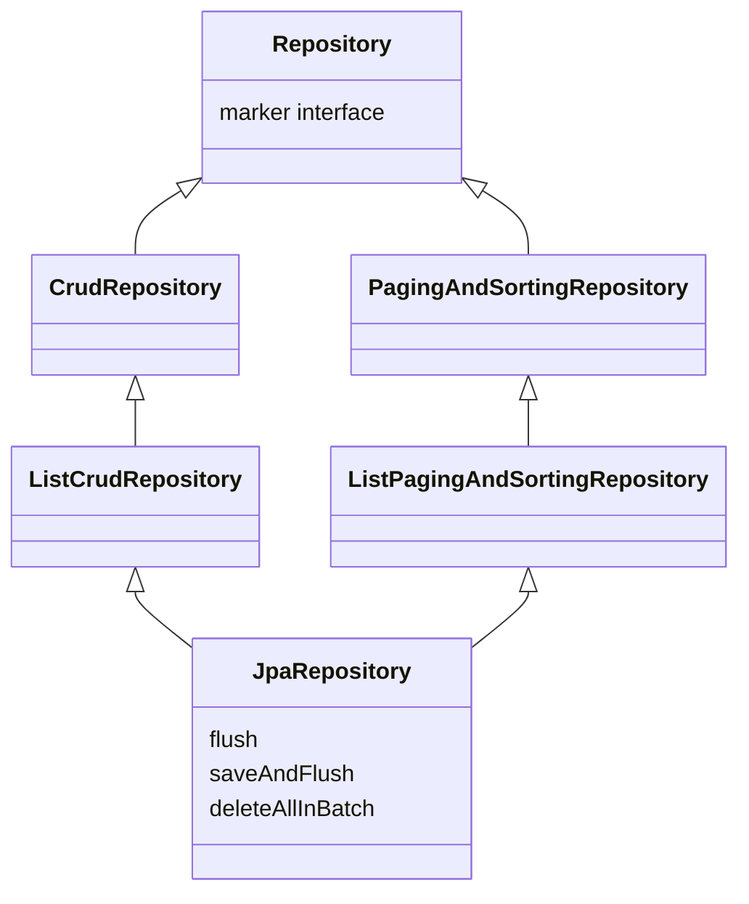
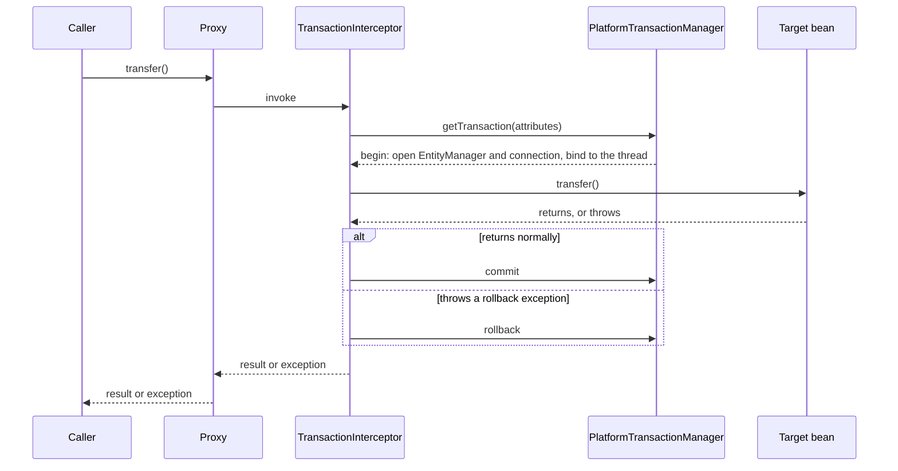
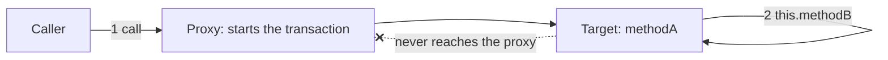

# Spring Data and Transactions

## Why It Matters

`@Transactional` is the most asked Spring topic after dependency injection. Interviewers ask "How does `@Transactional` work?", "What are the propagation types?", "Why does a `@Transactional` method not start a transaction when another method of the same class calls it?", and "Does a checked exception roll back?". On the job, a wrong transaction boundary causes lost updates, half-written data, and connection pool exhaustion. A wrong repository query causes slow pages. This page covers Spring Data repositories (derived queries, `@Query`, paging, projections) and the `@Transactional` mechanism: the proxy, the seven propagation types, isolation, read-only, rollback rules, the self-invocation pitfall, `@Async`, and transaction-bound events. The persistence layer below (JDBC, JPA, Hibernate, the persistence context, N+1) is in [JDBC, JPA, and Hibernate](16-jdbc-jpa-and-hibernate.md). The proxy mechanism in general (JDK against CGLIB, why internal calls skip the proxy) is in [Spring core](17-spring-core.md). The isolation levels and their anomalies have their home in `kb/databases/04-transactions-and-isolation.md`.

!!! info "Versions and what was run"
    Spring Boot 4.1.1 is the current release on spring.io (checked 2026-10-22). It manages Spring Framework 7.0.9, Spring Data 2026.0.1 (Spring Data JPA 4.1.1), and Hibernate ORM 7.4.5.Final. The newest Spring Boot 3.x release is 3.5.16, with Spring Framework 6.2.19 and Spring Data 2025.0.13. Every behavior in this page was run on the first set of versions with H2 2.4.240, in a plain Spring `AnnotationConfigApplicationContext` (no Boot auto-configuration, so the configuration class below is visible). The blocks carry `<!-- fragment -->` because the KB runner has no Spring jars. The `readOnly`, rollback, and proxy rules are the same in Spring Framework 6.x, except where the text says otherwise.

## Core Concepts

**Spring Data repository**: an interface that you declare. At startup, Spring Data creates a proxy that implements it. You write no implementation. The interface extends `Repository` or a sub-interface, and the proxy runs queries that Spring Data derives from method names or from annotations.

**Transaction**: a group of database operations that succeeds or fails as one unit. The details (ACID, isolation) are in the database pages.

**Declarative transaction management**: you mark a method with `@Transactional`, and Spring starts, commits, or rolls back the transaction around the method call. The method body contains no transaction code.

**`PlatformTransactionManager`**: the Spring interface that starts and ends transactions for one kind of resource. `JpaTransactionManager` handles JPA (and plain JDBC on the same `DataSource`). `DataSourceTransactionManager` handles JDBC only. `JtaTransactionManager` handles distributed (XA) transactions. Spring Boot creates `JpaTransactionManager` when it finds JPA.

**Proxy**: an object that stands in front of the real bean and adds behavior around each call. For `@Transactional`, the proxy starts the transaction before the call and ends it after.

**Propagation**: the rule that says what a transactional method does when a transaction already exists (join it, suspend it, or fail).

**Isolation**: the level of protection between concurrent transactions (what one transaction sees of the uncommitted or newly committed work of another).

**Rollback-only**: a mark on the shared transaction that says "this transaction must roll back". When any participant sets the mark, the transaction cannot commit.

**Transaction synchronization**: callbacks that Spring runs at fixed points of the transaction (before commit, after commit, after completion). `@TransactionalEventListener` is built on them.

## How It Works

### Spring Data repositories

#### The interface hierarchy



Spring Data 3.0 split `PagingAndSortingRepository` from `CrudRepository`. The `List*` variants return `List` where the others return `Iterable`. `JpaRepository` extends both `List*` interfaces (confirmed with `javap` on Spring Data JPA 4.1.1). Recommendation: extend `Repository` or `CrudRepository` and expose only the methods that the domain needs, so that the interface does not offer `deleteAll` to every caller.

The `SimpleJpaRepository` class implements the CRUD methods with the `EntityManager`. Its class is annotated `@Transactional(readOnly = true)`, and its write methods (`save`, `delete`) carry a plain `@Transactional` (Spring Data JPA reference, "Transactionality"). Two consequences:

- A repository call outside any service transaction runs in its own short transaction. Two repository calls in a service method without `@Transactional` are two transactions.
- A **declared query method** (derived or `@Query`) gets no transaction configuration by default (same reference). Without an outer transaction, a lazy association of the returned entities cannot load.

#### `save` and the state check

`save(entity)` calls `persist` if the entity is new, and `merge` if not (Spring Data JPA reference, "How `save(...)` Works"). The check is: if the entity has a non-primitive `@Version` property, the entity is new when that property is `null`. Otherwise the entity is new when its id is `null`. An entity with a manually assigned id and no version is never new by this rule, so `save` calls `merge`, and `merge` runs an extra `SELECT` before the `INSERT`. Implement `Persistable` to control the check.

`save` on a managed entity is not needed to write a change: dirty checking writes it at flush (see the JPA page).

#### Derived queries, `@Query`, paging, projections

The next blocks use these entities. `Audit` is used later for the propagation examples. The classes are package-private to keep the example short.

<!-- fragment -->
```java
package tx;

import jakarta.persistence.*;

@Entity
class Account {
    @Id @GeneratedValue(strategy = GenerationType.IDENTITY)
    private Long id;
    private String owner;
    private long balance;

    protected Account() {}
    Account(String owner, long balance) { this.owner = owner; this.balance = balance; }
    Long getId() { return id; }
    String getOwner() { return owner; }
    long getBalance() { return balance; }
    void setBalance(long balance) { this.balance = balance; }
}

@Entity
class Audit {
    @Id @GeneratedValue(strategy = GenerationType.IDENTITY)
    private Long id;
    private String message;

    protected Audit() {}
    Audit(String message) { this.message = message; }
    String getMessage() { return message; }
}
```

<!-- fragment -->
```java
package tx;

import java.util.List;
import org.springframework.data.domain.Page;
import org.springframework.data.domain.Pageable;
import org.springframework.data.domain.Slice;
import org.springframework.data.jpa.repository.JpaRepository;
import org.springframework.data.jpa.repository.Modifying;
import org.springframework.data.jpa.repository.Query;
import org.springframework.data.repository.query.Param;

interface AccountRepository extends JpaRepository<Account, Long> {

    // Derived query: Spring Data parses the method name when the context starts.
    List<Account> findByOwnerStartingWithOrderByBalanceDesc(String prefix);

    // JPQL with a named parameter and a page. Spring Data derives the count query.
    @Query("select a from Account a where a.balance >= :min")
    Page<Account> findRich(@Param("min") long min, Pageable pageable);

    // Slice: no count query. Spring Data loads size + 1 rows to find out if a next slice exists.
    Slice<Account> findByOwnerContaining(String part, Pageable pageable);

    // Interface projection: Spring Data loads only the owner column.
    interface OwnerOnly { String getOwner(); }
    List<OwnerOnly> findByBalanceGreaterThan(long min);

    // Class-based projection (a record): the constructor parameters name the columns.
    record Summary(String owner, long balance) {}
    List<Summary> findSummaryByOwner(String owner);

    // Dynamic projection: the caller chooses the type.
    <T> List<T> findByOwner(String owner, Class<T> type);

    // Bulk update. The persistence context does not see it, so clear it afterwards.
    @Modifying(flushAutomatically = true, clearAutomatically = true)
    @Query("update Account a set a.balance = a.balance + :delta where a.id = :id")
    int adjust(@Param("id") Long id, @Param("delta") long delta);
}

interface AuditRepository extends JpaRepository<Audit, Long> {}
```

**Derived queries.** Spring Data parses the method name when the application starts (the class `PartTree`). `findBy` starts a query. The words after it name properties and keywords. A name that Spring Data cannot map to a property fails at startup, so a typo breaks the start, not a request. Main keywords (Spring Data JPA reference, "Query Methods"):

| Keyword | Example | Effect |
|---|---|---|
| `And`, `Or` | `findByOwnerAndBalance` | `where owner = ? and balance = ?` |
| `Between`, `LessThan`, `GreaterThan` | `findByBalanceGreaterThan` | comparison |
| `IsNull`, `IsNotNull` | `findByOwnerIsNull` | null test |
| `Like`, `StartingWith`, `EndingWith`, `Containing` | `findByOwnerContaining` | `like`. For `Like`, the caller writes the `%` wildcards in the argument. `StartingWith`, `EndingWith`, and `Containing` add the `%` to the argument |
| `In`, `NotIn` | `findByIdIn(Collection<Long>)` | `in (...)` |
| `OrderBy...Asc/Desc` | `findByOwnerOrderByBalanceDesc` | sort |
| `IgnoreCase` | `findByOwnerIgnoreCase` | case-insensitive match |
| `Distinct` | `findDistinctByOwner` | `select distinct` |
| `First`, `Top` | `findFirst3ByOrderByBalanceDesc` | limit |
| `countBy`, `existsBy`, `deleteBy` | `existsByOwner` | other query kinds |

Derived queries stay readable for two or three conditions. A name such as `findByOwnerAndBalanceGreaterThanAndCreatedAtBetweenOrderByIdDesc` is a sign to switch to `@Query`.

**`@Query`.** The annotation holds JPQL (or SQL with `nativeQuery = true`, or `@NativeQuery`). Use `@Param` for named parameters. Always bind parameters: do not concatenate input into the query string (SQL injection, see the JPA page). Spring Data validates a JPQL string when it creates the repository, so a syntax error fails at startup. A native query that returns a `Page` needs a `countQuery` unless Spring Data can rewrite it (reference).

**Paging.**

| Return type | What it carries | Queries run |
|---|---|---|
| `List<T>` with a `Pageable` | The content only | One |
| `Slice<T>` | Content and `hasNext()` | One. Spring Data asks for one row more than the page size to find out if a next slice exists |
| `Page<T>` | Content, `getTotalElements()`, `getTotalPages()` | The content query, plus a `count` query |

Observed: with 3 accounts, `findRich(10, PageRequest.of(0, 2, ...))` returned 2 rows with `total=3` and `pages=2`. `findByOwnerContaining("a", PageRequest.of(0, 1))` returned a `Slice` with 1 row and `hasNext=true`. Use `Slice` for "load more" lists, where the total is not needed. The `count` query on a large table can cost more than the page query.

Offset paging (`PageRequest.of(page, size)`) makes the database skip `page * size` rows, so deep pages get slow. For large tables, use **keyset scrolling**: the next query starts after the sort key of the last row that the previous query returned, so the database seeks with an index instead of skipping rows. Spring Data has a scroll API since version 3.1 (the `Window` javadoc says "Since: 3.1"). A query method takes a `ScrollPosition` and returns a `Window<T>`. `ScrollPosition.keyset()` starts a keyset scroll, `ScrollPosition.offset()` starts an offset scroll, and `window.positionAt(i)` gives the position after element `i`. The method needs a stable sort on a unique key, and a limit (`First` or `Top`) that sets the window size. The query theory is in `kb/databases/05-query-execution-and-tuning.md`.

<!-- fragment -->
```java
package tx;

import java.util.ArrayList;
import java.util.List;
import org.springframework.data.domain.ScrollPosition;
import org.springframework.data.domain.Window;
import org.springframework.data.jpa.repository.JpaRepository;

interface AccountScrollRepository extends JpaRepository<Account, Long> {
    // Keyset scrolling: two rows for each window, sorted by the unique id.
    Window<Account> findFirst2ByOrderByIdAsc(ScrollPosition position);
}

class AccountScroller {
    static List<String> allOwners(AccountScrollRepository repo) {
        List<String> owners = new ArrayList<>();
        Window<Account> window = repo.findFirst2ByOrderByIdAsc(ScrollPosition.keyset());
        while (true) {
            window.forEach(a -> owners.add(a.getOwner()));
            if (!window.hasNext()) {
                return owners;
            }
            // The next query starts after the id of the last row of this window.
            window = repo.findFirst2ByOrderByIdAsc(window.positionAt(window.size() - 1));
        }
    }
}
```

Observed: with 3 accounts, the loop ran 2 windows and returned all 3 owners in id order.

Always give a stable sort for paging, such as the primary key as a tie-breaker. Without it, rows can repeat or vanish between pages.

**Projections.** A projection returns a part of the entity.

| Kind | Declared as | What happens |
|---|---|---|
| Interface (closed) | `interface OwnerOnly { String getOwner(); }` | Spring Data selects only the declared properties |
| Interface (open) | A method with `@Value("#{...}")` | Spring Data must load the whole entity |
| Class or record (DTO) | `record Summary(String owner, long balance)` | The constructor parameter names select the columns |
| Dynamic | `<T> List<T> findByOwner(String o, Class<T> type)` | The caller picks the type |

Observed: all four kinds returned the expected rows (`[alex, alice]` for the interface projection, `Summary[owner=bob, balance=10]` for the record and the dynamic form, and `Account` objects for the entity type). A projection avoids dirty checking and avoids loading unused columns and associations. It is the first tool against the N+1 problem for read-only screens.

**Bulk updates.** `@Modifying` marks an `@Query` as `update` or `delete`. A bulk statement goes straight to the database. It does not update the instances in the persistence context. I observed this: after a bulk `update`, an entity that was already loaded still showed the old name, and a repeated `findAll` returned the old value too, because the context kept its instance. With `@Modifying(clearAutomatically = true)`, Spring Data clears the context after the statement, and the next `find` reads the new row. `flushAutomatically = true` flushes pending changes first, so that they are not lost by the clear.

**Fetching.** An `@EntityGraph(attributePaths = "items")` on a repository method gives the method a fetch plan. In my run, it loaded 5 shops with their 10 items in 1 statement, the same as a `join fetch`. The N+1 problem, `JOIN FETCH`, and the pagination limits of fetch joins are in the JPA page.

**Exception translation.** Spring Data repositories translate persistence exceptions into the `DataAccessException` hierarchy (for example `DataIntegrityViolationException`, `ObjectOptimisticLockingFailureException`). See [exceptions](03-exceptions.md) for why Spring uses unchecked exceptions.

**Repository pattern.** A Spring Data repository is a repository in the sense of the LLD page on [architectural patterns](../lld/fundamentals/10-architectural-patterns.md): an interface that looks like a collection of aggregates and hides the storage. A `@Transactional` service method is the use-case boundary that the same page calls the unit of work: the persistence context collects the changes, and the commit writes them together.

### How `@Transactional` works

#### The proxy

`@EnableTransactionManagement` (Spring Boot enables it through auto-configuration) registers an advisor and a `TransactionInterceptor`. A bean post-processor then checks each bean after its creation. If any method of the bean has `@Transactional`, the post-processor replaces the bean in the context with a proxy. The proxy is a JDK dynamic proxy if the bean implements an interface and the proxy mode is not forced to classes. Otherwise it is a CGLIB subclass. Spring Boot creates class-based proxies by default (property `spring.aop.proxy-target-class`, default `true`). Observed in my plain-Spring run: the service bean was a CGLIB subclass (`...$$SpringCGLIB$$1`), and the repository bean was a JDK proxy.

The caller holds a reference to the proxy. Each call goes through it:



Steps in `TransactionInterceptor` (class `TransactionAspectSupport`, Spring Framework source):

1. Read the transaction attributes of the method (`@Transactional` on the method, else on the class).
2. Find the `PlatformTransactionManager`.
3. Call `getTransaction`. The manager decides by the propagation rule whether to create a transaction, join one, or suspend one. For a new transaction, `JpaTransactionManager` creates an `EntityManager`, starts the resource-local transaction (which takes a connection from the pool), and **binds the resources to the current thread** in `TransactionSynchronizationManager` (thread-local storage).
4. Call the target method.
5. If the method returns, commit. If it throws, apply the rollback rules and roll back or commit.

Because the resources are bound to the thread, every repository and every `EntityManager` call on the same thread finds the same transaction. This is also why a transaction does not follow a call into another thread.

**Rules that follow from the proxy:**

- Only calls that arrive through the proxy start a transaction (Spring Framework reference, "Using `@Transactional`").
- The target bean must be proxyable. A CGLIB proxy cannot override a `final` method, so such a method skips the advice. A `final` class cannot be subclassed.
- With an interface-based (JDK) proxy, the method must be public and declared in the interface. With a class-based proxy, `protected` and package-visible methods are transactional too since Spring Framework 6.0. A `private` method is never intercepted (a subclass cannot override it, and the proxy cannot call it).
- The Spring team recommends annotating methods of concrete classes, not of interfaces.

#### Configuration

The configuration class that I used. In a Spring Boot application, none of this code is needed: Boot configures the `DataSource` (HikariCP), the `EntityManagerFactory`, and `JpaTransactionManager`.

<!-- fragment -->
```java
package tx;

import jakarta.persistence.EntityManagerFactory;
import java.util.Properties;
import javax.sql.DataSource;
import org.springframework.context.annotation.Bean;
import org.springframework.context.annotation.ComponentScan;
import org.springframework.context.annotation.Configuration;
import org.springframework.data.jpa.repository.config.EnableJpaRepositories;
import org.springframework.jdbc.datasource.DriverManagerDataSource;
import org.springframework.orm.jpa.JpaTransactionManager;
import org.springframework.orm.jpa.LocalContainerEntityManagerFactoryBean;
import org.springframework.orm.jpa.vendor.HibernateJpaVendorAdapter;
import org.springframework.scheduling.annotation.EnableAsync;
import org.springframework.transaction.PlatformTransactionManager;
import org.springframework.transaction.annotation.EnableTransactionManagement;
import org.springframework.transaction.support.TransactionTemplate;

// Without Spring Boot you declare what Boot configures for you.
@Configuration
@EnableTransactionManagement      // registers the advisor that creates the transaction proxies
@EnableAsync
@EnableJpaRepositories(basePackages = "tx")
@ComponentScan("tx")
class Config {
    @Bean
    DataSource dataSource() {
        return new DriverManagerDataSource("jdbc:h2:mem:tx;DB_CLOSE_DELAY=-1", "sa", "");
    }

    @Bean
    LocalContainerEntityManagerFactoryBean entityManagerFactory(DataSource ds) {
        var f = new LocalContainerEntityManagerFactoryBean();
        f.setDataSource(ds);
        f.setPackagesToScan("tx");
        f.setJpaVendorAdapter(new HibernateJpaVendorAdapter());
        Properties p = new Properties();
        p.put("hibernate.hbm2ddl.auto", "create");
        f.setJpaProperties(p);
        return f;
    }

    @Bean
    PlatformTransactionManager transactionManager(EntityManagerFactory emf) {
        return new JpaTransactionManager(emf);     // handles JPA and JDBC on one DataSource
    }

    @Bean
    TransactionTemplate transactionTemplate(PlatformTransactionManager tm) {
        return new TransactionTemplate(tm);
    }
}
```

### Propagation: the seven types

**Propagation** answers the question: "A transactional method is called. Does a transaction already exist?" The enum is `org.springframework.transaction.annotation.Propagation`.

| Type | If a transaction exists | If none exists | Typical use |
|---|---|---|---|
| `REQUIRED` (default) | Join it | Create one | The normal case |
| `REQUIRES_NEW` | Suspend it, create a new independent one, resume the old one afterwards | Create one | Work that must commit or roll back on its own (an audit record, a counter) |
| `SUPPORTS` | Join it | Run without a transaction | A read method that can work either way |
| `NOT_SUPPORTED` | Suspend it, run without a transaction | Run without a transaction | A long non-database operation that must not hold the transaction |
| `MANDATORY` | Join it | Throw `IllegalTransactionStateException` | A method that is only valid inside a transaction |
| `NEVER` | Throw `IllegalTransactionStateException` | Run without a transaction | A method that must not run inside a transaction |
| `NESTED` | Create a savepoint inside the existing transaction | Create one (like `REQUIRED`) | A part of the work that may fail and be skipped, while the rest commits |

<!-- fragment -->
```java
package tx;

import org.springframework.stereotype.Service;
import org.springframework.transaction.annotation.Propagation;
import org.springframework.transaction.annotation.Transactional;
import org.springframework.transaction.support.TransactionSynchronizationManager;

@Service
class AuditService {
    private final AuditRepository audits;
    private final AccountRepository accounts;

    AuditService(AuditRepository audits, AccountRepository accounts) {
        this.audits = audits;
        this.accounts = accounts;
    }

    @Transactional(propagation = Propagation.REQUIRES_NEW)
    void writeRequiresNew(String message) { audits.save(new Audit(message)); }

    @Transactional                                         // REQUIRED, the default
    void failRequired() {
        audits.save(new Audit("required-inner"));
        throw new IllegalStateException("inner fails");
    }

    @Transactional(propagation = Propagation.NESTED)       // a savepoint in the outer transaction
    void failNested() {
        accounts.save(new Account("nestedInner", 1));
        throw new IllegalStateException("nested fails");
    }

    @Transactional(propagation = Propagation.MANDATORY)    // throws if no transaction is active
    void mandatory() {}

    @Transactional(propagation = Propagation.NEVER)        // throws if a transaction is active
    void never() {}

    @Transactional(propagation = Propagation.SUPPORTS)     // joins if one exists, else runs without
    boolean supports() { return TransactionSynchronizationManager.isActualTransactionActive(); }

    @Transactional(propagation = Propagation.NOT_SUPPORTED) // suspends an active transaction
    boolean notSupported() { return TransactionSynchronizationManager.isActualTransactionActive(); }
}
```

<!-- fragment -->
```java
package tx;

import org.springframework.stereotype.Service;
import org.springframework.transaction.annotation.Transactional;

@Service
class OrderFlowService {
    private final AccountRepository accounts;
    private final AuditService auditService;

    OrderFlowService(AccountRepository accounts, AuditService auditService) {
        this.accounts = accounts;
        this.auditService = auditService;
    }

    // The audit row commits in its own transaction, so it survives the rollback of the outer one.
    @Transactional
    void outerWithAudit() {
        accounts.save(new Account("outer", 1));
        auditService.writeRequiresNew("attempt");
        throw new IllegalStateException("outer fails");
    }

    // The inner REQUIRED call marks the shared transaction as rollback-only.
    // Catching the exception here does not remove the mark.
    @Transactional
    void outerCatchesInner() {
        accounts.save(new Account("rollbackOnly", 1));
        try {
            auditService.failRequired();
        } catch (RuntimeException e) {
            // swallowed
        }
    }

    // NESTED: only the savepoint rolls back, and the outer transaction commits.
    @Transactional
    void outerNested() {
        accounts.save(new Account("nestedOuter", 1));
        try {
            auditService.failNested();
        } catch (RuntimeException e) {
            // swallowed
        }
    }
}
```

Observed results of these classes (Spring 7.0.9, Hibernate 7.4.5, H2):

```text
outer: outer fails
outer row=false audit rows added=1
UnexpectedRollbackException: Transaction silently rolled back because
  it has been marked as rollback-only (line wrapped here)
rollbackOnly row=false
nestedOuter=true nestedInner=false
MANDATORY without tx: IllegalTransactionStateException
SUPPORTS without tx active=false
NOT_SUPPORTED active=false
```

Read the results:

- **`REQUIRES_NEW`**: the outer method saved an account, called `writeRequiresNew`, and then threw. The account row is gone (rolled back), and the audit row is still there (it committed in its own transaction). Use `REQUIRES_NEW` for a record that must survive a failure of the caller, for example a failed-attempt log.
- **`REQUIRED` and rollback-only**: the inner method joined the outer transaction and threw. The interceptor of the inner call marked the shared transaction as rollback-only. The outer method caught the exception and returned normally, but the commit failed with `UnexpectedRollbackException`, and nothing was saved. A swallowed exception does not cancel the rollback mark. If the inner work may fail without ruining the outer work, use `NESTED` or `REQUIRES_NEW`, or do not call it inside the transaction.
- **`MANDATORY`, `NEVER`, `SUPPORTS`, `NOT_SUPPORTED`**: the run above called them without an outer transaction. A second run called them from inside an outer `@Transactional` method. `never()` threw `IllegalTransactionStateException` with the message "Existing transaction found for transaction marked with propagation 'never'". `never()` without an outer transaction ran normally. `supports()` saw an active transaction (`true`), and `notSupported()` did not (`false`), because Spring suspended the outer transaction for the call.
- **`NESTED`**: the inner method failed, and Spring rolled back to the savepoint. The outer account was saved (`nestedOuter=true`), and the inner account was not (`nestedInner=false`). `JpaTransactionManager` with Hibernate supports this through JDBC savepoints on the transaction's connection. `NESTED` needs savepoint support or a transaction manager that supports nesting. `JtaTransactionManager` does not use savepoints: it asks the JTA provider to begin a nested transaction, and most JTA providers do not support that. Spring then throws `NestedTransactionNotSupportedException` ("JTA implementation does not support nested transactions", from the Spring 7.0.9 source).

When to use `REQUIRES_NEW`, and the risks:

- **A second connection.** The outer transaction stays open and keeps its connection while the inner transaction takes another one. A pool of 10 connections with 10 threads that each run an outer transaction and then call a `REQUIRES_NEW` method can reach a state in which each thread holds one connection and waits for a second. No thread can proceed until `connectionTimeout` expires. Keep the pool larger than the number of concurrent threads times the nesting depth, or avoid the pattern in hot paths. This follows from how the pool and the suspension work.
- **Lock conflicts with the outer transaction.** The inner transaction is independent. If it needs a row lock that the suspended outer transaction holds, it waits for a lock that only the outer transaction can release, and the outer transaction waits for the inner call. This is a deadlock until the lock timeout.
- **No shared view.** The inner transaction cannot see the uncommitted changes of the outer transaction.
- Do not use it to "make a failing call safe". Think first about what must commit independently.

### Isolation

`@Transactional(isolation = ...)` takes `Isolation.DEFAULT` (the database default), `READ_UNCOMMITTED`, `READ_COMMITTED`, `REPEATABLE_READ`, or `SERIALIZABLE`. These map to the JDBC constants of `java.sql.Connection`. The SQL standard defines each level by the read anomalies that it prevents: `READ_COMMITTED` prevents dirty reads, `REPEATABLE_READ` also prevents non-repeatable reads, and `SERIALIZABLE` also prevents phantom reads.

Real databases differ from the standard. The default level and the exact guarantees depend on the product. PostgreSQL documentation: "Read Committed is the default isolation level in PostgreSQL". Oracle Database Concepts: "Oracle AI Database offers the read committed (default) and serializable isolation levels". MySQL reference manual: "The default isolation level for InnoDB is REPEATABLE READ". `Isolation.DEFAULT` keeps the level of the connection, which is this database default unless the pool or the driver changes it. The details, the anomalies, and the vendor differences are in `kb/databases/04-transactions-and-isolation.md`. Spring-specific rules:

- Spring applies `isolation` and `timeout` only when the call **starts a new transaction** (`REQUIRED` with no outer transaction, or `REQUIRES_NEW`). A method that joins an existing transaction cannot change its isolation.
- With `JpaTransactionManager`, a non-default isolation needs a `JpaDialect` that can reach the JDBC connection, because standard JPA has no API for isolation. `HibernateJpaDialect` (which `HibernateJpaVendorAdapter` and Spring Boot configure) sets the level on the connection when the transaction begins and resets it at the end. Observed: inside an `@Transactional(isolation = Isolation.SERIALIZABLE)` method, `Connection.getTransactionIsolation()` returned 8 (`TRANSACTION_SERIALIZABLE`). A `JpaTransactionManager` with the plain `DefaultJpaDialect` threw `InvalidIsolationLevelException` ("DefaultJpaDialect does not support custom isolation levels due to limitations in standard JPA").
- A higher level reduces anomalies and raises the chance of lock waits or serialization failures. Code that uses `SERIALIZABLE` must be ready to retry.

### `readOnly`

`@Transactional(readOnly = true)` marks the transaction as read-only. The `TransactionDefinition.isReadOnly` javadoc says that the flag applies to a real resource transaction (`REQUIRED`, `REQUIRES_NEW`) and also to `SUPPORTS` without a transaction, where it affects only managed resources such as the Hibernate `Session`. The flag takes effect when the call starts the transaction. A `readOnly = true` method that joins an existing read-write transaction does not make that transaction read-only. The javadoc calls the flag a hint: a transaction manager that cannot interpret it ignores it. What it does depends on the transaction manager:

- With Hibernate, Spring sets the flush mode to `MANUAL`, so Hibernate skips dirty checking and does not write changes (Spring Data JPA reference, "Transactionality"). If the transaction created its own `EntityManager`, `HibernateJpaDialect` also marks the `Session` as default read-only (Spring 7.0.9 source). Hibernate then loads entities in read-only mode, which skips them in dirty checking and reduces memory use (Hibernate user guide). Under open session in view, the `EntityManager` exists before the transaction, so Spring sets only the flush mode.
- Spring calls `Connection.setReadOnly(true)` on the JDBC connection. The driver can pass it to the database as a hint. Some databases reject writes in a read-only transaction. It is not a security check.

<!-- fragment -->
```java
package tx;

import java.util.concurrent.CompletableFuture;
import org.springframework.scheduling.annotation.Async;
import org.springframework.stereotype.Service;
import org.springframework.transaction.annotation.Isolation;
import org.springframework.transaction.annotation.Transactional;
import org.springframework.transaction.support.TransactionSynchronizationManager;

@Service
class ReadOnlyService {
    private final AccountRepository accounts;

    ReadOnlyService(AccountRepository accounts) { this.accounts = accounts; }

    @Transactional(readOnly = true)
    void changeInReadOnly(Long id) {
        accounts.findById(id).orElseThrow().setBalance(999);   // Hibernate does not flush this
    }

    @Transactional
    void changeInReadWrite(Long id) {
        accounts.findById(id).orElseThrow().setBalance(777);   // dirty checking writes this
    }

    // Isolation and timeout apply only when this call starts a new transaction.
    @Transactional(isolation = Isolation.SERIALIZABLE, timeout = 5)
    void strictWork() {}
}

@Service
class AsyncWorker {
    @Async
    CompletableFuture<Boolean> hasTransaction() {
        return CompletableFuture.completedFuture(
            TransactionSynchronizationManager.isActualTransactionActive());
    }
}

@Service
class AsyncCaller {
    private final AsyncWorker worker;

    AsyncCaller(AsyncWorker worker) { this.worker = worker; }

    @Transactional
    String call() throws Exception {
        boolean mine = TransactionSynchronizationManager.isActualTransactionActive();
        boolean theirs = worker.hasTransaction().get();
        return "caller tx=" + mine + ", async tx=" + theirs;
    }
}
```

Observed: `changeInReadOnly` set the balance to 999 and `readOnly change persisted=false`. `changeInReadWrite` set 777 and `readWrite change persisted=true`. Use `readOnly = true` on query-only service methods: it saves the dirty-check work for every loaded entity, and it documents the intent. Entities that you load in a read-only transaction and then modify are silently not saved. This surprises developers who use `readOnly = true` at class level and forget to override it on a write method.

### Rollback rules

**By default, a transaction rolls back for `RuntimeException` and `Error`, and commits for checked exceptions** (Spring Framework reference). This differs from what many developers expect. The reason is EJB heritage: a checked exception was treated as a business condition that the caller handles, so the work stays valid.

<!-- fragment -->
```java
package tx;

import java.io.IOException;
import org.springframework.stereotype.Service;
import org.springframework.transaction.annotation.Transactional;

@Service
class RollbackService {
    private final AccountRepository accounts;

    RollbackService(AccountRepository accounts) { this.accounts = accounts; }

    @Transactional
    void failUnchecked() {
        accounts.save(new Account("unchecked", 1));
        throw new IllegalStateException("boom");          // rollback: unchecked
    }

    @Transactional
    void failChecked() throws IOException {
        accounts.save(new Account("checked", 1));
        throw new IOException("boom");                    // commit: checked exception
    }

    @Transactional(rollbackFor = IOException.class)
    void failCheckedWithRule() throws IOException {
        accounts.save(new Account("checkedRule", 1));
        throw new IOException("boom");                    // rollback: the rule names it
    }
}
```

Observed:

```text
threw IllegalStateException
threw IOException
threw IOException
saved: unchecked=false checked=true checkedRule=false
```

The unchecked exception rolled back. The checked `IOException` committed the row (`checked=true`). The `rollbackFor = IOException.class` rule rolled it back.

Rules:

- `rollbackFor` and `noRollbackFor` (and the `...ForClassName` variants) override the default for the named exceptions. Rules that you give keep the default for all other exceptions.
- Since Spring Framework 6.2, `@EnableTransactionManagement(rollbackOn = RollbackOn.ALL_EXCEPTIONS)` changes the default for the whole application. The Spring reference recommends this switch for consistent behavior, unless you rely on the commit-on-checked-exception style. Before 6.2, put `rollbackFor = Exception.class` on each annotation.
- The exception must leave the transactional method and pass through the proxy. A `catch` inside the method that swallows the exception means no rollback (except for the rollback-only mark described above).
- If a participant marked the shared transaction rollback-only and the outermost method returns normally, the commit rolls back and the caller sees `UnexpectedRollbackException`, not the original exception.

### Self-invocation and visibility

**Self-invocation**: a method of a bean calls another method of the same bean with `this`. The call goes straight to the target object and not through the proxy. The advice does not run, so `@Transactional` on the called method has no effect (Spring Framework reference: "self-invocation ... does not lead to an actual transaction at runtime even if the invoked method is marked with `@Transactional`").



<!-- fragment -->
```java
package tx;

import org.springframework.beans.factory.annotation.Autowired;
import org.springframework.context.annotation.Lazy;
import org.springframework.stereotype.Service;
import org.springframework.transaction.annotation.Propagation;
import org.springframework.transaction.annotation.Transactional;
import org.springframework.transaction.support.TransactionSynchronizationManager;
import org.springframework.transaction.support.TransactionTemplate;

@Service
class SelfInvocationService {
    private final TransactionTemplate template;
    private final AuditService auditService;
    @Autowired @Lazy
    private SelfInvocationService self;                    // fix 3: inject the proxy of this bean

    SelfInvocationService(TransactionTemplate template, AuditService auditService) {
        this.template = template;
        this.auditService = auditService;
    }

    // Wrong: this.inner() is a plain call on the target object. The proxy never sees it.
    boolean wrong() { return inner(); }

    @Transactional(propagation = Propagation.REQUIRES_NEW)
    boolean inner() { return TransactionSynchronizationManager.isActualTransactionActive(); }

    // Fix 1: move the method to another bean. The call goes through that bean's proxy.
    void fixSeparateBean() { auditService.writeRequiresNew("separate bean"); }

    // Fix 2: make the transaction explicit with a TransactionTemplate. No proxy is involved.
    boolean fixTemplate() {
        return Boolean.TRUE.equals(template.execute(status ->
            TransactionSynchronizationManager.isActualTransactionActive()));
    }

    // Fix 3: call through the injected proxy.
    boolean fixSelfInjection() { return self.inner(); }

    // A package-private method is transactional with a class-based proxy (Spring 6 and later).
    @Transactional(propagation = Propagation.REQUIRES_NEW)
    boolean packagePrivate() {
        return TransactionSynchronizationManager.isActualTransactionActive();
    }

    // A private method is never intercepted.
    boolean callPrivate() { return privateTx(); }

    @Transactional
    private boolean privateTx() {
        return TransactionSynchronizationManager.isActualTransactionActive();
    }
}
```

Observed:

```text
wrong self call active=false
fixTemplate active=true
fixSelfInjection active=true
packagePrivate active=true
private active=false
```

`wrong()` called `inner()`, which has `REQUIRES_NEW`, and no transaction was active. The fixes, from most to least recommended:

| Fix | How | Notes |
|---|---|---|
| Move the method to another bean | The caller injects the second bean and calls it | Clear. Matches the layering. Use this by default |
| `TransactionTemplate` | `template.execute(status -> ...)` | Explicit boundary. No proxy. Good for a small block inside a longer method |
| Inject the proxy of the bean itself | `@Autowired @Lazy` field of the own type, call `self.inner()` | Works. Looks odd, and hides a design problem |
| `AopContext.currentProxy()` | Set `@EnableAspectJAutoProxy(exposeProxy = true)`, call `((Service) AopContext.currentProxy()).inner()` | Couples the code to Spring AOP |
| AspectJ mode | `@EnableTransactionManagement(mode = AdviceMode.ASPECTJ)` with weaving | No proxy, so self-invocation works. Needs a weaver at compile or load time |

Visibility rules, observed: a `private` method with `@Transactional` ran without a transaction. A package-private method that is called from outside through the class-based proxy ran in a transaction (Spring 6.0 and later; the reference says that "as of 6.0, `protected` or package-visible methods can also be made transactional for class-based proxies by default"). On Spring Framework 5.x, a non-public method was ignored. To restore the old rule, create `AnnotationTransactionAttributeSource(true)`.

Also: do not rely on `@Transactional` in a `@PostConstruct` method. The proxy is not ready yet (Spring Framework reference).

### `@Transactional` and `@Async`

The transaction is bound to the thread. A method with `@Async` runs on another thread (from a `TaskExecutor`). That thread has no transaction, and it cannot see the uncommitted changes of the caller's transaction.

Observed with the `AsyncCaller` and `AsyncWorker` classes above: `caller tx=true, async tx=false`. Consequences:

- An `@Async` method that needs a transaction needs its own `@Transactional`. It starts a new transaction on its own thread, with `@Async` as the outer advice.
- If the caller's transaction later rolls back, the asynchronous work is not undone.
- If the async method reads data that the caller has just saved, but not yet committed, it cannot find it. The caller must start the async work after the commit, for example from a `@TransactionalEventListener` (next section).
- The same limit applies to `CompletableFuture.supplyAsync`, parallel streams, and virtual threads: the thread-bound transaction does not cross threads.

### Transaction synchronization and `@TransactionalEventListener`

By default, Spring delivers a published event right away, to every `@EventListener`, on the publisher's thread, inside the transaction (the default event multicaster is synchronous). A `@TransactionalEventListener` is different: Spring holds the event and calls the listener at a **phase** of the transaction.

| Phase | When the listener runs |
|---|---|
| `BEFORE_COMMIT` | Before the commit. An exception here rolls the transaction back |
| `AFTER_COMMIT` (default) | After a successful commit |
| `AFTER_ROLLBACK` | After a rollback |
| `AFTER_COMPLETION` | After either |

If no transaction is active when the event is published, Spring discards the event, unless `fallbackExecution = true` (Spring Framework reference, "Transaction-bound events").

<!-- fragment -->
```java
package tx;

import java.util.ArrayList;
import java.util.List;
import org.springframework.context.ApplicationEventPublisher;
import org.springframework.context.event.EventListener;
import org.springframework.stereotype.Component;
import org.springframework.transaction.annotation.Propagation;
import org.springframework.transaction.annotation.Transactional;
import org.springframework.transaction.event.TransactionPhase;
import org.springframework.transaction.event.TransactionalEventListener;

record AccountOpened(String owner) {}

@Component
class OpenAccountService {
    private final List<String> log = new ArrayList<>();
    private final ApplicationEventPublisher publisher;

    OpenAccountService(ApplicationEventPublisher publisher) { this.publisher = publisher; }

    List<String> log() { return log; }

    @Transactional
    void open(String owner, boolean fail) {
        log.add("publish");
        publisher.publishEvent(new AccountOpened(owner));
        if (fail) throw new IllegalStateException("fail");
    }

    @EventListener                                          // runs at once, inside the transaction
    void plain(AccountOpened e) { log.add("plain"); }

    @TransactionalEventListener(phase = TransactionPhase.BEFORE_COMMIT)
    void beforeCommit(AccountOpened e) { log.add("before-commit"); }

    @TransactionalEventListener                             // AFTER_COMMIT is the default phase
    void afterCommit(AccountOpened e) { log.add("after-commit"); }
}

@Component
class WelcomeMailer {
    private final AuditRepository audits;

    WelcomeMailer(AuditRepository audits) { this.audits = audits; }

    // A write in AFTER_COMMIT needs its own transaction. Spring accepts only REQUIRES_NEW
    // or NOT_SUPPORTED on a transactional listener method.
    @TransactionalEventListener
    @Transactional(propagation = Propagation.REQUIRES_NEW)
    void onOpened(AccountOpened e) { audits.save(new Audit("welcome " + e.owner())); }
}
```

Observed:

```text
commit: [publish, plain, before-commit, after-commit] audit rows added=1
rollback: [publish, plain]
```

On commit, the plain listener ran at once, then the transactional listeners ran at their phases. On rollback, the `BEFORE_COMMIT` and `AFTER_COMMIT` listeners did not run at all. This makes `AFTER_COMMIT` the right place for side effects that must happen only if the data is saved: sending an email, publishing a message, starting an `@Async` job.

**The `AFTER_COMMIT` trap.** The javadoc of `@TransactionalEventListener` warns: the transaction has already committed, but the transactional resources can still be active, so data access code at this point still "participates" in the original transaction, but its changes are not committed. A repository `save` in an `AFTER_COMMIT` listener can therefore silently lose data. In my first run, such a `save` added 0 audit rows. With `@Transactional(propagation = Propagation.REQUIRES_NEW)` on the listener method, as in `WelcomeMailer`, the write committed (1 audit row). Since Spring Framework 6.1, Spring accepts `@Transactional` on a transactional listener method only if the propagation is `REQUIRES_NEW` or `NOT_SUPPORTED` (class `RestrictedTransactionalEventListenerFactory`). Other propagation values make the context fail at startup.

For a guarantee that a message is sent exactly when the data is saved (the "dual write" problem: the commit succeeds and the send fails, or the reverse), an after-commit listener is not enough, because the process can crash between the two steps. The **transactional outbox** covers that case: the transaction writes the business change and an event row together, and a relay publishes the event rows afterwards, at least once (see the HLD page on [event-driven architecture](../hld/fundamentals/16-event-driven-architecture.md)).

### Transactions, locks, and connection use

A transaction holds a pooled connection and database locks until it ends. Rules that follow:

- Keep the transaction short. Do reads and remote calls (HTTP, message broker) before the transaction starts or after it ends.
- Do not put `@Transactional` on a controller method that renders a large response, and do not start a transaction in an HTTP filter. (Open session in view has a similar effect: see the JPA page.)
- Put `@Transactional` on the **service** method that implements the use case, not on the repository or the controller. This is the "service layer with the transaction boundary" of the LLD page.
- Do not catch a persistence exception inside the transaction and continue. After a database error, the transaction is usually unusable, and Hibernate marks it rollback-only.

## Trade-offs and When to Use

| Choice | Strengths | Weaknesses | Use when |
|---|---|---|---|
| Derived query | No query text. Checked at startup | Long names, limited expressions | Up to two or three simple conditions |
| `@Query` JPQL | Explicit and readable. Checked at startup | Tied to entity names | Joins, fetch joins, aggregates |
| `@Query` native | Full SQL | Not portable. Mapping work | A feature that JPQL lacks (window functions, `LATERAL`) |
| Interface or record projection | Reads only needed columns. No dirty checking | Not managed | Read-only lists and reports |
| `Page` | Total count for page navigation | An extra `count` query | A UI with page numbers |
| `Slice` or keyset scrolling | No count. Stable cost for deep pages (keyset) | No total | Infinite scroll, large tables |
| Declarative `@Transactional` | Short code. One place for the rule | Proxy rules (self-invocation, visibility) | The default |
| `TransactionTemplate` | Explicit boundary. No proxy rules | More code | A transaction around a block, or where the proxy rules get in the way |
| `REQUIRES_NEW` | Independent commit | Second connection. Lock and pool risks | An audit or counter that must survive a rollback |
| `NESTED` | Partial rollback with one connection | Needs savepoint support (JDBC) | An optional step that may fail |
| After-commit listener | Side effects only if the data is saved | Loses the event if the process crashes. Needs `REQUIRES_NEW` for writes | Notifications, cache eviction. Use the outbox for guaranteed delivery |

## Java Example

The code blocks above form one runnable set. The driver below creates the context, calls each service, and prints the results that this page reports. It needs Spring Framework 7, Spring Data JPA 4, Hibernate 7, H2, and the classes above in the package `tx`.

<!-- fragment -->
```java
package tx;

import org.springframework.context.annotation.AnnotationConfigApplicationContext;

class MiniDriver {
    public static void main(String[] args) throws Exception {
        try (var ctx = new AnnotationConfigApplicationContext(Config.class)) {
            RollbackService rollback = ctx.getBean(RollbackService.class);
            AccountRepository accounts = ctx.getBean(AccountRepository.class);
            try {
                rollback.failUnchecked();
            } catch (IllegalStateException e) {
                System.out.println("unchecked saved: "
                    + accounts.findAll().stream().anyMatch(a -> a.getOwner().equals("unchecked")));
            }
            SelfInvocationService self = ctx.getBean(SelfInvocationService.class);
            System.out.println("self call has transaction: " + self.wrong());
            System.out.println("template call has transaction: " + self.fixTemplate());
        }
    }
}
```

Output of the run:

```text
unchecked saved: false
self call has transaction: false
template call has transaction: true
```

## Interview Angle

### Questions

??? question "How does `@Transactional` work?"

    Spring wraps the bean in a proxy (CGLIB, or a JDK proxy if the bean has an interface and class proxies are not forced). The proxy sends each external call to a `TransactionInterceptor`. The interceptor asks the `PlatformTransactionManager` for a transaction according to the propagation rule. For a new transaction, `JpaTransactionManager` opens an `EntityManager` and a connection and binds them to the current thread. The interceptor then calls the real method. If the method returns, the interceptor commits. If it throws an exception that matches the rollback rules, it rolls back. Because the mechanism is a proxy, only calls that go through the proxy get a transaction, and because the resources are bound to the thread, a transaction does not cross threads.

??? question "Name the seven propagation types and say when you would use `REQUIRES_NEW`."

    `REQUIRED` (default: join or create), `REQUIRES_NEW` (suspend the current one and create an independent one), `SUPPORTS` (join if one exists, else none), `NOT_SUPPORTED` (suspend and run without one), `MANDATORY` (join, or throw if none), `NEVER` (throw if one exists), `NESTED` (a savepoint in the existing transaction). Use `REQUIRES_NEW` for work that must commit or fail on its own, for example an audit or attempt log that must survive the rollback of the caller. The risks: it takes a second connection while the first stays open, so it can exhaust the pool, and it can wait for a lock that the suspended outer transaction holds.

??? question "Why does `@Transactional` not work when one method of a class calls another method of the same class?"

    A call with `this` goes to the target object and not to the proxy, so the interceptor never runs, and no transaction starts or changes. I confirmed it: a `REQUIRES_NEW` method called with `this` ran with no transaction. The fixes: move the method to another bean (the default choice), use a `TransactionTemplate`, inject the proxy of the bean itself, expose it through `AopContext`, or use AspectJ mode, which weaves the advice into the class. The reason that the proxy model works this way is that the proxy is a separate object in front of the target.

??? question "Does a checked exception roll back the transaction?"

    Not by default. Spring rolls back for `RuntimeException` and `Error` and commits for checked exceptions. I ran it: an `IOException` left the row committed. Use `rollbackFor = Exception.class` on the annotation, or, since Spring Framework 6.2, `@EnableTransactionManagement(rollbackOn = RollbackOn.ALL_EXCEPTIONS)` for the whole application. Also: the exception must leave the method. If the method catches it, nothing rolls back (unless a nested participant marked the transaction rollback-only).

??? question "What happens if an inner `@Transactional` method throws, and the outer method catches the exception?"

    With `REQUIRED`, the inner call joined the outer transaction. When the exception passed through the inner proxy, the interceptor marked the shared transaction as rollback-only. The outer method returns normally, but the commit fails with `UnexpectedRollbackException: Transaction silently rolled back because it has been marked as rollback-only`, and nothing is saved. To let the inner work fail without ruining the outer work, use `NESTED` (rolls back to a savepoint) or `REQUIRES_NEW` (separate transaction).

??? question "What does `readOnly = true` do?"

    It marks the transaction as read-only. With Hibernate, Spring sets the flush mode to `MANUAL`, so Hibernate does not flush changes to managed entities. If the transaction opened its own `EntityManager`, Spring also makes the session default read-only, so Hibernate loads entities in read-only mode and skips them in dirty checking. I observed that a changed entity was not saved. Spring also calls `Connection.setReadOnly(true)`, which the driver can pass to the database, and some databases then reject writes. It is a performance and intent signal, not a security control: a native update can still run on some setups. It takes effect when the call starts the transaction: a read-only method that joins a read-write transaction does not change it. Put it on query-only service methods and override it on write methods.

??? question "What are the transaction isolation levels, and how do you set one in Spring?"

    The four levels are `READ_UNCOMMITTED`, `READ_COMMITTED`, `REPEATABLE_READ`, and `SERIALIZABLE`. They differ in the anomalies that they allow: dirty reads, non-repeatable reads, and phantom reads. Set the level with `@Transactional(isolation = Isolation.SERIALIZABLE)`. Spring applies it only when the call starts a new transaction, so a method that joins a transaction cannot change it. With JPA, the `JpaDialect` must support it: `HibernateJpaDialect` sets the level on the JDBC connection, and the plain `DefaultJpaDialect` throws `InvalidIsolationLevelException`. The database defines the real behavior (PostgreSQL and Oracle default to read committed, MySQL InnoDB to repeatable read). A higher level lowers anomalies and raises lock waits and retries. The theory is in the database transaction pages.

??? question "Does a transaction continue into an `@Async` method?"

    No. The transaction is bound to the thread, and `@Async` runs the method on another thread from the executor. I observed `caller tx=true, async tx=false`. If the async method needs a transaction, it needs its own `@Transactional`, and it then starts a new transaction that cannot see the uncommitted data of the caller. If the caller rolls back later, the async work stays. To start async work only after the data is saved, trigger it from a `@TransactionalEventListener` in the `AFTER_COMMIT` phase.

??? question "What is `@TransactionalEventListener`, and what is the trap with `AFTER_COMMIT`?"

    It binds a listener to a phase of the publisher's transaction: `BEFORE_COMMIT`, `AFTER_COMMIT` (default), `AFTER_ROLLBACK`, or `AFTER_COMPLETION`. If no transaction is active, the event is discarded unless `fallbackExecution` is true. On rollback, the commit-phase listeners do not run. The trap: in `AFTER_COMMIT`, the transaction has committed, but its resources are still bound, so a repository write in the listener joins that finished transaction and is never committed. I measured 0 rows written. Add `@Transactional(propagation = Propagation.REQUIRES_NEW)` to the listener method to write there.

??? question "Does `@Transactional` work on private methods?"

    No. A private method cannot be overridden by the CGLIB subclass, so the proxy does not intercept it, and the annotation is ignored. I confirmed `private active=false`. Package-private and protected methods are transactional with class-based proxies since Spring Framework 6.0 (they were ignored before), but only when the call comes through the proxy. With an interface-based proxy, the method must be public and in the interface. Make transactional methods public, on a bean that the proxy wraps.

??? question "How does Spring Data create a repository, and how does a derived query work?"

    At startup, Spring Data creates a JDK proxy for each repository interface and backs it with `SimpleJpaRepository` for the CRUD methods. For a query method, it either uses a `@Query` string or parses the method name (`findByOwnerStartingWithOrderByBalanceDesc`) into a query, and it fails the start if the name does not map to entity properties. The CRUD methods are transactional (reads are `readOnly`). Declared query methods are not transactional by default, so wrap the call in a service transaction when you need one.

??? question "What is the difference between `Page` and `Slice`, and when does `save` call `persist` or `merge`?"

    A `Page` carries the content and the total count, and costs an extra `count` query. A `Slice` carries the content and `hasNext()`, and asks for one extra row instead of a count query. Use `Slice` for "load more" lists. `save` calls `persist` if the entity is new and `merge` otherwise. Spring Data treats an entity as new if its non-primitive `@Version` is `null`, or, without a version, if its id is `null`. An entity with an assigned id and no version always goes through `merge`, which adds a `SELECT`. Implement `Persistable` to fix that.

### Follow-up Questions

??? question "A service method is not `@Transactional` and calls `repository.save(a)` and `repository.save(b)`. How many transactions run?"

    Two. `SimpleJpaRepository.save` has its own `@Transactional`, so each call runs in its own transaction and commits. If the second call fails, the first stays committed. Put `@Transactional` on the service method if the two writes must succeed or fail together.

??? question "A bulk `@Modifying` update ran, and a later `findById` still returns the old value. Why?"

    The bulk update goes straight to the database and does not touch the persistence context. The context returns the instance it already holds. Use `@Modifying(clearAutomatically = true)` so that Spring Data clears the context after the statement, and `flushAutomatically = true` so that pending changes are written first.

??? question "How would you make sure that a message is published only if the transaction commits?"

    Publish a Spring event in the transaction and send the message from a `@TransactionalEventListener` in the `AFTER_COMMIT` phase. This avoids sending for a transaction that rolls back. It does not give a delivery guarantee: if the process crashes after the commit and before the send, the message is lost. For a guarantee, use a transactional outbox: write the message to an outbox table in the same transaction and let a relay publish it, at least once, so consumers must handle duplicates.

??? question "What is the difference between `NESTED` and `REQUIRES_NEW`?"

    `NESTED` stays in the same transaction and the same connection, and uses a JDBC savepoint. A failure rolls back to the savepoint, and the outer transaction can continue and commit, but if the outer transaction rolls back, the nested work goes too. The nested work holds its locks until the outer transaction ends, and it sees the outer transaction's uncommitted changes. `REQUIRES_NEW` suspends the outer transaction and starts a separate one on a second connection. It commits on its own, even if the outer transaction rolls back later, and it cannot see the outer transaction's uncommitted changes. `NESTED` works with `DataSourceTransactionManager` and with `JpaTransactionManager` (through JDBC savepoints). `JtaTransactionManager` does not use savepoints: it asks the JTA provider for a nested transaction, most providers do not support one, and Spring then throws `NestedTransactionNotSupportedException`.

### Red Flags

- "`@Transactional` works on any method of any class." It needs a proxy: no self-invocation, no `private` methods.
- "A checked exception rolls the transaction back." Not by default.
- "`readOnly = true` makes the database reject all writes."
- "`REQUIRES_NEW` is just a safer `REQUIRED`." It uses a second connection and is independent.
- Not knowing that a repository call outside a service transaction runs in its own transaction.
- "I put `@Transactional` on the controller."
- "Transactions work across `@Async` or other threads."
- Swallowing an exception inside a transaction and expecting a commit.
- No answer to "what does the proxy do around the call".

## Common Mistakes

| Mistake | Why it hurts | Fix |
|---|---|---|
| Calling a `@Transactional` method with `this` | No transaction, no propagation, no rollback | Move it to another bean, or use `TransactionTemplate` |
| `@Transactional` on a `private` method | Ignored without a warning | Make it public (or package-visible with class proxies) on a proxied bean |
| Expecting a rollback for a checked exception | The data commits | `rollbackFor = Exception.class`, or `rollbackOn = ALL_EXCEPTIONS` (6.2 and later) |
| Catching an exception inside the transaction and returning normally | A rollback-only mark causes `UnexpectedRollbackException`, or half-saved data if no mark exists | Let it propagate, or use `NESTED` or `REQUIRES_NEW` for the part that may fail |
| `@Transactional(readOnly = true)` on a class, and a write method that does not override it | Changes are not flushed | Override with `@Transactional` on the write method |
| Remote calls inside a transaction | The thread holds a connection and locks while it waits | Call outside the transaction |
| A write in an `AFTER_COMMIT` listener without `REQUIRES_NEW` | The write is not committed | `@Transactional(propagation = REQUIRES_NEW)` on the listener |
| `REQUIRES_NEW` in a loop on a small pool | Pool exhaustion (each thread holds two connections) | Redesign, or size the pool for the nesting depth |
| Starting async work inside the transaction | The async thread cannot see the uncommitted data | Start it after commit |
| Paging without a stable sort | Rows repeat or vanish between pages | Sort by a unique column last |
| `@Modifying` bulk update without clearing | Managed entities keep old values | `clearAutomatically = true`, or `clear()` the context |
| `Page` return type for a "load more" list | An unneeded `count` query on each request | Return `Slice` |
| `@Transactional` on a `final` method or class of a CGLIB bean | The proxy cannot override it | Remove `final`, or use an interface |

## Commonly Confused With

| Looks like | Difference | Deciding question |
|---|---|---|
| `REQUIRES_NEW` vs `NESTED` | Separate transaction and connection vs a savepoint in the same transaction | Must the inner work commit even if the outer one rolls back? |
| `REQUIRED` vs `NESTED` | Join and share one fate vs join with a rollback point | Can the inner part fail without failing the whole? |
| `SUPPORTS` vs `NOT_SUPPORTED` | Run in the transaction if there is one vs always suspend it | Must the method stay out of the transaction? |
| `MANDATORY` vs `NEVER` | Fail without a transaction vs fail with one | Is the method valid inside a transaction only, or outside only? |
| `@EventListener` vs `@TransactionalEventListener` | Runs at once, inside the transaction vs runs at a transaction phase | Must the side effect happen only if the data commits? |
| `rollbackFor` vs `noRollbackFor` | Adds an exception that rolls back vs one that does not | Which exception should change the default? |
| `Page` vs `Slice` | With a total count vs only `hasNext` | Does the screen show the total? |
| `findById` vs `getReferenceById` | Loads now (or `Optional.empty`) vs returns a proxy and loads on first use | Do I need the data, or only a reference for a foreign key? |
| Spring `@Transactional` vs `jakarta.transaction.Transactional` | Spring supports both through the same interceptor and any `PlatformTransactionManager` (the reference calls the Jakarta one "a drop-in replacement"). Spring's annotation has `propagation` (including `NESTED`), `isolation`, `timeout`, `readOnly`, `rollbackFor`, `noRollbackFor`, and `transactionManager`. The Jakarta annotation has only `value` (a `TxType`: `REQUIRED`, `REQUIRES_NEW`, `MANDATORY`, `SUPPORTS`, `NOT_SUPPORTED`, `NEVER`), `rollbackOn`, and `dontRollbackOn`. Both roll back for unchecked exceptions by default | Do I need isolation, a timeout, read-only, `NESTED`, or a named transaction manager? If yes, use Spring's |
| `TransactionTemplate` vs `@Transactional` | Programmatic with no proxy vs declarative through a proxy | Do I need a boundary inside a method, or one that must avoid the proxy rules? |

## Quick Reference Card

- Repository: an interface, a proxy at runtime. `SimpleJpaRepository` does the CRUD. CRUD methods are transactional (reads `readOnly`). Declared query methods are not.
- Derived query: parsed from the method name at startup. A bad name fails the start. Use `@Query` for more than 2 or 3 conditions.
- `Page` runs a count query. `Slice` fetches size + 1 rows. Always sort stably.
- Projections: interface, record, or dynamic. They read less and skip dirty checking.
- `@Modifying`: bypasses the persistence context. Use `clearAutomatically = true`.
- `save`: `persist` if new (null version, else null id), else `merge`.
- `@Transactional`: a proxy, `TransactionInterceptor`, a `PlatformTransactionManager`, and resources bound to the thread.
- Only calls through the proxy count. Self-invocation and `private` methods get no transaction. Protected and package-visible work with class proxies since Spring 6.0.
- Propagation: `REQUIRED` (default), `REQUIRES_NEW` (second connection, independent commit), `SUPPORTS`, `NOT_SUPPORTED`, `MANDATORY`, `NEVER`, `NESTED` (savepoint).
- Rollback: unchecked and `Error` roll back, checked commits. Change with `rollbackFor`, or `rollbackOn = ALL_EXCEPTIONS` (6.2 and later).
- A swallowed inner exception leaves the rollback-only mark: `UnexpectedRollbackException`.
- `readOnly = true`: Hibernate flush mode `MANUAL`, no writes for managed entities, and a driver hint.
- Isolation and timeout apply only to a call that starts the transaction.
- `@Async` runs on another thread without the transaction.
- `AFTER_COMMIT` listener: runs only on commit. A write there needs `REQUIRES_NEW`. Use an outbox for guaranteed delivery.
- Keep transactions short and put them on service methods.

## Further Reading

- [Spring Framework reference: Declarative transaction management, `@Transactional`](https://docs.spring.io/spring-framework/reference/data-access/transaction/declarative/annotations.html): visibility rules, default rollback rules, `rollbackOn`, and self-invocation, quoted in this page.
- [Spring Framework reference: Transaction-bound events](https://docs.spring.io/spring-framework/reference/data-access/transaction/event.html): the phases of `@TransactionalEventListener` and `fallbackExecution`.
- [`TransactionalEventListener` javadoc](https://docs.spring.io/spring-framework/docs/current/javadoc-api/org/springframework/transaction/event/TransactionalEventListener.html): the warning about data access in `AFTER_COMMIT`.
- [`Propagation` and `Isolation` javadoc](https://docs.spring.io/spring-framework/docs/current/javadoc-api/org/springframework/transaction/annotation/Propagation.html): the exact definition of each constant.
- [Spring Data JPA reference: Query Methods](https://docs.spring.io/spring-data/jpa/reference/jpa/query-methods.html): keywords, `@Query`, `@Modifying`, `@EntityGraph`.
- [Spring Data JPA reference: Transactionality](https://docs.spring.io/spring-data/jpa/reference/jpa/transactions.html): transactions of CRUD and query methods, and the `readOnly` hint.
- [Spring Data JPA reference: Persisting Entities](https://docs.spring.io/spring-data/jpa/reference/jpa/entity-persistence.html): how `save` chooses `persist` or `merge`.
- [Spring Boot reference: SQL Databases](https://docs.spring.io/spring-boot/reference/data/sql.html): auto-configured `JpaTransactionManager`, HikariCP, and repository scanning.
- [Spring Data Commons reference: Scrolling](https://docs.spring.io/spring-data/commons/reference/repositories/scrolling.html): `Window`, `ScrollPosition`, and keyset scrolling.
- [`JtaTransactionManager` javadoc](https://docs.spring.io/spring-framework/docs/current/javadoc-api/org/springframework/transaction/jta/JtaTransactionManager.html) and [`HibernateJpaDialect` javadoc](https://docs.spring.io/spring-framework/docs/current/javadoc-api/org/springframework/orm/jpa/vendor/HibernateJpaDialect.html): nested transactions with JTA, and custom isolation and read-only handling with Hibernate.
- [PostgreSQL: Transaction Isolation](https://www.postgresql.org/docs/current/transaction-iso.html), [MySQL: InnoDB Transaction Isolation Levels](https://dev.mysql.com/doc/refman/8.4/en/innodb-transaction-isolation-levels.html), and [Oracle Database Concepts: Data Concurrency and Consistency](https://docs.oracle.com/en/database/oracle/oracle-database/23/cncpt/data-concurrency-and-consistency.html): the default isolation level of each database.
- *Patterns of Enterprise Application Architecture* (Fowler): Unit of Work, Repository, and Service Layer.
