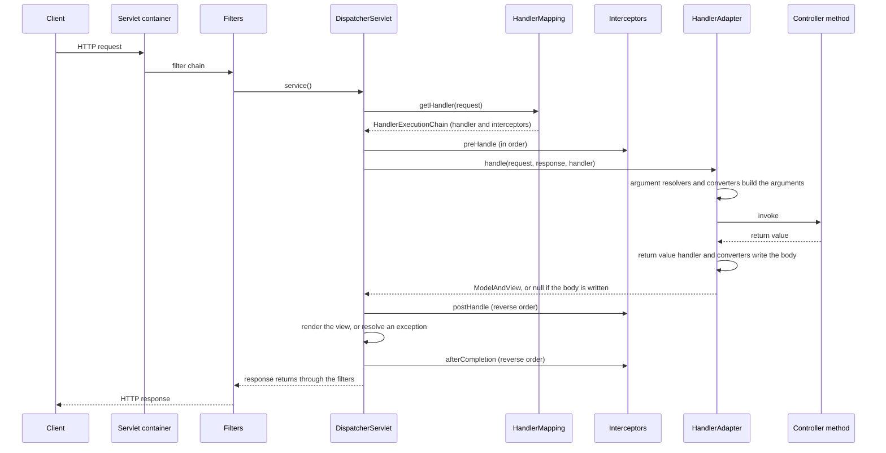

# Spring Web and REST

## Why It Matters

Almost every Java backend interview has a Spring MVC question: "What happens when a request arrives?", "What is the difference between a filter and an interceptor?", "How do you validate input and return a good error?", "What is `@ControllerAdvice`?". On the job, the same topic decides how clients see your service: the status codes, the error bodies, the validation messages, and the cost of each request. This page follows one HTTP request through a Spring MVC application, from the servlet container to the controller method and back. It covers controllers and their parameters, Bean Validation, exception handling with `ProblemDetail` (RFC 9457), filters and interceptors, the HTTP clients (`RestClient`, `WebClient`), and the one case where WebFlux helps. The security filter chain has its own page: [Spring Security](21-spring-security.md). Beans, proxies, and the application context are in [Spring core](17-spring-core.md). Auto-configuration and properties are in [Spring Boot](18-spring-boot.md).

!!! info "Versions"
    On 2026-10-22, the Spring release API (`api.spring.io`) lists Spring Boot 4.1.1 as the current generally available release. It manages Spring Framework 7.0.9, Tomcat 11.0.24 (Servlet 6.1), Hibernate Validator 9.1.3.Final (Jakarta Bean Validation 3.1.1), and Jackson 3.1.5. Spring Boot 3.5.16 is the newest 3.x release. It manages Spring Framework 6.2.19, Tomcat 10.1.55, Hibernate Validator 8.0.3.Final (Bean Validation 3.0.2), and Jackson 2.21.4. Both lines need Java 17 or later (Spring Boot "System Requirements": Boot 4.1.1 supports Java 17 up to Java 26). The numbers come from the `spring-boot-dependencies` POMs on Maven Central. Each "observed" behavior below comes from a run on Spring Framework 7.0.9 with `MockMvc`, unless the text says otherwise. Code that needs Spring carries the `<!-- fragment -->` marker, because the KB runner has no Spring jars. A table near the end of the page lists where Spring Boot 3.x differs.

## Core Concepts

**Servlet container**: the server (Tomcat, Jetty, Undertow) that accepts HTTP connections and calls servlets and filters, as defined by the Jakarta Servlet specification. Spring Boot embeds one in the application.

**`DispatcherServlet`**: the one servlet of Spring MVC. It is the **front controller**: all requests enter through it, and it decides which code handles each request. It delegates to the strategy beans below.

**Filter** (`jakarta.servlet.Filter`): a servlet-container component that sees the raw request and response, before and after the servlet. A filter does not know which Spring handler will run.

**Handler**: the code that handles a request. For `@RequestMapping` methods, the handler is a `HandlerMethod`: a bean plus a `Method`.

**`HandlerMapping`**: a strategy that finds the handler for a request. `RequestMappingHandlerMapping` matches `@RequestMapping` and its shortcuts (`@GetMapping`, `@PostMapping`) by path, HTTP method, `consumes`, `produces`, headers, and parameters. It returns a `HandlerExecutionChain`: the handler plus the interceptors that apply.

**`HandlerAdapter`**: a strategy that knows how to call one kind of handler. `RequestMappingHandlerAdapter` calls `@RequestMapping` methods. It lets the `DispatcherServlet` support handler types that share no interface.

**Argument resolver** (`HandlerMethodArgumentResolver`): a strategy that builds one method argument from the request. One resolver exists for `@PathVariable`, one for `@RequestParam`, one for `@RequestBody`, and so on.

**Return value handler** (`HandlerMethodReturnValueHandler`): a strategy that turns the return value into a response. For `@ResponseBody`, it writes the body with a message converter. For a view name, it records the name for the view resolver.

**`HttpMessageConverter`**: a strategy that reads a request body into an object and writes an object into a response body for a media type (JSON, XML, text, bytes).

**Content negotiation**: the choice of the response media type from the `Accept` request header and the types that the handler and the converters can produce.

**`ViewResolver`**: a strategy that turns a view name into a `View` that renders HTML (for example with Thymeleaf). A REST API does not use it.

**`HandlerInterceptor`**: a Spring MVC hook around the handler, with `preHandle`, `postHandle`, and `afterCompletion`. It knows the chosen handler.

**`HandlerExceptionResolver`**: a strategy that turns an exception from a handler into a response. `@ExceptionHandler` methods work through one of them.

**Bean Validation** (Jakarta Bean Validation): the standard for constraint annotations (`@NotBlank`, `@Min`, `@Size`) and the `Validator` that checks them. Hibernate Validator is the reference implementation.

**`ProblemDetail`**: the Spring class for an RFC 9457 "problem details" response body, with the members `type`, `title`, `status`, `detail`, `instance`, and extension members.

**`RestClient`**: the synchronous HTTP client with a fluent API (Spring Framework 6.1 and later). **`WebClient`**: the non-blocking client with a fluent API that returns `Mono` and `Flux`.

## How It Works

### The request flow



The steps in words:

1. The container accepts the connection, parses the HTTP request, and runs the **filter chain**. Each filter calls `chain.doFilter` to continue, or writes a response and stops. In Spring Boot, every `Filter` bean joins the chain, and the Spring Security filter is one of them.
2. The last element of the chain is the `DispatcherServlet` (`service` → `doDispatch`). By default, Spring Boot maps it to `/` (property `spring.mvc.servlet.path`, default `/`).
3. The `DispatcherServlet` asks each `HandlerMapping` in order for a handler. The first mapping that returns a non-null `HandlerExecutionChain` wins. If none returns one, the dispatcher throws `NoHandlerFoundException`. Spring Framework 6.1 made this the default (before 6.1, the dispatcher sent a plain `404` unless `throwExceptionIfNoHandlerFound` was `true`), and Spring Framework 7.0 removed the switch, so the dispatcher always throws (6.1 release notes; the 7.0.9 `DispatcherServlet` has no such property). In a Spring Boot application, the static resource handler matches `/**`, so the request reaches `ResourceHttpRequestHandler`, which throws `NoResourceFoundException` instead (also new in 6.1). The exception resolvers turn it into a `404` response, and a `ResponseEntityExceptionHandler` advice formats it.
4. The dispatcher finds a `HandlerAdapter` that supports the handler.
5. The interceptors' `preHandle` methods run in registration order. If one returns `false`, the dispatcher stops, and the `afterCompletion` methods of the interceptors that already ran execute in reverse order.
6. The adapter calls the handler: the argument resolvers build the arguments (path, query, header, body, `Principal`, `Model`), the method runs, and a return value handler processes the result.
7. For `@ResponseBody` and `@RestController` methods, the return value handler writes the body with an `HttpMessageConverter` and marks the request as handled. No view is rendered. For other return values (a `String` view name, `ModelAndView`), the dispatcher resolves and renders a view.
8. `postHandle` runs in reverse order (only if no exception happened), then the dispatcher renders the view or resolves an exception, and `afterCompletion` runs in reverse order.
9. The response returns through the filters in reverse order.

These are the beans that a plain `@EnableWebMvc` context creates on Spring Framework 7.0.9 (printed from the context):

| Strategy | Beans in the context |
|---|---|
| Handler mappings | `RequestMappingHandlerMapping`, `BeanNameUrlHandlerMapping`, `RouterFunctionMapping` |
| Handler adapters | `RequestMappingHandlerAdapter`, `HandlerFunctionAdapter`, `HttpRequestHandlerAdapter`, `SimpleControllerHandlerAdapter` |
| Message converters (in order) | `ByteArrayHttpMessageConverter`, `StringHttpMessageConverter`, `ResourceHttpMessageConverter`, `ResourceRegionHttpMessageConverter`, `AllEncompassingFormHttpMessageConverter`, `JacksonJsonHttpMessageConverter` (JSON, because Jackson 3 is on the classpath) |
| Exception resolvers (in order) | `ExceptionHandlerExceptionResolver`, `ResponseStatusExceptionResolver`, `DefaultHandlerExceptionResolver` |

The exception resolvers matter in step 8. The dispatcher asks them in order. `ExceptionHandlerExceptionResolver` runs your `@ExceptionHandler` methods (local to the controller first, then `@ControllerAdvice`). `ResponseStatusExceptionResolver` handles `@ResponseStatus` and `ResponseStatusException`. `DefaultHandlerExceptionResolver` maps the framework's own exceptions (missing parameter, wrong method, unsupported media type) to status codes. If none of them handles the exception, it propagates to the servlet container, which sends the error to `/error`. Spring Boot maps `/error` to `BasicErrorController`, which renders the default error JSON or page.

The program below proves the order. A filter, an interceptor, a controller, and an advice write to one list. The program makes three requests with `MockMvc`.

<!-- fragment -->
```java
import jakarta.servlet.FilterChain;
import jakarta.servlet.http.HttpServletRequest;
import jakarta.servlet.http.HttpServletResponse;
import java.util.ArrayList;
import java.util.List;
import org.springframework.context.annotation.Bean;
import org.springframework.context.annotation.Configuration;
import org.springframework.http.ProblemDetail;
import org.springframework.mock.web.MockServletContext;
import org.springframework.test.web.servlet.MockMvc;
import org.springframework.test.web.servlet.request.MockMvcRequestBuilders;
import org.springframework.test.web.servlet.setup.MockMvcBuilders;
import org.springframework.web.bind.annotation.ExceptionHandler;
import org.springframework.web.bind.annotation.GetMapping;
import org.springframework.web.bind.annotation.RestController;
import org.springframework.web.bind.annotation.RestControllerAdvice;
import org.springframework.web.context.support.AnnotationConfigWebApplicationContext;
import org.springframework.web.filter.OncePerRequestFilter;
import org.springframework.web.servlet.HandlerInterceptor;
import org.springframework.web.servlet.ModelAndView;
import org.springframework.web.servlet.config.annotation.EnableWebMvc;
import org.springframework.web.servlet.config.annotation.InterceptorRegistry;
import org.springframework.web.servlet.config.annotation.WebMvcConfigurer;

public class FlowDemo {
    static final List<String> LOG = new ArrayList<>();

    static class LogFilter extends OncePerRequestFilter {
        @Override
        protected void doFilterInternal(HttpServletRequest req, HttpServletResponse res,
                FilterChain chain) throws java.io.IOException, jakarta.servlet.ServletException {
            LOG.add("filter before");
            chain.doFilter(req, res);
            LOG.add("filter after, status " + res.getStatus());
        }
    }

    static class LogInterceptor implements HandlerInterceptor {
        @Override
        public boolean preHandle(HttpServletRequest q, HttpServletResponse r, Object handler) {
            LOG.add("interceptor preHandle");
            return true;
        }
        @Override
        public void postHandle(HttpServletRequest q, HttpServletResponse r, Object h,
                ModelAndView mv) {
            LOG.add("interceptor postHandle");
        }
        @Override
        public void afterCompletion(HttpServletRequest q, HttpServletResponse r, Object h,
                Exception ex) {
            LOG.add("interceptor afterCompletion, exception " + ex);
        }
    }

    @RestController
    static class Api {
        @GetMapping("/ok") String ok() { LOG.add("controller"); return "ok"; }
        @GetMapping("/boom") String boom() {
            LOG.add("controller");
            throw new IllegalStateException();
        }
    }

    @RestControllerAdvice
    static class Advice {
        @ExceptionHandler(IllegalStateException.class)
        ProblemDetail handle() {
            LOG.add("advice");
            return ProblemDetail.forStatus(503);
        }
    }

    @Configuration
    @EnableWebMvc
    static class Cfg implements WebMvcConfigurer {
        @Bean Api api() { return new Api(); }
        @Bean Advice advice() { return new Advice(); }
        @Override
        public void addInterceptors(InterceptorRegistry r) {
            r.addInterceptor(new LogInterceptor());
        }
    }

    public static void main(String[] args) throws Exception {
        var ctx = new AnnotationConfigWebApplicationContext();
        ctx.setServletContext(new MockServletContext());
        ctx.register(Cfg.class);
        ctx.refresh();
        MockMvc mvc = MockMvcBuilders.webAppContextSetup(ctx).addFilters(new LogFilter()).build();
        for (String path : List.of("/ok", "/boom", "/missing")) {
            LOG.clear();
            int status = mvc.perform(MockMvcRequestBuilders.get(path)).andReturn()
                    .getResponse().getStatus();
            System.out.println(path + " -> " + status);
            LOG.forEach(line -> System.out.println("    " + line));
        }
    }
}
```

Output from a real run (Spring Framework 7.0.9, Jakarta Servlet from Tomcat 11.0.24):

```text
/ok -> 200
    filter before
    interceptor preHandle
    controller
    interceptor postHandle
    interceptor afterCompletion, exception null
    filter after, status 200
/boom -> 503
    filter before
    interceptor preHandle
    controller
    advice
    interceptor afterCompletion, exception null
    filter after, status 503
/missing -> 404
    filter before
    filter after, status 404
```

Read the three results:

- `/ok`: the order is filter, `preHandle`, controller, `postHandle`, `afterCompletion`, filter.
- `/boom`: the advice handled the exception, so `postHandle` did not run. `afterCompletion` received `null` as the exception, because the dispatcher had resolved it. If you want to see a handled exception in `afterCompletion`, you cannot: log in the advice.
- `/missing`: no handler exists, so no interceptor ran. A cross-cutting rule that must also cover `404` and `405` responses belongs in a filter, not in an interceptor.

### Handler mapping: how a method is chosen

`RequestMappingHandlerMapping` registers every `@RequestMapping` method at startup and matches on these conditions: the path pattern, the HTTP method, `consumes` (the `Content-Type` of the request), `produces` (the `Accept` of the request), `params`, and `headers`. When no method matches, the mapping reports why, and the status depends on the closest miss:

| Request | Result | Exception |
|---|---|---|
| No path matches | `404 Not Found` | `NoHandlerFoundException`, or `NoResourceFoundException` when a static resource handler exists (Spring Framework 6.1 and later) |
| The path matches, the HTTP method does not | `405 Method Not Allowed` | `HttpRequestMethodNotSupportedException` |
| The path and method match, `consumes` does not | `415 Unsupported Media Type` | `HttpMediaTypeNotSupportedException` |
| The path and method match, `produces` does not match `Accept` | `406 Not Acceptable` | `HttpMediaTypeNotAcceptableException` |

Observed: `404` for `GET /nothing`, `405` for `DELETE /orders/5` on a path that has only `GET`, `415` for a `POST` with `Content-Type: text/plain` to a JSON endpoint, and `406` for `Accept: application/xml` on a JSON-only method. Since Spring Framework 6.0, a trailing slash no longer matches: `GET /orders/5/` returned `404` for a mapping `/orders/{id}`.

### Controllers, parameters, and request bodies

A **controller** is a bean that has `@RequestMapping` methods. `@RestController` is `@Controller` plus `@ResponseBody` on every method, so the return value becomes the response body. A plain `@Controller` returns view names. The controller is a singleton, so it must not keep per-request state in fields.

| Annotation | Reads | Use for | Missing or wrong value |
|---|---|---|---|
| `@PathVariable` | A segment of the path (`/orders/{id}`) | The identity of the resource | Type mismatch: `400` (`MethodArgumentTypeMismatchException`) |
| `@RequestParam` | A query or form parameter | Filters, paging, sorting, options | Missing and required: `400` (`MissingServletRequestParameterException`). `defaultValue` or `required = false` avoids it |
| `@RequestHeader` | A request header | Tenant, correlation ID, version | Same rules as `@RequestParam` |
| `@RequestBody` | The whole body, read by a message converter | JSON for `POST`, `PUT`, `PATCH` | Unreadable body: `400` (`HttpMessageNotReadableException`). Wrong `Content-Type`: `415` |
| `@ModelAttribute` | Request parameters bound to an object's properties (also the default for a simple object argument) | HTML form posts | Binding error: `400` |
| `@CookieValue`, `@RequestPart`, `Principal`, `HttpServletRequest` | Cookie, one part of a multipart request, the caller, the raw request | Special cases | |

Rules that cost points in interviews:

- Spring reads the parameter name of `@PathVariable` and `@RequestParam` from the compiled class file, so the compiler must run with `javac -parameters`. Spring Framework 6.1 removed `LocalVariableTableParameterNameDiscoverer`, the fallback that read names from debug information (6.1 release notes), so the flag is now the only source. Spring Boot's Maven and Gradle plugins set it. Without the flag, a test of `@RequestParam String name` failed with "Name for argument of type [java.lang.String] not specified, and parameter name information not available via reflection. Ensure that the compiler uses the '-parameters' flag." Write the name in the annotation (`@RequestParam("name")`) if the build cannot set the flag.
- `@RequestBody` reads the body once. A filter that reads the body first leaves nothing for the controller, unless it wraps the request in a caching wrapper.
- Use a `record` or a small class as the request body type, not the JPA entity. The entity exposes columns that the client must not set, and it ties the API to the table.
- Return `ResponseEntity` when you need to set the status, headers, or `Location`. Return the object directly for `200`. Use `@ResponseStatus` for a fixed status on a method or an exception class.

<!-- fragment -->
```java
import jakarta.validation.Valid;
import jakarta.validation.constraints.Max;
import jakarta.validation.constraints.Min;
import jakarta.validation.constraints.NotBlank;
import jakarta.validation.constraints.Size;
import java.net.URI;
import java.util.List;
import org.springframework.http.HttpStatus;
import org.springframework.http.ResponseEntity;
import org.springframework.web.bind.annotation.DeleteMapping;
import org.springframework.web.bind.annotation.GetMapping;
import org.springframework.web.bind.annotation.PathVariable;
import org.springframework.web.bind.annotation.PostMapping;
import org.springframework.web.bind.annotation.RequestBody;
import org.springframework.web.bind.annotation.RequestHeader;
import org.springframework.web.bind.annotation.RequestMapping;
import org.springframework.web.bind.annotation.RequestParam;
import org.springframework.web.bind.annotation.ResponseStatus;
import org.springframework.web.bind.annotation.RestController;

record CreateOrderRequest(
        @NotBlank String customer,
        @Min(1) int quantity,
        @Size(max = 10) List<@NotBlank String> tags) { }

record OrderView(long id, String customer, int quantity) { }

interface OrderService {
    OrderView find(long id);                       // throws OrderNotFoundException if absent
    List<OrderView> list(int page, int size, String tenant);
    OrderView create(CreateOrderRequest request);
    void delete(long id);
}

class OrderNotFoundException extends RuntimeException {
    final long id;
    OrderNotFoundException(long id) {
        super("Order " + id + " does not exist");
        this.id = id;
    }
}

@RestController
@RequestMapping("/orders")
class OrderController {
    private final OrderService service;

    OrderController(OrderService service) {          // constructor injection
        this.service = service;
    }

    @GetMapping("/{id}")                             // path variable: part of the resource identity
    OrderView get(@PathVariable long id) {
        return service.find(id);
    }

    @GetMapping                                      // query parameters: filtering and paging
    List<OrderView> list(
            @RequestParam(defaultValue = "0") @Min(0) int page,
            @RequestParam(defaultValue = "20") @Min(1) @Max(100) int size,
            @RequestHeader(name = "X-Tenant", required = false) String tenant) {
        return service.list(page, size, tenant);
    }

    @PostMapping
    ResponseEntity<OrderView> create(@Valid @RequestBody CreateOrderRequest body) {
        OrderView created = service.create(body);
        return ResponseEntity
                .created(URI.create("/orders/" + created.id()))   // 201 and a Location header
                .body(created);
    }

    @DeleteMapping("/{id}")
    @ResponseStatus(HttpStatus.NO_CONTENT)
    void delete(@PathVariable long id) {
        service.delete(id);
    }
}
```

`POST` returns `201 Created` with a `Location` header that names the new resource (RFC 9110 section 15.3.2). `DELETE` returns `204 No Content` when it succeeds. The rules for status codes, idempotency, paging, versioning, and error formats are in `kb/api-design/01-rest-principles.md` and `kb/api-design/02-api-design-practices.md`. The comparison of REST with gRPC and messaging is in [communication patterns](../hld/fundamentals/09-communication-patterns.md).

### Message converters and content negotiation

For `@RequestBody`, the argument resolver picks the first converter whose `canRead(type, contentType)` is true. For a return value, the return value handler computes the producible media types, intersects them with `Accept`, picks the best match, and the first converter that can write that type does the work. If the intersection is empty, the result is `406`.

With Jackson on the classpath, the JSON converter reads and writes records and classes through Jackson's `ObjectMapper`. Two observed results show the edges:

- A `String` return value goes through `StringHttpMessageConverter`, which accepts any media type. With `Accept: application/json`, the response carried `Content-Type: application/json` and the raw text `text`, which is not a JSON string. Return an object or a record when you want JSON.
- A `void` method returns `200` with no body and no `Content-Type`.

Jackson is the JSON library of Spring Boot's web starter. **Spring Boot 4 uses Jackson 3** (package `tools.jackson`, converter `JacksonJsonHttpMessageConverter`). Spring Boot 3.x uses Jackson 2 (package `com.fasterxml.jackson`, converter `MappingJackson2HttpMessageConverter`). Spring Framework 7.0.9 still contains the Jackson 2 converter, and Spring Boot 4 has the property `spring.jackson.use-jackson2-defaults` (default `false`): "Whether to configure Jackson 3 with the same defaults as Spring Boot previously used for Jackson 2". An interviewer who asks about a Boot 4 migration expects you to know that the JSON package names changed.

### Validation

**Bean Validation** puts constraints on the data and keeps them out of the controller code. The constraint annotations come from `jakarta.validation.constraints`. A `Validator` (Hibernate Validator) checks them. Spring MVC runs validation in two ways.

**Validation of a bound object.** `@Valid` (Jakarta) or `@Validated` (Spring) on an argument that is a `@RequestBody` or a `@ModelAttribute` triggers validation after the object is bound. On failure, Spring throws `MethodArgumentNotValidException` (it carries the `BindingResult` with each `FieldError`). Constraints on nested objects work only if the field of the outer object also has `@Valid`.

**Validation of method parameters.** Since Spring Framework 6.1, a controller method that has constraint annotations on its own parameters (`@RequestParam @Min(1) int size`) or on container elements (`List<@Valid Body>`) gets built-in method validation. On failure, Spring throws `HandlerMethodValidationException`. The controller class does not need `@Validated`. If the class has `@Validated` and an AOP method validation proxy is active (Spring Boot registers a `MethodValidationPostProcessor`), the proxy validates first and throws `jakarta.validation.ConstraintViolationException` instead.

Observed results for each case:

| Case | Exception | Default status |
|---|---|---|
| `@Valid @RequestBody` record has a bad field | `MethodArgumentNotValidException` | `400` |
| `@Valid @ModelAttribute` object has a bad field | `MethodArgumentNotValidException` | `400` |
| `@RequestParam @Size(min = 3) String q`, no class-level `@Validated` | `HandlerMethodValidationException` | `400` |
| `List<@Valid Body>` as `@RequestBody`, one element bad | `HandlerMethodValidationException` | `400` |
| Same `@RequestParam` constraint, class has `@Validated`, post-processor registered | `ConstraintViolationException` | `500` unless you handle it |

`@Valid` versus `@Validated`: `@Valid` is the standard annotation. It marks a nested object for cascading and triggers validation of an argument. `@Validated` is the Spring annotation that also selects **validation groups** (`@Validated(OnCreate.class)`) and turns on method validation at class level. For a body argument without groups, both work.

Validate at the boundary and again in the domain. A DTO constraint such as `@NotBlank` rejects bad input early with a clear `400`. It does not replace the rules that need the database (uniqueness) or the state of the system (enough stock).

### Exception handling and `ProblemDetail`

Without a handler, a framework exception returns its status with an empty or default body, and an uncaught exception from your code returns `500` through `/error`. A good API returns one error format for all failures. RFC 9457 ("Problem Details for HTTP APIs", which obsoletes RFC 7807) defines that format with the media type `application/problem+json`:

| Member | Meaning |
|---|---|
| `type` | A URI that identifies the problem type. The default is `about:blank`, which means "no more meaning than the status code" |
| `title` | A short summary of the type. It does not change between occurrences |
| `status` | The HTTP status code |
| `detail` | A message about this occurrence |
| `instance` | A URI for this occurrence (Spring sets it to the request path) |
| Extension members | Any extra data, for example `errors` |

Spring Framework 6 and later have `ProblemDetail` and the interface `ErrorResponse`. Framework exceptions such as `MethodArgumentNotValidException` implement `ErrorResponse`, and `ResponseEntityExceptionHandler` (a base class for your advice) maps all of them to `ProblemDetail` responses. In Spring Boot, the property `spring.mvc.problemdetails.enabled` (default `false` in Boot 3.5.16 and in Boot 4.1.1) turns this on without your own advice.

**`@ExceptionHandler`** marks a method that handles an exception type. In a controller, it handles that controller only. In a class with **`@ControllerAdvice`** (or `@RestControllerAdvice`, which adds `@ResponseBody`), it handles all controllers, or the controllers that `basePackages`, `assignableTypes`, or `annotations` select. When more than one handler matches, Spring picks the one whose declared exception type is closest to the thrown type. A handler in the controller wins over a handler in an advice. Two handlers for the same type in one class cause an `IllegalStateException` ("Ambiguous @ExceptionHandler method mapped for ..."). For an advice class, the error appears at startup. For a controller class, it appears when the first exception needs the handler table (both cases observed).

<!-- fragment -->
```java
import java.net.URI;
import java.util.LinkedHashMap;
import java.util.Map;
import org.springframework.http.HttpHeaders;
import org.springframework.http.HttpStatus;
import org.springframework.http.HttpStatusCode;
import org.springframework.http.ProblemDetail;
import org.springframework.http.ResponseEntity;
import org.springframework.validation.FieldError;
import org.springframework.web.bind.MethodArgumentNotValidException;
import org.springframework.web.bind.annotation.ExceptionHandler;
import org.springframework.web.bind.annotation.RestControllerAdvice;
import org.springframework.web.context.request.WebRequest;
import org.springframework.web.servlet.mvc.method.annotation.ResponseEntityExceptionHandler;

@RestControllerAdvice
class ApiErrors extends ResponseEntityExceptionHandler {

    // Domain exception: we choose the status and a stable "type" URI for clients.
    @ExceptionHandler(OrderNotFoundException.class)
    ProblemDetail notFound(OrderNotFoundException e) {
        ProblemDetail pd = ProblemDetail.forStatusAndDetail(HttpStatus.NOT_FOUND, e.getMessage());
        pd.setType(URI.create("https://api.example.com/problems/order-not-found"));
        pd.setTitle("Order not found");
        pd.setProperty("orderId", e.id);              // extension member (RFC 9457)
        return pd;
    }

    // Framework exception: the base class already maps it to a 400 ProblemDetail.
    // The default body has no field errors, so we add them.
    @Override
    protected ResponseEntity<Object> handleMethodArgumentNotValid(
            MethodArgumentNotValidException ex, HttpHeaders headers,
            HttpStatusCode status, WebRequest request) {
        Map<String, String> errors = new LinkedHashMap<>();
        for (FieldError f : ex.getBindingResult().getFieldErrors()) {
            errors.putIfAbsent(f.getField(), f.getDefaultMessage());
        }
        ProblemDetail pd = ex.getBody();               // status 400, title "Bad Request"
        pd.setDetail("Validation failed");
        pd.setProperty("errors", errors);
        return handleExceptionInternal(ex, pd, headers, status, request);
    }

    // Last resort: log the cause on the server, send a generic body to the client.
    @ExceptionHandler(Exception.class)
    ProblemDetail unexpected(Exception e) {
        return ProblemDetail.forStatusAndDetail(HttpStatus.INTERNAL_SERVER_ERROR,
                "Unexpected error");
    }
}
```

Observed responses of the controller and advice above behind `MockMvc`, with a stub `OrderService` (the `instance` member is the request path):

```text
GET /orders/404   404 {"detail":"Order 404 does not exist","instance":"/orders/404",
                       "status":404,"title":"Order not found",
                       "type":"https://api.example.com/problems/order-not-found","orderId":404}
GET /orders/500   500 {"detail":"Unexpected error","instance":"/orders/500",
                       "status":500,"title":"Internal Server Error"}
POST /orders      400 {"detail":"Validation failed","instance":"/orders","status":400,
                       "title":"Bad Request","errors":{"customer":"must not be blank",
                       "quantity":"must be greater than or equal to 1",
                       "tags[0]":"must not be blank"}}
GET /orders?size=500   400 {"detail":"Validation failure","instance":"/orders",
                            "status":400,"title":"Bad Request"}
```

The last line shows a default: the `ProblemDetail` for `HandlerMethodValidationException` has no field list. Override `handleHandlerMethodValidationException` in the advice if the client needs the list. The `400` for a bad `@RequestBody` also has no field errors by default (`"detail":"Invalid request content."`), which is why the advice above adds the `errors` member.

Rules for error design:

- Return `4xx` for client mistakes, `5xx` for server faults. Do not return `200` with an error in the body.
- Do not send stack traces, SQL, or class names to the client. Log the exception with a correlation ID on the server, and return only the ID. Spring Boot's `/error` output (from `BasicErrorController`) leaves out the message and the stack trace by default. The properties `spring.web.error.include-message` and `spring.web.error.include-stacktrace` default to `never` in Boot 4.1.1. In Boot 3.x, their names are `server.error.include-message` and `server.error.include-stacktrace`, and Boot 4 no longer binds the old names (configuration metadata of both versions).
- A `@ControllerAdvice` sees the exceptions that the `DispatcherServlet` raises: from the handler method, from argument resolution, and from the mapping itself (`404`, `405`, `415`, `406`). An exception from a **filter**, including the Spring Security filters, never reaches it. The container handles that exception and forwards to `/error`. Security failures use the `AuthenticationEntryPoint` and `AccessDeniedHandler` (see [Spring Security](21-spring-security.md)).

### Filters versus interceptors

<!-- fragment -->
```java
import jakarta.servlet.FilterChain;
import jakarta.servlet.ServletException;
import jakarta.servlet.http.HttpServletRequest;
import jakarta.servlet.http.HttpServletResponse;
import java.io.IOException;
import java.util.UUID;
import org.slf4j.MDC;
import org.springframework.context.annotation.Configuration;
import org.springframework.core.Ordered;
import org.springframework.core.annotation.Order;
import org.springframework.stereotype.Component;
import org.springframework.web.filter.OncePerRequestFilter;
import org.springframework.web.servlet.HandlerInterceptor;
import org.springframework.web.servlet.config.annotation.InterceptorRegistry;
import org.springframework.web.servlet.config.annotation.WebMvcConfigurer;

// A filter works on the raw request. It runs before the DispatcherServlet.
@Component
@Order(Ordered.HIGHEST_PRECEDENCE + 10)
class RequestIdFilter extends OncePerRequestFilter {
    @Override
    protected void doFilterInternal(HttpServletRequest request, HttpServletResponse response,
            FilterChain chain) throws ServletException, IOException {
        String id = request.getHeader("X-Request-Id");
        if (id == null) {
            id = UUID.randomUUID().toString();
        }
        MDC.put("requestId", id);
        response.setHeader("X-Request-Id", id);
        try {
            chain.doFilter(request, response);
        } finally {
            MDC.remove("requestId");                  // always clean up the thread
        }
    }
}

// An interceptor knows the chosen handler. It runs inside the DispatcherServlet.
class AuditInterceptor implements HandlerInterceptor {
    @Override
    public boolean preHandle(HttpServletRequest request, HttpServletResponse response,
            Object handler) {
        request.setAttribute("startNanos", System.nanoTime());
        return true;                                  // false stops the chain
    }

    @Override
    public void afterCompletion(HttpServletRequest request, HttpServletResponse response,
            Object handler, Exception ex) {
        long start = (Long) request.getAttribute("startNanos");
        long micros = (System.nanoTime() - start) / 1_000;
        System.out.println(request.getMethod() + " " + request.getRequestURI()
                + " " + response.getStatus() + " " + micros + " us");
    }
}

@Configuration
class WebConfig implements WebMvcConfigurer {
    @Override
    public void addInterceptors(InterceptorRegistry registry) {
        registry.addInterceptor(new AuditInterceptor())
                .addPathPatterns("/orders/**")
                .excludePathPatterns("/orders/health");
    }
}
```

| | Servlet `Filter` | `HandlerInterceptor` | `@ControllerAdvice` | AOP aspect |
|---|---|---|---|---|
| Defined by | Jakarta Servlet | Spring MVC | Spring MVC | Spring AOP |
| Runs | Around the servlet, for every request that reaches the container path | Inside the `DispatcherServlet`, only if a handler was found | When a handler throws | Around a bean method call |
| Knows the handler | No | Yes (the `HandlerMethod`, so its annotations) | Yes, through the exception | No, knows the bean method |
| Can wrap the request or response | Yes (`HttpServletRequestWrapper`) | No | No | No |
| Sees `404` and `405` | Yes | No (observed: no interceptor call) | Yes, if it handles the mapping exceptions (`ResponseEntityExceptionHandler` does) | No |
| Sees exceptions | Only those that escape the servlet | `afterCompletion` receives an unresolved exception | Handles them | Can catch them in the bean |
| Typical use | Security, request ID, CORS, compression, logging of every request, rate limiting | Handler-specific checks, audit, locale, metrics by handler | Error format | Transactions, retry, caching on service methods |

Recommendation: put a rule that must cover every request (authentication, request ID, rate limit) in a filter. Put a rule that depends on the handler (for example "this handler needs an API version header") in an interceptor. Extend `OncePerRequestFilter` so the filter runs one time per request even when the container dispatches the request again (forward, error, async).

Filter order is part of the behavior. Spring Boot orders filter beans with `@Order` or the `Ordered` interface, and the lower value runs first. Spring Security's chain has its own order and position (the page [Spring Security](21-spring-security.md) lists it).

### HTTP clients: `RestClient`, `RestTemplate`, `WebClient`

Your service also calls other services. Spring Framework 7 offers these clients:

| Client | Style | Status |
|---|---|---|
| `RestClient` | Synchronous, fluent. Added in Spring Framework 6.1 | The recommended synchronous client |
| `RestTemplate` | Synchronous, template methods (`getForObject`, `exchange`) | Being retired in three steps (Spring blog, "The state of HTTP clients in Spring", 2025-09-30): Spring Framework 7.0 (November 2025) deprecates it in the documentation; 7.1 (planned for November 2026) adds `@Deprecated` and marks it for removal; 8.0 removes it. The blog expects open-source support until at least 2029. The 7.0.9 class carries no `@Deprecated` annotation yet, so the compiler shows no warning |
| `WebClient` | Non-blocking, fluent, returns `Mono` and `Flux`. Needs `spring-webflux` and Reactor | Use it in a reactive application, or for streaming |
| HTTP interface clients (`@HttpExchange`) | A Java interface that Spring turns into a client with a proxy, on top of `RestClient` or `WebClient` | Covered on [microservices with Spring](22-microservices-with-spring.md) |

The program below ran on Spring Framework 7.0.9. `MockRestServiceServer` replaces the HTTP call, so the program needs no network. `retrieve()` throws `HttpClientErrorException` for a `4xx` status and `HttpServerErrorException` for `5xx` by default, and `onStatus` replaces that rule for the statuses that you choose.

<!-- fragment -->
```java
import org.springframework.http.HttpMethod;
import org.springframework.http.HttpStatusCode;
import org.springframework.http.MediaType;
import org.springframework.test.web.client.MockRestServiceServer;
import org.springframework.web.client.HttpClientErrorException;
import org.springframework.web.client.RestClient;
import org.springframework.web.reactive.function.client.WebClient;
import reactor.core.publisher.Mono;
import static org.springframework.test.web.client.match.MockRestRequestMatchers.method;
import static org.springframework.test.web.client.match.MockRestRequestMatchers.requestTo;
import static org.springframework.test.web.client.response.MockRestResponseCreators.withStatus;
import static org.springframework.test.web.client.response.MockRestResponseCreators.withSuccess;

public class ClientExamples {
    record Order(long id, String customer, int quantity) { }

    public static void main(String[] args) {
        // In production: RestClient.builder().baseUrl(...).build(). The mock server below
        // replaces the HTTP call, so the program needs no network.
        RestClient.Builder builder = RestClient.builder().baseUrl("http://orders.test");
        MockRestServiceServer server = MockRestServiceServer.bindTo(builder).build();
        server.expect(requestTo("http://orders.test/orders/5")).andExpect(method(HttpMethod.GET))
            .andRespond(withSuccess("{\"id\":5,\"customer\":\"ann\",\"quantity\":2}",
                MediaType.APPLICATION_JSON));
        server.expect(requestTo("http://orders.test/orders/9"))
            .andRespond(withStatus(HttpStatusCode.valueOf(404)));
        server.expect(requestTo("http://orders.test/orders/9"))
            .andRespond(withStatus(HttpStatusCode.valueOf(404)));
        RestClient client = builder.build();

        Order order = client.get().uri("/orders/{id}", 5).retrieve().body(Order.class);
        System.out.println(order);

        try {                                         // default: 4xx and 5xx throw
            client.get().uri("/orders/{id}", 9).retrieve().body(Order.class);
        } catch (HttpClientErrorException e) {
            System.out.println("caught " + e.getStatusCode());
        }

        Order none = client.get().uri("/orders/{id}", 9).retrieve()
            .onStatus(status -> status.value() == 404, (request, response) -> { })
            .body(Order.class);                       // the handler swallows the 404
        System.out.println("404 handled, body " + none);

        // WebClient returns a Mono. Nothing is sent until someone subscribes.
        WebClient webClient = WebClient.create("http://orders.test");
        Mono<Order> lazy = webClient.get().uri("/orders/{id}", 5)
            .retrieve().bodyToMono(Order.class);
        System.out.println("WebClient call built, not sent: " + (lazy != null));
    }
}
```

Output:

```text
Order[id=5, customer=ann, quantity=2]
caught 404 NOT_FOUND
404 handled, body null
WebClient call built, not sent: true
```

Set the connect timeout and the read timeout on every client that calls another service. A call without a timeout holds a thread (or a connection) for as long as the other side stays silent. Configure them in the request factory of the client (for example `JdkClientHttpRequestFactory` or the Apache or Jetty factories) and check the default of the HTTP library that you use. The resilience patterns (retry, circuit breaker) are in [reliability patterns](../hld/fundamentals/12-reliability-patterns.md).

### WebFlux: when reactive helps

**Spring WebFlux** is the second web framework of Spring. It handles requests on a small number of **event-loop** threads (Netty by default) and uses non-blocking I/O, so a thread never waits for a socket. A handler returns `Mono<T>` (zero or one value) or `Flux<T>` (zero to many values), and the framework subscribes to it. It can use the same annotations as Spring MVC (`@RestController`, `@GetMapping`) or functional routes (`RouterFunction`).

<!-- fragment -->
```java
import java.time.Duration;
import org.springframework.web.bind.annotation.GetMapping;
import org.springframework.web.bind.annotation.PathVariable;
import org.springframework.web.bind.annotation.RestController;
import org.springframework.web.reactive.function.client.WebClient;
import reactor.core.publisher.Flux;
import reactor.core.publisher.Mono;

record Price(String sku, long cents) { }

@RestController
class ReactivePriceController {
    private final WebClient pricing = WebClient.create("http://pricing.internal");

    @GetMapping("/prices/{sku}")
    Mono<Price> one(@PathVariable String sku) {       // the event-loop thread never blocks
        return pricing.get().uri("/p/{sku}", sku).retrieve().bodyToMono(Price.class)
                .timeout(Duration.ofSeconds(2));
    }

    @GetMapping("/prices")
    Flux<Price> many() {                              // streams elements as they arrive
        return pricing.get().uri("/p").retrieve().bodyToFlux(Price.class);
    }
}
```

When WebFlux helps:

- The service spends most of its time waiting for I/O (many calls to other services), and it must hold very many concurrent connections with few threads.
- The work is a stream: server-sent events, WebSocket, or a gateway that proxies bytes.
- The whole call chain is non-blocking: a reactive driver (R2DBC, reactive MongoDB, Redis) and `WebClient`.

When it does not help:

- The code calls blocking APIs (JDBC, JPA, a blocking SDK). One blocking call on an event-loop thread stalls every request on that thread. You then move the call to another scheduler, and you lose the benefit.
- The service is CPU-bound. Non-blocking I/O does not make computation faster.
- The team does not know reactive debugging. Stack traces, `ThreadLocal`-based context (security, MDC, transactions), and testing all work differently.

**Virtual threads (Java 21)** reduce the main reason for WebFlux. A blocking call on a virtual thread parks the virtual thread and frees the carrier thread, so a thread-per-request MVC application can hold many concurrent blocking calls. In Spring Boot, the property `spring.threads.virtual.enabled=true` (default `false`) runs requests on virtual threads. The mechanism, the pinning problem, and the limits are on [virtual threads](10-virtual-threads.md). Recommendation: for a new CRUD-style service on Java 21 with blocking JDBC, choose Spring MVC with virtual threads. Choose WebFlux when you need streaming, backpressure, or a fully non-blocking stack.

### What changed in Spring Boot 4 and Spring Framework 7

| Topic | Spring Boot 3.5.x / Framework 6.2.x | Spring Boot 4.1.x / Framework 7.0.x |
|---|---|---|
| JSON library | Jackson 2 (`com.fasterxml.jackson`), `MappingJackson2HttpMessageConverter` | Jackson 3 (`tools.jackson`), `JacksonJsonHttpMessageConverter`. Jackson 2 converter still in the jar |
| Servlet container | Tomcat 10.1 (Servlet 6.0) | Tomcat 11 (Servlet 6.1), from the Boot 4.1.1 BOM |
| Bean Validation | Hibernate Validator 8.0.3, Bean Validation 3.0 | Hibernate Validator 9.1.3, Bean Validation 3.1 |
| Boot modules | The web auto-configuration is in `spring-boot-autoconfigure` (`org.springframework.boot.autoconfigure.web.servlet`) | Split into modules, for example `spring-boot-webmvc` (package `org.springframework.boot.webmvc.autoconfigure`) and `spring-boot-web-server` |
| `RestTemplate` | Supported | Deprecated in the documentation in favor of `RestClient`. `@Deprecated(forRemoval)` planned for Framework 7.1, removal in 8.0 |
| `spring.mvc.throw-exception-if-no-handler-found` | Deprecated at level "error" since Boot 3.2 (no longer bound): the dispatcher throws by default since Framework 6.1 | Same. Framework 7.0 removed the property from `DispatcherServlet` |
| Error output properties | `server.error.include-message`, `server.error.include-stacktrace` | `spring.web.error.include-message`, `spring.web.error.include-stacktrace` |
| Web starter | `spring-boot-starter-web` | `spring-boot-starter-webmvc`. The old name still works but is deprecated (Spring Boot 4.0 migration guide) |
| `ProblemDetail` switch | `spring.mvc.problemdetails.enabled`, default `false` | Same property, default `false` |

The module split and the Jackson change are the two items that break builds when a team upgrades from Boot 3 to Boot 4. The module and package names come from the `AutoConfiguration.imports` file and the metadata of `spring-boot-webmvc-4.1.1.jar`.

## Trade-offs and When to Use

| Decision | Option A | Option B | Rule |
|---|---|---|---|
| Web stack | Spring MVC (thread per request) | WebFlux (event loop) | MVC with virtual threads for blocking I/O. WebFlux for streaming and a fully non-blocking stack |
| Cross-cutting rule | Filter | Interceptor | Filter for every request and for wrapping. Interceptor when the rule needs the handler |
| Error format | `ProblemDetail` (RFC 9457) | A custom error class | `ProblemDetail`: a standard that clients and gateways understand. Add extension members for your data |
| Validation | Constraint annotations on the DTO | `if` checks in the controller | Annotations for structure. Code for rules that need state |
| Where the exception becomes a status | `@ControllerAdvice` | `@ResponseStatus` on the exception class | Advice: one place, one format. `@ResponseStatus` fits a small app with one rule per exception |
| Synchronous client | `RestClient` | `RestTemplate` | `RestClient` for new code. `RestTemplate` exists in old code |
| Request body type | A DTO or record | The JPA entity | A DTO: stable API, no mass assignment |
| Status for a missing resource | `404` | `200` with an empty body | `404`. The client must be able to tell the difference |

## Java Example

The first program is plain JDK code. It rebuilds the control flow of the `DispatcherServlet` in about 120 lines: a filter chain around a dispatcher, a handler mapping with path variables, interceptors with `preHandle`, `postHandle`, and `afterCompletion`, a handler that returns an object, and an exception resolver (the "advice"). It prints the order of the calls for four requests. It shows the same results as the Spring run above: a resolved exception skips `postHandle`, and a request with no handler skips the interceptors.

```java
import java.util.ArrayList;
import java.util.LinkedHashMap;
import java.util.List;
import java.util.Map;
import java.util.function.Function;

public class MiniMvc {
    record Request(String method, String path, String body) { }
    record Response(int status, String body) { }

    interface Handler { Object handle(Map<String, String> vars, Request request); }
    interface Interceptor {
        boolean preHandle(Request r);
        void postHandle(Request r);
        void afterCompletion(Request r, Exception ex);
    }
    interface Filter { Response doFilter(Request r, Next next); }
    interface Next { Response proceed(Request r); }

    static class NotFound extends RuntimeException { }
    static class BadInput extends RuntimeException {
        BadInput(String m) { super(m); }
    }

    record Mapping(String method, String[] pattern, Handler handler) { }

    final List<Mapping> mappings = new ArrayList<>();
    final List<Interceptor> interceptors = new ArrayList<>();
    final Map<Class<? extends Exception>, Function<Exception, Response>> advice =
        new LinkedHashMap<>();
    final List<String> log = new ArrayList<>();

    void map(String method, String pattern, Handler h) {
        mappings.add(new Mapping(method, pattern.substring(1).split("/"), h));
    }

    // Step 1: the handler mapping finds a handler and extracts the path variables.
    Mapping find(Request r, Map<String, String> vars) {
        String[] parts = r.path().substring(1).split("/");
        for (Mapping m : mappings) {
            if (!m.method().equals(r.method()) || m.pattern().length != parts.length) continue;
            vars.clear();
            boolean ok = true;
            for (int i = 0; i < parts.length && ok; i++) {
                String p = m.pattern()[i];
                if (p.startsWith("{")) vars.put(p.substring(1, p.length() - 1), parts[i]);
                else ok = p.equals(parts[i]);
            }
            if (ok) return m;
        }
        return null;
    }

    // The DispatcherServlet part: handler, interceptors, adapter, exception resolver.
    Response dispatch(Request r) {
        Map<String, String> vars = new LinkedHashMap<>();
        Mapping m = find(r, vars);
        if (m == null) return resolve(new NotFound());
        Response response;
        int ran = 0;
        try {
            for (Interceptor i : interceptors) {
                if (!i.preHandle(r)) {                            // false: stop the chain
                    for (int k = ran - 1; k >= 0; k--) interceptors.get(k).afterCompletion(r, null);
                    // In Spring, the interceptor itself writes this response.
                    return new Response(403, "stopped by interceptor");
                }
                ran++;
            }
            Object result = m.handler().handle(vars, r);          // the handler adapter
            response = new Response(200, String.valueOf(result)); // the message converter
            for (int i = interceptors.size() - 1; i >= 0; i--) interceptors.get(i).postHandle(r);
        } catch (Exception e) {
            response = resolve(e);  // the exception resolver; the interceptors see no exception
        }
        for (int i = ran - 1; i >= 0; i--) interceptors.get(i).afterCompletion(r, null);
        return response;
    }

    Response resolve(Exception e) {
        for (var entry : advice.entrySet()) {
            if (entry.getKey().isInstance(e)) return entry.getValue().apply(e);
        }
        return new Response(500, "internal error");
    }

    // The servlet filter chain wraps the whole dispatch.
    Response serve(Request r, List<Filter> filters) {
        return chain(r, filters, 0);
    }

    Response chain(Request r, List<Filter> filters, int index) {
        if (index == filters.size()) return dispatch(r);
        return filters.get(index).doFilter(r, req -> chain(req, filters, index + 1));
    }

    public static void main(String[] args) {
        MiniMvc mvc = new MiniMvc();
        mvc.map("GET", "/orders/{id}", (vars, req) -> {
            mvc.log.add("handler");
            int id = Integer.parseInt(vars.get("id"));
            if (id < 0) throw new BadInput("negative id");
            return "order " + id;
        });
        mvc.advice.put(NotFound.class, e -> new Response(404, "no handler"));
        mvc.advice.put(BadInput.class, e -> new Response(400, e.getMessage()));
        mvc.advice.put(NumberFormatException.class, e -> new Response(400, "bad number"));
        mvc.interceptors.add(new Interceptor() {
            public boolean preHandle(Request r) { mvc.log.add("pre"); return true; }
            public void postHandle(Request r) { mvc.log.add("post"); }
            public void afterCompletion(Request r, Exception ex) { mvc.log.add("after"); }
        });
        List<Filter> filters = List.of((r, next) -> {
            mvc.log.add("filter in");
            Response res = next.proceed(r);
            mvc.log.add("filter out " + res.status());
            return res;
        });

        for (String path : List.of("/orders/5", "/orders/-1", "/orders/x", "/nothing")) {
            mvc.log.clear();
            Response res = mvc.serve(new Request("GET", path, ""), filters);
            System.out.println(path + " -> " + res.status() + " " + res.body());
            System.out.println("  " + mvc.log);
        }
    }
}
```

<!-- expected-output -->
```text
/orders/5 -> 200 order 5
  [filter in, pre, handler, post, after, filter out 200]
/orders/-1 -> 400 negative id
  [filter in, pre, handler, after, filter out 400]
/orders/x -> 400 bad number
  [filter in, pre, handler, after, filter out 400]
/nothing -> 404 no handler
  [filter in, filter out 404]
```

The program is a model. Spring adds argument resolvers, message converters, content negotiation, and view rendering to the same skeleton. The Spring programs earlier on this page ran against the real jars.

## Interview Angle

### Questions

??? question "Walk me through what happens from the moment an HTTP request arrives until the JSON response leaves."

    The servlet container (embedded Tomcat) parses the request and runs the filter chain. The last part of the chain is the `DispatcherServlet`, the front controller of Spring MVC. The dispatcher asks the `HandlerMapping` beans for a handler. `RequestMappingHandlerMapping` matches the path, the HTTP method, `consumes`, and `produces`, and returns the handler method together with the interceptors that apply. The dispatcher finds a `HandlerAdapter` for it, and runs the interceptors' `preHandle` methods.

    The `RequestMappingHandlerAdapter` builds the arguments with argument resolvers: `@PathVariable` and `@RequestParam` from the URL, `@RequestBody` with a message converter (Jackson) that reads the JSON, and validation if `@Valid` is present. It calls the method. For a `@RestController`, the return value handler writes the object with a message converter chosen by the `Accept` header, and the request counts as handled, so no view is rendered. Then `postHandle` runs in reverse order, and `afterCompletion` runs in reverse order after that. If the method throws, the exception resolvers (`@ExceptionHandler` first) turn the exception into a response. The response goes back through the filters.

    The edge cases that show depth: with no handler, the interceptors do not run (`404`). A resolved exception skips `postHandle`. An exception from a filter does not reach `@ControllerAdvice`. For a `@ResponseBody` method, the converter writes the body before `postHandle` runs, so `postHandle` cannot change that response. To change the body or headers of every JSON response, use a `ResponseBodyAdvice` (it runs before the converter writes) or a filter with a response wrapper.

??? question "What is the difference between a servlet filter and a Spring interceptor? When do you use each?"

    A filter belongs to the Servlet specification. It wraps the whole servlet call, sees the raw request, and can replace the request or response with a wrapper. It runs for every request that the container sends through it, also when no Spring handler exists. An interceptor belongs to Spring MVC. It runs inside the `DispatcherServlet` after the handler is chosen, so it receives the handler and can read its annotations. It cannot wrap the request, and it does not run for `404` or `405`.

    I use a filter for rules that apply to every request: authentication (Spring Security is a filter chain), a request ID, CORS, compression, rate limiting. I use an interceptor for rules that depend on the handler: an audit entry for the methods that carry `@Audited`, or a check of an API version header. Exceptions behave differently too. An exception in a filter never reaches `@ControllerAdvice`, and an interceptor's `afterCompletion` gets `null` when an advice has already resolved the exception.

??? question "What is the difference between `@Valid` and `@Validated`, and what does a failed validation throw?"

    `@Valid` is the Jakarta standard annotation. It triggers validation of an argument and marks a nested object for cascading. `@Validated` is the Spring annotation. It does the same for an argument, and it also selects validation groups, and at class level it turns on method validation through an AOP proxy.

    For a `@RequestBody` or `@ModelAttribute` that fails, Spring throws `MethodArgumentNotValidException` and the `BindingResult` holds the field errors. Since Spring Framework 6.1, constraints directly on controller parameters (`@RequestParam @Min(1)`) work without `@Validated`, and failures throw `HandlerMethodValidationException`. If the class has `@Validated` and a method validation post-processor is registered, the proxy throws `jakarta.validation.ConstraintViolationException` instead. `ResponseEntityExceptionHandler` does not handle that one, so it becomes a `500` by default. All of these exceptions describe client errors, so I map all of them to `400` in one `@RestControllerAdvice` that returns a `ProblemDetail` with a field list, and I remove the class-level `@Validated` from controllers so the built-in validation applies.

??? question "How do you design error handling for a REST API in Spring?"

    One format for all errors, built in one place. I use `@RestControllerAdvice` that extends `ResponseEntityExceptionHandler`, which already maps the framework exceptions (`400`, `404`, `405`, `415`, and others) to `ProblemDetail` bodies with the media type `application/problem+json` (RFC 9457). I add handlers for my domain exceptions with a stable `type` URI and an extension member for the data, such as the order ID. I override the validation handler so the body carries the list of invalid fields. A last handler for `Exception` returns a generic `500` and logs the cause with a correlation ID. The client receives the ID, never a stack trace. That catch-all must not swallow `AccessDeniedException` from method security, or a `403` becomes a `500` (see [Spring Security](21-spring-security.md)).

    The status codes follow the cause: `4xx` for client mistakes, `5xx` for server faults, `404` for a missing resource, `409` for a state conflict. Limits: the advice does not see exceptions from filters, so security errors use the `AuthenticationEntryPoint` and `AccessDeniedHandler` and must produce the same format.

??? question "What does `@RestController` do, and how does it differ from `@Controller`?"

    `@RestController` is a meta-annotation for `@Controller` plus `@ResponseBody`. With `@ResponseBody`, the return value is written to the response body by a message converter. With a plain `@Controller`, a `String` return value is a view name that a `ViewResolver` renders (for example a Thymeleaf template), and `@ResponseBody` on single methods switches them to body mode. The controller is a singleton bean, so it must not hold per-request state in fields.

??? question "What is the difference between `@PathVariable`, `@RequestParam`, `@RequestBody`, and `@ModelAttribute`?"

    `@PathVariable` reads a segment of the path and identifies the resource (`/orders/{id}`). `@RequestParam` reads a query or form parameter and carries options such as filter, page, and size. `@RequestBody` reads the whole body with a message converter (JSON for `POST`, `PUT`, `PATCH`). `@ModelAttribute` binds request parameters to the properties of an object, which suits HTML form posts, and it is the default for a simple object argument without an annotation. A missing required parameter or a type mismatch returns `400`. A wrong `Content-Type` for `@RequestBody` returns `415`. All parameter-name based annotations need the compiler flag `-parameters` or an explicit name.

??? question "How does Spring choose how to serialize the response? What are `406` and `415`?"

    The return value handler gathers the media types that the handler can produce (the `produces` attribute, or what the converters support for the return type), intersects them with the `Accept` header of the request, and takes the best match. The first `HttpMessageConverter` that can write the return type as that media type writes the body. If the intersection is empty, the response is `406 Not Acceptable`: the server cannot produce what the client accepts. `415 Unsupported Media Type` is the request side: the `Content-Type` of the request body is not one that the method consumes or that a converter can read. In Spring Boot 4 the JSON converter uses Jackson 3, and in Boot 3.x it uses Jackson 2.

??? question "Why does my interceptor not run for some requests, and what does `afterCompletion` receive?"

    An interceptor belongs to the handler execution chain, so it runs only if the `HandlerMapping` found a handler. For a `404` or `405` there is no handler, and no interceptor runs. `preHandle` runs in registration order. If one returns `false`, the chain stops, and `afterCompletion` runs for the interceptors that had returned `true`. `postHandle` is skipped when the handler throws. `afterCompletion` always runs for those interceptors, but its exception argument is `null` if an `@ExceptionHandler` resolved the exception (observed on Spring Framework 7.0.9). Use a filter if the rule must cover every request.

??? question "`RestTemplate`, `RestClient`, `WebClient`: which one do you use and why?"

    `RestClient` for synchronous calls in new code: a fluent API, the same message converters as MVC, and error handling with `retrieve().onStatus(...)`. `RestTemplate` is the older template-style client. Spring deprecated it in the Framework 7.0 documentation in favor of `RestClient`, plans to add `@Deprecated(forRemoval = true)` in 7.1, and plans to remove it in 8.0. So I keep it only in existing code and migrate call sites to `RestClient`, which can reuse the existing `RestTemplate` configuration through `RestClient.create(restTemplate)`. `WebClient` is the non-blocking client for reactive code and streaming, and it needs Reactor. For all three, I set connect and read timeouts, because a call without a timeout holds the calling thread, and I combine them with retry and a circuit breaker for calls to other services. For a typed client, an `@HttpExchange` interface on top of `RestClient` removes the boilerplate.

??? question "When would you choose WebFlux over Spring MVC, now that Java 21 has virtual threads?"

    WebFlux fits when the stack is non-blocking end to end and the load is many concurrent I/O waits or streams: server-sent events, WebSocket, a gateway, or a service that fans out to many remote calls and uses reactive drivers. It handles requests on a few event-loop threads, and a blocking call on such a thread stalls others, so JDBC and JPA do not fit. Virtual threads remove the old argument for WebFlux in a CRUD-style service: with `spring.threads.virtual.enabled=true`, a blocking call parks only the virtual thread, and the code stays simple and debuggable. So for a new service with blocking JDBC on Java 21, I choose MVC with virtual threads. I choose WebFlux for streaming, backpressure, or a fully reactive pipeline. WebFlux does not speed up CPU-bound work.

??? question "What changes for the web layer when you move from Spring Boot 3 to Spring Boot 4?"

    Boot 4 is built on Spring Framework 7. The changes that matter for the web layer: Jackson 3 is the default JSON library (package `tools.jackson`, converter `JacksonJsonHttpMessageConverter`), and code that imports `com.fasterxml.jackson` databind types, or custom `ObjectMapper` configuration, needs migration. The embedded Tomcat is version 11 (Servlet 6.1), and Hibernate Validator is 9.x (Bean Validation 3.1). Boot split its auto-configuration into modules, so the starters pull `spring-boot-webmvc` and similar jars, and some classes moved to new packages. `RestTemplate` is deprecated in the documentation in favor of `RestClient`. The web starter is renamed `spring-boot-starter-webmvc`, and the `server.error.*` properties became `spring.web.error.*`. Java 17 is still the minimum. What stays: the request flow, `@RestController`, `@Valid`, `ProblemDetail`, and filters and interceptors work as before.

### Follow-up Questions

??? question "Does `@ControllerAdvice` catch an exception that a filter throws?"

    No. `@ExceptionHandler` methods run through `ExceptionHandlerExceptionResolver` inside the `DispatcherServlet`. A filter runs outside it. An exception from a filter reaches the servlet container, which forwards the request to the error page (`/error`, handled by `BasicErrorController` in Spring Boot). To produce your error format for filter failures, catch the exception in the filter and write the response, or delegate to the `HandlerExceptionResolver` bean from the filter.

??? question "Why does a POST that creates a resource return `201` and a `Location` header, and not `200`?"

    `201 Created` states that a new resource exists. The `Location` header gives its URI, so the client does not guess it. RFC 9110 section 15.3.2 defines both. Spring gives `ResponseEntity.created(uri)`. A repeated `POST` creates a second resource, because `POST` is not idempotent, so a payment or order endpoint needs an idempotency key (see `kb/api-design/02-api-design-practices.md`).

??? question "Is a controller thread-safe?"

    A controller is a singleton, and many request threads call it at the same time. It is thread-safe if it keeps no mutable state in fields, and it uses only its injected services and the method arguments. A field such as a `SimpleDateFormat` or a counter is a bug. Per-request data goes in method arguments, or in `request` scoped beans.

??? question "What happens if two `@ExceptionHandler` methods match the same exception?"

    In one class, two methods for the same exception type cause an `IllegalStateException` ("Ambiguous @ExceptionHandler method mapped for ..."). For an advice class it fails at startup, and for a controller it fails when the first exception needs the table. Across classes, a handler in the controller wins over `@ControllerAdvice` beans. Among advice beans, `@Order` decides (the lowest value first), and the first advice that has any matching handler wins, even if a later advice has a closer match. So a catch-all `@ExceptionHandler(Exception.class)` in a high-priority advice hides the specific handlers of every later advice (observed on 7.0.9: an `IllegalStateException` got the catch-all's `500`, not the `409` of the later advice). Inside one class, the handler with the closest exception type wins, so a handler for `Exception` does not hide a handler for `IllegalStateException` in the same class.

??? question "How do you read the request body in a filter and still let the controller read it?"

    The body stream can be read once. Wrap the request in a `ContentCachingRequestWrapper` (Spring) or your own `HttpServletRequestWrapper` that buffers the bytes, and pass the wrapper to `chain.doFilter`. The cost is memory for the full body, so set a size limit and avoid it for uploads.

??? question "A `@RequestParam` works in my IDE but fails with a 'parameter name information not available' error in production. Why?"

    The IDE compiled with `-parameters`, and the production build did not. Spring reads parameter names from the class file, which stores them only if the compiler runs with `-parameters`. Set `<parameters>true</parameters>` in the Maven compiler plugin (the Spring Boot parent does it), or `options.compilerArgs << '-parameters'` in Gradle, or name the parameter in the annotation.

### Red Flags

- "The controller handles the request directly" with no mention of the `DispatcherServlet`, mapping, and adapter.
- "Interceptors and filters are the same thing."
- Returning the JPA entity from the controller, or accepting it as the request body.
- Returning `200` with `{"error": ...}`, or a stack trace in the response.
- `catch (Exception e) { return null; }` in a controller.
- "Validation is only in the controller", with no `@Valid` on nested objects and no check in the domain.
- Choosing WebFlux "because it is faster" without naming a non-blocking stack, or calling JDBC from a WebFlux handler.
- No timeouts on `RestClient` or `WebClient` calls.
- Calling `RestTemplate` "the current recommended client" for new code.

## Common Mistakes

| Mistake | Why it hurts | Fix |
|---|---|---|
| Missing `@Valid` on a nested object field | The nested constraints never run | Put `@Valid` on the field or on `List<@Valid Item>` |
| Constraint on a `@RequestParam` and no handler for `HandlerMethodValidationException` | The client gets `400` with only "Validation failure" | Override `handleHandlerMethodValidationException` in the advice and add the field list |
| Handling `Exception` in one `@ExceptionHandler` and nothing else | Every framework error becomes `500`, or the format differs | Extend `ResponseEntityExceptionHandler` and add the handler for `Exception` last |
| Putting a per-request rule in an interceptor | The rule skips `404`, `405`, and static resources | Use a filter |
| Writing to the response in a filter after `chain.doFilter` | The response is already committed | Set headers before `chain.doFilter`, or use a response wrapper |
| Leaving `MDC` values after the request | The pooled thread leaks the value into the next request | Clear the `MDC` in `finally` |
| Trailing-slash URLs from old clients | `GET /orders/` returns `404` since Spring Framework 6.0 | Fix the client, or redirect at the proxy |
| Blocking JDBC call inside a WebFlux handler | The event-loop thread stalls | Use MVC with virtual threads, or move the call to a bounded scheduler |
| `RestClient` with no timeouts | A slow dependency holds your threads | Set connect and read timeouts in the request factory |
| Business rule only in the DTO annotation | Rules that need the database are not covered | Check them in the service, and map the exception to `409` or `422` |
| Wrong status for create or delete (`200` for everything) | Clients and gateways cannot distinguish outcomes | `201` and `Location` for create, `204` for delete, `404` for missing |
| Compiling without `-parameters` | `@RequestParam` and `@PathVariable` fail at request time | Set the flag, or name the parameter in the annotation |

## Commonly Confused With

| Looks like | Difference | Deciding question |
|---|---|---|
| Filter vs interceptor | Filter: Servlet API, sees every request, can wrap it. Interceptor: Spring MVC, needs a handler, knows the handler | Does the rule need the handler, or must it cover every request? |
| `@Controller` vs `@RestController` | `@RestController` adds `@ResponseBody` to every method | Do I return HTML views or a body? |
| `@Valid` vs `@Validated` | `@Valid` is standard and cascades. `@Validated` is Spring, adds groups, and enables class-level method validation | Do I need groups or validation of service methods? |
| `@ControllerAdvice` vs `@RestControllerAdvice` | The second adds `@ResponseBody` to its handlers | Do the handlers return a body? |
| `@ResponseStatus` vs `ResponseEntity` | `@ResponseStatus` fixes the status at declaration time. `ResponseEntity` sets status and headers at run time | Does the status depend on the result? |
| `@RequestParam` vs `@PathVariable` | Query parameter versus path segment | Does the value identify the resource, or refine the request? |
| `RestClient` vs `RestTemplate` vs `WebClient` | New synchronous, old synchronous, non-blocking | Is the calling code blocking or reactive? |
| `404` vs `405` vs `415` vs `406` | No path, wrong method, wrong request type, wrong response type | Which part of the request failed to match? |
| `ProblemDetail` vs `ResponseEntity` | `ProblemDetail` is a body format (RFC 9457). `ResponseEntity` is the container for status, headers, and any body | Do I need a standard error body? |
| WebFlux vs virtual threads | Event loop with non-blocking code versus many cheap blocking threads | Is the stack non-blocking, and do I need streaming or backpressure? |

## Quick Reference Card

- Flow: container → filters → `DispatcherServlet` → `HandlerMapping` → interceptors `preHandle` → `HandlerAdapter` (argument resolvers, converters) → method → return value handler (converter) → `postHandle` → `afterCompletion` → filters.
- No handler (`404`, `405`): no interceptor runs. A handled exception skips `postHandle`, and `afterCompletion` gets `null`.
- `404` no path. `405` wrong method. `415` wrong `Content-Type`. `406` wrong `Accept`. A trailing slash does not match (Spring Framework 6.0 and later).
- `@PathVariable` identifies. `@RequestParam` refines. `@RequestBody` is the body. Compile with `-parameters`.
- Use DTOs (records), not entities. `201` with `Location` for create. `204` for delete.
- Validation: `@Valid` on the body and on nested fields. `MethodArgumentNotValidException` for objects. `HandlerMethodValidationException` for parameters (Framework 6.1 and later). `ConstraintViolationException` with a class-level `@Validated` proxy.
- Errors: `@RestControllerAdvice` that extends `ResponseEntityExceptionHandler`. `ProblemDetail` (RFC 9457, `application/problem+json`). The advice does not see filter exceptions. Hide stack traces.
- Filter for every request. Interceptor for the handler. Extend `OncePerRequestFilter`. Clear `MDC` in `finally`.
- Clients: `RestClient` (new), `RestTemplate` (deprecated in the 7.0 docs, `@Deprecated` planned for 7.1, removed in 8.0), `WebClient` (reactive). Always set timeouts.
- WebFlux only for a non-blocking stack, streaming, or backpressure. On Java 21, blocking MVC plus virtual threads covers most services.
- Boot 4 (Framework 7): Jackson 3, Tomcat 11, Hibernate Validator 9, modular auto-configuration. Boot 3.5 (Framework 6.2): Jackson 2, Tomcat 10.1.
- `spring.mvc.problemdetails.enabled` (default `false`), `spring.threads.virtual.enabled` (default `false`), `server.shutdown` (default `graceful`).

## Further Reading

- Spring Framework reference, "DispatcherServlet" (`https://docs.spring.io/spring-framework/reference/web/webmvc/mvc-servlet.html`). The special bean types, the processing sequence, and the interception points. Read it to check the request flow.
- Spring Framework reference, "Method Arguments" (`https://docs.spring.io/spring-framework/reference/web/webmvc/mvc-controller/ann-methods/arguments.html`). The full list of supported arguments and what each resolver reads.
- Spring Framework reference, "Validation" for controllers (`https://docs.spring.io/spring-framework/reference/web/webmvc/mvc-controller/ann-validation.html`). Method validation since 6.1 and the exceptions it throws.
- Spring Framework reference, "Error Responses" (`https://docs.spring.io/spring-framework/reference/web/webmvc/mvc-ann-rest-exceptions.html`). `ProblemDetail`, `ErrorResponse`, and `ResponseEntityExceptionHandler`.
- Spring Framework reference, "Exceptions" (`https://docs.spring.io/spring-framework/reference/web/webmvc/mvc-controller/ann-exceptionhandler.html`) and "Controller Advice" (`https://docs.spring.io/spring-framework/reference/web/webmvc/mvc-controller/ann-advice.html`). Handler selection and the scope of an advice.
- Spring Framework reference, "Filters" (`https://docs.spring.io/spring-framework/reference/web/webmvc/filters.html`) and "Interception" (`https://docs.spring.io/spring-framework/reference/web/webmvc/mvc-config/interceptors.html`). The built-in filters and the interceptor registration.
- Spring Framework reference, "REST Clients" (`https://docs.spring.io/spring-framework/reference/integration/rest-clients.html`). `RestClient`, `RestTemplate` (with the deprecation note), `WebClient`, and HTTP service clients.
- Spring Framework reference, "Spring WebFlux" (`https://docs.spring.io/spring-framework/reference/web/webflux/new-framework.html`). Why WebFlux exists and how it compares with MVC.
- Spring Boot reference, "System Requirements" (`https://docs.spring.io/spring-boot/system-requirements.html`). The Java and Framework versions for the current Boot release.
- Spring blog, "The state of HTTP clients in Spring" (`https://spring.io/blog/2025/09/30/the-state-of-http-clients-in-spring`). The plan to deprecate `RestTemplate`: documentation in 7.0, `@Deprecated` in 7.1, removal in 8.0.
- Spring Framework 6.1 release notes (`https://github.com/spring-projects/spring-framework/wiki/Spring-Framework-6.1-Release-Notes`). `NoHandlerFoundException` by default, `NoResourceFoundException`, the removal of `LocalVariableTableParameterNameDiscoverer`, `RestClient`, and built-in method validation.
- Spring Boot reference, "Error Handling" (`https://docs.spring.io/spring-boot/reference/web/servlet.html#web.servlet.spring-mvc.error-handling`). `BasicErrorController`, the `/error` mapping, and the error properties.
- Spring Boot 4.0 migration guide (`https://github.com/spring-projects/spring-boot/wiki/Spring-Boot-4.0-Migration-Guide`). Jackson 3, the module split, and the renamed starters.
- RFC 9457, "Problem Details for HTTP APIs" (`https://www.rfc-editor.org/rfc/rfc9457`). The standard error body.
- RFC 9110, "HTTP Semantics" (`https://www.rfc-editor.org/rfc/rfc9110`). The meaning of `201`, `204`, `404`, `405`, `406`, and `415`.
- Jakarta Bean Validation 3.1 specification (`https://jakarta.ee/specifications/bean-validation/3.1/`). The constraint model and the `Validator` that Hibernate Validator implements.
- Related pages: [Spring Security](21-spring-security.md), [virtual threads](10-virtual-threads.md), [reflection and annotations](14-reflection-and-annotations.md), [communication patterns](../hld/fundamentals/09-communication-patterns.md), [reliability patterns](../hld/fundamentals/12-reliability-patterns.md), [Spring core](17-spring-core.md), [Spring Boot](18-spring-boot.md), [microservices with Spring](22-microservices-with-spring.md), `kb/api-design/01-rest-principles.md`, `kb/api-design/02-api-design-practices.md`.
