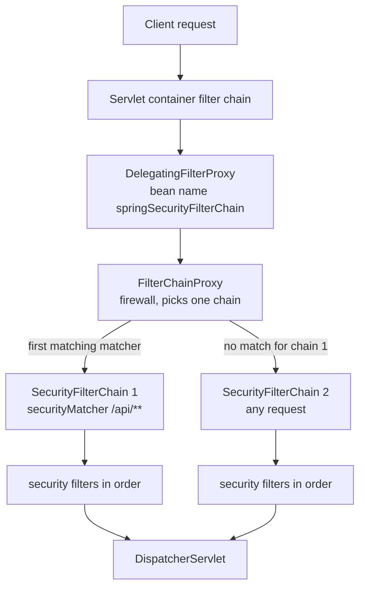
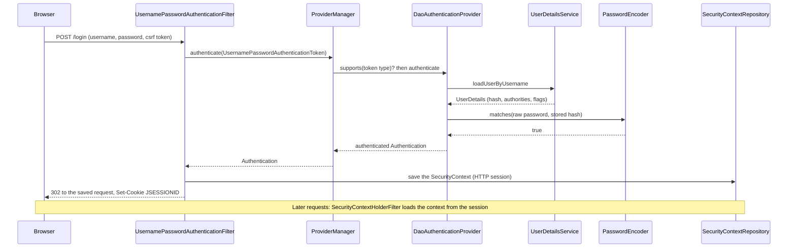
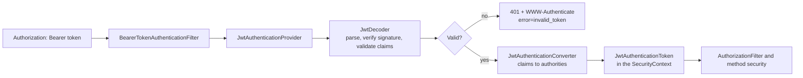

# Spring Security

## Why It Matters

Spring Security protects most Java backends, and interviews ask about it in three forms: "How does the filter chain work?", "How do you secure a REST API with JWT?", and "What is the difference between 401 and 403, CSRF and CORS?". On the job, the failures are concrete: a `403` on every `POST` because CSRF protection is on, a browser that blocks a call because the CORS configuration is missing, an endpoint that is open because a rule is in the wrong order, or a `@PreAuthorize` that does nothing because the call stays inside one class. This page explains the architecture from the servlet container down to the filters, the authentication flow, the authorization rules, sessions versus tokens, the OAuth2 resource server that validates JWTs, CSRF and CORS, and the changes between Spring Security 6 and 7 that interviewers use to test whether you know current code. The security concepts themselves (password hashing, OAuth 2.0 flows, JWT pitfalls) have their home in `kb/security/02-authentication.md` and `kb/security/03-authorization-oauth-oidc-jwt.md`, and the design view (gateway, mTLS, token lifetimes) is in [security in system design](../hld/fundamentals/21-security-in-design.md). This page shows how Spring implements them.

!!! info "Versions"
    On 2026-10-22, Spring Boot 4.1.1 is the current generally available release (`api.spring.io`). Its BOM manages Spring Security 7.1.1 and Spring Framework 7.0.9. Spring Boot 3.5.16 is the newest 3.x release and manages Spring Security 6.5.11 and Spring Framework 6.2.19. Both need Java 17 or later. Each "observed" behavior on this page comes from a run on Spring Security 7.1.1 with `MockMvc` and the Spring Security test support, unless the text says otherwise. The version changes come from the Spring Security 7.0 "What's New" page, the 6.5 and 7.0 migration guides, and the 6.0 GitHub milestone, checked against the class files of the 6.5.11 and 7.1.1 jars. Code that needs Spring carries the `<!-- fragment -->` marker, because the KB runner has no Spring jars. The section "What changed in Spring Security 7" lists the differences to know.

## Core Concepts

**Authentication**: proving who the caller is. In Spring Security the word has two meanings: the process (checking a password or a token) and the object that holds the result (`Authentication`: the principal, the credentials, the authorities, and a flag `isAuthenticated`).

**Authorization**: deciding whether a known caller may do an action. Spring Security makes this decision for a request (URL rules) and for a method call (method security).

**Principal**: the caller's identity, for example the user name or a `UserDetails` object. **Authority** (`GrantedAuthority`): a string that states one permission of the caller, for example `ROLE_ADMIN` or `SCOPE_orders.read`. A **role** is an authority with the prefix `ROLE_`.

**`SecurityContext`** and **`SecurityContextHolder`**: the `SecurityContext` holds the `Authentication` of the current request. The `SecurityContextHolder` stores it in a `ThreadLocal` by default, so code anywhere in the request thread can read it. A new thread does not inherit it unless you configure that.

**`DelegatingFilterProxy`**: a servlet filter that the container knows. It looks up a Spring bean by name and delegates every request to it. **`FilterChainProxy`**: the bean that it delegates to (bean name `springSecurityFilterChain`). It holds a list of `SecurityFilterChain` objects and runs the first one whose matcher accepts the request. **`SecurityFilterChain`**: a request matcher and an ordered list of security filters.

**`AuthenticationManager`**: the interface with one method, `authenticate(Authentication)`. **`ProviderManager`**: its usual implementation. It asks each `AuthenticationProvider` in turn. **`AuthenticationProvider`**: checks one kind of credential. `DaoAuthenticationProvider` checks a user name and password through a `UserDetailsService` and a `PasswordEncoder`.

**`UserDetailsService`**: loads a `UserDetails` (user name, stored password hash, authorities, account flags) by user name. **`PasswordEncoder`**: hashes a password and checks a raw password against a stored hash.

**`AuthenticationEntryPoint`**: starts authentication for an unauthenticated caller (a `401` with a `WWW-Authenticate` header, or a redirect to the login page). **`AccessDeniedHandler`**: handles an authenticated caller who lacks permission (usually `403`).

**`AuthorizationManager`**: makes one access decision. `AuthorizationFilter` and method security both use it.

**JWT** (JSON Web Token, RFC 7519): a signed token with claims. An **OAuth2 resource server**: an API that accepts access tokens and validates them. **CSRF** (cross-site request forgery): an attack in which a malicious page makes the victim's browser send a request that carries the victim's cookies. **CORS** (cross-origin resource sharing): the browser mechanism that lets a server permit a page from another origin to read its responses.

## How It Works

### Where security sits: three layers of filters



1. The **servlet container** accepts only servlet filters that it can create itself. It does not know Spring beans, and the beans do not exist yet when the container registers its filters. `DelegatingFilterProxy` solves this: the container registers the proxy, and the proxy looks up the real filter bean in the `ApplicationContext` when the first request arrives. Spring Boot registers it through `SecurityFilterAutoConfiguration`. Its position among the container's filters is the property `spring.security.filter.order` (default `-100`, so security runs early).
2. **`FilterChainProxy`** is the bean. It applies a firewall to the request (it rejects suspicious paths with `400`: in a test run, `/api/me;x=1`, `/api/%2e%2e/me`, `/api//me`, and `/api/me%2F` were all rejected, while `/api/me` returned `200`), and then it walks the list of `SecurityFilterChain` objects in order and runs the **first** chain whose request matcher accepts the request. The other chains do not run. This is how one application has a stateless JWT chain for `/api/**` and a session-based form-login chain for everything else.
3. A **`SecurityFilterChain`** is a list of security filters. Each filter does one job (load the context, check CSRF, read a token, check access). They are ordinary filters, but they are not beans of the servlet container, and the `HttpSecurity` builder decides which of them exist and in which order.

Spring Boot adds a default chain if you define none. When Spring Security is on the classpath, Boot secures every endpoint (including `/error`) with HTTP Basic and form login, chosen by content negotiation, and it creates one user named `user` with a random password that it prints at `WARN` level at startup (Spring Boot reference, "Spring Security"). If you define a `SecurityFilterChain` bean, the default chain backs off. The default `UserDetailsService` also backs off when `spring-security-oauth2-resource-server` is on the classpath.

### The filters of a chain, in order

This is the output of `FilterChainProxy.getFilterChains()` for a chain with `formLogin`, `httpBasic`, `logout`, and `oauth2ResourceServer` on Spring Security 7.1.1. The order is:

| # | Filter | Job |
|---|---|---|
| 1 | `DisableEncodeUrlFilter` | Stops the container from appending `;jsessionid=` to URLs |
| 2 | `WebAsyncManagerIntegrationFilter` | Carries the `SecurityContext` into async request handling |
| 3 | `SecurityContextHolderFilter` | Loads the `SecurityContext` from the `SecurityContextRepository` (the session, by default) into the holder, and clears it after the request |
| 4 | `HeaderWriterFilter` | Writes security headers (`X-Content-Type-Options`, `Cache-Control`, `X-Frame-Options`) |
| 5 | `CsrfFilter` | Rejects unsafe requests that carry no valid CSRF token (`403`) |
| 6 | `LogoutFilter` | Handles `POST /logout` |
| 7 | `OAuth2ProtectedResourceMetadataFilter` | Serves the OAuth 2.0 protected resource metadata document (RFC 9728) at `/.well-known/oauth-protected-resource` |
| 8 | `UsernamePasswordAuthenticationFilter` | Handles `POST /login` for form login |
| 9-11 | `DefaultResourcesFilter`, `DefaultLoginPageGeneratingFilter`, `DefaultLogoutPageGeneratingFilter` | Generate the default login and logout pages |
| 12 | `BearerTokenAuthenticationFilter` | Reads `Authorization: Bearer ...` and authenticates the token |
| 13 | `BasicAuthenticationFilter` | Reads `Authorization: Basic ...` and authenticates it |
| 14 | `RequestCacheAwareFilter` | Replays the saved request after a login redirect |
| 15 | `SecurityContextHolderAwareRequestFilter` | Makes `request.getUserPrincipal()` and `isUserInRole` work |
| 16 | `AnonymousAuthenticationFilter` | Puts an anonymous `Authentication` in the context if none exists |
| 17 | `ExceptionTranslationFilter` | Turns `AuthenticationException` and `AccessDeniedException` into responses |
| 18 | `AuthorizationFilter` | Checks the URL rules. The last filter |

Three rules explain most behavior:

- **Authenticate first, authorize last.** The filters that read credentials (`UsernamePasswordAuthenticationFilter`, `BearerTokenAuthenticationFilter`, `BasicAuthenticationFilter`) run before `AuthorizationFilter`. An authentication filter that finds a bad credential rejects the request at once, even on a URL that you declared `permitAll()`. Observed: `GET /api/products/1` (declared `permitAll`) returned `200` with no token and `401` with the token `Bearer abc`.
- **`ExceptionTranslationFilter` wraps only what comes after it.** It catches the exceptions of `AuthorizationFilter` and of the application. If the caller is anonymous, it calls the `AuthenticationEntryPoint` (`401` or a redirect to the login page). If the caller is authenticated, it calls the `AccessDeniedHandler` (`403`).
- **`@ControllerAdvice` never sees these exceptions.** The filters run before the `DispatcherServlet`, so a security error in the filter chain does not reach your `@ExceptionHandler` methods (see [Spring Web and REST](20-spring-web-and-rest.md)). To change the body of a `401` or `403`, set a custom entry point and access denied handler.

The program below sends 13 requests through that chain with `MockMvc`. Its output follows. Read the status codes: they are the answer to "what does Spring Security return when...".

<!-- fragment -->
```java
import com.nimbusds.jose.JWSAlgorithm;
import com.nimbusds.jose.JWSHeader;
import com.nimbusds.jose.crypto.MACSigner;
import com.nimbusds.jwt.JWTClaimsSet;
import com.nimbusds.jwt.SignedJWT;
import java.security.Principal;
import java.time.Instant;
import java.util.Date;
import javax.crypto.spec.SecretKeySpec;
import org.springframework.context.annotation.Bean;
import org.springframework.context.annotation.Configuration;
import org.springframework.http.HttpHeaders;
import org.springframework.mock.web.MockServletContext;
import org.springframework.security.config.Customizer;
import org.springframework.security.config.annotation.web.builders.HttpSecurity;
import org.springframework.security.config.annotation.web.configuration.EnableWebSecurity;
import org.springframework.security.core.userdetails.User;
import org.springframework.security.core.userdetails.UserDetailsService;
import org.springframework.security.crypto.bcrypt.BCryptPasswordEncoder;
import org.springframework.security.crypto.password.PasswordEncoder;
import org.springframework.security.oauth2.jose.jws.MacAlgorithm;
import org.springframework.security.oauth2.jwt.JwtDecoder;
import org.springframework.security.oauth2.jwt.NimbusJwtDecoder;
import org.springframework.security.provisioning.InMemoryUserDetailsManager;
import org.springframework.security.web.FilterChainProxy;
import org.springframework.security.web.SecurityFilterChain;
import org.springframework.test.web.servlet.MockMvc;
import org.springframework.test.web.servlet.RequestBuilder;
import org.springframework.test.web.servlet.request.RequestPostProcessor;
import org.springframework.test.web.servlet.setup.MockMvcBuilders;
import org.springframework.web.bind.annotation.GetMapping;
import org.springframework.web.bind.annotation.PostMapping;
import org.springframework.web.bind.annotation.RestController;
import org.springframework.web.context.support.AnnotationConfigWebApplicationContext;
import org.springframework.web.servlet.config.annotation.EnableWebMvc;
import org.springframework.security.test.web.servlet.request.SecurityMockMvcRequestPostProcessors;
import org.springframework.security.test.web.servlet.setup.SecurityMockMvcConfigurers;
import static org.springframework.test.web.servlet.request.MockMvcRequestBuilders.get;
import static org.springframework.test.web.servlet.request.MockMvcRequestBuilders.post;

public class SecurityFlow {
    static final byte[] KEY = "0123456789abcdef0123456789abcdef".getBytes();

    @RestController
    static class Api {
        @GetMapping("/public/ping") String ping() { return "pong"; }
        @GetMapping("/api/me") String me(Principal p) { return "me=" + p.getName(); }
        @GetMapping("/admin/panel") String admin() { return "admin"; }
        @PostMapping("/api/orders") String create() { return "created"; }
    }

    @Configuration
    @EnableWebSecurity
    @EnableWebMvc
    static class Cfg {
        @Bean Api apiController() { return new Api(); }

        @Bean
        SecurityFilterChain chain(HttpSecurity http) throws Exception {
            http
                .authorizeHttpRequests(a -> a
                    .requestMatchers("/public/**").permitAll()
                    .requestMatchers("/admin/**").hasRole("ADMIN")
                    .anyRequest().authenticated())
                .httpBasic(Customizer.withDefaults())
                .formLogin(Customizer.withDefaults())
                .oauth2ResourceServer(o -> o.jwt(Customizer.withDefaults()));
            return http.build();
        }

        @Bean PasswordEncoder encoder() { return new BCryptPasswordEncoder(); }

        @Bean
        UserDetailsService users(PasswordEncoder enc) {
            return new InMemoryUserDetailsManager(
                User.withUsername("ann").password(enc.encode("pw")).roles("USER").build(),
                User.withUsername("root").password(enc.encode("pw")).roles("ADMIN").build());
        }

        @Bean
        JwtDecoder jwtDecoder() {
            return NimbusJwtDecoder.withSecretKey(new SecretKeySpec(KEY, "HmacSHA256"))
                .macAlgorithm(MacAlgorithm.HS256).build();
        }
    }

    static RequestPostProcessor basic(String user, String password) {
        return SecurityMockMvcRequestPostProcessors.httpBasic(user, password);
    }

    static RequestPostProcessor csrfToken() {
        return SecurityMockMvcRequestPostProcessors.csrf();
    }

    static String token(long secondsUntilExpiry, byte[] key) throws Exception {
        JWTClaimsSet claims = new JWTClaimsSet.Builder().subject("ann")
            .issueTime(Date.from(Instant.now().minusSeconds(1000)))
            .expirationTime(Date.from(Instant.now().plusSeconds(secondsUntilExpiry))).build();
        SignedJWT jwt = new SignedJWT(new JWSHeader(JWSAlgorithm.HS256), claims);
        jwt.sign(new MACSigner(key));
        return jwt.serialize();
    }

    static void call(MockMvc mvc, String label, RequestBuilder request) throws Exception {
        var response = mvc.perform(request).andReturn().getResponse();
        String challenge = response.getStatus() == 401
            ? response.getHeader("WWW-Authenticate") : null;
        String location = response.getHeader("Location");
        System.out.println(label + " -> " + response.getStatus()
            + (challenge == null ? "" : "  " + challenge.split(",")[0])
            + (location == null ? "" : "  Location=" + location.replace("http://localhost", "")));
    }

    public static void main(String[] args) throws Exception {
        var ctx = new AnnotationConfigWebApplicationContext();
        ctx.setServletContext(new MockServletContext());
        ctx.register(Cfg.class);
        ctx.refresh();

        var chain = ctx.getBean(FilterChainProxy.class).getFilterChains().get(0);
        for (var filter : chain.getFilters()) {
            System.out.println("  " + filter.getClass().getSimpleName());
        }

        MockMvc mvc = MockMvcBuilders.webAppContextSetup(ctx)
            .apply(SecurityMockMvcConfigurers.springSecurity()).build();
        String good = "Bearer " + token(600, KEY);
        String expired = "Bearer " + token(-300, KEY);
        String forged = "Bearer " + token(600, "ffffffffffffffffffffffffffffffff".getBytes());
        call(mvc, "public, no credentials     ", get("/public/ping"));
        call(mvc, "api, browser, no credentials", get("/api/me").accept("text/html"));
        call(mvc, "api, json client, none     ", get("/api/me").accept("application/json"));
        call(mvc, "api, basic ok              ", get("/api/me").with(basic("ann", "pw")));
        call(mvc, "api, basic wrong password  ", get("/api/me").with(basic("ann", "bad")));
        call(mvc, "admin, role USER           ", get("/admin/panel").with(basic("ann", "pw")));
        call(mvc, "admin, role ADMIN          ", get("/admin/panel").with(basic("root", "pw")));
        call(mvc, "api, jwt ok                ",
            get("/api/me").header(HttpHeaders.AUTHORIZATION, good));
        call(mvc, "api, jwt expired           ",
            get("/api/me").header(HttpHeaders.AUTHORIZATION, expired));
        call(mvc, "api, jwt forged            ",
            get("/api/me").header(HttpHeaders.AUTHORIZATION, forged));
        call(mvc, "POST, basic, no csrf token ", post("/api/orders").with(basic("ann", "pw")));
        call(mvc, "POST, basic, csrf token    ",
            post("/api/orders").with(basic("ann", "pw")).with(csrfToken()));
        call(mvc, "POST, bearer, no csrf token",
            post("/api/orders").header(HttpHeaders.AUTHORIZATION, good));
    }
}
```

Output from a real run (Spring Security 7.1.1). The first 18 lines are the filters from the table. The remaining lines are the requests:

```text
  DisableEncodeUrlFilter
  WebAsyncManagerIntegrationFilter
  SecurityContextHolderFilter
  HeaderWriterFilter
  CsrfFilter
  LogoutFilter
  OAuth2ProtectedResourceMetadataFilter
  UsernamePasswordAuthenticationFilter
  DefaultResourcesFilter
  DefaultLoginPageGeneratingFilter
  DefaultLogoutPageGeneratingFilter
  BearerTokenAuthenticationFilter
  BasicAuthenticationFilter
  RequestCacheAwareFilter
  SecurityContextHolderAwareRequestFilter
  AnonymousAuthenticationFilter
  ExceptionTranslationFilter
  AuthorizationFilter
public, no credentials      -> 200
api, browser, no credentials -> 302  Location=/login
api, json client, none      -> 401  Basic realm="Realm"
api, basic ok               -> 200
api, basic wrong password   -> 401  Basic realm="Realm"
admin, role USER            -> 403
admin, role ADMIN           -> 200
api, jwt ok                 -> 200
api, jwt expired            -> 401  Bearer error="invalid_token"
api, jwt forged             -> 401  Bearer error="invalid_token"
POST, basic, no csrf token  -> 403
POST, basic, csrf token     -> 200
POST, bearer, no csrf token -> 200
```

What the results show:

- A caller without credentials gets `302` to `/login` if the request accepts HTML (a browser), and `401` with `WWW-Authenticate: Basic` if it asks for JSON. The entry point is chosen by the `Accept` header. For a pure API, configure one entry point and one scheme.
- A wrong password gives `401`. A valid user with a role that is too low gives `403`. This is the difference: `401` means "I do not know who you are", `403` means "I know who you are, and you may not do this". The status code `401` is named "Unauthorized" in HTTP, but it means unauthenticated.
- A forged or expired JWT gives `401` with `WWW-Authenticate: Bearer error="invalid_token"` (RFC 6750 section 3).
- A `POST` with Basic credentials and no CSRF token gives `403`. The same `POST` with a token gives `200`. A `POST` with a bearer token and no CSRF token gives `200`: the resource server configuration excludes bearer-token requests from CSRF checks, because a browser does not add an `Authorization` header by itself.

### Authentication

#### The flow for a password login



1. `UsernamePasswordAuthenticationFilter` reads the form fields and builds an unauthenticated `UsernamePasswordAuthenticationToken`.
2. `ProviderManager` asks its providers. `DaoAuthenticationProvider` supports that token type. It calls the `UserDetailsService` for the user, checks the account flags (`enabled`, `locked`, `expired`), and calls `PasswordEncoder.matches`.
3. On success, the provider returns an authenticated `Authentication` with the authorities. The manager erases the credentials from it. On failure, it throws an `AuthenticationException` (`BadCredentialsException`, `LockedException`, ...), and the failure handler responds.
4. The filter stores the `SecurityContext` in the `SecurityContextRepository`. For a form login the repository is the HTTP session, so the browser's `JSESSIONID` cookie stands for the login. In the next request, `SecurityContextHolderFilter` reads the context from the session. In Spring Security 6 and later, the application must save the context explicitly (the "explicit save" model). The login filters do it for you. A custom login endpoint that you write must call `SecurityContextRepository.saveContext` itself.

With a bearer token there is no login step on your side: `BearerTokenAuthenticationFilter` authenticates each request by validating the token, and it does not save anything in a session.

#### Users and passwords

Spring Boot builds a `DaoAuthenticationProvider` from a `UserDetailsService` bean and a `PasswordEncoder` bean. The code below loads accounts from your own repository and exposes the `AuthenticationManager` for a custom login endpoint.

<!-- fragment -->
```java
import java.util.List;
import java.util.Optional;
import org.springframework.context.annotation.Bean;
import org.springframework.context.annotation.Configuration;
import org.springframework.security.authentication.AuthenticationManager;
import org.springframework.security.config.annotation.authentication.configuration.*;
import org.springframework.security.core.userdetails.User;
import org.springframework.security.core.userdetails.UserDetails;
import org.springframework.security.core.userdetails.UserDetailsService;
import org.springframework.security.core.userdetails.UsernameNotFoundException;
import org.springframework.security.crypto.factory.PasswordEncoderFactories;
import org.springframework.security.crypto.password.PasswordEncoder;

record AccountRow(String username, String passwordHash, boolean enabled, List<String> roles) { }

interface AccountRepository {
    Optional<AccountRow> findByUsername(String username);
}

@Configuration
class AuthBeans {

    // Spring Security builds a DaoAuthenticationProvider from these two beans.
    @Bean
    UserDetailsService userDetailsService(AccountRepository accounts) {
        return username -> {
            AccountRow row = accounts.findByUsername(username)
                .orElseThrow(() -> new UsernameNotFoundException("unknown user"));
            return User.withUsername(row.username())
                .password(row.passwordHash())            // stored hash, e.g. "{bcrypt}$2a$10$..."
                .disabled(!row.enabled())
                .roles(row.roles().toArray(String[]::new))   // adds the ROLE_ prefix
                .build();
        };
    }

    @Bean
    PasswordEncoder passwordEncoder() {
        return PasswordEncoderFactories.createDelegatingPasswordEncoder();   // {bcrypt} by default
    }

    // Expose the manager for a custom login endpoint that issues a token.
    @Bean
    AuthenticationManager authenticationManager(AuthenticationConfiguration config)
            throws Exception {
        return config.getAuthenticationManager();
    }
}
```

**Password storage.** Never store a password in plain text or with a fast hash (MD5, SHA-256). A password hash needs a unique salt and a work factor that you can raise as hardware gets faster. Spring's `BCryptPasswordEncoder` does that. Observed on Spring Security 7.1.1: the output starts with `$2a$10$` (version `2a`, cost factor 10, so `2^10` rounds), is 60 characters long, differs for two calls with the same password (a random salt each time), and `matches` returns `true`. BCrypt reads at most 72 bytes of the password. `encode` on 7.1.1 throws `IllegalArgumentException` ("password cannot be more than 72 bytes") for a longer password (observed with 73 bytes), so limit the password length in your sign-up validation. The theory (salts, work factors, Argon2, PBKDF2) is in `kb/security/02-authentication.md`.

**`DelegatingPasswordEncoder`** (`PasswordEncoderFactories.createDelegatingPasswordEncoder()`) stores the algorithm in the hash as a prefix: `{bcrypt}$2a$10$...`. On `matches`, it reads the prefix and uses the matching encoder. That lets you change the algorithm later without breaking old hashes, because old rows keep their prefix. `{noop}pw` works as a plain text entry for tests only (observed: `matches` returned `true`). `upgradeEncoding(hash)` returns `true` when the stored hash uses a weaker setting than the current default (observed for a `{bcrypt}` hash with cost 4: `true`), so you can re-hash the password after a successful login.

**`UserDetails` and roles.** `User.withUsername("ann").roles("ADMIN")` stores the authority `ROLE_ADMIN` (the builder adds the `ROLE_` prefix). `.authorities("orders:write")` stores the string as it is.

### Authorization

#### URL rules

`authorizeHttpRequests` builds an ordered list of (matcher, rule) pairs. `AuthorizationFilter` checks them for each request.

<!-- fragment -->
```java
import org.springframework.context.annotation.Bean;
import org.springframework.context.annotation.Configuration;
import org.springframework.core.annotation.Order;
import org.springframework.http.HttpMethod;
import org.springframework.security.config.Customizer;
import org.springframework.security.config.annotation.method.configuration.EnableMethodSecurity;
import org.springframework.security.config.annotation.web.builders.HttpSecurity;
import org.springframework.security.config.annotation.web.configuration.EnableWebSecurity;
import org.springframework.security.config.annotation.web.configurers.AbstractHttpConfigurer;
import org.springframework.security.config.http.SessionCreationPolicy;
import org.springframework.security.oauth2.server.resource.authentication.*;
import org.springframework.security.web.SecurityFilterChain;

@Configuration
@EnableWebSecurity
@EnableMethodSecurity
class SecurityConfig {

    // Chain 1: the JSON API. Stateless, bearer JWT, no CSRF (no cookie authenticates a call).
    @Bean
    @Order(1)
    SecurityFilterChain apiChain(HttpSecurity http) throws Exception {
        http
            .securityMatcher("/api/**")
            .authorizeHttpRequests(auth -> auth
                .requestMatchers(HttpMethod.GET, "/api/products/**").permitAll()
                .requestMatchers("/api/admin/**").hasAuthority("SCOPE_admin")
                .anyRequest().authenticated())
            .oauth2ResourceServer(oauth -> oauth
                .jwt(jwt -> jwt.jwtAuthenticationConverter(jwtConverter())))
            .sessionManagement(s -> s.sessionCreationPolicy(SessionCreationPolicy.STATELESS))
            .csrf(AbstractHttpConfigurer::disable)
            .cors(Customizer.withDefaults());
        return http.build();
    }

    // Chain 2: everything else. Browser pages and a single-page app, form login,
    // session cookie, CSRF on.
    @Bean
    @Order(2)
    SecurityFilterChain webChain(HttpSecurity http) throws Exception {
        http
            .authorizeHttpRequests(auth -> auth
                .requestMatchers("/", "/login", "/assets/**").permitAll()
                .requestMatchers("/actuator/health/**").permitAll()
                .anyRequest().authenticated())
            .formLogin(Customizer.withDefaults())
            .logout(Customizer.withDefaults())
            .csrf(csrf -> csrf.spa());   // cookie XSRF-TOKEN, header X-XSRF-TOKEN (7.0 and later)
        return http.build();
    }

    // Map the "roles" claim to ROLE_* authorities. The default maps only "scope" and "scp".
    @Bean
    JwtAuthenticationConverter jwtConverter() {
        JwtGrantedAuthoritiesConverter roles = new JwtGrantedAuthoritiesConverter();
        roles.setAuthoritiesClaimName("roles");
        roles.setAuthorityPrefix("ROLE_");
        JwtAuthenticationConverter converter = new JwtAuthenticationConverter();
        converter.setJwtGrantedAuthoritiesConverter(roles);
        return converter;
    }
}
```

Rules that matter, each tested on Spring Security 7.1.1:

- **The first matching rule wins.** With `.requestMatchers("/admin/**").hasRole("ADMIN")` before `.requestMatchers("/admin/public").permitAll()`, a user with `ROLE_USER` got `403` on `/admin/public`. Put the specific rule first.
- **`anyRequest()` must be last.** A matcher after `anyRequest()` fails at startup with `IllegalStateException: Can't configure requestMatchers after anyRequest`.
- **A request that no rule matches is denied.** A chain with only `.requestMatchers("/x").permitAll()` returned `403` for `/other`. End every chain with `anyRequest().authenticated()` or `anyRequest().denyAll()` to make the intent visible.
- **`hasRole("ADMIN")` checks the authority `ROLE_ADMIN`.** `hasRole("ROLE_ADMIN")` fails at startup with "ROLE_ADMIN should not start with ROLE_ since ROLE_ is automatically prepended". Use `hasAuthority` for a string that has no prefix, such as `SCOPE_admin`.
- **A matcher string is a path pattern.** In Spring Security 7, `requestMatchers("/api/**")` builds a `PathPatternRequestMatcher`. The classes `AntPathRequestMatcher` and `MvcRequestMatcher` do not exist in the 7.1.1 jars (they exist in 6.5.11). `antMatchers`, `mvcMatchers`, and `regexMatchers` were removed in Spring Security 6.0.

URL rules are a coarse check on the path. They cannot say "this user owns this invoice", because the rule does not know the data. That check belongs in method security or in the service, and it is the failure that the OWASP API Security Top 10 2023 lists first (API1:2023, broken object level authorization; see [security in system design](../hld/fundamentals/21-security-in-design.md)).

#### Method security

`@EnableMethodSecurity` turns on `@PreAuthorize`, `@PostAuthorize`, `@PreFilter`, and `@PostFilter`. It creates a proxy for each bean that has such annotations, so it has the same limits as every Spring proxy (see [Spring core](17-spring-core.md)).

<!-- fragment -->
```java
import org.springframework.security.access.prepost.PostAuthorize;
import org.springframework.security.access.prepost.PreAuthorize;
import org.springframework.stereotype.Component;
import org.springframework.stereotype.Service;

record Invoice(long id, String ownerName, long cents) { }

interface InvoiceStore {
    Invoice load(long id);
}

@Component("authz")
class InvoiceAccess {
    private final InvoiceStore store;
    InvoiceAccess(InvoiceStore store) { this.store = store; }

    boolean isOwner(long invoiceId, String username) {
        return store.load(invoiceId).ownerName().equals(username);
    }
}

@Service
class InvoiceService {
    private final InvoiceStore store;
    InvoiceService(InvoiceStore store) { this.store = store; }

    @PreAuthorize("hasRole('ADMIN')")                       // checked before the method runs
    public void delete(long id) { }

    @PreAuthorize("hasAuthority('SCOPE_invoices:read')")
    public Invoice find(long id) { return store.load(id); }

    @PreAuthorize("@authz.isOwner(#id, authentication.name) or hasRole('ADMIN')")
    public Invoice findForUser(long id) { return store.load(id); }

    @PostAuthorize("returnObject.ownerName == authentication.name")   // checked after it ran
    public Invoice loadChecked(long id) { return store.load(id); }

    public void internalCleanup(long id) {
        delete(id);        // self-invocation: the proxy is skipped, so the check does NOT run
    }
}
```

- `@PreAuthorize` runs before the method. The expression language (SpEL) can read the arguments (`#id`), the `authentication`, and beans (`@authz.isOwner(...)`). `@PostAuthorize` runs after the method and can read `returnObject`.
- A denied call throws `AccessDeniedException`. On Spring Security 7.1.1 the observed type is `AuthorizationDeniedException` (a subclass). The exception travels up through the `DispatcherServlet`, and `ExceptionTranslationFilter` turns it into `403`, or into `401` for an anonymous caller. Because the method runs inside the `DispatcherServlet`, a controller advice sees the exception first. Trap: a catch-all `@ExceptionHandler(Exception.class)` in your advice catches `AccessDeniedException` too and turns a `403` into a `500` (observed on 7.1.1). Rethrow it, or add a handler for `AccessDeniedException` that returns `403`.
- **Self-invocation skips the check.** Observed on Spring Security 7.1.1 with a test bean in the shape of `internalCleanup`: a call to the annotated method from another method of the same bean (`this.admin()`) ran without any check, while a direct call through the proxy threw `AuthorizationDeniedException`. The proxy sits between callers and the bean, and `this` is the bean itself.
- `@EnableGlobalMethodSecurity` is deprecated (the class carries `@Deprecated` in the 7.1.1 jar). Use `@EnableMethodSecurity`.
- Put the check on the service method, not only on the controller. A job, a message listener, or another controller can call the service, and they skip the controller's check.

#### Sessions versus stateless tokens

| | Server-side session (cookie) | Stateless token (JWT as bearer) |
|---|---|---|
| State | The server stores the `SecurityContext` in a session. The cookie holds only the session ID | The token holds the claims. The server stores nothing |
| Scale-out | Needs sticky routing or a shared session store (Spring Session with Redis or a database) | Any instance can validate the token with the issuer's public key |
| Revocation | Immediate: delete the session | Hard until the token expires. Use short lifetimes, and a deny list or an opaque token for emergencies |
| Sent by | The browser adds the cookie to every request to that site, also to a forged cross-site request | Your code adds the `Authorization` header, so a forged cross-site request has no token |
| Needs CSRF protection | Yes | No (no ambient credential) |
| Typical client | A server-rendered web application | A mobile application, a single-page application with an API, service to service |
| Typical Spring setup | `formLogin`, `SessionCreationPolicy.IF_REQUIRED` (default) | `oauth2ResourceServer`, `SessionCreationPolicy.STATELESS`, `csrf` disabled |

`SessionCreationPolicy.STATELESS` tells Spring Security not to create an `HttpSession` and not to use one to store the context. The chain `apiChain` in the code above uses it. The theory of tokens, refresh tokens, and where a browser should store a token is in `kb/security/03-authorization-oauth-oidc-jwt.md` and [security in system design](../hld/fundamentals/21-security-in-design.md).

### The OAuth2 resource server with JWT

A **resource server** receives an access token on each request and decides whether to trust it. With `oauth2ResourceServer(o -> o.jwt(...))`, `BearerTokenAuthenticationFilter` extracts the token from the `Authorization` header, and a `JwtAuthenticationProvider` does the work:



1. The `JwtDecoder` (Nimbus implementation) parses the token, checks that the header algorithm is the configured one, and verifies the signature with the configured key: a key from the issuer's JWK Set URI (the decoder caches the key set), or a key you provide.
2. It runs the **validators** on the claims. The default validator checks the time claims: `exp` (and `nbf` if present), with a clock skew of **60 seconds**. Observed: a token that expired 30 seconds ago was accepted, and one that expired 90 seconds ago was rejected. The decoder also checks the `typ` header: absent or `JWT` passes. In Spring Security 6.x, the Nimbus library inside `NimbusJwtDecoder` makes this check. Spring Security 7.0 moved it into the validator list: every `JwtValidators.createDefault*` method adds `JwtTypeValidator.jwt()`, and Nimbus no longer checks the type (6.5 "Preparing for 7.0" and 7.0 migration guides). Observed on 7.1.1: a token without `typ` or with `typ: JWT` passed, and a token with `typ: at+jwt` was rejected ("the given typ value needs to be one of [JWT]"). If your identity provider issues RFC 9068 access tokens with `typ: at+jwt`, pass `new JwtTypeValidator("JWT", "at+jwt")` to `JwtValidators.createDefaultWithValidators(...)`. Observed: it replaced the default type check, accepted both values, and rejected a token without `typ` (call `setAllowEmpty(true)` to accept that case). With an issuer URI, Spring also checks `iss`. In Spring Boot, `spring.security.oauth2.resourceserver.jwt.issuer-uri` configures the issuer check and the key lookup, and `jwk-set-uri` gives the key location only. `jws-algorithms` sets the accepted signature algorithms (default `RS256`).
3. **The default does not check the audience (`aud`).** A token that was issued for another API and signed by the same issuer passes. Observed: a token with `aud: some-other-api` was accepted. Add an audience validator (Spring Boot has the property `spring.security.oauth2.resourceserver.jwt.audiences`, or write a `JwtClaimValidator` as in the code below).
4. The `JwtAuthenticationConverter` maps claims to authorities. The default `JwtGrantedAuthoritiesConverter` reads the claim `scope` (a space-separated string) or `scp` (a list) and adds the prefix `SCOPE_`. Observed: `scope: "read write"` and `scp: ["read","write"]` both give `SCOPE_read` and `SCOPE_write`, and a `roles` claim gives **no** role or scope authority. In Spring Security 7, the converter also adds a `FACTOR_BEARER` authority (a `FactorGrantedAuthority`, part of the multi-factor authentication support added in 7.0), which records how the caller authenticated.
5. On any validation failure the response is `401` with `WWW-Authenticate: Bearer error="invalid_token"` and a description (RFC 6750). A valid token with too few authorities gets `403` with `error="insufficient_scope"`.

<!-- fragment -->
```java
import java.util.List;
import org.springframework.context.annotation.Bean;
import org.springframework.context.annotation.Configuration;
import org.springframework.security.oauth2.core.OAuth2TokenValidator;
import org.springframework.security.oauth2.jose.jws.SignatureAlgorithm;
import org.springframework.security.oauth2.jwt.Jwt;
import org.springframework.security.oauth2.jwt.JwtClaimNames;
import org.springframework.security.oauth2.jwt.JwtClaimValidator;
import org.springframework.security.oauth2.jwt.JwtDecoder;
import org.springframework.security.oauth2.jwt.JwtIssuerValidator;
import org.springframework.security.oauth2.jwt.JwtValidators;
import org.springframework.security.oauth2.jwt.NimbusJwtDecoder;

@Configuration
class JwtConfig {
    @Bean
    JwtDecoder jwtDecoder() {
        // The decoder fetches the public keys from the JWK Set URI and caches them.
        NimbusJwtDecoder decoder = NimbusJwtDecoder
            .withJwkSetUri("https://idp.example.com/.well-known/jwks.json")
            .jwsAlgorithm(SignatureAlgorithm.RS256)     // pin the algorithm
            .build();

        OAuth2TokenValidator<Jwt> audience = new JwtClaimValidator<List<String>>(
            JwtClaimNames.AUD, aud -> aud != null && aud.contains("orders-api"));

        // createDefaultWithValidators keeps the defaults (exp and nbf with 60 seconds of
        // skew, and the typ check that Spring Security 7 runs here) and adds issuer and audience.
        // A plain DelegatingOAuth2TokenValidator would replace the defaults instead.
        decoder.setJwtValidator(JwtValidators.createDefaultWithValidators(List.of(
            new JwtIssuerValidator("https://idp.example.com"),
            audience)));                                 // the default does not check "aud"
        return decoder;
    }
}
```

Two traps, both observed:

- **A custom authorities converter replaces the default one.** In `SecurityConfig`, `jwtConverter()` maps the claim `roles`. After that, a token with `scope: admin` gets `403` on a `hasAuthority("SCOPE_admin")` rule, because nothing maps `scope` any more. Map both claims if you need both, or use one convention everywhere.
- **`hasRole` and `hasAuthority` read different strings.** A `roles: ["ADMIN"]` claim with prefix `ROLE_` gives `ROLE_ADMIN`, which `hasRole("ADMIN")` accepts. A scope `admin` gives `SCOPE_admin`, which only `hasAuthority("SCOPE_admin")` accepts.

The JWT pitfalls that the framework does not remove for you (the `alg` header attacks, long lifetimes, tokens in browser storage, missing `aud` and `iss` checks) are in `kb/security/03-authorization-oauth-oidc-jwt.md` and RFC 8725 ("JSON Web Token Best Current Practices"). An **opaque token** is an alternative: the server calls the issuer's introspection endpoint on each request (`o.opaqueToken(...)`). It costs one network call, and it supports instant revocation.

### CSRF

**The attack.** A user is logged in at `bank.example`, and the browser holds the session cookie. The user opens `evil.example`, whose page submits a hidden form to `bank.example/transfer`. The browser attaches the `bank.example` cookie to that request, because a browser sends a site's cookies with requests to that site, also when another site starts the request, unless the cookie's `SameSite` attribute forbids it. The server cannot tell the forged request from a real one.

**The defense (synchronizer token).** The server creates a random CSRF token per session and requires it in every unsafe request (`POST`, `PUT`, `PATCH`, `DELETE`), in a header or a form field. The attacker's page cannot read the token, because the same-origin policy blocks it from reading `bank.example` pages. `CsrfFilter` in the chain does the check. Spring Security turns it on by default and answers `403` when the token is missing or wrong (observed: `403` for a `POST` with Basic credentials and no token, and `200` with a token). Two defaults since Spring Security 6.0 change how the token reaches the client. First, token loading is deferred: the repository creates and stores a token only when some code reads it. Second, the token that Spring renders into a page is masked with a random value on each request (`XorCsrfTokenRequestAttributeHandler`), so that an attacker cannot recover it from compressed responses (the BREACH attack). The server unmasks the value that the client sends back. `SameSite` cookies add a second layer, and they are not a replacement for the token in Spring's model. The OWASP CSRF Prevention Cheat Sheet explains both.

**When to turn it off.** Turn CSRF protection off for an endpoint only when no ambient credential (a cookie, or browser-managed Basic authentication) can authenticate the request. A stateless API that reads a bearer token from the `Authorization` header qualifies, because the browser does not add that header by itself. Observed in the resource server chain: a `POST` with a bearer token and no CSRF token passed. For a browser application that uses a session cookie, keep CSRF on.

**A single-page application** that sends the session cookie needs the token too. The script reads it from a cookie named `XSRF-TOKEN` and sends it back in the header `X-XSRF-TOKEN`. In Spring Security 7, `csrf(csrf -> csrf.spa())` (in `webChain` above) configures all of it: a cookie that the script can read, a request handler that loads the deferred token so that the cookie is set, and a handler that accepts the raw cookie value in the header. `CookieCsrfTokenRepository.withHttpOnlyFalse()` alone is not enough since 6.0. Observed on 7.1.1: with only that repository, the cookie appeared only after a controller read the token, and a `POST` that copied the cookie value into `X-XSRF-TOKEN` got `403`, because the default handler expects a masked value. With `spa()`, the same `POST` got `200`. On Spring Security 6.x (Spring Boot 3.x), `spa()` does not exist: the 6.5 reference ("Single-Page Applications") shows a `SpaCsrfTokenRequestHandler` class that you copy and register with `csrfTokenRepository(CookieCsrfTokenRepository.withHttpOnlyFalse())` and `csrfTokenRequestHandler(new SpaCsrfTokenRequestHandler())`.

### CORS

**The browser rule.** The same-origin policy stops a script from `https://app.example.com` from reading the response of `https://api.example.com`, because the origins differ (scheme, host, or port). **CORS** is the way for `api.example.com` to allow it with response headers (`Access-Control-Allow-Origin` and others). For a request that is not "simple" (for example one with an `Authorization` header or a JSON `Content-Type`), the browser first sends a **preflight**: an `OPTIONS` request with `Origin` and `Access-Control-Request-Method`. The server answers with what it allows, and the browser sends the real request only if the answer permits it.

What CORS is **not**: it does not authenticate anyone, and it does not stop a request from reaching the server. A forged form post from another site is a simple request, and the server receives it (that is the CSRF attack). `curl` and any server-side client ignore CORS. CORS only controls which pages may *read* responses in a browser. It is a relaxation of the same-origin policy and not a security control for your API.

**In Spring Security.** The preflight request carries no credentials, so it must be answered **before** authentication, or the security chain rejects it with `401`. `.cors(Customizer.withDefaults())` adds `CorsFilter` early in the chain (after `HeaderWriterFilter`, before `CsrfFilter`, logout, and the credential filters), and the filter ends the preflight request with the CORS headers. Observed on Spring Security 7.1.1: the preflight from an allowed origin returned `200` with `Access-Control-Allow-Origin: https://app.example.com`, and from another origin returned `403` with the body "Invalid CORS request". Neither request reached the authentication filters (a test filter placed after the CORS filter did not run for the `OPTIONS` requests).

<!-- fragment -->
```java
import java.util.List;
import org.springframework.context.annotation.Bean;
import org.springframework.context.annotation.Configuration;
import org.springframework.web.cors.CorsConfiguration;
import org.springframework.web.cors.UrlBasedCorsConfigurationSource;

@Configuration
class CorsConfig {

    // The bean name matters. Spring Security looks for "corsConfigurationSource".
    @Bean
    UrlBasedCorsConfigurationSource corsConfigurationSource() {
        CorsConfiguration config = new CorsConfiguration();
        config.setAllowedOrigins(List.of("https://app.example.com"));   // exact origins
        config.setAllowedMethods(List.of("GET", "POST", "PUT", "DELETE"));
        config.setAllowedHeaders(List.of("Authorization", "Content-Type"));
        config.setAllowCredentials(false);       // true only with exact origins, never with "*"
        config.setMaxAge(3600L);                 // the browser may cache the preflight answer

        UrlBasedCorsConfigurationSource source = new UrlBasedCorsConfigurationSource();
        source.registerCorsConfiguration("/api/**", config);
        return source;
    }
}
```

A trap: Spring Security finds the CORS rules by the bean name **`corsConfigurationSource`**. Observed on 7.1.1: a bean of type `CorsConfigurationSource` named `cors` was ignored. The `CorsFilter` took its rules from Spring MVC's handler mappings instead, and the preflight got `200` with no CORS headers, from the allowed origin and from an unknown origin alike. The reference documentation shows the bean with that name and the return type `UrlBasedCorsConfigurationSource`. Do the same.

Rules: list exact origins in `allowedOrigins`. The browser forbids `Access-Control-Allow-Origin: *` together with credentials, and reflecting any `Origin` header with credentials allowed lets every site read your users' data. See the MDN CORS guide for the header rules.

### Multiple chains

One application often needs different rules for different URL spaces. Define several `SecurityFilterChain` beans, give each a `securityMatcher`, and order them with `@Order`. The chain with the lowest order that matches runs. The last chain has no `securityMatcher`, so it catches the rest (`webChain` above). If a chain that matches any request comes before another chain, the later chain can never run. Spring Security detects it and fails at startup with `UnreachableFilterChainException` (observed on 7.1.1). Check the order with `FilterChainProxy` when a rule seems ignored. Give the chain beans distinct names such as `apiChain` and `webChain`. Observed in a plain Spring context, which allows bean overriding: a `SecurityFilterChain` bean named `api` was replaced by a controller bean with the same name, and every request fell through to the other chain. Spring Boot forbids bean overriding by default and fails at startup instead.

### What changed in Spring Security 7

| Topic | Spring Security 6.x (Boot 3.x) | Spring Security 7.x (Boot 4.x) |
|---|---|---|
| `WebSecurityConfigurerAdapter` | Deprecated in 5.7.0-M2, removed in 6.0 (gh-11923, milestone 6.0.0-RC1). Define a `SecurityFilterChain` bean | Same |
| Chained DSL (`http.csrf().disable().and()...`) | `csrf()`, `cors()`, `httpBasic()` without arguments and `and()` still exist in 6.5.11 | `and()` and the no-argument methods are removed (7.0 "What's New"). Use the lambda form: `http.csrf(csrf -> csrf.disable())` or `csrf(AbstractHttpConfigurer::disable)` |
| `authorizeRequests()` (expression based) | Exists in 6.5.11 | Removed in 7.0. Use `authorizeHttpRequests` |
| `antMatchers`, `mvcMatchers`, `regexMatchers` | Removed in 6.0 (gh-11939). Use `requestMatchers` | Same |
| `AntPathRequestMatcher`, `MvcRequestMatcher` | Present in 6.5.11 | Removed in 7.0 in favor of `PathPatternRequestMatcher` (`requestMatchers("/path/**")` builds it) |
| CSRF for a single-page application | A custom `SpaCsrfTokenRequestHandler` from the reference | `csrf(c -> c.spa())` |
| JWT `typ` check | Nimbus checks `typ` inside the decoder (absent or `JWT`), so a custom validator list keeps the check | The check moved to `JwtTypeValidator.jwt()`, which every `createDefault*` method adds. A custom `DelegatingOAuth2TokenValidator` list now drops it (7.0 migration guide) |
| JWK Set fetch timeout of `NimbusJwtDecoder` | 500 ms connect and read timeout | 30 seconds (7.0 migration guide) |
| Multi-factor authentication | No built-in support (no `FactorGrantedAuthority` class in 6.5.11) | Added in 7.0: `@EnableMultiFactorAuthentication`, factor authorities such as `FACTOR_BEARER` and `FACTOR_PASSWORD` |
| Access API (`AccessDecisionManager`, `AccessDecisionVoter`) | In `spring-security-core` | Moved to a new module, `spring-security-access`. New code uses `AuthorizationManager` |
| OAuth 2.0 | The OAuth 2.0 client supports the password grant | Password grant removed. Spring Authorization Server is now part of Spring Security |
| `@EnableGlobalMethodSecurity` | Deprecated. Use `@EnableMethodSecurity` | Class still present in 7.1.1, marked `@Deprecated`. Use `@EnableMethodSecurity` |
| Context persistence | `SecurityContextHolderFilter` (explicit save) is the default since 6.0 | Same |
| Boot starters and modules | `spring-boot-starter-security`, `spring-boot-starter-oauth2-resource-server` | `spring-boot-starter-security` stays. The resource server starter is renamed `spring-boot-starter-security-oauth2-resource-server` (the old name is deprecated). `@WithMockUser` in Boot tests needs `spring-boot-starter-security-test`. The auto-configuration moved into modules such as `spring-boot-security` (package `org.springframework.boot.security.autoconfigure`) (Spring Boot 4.0 migration guide) |

An interviewer who shows `http.authorizeRequests().antMatchers("/admin/**").hasRole("ADMIN").and().formLogin()` wants you to say that it is the Spring Security 5 style, and to rewrite it as a `SecurityFilterChain` bean with `authorizeHttpRequests(a -> a.requestMatchers("/admin/**").hasRole("ADMIN"))` and `formLogin(Customizer.withDefaults())`. That code does not compile on Spring Security 6 (`antMatchers` is gone) or on 7 (`authorizeRequests` and `and()` are gone).

### Testing security

`spring-security-test` gives `MockMvc` request post-processors. `jwt()` fakes an authenticated JWT caller without a real token or a real decoder, and `csrf()` adds a valid CSRF token. A test for each rule keeps a wrong rule order from reaching production.

<!-- fragment -->
```java
import static org.springframework.test.web.servlet.request.MockMvcRequestBuilders.get;
import static org.springframework.test.web.servlet.result.MockMvcResultMatchers.status;

import org.springframework.security.core.authority.SimpleGrantedAuthority;
import org.springframework.security.test.web.servlet.request.SecurityMockMvcRequestPostProcessors;
import org.springframework.test.web.servlet.MockMvc;
import org.springframework.test.web.servlet.request.RequestPostProcessor;

class SecurityTest {
    static RequestPostProcessor tokenWith(String authority) {
        return SecurityMockMvcRequestPostProcessors.jwt()
            .authorities(new SimpleGrantedAuthority(authority));
    }

    void adminEndpointNeedsAdminScope(MockMvc mvc) throws Exception {
        mvc.perform(get("/api/admin/stats"))                           // no token
            .andExpect(status().isUnauthorized());

        mvc.perform(get("/api/admin/stats").with(tokenWith("SCOPE_read")))    // wrong scope
            .andExpect(status().isForbidden());

        mvc.perform(get("/api/admin/stats").with(tokenWith("SCOPE_admin")))   // right scope
            .andExpect(status().isOk());
    }
}
```

Observed against `SecurityConfig`: no token gave `401`, a token with `SCOPE_read` gave `403`, and a token with `SCOPE_admin` gave `200`.

## Trade-offs and When to Use

| Decision | Option A | Option B | Rule |
|---|---|---|---|
| Browser application | Session cookie, CSRF on | JWT in browser storage | Session cookie with CSRF and `SameSite` for a server-rendered site. A token in `localStorage` is readable by any injected script |
| API for mobile and services | Stateless JWT resource server | Server-side session | Stateless JWT, short lifetime, refresh tokens |
| Revocation needed at once | Opaque token with introspection | JWT with a deny list | Opaque token, or JWT with a lifetime of minutes plus a deny list for emergencies |
| Where to check authorization | URL rules only | URL rules plus method security | Both. URL rules for coarse access, method security or service code for data-level rules |
| `hasRole` vs `hasAuthority` | Roles (`ROLE_`) | Fine-grained authorities and scopes | Roles for a few user groups. Authorities for permissions that tokens carry |
| Password hash | `DelegatingPasswordEncoder` | One fixed encoder | `DelegatingPasswordEncoder`: you can upgrade the algorithm later |
| One chain vs many | One chain with mixed rules | One chain for each URL space | Many chains when sessions and stateless tokens coexist |
| Build your own login and token issuing | Custom authentication endpoint | A separate authorization server (Keycloak, Spring Authorization Server, a cloud IdP) | A separate server. Your API validates tokens and does not issue them |

## Java Example

The first program is plain JDK code. It rebuilds the control flow of the security filter chain in about 130 lines: a `FilterChainProxy` that runs the first chain whose matcher accepts the request, an authentication filter that sets a `ThreadLocal` context and clears it after the request, an `ExceptionTranslationFilter` that maps two exceptions to `401` and `403`, and an authorization filter with ordered rules where no matching rule means deny. It prints the filters that ran for each request. It shows why the order of the filters matters: with the exception translation placed outside the authentication filter, the context is already cleared when the translation runs, and every denied request becomes `401`.

```java
import java.util.ArrayList;
import java.util.List;
import java.util.Map;
import java.util.Optional;
import java.util.function.Predicate;

public class MiniSecurity {
    record Request(String path, String authorization) { }
    record Response(int status, String body) { }
    record Auth(String user, List<String> authorities) { }

    static class AuthenticationException extends RuntimeException { }
    static class AccessDeniedException extends RuntimeException { }

    interface Filter { Response doFilter(Request r, Chain chain); }
    interface Chain { Response proceed(Request r); }

    // Like SecurityContextHolder: one value for each thread.
    static final ThreadLocal<Auth> CONTEXT = new ThreadLocal<>();
    static final List<String> trace = new ArrayList<>();

    record SecurityChain(String name, Predicate<Request> matcher, List<Filter> filters) { }

    // Like FilterChainProxy: the first chain whose matcher accepts the request runs.
    static Response filterChainProxy(Request r, List<SecurityChain> chains, Chain servlet) {
        for (SecurityChain c : chains) {
            if (c.matcher().test(r)) {
                trace.add("chain " + c.name());
                return run(r, c.filters(), 0, servlet);
            }
        }
        return servlet.proceed(r);
    }

    static Response run(Request r, List<Filter> fs, int i, Chain servlet) {
        if (i == fs.size()) return servlet.proceed(r);
        return fs.get(i).doFilter(r, req -> run(req, fs, i + 1, servlet));
    }

    static final Map<String, String> TOKENS = Map.of(
        "token-ann", "ann:ROLE_USER", "token-root", "root:ROLE_ADMIN");

    // Like BearerTokenAuthenticationFilter: reads the credential and sets the context.
    static Filter authenticate() {
        return (r, chain) -> {
            trace.add("authenticate");
            if (r.authorization() != null) {
                String stored = TOKENS.get(r.authorization());
                if (stored == null) return new Response(401, "invalid token");
                String[] p = stored.split(":");
                CONTEXT.set(new Auth(p[0], List.of(p[1])));
            }
            try {
                return chain.proceed(r);
            } finally {
                CONTEXT.remove();          // the filter clears the context after the request
            }
        };
    }

    // Like ExceptionTranslationFilter: maps the two exceptions to 401 and 403.
    static Filter exceptionTranslation() {
        return (r, chain) -> {
            trace.add("exceptionTranslation");
            try {
                return chain.proceed(r);
            } catch (AuthenticationException e) {
                return new Response(401, "authenticate first");
            } catch (AccessDeniedException e) {
                return CONTEXT.get() == null
                    ? new Response(401, "authenticate first")
                    : new Response(403, "forbidden");
            }
        };
    }

    record Rule(Predicate<String> path, Optional<String> requiredAuthority, boolean open) { }

    // Like AuthorizationFilter: the first matching rule decides. No match means deny.
    static Filter authorize(List<Rule> rules) {
        return (r, chain) -> {
            trace.add("authorize");
            for (Rule rule : rules) {
                if (!rule.path().test(r.path())) continue;
                if (rule.open()) return chain.proceed(r);
                Auth a = CONTEXT.get();
                if (a == null) throw new AuthenticationException();
                if (rule.requiredAuthority().isPresent()
                        && !a.authorities().contains(rule.requiredAuthority().get())) {
                    throw new AccessDeniedException();
                }
                return chain.proceed(r);
            }
            throw new AccessDeniedException();
        };
    }

    public static void main(String[] args) {
        List<Rule> rules = List.of(
            new Rule(p -> p.startsWith("/public/"), Optional.empty(), true),
            new Rule(p -> p.startsWith("/admin/"), Optional.of("ROLE_ADMIN"), false),
            new Rule(p -> p.startsWith("/api/"), Optional.empty(), false));
        List<SecurityChain> chains = List.of(
            new SecurityChain("api", r -> r.path().startsWith("/api/"),
                List.of(authenticate(), exceptionTranslation(), authorize(rules))),
            new SecurityChain("default", r -> true,
                List.of(authenticate(), exceptionTranslation(), authorize(rules))));

        Chain servlet = r -> new Response(200, "hello " + (CONTEXT.get() == null
            ? "anonymous" : CONTEXT.get().user()));
        String[][] cases = {
            {"/public/ping", null}, {"/api/me", null}, {"/api/me", "token-ann"},
            {"/admin/x", "token-ann"}, {"/admin/x", "token-root"}, {"/other", "token-root"},
            {"/api/me", "forged"}};
        for (String[] c : cases) {
            trace.clear();
            Response res = filterChainProxy(new Request(c[0], c[1]), chains, servlet);
            System.out.println(c[0] + " " + c[1] + " -> " + res.status() + " " + res.body());
            System.out.println("  " + trace);
        }
    }
}
```

<!-- expected-output -->
```text
/public/ping null -> 200 hello anonymous
  [chain default, authenticate, exceptionTranslation, authorize]
/api/me null -> 401 authenticate first
  [chain api, authenticate, exceptionTranslation, authorize]
/api/me token-ann -> 200 hello ann
  [chain api, authenticate, exceptionTranslation, authorize]
/admin/x token-ann -> 403 forbidden
  [chain default, authenticate, exceptionTranslation, authorize]
/admin/x token-root -> 200 hello root
  [chain default, authenticate, exceptionTranslation, authorize]
/other token-root -> 403 forbidden
  [chain default, authenticate, exceptionTranslation, authorize]
/api/me forged -> 401 invalid token
  [chain api, authenticate]
```

The program is a model of the control flow, and not of the real classes. The Spring programs earlier on this page ran against the real jars.

## Interview Angle

### Questions

??? question "Explain the architecture of Spring Security. What are `DelegatingFilterProxy`, `FilterChainProxy`, and `SecurityFilterChain`?"

    Spring Security is a chain of servlet filters. The servlet container only knows filters that it creates, and Spring beans do not exist when the container registers its filters. So the container registers a `DelegatingFilterProxy`, which looks up a Spring bean named `springSecurityFilterChain` and delegates to it. That bean is the `FilterChainProxy`. It applies a firewall, and then it chooses the first `SecurityFilterChain` whose request matcher accepts the request. A `SecurityFilterChain` is a matcher plus an ordered list of security filters: load the context, check CSRF, read the credentials, check access.

    The reason for two layers is that the `FilterChainProxy` lets one application hold several chains, for example a stateless JWT chain for `/api/**` and a session chain for the web pages, and it gives Spring Security one place to clear the context and to debug the filter list. In Spring Boot, `SecurityFilterAutoConfiguration` registers the proxy with the order `spring.security.filter.order` (default `-100`).

??? question "How does authentication work in Spring Security, from the request to the `SecurityContext`?"

    A filter reads the credentials and builds an unauthenticated `Authentication`: `UsernamePasswordAuthenticationFilter` for a form login, `BasicAuthenticationFilter` for Basic, `BearerTokenAuthenticationFilter` for a token. It passes the object to the `AuthenticationManager`, usually a `ProviderManager`, which asks each `AuthenticationProvider` whether it supports that type. `DaoAuthenticationProvider` loads the user through a `UserDetailsService`, checks the account flags, and compares the password through the `PasswordEncoder`. On success, the manager returns an authenticated `Authentication` with the authorities. The filter puts it in the `SecurityContext`, which the `SecurityContextHolder` keeps in a `ThreadLocal` for the request. For a session-based login, the context is also saved in the `SecurityContextRepository` (the HTTP session), and `SecurityContextHolderFilter` loads it at the start of later requests. On failure, an `AuthenticationException` goes to the `AuthenticationEntryPoint` or the failure handler.

??? question "What is the difference between `401` and `403` in Spring Security, and which component produces each?"

    `401` means that the caller is not authenticated: no credentials, or bad ones. `403` means that the caller is authenticated and lacks permission. `ExceptionTranslationFilter` produces both, after `AuthorizationFilter` or method security throws. If the caller is anonymous, it calls the `AuthenticationEntryPoint`: for a browser that is a redirect to `/login` (`302`), for an API it is `401` with a `WWW-Authenticate` header. If the caller is authenticated, it calls the `AccessDeniedHandler`, which sends `403`. An authentication filter can also produce `401` itself: a bad bearer token gets `401` with `error="invalid_token"`, even on a `permitAll` URL, because the token filter runs before the authorization check. Both responses come from filters, so `@ControllerAdvice` does not see them, and I set a custom entry point and access denied handler to return the same `ProblemDetail` format as the rest of the API.

??? question "How do you secure a REST API with JWT in Spring Boot?"

    I add the resource server starter and configure `oauth2ResourceServer(o -> o.jwt(...))` in a `SecurityFilterChain`, with `SessionCreationPolicy.STATELESS` and CSRF disabled, because the token comes in the `Authorization` header and no cookie authenticates the call. The API does not issue tokens. A separate authorization server (Keycloak, Spring Authorization Server, a cloud IdP) does. In Spring Boot I set `spring.security.oauth2.resourceserver.jwt.issuer-uri` (or `jwk-set-uri`), and the `JwtDecoder` verifies the signature with the cached public keys, checks `exp` with 60 seconds of skew, checks the `typ` header, and checks the issuer. The default does not check `aud`, so I add an audience validator through `JwtValidators.createDefaultWithValidators`, which keeps the default checks. I pin the algorithm (default `RS256`). Authorities come from the `scope` claim with the prefix `SCOPE_`. If the identity provider puts roles in another claim, I set a custom `JwtAuthenticationConverter`, and I remember that it replaces the default mapping. Then I write URL rules with `hasAuthority("SCOPE_...")` and method security for data-level checks.

??? question "What does Spring's JWT resource server check by default, and what does it not check?"

    It parses the token and verifies the signature with the configured algorithm and key. It checks the time claims: `exp` and `nbf`, with a clock skew of 60 seconds: a token that expired 30 seconds ago still passes. It checks the `typ` header: absent or `JWT` passes, any other value (for example `at+jwt`) fails unless you configure a `JwtTypeValidator` for it. In Spring Security 7 that check is one of the default validators, so a custom validator list that does not start from `JwtValidators.createDefault*` loses it. With an issuer URI or `createDefaultWithIssuer`, it also checks `iss`. It does not check `aud`: a token that was issued for another API by the same issuer is accepted. It does not check anything about revocation, so a stolen token works until it expires. It maps only `scope` and `scp` to authorities. To close the gaps, I add an audience validator, I keep the lifetime at minutes, I pin the algorithm, and I use introspection or a deny list if I need immediate revocation.

??? question "What is CSRF, and do you disable it for a REST API?"

    CSRF is an attack in which another site makes the user's browser send a state-changing request to your site, and the browser attaches the user's session cookie automatically. The defense is a secret token that the server requires in every unsafe request. The attacker's page cannot read it because of the same-origin policy. Spring Security enables this by default and answers `403` when the token is missing.

    I disable it only when the request cannot be authenticated by an ambient credential. A stateless API that reads a bearer token from the `Authorization` header qualifies, because the browser never adds that header by itself. The resource server configuration already skips the CSRF check for requests that carry a bearer token. For an application that uses a session cookie, including a single-page application, CSRF stays on. The script reads the token from the `XSRF-TOKEN` cookie and sends it in the `X-XSRF-TOKEN` header. In Spring Security 7, `csrf(c -> c.spa())` sets this up. `CookieCsrfTokenRepository.withHttpOnlyFalse()` alone fails since 6.0, because the default handler expects a masked token (BREACH protection) and the cookie holds the raw one. On 6.x, the reference gives a custom `SpaCsrfTokenRequestHandler`. A `SameSite` cookie is an extra layer. "It is a REST API, so CSRF does not apply" is wrong if the API authenticates with a cookie.

??? question "What is CORS, how is it different from CSRF, and how do you configure it in Spring Security?"

    CORS is the browser mechanism that lets a server allow a page from another origin to read its responses. Without it, the same-origin policy blocks the read. CORS is not authentication and not a protection of the server: it does not stop a request from arriving (`curl` ignores it, and a forged form post still reaches the server), it only controls what a page may read. CSRF is a different problem: a forged request that uses the victim's cookies. CORS does not prevent it, and CSRF tokens do not configure CORS.

    In Spring Security, I call `.cors(Customizer.withDefaults())` and define a `CorsConfigurationSource` bean named `corsConfigurationSource` with the exact allowed origins, methods, and headers. The `CorsFilter` sits before the authentication filters and answers the preflight `OPTIONS` request, which carries no credentials, so the security chain does not reject it with `401`. A preflight from an allowed origin gets the CORS headers, and one from another origin gets `403`. A `CorsConfigurationSource` bean with another name is ignored, and the filter falls back to the Spring MVC CORS settings. I never combine a wildcard origin with credentials.

??? question "How does `@PreAuthorize` work, and why does it sometimes not run?"

    `@EnableMethodSecurity` registers an advisor, and Spring wraps each bean that has the annotations in a proxy. A call through the proxy runs an `AuthorizationManager` that evaluates the SpEL expression (it can read `#arguments`, `authentication`, and beans) and throws `AccessDeniedException` if it is false. The check does not run when the call does not go through the proxy: a call from another method of the same class (`this.delete(id)`), a method that is `private` or `final` in a CGLIB proxy, or an object that you created with `new`. A self-invocation passes without any check, while the same call through the proxy throws `AuthorizationDeniedException` (a subclass of `AccessDeniedException`). Fixes: move the method to another bean, inject the proxy of the bean into itself, or use the AspectJ mode. Also, a check only on the controller leaves jobs and listeners unprotected, so I put the rule on the service method.

??? question "`WebSecurityConfigurerAdapter` does not exist any more. How do you configure Spring Security now?"

    I define one or more `SecurityFilterChain` beans that take an `HttpSecurity` parameter and return `http.build()`. `WebSecurityConfigurerAdapter` was deprecated in 5.7 and removed in 6.0. In the current style (Spring Security 6.x and 7.x), every option uses the lambda form: `http.authorizeHttpRequests(a -> a.requestMatchers("/admin/**").hasRole("ADMIN").anyRequest().authenticated()).formLogin(Customizer.withDefaults())`. In Spring Security 7, the no-argument methods (`csrf()`, `cors()`) and `and()` are gone, `authorizeRequests` is gone, and `AntPathRequestMatcher` and `MvcRequestMatcher` are gone: `requestMatchers(String)` builds a path pattern matcher. For the authentication manager, I define a `UserDetailsService` and a `PasswordEncoder` bean, and Spring builds the provider. The Spring Security 7.0 "What's New" page lists these removals.

??? question "How do you store passwords with Spring Security?"

    I expose a `PasswordEncoder` bean, usually `PasswordEncoderFactories.createDelegatingPasswordEncoder()`. It hashes with BCrypt by default and stores the algorithm as a prefix (`{bcrypt}$2a$10$...`), so I can change the algorithm later and old hashes still verify. BCrypt adds a random salt (the same password gives a different hash each time) and has a cost factor (10 by default), so I can raise the cost as hardware improves. `upgradeEncoding` tells me when a stored hash is weaker than the current setting, and I re-hash on the next successful login. Never MD5 or an unsalted SHA. The password never goes into a log, and the `UserDetailsService` returns the stored hash and not the raw password.

### Follow-up Questions

??? question "Why does `permitAll()` not stop a request with a bad token from getting `401`?"

    `permitAll` is a rule of `AuthorizationFilter`, the last filter. `BearerTokenAuthenticationFilter` runs before it, and it rejects a token that it cannot validate with `401`, before the rule is checked. On a `permitAll` URL, a request with no token gets `200`, and a request with `Bearer abc` gets `401`. If a public endpoint must ignore a bad token, put it in a chain with a `securityMatcher` that has no `oauth2ResourceServer`.

??? question "In what order are the rules of `authorizeHttpRequests` evaluated, and what happens to a URL that no rule matches?"

    In the order you write them, and the first match wins. A specific rule after a broad one never runs. `anyRequest()` must be last, or startup fails with "Can't configure requestMatchers after anyRequest". A URL that no rule matches is denied (`403` for an authenticated caller). I end every chain with `anyRequest().authenticated()` or `denyAll()`.

??? question "What is the difference between `hasRole('ADMIN')` and `hasAuthority('ADMIN')`?"

    `hasRole("ADMIN")` checks for the authority `ROLE_ADMIN`: Spring adds the prefix. `hasAuthority("ADMIN")` checks the exact string `ADMIN`. Passing `ROLE_ADMIN` to `hasRole` fails at startup. Scopes from a JWT become `SCOPE_x`, so you check them with `hasAuthority("SCOPE_x")`.

??? question "Why does the `SecurityContext` disappear in a new thread, and how do you propagate it?"

    The `SecurityContextHolder` uses a `ThreadLocal`, so a new thread has an empty context. For `@Async` and executors, wrap the executor with `DelegatingSecurityContextExecutor` (or use the Spring Security task executor support) so each task runs with the caller's context. `SecurityContextHolder.MODE_INHERITABLETHREADLOCAL` copies the context into threads that the request thread creates, but it does not help with a pool: a pooled thread was created earlier, so it keeps whatever context it inherited then, and it can leak one user's identity into another user's task. With virtual threads, the same rule holds: a new virtual thread does not inherit a `ThreadLocal` from a platform thread, unless the code that creates it propagates the context. For asynchronous servlet processing, `WebAsyncManagerIntegrationFilter` handles the handoff.

??? question "How would you return a JSON `ProblemDetail` for `401` and `403` instead of the default?"

    The filters write these responses, so `@ControllerAdvice` is not involved. I implement `AuthenticationEntryPoint` and `AccessDeniedHandler`, write the `ProblemDetail` JSON with `ObjectMapper` (or the message converter), and register them: `http.exceptionHandling(e -> e.authenticationEntryPoint(...).accessDeniedHandler(...))`. For the resource server, the `BearerTokenAuthenticationEntryPoint` and `BearerTokenAccessDeniedHandler` set the `WWW-Authenticate` header, so I keep that header in my own handlers because RFC 6750 clients depend on it.

### Red Flags

- "Spring Security is an interceptor", or "it runs after the controller".
- Using `WebSecurityConfigurerAdapter`, `antMatchers`, or `authorizeRequests` in new code.
- `http.csrf().disable()` as the first line of every configuration, with no reason.
- Putting `permitAll()` rules after `anyRequest().authenticated()`, or believing that the order does not matter.
- Treating CORS as a security control, or `allowedOrigins("*")` together with `allowCredentials(true)`.
- Storing passwords with MD5 or SHA-256, or building your own login and token issuing in a resource server.
- Trusting a JWT without checking issuer and audience, or accepting any algorithm from the header.
- Relying on `@PreAuthorize` inside the same class, or only on the controller.
- Saying that `401` and `403` are the same, or that `401` means "unauthorized to do this".
- Keeping a JWT in `localStorage` with a long lifetime and no refresh or revocation plan.

## Common Mistakes

| Mistake | Why it hurts | Fix |
|---|---|---|
| Every `POST` returns `403` | CSRF protection is on and the client sends no token, or a single-page app sends the raw cookie value to the default masked-token handler | Use `csrf(c -> c.spa())` (7.0 and later) so the app can send the cookie value in `X-XSRF-TOKEN`, or turn CSRF off only for a stateless bearer-token chain |
| Rule order: broad rule before a specific one | The specific rule never applies, or an admin URL is open | Put specific matchers first and `anyRequest()` last. Test each rule |
| `hasRole("ROLE_ADMIN")` | Startup fails (`ROLE_` is added by the method) | `hasRole("ADMIN")` or `hasAuthority("ROLE_ADMIN")` |
| Custom `JwtAuthenticationConverter` that drops the default scopes | `SCOPE_` rules return `403` for valid tokens | Map every claim that your rules use, or use one convention |
| No audience check on the resource server | A token for another API works on yours | Add an audience validator or the `audiences` property |
| `setJwtValidator(new DelegatingOAuth2TokenValidator<>(issuer, audience))` | The list replaces the defaults, so the `exp`, `nbf`, and (in Spring Security 7) `typ` checks vanish unless you list them (observed on 7.1.1: an `at+jwt` token passed). Code that kept the `typ` check on Boot 3 loses it silently on Boot 4 | Use `JwtValidators.createDefaultWithValidators(...)` |
| CORS bean with the wrong name or type | Preflight requests fail, or the rules are ignored | Name it `corsConfigurationSource`, return `UrlBasedCorsConfigurationSource`, and test the preflight |
| `@PreAuthorize` on a method that the same class calls | The check is skipped (self-invocation) | Move the method to another bean, or call through the proxy |
| `SecurityFilterChain` bean named like another bean | The chain is replaced and the rules vanish | Give chain beans unique names such as `apiChain` |
| Using `@ControllerAdvice` for security errors | Filters throw these errors before the dispatcher | Configure the entry point and the access denied handler |
| Long-lived JWT with no revocation | A stolen token works for days | Use a lifetime of minutes, refresh tokens, and a deny list or opaque tokens |
| Plain `{noop}` passwords outside tests | Anyone with database access reads the passwords | `{bcrypt}` through the delegating encoder |
| A custom login endpoint that does not save the context | The user is logged in for one request and logged out for the next | Call `SecurityContextRepository.saveContext` (explicit save, Spring Security 6 and later) |
| Reading the `SecurityContext` in a new thread | The context is empty | Use `DelegatingSecurityContextExecutor` or pass the data as an argument |

## Commonly Confused With

| Looks like | Difference | Deciding question |
|---|---|---|
| Authentication vs authorization | Who are you versus what may you do | Is the question about identity or about permission? |
| `401` vs `403` | Not authenticated versus authenticated and denied | Does the server know the caller? |
| CSRF vs CORS | Forged request with cookies versus permission for a page to read a response | Is the risk a forged action, or a blocked read? |
| Role vs authority vs scope | `ROLE_x` authority, any permission string, and an OAuth permission from a token (`SCOPE_x`) | Which string does the rule read? |
| `hasRole` vs `hasAuthority` | The first adds `ROLE_`. The second compares the string as it is | Does the stored string have the prefix? |
| Session vs JWT | Server state and a cookie versus a signed token that the client holds | Do I need instant revocation, or stateless scale-out? |
| JWT vs opaque token | Self-contained claims versus a reference that needs introspection | Can I accept a delay for revocation? |
| `UserDetailsService` vs `AuthenticationProvider` | Loads a user by name versus checks credentials of one type | Do I load data, or define how to verify? |
| `DelegatingFilterProxy` vs `FilterChainProxy` | The bridge from the container to Spring versus the bean that picks a chain | Which one does the container know? |
| Filter vs `@PreAuthorize` | Request-level rule on the path versus method-level rule with the data | Does the rule need the object or the arguments? |
| `@EnableMethodSecurity` vs `@EnableGlobalMethodSecurity` | Current annotation versus deprecated annotation | Am I writing new code? |
| Resource server vs authorization server | Validates tokens versus issues tokens | Does this service issue tokens or accept them? |

## Quick Reference Card

- Chain: container → `DelegatingFilterProxy` → `FilterChainProxy` (firewall, first matching chain) → `SecurityFilterChain` → `DispatcherServlet`.
- Order inside a chain: context load, headers, CSRF, logout, credential filters (form, bearer, basic), anonymous, `ExceptionTranslationFilter`, `AuthorizationFilter` last.
- Authentication filters run before the rules. A bad bearer token gives `401` even on `permitAll`.
- `401` unauthenticated (entry point). `403` authenticated and denied (access denied handler). Both come from filters, not from `@ControllerAdvice`.
- Password login: filter → `ProviderManager` → `DaoAuthenticationProvider` → `UserDetailsService` + `PasswordEncoder` → `SecurityContext` in the session.
- Use `DelegatingPasswordEncoder` (`{bcrypt}`, cost 10, random salt, at most 72 bytes of input). `upgradeEncoding` finds weak hashes.
- Rules: first match wins, `anyRequest()` last, no match means `403`. `hasRole("X")` is `ROLE_X`. JWT scopes are `SCOPE_x`.
- Method security: `@EnableMethodSecurity`, `@PreAuthorize`. It uses a proxy, so self-invocation skips it.
- JWT resource server: signature, `exp` and `nbf` (60 seconds skew), `typ` (absent or `JWT`; a default validator since 7.0), `iss` if configured. No `aud` check by default. Add validators with `JwtValidators.createDefaultWithValidators` so the defaults stay. Only `scope` and `scp` map to authorities. A custom converter replaces the default.
- Stateless API: `STATELESS`, CSRF off, bearer token. Browser with session cookie: CSRF on. Single-page app with a session cookie: `csrf(c -> c.spa())`.
- CORS lets a page read a response. It is not authentication. The preflight is answered before authentication. Name the bean `corsConfigurationSource`.
- Spring Security 7: lambda DSL only, no `and()`, no `authorizeRequests`, no `AntPathRequestMatcher` or `MvcRequestMatcher`, built-in multi-factor authentication. `WebSecurityConfigurerAdapter` and `antMatchers` are gone since 6.0.
- Test with `jwt()` and `csrf()` post-processors. Test the rule order.

## Further Reading

- Spring Security reference, "Architecture" (`https://docs.spring.io/spring-security/reference/servlet/architecture.html`). `DelegatingFilterProxy`, `FilterChainProxy`, `SecurityFilterChain`, the filter order, and `ExceptionTranslationFilter`.
- Spring Security reference, "Authentication Architecture" (`https://docs.spring.io/spring-security/reference/servlet/authentication/architecture.html`). `SecurityContextHolder`, `AuthenticationManager`, `ProviderManager`, and `AuthenticationProvider`.
- Spring Security reference, "Persisting Authentication" (`https://docs.spring.io/spring-security/reference/servlet/authentication/persistence.html`). The `SecurityContextRepository` and explicit save.
- Spring Security reference, "Authorize HttpServletRequests" (`https://docs.spring.io/spring-security/reference/servlet/authorization/authorize-http-requests.html`). Matcher order and the rule types.
- Spring Security reference, "Method Security" (`https://docs.spring.io/spring-security/reference/servlet/authorization/method-security.html`). `@PreAuthorize`, `@PostAuthorize`, and how the proxy applies.
- Spring Security reference, "Password Storage" (`https://docs.spring.io/spring-security/reference/servlet/authentication/passwords/index.html`) and "PasswordEncoder" (`https://docs.spring.io/spring-security/reference/servlet/authentication/passwords/password-encoder.html`). `DelegatingPasswordEncoder` and upgrades.
- Spring Security reference, "OAuth 2.0 Resource Server: JWT" (`https://docs.spring.io/spring-security/reference/servlet/oauth2/resource-server/jwt.html`). The decoder, validators, and the authorities converter.
- Spring Security reference, "OAuth 2.0 Resource Server: Opaque Token" (`https://docs.spring.io/spring-security/reference/servlet/oauth2/resource-server/opaque-token.html`). Introspection.
- Spring Security reference, "Cross Site Request Forgery (CSRF)" (`https://docs.spring.io/spring-security/reference/servlet/exploits/csrf.html`) and "CORS" (`https://docs.spring.io/spring-security/reference/servlet/integrations/cors.html`). The defaults and the configuration.
- Spring Security reference, "Testing" (`https://docs.spring.io/spring-security/reference/servlet/test/index.html`). The `MockMvc` post-processors.
- Spring Boot reference, "Spring Security" (`https://docs.spring.io/spring-boot/reference/web/spring-security.html`). The default chain, the generated password, and when auto-configuration backs off.
- Spring Security 7.0 "What's New" (`https://docs.spring.io/spring-security/reference/7.0/whats-new.html`) and the 7.0 migration guide for OAuth 2.0 (`https://docs.spring.io/spring-security/reference/7.0/migration/servlet/oauth2.html`). The removals in 7.0, `csrf.spa()`, multi-factor authentication, the `typ` validator, and the JWK fetch timeout.
- Spring Security pull request gh-11923, "Remove WebSecurityConfigurerAdapter" (`https://github.com/spring-projects/spring-security/pull/11923`), and issue gh-11939, "Remove deprecated RequestMatcher methods from Java Configuration" (`https://github.com/spring-projects/spring-security/issues/11939`). Both are in milestone 6.0.0-RC1: the removals of 6.0.
- Spring blog, "Spring Security without the WebSecurityConfigurerAdapter" (`https://spring.io/blog/2022/02/21/spring-security-without-the-websecurityconfigureradapter`). The deprecation in 5.7.0-M2 and the component-based replacements.
- Spring Security 6.5 reference, "Preparing for 7.0: OAuth 2.0" (`https://docs.spring.io/spring-security/reference/6.5/migration-7/oauth2.html`). Where the `typ` check runs in 6.x and in 7.0.
- Spring Security 6.5 reference, "Cross Site Request Forgery", section "Single-Page Applications" (`https://docs.spring.io/spring-security/reference/6.5/servlet/exploits/csrf.html`). BREACH protection, deferred tokens, and the `SpaCsrfTokenRequestHandler` for Spring Security 6.x.
- Spring Boot 4.0 migration guide (`https://github.com/spring-projects/spring-boot/wiki/Spring-Boot-4.0-Migration-Guide`). The renamed starters and the module split.
- RFC 6750, "The OAuth 2.0 Authorization Framework: Bearer Token Usage" (`https://www.rfc-editor.org/rfc/rfc6750`). The `WWW-Authenticate` error codes (`invalid_token`, `insufficient_scope`).
- RFC 7519, "JSON Web Token (JWT)" (`https://www.rfc-editor.org/rfc/rfc7519`) and RFC 8725, "JSON Web Token Best Current Practices" (`https://www.rfc-editor.org/rfc/rfc8725`). The claims and the known attacks.
- OWASP Cross-Site Request Forgery Prevention Cheat Sheet (`https://cheatsheetseries.owasp.org/cheatsheets/Cross-Site_Request_Forgery_Prevention_Cheat_Sheet.html`). Tokens and `SameSite` cookies.
- OWASP Password Storage Cheat Sheet (`https://cheatsheetseries.owasp.org/cheatsheets/Password_Storage_Cheat_Sheet.html`). Current guidance on hashing algorithms and work factors.
- MDN, "Cross-Origin Resource Sharing (CORS)" (`https://developer.mozilla.org/en-US/docs/Web/HTTP/Guides/CORS`). Preflight requests and the header rules.
- Related pages: [Spring Web and REST](20-spring-web-and-rest.md), [security in system design](../hld/fundamentals/21-security-in-design.md), [communication patterns](../hld/fundamentals/09-communication-patterns.md), [reflection and annotations](14-reflection-and-annotations.md), [Spring core](17-spring-core.md), [Spring Boot](18-spring-boot.md), `kb/security/02-authentication.md`, `kb/security/03-authorization-oauth-oidc-jwt.md`, `kb/security/04-owasp-top-10.md`.
