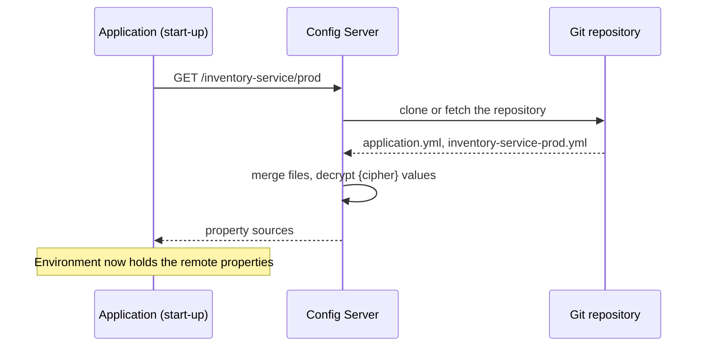
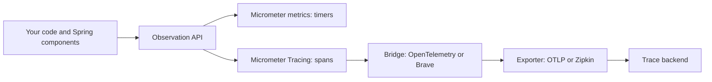
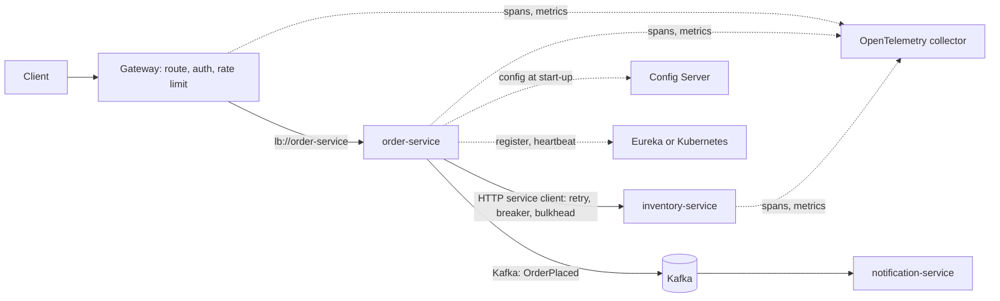

# Microservices with Spring

This page shows how the Spring ecosystem implements the building blocks of a microservice system: service discovery, central configuration, an API gateway, resilience, declarative HTTP clients, distributed tracing, and messaging. The architecture concepts have their home in the HLD pages. See [microservices and monoliths](../hld/fundamentals/14-microservices-and-monoliths.md) for discovery, gateways, and service boundaries, [reliability patterns](../hld/fundamentals/12-reliability-patterns.md) for timeouts, retries, circuit breakers, and bulkheads, and [observability in design](../hld/fundamentals/20-observability-in-design.md) for metrics, logs, and traces. This page does not repeat them. It covers the Spring classes, the properties, the defaults, and which Spring Cloud components are still alive.

## Why It Matters

Backend interviews for Java roles ask two kinds of microservice questions. The first kind is architectural ("how do services find each other?", "what happens when a dependency is slow?"). The second kind tests whether you know the Spring answer: "Is Hystrix still used?", "What replaced Ribbon?", "Feign or `RestClient`?", "How does a trace ID travel from the gateway to the database?". A candidate who names a removed component loses points, so this page gives the status of each component as of 2026-10-22. On the job, the same knowledge decides whether a team adds a Config Server and a Eureka server to a Kubernetes cluster that already provides both functions, whether a retry annotation runs at all (a proxy that the call skips does nothing), and whether a trace breaks at the first outbound call.

This page targets Spring Cloud 2025.1.3 ("Oakwood"), Spring Boot 4.1.1, and Spring Framework 7.0.9. It marks where the 2025.0 train and Spring Boot 3.x differ.

## Core Concepts

**Spring Cloud**: a family of separate Spring projects (Config, Gateway, Netflix Eureka, OpenFeign, Stream, and others) for distributed systems. Each project has its own repository and version number.

**Release train**: a named set of Spring Cloud project versions that were tested together. A train has a calendar-based version (`2025.1.3`) and a code name (Oakwood). You import the train as a BOM (a POM that fixes dependency versions, see [build tools](23-build-tools.md)), and you declare Spring Cloud starters without versions.

**`DiscoveryClient`**: the Spring Cloud Commons interface that returns the instances of a named service. Eureka, Consul, Zookeeper, and Kubernetes provide implementations.

**Service ID**: the logical name of a service in the registry (for example `inventory-service`). A client uses the service ID in a URL (`lb://inventory-service`) and does not use a host name.

**Spring Cloud LoadBalancer**: the client-side load balancer in Spring Cloud Commons. It takes a service ID, asks the `DiscoveryClient` for the instances, and chooses one. It replaced Ribbon.

**Config Server**: a Spring Boot application that serves configuration over HTTP from a backend, usually a Git repository. A client application loads its properties from the server at start-up.

**Spring Cloud Gateway**: a gateway built on Spring. It matches each request against routes. A **route** has an ID, a target URI, predicates (conditions on the request), and filters (changes to the request or the response).

**HTTP service client** (also called HTTP interface client): a Java interface with `@HttpExchange` methods. Spring Framework builds a proxy that sends the requests through `RestClient` or `WebClient`.

**Resilience4j**: a library with a circuit breaker, a retry, a bulkhead, a rate limiter, and a time limiter. It has no dependency on a framework, and it has a Spring Boot module.

**Observation**: the Micrometer API that one piece of instrumentation uses to produce both a metric and a span. **Micrometer Tracing**: the facade that creates spans and passes them to a tracer (OpenTelemetry or Brave). **OpenTelemetry**: the vendor-neutral standard for traces, metrics, and logs (see `kb/engineering-practice/08-observability.md`).

**Binder** (Spring Cloud Stream): the plugin that connects the application to a message broker (Kafka, RabbitMQ). The application code does not depend on the broker API.

## How It Works

### The release train and the status of each component

The current train is **2025.1.3 (Oakwood)**. The spring.io page for Spring Cloud lists it for Spring Boot 4.0.x and 4.1.x (4.1.x starting with 2025.1.2) and does not mark it as end of life. The train BOM pins Spring Boot 4.0.8 as its build version (`spring-cloud-dependencies-2025.1.3.pom` on Maven Central), but the compatibility table on spring.io is the statement about supported Boot versions. The previous train, 2025.0 (Northfields) for Spring Boot 3.5.x, is marked "End of life" on spring.io. A newer line exists on Maven Central only as a milestone (`2026.0.0-M1`). Do not use a milestone in production.

!!! warning "Sources disagree"
    The GitHub page "Spring Cloud Supported Versions" still shows Oakwood in italics (in development) and Northfields as supported. The spring.io project page is newer, and this page follows it. Check spring.io before you pick a train.

| Component | Status in 2025.1.3 | What replaced it or what to use | Difference from 2025.0 and Boot 3.x |
|---|---|---|---|
| Netflix Eureka (`spring-cloud-netflix-eureka-*`, 5.0.2) | Active. The only part of Spring Cloud Netflix that remains | Kubernetes Services, Consul, or Eureka | Same artifacts. The server uses the Jersey 3 variant of Eureka 2.0.6 |
| Netflix Hystrix | Maintenance mode announced in 2018 (Greenwich). Removed in 2020.0 | Resilience4j, through Spring Cloud Circuit Breaker | Not available in any current train |
| Netflix Ribbon | Same as Hystrix | Spring Cloud LoadBalancer | Not available |
| Netflix Zuul 1 | Same as Hystrix | Spring Cloud Gateway | Not available |
| Netflix Archaius 1, Turbine | Same as Hystrix | Spring Boot external configuration and Spring Cloud Config. Turbine: Micrometer and a monitoring system | Not available |
| Spring Cloud OpenFeign (5.0.3) | **Feature-complete**: only bug fixes and small community pull requests | Spring HTTP service clients (`@HttpExchange`) | Works as before. New projects use HTTP service clients |
| Spring Cloud Gateway (5.0.3) | Active. Two starters: Server WebFlux and Server WebMVC | none | The new starter names exist since Gateway 4.3.0 (2025.0). The old starter `spring-cloud-starter-gateway` has no 5.x release, and the 5.0.3 properties have no `spring.cloud.gateway.routes` alias |
| Spring Cloud Config (5.0.5) | Active | Kubernetes ConfigMaps and Secrets, for Kubernetes-only systems | Bootstrap files are off by default (see below) |
| Spring Cloud Circuit Breaker (5.0.3) | Active. Abstraction over Resilience4j and other libraries | none | Adds HTTP service client integration (see below) |
| Spring Cloud LoadBalancer (in Commons, 5.0.3) | Active | none | none |
| Spring Cloud Kubernetes (5.0.3) | Active. Does not support Spring Boot AOT or native images (reference documentation, 5.0.3) | Plain Kubernetes Services and config maps | none |
| Spring Cloud Stream (5.0.3) | Active. Functional programming model | Spring Kafka directly, when one broker is enough | The annotation model (`@EnableBinding`, `@StreamListener`) is gone. Use `Function`, `Consumer`, and `Supplier` beans |
| Spring Cloud Sleuth | Last version 3.1, Spring Boot 2.x only | Micrometer Tracing | Does not work with Boot 3 or 4 |

The facts about Hystrix, Ribbon, Zuul, and Archaius come from the Spring blog post "Spring Cloud Greenwich RC1" (maintenance mode, with the named replacements) and from the 2020.0 release notes ("Support for ribbon, hystrix and zuul was removed across the release train projects"). The OpenFeign statement is a quote from the OpenFeign reference documentation: "we're now treating the Spring Cloud OpenFeign project as feature-complete [...] We suggest migrating over to Spring HTTP Service Clients instead."

**Import the train.** The BOM goes in `dependencyManagement`, and the starters need no version.

```xml
<dependencyManagement>
  <dependencies>
    <dependency>
      <groupId>org.springframework.cloud</groupId>
      <artifactId>spring-cloud-dependencies</artifactId>
      <version>2025.1.3</version>
      <type>pom</type>
      <scope>import</scope>
    </dependency>
  </dependencies>
</dependencyManagement>
```

### Service discovery: Eureka, LoadBalancer, and Kubernetes

The concept (registry, heartbeat, client-side and server-side discovery) is on the [microservices and monoliths](../hld/fundamentals/14-microservices-and-monoliths.md) page. This section covers the Spring side.

**Eureka server.** Add `spring-cloud-starter-netflix-eureka-server` and put `@EnableEurekaServer` on the application class.

<!-- fragment -->
```java
import org.springframework.boot.SpringApplication;
import org.springframework.boot.autoconfigure.SpringBootApplication;
import org.springframework.cloud.netflix.eureka.server.EnableEurekaServer;

@SpringBootApplication
@EnableEurekaServer
public class RegistryApplication {

    public static void main(String[] args) {
        SpringApplication.run(RegistryApplication.class, args);
    }
}
```

The text of this block uses Spring Boot 4.1.1 and `spring-cloud-netflix-eureka-server` 5.0.2.

**Eureka client.** Add `spring-cloud-starter-netflix-eureka-client`. The application registers itself at start-up. The reference documentation for Spring Cloud Commons says: "`@EnableDiscoveryClient` is no longer required. You can put a `DiscoveryClient` implementation on the classpath to cause the Spring Boot application to register with the service discovery server." The service ID comes from `spring.application.name`.

```yaml
spring:
  application:
    name: inventory-service
eureka:
  client:
    service-url:
      defaultZone: http://registry-1:8761/eureka/,http://registry-2:8761/eureka/
  instance:
    prefer-ip-address: true
```

**Defaults.** These values come from the property metadata and the config classes of the 5.0.2 jars. A default differs from the value in your system if you set the property.

| Property | Default | Meaning |
|---|---|---|
| `eureka.instance.lease-renewal-interval-in-seconds` | 30 | The client sends a heartbeat (a renewal) at this interval |
| `eureka.instance.lease-expiration-duration-in-seconds` | 90 | The lease duration that the client announces to the server |
| `eureka.client.registry-fetch-interval-seconds` | 30 | The client fetches the registry from the server at this interval |
| `eureka.server.eviction-interval-timer-in-ms` | 60000 | The server looks for expired leases at this interval |
| `eureka.server.response-cache-update-interval-ms` | 30000 | The server refreshes its read-only response cache at this interval |
| `eureka.server.use-read-only-response-cache` | `true` | Clients read the registry from the read-only cache |
| `eureka.server.enable-self-preservation` | `true` | See below |
| `eureka.server.renewal-percent-threshold` | 0.85 | Threshold for self-preservation |
| `spring.cloud.loadbalancer.cache.ttl` | 35s | The LoadBalancer caches the instance list for this time |
| `eureka.client.register-with-eureka`, `eureka.client.fetch-registry` | `true`, `true` | A standalone server sets both to `false` |

**How long does a dead instance receive traffic?** Eureka is built for availability, so it detects a failed instance slowly. Read the defaults as a chain. Each link is an upper bound.

1. The lease expires. The `Lease` class in Eureka 2.0.6 sets `lastUpdateTimestamp = now + duration` at each renewal, and it declares the lease expired when `now > lastUpdateTimestamp + duration` (checked in the class file). The effective expiry is therefore twice the configured duration: 2 x 90 s = 180 s.
2. The eviction timer runs every 60 s, so it removes the lease up to 60 s after the expiry.
3. The server refreshes the read-only response cache every 30 s.
4. The client fetches the registry every 30 s.
5. The LoadBalancer cache holds the instance list for 35 s. If the `DiscoveryClient` already caches (Eureka does), the Spring Cloud documentation says to disable the LoadBalancer cache.

The sum is 180 + 60 + 30 + 30 + 35 = 335 s, about 5.6 minutes. This is a calculation from the defaults, not a measurement. An instance that shuts down in an orderly way tells the server, so the first link does not apply. A crashed instance, a network partition, or a `kill -9` takes the full chain. This is the reason that a caller needs a timeout, a retry on another instance, and a circuit breaker even with discovery (see [reliability patterns](../hld/fundamentals/12-reliability-patterns.md)).

**Self-preservation.** If the share of expected renewals that the server receives falls below `renewal-percent-threshold` (0.85), the server assumes that the network is the problem and stops evicting leases. The server keeps stale entries rather than empty its registry. The default value of the threshold and the switch are in the 5.0.2 configuration class. The behavior description comes from the Eureka project documentation. Recommendation: leave self-preservation on in production, and treat the dashboard warning as a sign of a network or capacity problem.

**Peers.** Eureka servers replicate registrations to their peers (Eureka wiki, "Understanding Eureka Peer to Peer Communication": each server replicates its operations to its peers, and a missed replication is reconciled at the next heartbeat. The wiki names no leader or master). The registry is eventually consistent, and a client can see different instance lists from different servers for some seconds.

**LoadBalancer.** `lb://inventory-service` means "ask the load balancer for an instance of `inventory-service`". The default algorithm is `RoundRobinLoadBalancer` (Spring Cloud Commons reference). You can replace it with `RandomLoadBalancer` or your own `ReactorLoadBalancer`. The LoadBalancer can filter instances: `spring.cloud.loadbalancer.configurations=health-check` calls `/actuator/health` on each instance, and `zone-preference` prefers instances in the zone of the caller.

**Kubernetes.** A Kubernetes `Service` already gives a stable DNS name and load balancing across ready pods. The simplest design on Kubernetes calls `http://inventory-service` and runs no registry at all. One long-lived HTTP/2 or keep-alive connection stays on one pod, because Kubernetes balances per connection (see [load balancing](../hld/fundamentals/02-load-balancing-dns-cdn.md)). Spring Cloud Kubernetes provides a `DiscoveryClient` that reads Kubernetes endpoints, and property sources that read config maps and secrets. Its reference documentation says: "it is also not a requirement in order to deploy a Spring Boot app on Kubernetes". Recommendation: on Kubernetes, start with native Services and config maps, and add Spring Cloud Kubernetes only when you need client-side balancing or the property reload.

### Configuration: Config Server

A Config Server answers `GET /{application}/{profile}/{label}`, where the label is a Git branch or tag by default. The client application asks for its own `spring.application.name` and its active profiles.



**Server.** The server needs `spring-cloud-config-server` and `@EnableConfigServer`.

<!-- fragment -->
```java
import org.springframework.boot.SpringApplication;
import org.springframework.boot.autoconfigure.SpringBootApplication;
import org.springframework.cloud.config.server.EnableConfigServer;

@SpringBootApplication
@EnableConfigServer
public class ConfigServerApplication {

    public static void main(String[] args) {
        SpringApplication.run(ConfigServerApplication.class, args);
    }
}
```

```yaml
server:
  port: 8888
spring:
  cloud:
    config:
      server:
        git:
          uri: https://git.example.com/platform/config-repo
          default-label: main
          clone-on-start: true
```

The text above uses `spring-cloud-config-server` 5.0.5. The property `spring.cloud.config.server.git.clone-on-start` defaults to `false` and `spring.cloud.config.server.git.timeout` defaults to 5 seconds (5.0.5 metadata). With `clone-on-start: true`, a wrong repository URL fails when the server starts and not when the first client asks.

**Client.** Spring Boot 2.4 introduced the Config Data API, and Spring Cloud Config uses it. The client needs one line:

```yaml
spring:
  application:
    name: inventory-service
  config:
    import: "optional:configserver:http://config-server:8888"
```

- With the prefix `optional:`, the application starts even if the server is down. Without the prefix, the application fails at start-up when it cannot reach the server. The reference documentation states both.
- The `bootstrap.yml` file is not needed. The legacy bootstrap context is off. To use it, you set `spring.cloud.bootstrap.enabled=true` as a system property or environment variable, or you add `spring-cloud-starter-bootstrap`. A tutorial that tells you to create `bootstrap.yml` is from before Boot 2.4.
- `spring.cloud.config.fail-fast` defaults to `false`. The client retry properties (`spring.cloud.config.retry.*`, defaults: 6 attempts, 1000 ms initial interval, multiplier 1.1, 2000 ms maximum interval) take effect only if fail-fast is on and `spring-retry` and an AOP starter are on the classpath (Config reference, "Config Client").
- Properties from the Config Server have a higher precedence than the packaged `application.yml`. The precedence rules are on the [Spring Boot](18-spring-boot.md) page.

**Encryption.** A value in the repository that starts with `{cipher}` is encrypted. The server decrypts it before it sends the properties to the client (Config reference, "Encryption and Decryption"). The server has the endpoints `/encrypt` and `/decrypt`. They need a symmetric key (`encrypt.key`) or a key store (`encrypt.key-store.*`). Guard these endpoints, because anyone who can call them can decrypt. Two defaults matter in a review: `encrypt.salt` defaults to `deadbeef` (spring-cloud-context 5.0.3 metadata), so set your own, and a value that the server cannot decrypt is replaced with a property with the prefix `invalid.` and the value `<n/a>`. In a properties file, do not put quotes around a `{cipher}` value.

**Refresh without restart.** A bean marked `@RefreshScope` (`org.springframework.cloud.context.config.annotation.RefreshScope`) is created again the next time something calls it after a refresh event. Spring Cloud also rebinds `@ConfigurationProperties` beans on a refresh event, so they need no `@RefreshScope`. The endpoint `POST /actuator/refresh` (endpoint ID `refresh`, class `RefreshEndpoint`) triggers a refresh on one instance. You must expose it, because Actuator does not expose it over HTTP by default (see [Spring Boot](18-spring-boot.md) for exposure). To refresh all instances, add Spring Cloud Bus (a broker, Kafka or RabbitMQ) to the server and the clients. The module `spring-cloud-config-monitor` then provides a `/monitor` endpoint for Git webhooks. The server sends a `RefreshRemoteApplicationEvent` over the bus. The `/monitor` endpoint rejects every webhook if no secret is configured (Config reference, "Push Notifications and Spring Cloud Bus").

**Trade-offs.** The Config Server adds one more service that every start-up depends on. Recommendation: run at least two instances, use `optional:` only if the application has safe defaults, and keep secrets in a secrets manager (Vault, a cloud secret store) and not in Git, even encrypted. On Kubernetes, a config map mounted as files and read by Spring Boot itself (`spring.config.import: "optional:configtree:/etc/config/"`, a Spring Boot feature and not a Config Server one) replaces the server for many teams.

### The gateway: Spring Cloud Gateway

The role of a gateway (one entry point, authentication, rate limits, routing) is on the [microservices and monoliths](../hld/fundamentals/14-microservices-and-monoliths.md) page. Rate-limiting algorithms are on [rate limiting algorithms](../hld/fundamentals/13-rate-limiting-algorithms.md).

Spring Cloud Gateway 5.0.3 has two products with two starters. Do not put both in one application.

| | Gateway Server WebFlux | Gateway Server WebMVC |
|---|---|---|
| Starter | `spring-cloud-starter-gateway-server-webflux` | `spring-cloud-starter-gateway-server-webmvc` |
| Built on | Spring WebFlux, Reactor Netty (non-blocking) | Spring MVC functional endpoints (`RouterFunction`), Tomcat or Jetty (servlet) |
| Route properties | `spring.cloud.gateway.server.webflux.routes` | `spring.cloud.gateway.server.webmvc.routes` |
| Java route API | `RouteLocatorBuilder` | `GatewayRouterFunctions.route(...)` with `HandlerFunctions.http()` |
| Choose it when | The gateway holds many open connections, or you already use WebFlux | The team uses blocking code and servlet tooling, or runs virtual threads (see [virtual threads](10-virtual-threads.md)) |

The property names come from the `spring-configuration-metadata.json` file of each 5.0.3 jar. The starter `spring-cloud-starter-gateway` (no suffix) has versions up to 4.3.5 on Maven Central and no 5.x version.

A route in YAML for the WebMVC variant (the example in the Gateway reference for the load balancer filter):

```yaml
spring:
  cloud:
    gateway:
      server:
        webmvc:
          routes:
            - id: api_route
              uri: lb://apiservice
              predicates:
                - Path=/api/**
```

The same route in the Java DSL. The `lb` filter resolves the service ID through Spring Cloud LoadBalancer.

<!-- fragment -->
```java
import static org.springframework.cloud.gateway.server.mvc.filter.LoadBalancerFilterFunctions.lb;
import static org.springframework.cloud.gateway.server.mvc.handler.GatewayRouterFunctions.route;
import static org.springframework.cloud.gateway.server.mvc.handler.HandlerFunctions.http;

import org.springframework.context.annotation.Bean;
import org.springframework.context.annotation.Configuration;
import org.springframework.web.servlet.function.RouterFunction;
import org.springframework.web.servlet.function.ServerResponse;

@Configuration
class GatewayRoutes {

    @Bean
    RouterFunction<ServerResponse> apiRoute() {
        return route("api_route")
                .GET("/api/**", http())
                .filter(lb("apiservice"))
                .build();
    }
}
```

The text above uses `spring-cloud-gateway-server-webmvc` 5.0.3. For the WebFlux variant, the same route is a `RouteLocator` bean:

<!-- fragment -->
```java
import org.springframework.cloud.gateway.route.RouteLocator;
import org.springframework.cloud.gateway.route.builder.RouteLocatorBuilder;
import org.springframework.context.annotation.Bean;
import org.springframework.context.annotation.Configuration;

@Configuration
class ReactiveGatewayRoutes {

    @Bean
    RouteLocator routes(RouteLocatorBuilder builder) {
        return builder.routes()
                .route("api_route", r -> r.path("/api/**")
                        .filters(f -> f.stripPrefix(1))
                        .uri("lb://apiservice"))
                .build();
    }
}
```

**Filters.** The WebFlux jar ships filter factories such as `StripPrefix`, `RewritePath`, `AddRequestHeader`, `Retry`, `RequestRateLimiter`, `TokenRelay`, and `CircuitBreaker` (class `SpringCloudCircuitBreakerFilterFactory`). The WebMVC variant has a smaller set, and its reference lists a `RateLimiter` filter and a circuit breaker filter. Check the WebMVC reference for the filter that you need before you choose it. A gateway filter that retries or opens a circuit breaker works at the edge. It does not replace the resilience of each service to its own dependencies.

**Keep the gateway thin.** Recommendation: the gateway does routing, authentication checks (see [Spring Security](21-spring-security.md)), rate limiting, and header handling. It does not hold business rules, because every team then needs a gateway deployment to change a rule.

### Resilience: Resilience4j and the Spring Framework 7 core features

The patterns, their parameters, and the failure modes are on the [reliability patterns](../hld/fundamentals/12-reliability-patterns.md) page. Read it for the states of a circuit breaker, for jitter, and for retry amplification. This section covers the Spring implementation.

**Which library.** Spring Cloud 2025.1 offers three options.

| Option | What it gives | Use it when |
|---|---|---|
| Resilience4j (`io.github.resilience4j`, 2.4.0) | Circuit breaker, retry, bulkhead, rate limiter, time limiter. Annotations and a registry API. Metrics for Micrometer | You need a circuit breaker or a bulkhead (Spring Framework has neither) |
| Spring Cloud Circuit Breaker (`CircuitBreakerFactory`) | One API over a circuit breaker library. The Resilience4j implementation is `spring-cloud-starter-circuitbreaker-resilience4j` | You want to switch the library, or the gateway and the HTTP service clients use it |
| Spring Framework 7 core: `@Retryable`, `@ConcurrencyLimit`, `RetryTemplate` | Retry with backoff, jitter, and a limit on concurrent calls. No circuit breaker | You need only retry or a concurrency limit and want no extra library |

**Resilience4j on Spring Boot 4.** Add `io.github.resilience4j:resilience4j-spring-boot4` (version 2.4.0 exists on Maven Central; the Boot 3 artifact is `resilience4j-spring-boot3`). The annotations work through AOP proxies, so the AspectJ support must be on the classpath. In Spring Boot 4, the starter is `spring-boot-starter-aspectj` (4.1.1 exists). The Spring Boot 3 starter `spring-boot-starter-aop` has no release after `4.0.0-M2`, and the Resilience4j documentation still names it, so the documentation is for Boot 3. Add `spring-boot-starter-actuator` for the metrics and the endpoints.

**Annotations.** Resilience4j has `@CircuitBreaker`, `@Retry`, `@Bulkhead`, `@RateLimiter`, and `@TimeLimiter`. Each takes the name of a configuration instance, and an optional `fallbackMethod`.

<!-- fragment -->
```java
import io.github.resilience4j.bulkhead.annotation.Bulkhead;
import io.github.resilience4j.circuitbreaker.annotation.CircuitBreaker;
import io.github.resilience4j.retry.annotation.Retry;
import org.springframework.stereotype.Service;
import org.springframework.web.client.RestClient;

@Service
class StockService {

    private final RestClient inventory;

    StockService(RestClient.Builder builder) {
        this.inventory = builder.baseUrl("http://inventory-service").build();
    }

    @Retry(name = "inventory")
    @CircuitBreaker(name = "inventory", fallbackMethod = "stockFromCache")
    @Bulkhead(name = "inventory")
    public int stock(String sku) {
        Integer count = inventory.get().uri("/stock/{sku}", sku)
                .retrieve().body(Integer.class);
        return count == null ? 0 : count;
    }

    // Same class, same parameters, plus one exception parameter at the end.
    int stockFromCache(String sku, Throwable cause) {
        return -1; // -1 means "unknown"; the caller shows "check later"
    }
}
```

The text above uses `resilience4j-annotations` 2.4.0 and Spring Framework 7.0.9. The fallback rules (Resilience4j reference): the fallback is in the same class, has the same parameters as the original method plus one exception parameter, and the closest exception type wins if several fallbacks exist. A fallback runs for any failure that the annotation covers, including the `CallNotPermittedException` of an open breaker.

**Configuration** goes under `resilience4j.<module>.instances.<name>`. A shared block uses `configs` and `baseConfig`.

```yaml
resilience4j:
  circuitbreaker:
    instances:
      inventory:
        slidingWindowType: COUNT_BASED
        slidingWindowSize: 20
        minimumNumberOfCalls: 10
        failureRateThreshold: 50
        slowCallDurationThreshold: 2s
        slowCallRateThreshold: 80
        waitDurationInOpenState: 30s
        permittedNumberOfCallsInHalfOpenState: 3
        ignoreExceptions:
          - com.example.stock.UnknownSkuException
  retry:
    instances:
      inventory:
        maxAttempts: 3
        waitDuration: 200ms
        enableExponentialBackoff: true
        exponentialBackoffMultiplier: 2
  bulkhead:
    instances:
      inventory:
        maxConcurrentCalls: 20
        maxWaitDuration: 0
```

The retry property names `enableExponentialBackoff` and `exponentialBackoffMultiplier` are fields of the `InstanceProperties` class in `resilience4j-framework-common` 2.4.0 (the class also has `exponentialMaxWaitDuration`, `enableRandomizedWait`, and `randomizedWaitFactor`). Durations such as `200ms` use the Spring Boot duration format.

**Defaults.** The `ofDefaults()` configurations of Resilience4j 2.4.0 (printed from the jars) are:

| Module | Defaults |
|---|---|
| Circuit breaker | failure rate threshold 50 percent, slow call rate threshold 100 percent, slow call duration 60 s, sliding window 100 calls (`COUNT_BASED`), minimum 100 calls, wait in open state 60 s, 10 calls in half-open state |
| Retry | 3 attempts (the first call counts), wait 500 ms |
| Bulkhead | 25 concurrent calls, maximum wait 0 |
| Rate limiter | 50 calls per period, period 500 ns, wait up to 5 s |
| Time limiter | timeout 1 s, cancel the running future |

The circuit breaker default needs 100 calls before it judges. A service with 5 calls per minute never opens the default breaker. Set `minimumNumberOfCalls` to match the traffic.

**Aspect order.** The Resilience4j reference gives the order as `Retry ( CircuitBreaker ( RateLimiter ( TimeLimiter ( Bulkhead ( Function ) ) ) ) )`. Retry is the outermost decorator. Each attempt therefore passes through the breaker, and the breaker records each attempt. The properties `retryAspectOrder`, `circuitBreakerAspectOrder`, `rateLimiterAspectOrder`, `timeLimiterAspectOrder`, and `bulkheadAspectOrder` change the order. The demo in the Java Example section shows the effect of this order.

**Pitfalls that cost an interview.**

- *Self-invocation.* The annotations work through a proxy. A call from one method of the class to another method of the same class does not pass through the proxy, so no breaker and no retry apply. The mechanism is on the [Spring Core](17-spring-core.md) page.
- *`@TimeLimiter` needs an asynchronous return type.* It works on methods that return `CompletableFuture` (or a reactive type), because a synchronous method cannot be cancelled from outside. For a blocking `RestClient` call, set the connect and read timeouts on the client.
- *The health indicator is off by default.* A circuit breaker that is OPEN shows as DOWN in `/actuator/health` only if you enable the indicator, and a pod that reports DOWN gets no traffic. Recommendation: do not tie readiness to a downstream circuit breaker.

**Spring Cloud Circuit Breaker.** The API is small. `CircuitBreakerFactory.create(name)` returns a `CircuitBreaker`, and `run(supplier, fallback)` runs the call.

<!-- fragment -->
```java
import org.springframework.cloud.client.circuitbreaker.CircuitBreakerFactory;
import org.springframework.stereotype.Service;
import org.springframework.web.client.RestClient;

@Service
class PriceService {

    private final RestClient prices;
    private final CircuitBreakerFactory<?, ?> breakers;

    PriceService(RestClient.Builder builder, CircuitBreakerFactory<?, ?> breakers) {
        this.prices = builder.baseUrl("http://price-service").build();
        this.breakers = breakers;
    }

    String price(String sku) {
        return breakers.create("price").run(
                () -> prices.get().uri("/prices/{sku}", sku).retrieve().body(String.class),
                cause -> "unavailable");
    }
}
```

The text above uses `spring-cloud-commons` 5.0.3. A `Customizer` bean sets the configuration of each breaker. A call such as `Customizer.once(...)` avoids repeated customization, because the Resilience4j implementation otherwise customizes on every `run` (Spring Cloud Circuit Breaker reference).

**Spring Framework 7 core resilience.** Since Spring Framework 7.0, `@Retryable` and `@ConcurrencyLimit` are part of the core framework (package `org.springframework.resilience.annotation`), and `RetryTemplate` is in `org.springframework.core.retry`. You enable the annotations with `@EnableResilientMethods` (it has the attributes `proxyTargetClass`, default `false`, and `order`).

<!-- fragment -->
```java
import java.util.concurrent.TimeUnit;
import org.springframework.context.annotation.Configuration;
import org.springframework.resilience.annotation.ConcurrencyLimit;
import org.springframework.resilience.annotation.EnableResilientMethods;
import org.springframework.resilience.annotation.Retryable;
import org.springframework.stereotype.Service;
import org.springframework.web.client.ResourceAccessException;
import org.springframework.web.client.RestClient;

@Configuration
@EnableResilientMethods
class ResilienceConfig {
}

@Service
class RatingClient {

    private final RestClient ratings;

    RatingClient(RestClient.Builder builder) {
        this.ratings = builder.baseUrl("http://rating-service").build();
    }

    @Retryable(includes = ResourceAccessException.class, maxRetries = 3,
            delay = 200, jitter = 50, multiplier = 2, maxDelay = 2000,
            timeUnit = TimeUnit.MILLISECONDS)
    @ConcurrencyLimit(20)
    public double rating(String sku) {
        Double value = ratings.get().uri("/ratings/{sku}", sku).retrieve().body(Double.class);
        return value == null ? 0.0 : value;
    }
}
```

The text above uses Spring Framework 7.0.9. The defaults, read from the annotation class in the 7.0.9 jar: `maxRetries` 3 (the method runs at most 4 times: one call and three retries), `delay` 1000 ms, `jitter` 0, `multiplier` 1.0, no maximum delay, and the retried exception is any `Throwable` unless you set `includes`. Note the difference from Resilience4j: `maxRetries = 3` means 4 calls, while `maxAttempts = 3` means 3 calls. When the retries end, the caller gets the last exception. `@ConcurrencyLimit` has a `policy`, `BLOCK` (the default: the caller waits) or `REJECT` (the call fails at once). The Spring Framework reference says the limit is useful with virtual threads, which have no pool limit by default (see [virtual threads](10-virtual-threads.md)). `RetryTemplate` retries a block of code without a proxy: `new RetryTemplate(RetryPolicy.withMaxRetries(4)).invoke(() -> ...)`, and `execute(...)` throws a checked `RetryException` that carries every failure.

If a bean has both `@Retryable` and `@Transactional`, the order of the two proxies decides whether each retry runs in a new transaction. The order is a setting (`order` on `@EnableResilientMethods`). The transaction rules are on the page [Spring Data and transactions](19-spring-data-and-transactions.md).

### Declarative HTTP clients: HTTP service clients and OpenFeign

A declarative client is an interface. You describe the HTTP calls with annotations, and the framework writes the code that sends them. Two options exist in Spring Cloud 2025.1.

**HTTP service clients** (Spring Framework 6.0 and later, groups since Framework 7.0 and Boot 4.0). The interface carries `@HttpExchange` annotations.

<!-- fragment -->
```java
import org.springframework.web.bind.annotation.PathVariable;
import org.springframework.web.service.annotation.GetExchange;
import org.springframework.web.service.annotation.HttpExchange;
import org.springframework.web.service.annotation.PostExchange;

record Stock(String sku, int available) {
}

record Reservation(String sku, int quantity) {
}

@HttpExchange("/stock")
interface InventoryApi {

    @GetExchange("/{sku}")
    Stock stock(@PathVariable String sku);

    @PostExchange("/reservations")
    void reserve(Reservation reservation);
}
```

The text above uses Spring Framework 7.0.9. A type-level `@HttpExchange` sets the common path. A method annotation (`@GetExchange`, `@PostExchange`, `@PutExchange`, `@DeleteExchange`, `@PatchExchange`) sets the method and the path. The parameters follow the controller annotations: `@PathVariable`, `@RequestParam`, `@RequestHeader`, `@RequestBody`.

You can build the proxy by hand with `HttpServiceProxyFactory`.

<!-- fragment -->
```java
import org.springframework.web.client.RestClient;
import org.springframework.web.client.support.RestClientAdapter;
import org.springframework.web.service.invoker.HttpServiceProxyFactory;

class ManualClientFactory {

    static InventoryApi create(String baseUrl) {
        RestClient restClient = RestClient.builder().baseUrl(baseUrl).build();
        HttpServiceProxyFactory factory = HttpServiceProxyFactory
                .builderFor(RestClientAdapter.create(restClient)).build();
        return factory.createClient(InventoryApi.class);
    }
}
```

In Spring Boot 4, you declare a **group** and let Boot register the proxies as beans. `@ImportHttpServices` is repeatable. The group name selects the properties, and the properties have the prefix `spring.http.serviceclient.<group>`.

<!-- fragment -->
```java
import org.springframework.context.annotation.Configuration;
import org.springframework.web.service.registry.ImportHttpServices;

@Configuration
@ImportHttpServices(group = "inventory", types = InventoryApi.class)
class HttpClientsConfig {
}
```

```yaml
spring:
  http:
    serviceclient:
      inventory:
        base-url: lb://inventory-service
        connect-timeout: 1s
        read-timeout: 2s
```

The Boot reference (HTTP Service Clients, Boot 4.1) shows these properties, and says that group properties override the global `spring.http.clients.*` properties. Always set the timeouts, because the default has no limit that you chose (see [Spring Web and REST](20-spring-web-and-rest.md) for the client timeouts).

**Spring Cloud integration since 5.0.** Spring Cloud Commons 5.0.3 contains classes that plug into the groups. This is the fact that decides the OpenFeign question:

- *Load balancing.* `LoadBalancerRestClientHttpServiceGroupConfigurer` (and a `WebClient` twin) adds the load balancer interceptor to the group. If `base-url` is not set, Spring builds the URL from the group name as service ID (`http://<group>`). If `base-url` has the scheme `lb`, the client load-balances too. Any other scheme gets no load balancing (Spring Cloud Commons reference, "LoadBalancer Integration for Spring HTTP Service Clients").
- *Circuit breaker and fallback.* `CircuitBreakerRestClientHttpServiceGroupConfigurer` wraps the calls of a group in a circuit breaker when you declare fallback classes with `@HttpServiceFallback`. The properties `spring.cloud.circuitbreaker.http-services.enabled=false` and `spring.cloud.circuitbreaker.reactive-http-services.enabled=false` turn the integration off.

<!-- fragment -->
```java
import org.springframework.cloud.client.circuitbreaker.httpservice.HttpServiceFallback;

@HttpServiceFallback(value = InventoryFallback.class, service = InventoryApi.class,
        group = "inventory")
class FallbackConfig {
}
```

The fallback class is `public`, as the reference requires:

<!-- fragment -->
```java
public class InventoryFallback {

    // Matches stock(String). The Throwable-first form stock(Throwable, String)
    // also matches and receives the cause.
    public Stock stock(String sku) {
        return new Stock(sku, 0);
    }
}
```

The text above uses `spring-cloud-commons` 5.0.3. The reference says the fallback class and its methods must be `public`, and a fallback method does not carry an `@HttpExchange` annotation. A method matches by name and parameter types, with or without a leading `Throwable` parameter. Precedence: a fallback for the service and the group, then for the service, then the default for the group or for all.

(This page compiled the block but did not run a circuit-breaker fallback end to end. The behavior in the last paragraph is the reference documentation.)

**Error handling.** By default, an HTTP service client throws on 4xx and 5xx responses (Spring Framework reference). You change that on the underlying client with `defaultStatusHandler`, or you decorate the adapter to turn a 404 into a `ResponseEntity` with a `null` body.

**OpenFeign** has the same idea with different annotations.

| | HTTP service client | OpenFeign |
|---|---|---|
| Home | Spring Framework 7 (`spring-web`) and Spring Boot 4 | Spring Cloud OpenFeign 5.0.3 and the Feign library |
| Status | Active. The recommended option | Feature-complete: bug fixes only |
| Annotations | `@HttpExchange`, `@GetExchange`, and the Spring MVC parameter annotations | `@FeignClient` and the Spring MVC annotations through a contract |
| Transport | `RestClient`, `WebClient`, or `RestTemplate` | The Feign HTTP client (JDK, Apache, OkHttp) |
| Load balancing | Group configurer (`lb://`) | Built in, through Spring Cloud LoadBalancer |
| Circuit breaker | `@HttpServiceFallback` and the group configurer | Through Spring Cloud Circuit Breaker |
| Controller sharing | A controller can implement the same interface (Framework reference) | Not covered on this page |

Recommendation: use HTTP service clients in new code, and keep OpenFeign in existing code until a planned migration. Do not make a rewrite for its own sake.

### Distributed tracing: Micrometer Tracing and OpenTelemetry

The concepts (trace, span, trace ID, sampling, the W3C `traceparent` header) and what to measure are on the [observability in design](../hld/fundamentals/20-observability-in-design.md) page. Instrumentation practice is on `kb/engineering-practice/08-observability.md`.

**What replaced Sleuth.** Spring Cloud Sleuth ended with version 3.1, which supports Spring Boot 2.x only. Spring Boot 3 and later use Micrometer Tracing. The Micrometer wiki has a migration guide ("Spring Cloud Sleuth 3.1 Migration Guide"): most code changes the package from `org.springframework.cloud.sleuth` to `io.micrometer.tracing`.

**The layers.**



An **observation** is one API call that Spring MVC, `RestClient`, JDBC, Kafka, and your own code use. A handler turns the observation into a timer and into a span. This is why the dependency list is short.

**Dependencies in Spring Boot 4.1.** The Boot reference ("Tracing") names one starter for OpenTelemetry with OTLP: `spring-boot-starter-opentelemetry`. Add `spring-boot-starter-actuator` as well. The older route (Brave with Zipkin) is the other documented set-up. The Boot reference also states that Boot removes the OpenTelemetry Zipkin exporter auto-configuration in 4.2, so prefer OTLP in new work.

**Properties and defaults** (from the 4.1.1 metadata jars):

| Property | Default | Meaning |
|---|---|---|
| `management.tracing.sampling.probability` | 0.1 | Boot samples 10 percent of requests |
| `management.tracing.propagation.produce` | `W3C` | The header format that the application sends |
| `management.tracing.propagation.consume` | `W3C`, `B3`, `B3_MULTI` | The header formats that the application accepts |
| `management.tracing.baggage.remote-fields` | none | Baggage fields that travel to other services |
| `management.observations.annotations.enabled` | `false` | Turns on `@Observed` handling |
| `spring.kafka.template.observation-enabled`, `spring.kafka.listener.observation-enabled` | `false`, `false` | Kafka spans (see messaging) |

A sampling probability of 0.1 means that nine in ten traces do not exist when you debug a rare failure. Set `1.0` in development. In production, the choice (head sampling or tail sampling in a collector) is a cost decision (see the HLD page). Boot includes the trace ID and the span ID in log lines (the `logging.pattern.correlation` setting), so a log line leads to its trace.

**The builder rule.** Boot instruments only the clients that it builds. The Boot reference says: "If you create the RestTemplate, the RestClient or the WebClient without using the auto-configured builders, automatic trace propagation won't work!" Inject `RestClient.Builder` (as the examples on this page do), and do not call `RestClient.create()` or `RestClient.builder()` in a bean that carries calls to other services. The same applies to `RestTemplateBuilder` and `WebClient.Builder`.

**Custom spans.** Use an observation.

<!-- fragment -->
```java
import io.micrometer.observation.Observation;
import io.micrometer.observation.ObservationRegistry;
import org.springframework.stereotype.Service;

@Service
class PricingService {

    private final ObservationRegistry registry;

    PricingService(ObservationRegistry registry) {
        this.registry = registry;
    }

    double quote(String sku, int quantity) {
        return Observation.createNotStarted("pricing.quote", registry)
                .lowCardinalityKeyValue("channel", "web")
                .observe(() -> compute(sku, quantity));
    }

    private double compute(String sku, int quantity) {
        return quantity * 9.99;
    }
}
```

The text above uses `micrometer-observation` 1.17.1. Put only values with few distinct values into `lowCardinalityKeyValue`, because they become metric tags. Put a user ID or an order ID in `highCardinalityKeyValue`, because that goes only on the span (see the cardinality definition on the [observability in design](../hld/fundamentals/20-observability-in-design.md) page). The annotation `@Observed` (from `micrometer-observation`) does the same on a method, when `management.observations.annotations.enabled=true` and the AspectJ support is present. It is a proxy, so the self-invocation rule applies.

**Messaging.** A trace crosses a Kafka topic only if the producer writes the trace context into the record headers and the consumer reads it. In Spring Kafka this is the observation setting of the `KafkaTemplate` and of the listener container, and both default to `false` in Boot. A consumer that does not read the headers starts a new trace, and the trace breaks at the broker.

### Messaging: Spring Cloud Stream and Spring Kafka

The concepts (queues, streams, consumer groups, delivery guarantees, the outbox) are on the pages [message queues and streams](../hld/fundamentals/08-message-queues-and-streams.md) and [event-driven architecture](../hld/fundamentals/16-event-driven-architecture.md). This section covers the two Spring options.

**Spring Cloud Stream** hides the broker behind a binder. You write plain `java.util.function` beans. The framework creates a binding for each function parameter and result:

<!-- fragment -->
```java
import java.util.function.Consumer;
import java.util.function.Function;
import org.springframework.context.annotation.Bean;
import org.springframework.context.annotation.Configuration;

record OrderPlaced(String orderId, String sku, int quantity) {
}

record StockReserved(String orderId, boolean ok) {
}

@Configuration
class InventoryStreams {

    @Bean
    Function<OrderPlaced, StockReserved> reserve() {
        return order -> new StockReserved(order.orderId(), order.quantity() <= 10);
    }

    @Bean
    Consumer<StockReserved> audit() {
        return result -> System.out.println("reserved " + result.orderId());
    }
}
```

The text above uses `spring-cloud-stream` 5.0.3. The binding name is `<functionName>-in-<index>` for an input and `<functionName>-out-<index>` for an output (Spring Cloud Stream reference). The function `reserve` has the bindings `reserve-in-0` and `reserve-out-0`. The destination is the topic:

```yaml
spring:
  cloud:
    function:
      definition: reserve;audit
    stream:
      bindings:
        reserve-in-0:
          destination: orders
          group: inventory
        reserve-out-0:
          destination: stock-results
        audit-in-0:
          destination: stock-results
          group: inventory-audit
      kafka:
        bindings:
          reserve-in-0:
            consumer:
              enableDlq: true
```

(Assumption: the `spring.cloud.function.definition` list with `;` for several functions follows the Spring Cloud Function documentation; this page did not run the application.)

- **Group.** The `group` is the Kafka consumer group. Without a group, the consumer is anonymous, and its `startOffset` is `latest` (Kafka binder reference). With an explicit group, the default is `earliest`. A consumer without a group loses the messages that arrive while it is down.
- **Retry and DLQ.** The core consumer defaults, read from `ConsumerProperties` in the 5.0.3 jar: `maxAttempts` 3 (including the first), initial back-off 1000 ms, multiplier 2.0, maximum back-off 10000 ms, `concurrency` 1. In the Kafka binder, `enableDlq` defaults to `false`. When it is `true`, a message that fails all attempts goes to the topic `error.<destination>.<group>` (for the example, `error.orders.inventory`), unless you set `dlqName`. The binder adds the headers `x-original-topic`, `x-exception-message`, and `x-exception-stacktrace` (Kafka binder reference).
- **Partitions.** The producer binding properties `partitionKeyExpression` and `partitionCount` map to Kafka partitions, and the consumer group maps directly to the Kafka consumer group.
- **`StreamBridge`** sends a message to a destination that the code chooses at run time, for example from a REST controller, where no function exists.

**Spring Kafka** is the direct choice. You use `KafkaTemplate` to send and `@KafkaListener` to receive.

<!-- fragment -->
```java
import org.apache.kafka.clients.consumer.ConsumerRecord;
import org.springframework.context.annotation.Bean;
import org.springframework.context.annotation.Configuration;
import org.springframework.kafka.annotation.KafkaListener;
import org.springframework.kafka.core.KafkaOperations;
import org.springframework.kafka.core.KafkaTemplate;
import org.springframework.kafka.listener.DeadLetterPublishingRecoverer;
import org.springframework.kafka.listener.DefaultErrorHandler;
import org.springframework.stereotype.Component;
import org.springframework.util.backoff.FixedBackOff;

@Component
class OrderPublisher {

    private final KafkaTemplate<String, String> kafka;

    OrderPublisher(KafkaTemplate<String, String> kafka) {
        this.kafka = kafka;
    }

    void publish(String orderId, String json) {
        kafka.send("orders", orderId, json); // the key keeps one order on one partition
    }
}

@Component
class OrderListener {

    @KafkaListener(topics = "orders", groupId = "inventory")
    void onOrder(ConsumerRecord<String, String> record) {
        System.out.println("order " + record.key());
    }
}

@Configuration
class KafkaErrorConfig {

    @Bean
    DefaultErrorHandler errorHandler(KafkaOperations<Object, Object> template) {
        return new DefaultErrorHandler(new DeadLetterPublishingRecoverer(template),
                new FixedBackOff(500L, 3L));
    }
}
```

The text above uses `spring-kafka` 4.1.1 (the version that Spring Boot 4.1.1 manages). `DefaultErrorHandler` retries a failed record with the back-off (here 3 retries, 500 ms apart) and then calls the recoverer. `DeadLetterPublishingRecoverer` publishes the record to the topic `<original topic>-dlt` by default, in the same partition as the original record, so the dead-letter topic needs at least as many partitions (Spring Kafka reference; the string `-dlt` is in the 4.1.1 class file). Spring Kafka 3.x used the suffix `.DLT`, so a tutorial for Boot 3 names a different topic. Spring Boot applies a `CommonErrorHandler` bean to the listener container factory that it auto-configures. Spring Kafka also has `@RetryableTopic` for non-blocking retries on retry topics, with a `@DltHandler` method for the dead-letter topic.

**Choose.**

| Question | Spring Cloud Stream | Spring Kafka |
|---|---|---|
| Brokers | Kafka and RabbitMQ, among others, through binders | Kafka only |
| Programming model | `Function`, `Consumer`, `Supplier` beans. Properties name the topics | Annotations and templates. Topics appear in the code |
| Kafka features | Through binder properties. Some features need native settings | All of the client features and the container settings |
| Fit | Many small event processors that could change broker | One broker, and the team wants full control of offsets, transactions, and error handling |

Recommendation: use Spring Kafka if the system uses Kafka only, and use Spring Cloud Stream if the same code must run on more than one broker or the team wants configuration-only wiring. Both give at-least-once delivery by default, so each consumer must be idempotent (see [reliability patterns](../hld/fundamentals/12-reliability-patterns.md), idempotency keys).

### Putting it together



Each service gets the same four things from the platform: its address (discovery), its settings (configuration), a protected call to its neighbors (resilience), and a trace (observability). On Kubernetes, the cluster supplies discovery and configuration, and Spring supplies the rest.

## Trade-offs and When to Use

| Need | Spring Cloud answer | Alternative | Recommendation |
|---|---|---|---|
| Discovery | Eureka client and LoadBalancer | Kubernetes Services and DNS. A service mesh | On Kubernetes, use Services. Use Eureka on virtual machines, or when the platform has no registry |
| Configuration | Config Server | Config maps, a secrets manager, environment variables | Use Config Server if many services share Git-versioned settings outside Kubernetes. Else use the platform |
| Gateway | Spring Cloud Gateway | A managed gateway, an ingress controller, Envoy, Kong | Use Spring Cloud Gateway when the team wants gateway logic in Java and tests. Use a managed gateway for plain routing |
| Circuit breaker, bulkhead | Resilience4j | A service mesh (timeouts, retries, outlier detection) | A mesh covers connection-level failures. Resilience4j covers the failures that the application understands, and gives fallbacks |
| Retry | `@Retryable` or Resilience4j `@Retry` | A mesh retry | Retry at one layer only (see [reliability patterns](../hld/fundamentals/12-reliability-patterns.md)) |
| Declarative client | HTTP service client | OpenFeign. Plain `RestClient` | HTTP service client in new code |
| Tracing | Micrometer Tracing with OpenTelemetry | A vendor agent | Use the Boot starter. Use an agent for libraries that Boot does not instrument |
| Messaging | Spring Kafka or Spring Cloud Stream | A plain client library | See the table above |

The cost of Spring Cloud is the number of moving parts that each service depends on at start-up and at run time: a registry, a config server, and a gateway are three more services to run, secure, and scale. A system with five services on Kubernetes rarely needs all of them. The architectural question "should this be microservices at all?" is on the [microservices and monoliths](../hld/fundamentals/14-microservices-and-monoliths.md) page.

## Java Example

This program shows the order of the Resilience4j decorators with no Spring and no timing dependence. It joins a retry (outer) and a circuit breaker (inner) around a remote call that the program switches on and off. It needs `resilience4j-circuitbreaker`, `resilience4j-retry`, and their dependencies (version 2.4.0), so it carries the `fragment` marker. The page author compiled and ran it against the 2.4.0 jars with Java 21. The output below is from that run.

<!-- fragment -->
```java
import io.github.resilience4j.circuitbreaker.CallNotPermittedException;
import io.github.resilience4j.circuitbreaker.CircuitBreaker;
import io.github.resilience4j.circuitbreaker.CircuitBreakerConfig;
import io.github.resilience4j.retry.Retry;
import io.github.resilience4j.retry.RetryConfig;
import java.time.Duration;
import java.util.concurrent.atomic.AtomicInteger;
import java.util.function.Supplier;

public class ResilienceDemo {

    public static void main(String[] args) {
        AtomicInteger remoteCalls = new AtomicInteger();
        boolean[] down = {false};
        Supplier<String> remote = () -> {
            remoteCalls.incrementAndGet();
            if (down[0]) {
                throw new IllegalStateException("inventory is down");
            }
            return "stock=7";
        };

        CircuitBreaker breaker = CircuitBreaker.of("inventory", CircuitBreakerConfig.custom()
                .slidingWindowSize(4)
                .minimumNumberOfCalls(4)
                .failureRateThreshold(50)
                .permittedNumberOfCallsInHalfOpenState(2)
                .waitDurationInOpenState(Duration.ofHours(1))
                .build());
        Retry retry = Retry.of("inventory", RetryConfig.custom()
                .maxAttempts(3)
                .waitDuration(Duration.ofMillis(10))
                .ignoreExceptions(CallNotPermittedException.class)
                .build());

        // Retry is the outer decorator, as in the Resilience4j aspect order: each attempt
        // passes through the circuit breaker and the breaker records each attempt.
        Supplier<String> guarded = Retry.decorateSupplier(retry,
                CircuitBreaker.decorateSupplier(breaker, remote));

        System.out.println("1. healthy call: " + call(guarded));
        System.out.println("   state=" + breaker.getState() + ", remote calls=" + remoteCalls);

        down[0] = true;
        System.out.println("2. service down: " + call(guarded));
        System.out.println("   state=" + breaker.getState() + ", remote calls=" + remoteCalls);

        System.out.println("3. breaker open: " + call(guarded));
        System.out.println("   state=" + breaker.getState() + ", remote calls=" + remoteCalls);

        breaker.transitionToHalfOpenState();
        down[0] = false;
        System.out.println("4. half-open, service back: " + call(guarded));
        System.out.println("   state=" + breaker.getState() + ", remote calls=" + remoteCalls);
        System.out.println("5. second trial call: " + call(guarded));
        System.out.println("   state=" + breaker.getState() + ", remote calls=" + remoteCalls);
    }

    static String call(Supplier<String> guarded) {
        try {
            return guarded.get();
        } catch (CallNotPermittedException e) {
            return "rejected without a remote call (" + e.getClass().getSimpleName() + ")";
        } catch (RuntimeException e) {
            return "failed (" + e.getMessage() + ")";
        }
    }
}
```

Output from a real run (Resilience4j 2.4.0, Java 21):

```text
1. healthy call: stock=7
   state=CLOSED, remote calls=1
2. service down: failed (inventory is down)
   state=OPEN, remote calls=4
3. breaker open: rejected without a remote call (CallNotPermittedException)
   state=OPEN, remote calls=4
4. half-open, service back: stock=7
   state=HALF_OPEN, remote calls=5
5. second trial call: stock=7
   state=CLOSED, remote calls=6
```

Read the output step by step.

- Step 1 puts one success in the window of 4 calls.
- In step 2, the retry makes 3 attempts. The three failures fill the window (1 success, 3 failures, a failure rate of 75 percent, above 50). The breaker opens after the fourth recorded call. The caller sees the last failure. The remote service received 4 calls in total.
- In step 3, the open breaker rejects the call. The retry does not retry a `CallNotPermittedException` (the configuration ignores it), so the remote service receives no call.
- In steps 4 and 5, the breaker lets `permittedNumberOfCallsInHalfOpenState` (2) trial calls through. Both succeed, and the breaker closes. The program calls `transitionToHalfOpenState()` by hand. In a real system, the breaker moves to half-open after `waitDurationInOpenState`, when the next call arrives (the property `automaticTransitionFromOpenToHalfOpenEnabled` defaults to `false`).

If you reverse the decorators (circuit breaker outside, retry inside), the breaker records one result for each call and not for each attempt, and the three attempts of step 2 count as one failure. The window of 4 then fills more slowly. The choice decides how fast the breaker reacts.

## Interview Angle

### Questions

??? question "Which Spring Cloud Netflix components are still in use, and what replaced the rest?"

    Only Eureka is still active in Spring Cloud Netflix (version 5.0.2 in the 2025.1.3 train). Spring announced maintenance mode for Hystrix, Ribbon, Zuul 1, and Archaius in 2018, and removed them in the 2020.0 train. The replacements are Resilience4j (through Spring Cloud Circuit Breaker) for Hystrix, Spring Cloud LoadBalancer for Ribbon, Spring Cloud Gateway for Zuul, and Spring Boot configuration with Spring Cloud Config for Archaius. The trade-off: a new project on Kubernetes often needs no Eureka either, because a Kubernetes Service gives discovery and load balancing.

??? question "How does a Spring service find another service, and how long can a dead instance stay in the list?"

    The caller uses a service ID in the URL (`lb://inventory-service`). Spring Cloud LoadBalancer asks the `DiscoveryClient` (Eureka, Consul, or Kubernetes) for the instances and picks one, round-robin by default. With Eureka defaults, a crashed instance can stay in the list for several minutes: the lease (90 s, effective expiry about 180 s because of how Eureka 2.0.6 computes it), the eviction timer (60 s), the server cache (30 s), the client fetch (30 s), and the LoadBalancer cache (35 s). The total is about 335 s. So the caller still needs a timeout, a retry on another instance, and a circuit breaker.

??? question "How does a Spring Boot application load its configuration from a Config Server, and how does it refresh a value without a restart?"

    The client sets `spring.config.import=optional:configserver:http://host:8888`. At start-up it calls `/{application}/{profile}/{label}`, and the server merges the files from its Git repository and decrypts `{cipher}` values. A `bootstrap.yml` is not needed in current versions. To refresh, mark the bean `@RefreshScope` and call `POST /actuator/refresh` (exposed on purpose) on the instance. For many instances, use Spring Cloud Bus with a broker, and a Git webhook to the `/monitor` endpoint. The trade-off: the server is one more dependency at start-up, so run two instances and decide whether `optional:` is safe for the application.

??? question "Feign or the HTTP interface client: which do you pick for a new service, and why?"

    The HTTP interface client (`@HttpExchange`). Spring Cloud OpenFeign is feature-complete, and its documentation recommends Spring HTTP Service Clients. Since Spring Cloud 5.0, the HTTP service client groups integrate with load balancing (`lb://` base URL) and circuit breakers (`@HttpServiceFallback`), so the main reason to choose Feign is gone. The client runs on `RestClient` (or `WebClient`), and Boot configures timeouts per group with `spring.http.serviceclient.<group>.*`. I keep OpenFeign in existing code and migrate with a plan.

??? question "How do you protect a call to a slow downstream service in a Spring application?"

    Layers, from the inside out. First, connect and read timeouts on the client. Second, a bulkhead or `@ConcurrencyLimit` to cap concurrent calls, so a slow service cannot use all threads. Third, a circuit breaker (Resilience4j) that opens when the failure rate or the slow-call rate passes the threshold, with a fallback. Fourth, a retry with backoff and jitter, only for idempotent calls and at one layer. The Resilience4j aspect order puts Retry outside CircuitBreaker, so the breaker sees every attempt. The edge case: the annotations work through proxies, so a call from inside the same class skips all of them.

??? question "What is the difference between Resilience4j `@Retry` and Spring Framework 7 `@Retryable`?"

    Both retry a method through a proxy. `@Retryable` is part of Spring Framework 7 (enable it with `@EnableResilientMethods`). Its `maxRetries` counts retries after the first call (default 3, so 4 calls), with `delay`, `multiplier`, `jitter`, and `maxDelay`. Resilience4j `@Retry` counts attempts (`maxAttempts` default 3, so 3 calls) and works with the other Resilience4j modules and the Micrometer metrics. Spring Framework has no circuit breaker, so a system that needs one uses Resilience4j for everything, for one configuration style. A system that needs only retry and a concurrency limit can use the core annotations and one dependency fewer.

??? question "How does a trace ID travel from the gateway to a service and into a Kafka consumer?"

    The gateway or the first service creates the trace and sends the W3C `traceparent` header on each outbound call. Spring Boot's tracing support (Micrometer Tracing with an OpenTelemetry bridge) reads the header on inbound requests and writes it on outbound calls, but only for clients that Boot builds, so I inject `RestClient.Builder` and do not call `RestClient.create()`. For Kafka, the `KafkaTemplate` and the listener container must have observation enabled (`spring.kafka.template.observation-enabled` and `spring.kafka.listener.observation-enabled`, both `false` by default), so the context travels in the record headers. Boot also puts the trace ID in the log lines. Boot samples 10 percent of requests by default, so I raise the rate in development.

??? question "Spring Cloud Stream or Spring Kafka for a new event consumer?"

    If the system uses only Kafka and the team wants control of offsets, transactions, retries, and the dead-letter topic, use Spring Kafka (`@KafkaListener`, `DefaultErrorHandler`). If the same code must work on more than one broker, or the team prefers configuration-only wiring, use Spring Cloud Stream, where a `Function<In, Out>` bean becomes a consumer and a producer with the bindings `name-in-0` and `name-out-0`. In both cases delivery is at least once, so the consumer must be idempotent, and the dead-letter topic needs an owner who reads it.

### Follow-up Questions

??? question "A service has a `@CircuitBreaker` annotation, but the breaker never opens in a test. What do you check?"

    First, the sliding window and `minimumNumberOfCalls`: the default needs 100 calls, so a test with 10 failed calls does not open it. Second, `ignoreExceptions` or `recordExceptions` might exclude the exception that the test throws. Third, the call might come from another method of the same class, which skips the proxy. Fourth, the AspectJ support (`spring-boot-starter-aspectj` in Boot 4) might be missing, so no aspect exists. Fifth, the instance name in the annotation might not match the name under `resilience4j.circuitbreaker.instances`.

??? question "Why does the Config Server not replace a secrets manager?"

    Git keeps history and gives access to everyone who can read the repository. An encrypted `{cipher}` value is safe only while the key is safe, and the server holds the key and decrypts for every client. A secrets manager gives rotation, audit, and short-lived credentials. Recommendation: keep non-secret settings in the Config Server and secrets in a secrets manager.

??? question "What changes if the gateway runs on virtual threads?"

    Gateway Server WebMVC runs on servlet threads, so with `spring.threads.virtual.enabled=true` the blocking proxy calls no longer use a bounded platform-thread pool. The limit on concurrent calls moves to the downstream pools and to bulkheads (`@ConcurrencyLimit` or a Resilience4j bulkhead). Gateway Server WebFlux does not need virtual threads, because it is non-blocking. See [virtual threads](10-virtual-threads.md).

### Red Flags

- Naming Hystrix, Ribbon, or Zuul as current choices.
- Saying "Feign is deprecated" (the documentation says feature-complete), or "Feign is the only declarative client".
- Putting `spring-cloud-starter-gateway` in a Spring Cloud 2025.1 answer, or putting both gateway starters in one application.
- Creating `bootstrap.yml` for the Config Server in a new project.
- Adding `@EnableDiscoveryClient` as if it were required.
- A retry on every layer, or a retry on a `POST` without an idempotency key.
- Building a `RestClient` with `RestClient.create()` in a service and then asking why traces break.
- Adding a Config Server, a registry, and a gateway to a five-service system on Kubernetes without naming the reason.

## Common Mistakes

| Mistake | Why it hurts | Fix |
|---|---|---|
| Use the default circuit breaker configuration | It needs 100 calls and a 60 s slow-call threshold, so it does not protect a low-traffic or latency-sensitive call | Set `slidingWindowSize`, `minimumNumberOfCalls`, and `slowCallDurationThreshold` from the traffic and the timeout |
| Call a `@Retry` or `@Retryable` method from the same class | The call skips the proxy, so the annotation does nothing | Move the method to another bean (see [Spring Core](17-spring-core.md)) |
| Retry at the gateway, in the caller, and in the client | Attempts multiply (3 x 3 x 3 = 27 calls) | Retry at one layer |
| Set no timeout on `RestClient` or on the HTTP service client group | A slow service holds the thread, and the breaker never sees a failure | Set `connect-timeout` and `read-timeout` in the group properties |
| Expect Eureka to remove a crashed instance in seconds | The chain of defaults is about 335 s | Use client timeouts and retries, and lower the intervals only after you measure the load on the server |
| Disable self-preservation to "clean up" the registry | A network blip then evicts healthy instances | Leave it on, and fix the network or capacity problem |
| Keep the default `encrypt.salt` (`deadbeef`) | The salt is public | Set your own salt and key, and protect `/encrypt` and `/decrypt` |
| Expose `/actuator/refresh` and `/monitor` to the public network | Anyone can trigger a refresh or flood the clients | Secure both, and set the webhook secret |
| Create a `RestClient` without the auto-configured builder | Trace propagation and metrics do not work | Inject `RestClient.Builder` |
| Use a tutorial for Boot 2 (`bootstrap.yml`, `@EnableBinding`, Sleuth, Ribbon, `.DLT` suffix) | The classes or the mechanism no longer exist or changed | Check the date and the Boot version of the source |
| Tie readiness to a downstream circuit breaker | One failing dependency removes every pod from service | Keep readiness for the pod's own ability to serve |

## Commonly Confused With

| Looks like | Difference | Deciding question |
|---|---|---|
| Eureka and Config Server | Eureka answers "where is service X?". Config Server answers "what are my settings?" | Does the application need an address or a value? |
| Spring Cloud Gateway and Spring Cloud LoadBalancer | The gateway is a server at the edge. The LoadBalancer is a library inside a client | Does the request enter the system or leave one service for another? |
| Gateway Server WebFlux and Gateway Server WebMVC | Two products with two starters and two property prefixes | Is the gateway reactive or servlet-based? |
| Resilience4j and Spring Cloud Circuit Breaker | Resilience4j is the library. Spring Cloud Circuit Breaker is an API over it | Do you want one implementation, or a swappable API? |
| `@Retry` (Resilience4j) and `@Retryable` (Spring Framework 7) | Different packages, different counting (`maxAttempts` includes the first call, `maxRetries` does not) | Do you also need a circuit breaker or a bulkhead? |
| `@HttpExchange` and `@FeignClient` | Spring Framework 7 versus feature-complete Spring Cloud OpenFeign | Is it new code? |
| `@RefreshScope` and a restart | `@RefreshScope` re-creates the scoped beans. It does not change a value that another bean already copied | Does any bean hold the value in a field that is not refresh-scoped? |
| Micrometer Tracing and Spring Cloud Sleuth | Sleuth ended at 3.1 for Boot 2. Micrometer Tracing is the Boot 3 and 4 library | Which Boot version? |
| Spring Cloud Stream and Spring Kafka | Binder abstraction versus the Kafka client wrapper | Must the code run on more than one broker? |
| Spring Cloud Kubernetes and Kubernetes Services | The first is a Java library that reads the Kubernetes API. The second is the platform feature | Do you need client-side balancing or property reload in Java? |

## Quick Reference Card

- **Train:** Spring Cloud 2025.1.3 (Oakwood) for Boot 4.0.x and 4.1.x (4.1 from 2025.1.2). 2025.0 (Boot 3.5.x) is end of life on spring.io.
- **Removed:** Hystrix, Ribbon, Zuul 1, Archaius, Turbine (maintenance 2018, removed in 2020.0). **Alive:** Eureka. **Feature-complete:** OpenFeign. **Gone:** Sleuth (Boot 2 only).
- **Discovery:** `lb://service-id`, round-robin, LoadBalancer cache 35 s. Eureka defaults: heartbeat 30 s, lease 90 s (effective 180 s), eviction every 60 s, server cache 30 s, client fetch 30 s. Dead instance: about 335 s. Kubernetes: use Services.
- **Config:** `spring.config.import=optional:configserver:URL`, no `bootstrap.yml`. `{cipher}`, `/encrypt`, `@RefreshScope`, `/actuator/refresh`, Bus plus `/monitor`. Set `encrypt.salt`.
- **Gateway:** `spring-cloud-starter-gateway-server-webflux` or `-webmvc`. Properties `spring.cloud.gateway.server.webflux.routes` or `.webmvc.routes`. Route = id, uri, predicates, filters.
- **Resilience:** Resilience4j 2.4.0 (`resilience4j-spring-boot4`, `spring-boot-starter-aspectj`). Order: Retry(CircuitBreaker(RateLimiter(TimeLimiter(Bulkhead)))). Breaker defaults: 50 percent, window 100, minimum 100, wait 60 s. Framework 7: `@Retryable` (`maxRetries` 3, 4 calls), `@ConcurrencyLimit`, `@EnableResilientMethods`.
- **Clients:** `@HttpExchange` interface, `@ImportHttpServices(group=...)`, `spring.http.serviceclient.<group>.base-url|connect-timeout|read-timeout`. `lb://` and `@HttpServiceFallback` work since Spring Cloud 5.0.
- **Tracing:** `spring-boot-starter-opentelemetry`. Sampling 0.1. W3C produce. Inject `RestClient.Builder`. Kafka observation is off by default.
- **Messaging:** Stream bindings `fn-in-0`, `fn-out-0`, group, DLQ `error.<destination>.<group>` (off by default), `maxAttempts` 3. Spring Kafka: `@KafkaListener`, `DefaultErrorHandler`, `DeadLetterPublishingRecoverer`.

## Further Reading

- Spring Cloud project page (https://spring.io/projects/spring-cloud). The current release train, the supported Boot versions, and the list of projects.
- Spring Cloud Greenwich RC1 announcement (https://spring.io/blog/2018/12/12/spring-cloud-greenwich-rc1-available-now). The maintenance-mode decision and the replacements.
- Spring Cloud 2020.0 release notes (https://github.com/spring-cloud/spring-cloud-release/wiki/Spring-Cloud-2020.0-Release-Notes). The removal of the Netflix modules.
- Spring Cloud OpenFeign reference (https://docs.spring.io/spring-cloud-openfeign/reference/). The feature-complete notice and the recommendation for HTTP service clients.
- Spring Cloud Commons reference, "LoadBalancer" (https://docs.spring.io/spring-cloud-commons/reference/spring-cloud-commons/loadbalancer.html). Algorithms, caching, health checks, and the HTTP service client integration.
- Spring Cloud Commons reference, "Common Abstractions" (https://docs.spring.io/spring-cloud-commons/reference/spring-cloud-commons/common-abstractions.html). `DiscoveryClient`, `@EnableDiscoveryClient`, and `ServiceRegistry`.
- Spring Cloud Commons reference, "Spring Cloud Circuit Breaker" (https://docs.spring.io/spring-cloud-commons/reference/spring-cloud-circuitbreaker.html). `CircuitBreakerFactory`, `Customizer`, and `@HttpServiceFallback`.
- Spring Cloud Config reference, "Client" (https://docs.spring.io/spring-cloud-config/reference/client.html). `spring.config.import`, fail-fast, retry, and the bootstrap status.
- Spring Cloud Config reference, "Encryption and Decryption" (https://docs.spring.io/spring-cloud-config/reference/server/encryption-and-decryption.html). `{cipher}` values and the endpoints.
- Spring Cloud Config reference, "Push Notifications and Spring Cloud Bus" (https://docs.spring.io/spring-cloud-config/reference/server/push-notifications-and-bus.html). The `/monitor` endpoint and its secret.
- Spring Cloud Gateway reference, Server WebMVC starter (https://docs.spring.io/spring-cloud-gateway/reference/spring-cloud-gateway-server-webmvc/starter.html). The starter and the servlet basis.
- Spring Cloud Gateway reference, "Configuration" for Server WebFlux (https://docs.spring.io/spring-cloud-gateway/reference/spring-cloud-gateway-server-webflux/configuration.html). The route properties.
- Spring Cloud Kubernetes reference (https://docs.spring.io/spring-cloud-kubernetes/reference/index.html). What the project provides and when you do not need it.
- Spring Framework reference, "Resilience" (https://docs.spring.io/spring-framework/reference/core/resilience.html). `@Retryable`, `@ConcurrencyLimit`, `RetryTemplate`.
- Spring Framework reference, "REST Clients" (https://docs.spring.io/spring-framework/reference/integration/rest-clients.html). HTTP service clients and groups.
- Spring Boot reference, "REST Clients" (https://docs.spring.io/spring-boot/reference/io/rest-client.html). `@ImportHttpServices` and the `spring.http.serviceclient` properties.
- Spring Boot reference, "Tracing" (https://docs.spring.io/spring-boot/reference/actuator/tracing.html). The OpenTelemetry starter, the sampling default, and the builder rule.
- Micrometer Tracing wiki, "Spring Cloud Sleuth 3.1 Migration Guide" (https://github.com/micrometer-metrics/tracing/wiki/Spring-Cloud-Sleuth-3.1-Migration-Guide). The move from Sleuth.
- Resilience4j documentation, "Getting started with Spring Boot" and "CircuitBreaker" (https://resilience4j.readme.io/docs/getting-started-3 and https://resilience4j.readme.io/docs/circuitbreaker). The aspect order, the fallback rules, and the defaults.
- Spring Cloud Stream reference, "Functional binding names" and "Kafka binder configuration options" (https://docs.spring.io/spring-cloud-stream/reference/spring-cloud-stream/functional-binding-names.html and https://docs.spring.io/spring-cloud-stream/reference/kafka/kafka-binder/config-options.html). Binding names, the DLQ name, and `startOffset`.
- Netflix Eureka wiki (https://github.com/Netflix/eureka/wiki). The peer replication and the lease model.
- Maven Central listings for `org.springframework.cloud`, `io.github.resilience4j`, and `com.netflix.eureka` (https://repo1.maven.org/maven2/). The artifact names and versions that this page names.
