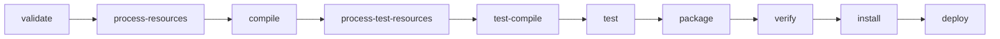
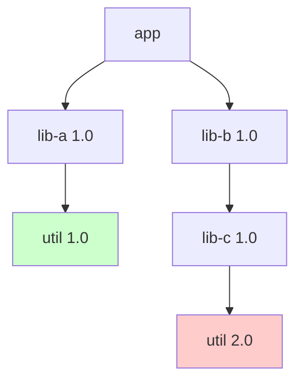

# Build Tools: Maven and Gradle

## Why It Matters

Every Java backend project uses Maven or Gradle, so interviews and daily work meet them in three forms. The first is a definition question: what is the Maven lifecycle, what does `mvn package` run, what is the difference between `implementation` and `api`. The second is a conflict question: two libraries need two versions of a third library, and the application fails at run time with `NoSuchMethodError` or `ClassNotFoundException`. The third is a hygiene question: how a team pins versions with a BOM, keeps builds reproducible, and finds why a jar is on the class path. A developer who cannot read `mvn dependency:tree` or `gradle dependencyInsight` loses hours to version conflicts. This page covers Maven (lifecycle, POM, scopes, transitive resolution, `dependencyManagement`, BOMs, exclusions), Gradle (tasks, configurations, conflict resolution, the wrapper), the diagnosis of version conflicts, and reproducible builds in brief. Spring Boot's starters and its BOM are in `kb/java/18-spring-boot.md`. Class loading, which explains why one class version wins at run time, is in [JVM architecture](05-jvm-architecture.md).

## Core Concepts

**Build tool**: a program that turns source code into a deliverable (a jar, a war, a container image) in repeatable steps: compile, test, package, publish. It also downloads the libraries that the code needs.

**Artifact**: a file that a build produces or consumes, usually a jar, with a name made from coordinates.

**Coordinates**: the three values that identify an artifact in a repository: `groupId` (the organization or project, for example `com.google.guava`), `artifactId` (the module name), and `version`. Gradle writes them as `group:name:version`. Maven adds `packaging` (the file type) and an optional `classifier`.

**Repository**: a server or a directory that stores artifacts. Maven Central is the public repository. A **local repository** (`~/.m2/repository` for Maven, a cache under `~/.gradle` for Gradle) holds the downloaded copies. A company often runs its own repository manager that proxies Maven Central.

**Dependency**: an artifact that your project needs. A **direct dependency** is one that you declare. A **transitive dependency** is one that a direct dependency needs, and that the tool adds for you.

**Class path**: the list of jars and directories where the JVM looks for classes. The build tool computes one class path for compiling and another for running.

**Convention over configuration**: Maven expects a standard layout (`src/main/java`, `src/test/java`, `src/main/resources`) and gives each project a standard lifecycle, so a project needs little configuration. Gradle uses the same layout through its `java` plugin.

## How It Works

### Maven: lifecycle, phases, plugins, and goals

Maven has three built-in **lifecycles**: `clean` (delete the output), `default` (build and deploy), and `site` (generate documentation). A lifecycle is an ordered list of **phases**. A phase is only a name and a position. A phase does no work itself. **Plugins** do the work. A plugin provides **goals**, and each goal is one task, written `plugin:goal` (for example `compiler:compile`). A **binding** attaches a goal to a phase. The packaging type sets the default bindings, so that `jar` packaging runs the right goals with no configuration (Maven "Introduction to the Build Lifecycle").

When you run a phase, Maven runs all earlier phases of the same lifecycle first, in order. `mvn package` runs `validate`, `compile`, `test`, and the other phases up to `package`.



The diagram shows the main phases only. The full default lifecycle has 23 phases, and also includes `initialize`, `generate-sources`, `process-sources`, `generate-resources`, `process-classes`, `generate-test-sources`, `process-test-sources`, `generate-test-resources`, `process-test-classes`, `prepare-package`, `pre-integration-test`, `integration-test`, and `post-integration-test`.

| Phase | Default goal for `jar` packaging | Result |
|---|---|---|
| `process-resources` | `resources:resources` | Copies `src/main/resources` to `target/classes` |
| `compile` | `compiler:compile` | Compiles `src/main/java` to `target/classes` |
| `process-test-resources` | `resources:testResources` | Copies test resources |
| `test-compile` | `compiler:testCompile` | Compiles the tests |
| `test` | `surefire:test` | Runs unit tests (Surefire) |
| `package` | `jar:jar` | Builds the jar in `target/` |
| `install` | `install:install` | Copies the jar to the local repository |
| `deploy` | `deploy:deploy` | Uploads the jar to a remote repository |

(The bindings are from the Maven lifecycle reference.)

You can also run a goal directly, with no phase: `mvn compiler:compile`. The goal then runs alone, without the earlier phases. This is the difference between `mvn compile` and `mvn compiler:compile`. The first runs every phase of the default lifecycle up to and including `compile` (`validate`, `initialize`, `generate-sources`, `process-sources`, `generate-resources`, `process-resources`, and `compile`), which runs each goal bound to those phases. The second runs only the compiler goal. The `integration-test` and `verify` phases exist to run slow tests with a plugin such as Failsafe, so that a failing integration test does not stop the cleanup in `post-integration-test`.

I ran `mvn compile` and then `mvn compiler:compile` on a small project (Apache Maven 3.9.3, Java 21.0.7, offline). The log lines that show the bindings:

```text
[INFO] --- resources:3.3.1:resources (default-resources) @ demo ---
[INFO] --- compiler:3.11.0:compile (default-compile) @ demo ---
```

and for the direct goal:

```text
[INFO] --- compiler:3.11.0:compile (default-cli) @ demo ---
```

Each line reads `plugin:version:goal (execution id) @ project`. The execution id `default-compile` marks a goal that the packaging bound to a phase. The execution id `default-cli` marks a goal that you ran from the command line. Maven 3.9.3 binds `resources` 3.3.1 and `compiler` 3.11.0 by default. Newer Maven versions bind newer plugin versions, so **pin plugin versions** in the POM (see below) to get the same behavior on every machine.

Commands that you use every day:

```bash
mvn clean verify              # delete target/, then run every phase up to verify
mvn -DskipTests package       # build the jar, compile the tests, but do not run them
mvn -Dmaven.test.skip=true package   # also skip compiling the tests
mvn -pl service-a -am package # build module service-a and the modules that it needs
mvn -o package                # offline: use only the local repository
```

### The POM

The **Project Object Model** (`pom.xml`) describes the project. Every POM inherits from a **super POM** that Maven builds in (it defines the central repository and the standard directories), and can inherit from a **parent** that you name.

The next POM is a complete, valid file. I ran `mvn -o compile` on it (Apache Maven 3.9.3, offline). The parts are explained after the block.

```xml
<?xml version="1.0" encoding="UTF-8"?>
<project xmlns="http://maven.apache.org/POM/4.0.0"
         xmlns:xsi="http://www.w3.org/2001/XMLSchema-instance"
         xsi:schemaLocation="http://maven.apache.org/POM/4.0.0
                             https://maven.apache.org/xsd/maven-4.0.0.xsd">
  <modelVersion>4.0.0</modelVersion>

  <groupId>com.example</groupId>
  <artifactId>demo</artifactId>
  <version>1.0.0</version>
  <packaging>jar</packaging>

  <properties>
    <maven.compiler.release>21</maven.compiler.release>
    <project.build.sourceEncoding>UTF-8</project.build.sourceEncoding>
    <guava.version>33.0.0-jre</guava.version>
  </properties>

  <dependencyManagement>
    <dependencies>
      <dependency>
        <groupId>com.google.guava</groupId>
        <artifactId>guava</artifactId>
        <version>${guava.version}</version>
      </dependency>
    </dependencies>
  </dependencyManagement>

  <build>
    <pluginManagement>
      <plugins>
        <plugin>
          <groupId>org.apache.maven.plugins</groupId>
          <artifactId>maven-compiler-plugin</artifactId>
          <version>3.11.0</version>
        </plugin>
      </plugins>
    </pluginManagement>
  </build>
</project>
```

| Element | Purpose |
|---|---|
| `groupId`, `artifactId`, `version`, `packaging` | The coordinates of this project. The `packaging` value (default `jar`) selects the lifecycle bindings |
| `properties` | Named values that the POM reuses as `${name}`. `maven.compiler.release` sets `javac --release` |
| `dependencies` | The direct dependencies. These are on the class path |
| `dependencyManagement` | Versions and scopes for dependencies, **without** adding them to the class path. A `dependency` that omits `<version>` takes it from here |
| `build/plugins` | Plugins that run in this build, with configuration |
| `build/pluginManagement` | Versions and configuration for plugins, without running them. The same idea as `dependencyManagement` |
| `parent` | The POM from which this POM inherits properties, management sections, and plugins |
| `modules` | In an aggregator POM (`packaging` `pom`): the child modules to build together (a **multi-module build**) |
| `profiles` | Alternative configuration that the build turns on by a flag (`-Pname`), by a property, or by the JDK version |

The difference between **inheritance** and **aggregation**: a child module names its `parent` and inherits from it. An aggregator lists `modules` and builds them together. One POM can do both, and often does, but they are separate relations.

### Dependency scopes

The `scope` of a dependency decides on which class paths it appears, and whether it is transitive (Maven "Dependency Mechanism").

| Scope | Compile class path | Test class path | Runtime class path | Transitive |
|---|---|---|---|---|
| `compile` (default) | Yes | Yes | Yes | Yes |
| `provided` | Yes | Yes | No | No |
| `runtime` | No | Yes | Yes | Yes |
| `test` | No | Yes | No | No |
| `system` | Yes | Yes | No | No (avoid: it points to a file path. The Maven documentation discourages it) |
| `import` | Not on a class path | | | Only in `dependencyManagement`, with `<type>pom</type>`: imports a BOM |

Typical uses: `provided` for an API that the server supplies (`jakarta.servlet-api`) or an annotation processor. `runtime` for a library that the code needs only at run time (a JDBC driver, since the code compiles against the `java.sql` interfaces). `test` for JUnit and Mockito.

When a dependency has a dependency, the scope of the transitive one depends on both scopes. The rule: a `compile` dependency's `compile` dependencies stay `compile`, and its `runtime` dependencies become `runtime`. A `runtime` dependency's `compile` dependencies become `runtime`. A `provided` or `test` dependency of a library is omitted: Maven does not pull in the test dependencies of the libraries that you use.

### Transitive resolution and "nearest wins"

If your project depends on `lib-a`, and `lib-a` depends on `util`, then Maven adds `util` to your class path. The result is a **dependency graph**. The same artifact can appear several times with different versions. The class path can hold one version of each artifact, so Maven must choose.

Maven's rule is **nearest definition wins**: Maven picks the version whose path from your project is the shortest. If two paths have the same length, the **first declaration** wins, in the order of the POM (Maven "Dependency Mechanism", "Dependency mediation").



Here `util 1.0` is at depth 2, and `util 2.0` is at depth 3, so Maven chooses `util 1.0`, even though `lib-c` was built against `util 2.0`. If `lib-c` calls a method that exists only in `util 2.0`, the application fails at run time with `NoSuchMethodError`. Maven chooses by position in the graph, not by the version number. A change in the order of two dependencies in the POM can change the result when depths are equal.

**Ways to control the version:**

1. Declare the artifact yourself as a direct dependency (depth 1 always wins). This is the clearest way.
2. List it in `dependencyManagement`. The managed version applies to the artifact **everywhere in the graph**, including transitive occurrences, and overrides nearest-wins.
3. Exclude the unwanted path with an `<exclusion>`.

```xml
<dependencies>
  <dependency>
    <groupId>com.example</groupId>
    <artifactId>lib-a</artifactId>
    <version>1.0</version>
    <exclusions>
      <exclusion>
        <groupId>com.example</groupId>
        <artifactId>util</artifactId>
      </exclusion>
    </exclusions>
  </dependency>
  <dependency>
    <groupId>com.example</groupId>
    <artifactId>util</artifactId>
    <version>2.0</version>
  </dependency>
</dependencies>
```

An exclusion removes the named artifact from the subtree below that one dependency (an exclusion with `*` for both fields removes all transitive dependencies). It does not check that `lib-a` still works without that artifact. If you exclude `util` from `lib-a`, you must supply a compatible version yourself.

### `dependencyManagement` and BOMs

A **BOM** (bill of materials) is a POM with `packaging` `pom` whose purpose is its `dependencyManagement` section: a list of compatible versions for a set of libraries. A project **imports** a BOM with scope `import`. After the import, the project declares the libraries with no version, and the BOM supplies the version.

```xml
<dependencyManagement>
  <dependencies>
    <dependency>
      <groupId>org.springframework.boot</groupId>
      <artifactId>spring-boot-dependencies</artifactId>
      <version>3.5.16</version>
      <type>pom</type>
      <scope>import</scope>
    </dependency>
  </dependencies>
</dependencyManagement>

<dependencies>
  <dependency>
    <groupId>com.fasterxml.jackson.core</groupId>
    <artifactId>jackson-databind</artifactId>
    <!-- no version: the BOM supplies it -->
  </dependency>
</dependencies>
```

(The Spring Boot version in this block is an example from the 3.x line. On 2026-10-22, spring.io lists Spring Boot 4.1.1 as the current generally available version, and `spring-boot-dependencies` is still the BOM artifact. Check the current version at spring.io. I did not run this block, because the build needs network access to download the BOM.)

Spring Boot's `spring-boot-starter-parent` goes one step further: it is a **parent** POM, so a project that names it as `parent` inherits the managed versions and also its plugin configuration. A project that already has another parent imports `spring-boot-dependencies` as a BOM instead, because a POM has one parent only. The difference between a parent and a BOM: a parent shares properties, plugins, and management by inheritance. A BOM shares only dependency versions, by import, and any number of BOMs can be imported.

### `mvn dependency:tree` and other diagnosis commands

The Maven Dependency Plugin prints the resolved graph:

```bash
mvn dependency:tree
mvn dependency:tree -Dverbose                       # also show omitted duplicates and conflicts
mvn dependency:tree -Dincludes=com.example:util     # show only the paths to one artifact
mvn dependency:analyze                              # find unused declared and used undeclared
mvn help:effective-pom                              # the POM after inheritance and profiles
```

I could not run `dependency:tree` in the environment where I wrote this page: the sandbox allowed no access to Maven Central, and the plugin was not in the local repository. The output below is **illustrative**. It uses invented artifacts (`com.example:*`) and follows the documented format of the plugin. Run the command in your own project to see real output.

```text
[INFO] com.example:app:jar:1.0.0
[INFO] +- com.example:lib-a:jar:1.0:compile
[INFO] |  \- com.example:util:jar:1.0:compile
[INFO] \- com.example:lib-b:jar:1.0:compile
[INFO]    \- com.example:lib-c:jar:1.0:compile
```

With `-Dverbose`, the tool also lists the occurrence that Maven omitted, in parentheses, for example `(com.example:util:jar:2.0:compile - omitted for conflict with 1.0)`. The plugin's own example, "Resolving conflicts using the dependency tree", shows this format (`omitted for conflict with <version>`; a repeated artifact shows `omitted for duplicate`). The `tree` goal page documents the `verbose` and `includes` parameters but gives no sample output. The tree shows that `util 1.0` won, and the verbose form shows that `lib-c` wanted `util 2.0`.

Guard against silent conflicts with the **Maven Enforcer Plugin**: the rule `dependencyConvergence` fails the build when the graph holds two versions of one artifact, and `requireUpperBoundDeps` fails when the chosen version is lower than a version that some path requires. Both turn a run-time failure into a build-time failure.

### Gradle: tasks, plugins, and the build script

Gradle models a build as a **directed acyclic graph of tasks**. A **task** is one unit of work (`compileJava`, `test`, `jar`). A task declares its **inputs** and **outputs**. Gradle runs a task only if its inputs changed since the last run, or its outputs are missing, and otherwise marks it `UP-TO-DATE`. This **incremental build** and the optional **build cache** make repeated builds fast. Gradle builds the task graph from the dependencies between tasks, and then runs the tasks in an order that respects them (Gradle user guide, "Build Lifecycle" and "Tasks").

A build has three phases: **initialization** (read `settings.gradle(.kts)` to find the projects), **configuration** (run the build scripts to create the task graph), and **execution** (run the selected tasks). Code in the body of a `tasks.register` block runs at configuration time only if it is outside `doLast` and `doFirst`, so put work inside `doLast`.

Gradle build scripts use the Kotlin DSL (`build.gradle.kts`) or the Groovy DSL (`build.gradle`). The same small build in both:

=== "Kotlin"

    ```kotlin
    plugins {
        `java-library`
    }

    repositories {
        mavenCentral()
    }

    dependencies {
        api("com.google.guava:guava:33.0.0-jre")
        implementation("commons-io:commons-io:2.15.1")
        runtimeOnly("org.postgresql:postgresql:42.7.3")
        testImplementation("org.junit.jupiter:junit-jupiter:5.10.2")
        testRuntimeOnly("org.junit.platform:junit-platform-launcher")
    }

    java {
        toolchain {
            languageVersion = JavaLanguageVersion.of(21)
        }
    }

    tasks.test {
        useJUnitPlatform()
    }

    tasks.register("hello") {
        doLast { println("hello from " + project.name) }
    }
    ```

=== "Groovy"

    ```groovy
    plugins {
        id 'java-library'
    }

    repositories {
        mavenCentral()
    }

    dependencies {
        api 'com.google.guava:guava:33.0.0-jre'
        implementation 'commons-io:commons-io:2.15.1'
        runtimeOnly 'org.postgresql:postgresql:42.7.3'
        testImplementation 'org.junit.jupiter:junit-jupiter:5.10.2'
        testRuntimeOnly 'org.junit.platform:junit-platform-launcher'
    }

    java {
        toolchain {
            languageVersion = JavaLanguageVersion.of(21)
        }
    }

    tasks.named('test') {
        useJUnitPlatform()
    }

    tasks.register('hello') {
        doLast { println "hello from ${project.name}" }
    }
    ```

I could not run these scripts. Gradle 8.14 started but failed in the sandbox of this environment: Gradle needs a local socket for its file-lock service, and the sandbox refuses it ("Could not create service of type FileLockContentionHandler"). The scripts follow the Gradle documentation. The version numbers of the libraries are examples. The `junit-platform-launcher` line is required since Gradle 9.0: before 9.0, Gradle leaked its own copy of the launcher into the test runtime class path, and Gradle 9 no longer does, so a Gradle 9 build must declare it (Gradle user manual, "Testing in Java & JVM projects"). Gradle 9 itself runs on Java 17 or later; the toolchain in the script controls the JDK that compiles and tests.

### Gradle configurations: `implementation` versus `api`

A **configuration** is a named group of dependencies with a purpose. Gradle resolves each configuration separately, and the Java plugins create the standard ones:

| Configuration | On the compile class path | On the runtime class path | Exposed to consumers' compile class path | Plugin |
|---|---|---|---|---|
| `implementation` | Yes | Yes | No | `java` |
| `api` | Yes | Yes | Yes | `java-library` only |
| `compileOnly` | Yes | No | No | `java` |
| `runtimeOnly` | No | Yes | No | `java` |
| `testImplementation` | Test only | Test only | No | `java` |
| `annotationProcessor` | Processor path | No | No | `java` |

The difference between `implementation` and `api`: a library `L` has dependency `D`. If `L` declares `D` with `implementation`, then `D` is an internal detail. A project that uses `L` gets `D` on its **runtime** class path, but not on its **compile** class path. If `L` declares `D` with `api`, then `D` is part of the public API of `L` (a public method of `L` returns a type from `D`), and the consumer also gets `D` on its compile class path. Use `api` only when a type from `D` appears in the public signatures of `L`. Otherwise use `implementation`. The benefit: when `D` changes, Gradle recompiles only the modules that see `D` on their compile class path, so builds are shorter, and the public API of each module stays small. The `api` configuration exists only with the `java-library` plugin, since an application has no consumers.

Maven's equivalents: a Maven `compile` dependency behaves like `api` (it is transitive on the compile class path), and Maven has no direct form of `implementation`.

### Gradle conflict resolution: "highest version wins"

Gradle resolves a version conflict differently from Maven. If the graph holds several versions of one module, Gradle chooses the **highest version** among the requested versions, whatever the depth (Gradle user guide, "Dependency Resolution": version conflict resolution). The order of the declarations and the depth have no effect.

| | Maven | Gradle |
|---|---|---|
| Rule | Nearest definition wins. A tie goes to the first declaration | Highest version wins |
| Depends on the order in the file | Yes, for equal depth | No |
| Can pick an older version than the graph asked for | Yes | No (unless you force it) |
| Failure mode | `NoSuchMethodError` when the nearest version is too old | `NoSuchMethodError` or a behavior change when the newest version removed an API that another library uses |

To change the outcome in Gradle:

```kotlin
dependencies {
    // A constraint sets a preferred version for a transitive dependency
    constraints {
        implementation("com.example:util:2.0") {
            because("lib-c needs the fix from 2.0")
        }
    }
    // A BOM through platform(): the Gradle form of a Maven BOM import
    implementation(platform("org.springframework.boot:spring-boot-dependencies:3.5.16"))
    // An exclusion, like a Maven <exclusion>
    implementation("com.example:lib-a:1.0") {
        exclude(group = "com.example", module = "util")
    }
}

configurations.all {
    resolutionStrategy {
        failOnVersionConflict()          // fail instead of resolving silently
        force("com.example:util:2.0")    // pin a version. Use it as a last resort
    }
}
```

`version { strictly("1.5") }` on a dependency pins the version and fails the build if another module needs a version outside the range. **Dependency locking** (`dependencyLocking { lockAllConfigurations() }`, then `gradle dependencies --write-locks`) records the resolved versions in a `gradle.lockfile`, so that a build does not pick up a newer version when a library releases one.

Diagnosis commands:

```bash
gradle dependencies --configuration runtimeClasspath       # the whole tree
gradle dependencyInsight --dependency util --configuration runtimeClasspath
gradle :service-a:dependencies                              # one subproject
```

`dependencyInsight` shows why Gradle chose a version: it lists each requested version, who requested it, and the selection reason (for example "by conflict resolution" or "by constraint"). It is the Gradle form of `mvn dependency:tree -Dincludes=...`.

### The Gradle wrapper

The **wrapper** is a small script (`gradlew`, `gradlew.bat`) and a few files in `gradle/wrapper/` that you commit with the project. The script downloads the exact Gradle version that `gradle-wrapper.properties` names (`distributionUrl`), and runs the build with it. Everyone then builds with the same Gradle version, and nobody installs Gradle first. A CI server needs only a JDK.

```bash
gradle wrapper --gradle-version 9.8.2     # create or upgrade the wrapper files
./gradlew build                            # use the wrapper, not an installed Gradle
```

```properties
# gradle/wrapper/gradle-wrapper.properties
distributionUrl=https\://services.gradle.org/distributions/gradle-9.8.2-bin.zip
distributionSha256Sum=<sha-256 of the zip, from gradle.org>
```

Setting `distributionSha256Sum` makes the wrapper check the download. Maven has the same idea in the **Maven Wrapper** (`mvnw`), which `mvn wrapper:wrapper` generates. The `~/.m2/wrapper` directory on the machine where I wrote this page holds a Maven 3.9.3 download from a wrapper.

**Versions today (checked on 2026-10-22).** The Maven download page names Apache Maven 3.10.0 as the latest release, lists Maven 3.9.x as the previous stable line, and lists Maven 4.0.0-rc-7 as a release candidate that is "not safe for production use". The Gradle releases page lists Gradle 9.8.2 (19 October 2026) as the newest release, and 8.14.6 as the newest of the 8.x line. The commands I ran used Maven 3.9.3 (the Maven version in the local wrapper cache), because that was the version available offline. Check the pages for newer versions: [Maven](https://maven.apache.org/download.cgi), [Gradle](https://gradle.org/releases/).

### Maven versus Gradle

| Aspect | Maven | Gradle |
|---|---|---|
| Build file | `pom.xml` (declarative XML) | `build.gradle.kts` or `build.gradle` (a program in Kotlin or Groovy) |
| Model | Fixed lifecycle of phases. Plugins bind goals | Graph of tasks with inputs and outputs |
| Customization | Write or configure a plugin | Write a task or plugin in the script |
| Incremental build, cache | Limited. The compiler plugin detects changes | Built in: up-to-date checks, build cache, daemon |
| Version conflict rule | Nearest wins | Highest wins |
| Exposing dependencies | `compile` scope (transitive) | `api` versus `implementation` |
| Learning curve | Low. Every project looks the same | Higher. Each build can be different |
| Where you meet it | Spring and enterprise projects | Android, large multi-module builds |

### Version conflicts and `NoSuchMethodError`

A **version conflict** happens when the class path holds a different version of a library from the one that some other code was compiled against. The compiler cannot detect it, because it compiled against the right version. The JVM finds the problem when it links the call or loads the class. The usual errors:

| Error | Cause |
|---|---|
| `NoSuchMethodError` | The loaded class lacks a method that the caller expects: the loaded version is older (or newer, with the method removed) |
| `NoSuchFieldError` | The same, for a field |
| `NoClassDefFoundError` | A class that was present at compile time is absent at run time (the jar is missing, or a static initializer failed earlier) |
| `ClassNotFoundException` | Code asks for a class by name (`Class.forName`, a framework) and the class loader cannot find it |
| `AbstractMethodError`, `IncompatibleClassChangeError` | An interface or a superclass changed shape between versions |
| `LinkageError` | The parent type of the linkage errors above, such as `NoClassDefFoundError` and `IncompatibleClassChangeError`. A message that says a loader constraint is violated means that two class loaders see different versions of the same class |

I reproduced the most common case. A library `util` has version 1.0 with methods `shout` and `pad`. Version 2.0 removes `pad`. The application is compiled against 1.0 and run with 2.0 on the class path (JDK 21.0.7, `javac` and `java` only, no build tool):

```bash
javac -cp util-1.0.jar -d app/out app/App.java          # compiles: pad exists in 1.0
java  -cp app/out:util-1.0.jar App                      # works
java  -cp app/out:util-2.0.jar App                      # fails
```

```text
Exception in thread "main" java.lang.NoSuchMethodError:
    'java.lang.String util.Strings.pad(java.lang.String)'
	at App.main(App.java:3)
```

The message (wrapped by hand here, to fit the page) gives the exact method: its return type, class, name, and parameter types. This is the key clue.

**Diagnosis, step by step:**

1. Read the message. Note the class (`util.Strings`) and the missing member.
2. Find which jar the JVM loaded the class from. Start the JVM with `-Xlog:class+load` and filter for the class (JDK 9 and later; the older option is `-verbose:class`):

    ```bash
    java -Xlog:class+load -cp app/out:util-2.0.jar App | grep 'util.Strings'
    ```

    ```text
    [0.031s][info][class,load] util.Strings source: file:/.../util-2.0.jar
    ```

3. Check the jar for the member: `javap -cp util-2.0.jar util.Strings` lists `shout` and no `pad`. A jar that holds the class twice (a "fat jar" or a shaded copy) can hide the real source, so search for the class name inside the other jars on the class path.
4. Find out who brings the jar in, and why this version won: `mvn dependency:tree -Dincludes=com.example:util` (add `-Dverbose` for the omitted versions), or `gradle dependencyInsight --dependency util`.
5. Fix the version: declare the right version directly, manage it in `dependencyManagement` (Maven) or `constraints` (Gradle), or exclude the wrong path. Then add an enforcer rule (Maven) or `failOnVersionConflict()` (Gradle) so that the conflict cannot return unseen.
6. If the two versions are both needed by different parts of the application, the build tool alone cannot help, because a class path holds one version. Options: **shade and relocate** one copy (the Maven Shade Plugin renames the package), or load each in its own class loader (what application servers and plugin systems do).

The IDE shows the same information: IntelliJ IDEA has a Maven or Gradle dependency diagram, and Eclipse has the POM editor's "Dependency Hierarchy" tab.

### Reproducible builds in brief

A build is **reproducible** if the same source, built twice, gives byte-identical artifacts. Reproducibility lets you verify that a published jar comes from the published source, and lets a build cache and a security audit trust the artifact (reproducible-builds.org).

Sources of difference, and the fix for each:

| Source of difference | Fix |
|---|---|
| Version ranges and `SNAPSHOT` or `latest` versions | Use fixed versions. Use dependency locking (Gradle `gradle.lockfile`) or a BOM |
| Unpinned plugin versions | Set `<version>` in `pluginManagement`. Maven warns about plugins without a version |
| Timestamps inside the jar | Maven: set `<project.build.outputTimestamp>` (supported since maven-jar-plugin 3.2.0). Gradle: `isPreserveFileTimestamps = false` |
| File order inside the archive | Gradle: `isReproducibleFileOrder = true` |
| Different JDK or tool version | Pin the JDK (Gradle toolchain, or a container image), and use the wrapper |
| Different repository contents | Use a repository manager that you control, and checksum verification (Gradle `verification-metadata.xml`) |

```kotlin
tasks.withType<AbstractArchiveTask>().configureEach {
    isPreserveFileTimestamps = false
    isReproducibleFileOrder = true
}
```

```xml
<properties>
  <project.build.outputTimestamp>2026-10-01T00:00:00Z</project.build.outputTimestamp>
</properties>
```

I did not run the reproducibility settings in this environment.

## Trade-offs and When to Use

| Situation | Choice | Reason |
|---|---|---|
| New Spring or enterprise service, team knows Maven | Maven | A standard layout and lifecycle. Every developer can read the POM |
| Large multi-module repository, long build times | Gradle | Incremental builds, build cache, and parallel execution cut build time |
| Android | Gradle | The Android Gradle Plugin is the supported tool |
| Need custom build logic | Gradle (a task) or Maven (a plugin) | Gradle is faster to write. A Maven plugin is more formal and reusable |
| Versions of many libraries must match | A BOM (Maven import, Gradle `platform`) | One place to update, and the versions are tested together |
| A transitive version is wrong | Direct declaration or management, then an exclusion | Exclusions hide the problem. A managed version states the intent |
| Build must give the same result on every machine | Wrapper, pinned plugins, locked dependencies, pinned JDK | Removes the differences that you do not control |

Recommendation: prefer a managed version (`dependencyManagement`, `constraints`) over an exclusion, because the managed version states which version you want, while an exclusion leaves the question open.

<!-- omit: Java Example -- the page shows build files and shell commands, and the Java code is in the NoSuchMethodError demo -->

## Interview Angle

### Questions

??? question "Explain the Maven build lifecycle. What does `mvn package` do?"

    Maven has three lifecycles: `clean`, `default`, and `site`. The default lifecycle is an ordered list of phases (`validate`, `compile`, `test`, `package`, `verify`, `install`, `deploy`, and others). A phase does no work by itself. Plugin goals do the work, and the packaging type binds goals to phases: for `jar`, `compiler:compile` runs in `compile`, `surefire:test` in `test`, and `jar:jar` in `package`.

    `mvn package` runs every phase of the default lifecycle up to and including `package`, in order: it validates the POM, copies resources, compiles the code, compiles and runs the unit tests, and builds the jar in `target/`. It does not install the jar to the local repository (`install`) or upload it (`deploy`). A failing test stops the build before `package`.

??? question "What are Maven dependency scopes, and how does `provided` differ from `runtime`?"

    The scope decides on which class paths a dependency appears and whether it is transitive. `compile` (default) is on all class paths and is transitive. `provided` is on the compile and test class paths but not at run time, and is not transitive: the runtime environment supplies it (the servlet API in a servlet container). `runtime` is not needed to compile but is on the test and runtime class paths (a JDBC driver). `test` is only on test class paths. `import` is only for a BOM in `dependencyManagement`.

    A good answer adds that a `compile` dependency of a `compile` dependency stays `compile`, and that Maven omits the `test` and `provided` dependencies of a library.

??? question "How does Maven choose a version when two libraries need different versions of a third library?"

    Maven uses "nearest definition wins": it picks the version at the shortest path from the project in the dependency graph. If two paths have the same length, the first declaration in the POM wins. It does not pick the highest version.

    This can choose a version that is too old for one of the libraries, which gives `NoSuchMethodError` at run time. To control it: declare the artifact directly in the project (depth 1), set its version in `dependencyManagement` (which applies to transitive occurrences too), or exclude the unwanted path. To find the cause, run `mvn dependency:tree -Dverbose`. To prevent it, use the Enforcer plugin rules `dependencyConvergence` or `requireUpperBoundDeps`.

??? question "What is the difference between `implementation` and `api` in Gradle?"

    Both put the dependency on the library's own compile and runtime class paths. With `api`, the dependency is also on the compile class path of the library's consumers: it is part of the public API. With `implementation`, consumers get it only on their runtime class path, so it stays an internal detail. Use `api` only when a type from the dependency appears in a public signature of the library, and `implementation` in every other case. The result: a change inside an `implementation` dependency does not force the consumers to recompile, and the API stays small. `api` exists only with the `java-library` plugin.

### Follow-up Questions

??? question "How does Gradle resolve version conflicts, and how does that differ from Maven?"

    Gradle chooses the highest version among all requested versions of a module, whatever their depth or order. Maven chooses the nearest. Gradle's rule cannot pick an older version than some library asked for, but it can pick a newer version that removed an API that another library uses. To override: `constraints`, `strictly` in a version, `force` in `resolutionStrategy`, or a `platform` (BOM). `failOnVersionConflict()` turns any conflict into an error. `gradle dependencyInsight` shows why a version won.

??? question "What is a BOM, and what is the difference between importing a BOM and using a parent POM?"

    A BOM is a POM that holds only a `dependencyManagement` section, with versions of libraries that are tested together. A project imports it with `<scope>import</scope>` and `<type>pom</type>`, then declares the libraries with no version. A parent POM shares properties, plugin configuration, and dependency management by inheritance, and a project has one parent. A project can import many BOMs. Use the parent when you want its plugin setup too, and the import when you already have a parent. In Gradle, `platform(...)` does the same job as the import.

??? question "A service fails in production with `NoSuchMethodError`, and the tests passed. How do you find the cause?"

    Read the error: it names the class and the exact method signature. Start the JVM with `-Xlog:class+load` to see which jar supplied the class, and list that jar with `javap` to confirm the method is missing. Then run `mvn dependency:tree -Dincludes=<group>:<artifact>` (or `gradle dependencyInsight`) to see who brings that version and why it won. The tests passed because the test class path differs from the production class path (different scopes, a different packaging such as a fat jar, or a different BOM). Fix the version with a managed version or a direct declaration, and add an enforcer rule so the conflict fails the build.

??? question "What is the Gradle wrapper, and why do you commit it?"

    The wrapper is the `gradlew` script plus `gradle/wrapper/gradle-wrapper.properties` and a small jar. The script downloads the Gradle version named in the properties file and runs the build with it. Committing it makes every developer and the CI server use the same Gradle version, and nobody has to install Gradle. Maven has a similar tool, `mvnw`.

??? question "What makes a build reproducible?"

    The same source gives byte-identical artifacts. The requirements: fixed dependency and plugin versions (no ranges or snapshots, or locked versions), a pinned JDK and build tool version (toolchain, wrapper), no timestamps or file-order differences in the archive (`project.build.outputTimestamp` in Maven, `isPreserveFileTimestamps = false` and `isReproducibleFileOrder = true` in Gradle), and a controlled repository. The benefit is that you can verify a published artifact against its source.

### Red Flags

- "Maven picks the latest version." Maven picks the nearest, and Gradle picks the highest.
- "`dependencyManagement` adds the dependency." It only sets versions. The dependency must still be declared.
- "A phase compiles the code." A plugin goal does the work. A phase is a position in the lifecycle.
- Fixing a conflict by adding `<exclusion>` elements everywhere, with no check that the library still works.
- Using `system` scope, or copying jars into the repository, instead of installing the artifact in a repository.
- Using `api` for everything in Gradle, or `force` as the first answer to a conflict.
- Saying "it compiled, so the versions are fine". A version conflict appears at run time.

## Common Mistakes

| Mistake | Effect | Fix |
|---|---|---|
| Plugins without a version | The build behaves differently with a new Maven version | Pin plugin versions in `pluginManagement` |
| `SNAPSHOT` or version ranges in a release | The build changes with no change in the source | Use fixed versions, and lock them |
| Relying on transitive dependencies for classes that you import | Your code breaks when the library drops that dependency (Maven `dependency:analyze` shows "used undeclared") | Declare each library that your code uses directly |
| Fixing a conflict with an exclusion alone | The exclusion hides the cause, and the next upgrade fails again | Manage the version, or use a BOM |
| Running `mvn install` when you mean `mvn verify` | Fills the local repository with unreleased artifacts, which can hide missing dependencies in other modules | Use `verify` unless another project needs the artifact |
| `provided` for a library that the server does not supply | `NoClassDefFoundError` at run time | Use `compile` or `runtime` |
| `api` for an internal dependency (Gradle) | A larger public API, and more recompilation | Use `implementation` |
| Not committing the wrapper | Different Gradle versions on different machines | Commit `gradlew` and `gradle/wrapper/` |
| Using `-DskipTests` in CI to "fix" a failing build | Broken code ships | Fix the test |
| Mixing two versions of a BOM-managed library by hand | A version that the BOM never tested | Remove the explicit version, or update the BOM |

## Commonly Confused With

| Looks like | Difference | Deciding question |
|---|---|---|
| Maven phase and goal | A phase is a named step in the lifecycle. A goal is a task of a plugin that a phase runs | Does it do work, or does it name a position? |
| `dependencies` and `dependencyManagement` | The first adds to the class path. The second only sets versions | Is the library used by this module? |
| Parent POM and aggregator POM | A parent shares configuration by inheritance. An aggregator lists modules to build together | Does it share settings, or group modules? |
| Parent POM and BOM import | Inheritance (one parent) versus import (many BOMs, versions only) | Does the project need plugin configuration too? |
| `mvn install` and `mvn deploy` | Copy to the local repository versus upload to a remote repository | Who must see the artifact? |
| `mvn compile` and `mvn compiler:compile` | A phase runs all earlier phases. A goal runs alone | Do you need resources copied first? |
| `implementation` and `api` | Hidden from consumers' compile class path versus exposed | Does a type from it appear in a public signature? |
| `compileOnly` and `provided` | The Gradle and Maven forms of "needed to compile, not shipped" | Does the runtime supply the library? |
| Maven nearest-wins and Gradle highest-wins | Position in the graph versus version number | Which tool builds this project? |
| `NoSuchMethodError` and `ClassNotFoundException` | The class loaded, but a member is missing, versus the class is not found | Is the class on the class path at all? |

## Quick Reference Card

- Maven: lifecycles `clean`, `default`, `site`. A phase is a position. Plugin goals do the work. `mvn <phase>` runs all earlier phases of that lifecycle.
- Default phases that matter: `validate`, `compile`, `test`, `package`, `verify`, `install`, `deploy`. `install` copies to `~/.m2`. `deploy` uploads.
- Scopes: `compile` (default), `provided` (not at run time), `runtime` (not to compile), `test`, `import` (BOM only).
- Maven conflict rule: nearest wins, then first declaration. Gradle: highest version wins.
- `dependencyManagement` sets versions and does not add dependencies. A BOM is imported with `type pom` and `scope import`. Gradle: `platform(...)`.
- Exclusion removes a path. A managed or direct version states the intent. Prefer them.
- Diagnose: `mvn dependency:tree -Dverbose -Dincludes=g:a`, `gradle dependencyInsight --dependency x`, `-Xlog:class+load`, `javap`.
- `NoSuchMethodError` means the loaded version differs from the compiled version. The message names the method.
- Gradle: tasks with inputs and outputs, `UP-TO-DATE` checks. `api` is exposed to consumers' compile class path (`java-library`). `implementation` is not.
- Commit the wrapper (`gradlew` or `mvnw`). Pin plugin versions and the JDK. Avoid snapshots and ranges. Set an output timestamp for reproducible archives.
- Enforce: Maven Enforcer `dependencyConvergence`, Gradle `failOnVersionConflict()`.

## Further Reading

- [Maven: Introduction to the Build Lifecycle](https://maven.apache.org/guides/introduction/introduction-to-the-lifecycle.html): phases, goals, bindings, and the default bindings by packaging type.
- [Maven: Introduction to the Dependency Mechanism](https://maven.apache.org/guides/introduction/introduction-to-dependency-mechanism.html): scopes, transitive dependencies, dependency mediation (nearest wins), `dependencyManagement`, and the BOM import.
- [Maven: Guide to Working with Multiple Modules and POM Reference](https://maven.apache.org/pom.html): every element of the POM, and inheritance versus aggregation.
- [Apache Maven Dependency Plugin: `dependency:tree`](https://maven.apache.org/plugins/maven-dependency-plugin/tree-mojo.html): the options `verbose` and `includes`.
- [Maven Dependency Plugin: Resolving conflicts using the dependency tree](https://maven.apache.org/plugins-archives/maven-dependency-plugin-2.6/examples/resolving-conflicts-using-the-dependency-tree.html): a worked `-Dverbose` example with the `omitted for conflict with` text (archived 2.6 documentation).
- [Apache Maven Enforcer Plugin: built-in rules](https://maven.apache.org/enforcer/enforcer-rules/index.html): `dependencyConvergence` and `requireUpperBoundDeps`.
- [Maven: Configuring for Reproducible Builds](https://maven.apache.org/guides/mini/guide-reproducible-builds.html): `project.build.outputTimestamp` and plugin versions.
- [Gradle User Manual: Build Lifecycle and Tasks](https://docs.gradle.org/current/userguide/build_lifecycle.html): the three build phases and the task graph.
- [Gradle User Manual: Dependency Resolution and Version Conflicts](https://docs.gradle.org/current/userguide/dependency_resolution.html): "highest version wins", constraints, strict versions, and `dependencyInsight`.
- [Gradle User Manual: The Java Library Plugin](https://docs.gradle.org/current/userguide/java_library_plugin.html): `api` versus `implementation`, with the reasons.
- [Gradle User Manual: The Gradle Wrapper](https://docs.gradle.org/current/userguide/gradle_wrapper.html): wrapper files and the checksum option.
- [Reproducible Builds](https://reproducible-builds.org/docs/): the definition, and the sources of difference.
- [JDK 21 `java.lang.NoSuchMethodError` javadoc](https://docs.oracle.com/en/java/javase/21/docs/api/java.base/java/lang/NoSuchMethodError.html): the error and its parent `IncompatibleClassChangeError`.
