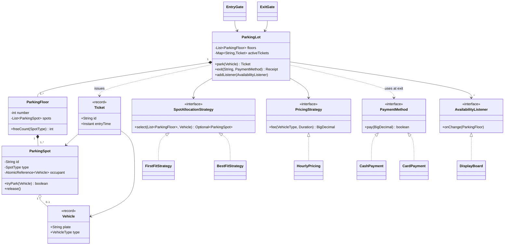
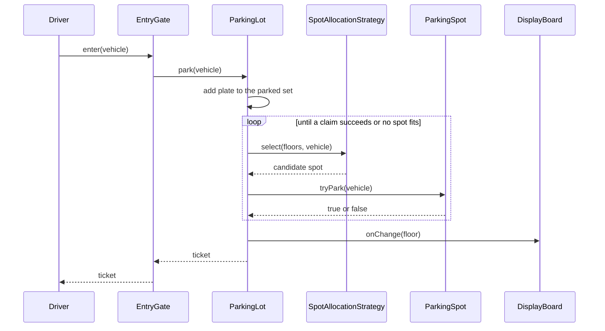

# Design a Parking Lot

A parking lot is the most common LLD interview problem. It looks simple, and it tests the full procedure from [how to approach an LLD interview](../../how-to-approach-lld.md): model the entities, choose a Strategy where the rules vary, notify displays with Observer, and protect the spots when two gates assign them at the same time. The folder holds this page and one runnable `Main.java`. Run it with `java Main.java` (JDK 21).

## Problem Statement

Design a multi-floor parking lot. Each floor has spots of different sizes. Vehicles of different types arrive at entry gates. The system finds a free spot that fits the vehicle, issues a ticket, and records the entry time. At an exit gate, the driver gives the ticket, the system computes the fee from the parked time, takes the payment, frees the spot, and opens the gate. Display boards show how many spots are free. Several gates work at the same time.

## Clarifying Questions

Ask these in the first 5 minutes. Each row gives the answer that this design assumes.

| Question | Assumed answer |
|---|---|
| Which vehicle types exist? | Motorcycle, car, truck. A new type must be easy to add |
| Which spot types exist? | Small, medium, large |
| Which vehicle fits which spot? | A vehicle fits a spot of its own size or a larger size. Motorcycle: small, medium, large. Car: medium, large. Truck: large |
| How does the lot choose a spot? | The rule can change. The design supports several rules. The demo has first-fit and best-fit |
| How is the fee computed? | Hourly rate per vehicle type. A started hour counts as a full hour. The minimum is one hour. The rule can change |
| Which payment methods exist? | Cash and card. More methods can follow |
| What happens when no spot fits? | The gate refuses the vehicle with a clear error. No queue |
| What happens when a ticket is lost or used twice? | A ticket works once. An unknown or used ticket is refused. Lost-ticket handling is an extension |
| Can the same vehicle enter twice? | No. The lot refuses a plate that is already inside |
| Are there several gates? | Yes. Several entry gates and exit gates work at the same time |
| What do the display boards show? | The free spots of each type on one floor |
| Is storage in memory? | Yes. No database. Persistence is an extension |
| Is the interface a Java API? | Yes. No UI and no REST layer |

## Requirements

### Functional

1. The lot has several floors. Each floor has spots. Each spot has a type (small, medium, large).
2. A vehicle has a plate and a type (motorcycle, car, truck).
3. An entry gate takes a vehicle, finds a free spot that fits, marks the spot as taken, and returns a ticket with the entry time.
4. The spot allocation rule is replaceable (Strategy).
5. An exit gate takes a ticket and a payment method. The system computes the fee, takes the payment, frees the spot, and returns a receipt.
6. The fee rule is replaceable (Strategy).
7. The payment method is replaceable (Strategy).
8. Display boards show the free spots per type. A board updates when a spot changes state (Observer).
9. The lot refuses a vehicle when no spot fits, when the plate is already inside, and when a ticket is unknown or used.

### Non-functional

1. Two gates that assign a spot at the same time never give the same spot to two vehicles.
2. One ticket pays at most once, even if two exit gates read it at the same time.
3. The time source is injected, so tests use a fixed clock and get the same fees on every run.
4. A new vehicle type, spot type, pricing rule, or allocation rule changes few existing classes.
5. Allocation scans the spots of the lot. The cost is O(S) for S spots. The Extensions section shows how to make the cost independent of S.

## Entities and Relationships

| Entity | Responsibility | Relationships |
|---|---|---|
| `ParkingLot` | Facade of the system. Parks and exits vehicles, owns the ticket registry, and notifies listeners | Has many `ParkingFloor` (composition). Uses one `SpotAllocationStrategy`, one `PricingStrategy`, and one `Clock`. Has many `AvailabilityListener` |
| `ParkingFloor` | Groups the spots of one floor. Counts free spots per type | Has many `ParkingSpot` (composition) |
| `ParkingSpot` | Holds its own type and its occupant. Claims the spot in one atomic step | Belongs to one floor. Holds zero or one `Vehicle` |
| `Vehicle` | A value: plate and type | Used by `Ticket` and `ParkingSpot` |
| `VehicleType`, `SpotType` | Enums. `VehicleType.fitsIn(SpotType)` holds the fit rule | |
| `Ticket` | A record: id, vehicle, spot, entry time. Its fields never change. The spot that it refers to is mutable, and the spot protects its own state | Refers to a `ParkingSpot` |
| `Receipt` | A record that proves a payment | |
| `SpotAllocationStrategy` | Chooses a free spot that fits | Implemented by `FirstFitStrategy`, `BestFitStrategy` |
| `PricingStrategy` | Computes the fee from the vehicle type and the parked time | Implemented by `HourlyPricing` |
| `PaymentMethod` | Takes a payment | Implemented by `CashPayment`, `CardPayment` |
| `AvailabilityListener` | Observer interface for spot changes | Implemented by `DisplayBoard` |
| `DisplayBoard` | Shows the free counts of one floor | Observes `ParkingLot` |
| `EntryGate`, `ExitGate` | Thin entry points that carry a gate id and call the lot | Use `ParkingLot` |

The lot is the only class that changes shared state across several spots. Each spot owns the atomic claim of itself. This split keeps the lock-free logic in the smallest class.

Why `Ticket` holds a `ParkingSpot` and not a spot id: the exit path needs the spot object to release it. A lookup by id adds a map and a failure case. The cost: a ticket now depends on the spot class. This is fine inside one module.

## Class Diagram



See [UML class and sequence diagrams](../../fundamentals/04-uml-class-and-sequence-diagrams.md) for the notation. The entry flow in order:



## Design Patterns Used

| Pattern | Where | Why | Rejected alternative |
|---|---|---|---|
| Strategy | `SpotAllocationStrategy` | The statement says the rule can change (first-fit, best-fit, nearest to the exit, EV spots first). Each rule is one class, and `ParkingLot` does not change | A `switch` on a mode enum inside `ParkingLot`. Each new rule edits the lot and breaks the Open-Closed Principle |
| Strategy | `PricingStrategy` | The fee rule changes more often than any other rule (peak hours, daily caps, weekend rates) | A fee field on `VehicleType`. It fixes one rule for all lots and cannot express a cap |
| Strategy | `PaymentMethod` | Cash and card differ in how they take the money. Adding UPI is one class | An `if (cash) ... else ...` chain in the exit path |
| Observer | `AvailabilityListener`, `DisplayBoard` | The lot must not know how many boards exist or what they show. A mobile app can subscribe later | The lot calls each board by name. It couples the lot to every display. A polling board is also valid, but it wastes calls and shows stale data between polls |
| Facade | `ParkingLot` | One entry point (`park`, `exit`) hides the allocation, the ticket registry, and the notification. The gates stay thin | Gates that call the strategy and the registry themselves. Each gate repeats the ordering rules |
| Value objects (records) | `Vehicle`, `Ticket`, `Receipt` | They are immutable, so threads share them without a lock | Mutable classes with setters |

The design does not use Singleton for `ParkingLot`. A lot is passed to the gates through the constructor. This keeps tests independent, and the demo builds several lots in one run. See [creational patterns](../../fundamentals/06-creational-patterns.md) for why Singleton hurts testing.

The design does not use State for `ParkingSpot`. A spot has two states (free, taken) and no behavior that depends on the state. An `AtomicReference` holds the occupant. See [behavioral patterns](../../fundamentals/08-behavioral-patterns.md) for the Strategy, Observer, and State patterns, [SOLID](../../fundamentals/02-solid.md) for the Open-Closed Principle, and [OOP](../../fundamentals/01-oop.md) for encapsulation.

## Key Code

### Types and the fit rule

`VehicleType` holds the smallest spot that fits. `fitsIn` compares the order of the enum constants. A new vehicle type adds one constant. A new spot type needs a place in the order.

```java
enum SpotType { SMALL, MEDIUM, LARGE }

enum VehicleType {
    MOTORCYCLE(SpotType.SMALL), CAR(SpotType.MEDIUM), TRUCK(SpotType.LARGE);

    private final SpotType smallestSpot;

    VehicleType(SpotType smallestSpot) {
        this.smallestSpot = smallestSpot;
    }

    boolean fitsIn(SpotType spot) {
        return spot.ordinal() >= smallestSpot.ordinal();
    }
}
```

### The spot: one atomic claim

`tryPark` is the only way to take a spot. `compareAndSet(null, vehicle)` succeeds for exactly one caller when several callers race. The check and the change are one step.

```java
final class ParkingSpot {
    private final String id;
    private final int floor;
    private final SpotType type;
    private final AtomicReference<Vehicle> occupant = new AtomicReference<>();

    ParkingSpot(String id, int floor, SpotType type) {
        this.id = id;
        this.floor = floor;
        this.type = type;
    }

    String id() {
        return id;
    }

    int floor() {
        return floor;
    }

    SpotType type() {
        return type;
    }

    boolean isFree() {
        return occupant.get() == null;
    }

    /** Atomic claim. Exactly one caller wins when several call at the same time. */
    boolean tryPark(Vehicle vehicle) {
        return occupant.compareAndSet(null, vehicle);
    }

    void release() {
        occupant.set(null);
    }
}
```

### Allocation strategies

A strategy only reads the spots and suggests a candidate. It does not claim the spot, because claiming needs the atomic step in `ParkingSpot`.

```java
interface SpotAllocationStrategy {
    Optional<ParkingSpot> select(List<ParkingFloor> floors, Vehicle vehicle);
}
```

```java
/** Takes the smallest free spot that fits. Large spots stay free for large vehicles. */
final class BestFitStrategy implements SpotAllocationStrategy {
    @Override
    public Optional<ParkingSpot> select(List<ParkingFloor> floors, Vehicle vehicle) {
        ParkingSpot best = null;
        for (ParkingFloor floor : floors) {
            for (ParkingSpot spot : floor.spots()) {
                if (spot.isFree() && vehicle.type().fitsIn(spot.type())
                        && (best == null || spot.type().ordinal() < best.type().ordinal())) {
                    best = spot;
                }
            }
        }
        return Optional.ofNullable(best);
    }
}
```

`FirstFitStrategy` in `Main.java` has the same shape and takes the first match. Best-fit keeps the large spots free for trucks. First-fit is cheaper per call and fills the lower floors first.

### Pricing and payment

```java
interface PricingStrategy {
    BigDecimal fee(VehicleType type, Duration parked);
}

final class HourlyPricing implements PricingStrategy {
    private final Map<VehicleType, BigDecimal> ratePerHour;

    HourlyPricing(Map<VehicleType, BigDecimal> ratePerHour) {
        this.ratePerHour = new EnumMap<>(ratePerHour);
    }

    static HourlyPricing standard() {
        return new HourlyPricing(Map.of(VehicleType.MOTORCYCLE, new BigDecimal("10"),
                VehicleType.CAR, new BigDecimal("20"), VehicleType.TRUCK, new BigDecimal("50")));
    }

    @Override
    public BigDecimal fee(VehicleType type, Duration parked) {
        long billedHours = Math.max(1, (parked.toMinutes() + 59) / 60);
        return ratePerHour.get(type).multiply(BigDecimal.valueOf(billedHours));
    }
}
```

`(minutes + 59) / 60` rounds up to whole hours. `Math.max(1, ...)` sets the minimum of one hour. The code uses `BigDecimal` for money. See [domain modeling](../../fundamentals/05-domain-modeling.md) for why `double` is wrong for money.

```java
interface PaymentMethod {
    boolean pay(BigDecimal amount);

    String describe();
}

record CashPayment(BigDecimal tendered) implements PaymentMethod {
    @Override
    public boolean pay(BigDecimal amount) {
        return tendered.compareTo(amount) >= 0;
    }

    @Override
    public String describe() {
        return "cash";
    }
}
```

### Observer and display board

The lot sends the changed floor. The board reads the live counts from that floor. It does not trust a count in the message. Reason: two threads can send notifications in a different order than the changes. A board that reads the live state at notification time ends with the correct counts after the last notification.

```java
interface AvailabilityListener {
    void onChange(ParkingFloor floor);
}

/** A display board for one floor. It reads the live counts when the lot notifies it. */
final class DisplayBoard implements AvailabilityListener {
    private final ParkingFloor floor;
    private String text;

    DisplayBoard(ParkingFloor floor) {
        this.floor = floor;
        this.text = floor.summary();
    }

    @Override
    public synchronized void onChange(ParkingFloor changed) {
        if (changed == floor) {
            text = floor.summary();
        }
    }

    synchronized String text() {
        return text;
    }
}
```

### The lot

`park` and `exit` hold the main rules. Read them with the concurrency section in mind. The constructor checks that the floor at index i has number i, because `floor(int)` and `notifyListeners` find a floor by its number.

```java
final class ParkingLot {
    private final List<ParkingFloor> floors;
    private final SpotAllocationStrategy allocation;
    private final PricingStrategy pricing;
    private final Clock clock;
    private final AtomicLong ticketSeq = new AtomicLong();
    private final Map<String, Ticket> activeTickets = new ConcurrentHashMap<>();
    private final Set<String> parkedPlates = ConcurrentHashMap.newKeySet();
    private final List<AvailabilityListener> listeners = new CopyOnWriteArrayList<>();

    ParkingLot(List<ParkingFloor> floors, SpotAllocationStrategy allocation,
               PricingStrategy pricing, Clock clock) {
        this.floors = List.copyOf(floors);
        for (int i = 0; i < this.floors.size(); i++) {
            if (this.floors.get(i).number() != i) {
                throw new IllegalArgumentException("floor " + i + " has number "
                        + this.floors.get(i).number());
            }
        }
        this.allocation = allocation;
        this.pricing = pricing;
        this.clock = clock;
    }

    ParkingFloor floor(int number) {
        return floors.get(number);
    }

    void addListener(AvailabilityListener listener) {
        listeners.add(listener);
    }

    boolean isParked(String plate) {
        return parkedPlates.contains(plate);
    }

    Ticket park(Vehicle vehicle) {
        if (!parkedPlates.add(vehicle.plate())) {
            throw new ParkingException("vehicle " + vehicle.plate() + " is already parked");
        }
        ParkingSpot spot;
        try {
            spot = allocate(vehicle);
        } catch (RuntimeException e) {
            parkedPlates.remove(vehicle.plate()); // a failing strategy must not leave the plate
            throw e;
        }
        if (spot == null) {
            parkedPlates.remove(vehicle.plate());
            throw new LotFullException(vehicle);
        }
        Ticket ticket = new Ticket("T-" + ticketSeq.incrementAndGet(), vehicle, spot,
                clock.instant());
        activeTickets.put(ticket.id(), ticket);
        notifyListeners(spot);
        return ticket;
    }

    private ParkingSpot allocate(Vehicle vehicle) {
        while (true) {
            Optional<ParkingSpot> candidate = allocation.select(floors, vehicle);
            if (candidate.isEmpty()) {
                return null;
            }
            if (candidate.get().tryPark(vehicle)) {
                return candidate.get();
            }
            // Another gate took this spot between select and tryPark. Select again.
        }
    }

    Receipt exit(String ticketId, PaymentMethod method) {
        Ticket ticket = activeTickets.remove(ticketId);
        if (ticket == null) {
            throw new InvalidTicketException(ticketId);
        }
        boolean paid = false;
        try {
            Duration parked = Duration.between(ticket.entryTime(), clock.instant());
            BigDecimal fee = pricing.fee(ticket.vehicle().type(), parked);
            if (!method.pay(fee)) {
                throw new PaymentFailedException(fee);
            }
            paid = true;
            ticket.spot().release();
            parkedPlates.remove(ticket.vehicle().plate());
            notifyListeners(ticket.spot());
            return new Receipt(ticketId, ticket.vehicle().plate(), ticket.spot().id(),
                    parked.toMinutes(), fee, method.describe());
        } finally {
            if (!paid) {
                // The payment was declined or threw. The driver can try again.
                activeTickets.put(ticketId, ticket);
            }
        }
    }

    private void notifyListeners(ParkingSpot spot) {
        ParkingFloor floor = floors.get(spot.floor());
        for (AvailabilityListener listener : listeners) {
            listener.onChange(floor);
        }
    }
}
```

## Concurrency

Two things race in this design: the spot assignment and the ticket use.

### Race 1: two gates take the same spot

The wrong form checks the spot, and then changes it:

<!-- fragment -->
```java
// Wrong: check, then act. Two gates can both see a free spot.
if (spot.isFree()) {
    spot.setOccupant(vehicle);
}
```

Gate A and gate B both read `isFree() == true`. Both set the occupant. Two vehicles now own one spot. The result depends on the thread schedule, so the bug appears rarely and is hard to reproduce.

The design fixes this in two layers:

1. `ParkingSpot.tryPark` uses `AtomicReference.compareAndSet(null, vehicle)`. The compare-and-swap operation makes the check and the change one atomic step. Exactly one caller gets `true`.
2. `ParkingLot.allocate` loops. The strategy suggests a candidate from a snapshot that can be stale. If `tryPark` returns `false`, another gate took the spot after the strategy read it. The loop asks the strategy again, and the taken spot no longer qualifies. The loop ends when a claim succeeds or when no spot fits. Each failed claim means that another thread made progress, so the claim loop is lock-free: it takes no lock, and the system as a whole always moves forward. (`park` as a whole also writes to `ConcurrentHashMap`, which locks one bin for a short time on a write.) It is not wait-free: one unlucky thread can lose several claims in a row. With best-fit, all gates pick the same smallest spot, so they conflict more often than with a strategy that starts the scan at a different spot for each gate.

The demo (section 5) starts 10 threads through two gates on a lot with 3 medium spots. The result is always 3 parked, 7 rejected, and 3 distinct spots. The demo prints only these schedule-independent numbers.

### Race 2: the same ticket exits twice

`exit` calls `activeTickets.remove(ticketId)` first. `ConcurrentHashMap.remove` is atomic, so exactly one caller receives the ticket. Every other caller receives `null` and fails with `InvalidTicketException`. The design chooses "claim, then pay" because "pay, then claim" can charge the driver twice: two exit gates both read the ticket, both charge, and only then does one of them fail to remove it.

If the payment is declined, or if the payment code throws an exception, the `finally` block puts the ticket back, so the driver can pay again with another method. Without the `finally`, an exception from a card gateway removes the ticket forever, and the spot stays taken with no ticket that can free it. The flag `paid` turns `true` only after the payment succeeds, so a paid ticket never returns to the registry.

The exit then frees the spot, removes the plate, and notifies the boards, in this order. The spot is freed only after the payment, so a declined payment keeps the vehicle in its spot.

Trade-off: while a payment is in progress, the ticket is not in the registry. A second attempt in that moment fails with "unknown or already used". The driver retries. A stricter design marks the ticket as `PAYING` with a state field.

### Race 3: the same plate enters through two gates

`parkedPlates.add(plate)` is atomic (`ConcurrentHashMap.newKeySet()`). Exactly one gate adds the plate. The other gate gets `false` and refuses the vehicle. If allocation fails, the code removes the plate again.

### Other shared state

| State | Protection | Reason |
|---|---|---|
| Spot occupant | `AtomicReference` with `compareAndSet` | Single variable, single step |
| Ticket registry | `ConcurrentHashMap` | `remove` is atomic |
| Parked plates | `ConcurrentHashMap.newKeySet()` | `add` is atomic |
| Ticket numbers | `AtomicLong` | Unique ids without a lock |
| Listener list | `CopyOnWriteArrayList` | Few writes, many reads. Iteration works on a snapshot |
| Display text | `synchronized` in `DisplayBoard` | The text is updated and read as a whole |
| `Vehicle`, `Ticket`, `Receipt` | Immutable records | Nothing to protect |

Why no global lock: a lock on `ParkingLot.park` serializes all gates, and the lock covers the full scan. Per-spot atomics let gates work in parallel and conflict only on the same spot. The cost: the lot has no consistent snapshot. A board can show an old count until the notifications of the latest changes run. The last notification corrects it. The listeners run on the gate thread, so a slow listener delays the gate. A board that does slow work hands the update to its own executor. A listener that throws reaches the caller of `park` or `exit` after the spot is claimed or the payment is taken, so a production version catches and logs each listener exception in `notifyListeners`. Assumption: the demo listeners do not throw, so the code keeps the loop plain. See [concurrency in LLD](../../fundamentals/09-concurrency-in-lld.md) for the comparison of locks and atomics, and [java.util.concurrent: Executors, Locks, Atomics, and Synchronizers](../../../java/08-java-util-concurrent.md) for the primitives.

!!! tip "What to say in the interview"
    "I protect the one thing that must be exact, the spot claim, with an atomic compare-and-set. I do not lock the whole lot. If two gates pick the same spot, the loser asks the strategy again."

## Extensions

Interviewers ask for these changes. Each row names the classes that change.

| Extension | Change | Unchanged |
|---|---|---|
| New vehicle type (bus, electric car) | Add a constant to `VehicleType` with its smallest spot. Add a rate to the pricing map | `ParkingLot`, strategies, gates |
| New spot kind (EV charging, disabled access, reserved) | If the kind is a size, add a `SpotType`. If it is an attribute, add a `Set<SpotFeature>` field to `ParkingSpot` and a `needs` set to the vehicle request. Add `EvFirstStrategy` that filters on the feature | `ParkingLot`, `Ticket` |
| New pricing (daily cap, peak hours, first 30 minutes free) | Add a `PricingStrategy` class, for example `CappedPricing` that wraps `HourlyPricing` (Decorator) and returns `min(fee, cap * days)` | `ParkingLot`, gates |
| New payment method (UPI, wallet) | Add a class that implements `PaymentMethod`. For a gateway with network calls, add a timeout and return a result object with a status | `ParkingLot` |
| Lost ticket | Add `ParkingLot.exitWithoutTicket(plate, method)`. Look up the ticket in an index `plate -> Ticket`. Charge the maximum fee through a `LostTicketPricing` | Strategies, spots |
| Allocation without the scan | Replace the scan with one `ConcurrentLinkedQueue<ParkingSpot>` of free spots per floor and spot type. Allocation polls a queue, and exit offers the spot back after `release`. The strategy chooses the order in which it polls the queues. The cost per allocation is at most F × T queue polls for F floors and T spot types, and it does not grow with the number of spots. `poll` gives each spot to one caller, and `tryPark` stays as the final guard | Entities, gates |
| Several lots (a chain) | Add a `ParkingService` that owns a `Map<String, ParkingLot>`. Each lot stays unchanged | `ParkingLot` |
| Persistence | Add a `TicketRepository` interface with an in-memory implementation and a database implementation. `ParkingLot` takes it through the constructor in place of the map. The repository must keep both claims atomic, because `ConcurrentHashMap.remove` and `compareAndSet` no longer protect anything once the state is in a database or several app instances share it. Use a conditional update and check the affected-row count: `UPDATE ticket SET status = 'PAID' WHERE id = ? AND status = 'ACTIVE'` for the exit, and `UPDATE spot SET plate = ? WHERE id = ? AND plate IS NULL` for the claim. One affected row means this caller won | Strategies |
| Reservations | Add a `Reservation` entity and a `RESERVED` state. A spot holds `AtomicReference<Occupant>` where `Occupant` is a sealed type of `Vehicle` or `Reservation`. Add expiry with the injected `Clock` | Pricing, gates |
| Display on every floor and at the gate | Add more `AvailabilityListener` implementations. The lot does not change | `ParkingLot` |

## Common Mistakes

1. Starting with the class diagram of ten classes before the clarifying questions. The interviewer wants the priorities first.
2. Modeling `Car`, `Truck`, and `Motorcycle` as a `Vehicle` class hierarchy with no behavior in the subclasses. A `VehicleType` enum is enough, because the types differ in data and not in behavior. Add subclasses only when behavior differs. See [OOP](../../fundamentals/01-oop.md).
3. Putting the fee `switch` inside `Ticket` or `ParkingLot`. Each new rule edits the class. Use `PricingStrategy`.
4. Checking `spot.isFree()` and then setting the occupant. This is the race described above.
5. Using one `synchronized` method on `park` and saying "it is thread-safe". It is correct, but it serializes all gates. Say the trade-off, and know the finer form.
6. A `ParkingLot` Singleton with `static` access. It makes tests share state and hides the dependency. See [anti-patterns](../../fundamentals/11-anti-patterns.md).
7. `double` for money. Use `BigDecimal` or an integer in the smallest currency unit.
8. Reading `LocalDateTime.now()` inside the fee code. The test cannot fix the time. Inject a `Clock`.
9. A `getSpots()` that returns the internal mutable list. Callers can change the lot. Return an unmodifiable view.
10. Returning `null` from the allocation. Return `Optional` and let the lot throw a domain exception.
11. Treating the exit as only "free the spot". The exit also computes the fee, takes the payment, and handles a ticket that is used twice.
12. An `Observer` where the message carries the new count. With two threads, the messages arrive out of order and the board shows an old count. Send the changed object, and let the observer read the live state.

## 45-Minute Plan

| Minutes | What to do | Output |
|---|---|---|
| 0 to 5 | Ask the questions of the table above. State assumptions. Ask how much code the interviewer wants | A numbered requirement list |
| 5 to 10 | List use cases (park, exit, display). Name the entities. Mark the variation points: spot choice, fee, payment, display | Entity list and three Strategy points |
| 10 to 17 | Draw the class diagram with 8 to 10 classes. Write the signatures of `park`, `exit`, and the three interfaces | Diagram and signatures |
| 17 to 35 | Write the code: enums and records, `ParkingSpot`, one strategy, `HourlyPricing`, `ParkingLot.park` and `exit`. Name the others and skip them | Compiling core |
| 35 to 41 | Explain the three races and the atomic claim. Say why no global lock | Concurrency answer |
| 41 to 45 | Answer three extensions: new vehicle type, new pricing, allocation without the scan. Ask the interviewer a question | Extension answers |

If the interviewer wants a diagram only, spend the freed 18 minutes on the sequence diagram of `park` and on more extensions. See [machine coding round](../../machine-coding-round.md) for the 90-minute version, where you add tests and a driver class. Later case studies that reuse these ideas: `kb/lld/case-studies/05-movie-ticket-booking/README.md` (seat claim and hold), `kb/lld/case-studies/20-hotel-booking/README.md` (availability by date), and [the elevator system](../04-elevator-system/README.md) (dispatch Strategy).

## Expected Output

<!-- expected-output -->
```text
== 1. Park vehicles with the best-fit strategy ==
Floor 0 | SMALL 2 | MEDIUM 2 | LARGE 1
Floor 1 | SMALL 0 | MEDIUM 1 | LARGE 1
T-1 BIKE-1 -> F0-S1 (SMALL)
T-2 CAR-1 -> F0-S3 (MEDIUM)
T-3 TRUCK-1 -> F0-S5 (LARGE)
T-4 TRUCK-2 -> F1-S2 (LARGE)
rejected TRUCK-3: no free TRUCK spot
Floor 0 | SMALL 1 | MEDIUM 1 | LARGE 0
Floor 1 | SMALL 0 | MEDIUM 1 | LARGE 0
== 2. Reject a duplicate plate, fill the medium spots ==
rejected CAR-1: vehicle CAR-1 is already parked
CAR-2 -> F0-S4
CAR-3 -> F1-S1
rejected CAR-4: no free CAR spot
== 3. Pay and exit ==
Receipt[ticketId=T-2, plate=CAR-1, spotId=F0-S3, minutes=130, fee=60, method=cash]
Floor 0 | SMALL 1 | MEDIUM 1 | LARGE 0
exit refused for T-2: ticket T-2 is unknown or already used
exit refused for T-3: payment of 150 was declined
TRUCK-1 still parked: true
Receipt[ticketId=T-3, plate=TRUCK-1, spotId=F0-S5, minutes=130, fee=150, method=card ending 4242]
CAR-4 reuses F0-S3
== 4. Compare allocation strategies ==
FirstFitStrategy: F0-S1 (LARGE)
BestFitStrategy: F0-S3 (SMALL)
== 5. Two gates assign spots at the same time ==
parked=3 rejected=7 distinctSpots=3
Floor 0 | SMALL 0 | MEDIUM 0 | LARGE 0
```
