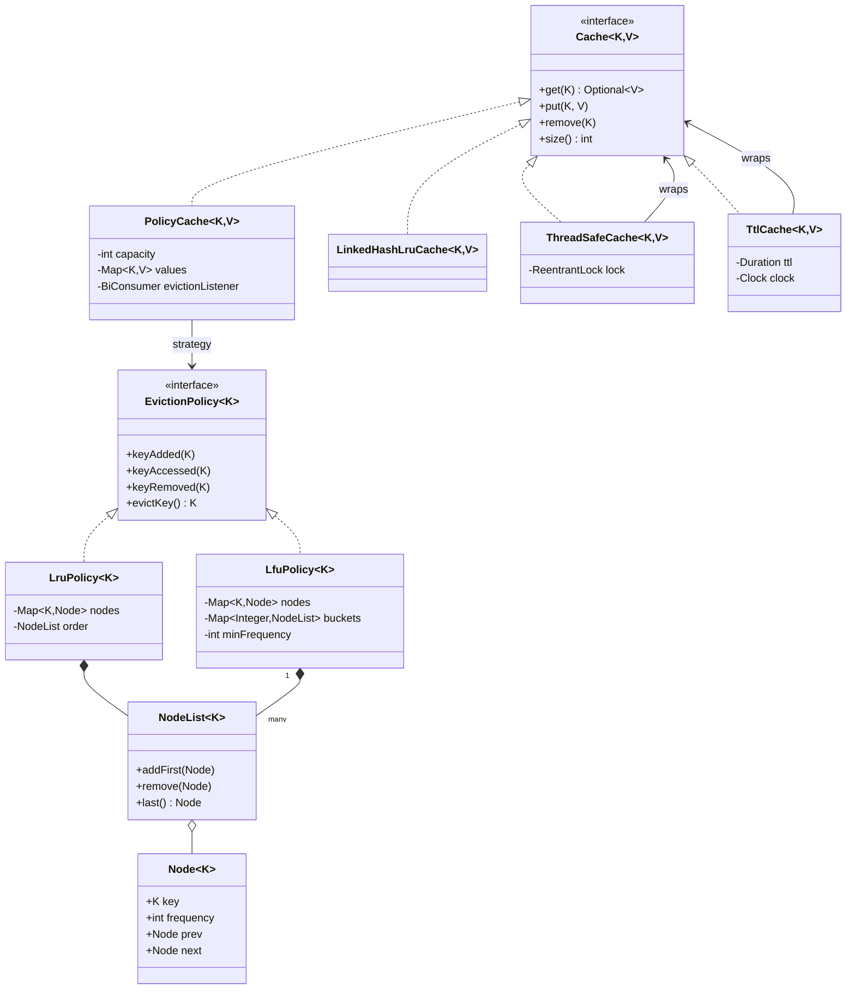

# Design LRU and LFU Caches

A cache keeps a limited number of entries and removes one entry when it is full. This case study builds the two classic eviction policies: LRU (least recently used) and LFU (least frequently used). Both run `get` and `put` in O(1). The design separates the policy from the storage (Strategy), adds thread safety and a time to live (TTL) as decorators, and shows the `LinkedHashMap` version that the JDK allows in about ten lines. This page is the home of the LRU cache in the KB. The folder holds this page and one runnable `Main.java`. Run it with `java Main.java` (JDK 21).

## Problem Statement

Design an in-memory cache with a fixed capacity. `get(key)` returns the value or nothing. `put(key, value)` stores a value. If the cache is full and the key is new, the cache removes one entry before it stores the new one. Implement LRU, which removes the entry that was used longest ago. Then implement LFU, which removes the entry that was used the fewest times. Both operations must take O(1) time. Then make the cache thread-safe, and add a time to live for entries.

## Clarifying Questions

| Question | Assumed answer |
|---|---|
| Which eviction policies are needed? | LRU first, then LFU. More policies can follow |
| What does "use" mean? | A `get` that finds the key, and a `put` for a key that already exists. A `put` of a new key is the first use |
| What is the time limit? | O(1) for `get` and `put`, on average |
| Are keys and values generic? | Yes. `Cache<K, V>`. Keys must have a correct `equals` and `hashCode`. Values must not be `null` |
| What does `get` return for a missing key? | `Optional.empty()`. No `null` and no exception |
| How does LFU break a tie when several keys have the same count? | It removes the least recently used key among them |
| What if the capacity is zero or negative? | `IllegalArgumentException` at construction |
| Is the cache used by several threads? | Yes, in the thread-safe version. The single-thread classes stay simple |
| Is there a TTL? | An extension that wraps any cache. An expired entry counts as missing |
| Must the cache report evictions? | Yes, through an optional listener (useful for tests, metrics, and write-back) |
| Does the cache load missing values? | No. The caller handles a miss. A loading cache is an extension |

## Requirements

### Functional

1. `get(key)` returns the value if the key is present, and counts as a use.
2. `put(key, value)` stores the value. If the key exists, it replaces the value and counts as a use. If the key is new and the cache is full, the cache evicts one entry first.
3. `remove(key)` deletes an entry.
4. The eviction policy is replaceable (Strategy). LRU and LFU are two implementations.
5. An optional listener receives each evicted entry.
6. A wrapper makes any cache thread-safe.
7. A wrapper adds a TTL to any cache.

### Non-functional

1. `get`, `put`, and the eviction run in O(1) average time. `remove` runs in O(1) for LRU. For LFU, `remove` runs in O(1) except when it empties the lowest-frequency bucket, where it costs O(F) for F distinct frequencies.
2. The space is O(capacity).
3. The thread-safe version never exceeds the capacity and never corrupts the order structure.
4. The time source of the TTL cache is injected.

## Entities and Relationships

| Entity | Responsibility | Relationships |
|---|---|---|
| `Cache<K, V>` | The contract: `get`, `put`, `remove`, `size` | Implemented by the classes below |
| `PolicyCache<K, V>` | Stores the values in a `HashMap`. Enforces the capacity. Asks the policy which key to evict | Has one `EvictionPolicy` (Strategy) |
| `EvictionPolicy<K>` | Tracks the order of keys. Stores no values. Picks the victim | Implemented by `LruPolicy`, `LfuPolicy` |
| `Node<K>` | One key in a doubly linked list. Holds the key and its use count | Used by both policies |
| `NodeList<K>` | A doubly linked list with two sentinel nodes. `addFirst`, `remove`, `last` in O(1) | Used by both policies |
| `LruPolicy<K>` | One `NodeList` ordered by recency, plus a `HashMap<K, Node>` | |
| `LfuPolicy<K>` | One `NodeList` per frequency, a `HashMap<Integer, NodeList>`, and `minFrequency` | |
| `LinkedHashLruCache<K, V>` | The JDK version of LRU. A different implementation of `Cache` | |
| `ThreadSafeCache<K, V>` | Decorator. One `ReentrantLock` around each call | Wraps any `Cache` |
| `TtlCache<K, V>` | Decorator. Stores an expiry time with each value | Wraps a `Cache` of `Expiring<V>`. Uses a `Clock` |

Why the policy stores only keys: the value storage and the order tracking change for different reasons. A policy that stores keys is easy to test alone and to swap. The cost: two maps hold the same keys (`values` in the cache, `nodes` in the policy). This is the price of a clean split.

## Class Diagram



See [UML class and sequence diagrams](../../fundamentals/04-uml-class-and-sequence-diagrams.md) for the notation.

## Design Patterns Used

| Pattern | Where | Why | Rejected alternative |
|---|---|---|---|
| Strategy | `EvictionPolicy` | The statement names two policies and implies more (FIFO, random, TinyLFU). The cache class holds the storage and the capacity rule once. Each policy is one class | One class per policy that repeats the map and the capacity check. This copies the storage code and forces a fix in every copy |
| Decorator | `ThreadSafeCache`, `TtlCache` | Thread safety and TTL are separate concerns. A decorator adds each one to any `Cache`, in any order, and the core classes stay free of locks and clocks | Flags in `PolicyCache` (`threadSafe`, `ttl`). Every method then has branches, and a single-threaded user pays for the lock |
| Adapter-like wrapper | `LinkedHashLruCache` | It gives the JDK class the `Cache` contract, so the demo compares both versions through one interface | Extending `LinkedHashMap` directly. `LinkedHashMap.get(Object)` clashes with `Cache.get(K)`, and the cache would expose every `Map` method |
| Observer (callback) | The eviction listener (`BiConsumer`) | One listener is enough, so a functional interface replaces a listener list | A list of listener objects. It adds a type and a registration method for no gain |
| Composite data structure | `HashMap` plus `NodeList` | A hash map gives O(1) lookup, and a list gives O(1) reorder. Neither alone gives both | An `ArrayList` or `LinkedList` for the order: finding a key costs O(n) |

See [behavioral patterns](../../fundamentals/08-behavioral-patterns.md) for Strategy, [structural patterns](../../fundamentals/07-structural-patterns.md) for Decorator and Adapter, and [SOLID](../../fundamentals/02-solid.md) for the Single Responsibility and Open-Closed principles that the split follows.

## Key Code

### The contract and the policy

```java
interface Cache<K, V> {
    Optional<V> get(K key);

    void put(K key, V value);

    void remove(K key);

    int size();
}

/** Tracks the order of keys and picks the victim. It stores no values. */
interface EvictionPolicy<K> {
    void keyAdded(K key);

    void keyAccessed(K key);

    void keyRemoved(K key);

    /** Removes the victim from the policy state and returns it. */
    K evictKey();
}
```

### The doubly linked list

The list has two sentinel nodes, `head` and `tail`, that hold no key. Sentinels remove every "is this the first node?" and "is this the last node?" branch. Insert and remove each change four pointers.

```java
/** A cache entry in a doubly linked list. The list has two sentinel nodes. */
final class Node<K> {
    final K key;
    int frequency = 1;
    Node<K> prev;
    Node<K> next;

    Node(K key) {
        this.key = key;
    }
}

final class NodeList<K> {
    private final Node<K> head = new Node<>(null);
    private final Node<K> tail = new Node<>(null);

    NodeList() {
        head.next = tail;
        tail.prev = head;
    }

    boolean isEmpty() {
        return head.next == tail;
    }

    void addFirst(Node<K> node) {
        node.prev = head;
        node.next = head.next;
        head.next.prev = node;
        head.next = node;
    }

    void remove(Node<K> node) {
        node.prev.next = node.next;
        node.next.prev = node.prev;
        node.prev = null;
        node.next = null;
    }

    Node<K> last() {
        return isEmpty() ? null : tail.prev;
    }
}
```

### LRU: a hash map and a list

The most recently used key sits next to `head`. The least recently used key sits next to `tail`. A hit moves the node to the front, and an eviction takes the node at the back. The map finds a node in O(1), and the list moves it in O(1). A singly linked list cannot remove a node in O(1), because it cannot reach the previous node. This is the reason for the double link.

```java
final class LruPolicy<K> implements EvictionPolicy<K> {
    private final Map<K, Node<K>> nodes = new HashMap<>();
    private final NodeList<K> order = new NodeList<>();

    @Override
    public void keyAdded(K key) {
        Node<K> node = new Node<>(key);
        nodes.put(key, node);
        order.addFirst(node);
    }

    @Override
    public void keyAccessed(K key) {
        Node<K> node = nodes.get(key);
        order.remove(node);
        order.addFirst(node);
    }

    @Override
    public void keyRemoved(K key) {
        order.remove(nodes.remove(key));
    }

    @Override
    public K evictKey() {
        Node<K> victim = order.last();
        order.remove(victim);
        nodes.remove(victim.key);
        return victim.key;
    }
}
```

### LFU: one list for each frequency

The idea: group the keys by use count. `buckets.get(3)` holds all keys used exactly 3 times, ordered by recency. `minFrequency` points at the lowest non-empty bucket. The victim is the last node of that bucket, which is the least recently used key among the least frequently used keys.

A hit moves the node from bucket `f` to bucket `f + 1`. If bucket `f` becomes empty and `f` is the minimum, the minimum becomes `f + 1`, which is exact because the node just moved there. A new key goes to bucket 1, and `minFrequency` becomes 1, because 1 is the lowest count that a key can have. The cache evicts before it adds, so the new key is never its own victim.

```java
final class LfuPolicy<K> implements EvictionPolicy<K> {
    private final Map<K, Node<K>> nodes = new HashMap<>();
    private final Map<Integer, NodeList<K>> buckets = new HashMap<>();
    private int minFrequency;

    @Override
    public void keyAdded(K key) {
        Node<K> node = new Node<>(key);
        nodes.put(key, node);
        bucket(1).addFirst(node);
        minFrequency = 1;
    }

    @Override
    public void keyAccessed(K key) {
        Node<K> node = nodes.get(key);
        detach(node);
        if (!buckets.containsKey(minFrequency)) {
            minFrequency++;
        }
        node.frequency++;
        bucket(node.frequency).addFirst(node);
    }

    @Override
    public void keyRemoved(K key) {
        detach(nodes.remove(key));
        if (!buckets.containsKey(minFrequency) && !buckets.isEmpty()) {
            minFrequency = lowestFrequency();
        }
    }

    @Override
    public K evictKey() {
        if (!buckets.containsKey(minFrequency)) {
            // Only after an eviction with no keyAdded after it, as in a weighted cache.
            minFrequency = lowestFrequency();
        }
        Node<K> victim = buckets.get(minFrequency).last();
        detach(victim);
        nodes.remove(victim.key);
        return victim.key;
    }

    /** O(F) for F distinct frequencies. Throws NoSuchElementException if no key exists. */
    private int lowestFrequency() {
        return buckets.keySet().stream().min(Integer::compare).orElseThrow();
    }

    private NodeList<K> bucket(int frequency) {
        return buckets.computeIfAbsent(frequency, f -> new NodeList<>());
    }

    private void detach(Node<K> node) {
        NodeList<K> bucket = buckets.get(node.frequency);
        bucket.remove(node);
        if (bucket.isEmpty()) {
            buckets.remove(node.frequency);
        }
    }
}
```

`keyRemoved` handles an explicit `remove` or a TTL expiry. After such a removal, the lowest bucket can vanish, and `minFrequency` can point at nothing. The code then recomputes the minimum over the bucket keys. That costs O(F) and happens only on an explicit remove that empties the lowest bucket. `get`, `put`, and eviction stay O(1).

`evictKey` can also empty the lowest bucket. `PolicyCache.put` calls `keyAdded` right after the eviction, and `keyAdded` sets the minimum to 1, so the stale value is never read. A caller that evicts two keys in a row (the weighted-capacity extension) reads it. The guard at the start of `evictKey` recomputes the minimum in that case, in O(F). In the one-eviction flow of `PolicyCache`, the guard never fires.

If the interviewer asks for O(1) on every operation, including `remove`, replace the `HashMap` of buckets with a doubly linked list of frequency nodes, sorted by count. Each node holds the keys with that count. The lowest bucket is then the first node of the list, and an empty node is unlinked in O(1). This is the structure of Shah, Mitra, and Matani, "An O(1) algorithm for implementing the LFU cache eviction scheme" (2010, [arXiv:2110.11602](https://arxiv.org/abs/2110.11602)).

### The cache: storage and capacity

```java
/** Stores the values. The policy decides which key leaves when the cache is full. */
final class PolicyCache<K, V> implements Cache<K, V> {
    private final int capacity;
    private final Map<K, V> values = new HashMap<>();
    private final EvictionPolicy<K> policy;
    private final BiConsumer<K, V> evictionListener;

    PolicyCache(int capacity, EvictionPolicy<K> policy) {
        this(capacity, policy, (k, v) -> { });
    }

    PolicyCache(int capacity, EvictionPolicy<K> policy, BiConsumer<K, V> evictionListener) {
        if (capacity < 1) {
            throw new IllegalArgumentException("capacity must be at least 1");
        }
        this.capacity = capacity;
        this.policy = policy;
        this.evictionListener = evictionListener;
    }

    @Override
    public Optional<V> get(K key) {
        V value = values.get(key);
        if (value == null) {
            return Optional.empty();
        }
        policy.keyAccessed(key);
        return Optional.of(value);
    }

    @Override
    public void put(K key, V value) {
        Objects.requireNonNull(value, "value");
        if (values.containsKey(key)) {
            values.put(key, value);
            policy.keyAccessed(key);
            return;
        }
        if (values.size() == capacity) {
            K victim = policy.evictKey();
            V evictedValue = values.remove(victim);
            evictionListener.accept(victim, evictedValue);
        }
        values.put(key, value);
        policy.keyAdded(key);
    }

    @Override
    public void remove(K key) {
        if (values.remove(key) != null) {
            policy.keyRemoved(key);
        }
    }

    @Override
    public int size() {
        return values.size();
    }
}
```

The order in `put` matters. The cache evicts before it inserts, so the new key never competes for its own slot. If the key already exists, `put` replaces the value and counts a use, and no eviction happens. Demo section 8 checks the smallest case, capacity 1, for both policies: a second `put` of `a` replaces the value with no eviction, and the `put` of `b` evicts `a`.

### The JDK version

`LinkedHashMap` keeps a doubly linked list of entries. The constructor argument `accessOrder = true` moves an entry to the end on each `get` and `put`. `removeEldestEntry` runs after each insertion, and returning `true` removes the eldest entry, which is the least recently used one.

```java
/** The JDK version: LinkedHashMap in access order removes the eldest entry. */
final class LinkedHashLruCache<K, V> implements Cache<K, V> {
    private final Map<K, V> map;

    LinkedHashLruCache(int capacity) {
        this.map = new LinkedHashMap<>(16, 0.75f, true) {
            @Override
            protected boolean removeEldestEntry(Map.Entry<K, V> eldest) {
                return size() > capacity;
            }
        };
    }

    @Override
    public Optional<V> get(K key) {
        return Optional.ofNullable(map.get(key));
    }

    @Override
    public void put(K key, V value) {
        map.put(key, Objects.requireNonNull(value, "value"));
    }

    @Override
    public void remove(K key) {
        map.remove(key);
    }

    @Override
    public int size() {
        return map.size();
    }
}
```

In an interview, write the hand-made version when the interviewer asks for "O(1) LRU from scratch". Mention the `LinkedHashMap` version as the production answer. A candidate who knows only the `LinkedHashMap` trick shows no design skill. A candidate who writes 100 lines in production when the 10-line version exists shows poor judgment.

### Thread safety and TTL

```java
/** One lock for the whole cache. A read also changes the order, so a read needs the lock. */
final class ThreadSafeCache<K, V> implements Cache<K, V> {
    private final Cache<K, V> delegate;
    private final ReentrantLock lock = new ReentrantLock();

    ThreadSafeCache(Cache<K, V> delegate) {
        this.delegate = delegate;
    }

    @Override
    public Optional<V> get(K key) {
        lock.lock();
        try {
            return delegate.get(key);
        } finally {
            lock.unlock();
        }
    }

    @Override
    public void put(K key, V value) {
        lock.lock();
        try {
            delegate.put(key, value);
        } finally {
            lock.unlock();
        }
    }

    @Override
    public void remove(K key) {
        lock.lock();
        try {
            delegate.remove(key);
        } finally {
            lock.unlock();
        }
    }

    @Override
    public int size() {
        lock.lock();
        try {
            return delegate.size();
        } finally {
            lock.unlock();
        }
    }
}
```

```java
/** Adds a time to live to any cache. Expired entries leave when a read finds them. */
final class TtlCache<K, V> implements Cache<K, V> {
    /** The stored form of a value. Package-private, so callers can build the delegate. */
    record Expiring<V>(V value, Instant expiresAt) { }

    private final Cache<K, Expiring<V>> delegate;
    private final Duration ttl;
    private final Clock clock;

    TtlCache(Cache<K, Expiring<V>> delegate, Duration ttl, Clock clock) {
        this.delegate = delegate;
        this.ttl = ttl;
        this.clock = clock;
    }

    @Override
    public Optional<V> get(K key) {
        Optional<Expiring<V>> entry = delegate.get(key);
        if (entry.isEmpty()) {
            return Optional.empty();
        }
        if (!clock.instant().isBefore(entry.get().expiresAt())) {
            delegate.remove(key);
            return Optional.empty();
        }
        return Optional.of(entry.get().value());
    }

    @Override
    public void put(K key, V value) {
        delegate.put(key, new Expiring<>(value, clock.instant().plus(ttl)));
    }

    @Override
    public void remove(K key) {
        delegate.remove(key);
    }

    @Override
    public int size() {
        return delegate.size();
    }
}
```

## Concurrency

### Why `get` needs the lock

A normal cache read does not change state, so a read lock would let many readers work together. An LRU or LFU `get` changes the order: it moves a node or raises a count. A `get` is a write to the policy structure. Two threads that move nodes at the same time corrupt the four pointers, and the list loses nodes or forms a cycle. A `ReadWriteLock` does not help, because every call needs exclusive access.

The wrong form, a `HashMap` shared with no lock:

<!-- fragment -->
```java
// Wrong: two threads can run these steps at the same time.
Node<K> node = nodes.get(key);
order.remove(node);      // thread A unlinks the node
order.remove(node);      // thread B unlinks the same node: NullPointerException
order.addFirst(node);
```

A `ConcurrentHashMap` in place of the `HashMap` does not fix this. The map is safe, but the compound step "find the node, unlink it, link it at the front" is not atomic. This is the check-then-act problem. See [concurrency in LLD](../../fundamentals/09-concurrency-in-lld.md).

### The design: one lock in a decorator

`ThreadSafeCache` takes one `ReentrantLock` for each call and releases it in `finally`. The listener runs under the lock, because `PolicyCache` calls it inside `put`. A slow listener blocks every other caller. Keep the listener short, or hand the entry to a queue.

Demo section 7 starts 8 threads. Each puts 1000 distinct keys and reads other keys. The result is always `size 100` and `evictions 7900` (8000 distinct keys minus 100 kept). The demo prints only these counts, which do not depend on the schedule.

### Trade-offs of the lock

| Option | Throughput | Complexity | Correct for LRU/LFU |
|---|---|---|---|
| One lock (this design) | All calls run one at a time. Throughput stops growing when threads wait for the lock | Low | Yes |
| `ReadWriteLock` | No gain, because `get` writes | Low | Yes, but pointless |
| Sharding: N caches, each with its own lock, chosen by `hash(key) % N` | Scales with N | Medium. Capacity splits per shard. The eviction is local, not global | Approximately. Each shard is exactly LRU. The whole cache is not |
| Buffer the reads: record hits in a buffer and apply the order changes in a batch under the lock | High | High | Approximately. The buffer can drop hits when it is full, so the order is close to LRU but not exact. Caffeine does this: reads go to a striped ring buffer that may lose events, writes go to a bounded queue that loses none, and one thread at a time drains both under a lock ([Caffeine design](https://github.com/ben-manes/caffeine/wiki/Design)) |

Recommendation: in an interview, build the one-lock decorator, and name sharding as the next step. In production, use a library such as Caffeine instead of your own cache.

### TTL under concurrency

`TtlCache` has no lock of its own. Use the order `ThreadSafeCache(TtlCache(PolicyCache(...)))`. The lock then covers the expiry check and the removal as one step.

The other order, `TtlCache(ThreadSafeCache(...))`, is wrong. Each inner call holds the lock, but the check and the removal are two calls. Thread A reads an expired entry. Thread B puts a fresh value for the same key. Thread A then removes the fresh value. This is the check-then-act problem again.

## Extensions

| Extension | Change | Unchanged |
|---|---|---|
| FIFO, random, or MRU policy | Add one `EvictionPolicy` class. FIFO is `LruPolicy` without the move in `keyAccessed` | `PolicyCache`, decorators |
| TTL with active expiry | Add a `PriorityQueue<(expiresAt, key)>` and a `purgeExpired()` that a scheduled task calls under the lock. A `put` of an existing key leaves an old queue entry, so `purgeExpired` removes a key only if the stored expiry time matches. Lazy expiry alone leaves dead entries that occupy capacity until a `get` finds them, and the policy can evict a live entry while a dead one stays | Policies |
| Loading cache (cache-aside inside the cache) | Add `get(K, Function<K, V> loader)`. On a miss it calls the loader and stores the result. Add a per-key lock or a `CompletableFuture` map so that 100 threads that miss on one key call the loader once | `EvictionPolicy` |
| Weighted capacity (size in bytes, not in entries) | Add a `Weigher<V>` interface. `PolicyCache` tracks `totalWeight` and evicts in a loop until the new entry fits. `LfuPolicy.evictKey` already handles two evictions in a row | Policies |
| Statistics (hit rate, eviction count) | Add `StatsCache` as a third decorator with `LongAdder` counters. Or use the eviction listener for evictions | Core classes |
| Write-through or write-back to a store | Use the eviction listener for write-back. Add a `Store<K, V>` interface for write-through, called in `put` | Policies |
| Better policy than LFU | LFU keeps an old, once-hot key for a long time, because its count stays high. Add an aging step that halves all counts at an interval (O(n) per pass, because each node moves to a new bucket). TinyLFU and W-TinyLFU need one more hook: they compare the new key with the victim and can refuse the new key. Add `boolean admit(K candidate, K victim)` to `EvictionPolicy`, and let `PolicyCache.put` skip the insert when it returns `false` | Storage and decorators |
| Distributed cache | Out of scope for LLD. See the HLD caching page (`kb/hld/fundamentals/03-caching.md`) for consistent hashing, replication, and invalidation | |

## Common Mistakes

1. Using `ArrayList` or `LinkedList.remove(Object)` for the order. Finding the key is O(n). The answer must be O(1), so the map must point to the list node.
2. A singly linked list. `remove(node)` then needs the previous node, which costs O(n).
3. No sentinel nodes. The code fills with `if (node == head)` branches, and one missed branch corrupts the list. Sentinels remove them.
4. Forgetting to update the map when the list changes (or the other way around). Every eviction must remove the key from both structures. The design keeps the rule in `PolicyCache.put`.
5. Counting a `put` of an existing key as no use. Then the entry that the caller just wrote is the first victim.
6. In LFU, forgetting `minFrequency`, and scanning all buckets for the minimum on each eviction. That is O(F).
7. In LFU, forgetting the recency tie-break. With a plain `HashSet` per bucket, the victim among equal counts depends on the hash order, not on recency. Use a list or `LinkedHashSet` per bucket.
8. In LFU, setting `minFrequency` wrong after a hit. The rule: if the old bucket is empty and equals the minimum, the minimum increases by 1.
9. Locking `put` but not `get`. A `get` reorders the structure.
10. A `ReadWriteLock` with `get` on the read lock. Many readers then reorder the list at the same time.
11. Returning `null` for a miss, so the caller cannot tell a miss from a stored `null`. This design bans `null` values and uses `Optional`.
12. `LinkedHashMap` with `accessOrder = false` (the default). It evicts in insertion order, which is FIFO.
13. Using `LinkedHashMap` and saying nothing else. The interviewer asked for the design. Explain the structure that it hides.
14. A mutable key whose `hashCode` changes after insertion. The entry becomes unreachable. See [Java Language Core](../../../java/01-language-core.md) for the `equals` and `hashCode` contract.

## 45-Minute Plan

| Minutes | What to do | Output |
|---|---|---|
| 0 to 4 | Clarify: policy, O(1) requirement, tie-break, thread safety, null handling | Requirement list |
| 4 to 8 | State the idea: map for lookup, doubly linked list for order. Draw the two structures with five keys | Diagram |
| 8 to 12 | Define the interfaces: `Cache`, `EvictionPolicy`. Explain the Strategy split | Signatures |
| 12 to 22 | Code `NodeList` with sentinels and `LruPolicy`. Walk through `get a, put d` with a trace | Working LRU |
| 22 to 26 | Show the `LinkedHashMap` version in 10 lines | Comparison |
| 26 to 38 | Explain LFU: frequency buckets and `minFrequency`. Code `keyAdded`, `keyAccessed`, `evictKey`. State the tie-break | Working LFU |
| 38 to 42 | Thread safety: say why `get` writes, and add the lock decorator | Concurrency answer |
| 42 to 45 | TTL and one more extension. Ask the interviewer a question | Extension answer |

If the interviewer asks for LRU only, spend minutes 26 to 38 on the lock, TTL, and tests. The data-structure design page `kb/dsa/26-design-data-structures/README.md` links here for the LRU cache. See [how to approach an LLD interview](../../how-to-approach-lld.md) for the general procedure.

## Expected Output

<!-- expected-output -->
```text
== 1. LRU cache with capacity 3 ==
get a -> 1
get b -> null
evicted [b=2, a=1], size 3
== 2. LRU and LFU choose different victims ==
LruPolicy evicted [2, 1]
LfuPolicy evicted [2, 3]
== 3. LFU breaks a frequency tie by recency ==
evicted [2, 1]
== 4. Hand-written LRU against LinkedHashMap ==
hits 2039 and 2039, same answers: true
== 5. TTL decorator ==
after 5s: alice
after 11s: expired
== 6. Remove keeps the LFU buckets correct ==
x=null y=2 size=3
== 7. Thread-safe cache under 8 writers ==
size 100, evictions 7900
== 8. Capacity 1 and the update of an existing key ==
LruPolicy: a=null b=3 evicted [a] size 1
LfuPolicy: a=null b=3 evicted [a] size 1
```
