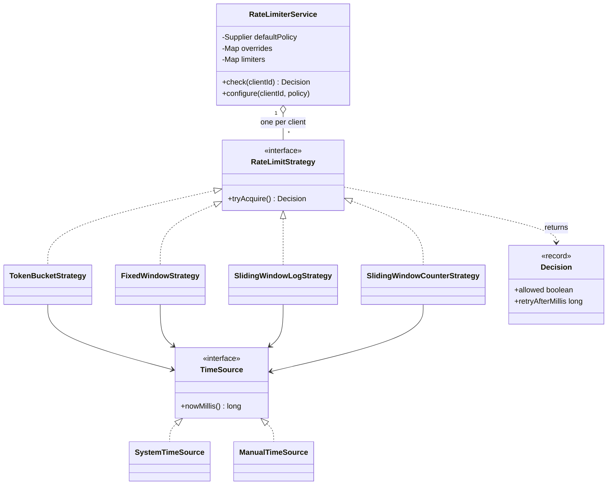

# Design a Rate Limiter

A rate limiter decides, for each request, whether a client may proceed or must wait. This case study designs the limiter as one in-process library. It offers four algorithms behind one interface, keeps one limit state for each client, and stays correct when many threads call it. The rate limiting algorithms have their home page in `kb/hld/fundamentals/13-rate-limiting-algorithms.md`. This page uses the algorithms as code and does not repeat the theory. The distributed version (many servers, a shared store) is in `kb/hld/case-studies/02-distributed-rate-limiter.md`. Follow the steps in [how to approach an LLD interview](../../how-to-approach-lld.md).

## Problem Statement

"Design a rate limiter. Before a service handles a request, it asks the limiter whether the client may proceed. Each client has a limit, for example 100 requests in 1 minute. The limiter allows the request or denies it. Different clients can have different limits. Many threads call the limiter at the same time."

## Clarifying Questions

| Question | Answer that this design assumes |
|---|---|
| Is this one process or a distributed limiter? | One process. The state is in memory. A shared store is an extension (see Extensions) |
| What identifies a client? | A string key: a user id, an API key, or an IP address. The limiter does not interpret the key |
| Which algorithm? | Not fixed. The design supports token bucket, fixed window, sliding window log, and sliding window counter. The caller picks one for each client or uses the default |
| Can clients have different limits? | Yes. A default policy exists, and a client can have its own policy |
| What does a denied request get? | A `Decision` with `allowed = false` and a retry-after hint in milliseconds. The limiter does not block |
| Does a request cost more than one unit? | No. Each request costs one unit. Weighted cost is an extension |
| How does the limiter read time? | Through a `TimeSource` that the caller injects. Its contract: the time never decreases. Production uses a monotonic source. The tests and the demo use a manual clock |
| Many threads? | Yes. The limiter must never allow more requests than the limit, even when threads race |
| How many clients? | Many, but the memory for one client is small. Removal of idle clients is an extension |
| Is there a metrics or logging requirement? | No. The `Decision` returns all the data that a caller needs for a response header |

## Requirements

### Functional

1. `check(clientId)` returns a `Decision`: allowed, or denied with a retry-after hint.
2. The limiter supports four algorithms: token bucket, fixed window, sliding window log, and sliding window counter.
3. All four algorithms sit behind one interface. A new algorithm needs a new class and no change to the service.
4. Each client has its own state. The requests of one client never affect the limit of another client.
5. A client can have its own policy. Other clients use the default policy.
6. Invalid configuration (a limit of 0, a window of 0) is rejected when the strategy is created.

### Non-functional

1. Thread safety: for a limit of N and a frozen clock, exactly N requests of one client are allowed, with any number of threads.
2. Cost of one check: O(1) time for token bucket, fixed window, and sliding window counter. The sliding window log removes expired entries before it decides. Each timestamp enters the deque once and leaves it at most once, so over a sequence of requests the cost is amortized O(1) for each request. One call can remove up to `limit` entries, so the worst case of one call is O(limit).
3. Memory for one client: O(1) for token bucket, fixed window, and sliding window counter. O(limit) for sliding window log, because the log stores only allowed requests, and at most `limit` allowed requests fit in one window. A log that also stored denied requests would grow with the request rate of an attacker.
4. Testable time: no class calls the system clock directly, except `SystemTimeSource`.
5. Contention: the lock of a strategy protects one client only. Two clients do not share a strategy lock.

## Entities and Relationships

| Entity | Responsibility | Relationships |
|---|---|---|
| `RateLimiterService` | The entry point. Finds or creates the limiter state for a client, and delegates the decision | Has many `RateLimitStrategy` (one for each client). Holds `Supplier<RateLimitStrategy>` objects for the default policy and for the overrides |
| `RateLimitStrategy` | The interface of one algorithm for one client. `tryAcquire()` returns a `Decision` | Implemented by four classes |
| `TokenBucketStrategy` | Keeps a token count that refills with time. A request takes one token | Uses `TimeSource` |
| `FixedWindowStrategy` | Counts requests in the current aligned time window | Uses `TimeSource` |
| `SlidingWindowLogStrategy` | Stores the timestamp of each allowed request, and counts those inside the last window | Uses `TimeSource` |
| `SlidingWindowCounterStrategy` | Keeps the counts of the current and the previous window, and estimates the count of the sliding window | Uses `TimeSource` |
| `Decision` | A value object: allowed or denied, and the retry-after hint | Returned by every strategy |
| `TimeSource` | The interface that returns the current time in milliseconds. The time never decreases | Implemented by `SystemTimeSource` (monotonic, from `System.nanoTime()`) and `ManualTimeSource` |

Each strategy object holds the state of one client. This choice has a consequence: the `RateLimiterService` has a map from client id to strategy object, and the lock of each strategy object protects only that client.

## Class Diagram



## Design Patterns Used

The [behavioral patterns page](../../fundamentals/08-behavioral-patterns.md) describes Strategy. The [creational patterns page](../../fundamentals/06-creational-patterns.md) describes the factory idea. The [SOLID page](../../fundamentals/02-solid.md) describes the dependency inversion that the `TimeSource` uses.

| Pattern | Where | Reason | Alternative that the design rejected |
|---|---|---|---|
| Strategy | `RateLimitStrategy` and its four implementations | The requirement says that the algorithm changes by client and by deployment. Each algorithm is one class, and the service does not know which one it calls | An `enum Algorithm` with a `switch` inside one `RateLimiter` class. Each new algorithm would edit that class, and the fields of all algorithms would sit in one object |
| Factory by `Supplier` | The `Supplier<RateLimitStrategy>` that the service holds | The service must create a new state object for each new client, and it must not know the constructor arguments. A `Supplier` is a factory with one method and needs no extra interface | A `RateLimitStrategyFactory` interface. It adds a type that has one method, and `Supplier` already has the same shape |
| Dependency injection | `TimeSource` in each constructor | The tests and the demo move the clock by hand, so the output is exact | Calls to `System.currentTimeMillis()` inside each strategy. The tests would need `Thread.sleep` and would be slow and unreliable |
| Value object | `Decision` (a `record`) | The result has two fields that always travel together, and it has no identity | Return a `boolean`. The caller then cannot send a `Retry-After` header |
| One strategy object per client (state in the strategy) | The `limiters` map | The lock of the strategy protects one client, so clients do not wait for each other | One strategy object that has a `Map<String, State>` and one lock. All clients would share one lock |
| No Singleton | `RateLimiterService` is a normal class | Several services can exist in one program (one for each API) and each can have its own default policy. Tests create a new service for each test | A Singleton limiter. It hides global state and makes tests depend on each other. See the [anti-patterns page](../../fundamentals/11-anti-patterns.md) |

### The four algorithms compared

| Algorithm | State for one client | Accuracy | Burst behavior | Weak point |
|---|---|---|---|---|
| Token bucket | A token count and the time of the last refill | Exact for its own rule: average rate = refill rate, burst up to the capacity | Allows a burst of `capacity` requests at once | A large capacity allows a large burst |
| Fixed window | A counter and the start of the window | Exact inside one window | Allows up to twice the limit across a window boundary (the demo shows 6 requests in 100 ms for a limit of 3) | The boundary burst |
| Sliding window log | One timestamp for each allowed request | Exact | At most `limit` requests in any window of the given length | O(limit) memory for each client |
| Sliding window counter | Two counters and the start of the current window | An estimate. It assumes that the requests of the previous window were spread evenly over that window | Close to the log, with O(1) memory (see the error note below) | The estimate is wrong when the previous window had a burst at its start or at its end |

**How wrong can the sliding window counter be?** If the previous window had its requests at its end, the estimate gives them too little weight, and the true count in one window length can approach 2 × limit − 1. Cloudflare measured 0.003% wrong decisions in 400 million requests of its own traffic ([Cloudflare blog, "Counting things, a lot of different things"](https://blog.cloudflare.com/counting-things-a-lot-of-different-things/)). That is one measurement, not a guarantee. The analysis belongs to the algorithm home page, `kb/hld/fundamentals/13-rate-limiting-algorithms.md`.

Recommendation: start with token bucket when the interviewer asks for a "rate limiter" and says nothing else, because it allows short bursts and uses little memory. Name the boundary burst of the fixed window when you present it, because interviewers ask about it.

## Key Code

The excerpts below are copied from `Main.java` in this folder.

### Time and the result

`TimeSource` is the only way that a strategy reads time. `ManualTimeSource` lets the demo move time by hand. `SystemTimeSource` reads `System.nanoTime()`, not the wall clock. The warning in the Concurrency section gives the reason.

```java
// Contract: nowMillis() never decreases. The strategies rely on it.
interface TimeSource {
    long nowMillis();
}

// System.nanoTime() is not related to the wall clock, so a clock change cannot move it back.
// Its origin is arbitrary and the value can be negative, so the strategies use floorMod.
final class SystemTimeSource implements TimeSource {
    @Override
    public long nowMillis() {
        return Math.floorDiv(System.nanoTime(), 1_000_000L);
    }
}

final class ManualTimeSource implements TimeSource {
    private long now;

    @Override
    public synchronized long nowMillis() {
        return now;
    }

    synchronized void advance(long millis) {
        if (millis < 0) {
            throw new IllegalArgumentException("time must not move backward");
        }
        now += millis;
    }
}
```

`Decision` carries the answer and the retry-after hint. `RateLimitStrategy` is the Strategy interface. Each implementation holds the state of one client.

```java
record Decision(boolean allowed, long retryAfterMillis) {
    static Decision allow() {
        return new Decision(true, 0);
    }

    static Decision deny(long retryAfterMillis) {
        return new Decision(false, retryAfterMillis);
    }

    @Override
    public String toString() {
        return allowed ? "ALLOWED" : "DENIED (retry after " + retryAfterMillis + " ms)";
    }
}

interface RateLimitStrategy {
    Decision tryAcquire();
}
```

### Token bucket

The bucket holds up to `capacity` tokens. Time adds tokens at the refill rate. A request takes one token. The code computes the refill from the elapsed time at each call, so no background thread is needed.

```java
final class TokenBucketStrategy implements RateLimitStrategy {
    private final double capacity;
    private final double refillPerMilli;
    private final TimeSource time;
    private double tokens;
    private long lastRefill;

    TokenBucketStrategy(int capacity, double refillPerSecond, TimeSource time) {
        if (capacity <= 0) {
            throw new IllegalArgumentException("capacity must be positive");
        }
        if (!Double.isFinite(refillPerSecond) || refillPerSecond < 0) {
            throw new IllegalArgumentException("refill rate must be finite and not negative");
        }
        this.capacity = capacity;
        this.refillPerMilli = refillPerSecond / 1000.0;
        this.time = time;
        this.tokens = capacity;
        this.lastRefill = time.nowMillis();
    }

    @Override
    public synchronized Decision tryAcquire() {
        long now = time.nowMillis();
        tokens = Math.min(capacity, tokens + (now - lastRefill) * refillPerMilli);
        lastRefill = now;
        if (tokens >= 1.0) {
            tokens -= 1.0;
            return Decision.allow();
        }
        if (refillPerMilli == 0) {
            return Decision.deny(Long.MAX_VALUE);
        }
        return Decision.deny((long) Math.ceil((1.0 - tokens) / refillPerMilli));
    }
}
```

If the bucket has no token, the retry-after hint is the time that the refill needs to reach 1 token. With a refill rate of 0 the bucket never refills, and the hint is `Long.MAX_VALUE`.

The token count is a `double`, so a rate such as 0.5 tokens per second works. The refill `elapsed × refillPerMilli` is a `double` product, so a long idle time cannot overflow, and `Math.min` caps the result at the capacity. A `double` sum can carry a rounding error in the last bits. The effect is a decision that is early or late by a fraction of a millisecond. If exact counts matter, store the tokens as a `long` in a smaller unit (for example thousandths of a token) and check `elapsed` against `(capacity − tokens) / rate` before you multiply, so that the product cannot overflow.

The refill relies on the `TimeSource` contract. If `now` were smaller than `lastRefill`, the product would be negative, and the bucket would lose tokens. A monotonic time source prevents this case.

### Fixed window

The window start is the current time rounded down to a multiple of the window length. When a request arrives in a new window, the count resets. The code uses `Math.floorMod` and not `%`, because `System.nanoTime()` can return a negative value. For a negative `now`, `now % windowMillis` is negative, and `now - (now % windowMillis)` would give a start after `now`.

```java
final class FixedWindowStrategy implements RateLimitStrategy {
    private final int limit;
    private final long windowMillis;
    private final TimeSource time;
    private long windowStart;
    private int count;

    FixedWindowStrategy(int limit, long windowMillis, TimeSource time) {
        if (limit <= 0) {
            throw new IllegalArgumentException("limit must be positive");
        }
        if (windowMillis <= 0) {
            throw new IllegalArgumentException("window must be positive");
        }
        this.limit = limit;
        this.windowMillis = windowMillis;
        this.time = time;
        this.windowStart = alignedStart(time.nowMillis());
    }

    private long alignedStart(long now) {
        return now - Math.floorMod(now, windowMillis);
    }

    @Override
    public synchronized Decision tryAcquire() {
        long now = time.nowMillis();
        long start = alignedStart(now);
        if (start != windowStart) {
            windowStart = start;
            count = 0;
        }
        if (count < limit) {
            count++;
            return Decision.allow();
        }
        return Decision.deny(windowStart + windowMillis - now);
    }
}
```

### Sliding window log

The log keeps the timestamp of each allowed request. A request first removes the timestamps that left the window. The oldest remaining timestamp gives the exact retry-after hint.

```java
final class SlidingWindowLogStrategy implements RateLimitStrategy {
    private final int limit;
    private final long windowMillis;
    private final TimeSource time;
    private final Deque<Long> timestamps = new ArrayDeque<>();

    SlidingWindowLogStrategy(int limit, long windowMillis, TimeSource time) {
        if (limit <= 0) {
            throw new IllegalArgumentException("limit must be positive");
        }
        if (windowMillis <= 0) {
            throw new IllegalArgumentException("window must be positive");
        }
        this.limit = limit;
        this.windowMillis = windowMillis;
        this.time = time;
    }

    @Override
    public synchronized Decision tryAcquire() {
        long now = time.nowMillis();
        while (!timestamps.isEmpty() && timestamps.peekFirst() <= now - windowMillis) {
            timestamps.removeFirst();
        }
        if (timestamps.size() < limit) {
            timestamps.addLast(now);
            return Decision.allow();
        }
        return Decision.deny(timestamps.peekFirst() + windowMillis - now);
    }
}
```

### Sliding window counter

The counter keeps two counts instead of a full log. The estimate is `previous * weight + current`, where `weight = (window − elapsed) / window` is the part of the previous window that the sliding window still covers. The code multiplies both sides of the test by `windowMillis`, so the test runs in exact `long` arithmetic with no rounding. The constructor rejects a limit and a window whose product could overflow a `long` (the largest product is below `(2 × limit + 1) × window`).

```java
final class SlidingWindowCounterStrategy implements RateLimitStrategy {
    private final int limit;
    private final long windowMillis;
    private final TimeSource time;
    private long currentStart;
    private int currentCount;
    private int previousCount;

    SlidingWindowCounterStrategy(int limit, long windowMillis, TimeSource time) {
        if (limit <= 0) {
            throw new IllegalArgumentException("limit must be positive");
        }
        if (windowMillis <= 0) {
            throw new IllegalArgumentException("window must be positive");
        }
        if (windowMillis > Long.MAX_VALUE / (2L * limit + 1)) {
            throw new IllegalArgumentException("limit x window overflows a long");
        }
        this.limit = limit;
        this.windowMillis = windowMillis;
        this.time = time;
        long now = time.nowMillis();
        this.currentStart = now - Math.floorMod(now, windowMillis);
    }

    @Override
    public synchronized Decision tryAcquire() {
        long now = time.nowMillis();
        long start = now - Math.floorMod(now, windowMillis);
        if (start != currentStart) {
            previousCount = (start - currentStart == windowMillis) ? currentCount : 0;
            currentCount = 0;
            currentStart = start;
        }
        long elapsed = now - currentStart;
        // The estimate times windowMillis, in exact long arithmetic:
        // previous * (window - elapsed) / window + current.
        long scaledEstimate =
                previousCount * (windowMillis - elapsed) + currentCount * windowMillis;
        if (scaledEstimate + windowMillis <= limit * windowMillis) {
            currentCount++;
            return Decision.allow();
        }
        return Decision.deny(retryAfter(elapsed));
    }

    // The wait until the estimate plus one request fits in the limit.
    private long retryAfter(long elapsed) {
        long room = limit - 1L - currentCount;
        if (room >= 0) {
            // The weight of the previous window must drop. Here previousCount > 0,
            // because with previousCount == 0 the request is allowed.
            long allowedAt = windowMillis - room * windowMillis / previousCount;
            return allowedAt - elapsed;
        }
        // currentCount == limit. In the next window, currentCount becomes the previous count.
        long allowedAt = windowMillis - (limit - 1L) * windowMillis / currentCount;
        return windowMillis - elapsed + allowedAt;
    }
}
```

If the new window does not directly follow the old one (a gap of more than one window), the previous count is 0.

`retryAfter` gives the exact wait until the next request fits. Two cases exist. If the current count is below the limit, the request waits until the weight of the previous window drops enough, inside the current window. If the current count equals the limit, the request waits for the next window, where the current count becomes the previous count with weight 1, and then for that weight to drop. The demo shows the first case: at t=1500 the hint is 167 ms, and the request at t=1667 is allowed. Do not return "the time until the current window ends" as the hint: at that moment the full current count moves to the previous window with weight 1, so the estimate can still be over the limit.

### The service

`computeIfAbsent` creates the state of a new client in one atomic step. The service calls `Supplier.get()` only for a client that has no state yet.

```java
final class RateLimiterService {
    private final Supplier<RateLimitStrategy> defaultPolicy;
    private final Map<String, Supplier<RateLimitStrategy>> overrides = new ConcurrentHashMap<>();
    private final Map<String, RateLimitStrategy> limiters = new ConcurrentHashMap<>();

    RateLimiterService(Supplier<RateLimitStrategy> defaultPolicy) {
        this.defaultPolicy = defaultPolicy;
    }

    void configure(String clientId, Supplier<RateLimitStrategy> policy) {
        overrides.put(clientId, policy);
        limiters.remove(clientId);
    }

    Decision check(String clientId) {
        RateLimitStrategy limiter = limiters.computeIfAbsent(
                clientId, id -> overrides.getOrDefault(id, defaultPolicy).get());
        return limiter.tryAcquire();
    }
}
```

## Concurrency

**What races.** Each strategy has a check-then-act sequence: read the counter, compare it with the limit, then change the counter. Two threads can both read "99 of 100 used", both pass the check, and both add 1. The limiter then allows 101 requests. The same race exists for the token count of the token bucket, and for the deque of the sliding window log (a `java.util.ArrayDeque` is not thread-safe). A second race is in the service: two threads that see a new client can both create a strategy object for it. Each object then has its own counter, and the client gets double the limit.

**How the design prevents the race.**

| Race | Fix | Reason |
|---|---|---|
| Check-then-act on the counter or tokens | `tryAcquire()` is `synchronized` in each strategy | The check and the change run as one step. The lock belongs to one client, so other clients do not wait |
| Two strategy objects for one client | `ConcurrentHashMap.computeIfAbsent` | The Java 21 javadoc says: "The entire method invocation is performed atomically. The supplied function is invoked exactly once per invocation of this method if the key is absent, else not at all." So one thread creates the state of a new client, and the other threads get that state. The javadoc also says that other updates "may be blocked while computation is in progress, so the computation should be short and simple". A strategy constructor is short |
| `configure` while requests run | `configure` stores the new policy and removes the old state | A request that already holds the old strategy object finishes against the old state. The next request creates a new state. The change takes effect for the next request, which is enough for a limit change. The new state starts full (or at count 0), so a client gets one fresh allowance when its policy changes |
| Time read | `ManualTimeSource` is `synchronized` | The demo moves the clock between thread runs. In production, `System.nanoTime()` needs no lock |

The demo runs 8 threads with 1000 requests each against one client with a limit of 100 and a frozen clock. Exactly 100 requests are allowed in every run, and the demo prints the count after it joins all threads.

**Alternatives that the design rejected.**

- A lock-free counter with `AtomicLong` or `AtomicInteger` and a compare-and-set loop. It works for the fixed window, and it needs a retry loop. It does not fit the sliding window log, which changes a queue and a count together. A `synchronized` method gives one rule for all four algorithms. Recommendation: say that the lock is not the bottleneck here, because the critical section has a few operations and one client holds the lock.
- One global lock in the service. The lock would serialize all clients. The per-client lock does not.
- `LongAdder` for the counter. `LongAdder` is fast for counting, and it cannot atomically compare the sum with a limit and add 1 in one step.

!!! note "Where the other thread-safety details live"
    The [concurrency in LLD page](../../fundamentals/09-concurrency-in-lld.md) compares `synchronized`, `ReentrantLock`, atomics, and concurrent collections for cases like this one.

!!! warning "Time source"
    The wall clock (`System.currentTimeMillis()`) can jump backward. On Linux, the `clock_gettime(2)` manual says that `CLOCK_REALTIME` "is affected by discontinuous jumps in the system time" (for example, when an administrator sets the clock), and that `CLOCK_MONOTONIC` "is not affected by discontinuous jumps". If `now` moves backward, `now - lastRefill` is negative and the token bucket loses tokens, and the fixed window resets its count when the time falls into an earlier window. For this reason `SystemTimeSource` reads `System.nanoTime()`. Its javadoc says that it "can only be used to measure elapsed time and is not related to any other notion of system or wall-clock time", that its origin is arbitrary and "values may be negative", and that differences overflow only after about 292 years. The javadoc does not use the word "monotonic". Assumption: the JVM implements `nanoTime` with a monotonic operating system clock, which HotSpot does on Linux (`CLOCK_MONOTONIC`). The cost of `nanoTime`: windows align to an arbitrary origin, not to calendar minutes. If a fixed window must align to calendar time (for example "100 requests per calendar hour" shown to users), use a wall-clock source for that strategy, and accept that a clock jump can give one extra or one lost window.

## Extensions

| Extension | Class changes |
|---|---|
| Weighted requests (an expensive call costs 5 units) | Add `Decision tryAcquire(int permits)` to `RateLimitStrategy`. Token bucket subtracts `permits`. The counters add `permits`. The log stores a `(timestamp, permits)` pair. `RateLimiterService.check` gets a `permits` parameter. The old `tryAcquire()` calls `tryAcquire(1)` |
| Several rules for one client (10 per second and 1000 per hour) | Add `CompositeStrategy implements RateLimitStrategy` that holds a list of strategies. It must not consume a unit from the first rule when the second rule denies the request. Check all rules first, then commit. This needs a `canAcquire` and a `commit` method on the interface, or one lock around the composite |
| Limits for each API endpoint | Make the key a pair (`clientId`, `endpoint`), for example a `record LimitKey`. `RateLimiterService` uses `LimitKey` as the map key. No strategy class changes |
| Remove idle clients (the map grows without limit) | Add `long lastSeenMillis()` to `RateLimitStrategy`, and a scheduled task that removes entries that are idle long enough for their state to equal a fresh state: one window for the window strategies, two windows for the sliding window counter, and `capacity / refill rate` for the token bucket (the time to refill a full bucket). Remove with `limiters.remove(clientId, strategy)`, so that the task does not remove a state that another thread just replaced. One race remains: a thread that read the old strategy just before the removal can still take a permit from it, and the next request then gets a fresh state. The client can get one extra permit at that moment. If that is not acceptable, do the idle check and the removal inside `limiters.computeIfPresent`, and make `check` take the permit inside `limiters.compute` for the same key. Or use a cache library with expiry after access |
| Leaky bucket | Add `LeakyBucketStrategy implements RateLimitStrategy`. Its state is the queue size and the last leak time. The service does not change. See the algorithm home page `kb/hld/fundamentals/13-rate-limiting-algorithms.md` |
| Distributed limiter (many servers) | Add a `RateLimitStrategy` implementation that calls a shared store (for example Redis) through a `CounterStore` interface. The state moves out of the process. The check and the change must still run as one atomic step in the store (a Lua script or an atomic increment). See `kb/hld/case-studies/02-distributed-rate-limiter.md` |
| Response headers for the client (limit, remaining, retry-after) | Add `limit` and `remaining` fields to `Decision`. Each strategy fills them. The HTTP layer maps `Decision` to headers |
| Dynamic configuration (change limits without a restart) | `configure` already replaces a policy. Add a `PolicyRepository` that the service reads when it creates a state, or a watcher that calls `configure` when the configuration changes |
| Blocking mode (wait until a permit is free) | Add `void acquire()` to the service. It loops: call `tryAcquire`, then sleep for `retryAfterMillis`. Use a `Condition` or a scheduler in production |
| Metrics (count of denied requests for each client) | Wrap the strategy in a `Decorator` that counts the decisions. See the [structural patterns page](../../fundamentals/07-structural-patterns.md) |

## Common Mistakes

| Mistake | Problem | Fix |
|---|---|---|
| Call `System.currentTimeMillis()` inside each algorithm | The code cannot be tested without `Thread.sleep`, and tests are slow and unreliable | Inject a `TimeSource` |
| One `if (count < limit) count++` without a lock | Two threads pass the check at the same time, and the limiter allows more than the limit | Make the check and the change one atomic step |
| Use `HashMap` for the client map, or `containsKey` then `put` | The map is not thread-safe, and two threads can create two states for one client | `ConcurrentHashMap.computeIfAbsent` |
| Use a `switch` on the algorithm name inside one class | Each new algorithm edits the class. The class holds the fields of all algorithms | Strategy |
| Choose the fixed window and do not name the boundary burst | The interviewer finds the flaw, and you show no awareness of it | State that the limit can be doubled across a boundary, and offer the sliding window |
| Choose the sliding window log for a limit of 1 million | The log holds up to 1 million timestamps for each client | Use the sliding window counter or the token bucket |
| Run a background thread that adds tokens every second | One thread for all clients, drift, and extra locking | Compute the refill from the elapsed time when a request arrives |
| Forget removal of idle clients | The map grows with the number of client ids that ever called, which is a memory leak for random keys such as IP addresses | Remove idle entries |
| Return `boolean` only | The caller cannot say when to retry | Return a `Decision` |
| Store the limit in a `static` field | All clients and all tests share it | Pass the policy to the service |
| Make the limiter block with `Thread.sleep` inside `check` | A denied request holds a thread. Under load, all threads sleep | Return a denial at once, and let the caller decide |

## 45-Minute Plan

| Minutes | Part | What to present |
|---|---|---|
| 0-5 | Clarify | Ask the questions of the table above. State the assumptions: one process, a string client key, one unit for each request, an injected clock |
| 5-10 | Entities and API | Write `RateLimiterService.check(clientId)`, the `Decision` record, and the `RateLimitStrategy` interface. Say that each strategy object holds one client |
| 10-15 | Diagram | Draw the class diagram with the four strategies and `TimeSource`. Say "Strategy" and name the rejected `switch` |
| 15-25 | Core code | Write `TokenBucketStrategy` fully, then `FixedWindowStrategy`. Show the refill computation and the `synchronized` method. Describe the other two and write their `tryAcquire` if time remains |
| 25-32 | Algorithms | Compare the four algorithms with the table. Name the boundary burst of the fixed window. Give the memory cost of each |
| 32-38 | Concurrency | Name the check-then-act race and the double creation race. Explain `synchronized` in the strategy and `computeIfAbsent` in the service |
| 38-43 | Extensions | Answer weighted requests, the distributed limiter, and idle client removal |
| 43-45 | Questions | Ask what the interviewer wants to see in more depth |

## Expected Output

The demo moves a manual clock, so the output is the same in every run. The concurrency demo prints only a result that does not depend on the thread schedule.

<!-- expected-output -->
```text
== Token bucket: capacity 5, refill 1 token per second ==
t=0ms, burst of 6 requests:
  request 1 -> ALLOWED
  request 2 -> ALLOWED
  request 3 -> ALLOWED
  request 4 -> ALLOWED
  request 5 -> ALLOWED
  request 6 -> DENIED (retry after 1000 ms)
t=2000ms, 3 requests after 2 seconds of refill:
  request 1 -> ALLOWED
  request 2 -> ALLOWED
  request 3 -> DENIED (retry after 1000 ms)
== Boundary burst: limit 3 per 1000 ms, requests at 900, 1000 ms ==
fixed window: allowed 3 at t=900, 3 at t=1000, total 6 in 100 ms
sliding log: allowed 3 at t=900, 0 at t=1000, total 3 in 100 ms
sliding counter: allowed 3 at t=900, 0 at t=1000, total 3 in 100 ms
== Sliding counter: weight of the previous window ==
t=900: allowed 3 of 3
t=1500: previous window weighs 0.5, estimate 1.5, allowed 1 of 3
t=1500: next request -> DENIED (retry after 167 ms)
t=1667: after the hint -> ALLOWED
t=2000: allowed 1 of 3
== Per-client limits: default 2 per window, premium client 4 ==
alice: 2 of 6 allowed
bob: 2 of 6 allowed
premium: 4 of 6 allowed
after the window ends, alice -> ALLOWED
== Concurrency: 8 threads x 1000 requests, one client, limit 100 ==
allowed in total: 100 of 8000
== Validation ==
rejected: capacity must be positive
rejected: window must be positive
```

## Sources

- [`System.nanoTime()` and `System.currentTimeMillis()` javadoc, Java SE 21](https://docs.oracle.com/en/java/javase/21/docs/api/java.base/java/lang/System.html#nanoTime()): the contract of the two time sources.
- [`clock_gettime(2)` Linux manual page](https://man7.org/linux/man-pages/man2/clock_gettime.2.html): `CLOCK_REALTIME` jumps, `CLOCK_MONOTONIC` does not.
- [`ConcurrentHashMap.computeIfAbsent` javadoc, Java SE 21](https://docs.oracle.com/en/java/javase/21/docs/api/java.base/java/util/concurrent/ConcurrentHashMap.html#computeIfAbsent(K,java.util.function.Function)): atomicity of the per-client state creation.
- [Cloudflare blog, "Counting things, a lot of different things"](https://blog.cloudflare.com/counting-things-a-lot-of-different-things/): the sliding window counter formula and its measured error on production traffic.
