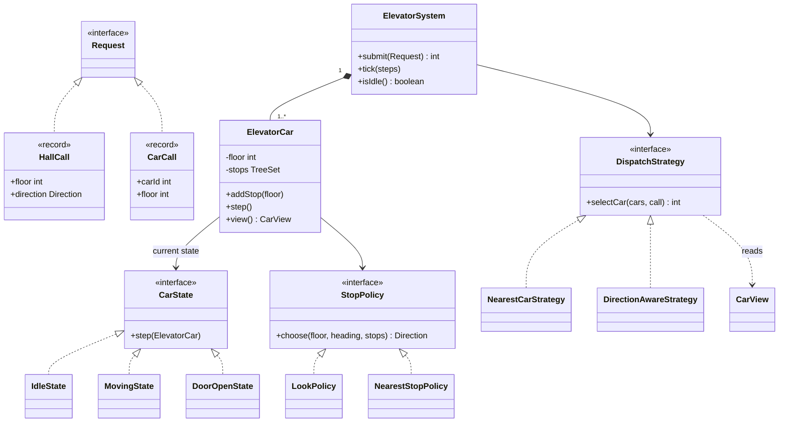
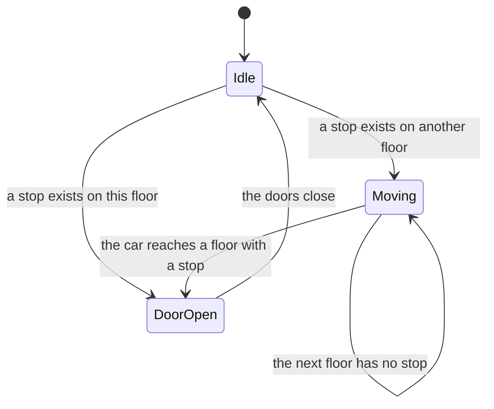

# Design an Elevator System

An elevator system moves several cars between floors to serve passengers. This case study designs the classes for a building with N floors and M cars. A passenger in a hall presses UP or DOWN, and a passenger in a car presses a floor number. The design uses the State pattern for the car, and two Strategy interfaces: one chooses which car answers a hall call, and one chooses the order in which a car visits its stops. A simulation loop with a fixed tick makes the demo deterministic. Follow the steps in [how to approach an LLD interview](../../how-to-approach-lld.md).

## Problem Statement

"Design an elevator system for a building. The building has several floors and several elevator cars. A person on a floor calls an elevator and says up or down. A person inside a car selects a destination floor. The system decides which car answers each call and in which order a car serves its stops. Many people press buttons at the same time."

## Clarifying Questions

| Question | Answer that this design assumes |
|---|---|
| How many floors and cars? | Configurable. The demo uses 10 floors (0 to 9) and 2 cars. One demo uses 50 floors |
| Which request types exist? | A hall call (floor and direction, from outside) and a car call (car and floor, from inside). Both are in scope |
| Do we model real time? | No. The system moves in ticks. One tick moves a car by one floor, or closes the doors of a car. A scheduler calls `tick()` in production |
| Does a car have a weight limit or a capacity? | No. This is an extension |
| What is the rule for pickup in a hall call? | Assumption: when a car stops at the floor of a hall call, the person boards, whatever the direction of the car. Direction-correct pickup is an extension |
| Which algorithm picks the car for a hall call? | Not fixed. The design has a nearest-car rule and a direction-aware rule, behind one interface |
| Which algorithm orders the stops of a car? | LOOK: keep the direction while stops remain ahead, then reverse. A nearest-stop rule exists for comparison |
| Do we handle faults, fire mode, or maintenance? | No. They are extensions |
| Do many threads send requests? | Yes. People press buttons at the same time. One thread runs the tick loop |
| Display boards and sound? | No. An Observer is an extension |

## Requirements

### Functional

1. A hall call `(floor, direction)` is assigned to one car by a `DispatchStrategy`.
2. A car call `(carId, floor)` adds a stop to that car.
3. A car stops at each requested floor, opens its doors for one tick, and then continues.
4. A car serves its stops in an order that a `StopPolicy` decides (LOOK in the demo).
5. A car that has no stop is idle.
6. The system rejects a floor outside the building, a hall call without a direction, an UP call at the top floor, a DOWN call at the ground floor, and a car call for a car that does not exist.
7. Both strategies can change without a change to the car or the system.

### Non-functional

1. The simulation is deterministic: the same requests and the same ticks give the same result.
2. Thread safety: concurrent button presses never lose a stop and never corrupt the stop set.
3. A stop request is idempotent. Pressing the same floor twice has the same effect as pressing it once.
4. Bounded wait in the default policy: LOOK serves every stop within two sweeps of the car, also when new stops arrive. A sweep is one run in one direction, and it ends at the building's end at the latest. The bound has one condition: no passenger holds the doors at the floor where the car stands. The section "Why LOOK cannot starve a stop" gives the argument.
5. A new algorithm needs a new class and no change to existing classes.

## Entities and Relationships

| Entity | Responsibility | Relationships |
|---|---|---|
| `ElevatorSystem` | The facade. Accepts `Request` objects, asks the `DispatchStrategy` for a car, and runs the tick loop | Has many `ElevatorCar`. Uses `DispatchStrategy` |
| `Request` (sealed) | The input of the system. Two kinds: `HallCall` and `CarCall` | `HallCall` and `CarCall` implement it |
| `HallCall` | A person at a floor presses UP or DOWN | Has a `Direction` |
| `CarCall` | A person in a car presses a floor | Refers to a car by id |
| `ElevatorCar` | One car. Owns its floor, its set of stops, and its state. Moves one step in each tick | Has one `CarState` and one `StopPolicy`. Has many stops (floors) |
| `CarState` | The behavior of a car in one state: `IdleState`, `MovingState`, `DoorOpenState` | Each state changes the car and sets the next state |
| `DispatchStrategy` | Chooses the car for a hall call from a list of `CarView` objects | `NearestCarStrategy` and `DirectionAwareStrategy` implement it |
| `StopPolicy` | Chooses the next direction of a car from its floor, its heading, and its stops | `LookPolicy` and `NearestStopPolicy` implement it |
| `CarView` | An immutable snapshot of a car: id, floor, the direction of its next move, and the farthest stop in that direction | Created by `ElevatorCar.view()`. Read by `DispatchStrategy` |
| `Direction` | `UP`, `DOWN`, `IDLE` | Used by calls, views, and policies |

The `DispatchStrategy` reads a `CarView` and not the car itself. The strategy then cannot change a car, and the strategy has no lock to take.

## Class Diagram



The state machine of one car:



## Design Patterns Used

The [behavioral patterns page](../../fundamentals/08-behavioral-patterns.md) describes State and Strategy. The [UML page](../../fundamentals/04-uml-class-and-sequence-diagrams.md) shows the notation of the diagrams above.

| Pattern | Where | Reason | Alternative that the design rejected |
|---|---|---|---|
| State | `CarState` with `IdleState`, `MovingState`, `DoorOpenState` | The action of a tick depends on the state of the car. An idle car picks a direction. A moving car changes its floor. An open car closes the doors. Each state is one small class, and a new state (out of service, fire mode) is a new class | An `enum` and a `switch` in `ElevatorCar.step()`. Three states are small enough for an enum, and an enum is a good answer in a short round. The State classes pay off when the states grow (out of service, fire mode) because the `switch` would grow with each state |
| Strategy (dispatch) | `DispatchStrategy` | The requirement says that the rule for the car choice changes with the building. A new rule is a new class | A fixed rule in `ElevatorSystem`. Each new rule would edit the class |
| Strategy (stop order) | `StopPolicy` | The order of stops is a separate decision from the choice of the car. LOOK and nearest-stop give different results (see the demo) | A `boolean useLook` flag in the car |
| Facade | `ElevatorSystem` | The caller has one entry point (`submit`) and does not know about cars, states, or strategies | The caller calls the cars directly and runs the dispatch itself |
| Sealed interface with pattern matching | `Request` with `HallCall` and `CarCall` | The compiler checks that `submit` handles every request kind. A new request kind that has no `case` is a compile error | The Visitor pattern. It needs a `visit` method in each type and is longer. See the [behavioral patterns page](../../fundamentals/08-behavioral-patterns.md) |
| Value object (snapshot) | `CarView` | The strategy reads a consistent copy of a car, taken under the lock of the car | Pass `ElevatorCar` to the strategy. The strategy could change the car, and it would read the fields without the lock |
| Centralized push of calls | `ElevatorSystem` assigns the hall call to one car at once | One decision at the time of the call. The car then needs no knowledge of other cars | A shared queue of hall calls, where an idle car pulls the next call. This design balances load well and delays the answer to a call until a car is free |

### SCAN, LOOK, and nearest stop

These names come from disk scheduling. The car is the disk head, and the floors are the tracks.

| Policy | Rule | Weak point |
|---|---|---|
| SCAN | Move in one direction up to the last floor of the building, then reverse | The car travels to the end of the shaft even when no stop is there |
| LOOK | Move in one direction while a stop exists ahead, then reverse. This design implements LOOK | A person just behind the car waits for a full sweep |
| Nearest stop (shortest seek time first, SSTF) | Always go to the closest stop | A stream of requests near the car can starve a far floor |

The names and the rules are the disk-scheduling algorithms of operating system textbooks (Silberschatz, Galvin, and Gagne, *Operating System Concepts*, chapter "Mass-Storage Structure", section on disk scheduling). That book also says that SCAN is sometimes called the elevator algorithm. In this design, `NearestStopPolicy` decides only when the car stands still (after the doors close). A moving car does not turn back between two floors.

#### Why LOOK cannot starve a stop

Take a stop at floor `f`, added while the car moves UP.

1. If `f` is above the car, the car passes `f` in the current sweep. `MovingState` checks every floor, so the car stops at `f`.
2. If `f` is below the car, the car keeps going UP only while a stop exists above it. The building has a top floor, so this sweep ends after at most `topFloor` moves. The policy then reverses, because `f` is below. On the way down, the car keeps going DOWN while a stop exists below it, and `f` is such a stop, so the car reaches `f`.

New stops above the car in step 2 make the first sweep longer, but never longer than the shaft. So the wait for `f` is at most two sweeps: at most `2 × topFloor` moves, plus one door cycle for each stop on the way (at most one stop for each floor in each sweep).

The condition: a passenger can hold the car at one floor. `addStop` ignores a press for the current floor while the doors are open. After the doors close, the car is idle for one tick, and a new press for the same floor in that tick opens the doors again. A passenger who presses the button in each such tick keeps the car at the floor, and the other stops wait. Recommendation: limit the door hold with a maximum number of reopenings, or with a timeout in `DoorOpenState` (see the extension "Real time").

The demo has a car at floor 5 with stops 6, 4, 9, and 2. LOOK visits 6, 9, 4, 2. Nearest stop visits 6, 4, 2, 9. Both orders are legal, and the policies differ in travel and in waiting time of each floor.

## Key Code

The excerpts below are copied from `Main.java` in this folder.

### Requests and the snapshot

The sealed interface `Request` lists the two kinds of input. `CarView` is the snapshot that the dispatch strategy reads.

```java
enum Direction {
    UP, DOWN, IDLE
}

sealed interface Request permits HallCall, CarCall {
}

record HallCall(int floor, Direction direction) implements Request {
    HallCall {
        Objects.requireNonNull(direction, "direction");
        if (direction == Direction.IDLE) {
            throw new IllegalArgumentException("a hall call needs UP or DOWN");
        }
    }
}

record CarCall(int carId, int floor) implements Request {
}

record CarView(int id, int floor, Direction direction, int farthestStop) {
}
```

### Dispatch strategies

The nearest-car rule uses the distance only. It can send a hall call to a car that moves away. The direction-aware rule adds the cost of the turn: if the car moves away from the call or in the other direction, the car must first go to its farthest stop and come back.

```java
interface DispatchStrategy {
    int selectCar(List<CarView> cars, HallCall call);
}

final class NearestCarStrategy implements DispatchStrategy {
    @Override
    public int selectCar(List<CarView> cars, HallCall call) {
        CarView best = cars.get(0);
        for (CarView car : cars) {
            if (Math.abs(car.floor() - call.floor()) < Math.abs(best.floor() - call.floor())) {
                best = car;
            }
        }
        return best.id();
    }
}

final class DirectionAwareStrategy implements DispatchStrategy {
    @Override
    public int selectCar(List<CarView> cars, HallCall call) {
        CarView best = cars.get(0);
        for (CarView car : cars) {
            if (cost(car, call) < cost(best, call)) {
                best = car;
            }
        }
        return best.id();
    }

    private int cost(CarView car, HallCall call) {
        int distance = Math.abs(car.floor() - call.floor());
        if (car.direction() == Direction.IDLE) {
            return distance;
        }
        boolean ahead = car.direction() == Direction.UP
                ? call.floor() >= car.floor()
                : call.floor() <= car.floor();
        if (ahead && call.direction() == car.direction()) {
            return distance;
        }
        return Math.abs(car.farthestStop() - car.floor())
                + Math.abs(car.farthestStop() - call.floor());
    }
}
```

In the demo, car 0 moves UP to floor 9 and is at floor 3. Car 1 is idle at floor 4. A hall call arrives at floor 1. The nearest-car rule sends it to car 0, which has a distance of 2 and then travels 6 floors up and 8 floors down. The direction-aware rule sends it to car 1 (cost 3).

The cost is an estimate of the floors that the car travels before it reaches the call floor: directly, if the call is ahead and has the same direction, or else after one turn at the farthest stop in its current direction. A car that moves UP and passes a DOWN call on its way would stop there under this design's pickup assumption, but the passenger would ride up first, so the rule counts the trip to the farthest stop and back. The estimate ignores stops on the way and stops beyond the call floor after the turn, so it can rank two cars in the wrong order. Ties go to the car with the lower id, because the loop replaces `best` only for a strictly smaller cost.

**Edge case: a stale heading.** After a car serves its last stop in the UP direction, its `heading` field still says UP until the next idle tick. If `view()` reported that field, the rule would compute a turn cost for a car that is about to go DOWN, or about to stop. So `view()` reports the direction of the next move: the heading of a moving car, and for a stopped car the direction that the `StopPolicy` returns for the current stops.

### Stop policies

A policy answers one question: in which direction should the car go next? The policy reads the stops as a `NavigableSet`, so `higher` and `lower` find the next stop on each side in O(log n).

```java
interface StopPolicy {
    Direction choose(int floor, Direction heading, NavigableSet<Integer> stops);
}

final class LookPolicy implements StopPolicy {
    @Override
    public Direction choose(int floor, Direction heading, NavigableSet<Integer> stops) {
        Integer above = stops.higher(floor);
        Integer below = stops.lower(floor);
        if (heading == Direction.UP && above != null) {
            return Direction.UP;
        }
        if (heading == Direction.DOWN && below != null) {
            return Direction.DOWN;
        }
        if (above != null && below != null) {
            return floor - below < above - floor ? Direction.DOWN : Direction.UP;
        }
        return above != null ? Direction.UP : below != null ? Direction.DOWN : Direction.IDLE;
    }
}

final class NearestStopPolicy implements StopPolicy {
    @Override
    public Direction choose(int floor, Direction heading, NavigableSet<Integer> stops) {
        Integer above = stops.higher(floor);
        Integer below = stops.lower(floor);
        if (above != null && below != null) {
            return floor - below < above - floor ? Direction.DOWN : Direction.UP;
        }
        return above != null ? Direction.UP : below != null ? Direction.DOWN : Direction.IDLE;
    }
}
```

### The state classes

Each state has one method, `step`. The state changes the car and sets the next state. The car does not contain a `switch` on the state.

```java
interface CarState {
    String label();

    void step(ElevatorCar car);
}

final class IdleState implements CarState {
    @Override
    public String label() {
        return "IDLE";
    }

    @Override
    public void step(ElevatorCar car) {
        if (car.hasStopHere()) {
            car.openDoor();
            return;
        }
        Direction direction = car.chooseDirection();
        if (direction != Direction.IDLE) {
            car.setState(new MovingState(direction));
            car.currentState().step(car);
        }
    }
}

final class MovingState implements CarState {
    private final Direction direction;

    MovingState(Direction direction) {
        this.direction = direction;
    }

    @Override
    public String label() {
        return "MOVING_" + direction;
    }

    @Override
    public void step(ElevatorCar car) {
        car.moveOneFloor(direction);
        if (car.hasStopHere()) {
            car.openDoor();
        }
    }
}

final class DoorOpenState implements CarState {
    @Override
    public String label() {
        return "DOOR_OPEN";
    }

    @Override
    public void step(ElevatorCar car) {
        car.setState(new IdleState());
    }
}
```

`IdleState` opens the door if the car already stands at a requested floor. If not, it asks the policy for a direction and moves in the same tick. `MovingState` moves one floor, and opens the door if the new floor has a stop. `DoorOpenState` takes one tick and then sets the car to idle. The next tick lets the idle car choose the next direction.

### The car

All public methods are `synchronized`. They share one lock for one car. The package-private methods at the end of the class run inside `step()`, which already holds that lock.

```java
final class ElevatorCar {
    private final int id;
    private final int topFloor;
    private final StopPolicy policy;
    private final TreeSet<Integer> stops = new TreeSet<>();
    private final List<Integer> served = new ArrayList<>();
    private int floor;
    private Direction heading = Direction.IDLE;
    private CarState state = new IdleState();

    ElevatorCar(int id, int startFloor, int topFloor, StopPolicy policy) {
        if (startFloor < 0 || startFloor > topFloor) {
            throw new IllegalArgumentException("start floor " + startFloor + " is outside 0.."
                    + topFloor);
        }
        this.id = id;
        this.floor = startFloor;
        this.topFloor = topFloor;
        this.policy = policy;
    }

    synchronized void addStop(int target) {
        if (target < 0 || target > topFloor) {
            throw new IllegalArgumentException("floor " + target + " is outside 0.." + topFloor);
        }
        if (target == floor && state instanceof DoorOpenState) {
            return;
        }
        stops.add(target);
    }

    synchronized void step() {
        state.step(this);
    }

    // A moving car keeps its direction. A stopped car reports the direction that the
    // policy will choose next, so a heading left over from the last trip does not count.
    synchronized CarView view() {
        Direction next = state instanceof MovingState ? heading
                : policy.choose(floor, heading, stops);
        int farthest = next == Direction.UP ? stops.last()
                : next == Direction.DOWN ? stops.first()
                : floor;
        return new CarView(id, floor, next, farthest);
    }

    synchronized int pendingStops() {
        return stops.size();
    }

    synchronized List<Integer> servedFloors() {
        return List.copyOf(served);
    }

    synchronized boolean isIdle() {
        return state instanceof IdleState && stops.isEmpty();
    }

    synchronized String describe() {
        return "car " + id + " floor " + floor + " " + state.label();
    }

    // The methods below run inside step(), which holds the lock of the car.
    boolean hasStopHere() {
        return stops.contains(floor);
    }

    Direction chooseDirection() {
        heading = policy.choose(floor, heading, stops);
        return heading;
    }

    void moveOneFloor(Direction direction) {
        int next = floor + (direction == Direction.UP ? 1 : -1);
        if (next < 0 || next > topFloor) {
            throw new IllegalStateException("car " + id + " cannot move to floor " + next);
        }
        floor = next;
    }

    void openDoor() {
        stops.remove(floor);
        served.add(floor);
        state = new DoorOpenState();
    }

    void setState(CarState next) {
        state = next;
    }

    CarState currentState() {
        return state;
    }
}
```

`addStop` ignores a request for the current floor while the doors are open, because the doors are already open. A `TreeSet` makes a repeated request a no-op and keeps the stops sorted for the policy. `moveOneFloor` throws if a move would leave the shaft. LOOK and nearest stop only move toward an existing stop, so the check never fires in this code. It guards a later policy (for example a SCAN policy or a cancel feature) that breaks this rule.

### The system and the tick loop

`submit` uses a pattern `switch` over the sealed `Request`. For a hall call, the system builds a list of snapshots and asks the strategy. `tick` steps each car in order, so the simulation is deterministic.

```java
final class ElevatorSystem {
    private final int topFloor;
    private final List<ElevatorCar> cars = new ArrayList<>();
    private final DispatchStrategy dispatch;
    private int tickCount;

    ElevatorSystem(int topFloor, List<Integer> startFloors,
                   DispatchStrategy dispatch, StopPolicy policy) {
        if (topFloor < 1 || startFloors.isEmpty()) {
            throw new IllegalArgumentException("need at least 2 floors and 1 car");
        }
        this.topFloor = topFloor;
        this.dispatch = dispatch;
        for (int i = 0; i < startFloors.size(); i++) {
            cars.add(new ElevatorCar(i, startFloors.get(i), topFloor, policy));
        }
    }

    int submit(Request request) {
        return switch (request) {
            case HallCall call -> {
                if (call.floor() < 0 || call.floor() > topFloor) {
                    throw new IllegalArgumentException("floor " + call.floor() + " is outside 0.."
                            + topFloor);
                }
                if (call.floor() == topFloor && call.direction() == Direction.UP) {
                    throw new IllegalArgumentException("no UP call at the top floor");
                }
                if (call.floor() == 0 && call.direction() == Direction.DOWN) {
                    throw new IllegalArgumentException("no DOWN call at the ground floor");
                }
                List<CarView> views = new ArrayList<>();
                for (ElevatorCar car : cars) {
                    views.add(car.view());
                }
                int carId = dispatch.selectCar(views, call);
                cars.get(carId).addStop(call.floor());
                yield carId;
            }
            case CarCall call -> {
                if (call.carId() < 0 || call.carId() >= cars.size()) {
                    throw new IllegalArgumentException("no car " + call.carId());
                }
                cars.get(call.carId()).addStop(call.floor());
                yield call.carId();
            }
        };
    }

    void tick(int steps) {
        for (int i = 0; i < steps; i++) {
            tickCount++;
            for (ElevatorCar car : cars) {
                car.step();
            }
        }
    }

    boolean isIdle() {
        return cars.stream().allMatch(ElevatorCar::isIdle);
    }

    ElevatorCar car(int id) {
        return cars.get(id);
    }

    String status() {
        StringBuilder text = new StringBuilder("t=" + tickCount);
        for (ElevatorCar car : cars) {
            text.append(" | ").append(car.describe());
        }
        return text.toString();
    }
}
```

## Concurrency

**What races.** Button presses come from many threads, and the tick loop runs in one thread. They share the stop set and the state of each car. Without protection:

- Two threads call `TreeSet.add` at the same time, and the tree breaks or loses a stop. `TreeSet` is not thread-safe.
- A thread adds a stop while the tick thread reads `stops.higher(floor)`. The policy reads a tree that changes during the read.
- The tick thread moves the car (changes `floor`) while the dispatcher reads `floor` to compute a distance. The dispatcher reads a stale or inconsistent value.

**How the design prevents the races.** Each `ElevatorCar` has one lock (its own monitor). `addStop`, `step`, `view`, `pendingStops`, `servedFloors`, and `isIdle` are `synchronized`. A button press and a tick never run at the same time on the same car. The press of one car does not block the tick of another car.

**The dispatcher reads a stale snapshot.** The system calls `view()` on each car one by one, and each call takes the lock of that car for a moment. The views come from slightly different moments. The strategy chooses a car, and the car can move before `addStop` runs. This is acceptable: the stop is added to the chosen car anyway, and the car serves it. The result can be a car that is not the best, and it can never be a lost call. Recommendation: say this trade-off in the interview. A lock over all cars for each hall call would give exact views and would stop all cars while the system chooses.

**No deadlock.** No method holds two car locks at the same time. The system never nests the locks of two cars.

**The car list.** The constructor fills `cars`, and no method changes the list after that. The field is `final`, so the Java memory model guarantees that each thread that sees the `ElevatorSystem` also sees the filled list (JLS 17.5, final field semantics). The button threads read the list without a lock, and this is safe.

**One tick thread.** `ElevatorSystem.tick` and its `tickCount` field assume one caller thread (a scheduler). If two threads call `tick`, each car still stays consistent, but the order of the cars is not defined, and `tickCount` needs an atomic type.

The demo starts 8 threads. Each thread requests floors 1 to 49 of one car. After the join, the car has exactly 49 pending stops (the same floor from many threads is one stop), and the car then serves 49 floors.

!!! note "Where the other thread-safety details live"
    The [concurrency in LLD page](../../fundamentals/09-concurrency-in-lld.md) compares `synchronized`, locks, atomics, and concurrent collections.

## Extensions

| Extension | Class changes |
|---|---|
| Weight limit, or a full car that skips hall calls | Add `capacity` and `load` to `ElevatorCar`, and `full` to `CarView`. `DispatchStrategy` implementations skip full cars. A full car does not stop for a hall call: the car needs to know which stops are hall calls, so store them in a separate set (see the next row) |
| Direction-correct pickup (UP call is served by a car that goes UP) | Replace the `TreeSet<Integer>` of stops with a map from floor to a set of `Direction` values, or keep a second set of hall stops for each direction. `LookPolicy` stops at a hall stop when the heading matches, or when it is the last stop in that direction. `CarCall` stops stay unconditional |
| SCAN instead of LOOK | Add `ScanPolicy implements StopPolicy`. It needs the top floor in its constructor, and it keeps the direction until the car reaches the end of the shaft. `ElevatorCar` and `ElevatorSystem` do not change. `MovingState` must not assume that a stop exists ahead, so it moves while the policy says so |
| A car out of service (fault, maintenance) | Add `OutOfServiceState implements CarState` whose `step` does nothing. Add `boolean available` to `CarView`. `DispatchStrategy` skips unavailable cars. Add `ElevatorSystem.reassign(carId)` that submits the pending hall calls of that car again. This needs `ElevatorSystem` to keep a list of the hall calls that it assigned |
| Fire mode, or a VIP request that has priority | Add `FireModeState` that clears the stops and sends the car to the ground floor. Add a request record `PriorityCall` to the sealed `Request` interface. The compiler reports that `submit` has no `case` for it, which marks the place to change |
| Destination dispatch (the person enters the destination in the hall, and the system picks the car) | Add `record DestinationCall(int from, int to)` to `Request`. The `submit` case asks the `DispatchStrategy` for a car (the cost now includes the trip from `from` to `to`) and adds the stop `from`. The car must not add `to` at once: LOOK could then visit `to` before `from`, with the passenger still in the hall. Add `Map<Integer, Set<Integer>> pendingDestinations` to `ElevatorCar`. `openDoor` moves the destinations of the current floor into the stop set |
| Floor displays and sound on arrival | Add `interface CarListener { void onFloor(int carId, int floor, String stateLabel); }`. `ElevatorCar` keeps the listeners in a `CopyOnWriteArrayList` (Observer). `step()` records the event under the lock, and `ElevatorSystem.tick` calls the listeners after `step()` returns. Do not call a listener while the car lock is held: a slow listener then delays every button press of that car, and a listener that waits for another thread that needs the car lock causes a deadlock. A callback into the same car from the same thread does not block, because Java monitors are reentrant. See the [behavioral patterns page](../../fundamentals/08-behavioral-patterns.md) |
| Real time (a door stays open for 5 seconds) | A `ScheduledExecutorService` calls `tick(1)` each period. `DoorOpenState` gets a `remainingTicks` field and returns to idle after that count. No other class changes |
| Zones (cars for floors 1-20 and cars for floors 21-40) | Add `ZoneStrategy implements DispatchStrategy` that filters the `CarView` list by zone before it applies another strategy (Decorator on a strategy) |
| Statistics (average wait time) | Record the tick of each call and the tick of its service. Add `Map<Integer, Integer>` pending calls in the system, or a listener (see the display row) |

## Common Mistakes

| Mistake | Problem | Fix |
|---|---|---|
| One `Elevator` class that holds the floors, the cars, the requests, and the scheduling | A god class. A new algorithm edits it | Separate the system, the car, and the strategies |
| `switch` on a state field in every method of the car | Each new state edits every method | State pattern, or an enum with a single `switch` if there are only two or three states |
| Hard-coded dispatch in the system | The interviewer asks for another rule, and the class changes | `DispatchStrategy` |
| No separation between a hall call and a car call | The two have different data: a hall call has a direction and no car. A car call has a car and no direction | Two request types |
| Choose the nearest car by distance only, and call it done | A car that moves away from the call looks near | Add direction to the cost. Say the weak point of the nearest rule |
| A new thread for each car and for each request | Threads wait on each other, and the output is not reproducible | One tick loop. Threads only enqueue requests |
| A shared `ArrayList` or `HashSet` of stops with no lock | Lost updates, or a `ConcurrentModificationException` | One lock for each car, or a concurrent collection |
| Stop requests stored in a `List` | A person who presses a button twice adds two stops, and the car opens its doors twice | A sorted set |
| Start code before the clarifying questions | The design handles hall calls without direction, or ignores car calls | Ask about request types, tick or real time, and the algorithm in the first 5 minutes |
| Model the physics (speed, acceleration) | The time is lost, and the design does not improve | State that one tick is one floor, and move on |
| Let the strategy modify the car | The strategy gets side effects, and the lock rule breaks | Pass an immutable snapshot (`CarView`) |

## 45-Minute Plan

| Minutes | Part | What to present |
|---|---|---|
| 0-5 | Clarify | Request types, number of cars and floors, tick-based time, the algorithms, the pickup assumption |
| 5-10 | Entities | `ElevatorSystem`, `ElevatorCar`, `HallCall`, `CarCall`, `Direction`. Say which two decisions change: the car choice and the stop order |
| 10-15 | Diagram | Draw the class diagram and the state machine of a car (Idle, Moving, DoorOpen) |
| 15-27 | Core code | Write the request types, `ElevatorCar` with `addStop` and `step`, the three state classes, and `LookPolicy` |
| 27-33 | Dispatch | Write `NearestCarStrategy`. Describe `DirectionAwareStrategy` and give the demo example where nearest fails. Compare SCAN, LOOK, and nearest stop |
| 33-38 | Concurrency | Name the stop set, the lock for each car, the stale snapshot trade-off, and the single tick thread |
| 38-43 | Extensions | Answer out of service, destination dispatch, and direction-correct pickup |
| 43-45 | Questions | Ask what the interviewer wants to see in more depth |

## Expected Output

The simulation uses ticks and no real time. The concurrency demo prints only counts that do not depend on the thread schedule. The output is the same in every run.

<!-- expected-output -->
```text
== Two cars, 10 floors: a hall call, then a car call ==
hall call at floor 3 going UP -> car 0
t=3 | car 0 floor 3 DOOR_OPEN | car 1 floor 9 IDLE
passenger in car 0 presses 7
t=4 | car 0 floor 3 IDLE | car 1 floor 9 IDLE
t=5 | car 0 floor 4 MOVING_UP | car 1 floor 9 IDLE
t=6 | car 0 floor 5 MOVING_UP | car 1 floor 9 IDLE
t=7 | car 0 floor 6 MOVING_UP | car 1 floor 9 IDLE
t=8 | car 0 floor 7 DOOR_OPEN | car 1 floor 9 IDLE
t=9 | car 0 floor 7 IDLE | car 1 floor 9 IDLE
== Dispatch: car 0 heads UP to 9 (floor 3), car 1 idle at 4 ==
NearestCarStrategy sends the hall call at floor 1 to car 0
DirectionAwareStrategy sends the hall call at floor 1 to car 1
== Stop order: car at floor 5, stops 6, 4, 9, 2 ==
LookPolicy: visited [6, 9, 4, 2] in 15 ticks
NearestStopPolicy: visited [6, 4, 2, 9] in 16 ticks
== Concurrency: 8 threads press floors 1..49 in one car ==
pending stops: 49
floors served: 49
== Validation ==
rejected: floor 12 is outside 0..9
rejected: no UP call at the top floor
rejected: no car 5
```

## Sources

- Abraham Silberschatz, Peter B. Galvin, Greg Gagne, *Operating System Concepts*, Wiley, chapter "Mass-Storage Structure", section on disk scheduling (chapter 10 in the 9th edition, chapter 11 in the 10th edition): SSTF, SCAN (with the note that SCAN is sometimes called the elevator algorithm), and LOOK as the variant of SCAN that does not travel to the end of the disk.
- [Java Language Specification, Java SE 21, section 17.5 "final Field Semantics"](https://docs.oracle.com/javase/specs/jls/se21/html/jls-17.html#jls-17.5): the visibility guarantee for the `cars` list.
- [Java Language Specification, Java SE 21, section 14.11.1.1 "Exhaustive Switch Blocks"](https://docs.oracle.com/javase/specs/jls/se21/html/jls-14.html#jls-14.11.1.1): why a new `Request` kind without a `case` is a compile error.
