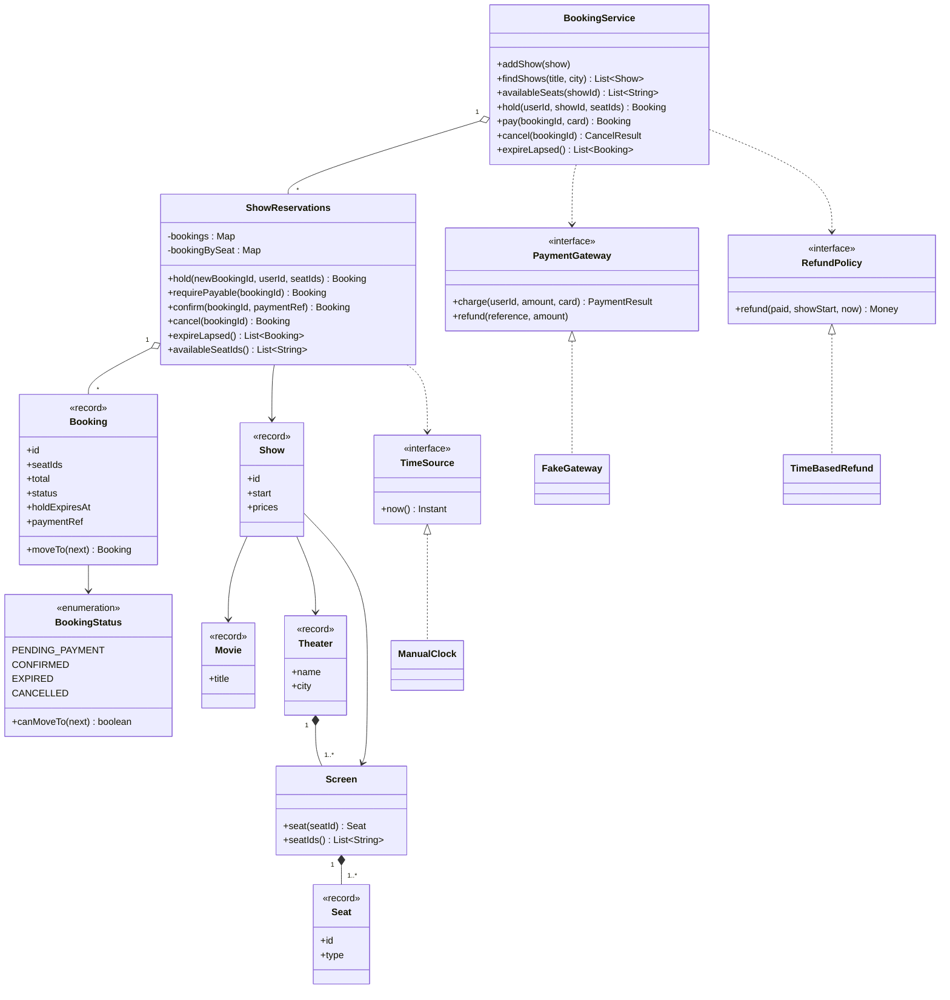
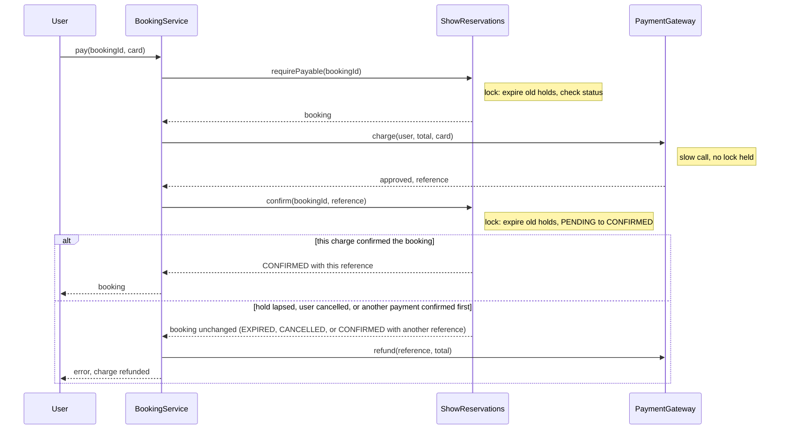
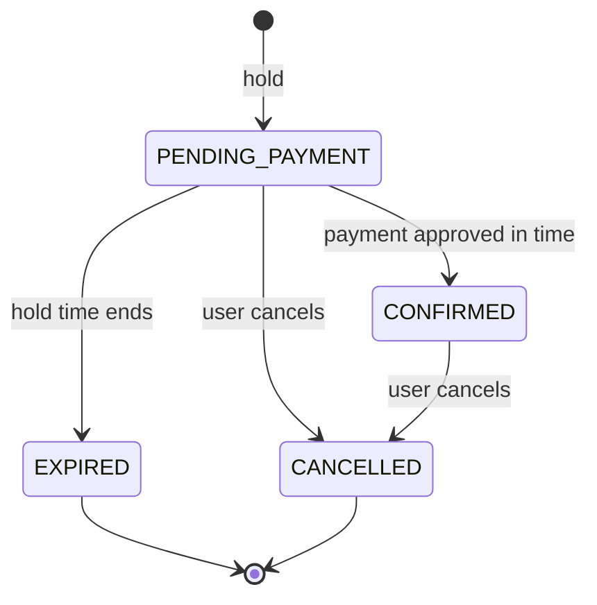

# Design a Movie Ticket Booking System

This case study designs the classes behind a movie ticket booking site: theaters, screens, shows, seats, a timed seat hold, payment, and cancellation. The hard part is concurrency: two users must not get the same seat. `Main.java` in this folder runs the whole design with `java Main.java`. The page follows the procedure in [How to approach an LLD interview](../../how-to-approach-lld.md).

## Problem Statement

The interviewer says: "Design a movie ticket booking system like BookMyShow. A user finds a show, picks seats, pays, and gets a booking. Many users book at the same time. Two users must not get the same seat. If a user does not pay in time, the seats go back to the pool. A user can cancel."

Interviewers use this problem to test concurrency in an LLD round. The interviewer wants to see the race and the fix, so plan to show both. See [Concurrency in LLD](../../fundamentals/09-concurrency-in-lld.md) for the tools.

## Clarifying Questions

Ask these questions in the first 5 minutes. Each row gives the answer that this design assumes.

| Question | Assumed answer |
|---|---|
| Which flows matter most? | Find a show, hold seats, pay, confirm. Cancellation is second. Search is third |
| Do we model several theaters and cities? | Yes. A user searches shows by movie title and city. The demo uses one theater |
| Does the user choose exact seats? | Yes, 1 to 6 seats in one booking |
| What happens between "select seats" and "pay"? | The system holds the seats for 5 minutes. The hold time is a constructor argument |
| What if a hold ends and the seat goes to another user? | The first user can no longer pay for it. The booking has the state `EXPIRED` |
| Who takes the payment? | An external payment gateway. It can decline a card and it can be slow. The system does not store card data |
| What if payment succeeds after the hold ended? | The system refunds the charge and does not confirm the booking |
| What does a declined card do? | The booking stays pending with the same hold. The user can retry until the hold ends |
| What is the cancellation rule? | A pending booking releases its seats. A confirmed booking is refunded in full if the show starts in 2 hours or more, and not refunded otherwise |
| How is a price computed? | Each show has one price for each seat type. No taxes, coupons, or dynamic pricing |
| Is there one server or many? | One JVM. For many servers, the database enforces the seat rule with a conditional update (see "More than one server" in Concurrency) |
| Storage? | In memory |
| Do we notify the user? | Out of scope. The design leaves a place for it (see Extensions) |

## Requirements

### Functional

| # | Requirement |
|---|---|
| F1 | A user finds the shows of a movie in a city |
| F2 | A user sees the free seats of a show |
| F3 | A user holds 1 to 6 seats of one show. The hold takes all seats or none |
| F4 | A hold ends after the hold time. The seats become free again |
| F5 | A user pays for a pending booking. If payment succeeds before the hold ends, the booking becomes `CONFIRMED` |
| F6 | If the card is declined, the booking stays pending. If payment succeeds after the hold ended, the system refunds the charge |
| F7 | A user cancels a pending booking (seats are released) or a confirmed booking (the refund policy decides the refund) |
| F8 | A seat of a show has at most one live booking at any time |

### Non-functional

| # | Requirement |
|---|---|
| N1 | Correct under concurrency: no double booking, no partial multi-seat hold |
| N2 | Testable time: the design reads time from an injected `TimeSource`, so a test controls expiry |
| N3 | No slow call under a lock: the payment gateway call does not hold the show lock |
| N4 | Open for extension: a new refund rule, price rule, or payment provider is a new class |
| N5 | Short critical section: map operations on at most 6 seats and a scan of the bookings of one show, with no I/O |

## Entities and Relationships

Apply noun-verb analysis from [Domain modeling](../../fundamentals/05-domain-modeling.md) to the problem statement.

| Type | Kind | Responsibility | Relationships |
|---|---|---|---|
| `Movie` | Value object (`record`) | Title and duration | Referenced by `Show` |
| `Theater` | Value object (`record`) | Name, city, and its screens | Has 1..* `Screen` |
| `Screen` | Entity | The seat layout of one room | Has 1..* `Seat` |
| `Seat`, `SeatType` | Value object, enum | A seat id and its price class. Seat state is **not** here (see below) | Part of `Screen` |
| `Show` | Entity (immutable) | One screening: movie, screen, start time, price for each seat type | Refers to `Movie`, `Theater`, `Screen` |
| `ShowReservations` | Aggregate root, the lock unit | All bookings and seat ownership of one show. Enforces F8 | Has 0..* `Booking`. Refers to `Show` and `TimeSource` |
| `Booking` | Immutable record, with a state | One user, some seats, a total, a status, a hold deadline, a payment reference | Held by `ShowReservations` |
| `BookingStatus` | Enum with a transition rule | `PENDING_PAYMENT`, `CONFIRMED`, `EXPIRED`, `CANCELLED` | Used by `Booking` |
| `BookingService` | Facade | The public API. Runs the pay flow across the gateway and the reservations | Has 0..* `ShowReservations` |
| `PaymentGateway` | Interface (port) | `charge` and `refund` | Used by `BookingService` |
| `RefundPolicy` | Interface (Strategy) | How much money returns on a cancellation | Used by `BookingService` |
| `TimeSource` | Interface | The current time | Used by `ShowReservations`, `BookingService` |
| `Money` | Value object | An amount in minor units (`long`). Not a `double` | Used by `Show`, `Booking` |

!!! note "Where seat state lives"
    The status of a seat (free, held, booked) belongs to a **show**, not to the `Seat`. The same physical seat `A1` is free for the 6 pm show and booked for the 9 pm show. A design with `seat.setBooked(true)` on a shared `Seat` object is wrong. `ShowReservations` keeps the ownership map for one show.

The central decision: one `ShowReservations` object guards all state of one show with one lock. Section "Concurrency" gives the reasons.

## Class Diagram



Read the diagram from the top. `BookingService` is the only class that a caller needs. `ShowReservations` holds the rules and the lock. The three interfaces on the right and bottom are the points where a test or a new feature replaces behavior. See [UML class and sequence diagrams](../../fundamentals/04-uml-class-and-sequence-diagrams.md) for the notation.

The pay flow has three steps, with a gateway call between two lock sections:



The booking moves through these states. `BookingStatus.canMoveTo` implements the arrows.



## Design Patterns Used

| Pattern | Where | Why | Rejected alternative |
|---|---|---|---|
| Facade ([structural patterns](../../fundamentals/07-structural-patterns.md)) | `BookingService` | The caller needs one entry point for each use case. The facade also runs the pay flow that spans the gateway and the reservations | Callers use `ShowReservations` and `PaymentGateway` directly. Each caller then repeats the three-step pay flow and can get it wrong |
| Strategy ([behavioral patterns](../../fundamentals/08-behavioral-patterns.md)) | `RefundPolicy` and `TimeBasedRefund` | The interviewer can change the refund rule. A new rule is a new class | An `if` on the time in `cancel`. Each new rule edits `BookingService` |
| Port and adapter ([architectural patterns](../../fundamentals/10-architectural-patterns.md)) | `PaymentGateway`, with `FakeGateway` as the test adapter | The domain does not depend on a payment vendor, and the demo needs a gateway that declines and that is slow | A concrete `StripeClient` field. The demo cannot show a decline or a slow call |
| Enum with a transition table (a light State) | `BookingStatus.canMoveTo` | The status only guards the legal moves. The behavior of the booking does not change with the status | The full State pattern, with one class for each status. The statuses have no different behavior to put in classes. See the State question in [How to approach an LLD interview](../../how-to-approach-lld.md) |
| Dependency injection ([creational patterns](../../fundamentals/06-creational-patterns.md)) | `TimeSource`, `PaymentGateway`, `RefundPolicy`, and the hold time come in through the constructor | A test controls time and payment. No Singleton | A Singleton service with `System.currentTimeMillis()`. The expiry cannot be tested without `sleep` |
| Immutable value objects ([OOP](../../fundamentals/01-oop.md)) | `Booking`, `Show`, `Money`, `Seat` are records | A reader gets a snapshot that no other thread can change. A change makes a new object, inside the lock | A mutable `Booking` with setters. A reader can see a half-changed booking |
| Aggregate as the lock unit ([domain modeling](../../fundamentals/05-domain-modeling.md)) | `ShowReservations` | The invariant F8 spans all seats of one show, so one object and one lock own it | A lock for each seat. Section "Concurrency" shows why it fails for multi-seat holds |
| Observer | Not used in version 1 | No requirement asks for a notification | A listener list in `BookingService`. It adds code with no use. See Extensions |

## Key Code

The excerpts below are copied from `Main.java`. The file also has the catalog classes (`Movie`, `Theater`, `Screen`, `Show`), the fake gateway, the clock, and the demo.

### Money and the booking state machine

`Money` holds a `long` in minor units (cents). Do not use `double` for money.

```java
record Money(long minor) {
    static final Money ZERO = new Money(0);

    Money {
        if (minor < 0) {
            throw new IllegalArgumentException("Money cannot be negative");
        }
    }

    Money plus(Money other) {
        return new Money(Math.addExact(minor, other.minor));
    }

    boolean isZero() {
        return minor == 0;
    }

    @Override
    public String toString() {
        return String.format(Locale.ROOT, "%d.%02d", minor / 100, minor % 100);
    }
}
```

The status enum holds the transition rule. `Booking` is an immutable record, and `moveTo` returns a new `Booking` or throws.

```java
enum BookingStatus {
    PENDING_PAYMENT, CONFIRMED, EXPIRED, CANCELLED;

    boolean canMoveTo(BookingStatus next) {
        return switch (this) {
            case PENDING_PAYMENT -> next != PENDING_PAYMENT;
            case CONFIRMED -> next == CANCELLED;
            case EXPIRED, CANCELLED -> false;
        };
    }
}
```

```java
record Booking(String id, String userId, String showId, List<String> seatIds, Money total,
               BookingStatus status, Instant holdExpiresAt, String paymentRef) {
    Booking {
        seatIds = List.copyOf(seatIds);
    }

    Booking moveTo(BookingStatus next) {
        if (!status.canMoveTo(next)) {
            throw new BookingException(
                    "Booking " + id + " cannot move from " + status + " to " + next);
        }
        return new Booking(id, userId, showId, seatIds, total, next, holdExpiresAt, paymentRef);
    }

    Booking paidWith(String reference) {
        Booking confirmed = moveTo(BookingStatus.CONFIRMED);
        return new Booking(id, userId, showId, seatIds, total, confirmed.status(),
                holdExpiresAt, reference);
    }

    String describe() {
        return id + " " + userId + " " + seatIds + " " + status + " " + total;
    }
}
```

### The three injected collaborators

The design reads the time from a `TimeSource`, calls payment through a `PaymentGateway`, and decides refunds with a `RefundPolicy`. A test replaces each one.

```java
interface TimeSource {
    Instant now();
}
```

```java
record PaymentResult(boolean approved, String reference) { }

interface PaymentGateway {
    PaymentResult charge(String userId, Money amount, String card);

    void refund(String reference, Money amount);
}
```

```java
interface RefundPolicy {
    Money refund(Money paid, Instant showStart, Instant now);
}

final class TimeBasedRefund implements RefundPolicy {
    private static final Duration FULL_REFUND_WINDOW = Duration.ofHours(2);

    @Override
    public Money refund(Money paid, Instant showStart, Instant now) {
        boolean early = !now.plus(FULL_REFUND_WINDOW).isAfter(showStart);
        return early ? paid : Money.ZERO;
    }
}
```

### ShowReservations: the rules and the lock

`hold` is the critical operation. It validates the request, then checks that every seat is free, then takes all seats. The method is `synchronized`, so no other thread changes the show between the check and the take.

```java
    // All or nothing: every requested seat is free, or no seat changes.
    // The id supplier runs only after validation, so a rejected hold uses no booking id.
    synchronized Booking hold(Supplier<String> newBookingId, String userId,
                              List<String> seatIds) {
        expireLapsed();
        Instant now = clock.now();
        if (!now.isBefore(show.start())) {
            throw new BookingException("Show " + show.id() + " has started");
        }
        if (seatIds.isEmpty() || seatIds.size() > MAX_SEATS_PER_BOOKING
                || new HashSet<>(seatIds).size() != seatIds.size()) {
            throw new BookingException("Choose 1 to " + MAX_SEATS_PER_BOOKING + " different seats");
        }
        Money total = Money.ZERO;
        for (String seatId : seatIds) {
            Seat seat = show.screen().seat(seatId);
            if (seat == null) {
                throw new BookingException("Unknown seat: " + seatId);
            }
            total = total.plus(show.priceOf(seat));
        }
        List<String> taken = seatIds.stream().filter(bookingBySeat::containsKey).sorted().toList();
        if (!taken.isEmpty()) {
            throw new SeatUnavailableException(taken);
        }
        String bookingId = newBookingId.get();
        Booking booking = new Booking(bookingId, userId, show.id(), seatIds, total,
                BookingStatus.PENDING_PAYMENT, now.plus(holdTtl), null);
        bookings.put(bookingId, booking);
        seatIds.forEach(seatId -> bookingBySeat.put(seatId, bookingId));
        return booking;
    }
```

`requirePayable` and `confirm` are the two lock sections around the gateway call. `confirm` returns the booking unchanged if the booking is no longer pending, and the caller then refunds its charge.

```java
    synchronized Booking requirePayable(String bookingId) {
        expireLapsed();
        Booking booking = find(bookingId);
        if (booking.status() != BookingStatus.PENDING_PAYMENT) {
            throw new BookingException(
                    "Booking " + bookingId + " is " + booking.status() + ", not payable");
        }
        return booking;
    }

    // Returns the booking unchanged if it is no longer pending (the hold lapsed, the user
    // cancelled, or another payment confirmed it first). The caller then refunds its charge.
    synchronized Booking confirm(String bookingId, String paymentRef) {
        expireLapsed();
        Booking booking = find(bookingId);
        if (booking.status() != BookingStatus.PENDING_PAYMENT) {
            return booking;
        }
        Booking confirmed = booking.paidWith(paymentRef);
        bookings.put(bookingId, confirmed);
        return confirmed;
    }
```

`cancel` changes the status and frees the seats in one lock section. A second cancel of the same booking fails in `moveTo`, so only one caller gets a refund.

```java
    synchronized Booking cancel(String bookingId) {
        expireLapsed();
        Booking booking = find(bookingId);
        Booking cancelled = booking.moveTo(BookingStatus.CANCELLED);
        bookings.put(bookingId, cancelled);
        release(booking);
        return cancelled;
    }
```

Every public method starts with `expireLapsed`. This is lazy expiry: a seat whose hold ended is free the next time anyone asks, and no background thread is needed for correctness.

```java
    // Lazy expiry: every operation calls this first, so no seat stays locked by a dead hold.
    synchronized List<Booking> expireLapsed() {
        Instant now = clock.now();
        List<Booking> lapsed = new ArrayList<>();
        for (Booking booking : List.copyOf(bookings.values())) {
            if (booking.status() == BookingStatus.PENDING_PAYMENT
                    && !now.isBefore(booking.holdExpiresAt())) {
                Booking expired = booking.moveTo(BookingStatus.EXPIRED);
                bookings.put(booking.id(), expired);
                release(booking);
                lapsed.add(expired);
            }
        }
        return lapsed;
    }
```

### BookingService: the pay flow and the cancel flow

`pay` counts as a success only if the booking is `CONFIRMED` with the reference of this charge. A check of the status alone is wrong when two `pay` calls on one booking overlap, for example a second press while the first call waits on the gateway. Both calls pass `requirePayable`, both charge the card, the first `confirm` wins, and the second call then sees `CONFIRMED` too. With the status check, the second call reports success and keeps a second charge that nobody refunds.

```java
    // Three steps. The gateway call runs outside the show lock, because it is slow.
    Booking pay(String bookingId, String card) {
        ShowReservations reservations = reservationsOfBooking(bookingId);
        Booking booking = reservations.requirePayable(bookingId);
        PaymentResult result = gateway.charge(booking.userId(), booking.total(), card);
        if (!result.approved()) {
            throw new BookingException("Payment declined for " + bookingId);
        }
        Booking after = reservations.confirm(bookingId, result.reference());
        // Success only if this charge confirmed the booking. Compare the reference, not the
        // status: a second pay call that loses the race sees CONFIRMED with the other charge.
        if (!result.reference().equals(after.paymentRef())) {
            gateway.refund(result.reference(), booking.total());
            throw new BookingException("Booking " + bookingId + " is " + after.status()
                    + " after payment, charge refunded");
        }
        return after;
    }
```

```java
    CancelResult cancel(String bookingId) {
        ShowReservations reservations = reservationsOfBooking(bookingId);
        Booking cancelled = reservations.cancel(bookingId);
        Money refund = Money.ZERO;
        if (cancelled.paymentRef() != null) {
            refund = refundPolicy.refund(
                    cancelled.total(), reservations.show().start(), clock.now());
            if (!refund.isZero()) {
                gateway.refund(cancelled.paymentRef(), refund);
            }
        }
        return new CancelResult(cancelled, refund);
    }
```

## Concurrency

### What can race

| Shared state | Broken sequence | Invariant | Fix in this design |
|---|---|---|---|
| Seat ownership of one show | Check "seat is free", then take it | A seat has at most one live booking (F8) | One lock per show. Check and take run in one `synchronized` method |
| Several seats of one booking | Take seat 1, find seat 2 taken, leave seat 1 held | All seats or none (F3) | The same lock. The method checks all seats before it takes any |
| Booking status | A payment confirms while the sweep expires | A booking has one final status | Every status change runs inside the show lock, and `moveTo` rejects illegal moves |
| Payment of one booking | Two overlapping `pay` calls on one booking both pass `requirePayable` and both charge the card | At most one charge stays for each booking | `pay` succeeds only if the booking holds this charge's reference. The other call refunds its charge |
| Refund | Two cancels of one confirmed booking | One refund for each booking | The second `cancel` fails in `moveTo`, inside the lock |
| Booking id counter | Two threads get the same id | Ids are unique | `AtomicInteger` |
| Show registry | A thread reads while another adds a show | A reader sees a show or does not | `ConcurrentHashMap` |

### The race, shown

The wrong form checks a seat and writes the owner in two steps. This class keeps a hook between the two steps, so the demo can force the schedule. Two threads both pass the check, and both write.

```java
final class UnsafeSeat {
    private String owner;

    boolean hold(String user, Runnable betweenCheckAndAct) {
        if (owner != null) {
            return false;
        }
        betweenCheckAndAct.run();   // test hook: both threads pass the check first
        owner = user;
        return true;
    }
}
```

The demo uses a `CyclicBarrier` as the hook. Without the barrier the same interleaving happens only when the schedule matches, which is rare and hard to reproduce. That is why this bug reaches production. The output line is `No lock, 2 threads, 1 seat: 2 holders`. Two users now hold one seat.

### The fix: one lock for each show

`ShowReservations` keeps the seat ownership in plain `HashMap` and `LinkedHashMap` objects. Every public method is `synchronized`. The check and the write become one step. The demo starts 10 threads that hold the same two seats, five in the order R2, R3 and five in the order R3, R2. Exactly 1 thread wins and 9 get `SeatUnavailableException`. The seat count after the race is deterministic.

Why one lock for each show and not one for each seat:

| Choice | Result |
|---|---|
| Lock for each seat | A multi-seat hold takes several locks. Threads that take seats in opposite orders can deadlock. The fix: sort the seat ids, take every lock in that order, then check all seats, then write. This order needs no undo, because the thread writes nothing before all checks pass. The costs move elsewhere: `confirm`, `cancel`, and expiry must also take all seat locks of a booking in the same order, and `availableSeats` and the sweep must take every seat lock of the show or accept a view that is not a snapshot. A thread that writes seat 1 before it checks seat 2 needs an undo, and that form is the bug to avoid |
| Lock for each show (this design) | The all-or-nothing hold is one critical section. No lock order is needed, so no deadlock is possible. The cost: two users who book different seats of the same show wait for each other. The section holds map operations on at most 6 seats, a scan of the bookings of one show for expiry, and no I/O |
| One global lock | Correct, but users of different shows wait for each other for no reason |
| Optimistic version on each seat | Good when conflicts are rare. A hot show has many conflicts, and a multi-seat hold needs a rollback when one version check fails |

Recommendation: start with the lock for each show and say in the interview: "If one show becomes a hot spot, I move to a lock for each seat and lock the seats in id order." See the lock granularity table in [Concurrency in LLD](../../fundamentals/09-concurrency-in-lld.md).

### Deadlock

Each operation takes exactly one lock, the lock of one show. No operation holds two show locks. No deadlock between shows is possible. The design calls the payment gateway without holding the show lock, so a lock inside the gateway client cannot join a lock cycle with the show lock.

### Why the payment call has no lock

A gateway call can take seconds. If `pay` held the show lock during the call, every user of the show would wait. The design splits `pay` into `requirePayable`, the charge, and `confirm`. This creates a gap, and the design handles the gap on purpose:

| What happens in the gap | Result |
|---|---|
| Nothing | `confirm` sets `CONFIRMED` |
| The hold ends, and the seats are still free | `confirm` expires the booking first, finds the status `EXPIRED`, and the caller refunds the charge |
| The hold ends, and another user holds the seats | The same path. The seats belong to the other user. The first user gets a refund |
| The user cancels during payment | The status is `CANCELLED`. The caller refunds the charge |
| A second `pay` call on the same booking confirms first | The status is `CONFIRMED`, but with the other reference. The caller refunds its own charge. Without the reference check, the user pays twice |
| The gateway call throws or times out | The outcome is unknown: the card may or may not be charged. The booking stays `PENDING_PAYMENT`. Recommendation: send an idempotency key (the booking id) with `charge`, so a retry with the same key returns the first result and does not charge again. Before the hold ends, the service asks the gateway for the status of that key. A reconciliation job refunds every charge that has no confirmed booking |

The demo shows the second row with a gateway that advances the clock by 400 seconds during `charge`. The output shows `Booking B-5 is EXPIRED after payment, charge refunded` and the refund `pay-4 10.00`. The demo does not show the double `pay` row. A test for it uses a gateway that waits on a `CyclicBarrier` inside `charge`, so both calls charge before either confirms. The result is 1 success, 1 failure, and 1 refund.

Recommendation: charge after you check, confirm after you charge, and refund if the confirm fails. The refund must be reliable. A real system writes the charge and the failed confirm to a durable store, and a job retries the refund (see `kb/hld/fundamentals/12-reliability-patterns.md`).

### Expiry without a background thread

A background thread that releases expired holds has a lag: a seat stays blocked until the next run. A test then needs `sleep`. Lazy expiry makes the answer exact: each method first expires the holds whose deadline has passed. `expireLapsed` on `BookingService` is for a scheduled job (a `ScheduledExecutorService` with a fixed period, for example 10 seconds). The job does not decide which seats are free. It only frees memory and produces events. The sweep takes the same show lock.

### Visibility

`Booking`, `Show`, `Money`, and `Seat` are immutable. A thread that reads a `Booking` gets a complete object. The maps inside `ShowReservations` are only touched inside `synchronized` methods, and a lock release happens-before the next lock acquire on the same monitor (JLS 17.4.5). So every thread sees the latest map state.

### More than one server

The locks protect one JVM. With two servers, two users can still hold the same seat. The rule then moves into a shared store.

Recommendation: keep one `show_seat` row for each seat of each show, with the columns `status`, `booking_id`, and `hold_expires_at`, and the primary key (show id, seat id). The service creates the rows when it creates the show.

- Hold: in one transaction, run `UPDATE show_seat SET status = 'HELD', booking_id = ?, hold_expires_at = ? WHERE show_id = ? AND seat_id IN (...) AND (status = 'FREE' OR (status = 'HELD' AND hold_expires_at <= now()))`. If the number of updated rows equals the number of requested seats, commit. If not, roll back and report the seats as taken. The condition in the `WHERE` clause is the lazy expiry of this page.
- Confirm: `UPDATE show_seat SET status = 'BOOKED' WHERE show_id = ? AND seat_id IN (...) AND status = 'HELD' AND booking_id = ? AND hold_expires_at > now()`. If fewer rows change than the booking has seats, roll back and refund the charge. This is the second check of `confirm`.
- A plain unique key on (show id, seat id) in a table of holds also blocks a double `INSERT`. But an expired hold row then blocks the seat until a job deletes it, so the hold transaction must first delete the expired rows of those seats.
- A Redis key for each seat with `SET key value NX PX 300000` gives a hold with a time-to-live of 5 minutes. One `SET NX` covers one key, so a multi-seat hold needs a Lua script that checks and sets all keys in one step. Redis then answers the hold without a database round trip, and the database check at confirm time stays the source of truth.

See `kb/databases/04-transactions-and-isolation.md` for transactions and row locks. See `kb/hld/case-studies/12-ticket-booking.md` for the distributed design and `kb/hld/distributed-systems/05-distributed-locks-and-leases.md` for the limits of lease locks. The class design on this page stays: `ShowReservations` becomes a repository-backed class.

## Extensions

Each row names the classes to add, the classes to change, and the classes that stay.

| Change | Add | Change | Stay |
|---|---|---|---|
| Notify the user on confirmation and on expiry | `BookingListener` interface (Observer), and an `EmailListener` | `BookingService` keeps a listener list and calls it **after** the lock is released. `expireLapsed` already returns the lapsed bookings | `ShowReservations`, `Booking` |
| Free memory and send events for expired holds | A `ScheduledExecutorService` job that calls `expireLapsed` | `ShowReservations.expireLapsed` can use a min-heap of deadlines, so it does not scan all bookings | `hold`, `confirm`, `cancel` |
| Dynamic pricing (weekend, peak) | `PricingStrategy` interface and `WeekendPricing` | `Show.priceOf` is replaced by a call to the strategy. `ShowReservations` receives the strategy | `Booking`, `BookingService` |
| Coupons and discounts | `Discount` interface. A `DiscountedPricing` that wraps another `PricingStrategy` (Decorator) | The `PricingStrategy` wiring | Everything else |
| Tiered refund (100 percent, then 50 percent, then none) | `TieredRefund implements RefundPolicy` | The wiring in `main` | `BookingService`, `ShowReservations` |
| Seat rules (no single empty seat between two booked seats) | `SeatRule` interface, with a list of rules (Chain of Responsibility or a list of Strategy objects) | `ShowReservations.hold` runs the rules inside the lock, after the free check | `Booking`, `BookingService` |
| Several payment providers | One `PaymentGateway` adapter for each provider, and a `PaymentRouter` (Strategy) | The wiring | `ShowReservations` |
| Retry-safe payment (the user presses "pay" twice) | An idempotency key in `pay`, and a `Map` from key to result. The key also goes to `charge`, so the gateway does not charge twice. The current design already refunds the second charge (see Concurrency). The key removes the charge and the refund | `BookingService.pay`. `Booking` gets a field `idempotencyKey` | `ShowReservations.hold` |
| Waiting list for a sold-out show | `WaitingList` class | `ShowReservations.cancel` and expiry return the freed seats, and `BookingService` offers them to the first user on the list | `Booking` |
| Many servers | `SeatRepository` interface with a database implementation over a `show_seat` table, with conditional updates for hold and confirm (see "More than one server") | `ShowReservations` calls the repository instead of the maps | `BookingService`, `PaymentGateway`, `RefundPolicy` |

## Common Mistakes

| Mistake | Why it fails | Fix |
|---|---|---|
| A `booked` flag on `Seat` | The seat is the same object for all shows. Booking the 6 pm show books the 9 pm show | State belongs to the show. `ShowReservations` keeps ownership |
| `if (seat.isFree()) seat.book(user)` with no lock | Check-then-act race. Two users hold one seat | One `synchronized` method for the check and the write |
| A lock for each seat for a multi-seat booking, taken and written one seat at a time | Partial holds, and deadlock if the lock order differs | One lock for each show. Or take all seat locks in id order, check all seats, then write |
| Book at payment time, with no hold | Two users enter payment for one seat, and one of them pays for nothing | Hold first, with a deadline |
| Hold with no expiry | An abandoned cart blocks seats for ever | A deadline on every hold, and lazy expiry |
| A background thread as the only expiry | The seat stays blocked until the thread runs, and tests need `sleep` | Lazy expiry on every call. The thread only cleans up |
| `System.currentTimeMillis()` or `LocalDateTime.now()` inside the logic | The test cannot control time | Inject a `TimeSource` |
| The gateway call inside the lock | One slow payment blocks the whole show | Split `pay` into check, charge, confirm. Refund if the confirm fails |
| Confirm after payment with no second check | A user pays after the hold ended, and the booking confirms for a seat that another user holds | Check the status again in `confirm`. Refund on failure |
| Treat "status is `CONFIRMED`" as success after `confirm` | Two overlapping `pay` calls both charge. The second call sees the first call's confirmation and keeps its charge | Check that the booking holds the reference of this charge. Refund if not |
| Status as several boolean flags | Illegal combinations such as `paid` and `cancelled` | One enum and a transition rule |
| `double` for the price | Rounding errors in totals and refunds | `long` in minor units, or `BigDecimal` |
| One `BookingSystem` class with 40 methods | Many reasons to change. Hard to lock correctly | Facade over small classes, with one lock owner |
| Calling a listener or the gateway while holding the lock | A slow or re-entrant callback blocks or deadlocks | Collect the work inside the lock and run it after |

## 45-Minute Plan

| Minutes | Part | What to say or draw |
|---|---|---|
| 0-5 | Clarify | The questions above, mainly: hold time, payment failure, refund rule, concurrency, one server or many. Write the assumptions |
| 5-10 | Entities and use cases | List `Movie`, `Theater`, `Screen`, `Seat`, `Show`, `Booking`. Say that seat state belongs to the show. Name the use cases: search, hold, pay, cancel |
| 10-17 | Class diagram and states | Draw `BookingService`, `ShowReservations`, `Booking`, the three interfaces. Draw the four booking states. Explain the pattern choices and the rejected alternatives |
| 17-22 | Signatures | The seven public methods of `BookingService`. Say which ones throw |
| 22-34 | Code | Write `Money`, `BookingStatus`, `Booking`, then `ShowReservations.hold` and `expireLapsed`. Then `BookingService.pay`. Skip the catalog classes and name them |
| 34-40 | Concurrency | Show the check-then-act race on a seat. Fix it with the lock for each show. Explain why not a lock for each seat. Explain the payment gap and the refund |
| 40-45 | Extensions | Notifications (Observer), pricing (Strategy), many servers (conditional update on a `show_seat` table). The classes that stay |

If you run short on time, cut the catalog and the search, and keep the hold, the lock, and the payment gap. Those three are what the interviewer scores.

## Expected Output

The program prints the text below. The clock is a `ManualClock`, so the expiry and the refund times are deterministic. The threads are joined before the program prints, and the program prints only results that do not depend on the schedule.

<!-- expected-output -->
```text
== Search ==
SH-1 Inception 2026-10-31T18:00:00Z Galaxy Cinema Screen 1
SH-2 Inception 2026-10-31T18:00:00Z Galaxy Cinema Screen 2
Free seats SH-1: [A1, A2, A3, A4, B1, B2, B3, B4]
== Hold, pay, expire ==
alice holds A1,A2: B-1 alice [A1, A2] PENDING_PAYMENT 30.00
bob holds A2,A3 -> rejected: Seats not available: [A2]
bob holds A3,B1: B-2 bob [A3, B1] PENDING_PAYMENT 25.00
alice pays B-1: B-1 alice [A1, A2] CONFIRMED 30.00
bob pays B-2 after 301 s -> rejected: Booking B-2 is EXPIRED, not payable
carol holds A3: B-3 carol [A3] PENDING_PAYMENT 15.00
carol pays B-3: B-3 carol [A3] CONFIRMED 15.00
== Payment failures ==
dave holds B1: B-4 dave [B1] PENDING_PAYMENT 10.00
dave pays B-4 with a declined card -> rejected: Payment declined for B-4
dave retries B-4: B-4 dave [B1] CONFIRMED 10.00
erin holds B2: B-5 erin [B2] PENDING_PAYMENT 10.00
erin pays B-5 on a slow gateway -> rejected: Booking B-5 is EXPIRED after payment, charge refunded
Refunds so far: [pay-4 10.00]
Free seats SH-1: [A4, B2, B3, B4]
== Cancellation ==
alice cancels B-1 (more than 2 h before): B-1 alice [A1, A2] CANCELLED 30.00, refund 30.00
Free seats SH-1: [A1, A2, A4, B2, B3, B4]
dave cancels B-4 (1 h before): B-4 dave [B1] CANCELLED 10.00, refund 0.00
alice cancels B-1 again -> rejected: Booking B-1 cannot move from CANCELLED to CANCELLED
frank holds B2: B-6 frank [B2] PENDING_PAYMENT 10.00
Sweep expired: [B-6]
Refunds: [pay-4 10.00, pay-1 30.00]
== Concurrency ==
No lock, 2 threads, 1 seat: 2 holders
Per-show lock, 10 threads, seats R2+R3 in both orders: 1 won, 9 lost
Free seats SH-2: [R1]
```
