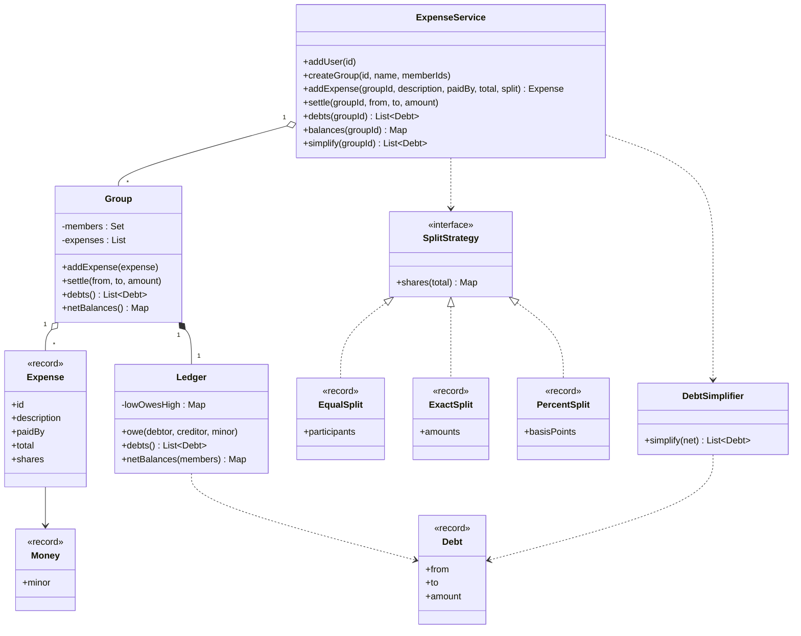

# Design Splitwise (Expense Sharing)

This case study designs an expense-sharing application: users in groups add shared expenses, split them in different ways, track who owes whom, and settle up. The hard parts are exact money arithmetic (a 100.00 expense for three people) and the debt simplification algorithm. `Main.java` in this folder runs the whole design with `java Main.java`. The page follows the procedure in [How to approach an LLD interview](../../how-to-approach-lld.md).

## Problem Statement

The interviewer says: "Design Splitwise. Users form groups and add expenses. One user pays, and the cost is shared among some users. The split can be equal, by exact amounts, or by percentages. The system shows how much each user owes or is owed. The system can reduce the number of payments that settle the group."

This is an algorithm-and-model problem. The classes are small. The interviewer scores the split strategies, the rounding, and the simplification algorithm with its complexity. See [How to approach an LLD interview](../../how-to-approach-lld.md) for the rule that algorithm-heavy problems need more time on the data structure.

## Clarifying Questions

| Question | Assumed answer |
|---|---|
| Which flows matter most? | Add an expense with a split. Show balances. Simplify debts. Settle up |
| Do we need groups? | Yes. Every expense belongs to a group. Two friends form a group of two |
| Who pays an expense? | One user pays the full amount. Several payers are an extension |
| Which split types? | Equal, exact amounts, and percentages. The design must allow a new type |
| Does the payer take part in the split? | The payer is a participant only if the split lists the payer |
| One currency or many? | One currency. Amounts are `long` values in minor units (cents) |
| How do we split 100.00 among 3 users? | 33.34, 33.33, 33.33. The first participants in the list get the extra cent. The shares add up to the total exactly |
| How are percentages given? | As whole basis points: 3333 means 33.33 percent. All shares must add up to 10000 |
| What does "simplify" do? | It computes a short list of payments, at most n - 1 for n users with a non-zero balance, with a greedy algorithm. The list is not always the shortest possible (see "Is it optimal?"). It is a preview. It does not rewrite the pairwise ledger |
| Can a user edit or delete an expense? | Out of scope. See Extensions |
| Concurrency? | Many users add expenses to one group at the same time. One JVM |
| Storage? | In memory |
| Do we notify users? | Out of scope |

## Requirements

### Functional

| # | Requirement |
|---|---|
| F1 | Create users and groups. A group has members |
| F2 | Add an expense to a group: description, payer, total, and a split |
| F3 | Split types: equal, exact, percent. Each gives a share for each participant. The shares add up to the total exactly |
| F4 | Reject an invalid expense: the payer or a participant is not a member, exact amounts that do not add up, percentages that do not add up to 100 |
| F5 | Show who owes whom in a group, with one amount for each pair of users |
| F6 | Show the net balance of each member: positive means the member is owed money, negative means the member owes money |
| F7 | Simplify: compute a short list of payments that settles all balances of a group |
| F8 | Settle up: record a payment from one member to another |

### Non-functional

| # | Requirement |
|---|---|
| N1 | Exact arithmetic. No `double`. No cent is created or lost |
| N2 | Deterministic: the same input gives the same shares and the same simplified payments |
| N3 | Correct under concurrency: no lost update and no half-applied expense |
| N4 | Open for extension: a new split type is a new class |
| N5 | Simplification runs in O(n log n) time for n members with a non-zero balance. Computing the net balances from the pair ledger first costs O(p + m) for p pair entries and m members |

## Entities and Relationships

| Type | Kind | Responsibility | Relationships |
|---|---|---|---|
| `User` | Value object | A user id | Member of 0..* `Group` |
| `Group` | Entity, lock unit | Members, expenses, and the ledger. Validates members. Applies an expense to the ledger | Has 0..* members (the code does not enforce a minimum), 0..* `Expense`, one `Ledger` |
| `Expense` | Immutable record | One shared cost: payer, total, and the share of each participant. Valid by construction | Belongs to one `Group` |
| `SplitStrategy` | Interface (Strategy) | Turns a total into shares that add up exactly | Implemented by `EqualSplit`, `ExactSplit`, `PercentSplit` |
| `Ledger` | Entity | One signed number for each pair of users: what one owes the other | Owned by `Group` |
| `Debt` | Value object | "`from` owes `to` an amount" | Produced by `Ledger` and `DebtSimplifier` |
| `DebtSimplifier` | Stateless function (static) | Turns net balances into a short list of payments | Uses `Debt`, `Money` |
| `ExpenseService` | Facade | The public API. Registry of users and groups | Has 0..* `Group` |
| `Money` | Value object | An amount in minor units. Not a `double` | Used everywhere |

Why the `Ledger` stores one number for each pair: if Alice owes Bob 10 and Bob owes Alice 4, the screen must show "Alice owes Bob 6". The ledger nets the two directions at each update. A map from pair to a signed number does this with one entry for each pair. The pair key is ordered (the lower id first), so (Alice, Bob) and (Bob, Alice) use the same entry.

## Class Diagram



`ExpenseService` asks a `SplitStrategy` for the shares, builds an `Expense`, and gives it to the `Group`. The `Group` validates the members and updates the `Ledger`. `simplify` reads the net balances from the group and gives them to the `DebtSimplifier`. See [UML class and sequence diagrams](../../fundamentals/04-uml-class-and-sequence-diagrams.md) for the notation.

## Design Patterns Used

| Pattern | Where | Why | Rejected alternative |
|---|---|---|---|
| Strategy ([behavioral patterns](../../fundamentals/08-behavioral-patterns.md)) | `SplitStrategy` with `EqualSplit`, `ExactSplit`, `PercentSplit` | The requirement says "different ways to split". A new way is a new class, and `ExpenseService` does not change (Open-Closed Principle, see [SOLID](../../fundamentals/02-solid.md)) | A `switch` on a `SplitType` enum inside `addExpense`. Each new type edits the method, and the data for each type (a list, a map, a map of percentages) does not fit one signature |
| Facade ([structural patterns](../../fundamentals/07-structural-patterns.md)) | `ExpenseService` | One entry point for each use case. It hides the group registry | Callers use `Group` and `Ledger` directly |
| Value objects and records ([domain modeling](../../fundamentals/05-domain-modeling.md)) | `Money`, `Debt`, `Expense`, the three split records | They are immutable, they validate in the constructor, and they are safe to share between threads | Classes with setters. An `Expense` that can change after it is added would make the ledger wrong |
| Valid by construction ([OOP](../../fundamentals/01-oop.md)) | The `Expense` constructor checks that the shares add up to the total | An invalid expense cannot exist | A `validate()` method that a caller must remember to call |
| Stateless algorithm class | `DebtSimplifier.simplify` | A pure function of the net balances. It is easy to test | An interface `SimplificationStrategy` with one implementation. Add the interface when a second algorithm exists (see Extensions) |
| Aggregate as the lock unit ([concurrency in LLD](../../fundamentals/09-concurrency-in-lld.md)) | `Group` | The invariant "the net balances add up to zero" spans the ledger and the expense list of one group | A global lock, or a concurrent map with no group lock (see Concurrency) |
| Builder | Not used | `Expense` has five fields and a split. An `ExpenseService.addExpense` method with five parameters is clear enough | A builder adds a class with no gain. See [creational patterns](../../fundamentals/06-creational-patterns.md) |

## Key Code

The excerpts below are copied from `Main.java`.

### Money

```java
record Money(long minor) {
    Money {
        if (minor < 0) {
            throw new IllegalArgumentException("Money cannot be negative");
        }
    }

    // Signed text for a balance: positive means "is owed", negative means "owes".
    static String signed(long minor) {
        String sign = minor < 0 ? "-" : minor > 0 ? "+" : "";
        long abs = Math.abs(minor);
        return String.format(Locale.ROOT, "%s%d.%02d", sign, abs / 100, abs % 100);
    }

    @Override
    public String toString() {
        return String.format(Locale.ROOT, "%d.%02d", minor / 100, minor % 100);
    }
}
```

`Money` is not negative. Balances are signed, so the ledger and the simplifier use `long` values and wrap the result in `Money` when it is a debt amount. `Money.signed` formats a balance with a sign.

### The split strategies

The interface has one method. The contract: the returned shares add up to the total exactly.

```java
interface SplitStrategy {
    // Returns the share of each participant. The shares add up to the total exactly.
    Map<String, Money> shares(Money total);
}
```

**Equal split.** Divide the total by the number of participants, and give the remainder (the total modulo the number) to the first participants, one minor unit each. For 100.00 among 3 users: 10000 divided by 3 is 3333 remainder 1. The first user gets 3334, the others get 3333.

```java
record EqualSplit(List<String> participants) implements SplitStrategy {
    EqualSplit {
        if (participants.isEmpty()
                || participants.stream().distinct().count() != participants.size()) {
            throw new IllegalArgumentException("Equal split needs different participants");
        }
        participants = List.copyOf(participants);
    }

    // The remainder (total mod n) goes to the first participants, one minor unit each.
    @Override
    public Map<String, Money> shares(Money total) {
        int count = participants.size();
        long each = total.minor() / count;
        long extra = total.minor() % count;
        Map<String, Money> result = new LinkedHashMap<>();
        for (int i = 0; i < count; i++) {
            result.put(participants.get(i), new Money(each + (i < extra ? 1 : 0)));
        }
        return result;
    }
}
```

**Exact split.** The caller gives an amount for each user. The strategy checks that the amounts add up to the total.

```java
record ExactSplit(Map<String, Money> amounts) implements SplitStrategy {
    ExactSplit {
        if (amounts.isEmpty()) {
            throw new IllegalArgumentException("Exact split needs participants");
        }
        amounts = Map.copyOf(amounts);
    }

    @Override
    public Map<String, Money> shares(Money total) {
        long sum = amounts.values().stream().mapToLong(Money::minor).sum();
        if (sum != total.minor()) {
            throw new IllegalArgumentException("Exact amounts add up to " + new Money(sum)
                    + " but the expense is " + total);
        }
        return new TreeMap<>(amounts);
    }
}
```

**Percent split.** The caller gives basis points. If the shares are rounded one by one, the sum can differ from the total by a few cents. The *largest remainder method* fixes this. The method rounds every share down, counts the missing minor units, and gives one unit each to the shares that lost the largest fraction. Ties go to the user that comes first in the sorted order, so the result is deterministic.

```java
// Percentages are whole basis points: 3333 means 33.33 percent. All must add up to 10000.
record PercentSplit(Map<String, Integer> basisPoints) implements SplitStrategy {
    private static final int WHOLE = 10_000;

    PercentSplit {
        if (basisPoints.isEmpty() || basisPoints.values().stream().anyMatch(bp -> bp < 0)) {
            throw new IllegalArgumentException("Percent split needs non-negative percentages");
        }
        int sum = basisPoints.values().stream().mapToInt(Integer::intValue).sum();
        if (sum != WHOLE) {
            throw new IllegalArgumentException("Percentages add up to "
                    + String.format(Locale.ROOT, "%d.%02d", sum / 100, sum % 100)
                    + ", not 100.00");
        }
        basisPoints = Map.copyOf(basisPoints);
    }

    // Largest remainder method: round every share down, then give the missing minor
    // units to the shares that lost the largest fraction. The shares add up exactly.
    @Override
    public Map<String, Money> shares(Money total) {
        List<String> users = basisPoints.keySet().stream().sorted().toList();
        int count = users.size();
        long[] shares = new long[count];
        long[] remainders = new long[count];
        long assigned = 0;
        for (int i = 0; i < count; i++) {
            long product = Math.multiplyExact(total.minor(), (long) basisPoints.get(users.get(i)));
            shares[i] = product / WHOLE;
            remainders[i] = product % WHOLE;
            assigned += shares[i];
        }
        long missing = total.minor() - assigned;
        List<Integer> order = IntStream.range(0, count).boxed()
                .sorted(Comparator.comparingLong((Integer i) -> -remainders[i])
                        .thenComparingInt(i -> i))
                .toList();
        for (int k = 0; k < missing; k++) {
            shares[order.get(k)]++;
        }
        Map<String, Money> result = new LinkedHashMap<>();
        for (int i = 0; i < count; i++) {
            result.put(users.get(i), new Money(shares[i]));
        }
        return result;
    }
}
```

Worked example from the demo. The total is 100.01 (10001 minor units). Bob and Carol get 33.33 percent (3333 basis points), and Dave gets 33.34 percent (3334).

| User | Share before rounding (10001 times bp, divided by 10000) | Rounded down | Fraction lost (in 10000ths) |
|---|---|---|---|
| bob | 3333.3333 | 3333 | 3333 |
| carol | 3333.3333 | 3333 | 3333 |
| dave | 3334.3334 | 3334 | 3334 |

The rounded shares add up to 10000. One unit is missing. Dave lost the largest fraction, so Dave gets it: 3335. The shares are 33.33, 33.33, and 33.35, which add up to 100.01.

### Expense: valid by construction

```java
record Expense(String id, String description, String paidBy, Money total,
               Map<String, Money> shares) {
    Expense {
        if (description == null || description.isBlank()) {
            throw new IllegalArgumentException("Description is required");
        }
        if (total.minor() <= 0) {
            throw new IllegalArgumentException("Expense must be positive");
        }
        long sum = shares.values().stream().mapToLong(Money::minor).sum();
        if (shares.isEmpty() || sum != total.minor()) {
            throw new IllegalArgumentException("Shares must add up to the total");
        }
        shares = Map.copyOf(shares);
    }

    String describe() {
        String text = new TreeMap<>(shares).entrySet().stream()
                .map(entry -> entry.getKey() + " " + entry.getValue())
                .collect(Collectors.joining(", "));
        return id + " " + total + " paid by " + paidBy + ": " + text;
    }
}
```

### Ledger: one signed number for each pair

```java
final class Ledger {
    private record Pair(String low, String high) { }

    // The value is what "low" owes "high". A negative value means "high" owes "low".
    private final Map<Pair, Long> lowOwesHigh = new HashMap<>();

    void owe(String debtor, String creditor, long minor) {
        if (debtor.compareTo(creditor) < 0) {
            lowOwesHigh.merge(new Pair(debtor, creditor), minor, Long::sum);
        } else {
            lowOwesHigh.merge(new Pair(creditor, debtor), -minor, Long::sum);
        }
    }

    List<Debt> debts() {
        List<Debt> result = new ArrayList<>();
        lowOwesHigh.forEach((pair, value) -> {
            if (value > 0) {
                result.add(new Debt(pair.low(), pair.high(), new Money(value)));
            } else if (value < 0) {
                result.add(new Debt(pair.high(), pair.low(), new Money(-value)));
            }
        });
        result.sort(Comparator.comparing(Debt::from).thenComparing(Debt::to));
        return result;
    }

    // Positive: other users owe this user. Negative: this user owes others.
    Map<String, Long> netBalances(Collection<String> members) {
        Map<String, Long> net = new TreeMap<>();
        members.forEach(member -> net.put(member, 0L));
        lowOwesHigh.forEach((pair, value) -> {
            net.merge(pair.low(), -value, Long::sum);
            net.merge(pair.high(), value, Long::sum);
        });
        return net;
    }
}
```

`owe(debtor, creditor, minor)` adds a debt. If the debtor has the lower id, the method adds the amount to the pair entry. If not, it subtracts the amount, because the entry means "low owes high". A negative entry means that the high user owes the low user. A payment is a debt in reverse, so `Group.settle` calls `owe` with the two users swapped.

### Group: validation, the ledger update, and the lock

```java
final class Group {
    private final String id;
    private final String name;
    private final Set<String> members;
    private final Ledger ledger = new Ledger();
    private final List<Expense> expenses = new ArrayList<>();

    Group(String id, String name, Collection<String> members) {
        this.id = id;
        this.name = name;
        this.members = new LinkedHashSet<>(members);
    }

    synchronized void addExpense(Expense expense) {
        requireMember(expense.paidBy());
        expense.shares().keySet().forEach(this::requireMember);
        expenses.add(expense);
        expense.shares().forEach((user, share) -> {
            if (!user.equals(expense.paidBy())) {
                ledger.owe(user, expense.paidBy(), share.minor());
            }
        });
    }

    // "from" pays "to" to reduce what "from" owes. The ledger sees it as a debt in reverse.
    synchronized void settle(String from, String to, Money amount) {
        requireMember(from);
        requireMember(to);
        if (amount.minor() <= 0 || from.equals(to)) {
            throw new IllegalArgumentException("Settlement needs two users and a positive amount");
        }
        ledger.owe(to, from, amount.minor());
    }

    synchronized List<Debt> debts() {
        return ledger.debts();
    }

    synchronized Map<String, Long> netBalances() {
        return ledger.netBalances(members);
    }

    synchronized int expenseCount() {
        return expenses.size();
    }

    private void requireMember(String userId) {
        if (!members.contains(userId)) {
            throw new IllegalArgumentException(userId + " is not a member of " + name);
        }
    }
}
```

When an expense is added, each participant except the payer owes the payer the participant's share. The payer's own share needs no entry. The `synchronized` methods make "update the expense list and update the ledger" one step.

### Debt simplification

```java
final class DebtSimplifier {
    private record Balance(String user, long amount) { }

    // Largest amount first. The user id breaks ties, so the result is deterministic.
    private static final Comparator<Balance> LARGEST_FIRST =
            Comparator.comparingLong(Balance::amount).reversed().thenComparing(Balance::user);

    // net: positive means the user is owed money, negative means the user owes money.
    // Time O(n log n), space O(n), at most n - 1 transfers for n users with a balance.
    static List<Debt> simplify(Map<String, Long> net) {
        if (net.values().stream().mapToLong(Long::longValue).sum() != 0) {
            throw new IllegalArgumentException("Net balances must add up to zero");
        }
        PriorityQueue<Balance> creditors = new PriorityQueue<>(LARGEST_FIRST);
        PriorityQueue<Balance> debtors = new PriorityQueue<>(LARGEST_FIRST);
        net.forEach((user, amount) -> {
            if (amount > 0) {
                creditors.add(new Balance(user, amount));
            } else if (amount < 0) {
                debtors.add(new Balance(user, -amount));
            }
        });
        List<Debt> transfers = new ArrayList<>();
        while (!creditors.isEmpty() && !debtors.isEmpty()) {
            Balance creditor = creditors.poll();
            Balance debtor = debtors.poll();
            long moved = Math.min(creditor.amount(), debtor.amount());
            transfers.add(new Debt(debtor.user(), creditor.user(), new Money(moved)));
            if (creditor.amount() > moved) {
                creditors.add(new Balance(creditor.user(), creditor.amount() - moved));
            }
            if (debtor.amount() > moved) {
                debtors.add(new Balance(debtor.user(), debtor.amount() - moved));
            }
        }
        return transfers;
    }
}
```

The algorithm in words:

1. Compute the net balance of each user. A positive value means the user is owed money. A negative value means the user owes money. The sum of all balances is zero, because each expense is zero-sum.
2. Put the creditors (positive balances) in a max-heap, and the debtors (negative balances, as positive amounts) in another max-heap. The largest amount is first. The user id breaks ties.
3. Remove the largest creditor and the largest debtor. The debtor pays the smaller of the two amounts to the creditor. Record the payment.
4. Put back the one whose balance is not zero yet (with the reduced amount). If both amounts were equal, neither goes back.
5. Repeat until a heap is empty. Both heaps become empty together, because the balances add up to zero.

**Trace on the demo group.** The net balances are alice -113.34, bob -246.66, carol +393.34, dave -33.34.

| Step | Largest creditor | Largest debtor | Payment | Left over |
|---|---|---|---|---|
| 1 | carol 393.34 | bob 246.66 | bob pays carol 246.66 | carol 146.68 |
| 2 | carol 146.68 | alice 113.34 | alice pays carol 113.34 | carol 33.34 |
| 3 | carol 33.34 | dave 33.34 | dave pays carol 33.34 | none |

Six pairwise debts become three payments.

**Complexity.** Let n be the number of users with a non-zero balance.

| Part | Cost |
|---|---|
| Build the two heaps | O(n log n) with `n` calls to `add`, each O(log n) |
| Loop | At most n - 1 iterations. Each iteration settles at least one user completely, and the last iteration settles two. Each iteration does 2 `poll` calls and at most 2 `add` calls, each O(log n) |
| Total time | O(n log n) |
| Space | O(n) for the heaps and the result |
| Result size | At most n - 1 payments |

**Is it optimal?** The greedy algorithm does not always give the smallest number of payments. The exact statement:

- Let n be the number of users with a non-zero net balance. Users with a zero balance need not take part in any payment.
- Let k be the largest number of parts in a partition of these n users into non-empty subsets, such that the balances in each subset add up to zero.
- The smallest number of payments that settles all balances is n - k.

The reason: draw each payment as an arrow between two users. In each connected part of this graph, the balances add up to zero, because each payment adds the same amount to one user and subtracts it from another. A connected part with m users needs at least m - 1 arrows. So a settlement whose graph has c connected parts uses at least n - c payments, and c is at most k. The greedy algorithm, run on each zero-sum subset of the best partition, reaches n - k.

Finding k is NP-hard in the strong sense. Verhoeff (2004, in the sources of this page) shows this with a reduction from 3-Partition, a problem that is NP-complete in the strong sense. The paper gives the reduction as an argument in the text, not as a formal theorem. No polynomial-time algorithm that always finds the minimum is known, and none exists unless P = NP. The demo runs the greedy algorithm on a counter-example, the balances A +6, B +5, C -5, D -4, E -2, and prints 4 payments. The 4 payments are:

| Step | Payment |
|---|---|
| 1 | C pays A 5 (A has 1 left) |
| 2 | D pays B 4 (B has 1 left) |
| 3 | E pays A 1 (the tie between A and B goes to A, E has 1 left) |
| 4 | E pays B 1 |

The set {B +5, C -5} adds up to zero and the set {A +6, D -4, E -2} adds up to zero. So 3 payments are enough: C pays B 5, D pays A 4, E pays A 2. Say this in the interview: "The greedy algorithm is O(n log n) and needs at most n - 1 payments. It is not always minimal. The exact minimum is NP-hard." Recommendation: for a small group, offer an exact search, and code it only if the interviewer asks. The search keeps, for each subset of the n users (a bitmask), the largest number of zero-sum parts inside it: `best[mask] = max over users i in mask of best[mask without i]`, plus 1 if the balances of `mask` add up to zero. The answer is n - `best[all users]`. It takes O(2^n × n) time and O(2^n) space, so it fits small groups. Assumption: up to about 20 users, an estimate from 2^20 × 20, about 2 × 10^7 steps.

**Settle up against a preview.** The demo records the three simplified payments with `settle`. After that, every net balance is zero, but the pairwise ledger still has 6 entries, for example "alice owes carol 60.00" and "carol owes bob 86.66". Each user's entries add up to zero, so nobody owes money in total, but the "who owes whom" screen still shows debts. The reason: `settle` records a payment against one pair, and the simplified payments do not follow the pairs. This is the cost of "simplify is a preview". If the group pays the simplified list, the design must first replace the pair entries with that list. That is the extension `Group.applySimplification()` in Extensions.

### ExpenseService: the public API

```java
    Expense addExpense(String groupId, String description, String paidBy, Money total,
                       SplitStrategy split) {
        Group group = group(groupId);
        Map<String, Money> shares = split.shares(total);
        Expense expense = new Expense("E-" + expenseSequence.incrementAndGet(), description,
                paidBy, total, shares);
        group.addExpense(expense);
        return expense;
    }
```

## Concurrency

### What can race

| Shared state | Broken sequence | Invariant | Fix in this design |
|---|---|---|---|
| The ledger map of one group | Two threads call `merge` on a plain `HashMap` at the same time | No lost update. No corrupted map | `Group` methods are `synchronized`. The ledger is only touched inside the group lock |
| The ledger and the expense list | A reader runs between the update of two pairs of one expense | The net balances add up to zero | Reads (`debts`, `netBalances`, `expenseCount`) are `synchronized` too. A reader does not see half an expense |
| Simplify while a writer adds an expense | `simplify` reads the balances in the middle of an expense | The input of `DebtSimplifier` adds up to zero | `netBalances` is one `synchronized` call. The simplifier then works on a private copy |
| Expense id counter | Two threads get the same id | Ids are unique | `AtomicInteger` |
| Group and user registries | A thread reads while another adds | A reader sees the entry or does not | `ConcurrentHashMap` |

Consider the second row. An expense for three users changes two pairs. A reader without the lock can see one pair changed and one pair not. The net balances then add up to a non-zero number, and `DebtSimplifier.simplify` throws `Net balances must add up to zero`. The `ConcurrentHashMap` does not prevent this: each `merge` on the map is atomic, but the expense is a group of `merge` calls. The invariant spans several entries, so a lock must cover all of them. See the rule "a lock protects an invariant, not a variable" in [Concurrency in LLD](../../fundamentals/09-concurrency-in-lld.md).

### The demo

The demo starts 8 threads. Each thread adds 250 expenses to one group, equal among 4 members. The payer of thread `t` is member number `t modulo 4` in the list alice, bob, carol, dave, and the amount is 10.00 times `t + 1`. After the join, the program prints the number of expenses (2000) and the net balances. The balances do not depend on the thread order, because each expense adds a fixed amount to each user. The sum of the net balances is exactly 0.00.

### Lock granularity

| Option | Result |
|---|---|
| One lock for each group (this design) | Expenses of different groups run in parallel. Expenses of one group take turns. Each expense takes one `merge` for each participant other than the payer, and no I/O |
| One global lock | Correct and simple, but all groups wait for each other |
| `ConcurrentHashMap` for the ledger, no group lock | Each `merge` is atomic, but readers see half an expense (see above) |
| `ReadWriteLock` | Helps if reads are much more frequent than writes. Measure first. A read of the net balances is O(pairs), so reads are not tiny |

No operation uses two group locks, so there is no lock-order problem. If a later feature reads a user's balance across all groups, read one group at a time. The result is not a consistent snapshot across groups. If that matters, take the group locks in group-id order.

### Many servers

With several servers, a database transaction replaces the group lock. One transaction inserts the expense and its shares, and updates the pair balance rows with `UPDATE pair_balance SET amount = amount + ? WHERE low = ? AND high = ?`. Each `UPDATE` locks its row until the commit. Recommendation: update the pair rows in the order of the pair key. Two transactions then take the row locks in the same order, so they cannot deadlock. A different design stores only the expense and share rows, and computes the balances with `SUM` when a user reads them. See `kb/databases/04-transactions-and-isolation.md` for transactions and locking.

## Extensions

| Change | Add | Change | Stay |
|---|---|---|---|
| New split type: by shares or ratio (2:1:1) | `ShareSplit implements SplitStrategy`. Use the largest remainder method | The caller creates it | `ExpenseService`, `Group`, `Ledger` |
| Several payers for one expense | A `Map<String, Money> paid` in `Expense`, with a rule that the amounts add up to the total | `Expense` and `Group.addExpense`: compute each user's net (paid minus share), then run `DebtSimplifier` on that net to create the debts | The split strategies, `Ledger` |
| Edit or delete an expense | `Expense` status, or a reversal entry | `Group.removeExpense(id)` calls `ledger.owe` with the shares reversed. Keep the old expense in the history | The strategies, `DebtSimplifier` |
| "Simplify debts" as a group setting | `Group.applySimplification()` and `Ledger.clear()` | Inside the group lock: compute the simplified payments from the net balances, clear the pair entries, and call `owe` once for each payment. The net balances do not change. Then `debts()` shows the short list, and `settle` with those payments leaves no debts | `DebtSimplifier`, strategies |
| A second simplification algorithm (exact search for small groups) | `SimplificationStrategy` interface, `GreedySimplifier`, `ExactSimplifier` | `ExpenseService` takes the strategy as a constructor argument | `Group`, `Ledger` |
| Several currencies | `Currency` in `Money`. `ExchangeRates` interface | One ledger for each currency in `Group`. Simplify each currency apart | The strategies (they work in one currency) |
| Notify users when an expense is added | `ExpenseListener` interface (Observer) | `ExpenseService` calls the listeners after the group lock is released | `Group`, `Ledger` |
| Recurring expenses (monthly rent) | `RecurringExpense` and a scheduler (see `kb/lld/case-studies/16-task-scheduler/README.md`) | A job calls `addExpense` | Everything else |
| Safe retry of a request | An idempotency key in `addExpense`, and a set of used keys in `Group` | `ExpenseService.addExpense` | The strategies, `DebtSimplifier` |
| Persistence | `GroupRepository` and `ExpenseRepository` interfaces | `Group` loads and stores through them, inside a transaction | `SplitStrategy`, `DebtSimplifier` |

## Common Mistakes

| Mistake | Why it fails | Fix |
|---|---|---|
| `double` or `float` for money | 0.1 + 0.2 is not 0.3. Totals drift | `long` minor units or `BigDecimal` |
| Divide 100.00 by 3 and store 33.33 three times | The shares add up to 99.99. One cent is lost | Give the remainder to the first participants, or use the largest remainder method |
| Round each percent share on its own | The sum differs from the total by a few cents | The largest remainder method |
| A `switch` on the split type in `addExpense` | Each new type edits the method | A `SplitStrategy` interface |
| A mutable `Expense` with setters | A change after the expense joined the ledger makes the balances wrong | An immutable record that is valid by construction |
| Store only a net balance for each user | The screen cannot show who owes whom | Keep a pair ledger, and compute the net balance from it |
| Store two entries for each pair (A to B and B to A) | The screen shows "A owes B 10" and "B owes A 4" | One signed entry for each pair, with an ordered key |
| Forget that the payer is also a participant, or that the payer is not | The payer owes themselves, or the payer's share is missing | Skip the payer in the ledger update. Take the shares from the split |
| Accept an expense for a user outside the group | The balances include a stranger | Validate the payer and all participants in `Group.addExpense` |
| Claim that the greedy algorithm is optimal | The minimum problem is NP-hard | Say that it is a good heuristic with at most n - 1 payments |
| Simplify with only cycle removal | Cycle removal leaves chains. The number of payments can still be large | Net balances and two heaps |
| A concurrent map and no group lock | A reader sees half an expense | One lock for each group around the whole update and the reads |
| A global lock | All groups wait for each other | A lock for each group |
| Call a listener inside the lock | A slow listener blocks the group | Call the listener after the lock is released |

## 45-Minute Plan

| Minutes | Part | What to say or draw |
|---|---|---|
| 0-5 | Clarify | The questions above, mainly: split types, rounding, simplify as preview or rewrite, groups, concurrency. State the assumption "amounts in minor units" |
| 5-10 | Entities and use cases | `User`, `Group`, `Expense`, `Ledger`. Say why a pair ledger and not a balance for each user. Name the four use cases: add expense, show balances, simplify, settle |
| 10-17 | Class diagram and patterns | `ExpenseService`, `Group`, `SplitStrategy` and its three implementations, `Ledger`. Strategy for the split, with the rejected `switch` |
| 17-22 | Signatures | `shares(Money)` contract: the shares add up exactly. `addExpense`, `balances`, `simplify`, `settle` |
| 22-30 | Code | `Money`, `SplitStrategy`, `EqualSplit` with the remainder rule. Then `Ledger.owe`. `PercentSplit` if time remains |
| 30-38 | Simplification | The two heaps, the loop, the trace on a small example, the complexity O(n log n), at most n - 1 payments |
| 38-42 | Concurrency | A lock for each group. The invariant "net balances add up to zero" spans several entries, so a concurrent map is not enough |
| 42-45 | Extensions | Several payers, a new split type, edit and delete, persistence. The classes that stay. Mention that greedy is not minimal |

If you run short on time, name `ExactSplit` and `PercentSplit` and code only `EqualSplit`. The interviewer scores the rounding rule and the simplification algorithm.

## Expected Output

The program prints the text below. All amounts are exact. The threads are joined before the program prints, and the program prints only results that do not depend on the thread order.

<!-- expected-output -->
```text
== Expenses ==
Dinner, equal: E-1 100.00 paid by alice: alice 33.34, bob 33.33, carol 33.33
Cab, exact: E-2 45.00 paid by bob: alice 10.00, bob 15.00, carol 20.00
Hotel, percent: E-3 600.00 paid by carol: alice 240.00, bob 180.00, carol 120.00, dave 60.00
Snacks, equal: E-4 90.01 paid by dave: alice 30.01, bob 30.00, dave 30.00
Tickets, percent: E-5 100.01 paid by alice: bob 33.33, carol 33.33, dave 33.35
== Rejected input ==
Exact amounts too small -> rejected: Exact amounts add up to 99.00 but the expense is 100.00
Percent below 100 -> rejected: Percentages add up to 99.99, not 100.00
Payer outside the group -> rejected: mallory is not a member of Goa Trip
== Balances ==
Who owes whom:
  alice owes carol 173.34
  bob owes alice 56.66
  bob owes carol 160.00
  bob owes dave 30.00
  dave owes alice 3.34
  dave owes carol 60.00
Net balances:
  alice -113.34
  bob -246.66
  carol +393.34
  dave -33.34
== Simplify ==
6 pairwise debts become 3 transfers:
  bob owes carol 246.66
  alice owes carol 113.34
  dave owes carol 33.34
Every net balance is zero after the transfers: true
Pairwise debts left, because simplify did not rewrite them: 6
  alice owes carol 60.00
  bob owes alice 56.66
  bob owes dave 30.00
  carol owes bob 86.66
  dave owes alice 3.34
  dave owes carol 26.66
Greedy on A+6 B+5 C-5 D-4 E-2: 4 transfers
== Concurrency ==
Expenses recorded: 2000
  alice -7500.00
  bob -2500.00
  carol +2500.00
  dave +7500.00
Net balances add up to: 0.00
```

## Sources

- Verhoeff, T. ["Settling Multiple Debts Efficiently: An Invitation to Computing Science."](https://doi.org/10.15388/infedu.2004.08) *Informatics in Education* 3(1), 2004, pp. 105-126. Shows that a settlement with the fewest transfers maximizes the number of zero-sum parts, that greedy settlement needs at most N - 1 transfers, and that minimizing the number of transfers is at least as hard as 3-Partition.
- [`java.util.PriorityQueue` javadoc (Java 21)](https://docs.oracle.com/en/java/javase/21/docs/api/java.base/java/util/PriorityQueue.html). `add` and `poll` run in O(log n) time.
- Fowler, M. *Patterns of Enterprise Application Architecture*. Addison-Wesley, 2002. The Money pattern, including allocation of a remainder.
