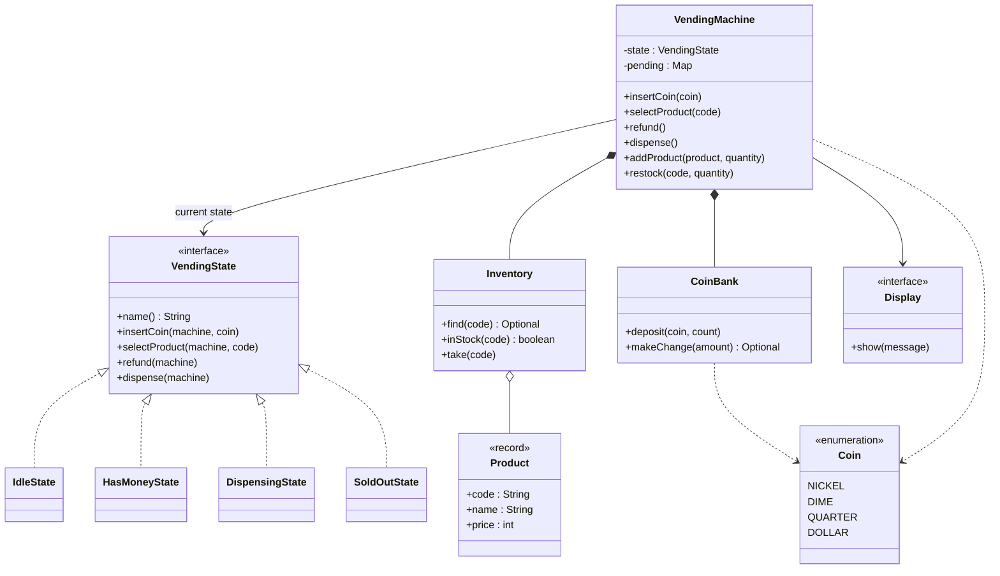
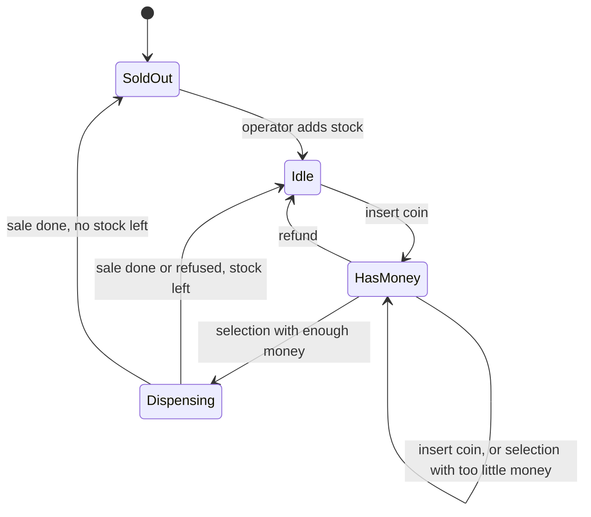

# Design a Vending Machine

## Problem Statement

The interviewer says: "Design a vending machine. A customer inserts coins, picks a product, and gets the product and the change. The customer can cancel and get the coins back. An operator loads products and coins." This is the standard State pattern problem: the same button does different work depending on what the machine is doing. Follow the procedure in [How to Approach an LLD Interview](../../how-to-approach-lld.md).

## Clarifying Questions

| Question | Answer that this design assumes |
|---|---|
| Does the machine take cash only, or also cards? | Coins only. A card reader is an extension (see Extensions) |
| Which coins? | Nickel (5 cents), dime (10), quarter (25), and dollar (100). The code holds money as whole cents in an `int`, never as `double` |
| Does the machine give change? From which coins? | Yes. It gives change from its own coin bank. The bank includes the coins that the customer inserted for the current sale |
| What if the machine cannot make exact change? | The machine refuses the sale, returns the inserted coins, and says "Exact change only" |
| Can the customer insert more coins after a failed selection (too little money)? | Yes. The machine stays in the `HasMoney` state and keeps the balance |
| Can the customer cancel? | Yes, until the sale starts. The machine returns the inserted coins |
| What happens when a product is sold out? | The machine shows "Sold out" for that product and keeps the money. When every product is sold out, the whole machine enters the `SoldOut` state and rejects coins |
| One customer at a time, or many? | One session at a time, as in a real machine. The operator can act from another thread |
| Is a user interface in scope? | No. A `Display` interface receives messages. The demo prints them |
| Storage? | In memory |

## Requirements

Functional requirements:

1. The operator adds products with a code, a name, a price, and a quantity, and restocks them.
2. The operator loads coins into the change bank.
3. The customer inserts coins. The machine shows the balance after each coin.
4. The customer selects a product by code. If the balance is enough and the product is in stock, the machine dispenses the product and gives change.
5. If the balance is too low, the machine says how much is missing and waits for more coins.
6. The customer can ask for a refund before the sale. The machine returns exactly the inserted coins.
7. If the machine cannot make exact change, it refuses the sale and refunds.
8. When no product is left, the machine rejects coins until the operator restocks.

Non-functional requirements:

- The machine rejects an operation that does not fit its current state, and the rejection does not change anything.
- The state classes are the only place where a rule "in state X, action Y does Z" exists. A new state needs a new class and no edit in existing states.
- Operator and customer actions on the same machine do not corrupt the stock, the bank, or the balance.
- All money is an `int` of cents.

## Entities and Relationships

| Type | Kind | Responsibility |
|---|---|---|
| `VendingMachine` | Entity (the context) | Holds the current state, the pending coins, the inventory, and the bank. Exposes the public operations and delegates each one to the current state |
| `VendingState` | Interface | The contract of a state: `insertCoin`, `selectProduct`, `refund`, `dispense`. Each method throws `IllegalStateException` by default |
| `IdleState`, `HasMoneyState`, `DispensingState`, `SoldOutState` | Classes | The four states. Each one overrides only the actions that are valid in it |
| `Inventory` | Entity | Maps a product code to a product and a quantity. Owns the rule "the quantity is not negative" |
| `CoinBank` | Entity | Counts the coins of each denomination. Finds a set of coins for a change amount |
| `Product` | Value object (`record`) | Code, name, price. Rejects a price that is not positive |
| `Coin` | Enum | The denominations, with their value in cents |
| `Cents` | Utility | Formats and sums money values |
| `Display` | Interface | Receives the messages for the customer |

Relationships:

- `VendingMachine` has one current `VendingState` (association that changes at run time) and four state objects that it owns (composition).
- `VendingMachine` owns one `Inventory` and one `CoinBank` (composition).
- `Inventory` refers to many `Product` values (aggregation).
- The states call back into the machine through package-private hook methods. The machine does not know the rules of a state, and a state does not own any data.

The pending coins (the coins of the current customer) are separate from the bank. The machine moves them into the bank only when the sale succeeds. This is why a refund returns the exact coins that the customer inserted.

## Class Diagram



The state transitions:



A new machine starts in `SoldOut`, because it has no product. The first `addProduct` call with a positive quantity moves it to `Idle`.

## Design Patterns Used

| Pattern | Where | Reason | Rejected alternative |
|---|---|---|---|
| State ([behavioral patterns](../../fundamentals/08-behavioral-patterns.md)) | `VendingState` and its four classes | The meaning of "insert coin", "select", and "refund" depends on the state. Each state class holds the rules for its own state. The `default` methods reject invalid actions in one place | An `enum` status field with a `switch` in every operation. Each new state edits all four methods. In a `switch` statement with a `default` branch, a missing `case` is a silent bug. A `switch` expression on the enum with no `default` fails to compile when a constant has no `case`, which removes the silent bug but not the edits. Recommendation: for a machine with two states and one operation, the enum is simpler and is the better choice. With four states and four operations, as here, State keeps each rule in one place |
| Strategy and dependency injection ([behavioral patterns](../../fundamentals/08-behavioral-patterns.md), [architectural patterns](../../fundamentals/10-architectural-patterns.md)) | `Display`, which the machine receives in its constructor | The output channel changes (console, screen, a list in a test). A test passes a list-backed display and checks the messages | A `System.out.println` call in the states, which a test cannot read |
| Immutable value objects ([OOP](../../fundamentals/01-oop.md), [domain modeling](../../fundamentals/05-domain-modeling.md)) | `Product`, `Coin` | A product does not change after creation. The `record` gives `equals` and `hashCode` | A mutable `Product` with setters, which allows a price change during a sale |

Why the states are stateless objects: the pending coins, the selected product, and the stock live in the machine. A state class has no field, so the machine creates each state once and reuses it. Recommendation: keep data out of state classes unless the data belongs only to that state. If a state needs its own data (a timer for a timeout), create a new state object at each transition.

Why `DispensingState` exists: the sale is a transient step with its own failure path (exact change not possible). A separate state makes the sale a named step and keeps `HasMoneyState` short. Some designs skip this state and dispense inside `HasMoneyState`. That is also correct for a 45-minute round. State your choice.

The [SOLID page](../../fundamentals/02-solid.md) explains the Open-Closed Principle that the State pattern serves here. The [design principles page](../../fundamentals/03-design-principles.md) explains why the money is an `int` of cents and why the class that owns the data owns its rules.

## Key Code

The complete runnable program is in [`Main.java`](Main.java). Run it with `java Main.java`.

### Coins and products

Money is an `int` of cents. `Coin` is an enum because the denominations are fixed. `Product` is a `record` that checks its own invariant.

```java
enum Coin {
    NICKEL(5), DIME(10), QUARTER(25), DOLLAR(100);

    private final int cents;

    Coin(int cents) {
        this.cents = cents;
    }

    int cents() {
        return cents;
    }
}
```

```java
record Product(String code, String name, int price) {
    Product {
        if (price <= 0) {
            throw new IllegalArgumentException("price must be positive");
        }
    }
}
```

### Making change

`makeChange` is a backtracking search for coins that add up to the amount. It tries the largest denomination first. For each denomination, it starts with the largest usable count, `min(coins in the bank, remaining / value)`, and goes down to zero. If the rest cannot be paid, it uses one coin fewer and tries again. It does not change the bank. The caller withdraws the coins after it checks the result.

The search finds a solution whenever one exists. Any solution uses, for each denomination, a count between zero and that cap, because it cannot use more coins than the bank has or more value than the amount still due. The search tries every combination of counts within the caps, so it reaches every solution, and it returns the first one that it finds. It does not promise the fewest coins.

A greedy loop (take the largest coin while it fits) gives correct change for these denominations if the bank has enough coins of each kind. With a limited bank, greedy can fail when a solution exists. Example: the bank has 1 quarter, 3 dimes, and no nickel, and the change is 30 cents. A greedy loop takes the quarter and then cannot pay 5 cents. The search tries the quarter, fails, tries zero quarters, and takes 3 dimes.

Cost: let `u` be the cap `min(count, amount / value)` for a denomination. The search has at most the product of `(u + 1)` over the four denominations as leaf combinations, and at most 5 times that product as calls in total (one level per denomination, plus the first call). The number of denominations is fixed at four, so the cost depends only on how many coins of each kind can be used. Alternative: a dynamic programming table for bounded coin change, which costs O(amount × total usable coins) in its basic form (each usable coin is one item), and can also find the fewest coins.

```java
    // Finds coins that add up to the amount, or returns empty. Does not change the bank.
    Optional<Map<Coin, Integer>> makeChange(int amount) {
        return search(0, amount, new EnumMap<>(Coin.class));
    }

    private Optional<Map<Coin, Integer>> search(int index, int remaining,
                                                Map<Coin, Integer> chosen) {
        if (remaining == 0) {
            return Optional.of(new EnumMap<>(chosen));
        }
        if (index == DESCENDING.length) {
            return Optional.empty();
        }
        Coin coin = DESCENDING[index];
        int most = Math.min(counts.getOrDefault(coin, 0), remaining / coin.cents());
        for (int use = most; use >= 0; use--) {
            if (use > 0) {
                chosen.put(coin, use);
            } else {
                chosen.remove(coin);
            }
            Optional<Map<Coin, Integer>> found = search(index + 1, remaining - use * coin.cents(),
                    chosen);
            if (found.isPresent()) {
                return found;
            }
        }
        chosen.remove(coin);
        return Optional.empty();
    }
```

### The state contract

The interface gives every action a default that throws. A state overrides only what is valid in it. The machine never asks "which state?". It calls the method.

```java
interface VendingState {
    String name();

    default void insertCoin(VendingMachine machine, Coin coin) {
        throw new IllegalStateException("Cannot insert a coin in state " + name());
    }

    default void selectProduct(VendingMachine machine, String code) {
        throw new IllegalStateException("Cannot select a product in state " + name());
    }

    default void refund(VendingMachine machine) {
        throw new IllegalStateException("Cannot refund in state " + name());
    }

    default void dispense(VendingMachine machine) {
        throw new IllegalStateException("Cannot dispense in state " + name());
    }
}
```

### The states

`IdleState` accepts a coin and moves to `HasMoney`.

```java
class IdleState implements VendingState {
    @Override
    public String name() {
        return "Idle";
    }

    @Override
    public void insertCoin(VendingMachine machine, Coin coin) {
        machine.acceptCoin(coin);
        machine.setState(machine.hasMoneyState());
    }

    @Override
    public void selectProduct(VendingMachine machine, String code) {
        machine.display().show("Insert coins first");
    }
}
```

`HasMoneyState` accepts more coins, checks the selection, and starts the sale when the balance is enough. The checks run in a fixed order: unknown product, sold out, too little money.

```java
class HasMoneyState implements VendingState {
    @Override
    public String name() {
        return "HasMoney";
    }

    @Override
    public void insertCoin(VendingMachine machine, Coin coin) {
        machine.acceptCoin(coin);
    }

    @Override
    public void selectProduct(VendingMachine machine, String code) {
        Optional<Product> product = machine.inventory().find(code);
        if (product.isEmpty()) {
            machine.display().show("Unknown product " + code);
        } else if (!machine.inventory().inStock(code)) {
            machine.display().show("Sold out: " + product.get().name());
        } else if (machine.balance() < product.get().price()) {
            int missing = product.get().price() - machine.balance();
            machine.display().show("Insert " + Cents.format(missing) + " more for "
                    + product.get().name());
        } else {
            machine.select(product.get());
            machine.setState(machine.dispensingState());
            machine.dispense();
        }
    }

    @Override
    public void refund(VendingMachine machine) {
        machine.refundPending();
        machine.setState(machine.idleState());
    }
}
```

`DispensingState` runs the sale. It adds the pending coins to the bank, looks for change, and either completes the sale or undoes the deposit and refunds. Then it chooses the next state.

```java
class DispensingState implements VendingState {
    @Override
    public String name() {
        return "Dispensing";
    }

    @Override
    public void dispense(VendingMachine machine) {
        Product product = machine.selected();
        int changeDue = machine.balance() - product.price();
        machine.bank().depositAll(machine.pending());
        Optional<Map<Coin, Integer>> change = machine.bank().makeChange(changeDue);
        if (change.isEmpty()) {
            machine.bank().withdrawAll(machine.pending());
            machine.display().show("Exact change only. Cannot give " + Cents.format(changeDue)
                    + " change");
            machine.refundPending();
        } else {
            machine.bank().withdrawAll(change.get());
            machine.inventory().take(product.code());
            String changeText = changeDue == 0 ? "no change"
                    : "change " + Cents.format(changeDue) + " (" + Cents.describe(change.get())
                    + ")";
            machine.display().show("Dispensed " + product.name() + ", " + changeText);
            machine.clearPending();
        }
        machine.setState(machine.inventory().allSoldOut()
                ? machine.soldOutState() : machine.idleState());
    }
}
```

`SoldOutState` accepts nothing. It returns each coin that the customer tries to insert.

```java
class SoldOutState implements VendingState {
    @Override
    public String name() {
        return "SoldOut";
    }

    @Override
    public void insertCoin(VendingMachine machine, Coin coin) {
        machine.display().show("Sold out. Returned " + coin);
    }
}
```

### The machine (context)

The machine keeps the data and delegates each action to the current state.

```java
class VendingMachine {
    private final Display display;
    private final Inventory inventory = new Inventory();
    private final CoinBank bank = new CoinBank();
    private final Map<Coin, Integer> pending = new EnumMap<>(Coin.class);
    private final VendingState idle = new IdleState();
    private final VendingState hasMoney = new HasMoneyState();
    private final VendingState dispensing = new DispensingState();
    private final VendingState soldOut = new SoldOutState();
    private VendingState state = soldOut;
    private Product selected;
```

Each public operation is `synchronized` and delegates.

```java
    // Public operations: each one holds the machine lock and delegates to the current state.
    public synchronized void insertCoin(Coin coin) {
        state.insertCoin(this, coin);
    }

    public synchronized void selectProduct(String code) {
        state.selectProduct(this, code);
    }

    public synchronized void refund() {
        state.refund(this);
    }

    public synchronized void dispense() {
        state.dispense(this);
    }
```

## Concurrency

A physical machine serves one customer at a time, so in this design one thread drives a customer session. Two kinds of race remain:

1. **Operator and customer.** The operator thread restocks while the customer thread selects. Without a lock, `inStock` and `take` in `Inventory` can interleave with a `restock` call, or two threads can read `state` and then both change it. The check-then-act pair "is the product in stock, then take one" is the point of the race.
2. **Timers and background tasks.** A timeout that refunds idle money (see Extensions) runs on another thread and calls `refund()` while the customer calls `selectProduct()`.

The design prevents both with one rule: each public method of `VendingMachine` is `synchronized`, so the machine is one critical section. Every action reads and changes the state, the pending coins, the inventory, and the bank while it holds the lock. The package-private hooks that the states call are not `synchronized`. They run only inside a public method, so they already hold the lock. `selectProduct` calls `dispense` and enters the same lock again. Java monitors are reentrant, so this is safe.

Trade-offs:

- One lock for the whole machine is the simplest correct choice. The throughput of one physical machine is low, so a finer lock gives no gain.
- If the machine must serve many customers at once (a software model of a fleet, or a kiosk service), give each customer a `Session` object with its own pending coins and state. The machine then shares only the inventory and the bank, and those two use their own locks. Lock the bank and the inventory in a fixed order to prevent deadlock. See [concurrency in LLD](../../fundamentals/09-concurrency-in-lld.md).
- Every `Display.show` call runs while the thread holds the machine lock. A slow display blocks every operation for that time, including the operator's. If the display is slow, put the messages on a queue, and let another thread show them.

The demo in `Main.java` is single-threaded, so its output is deterministic.

## Extensions

| Change | How the design handles it |
|---|---|
| Card or mobile payment | Add `interface PaymentMethod { int balance(); boolean charge(int amount); void refund(); }`. Add `CashPayment`, which wraps the pending coins and the bank, and `CardPayment`. The machine holds one `PaymentMethod` for the session. `HasMoneyState` and `DispensingState` call `machine.payment().balance()` and `charge(...)` instead of the coin hooks. `CoinBank.makeChange` moves into `CashPayment` |
| Maintenance mode | Add `OutOfServiceState implements VendingState` that rejects every customer action. Add `machine.setOutOfService()` for the operator. No existing state changes, because the `default` methods already reject actions |
| Time-based pricing or discounts | Add `interface PricingPolicy { int priceFor(Product product); }` and inject it into the machine. `HasMoneyState` and `DispensingState` call `policy.priceFor(product)` instead of `product.price()`. Add `HappyHourPricing` as a new class. This is Strategy |
| Low-stock alerts and sales reports | Add `interface MachineListener { void onSale(Product p); void onLowStock(Product p); }` (Observer). The machine keeps a `List<MachineListener>`. `DispensingState` calls the listeners after a sale. A report is a listener that counts sales |
| Refund after a timeout | Inject a small `Scheduler` interface. Production code implements it with a `ScheduledExecutorService`, and a test passes a fake that runs tasks on demand. The state objects are shared and have no fields, so the machine stores the timer: a handle that cancels the scheduled task, and a `long session` counter. `acceptCoin` cancels the old task and schedules `machine.timeoutRefund(sessionAtSchedule)` after 60 seconds. `clearPending` increments `session` and cancels the task. `timeoutRefund` is `synchronized`, and it refunds only if `session` still equals the scheduled value and the state is `HasMoney`. The check and the refund run under one lock, so a sale cannot finish between them, and a timer from an older session does nothing. The task must not call `refund()` directly, because `refund()` throws in `Idle` |
| Buy several products in one session | Change `selected` to a cart (`List<Product>`). Add `VendingState.confirm(machine)`. `HasMoneyState.selectProduct` adds to the cart, and `confirm` starts the sale. `DispensingState` sums the prices |
| Hardware failure (the product jams) | Add `interface Dispenser { void release(String code) throws DispenseException; }`. `DispensingState` catches the exception, refunds the pending coins, and does not call `inventory.take`. A new `FaultState` can lock a broken slot |
| Many slots per product code | Replace the `Map<String, Integer>` in `Inventory` by a `Slot` class with a code, a product, and a quantity. The states call the same `Inventory` methods |

## Common Mistakes

- **A `switch` on a status field in every method.** The code compiles, and each new state edits every method. Use State.
- **State classes that hold the data.** Then every transition copies the coins and the selection. Keep the data in the machine.
- **`double` for money.** `0.1 + 0.2` is not `0.3` in binary floating point. Use `int` cents or `BigDecimal`.
- **Adding the customer's coins to the bank at once.** A refund then returns the wrong coins, or none. Keep pending coins apart until the sale succeeds.
- **Greedy change with a limited bank.** The code fails on a case that has a solution (see Making change). It also does not handle "cannot make change".
- **Dispensing before the change is confirmed.** The machine gives the product and then cannot give the change. Check the change first, then take the product.
- **Reporting an invalid action with a `null` or a silent return.** The caller cannot tell the difference between success and failure. Throw an exception, or show a message, in one place.
- **A state that changes the machine's state in two places.** Keep each transition in one method so that the transition table is easy to check.
- **Skipping the sold-out and exact-change cases.** These are the first edge cases that test the design. Cover them in the state diagram.
- **A `Singleton` machine.** The machine is a normal object. A test needs many instances.

## 45-Minute Plan

| Minutes | What to do |
|---|---|
| 0 to 5 | Ask the clarifying questions above. Write the numbered requirements. Say "Assumption: coins only, one session at a time, in memory" |
| 5 to 10 | List the use cases (insert, select, refund, restock). Name the entities. Say that the money is in cents. Say that each product is data, not a subclass |
| 10 to 18 | Draw the state diagram first (four states, the transitions). Then draw the class diagram: the machine, `VendingState`, the four states, `Inventory`, `CoinBank`. Say "I use State because the behavior depends on the state, and the alternative `switch` edits every method for a new state" |
| 18 to 22 | Write the signatures of `VendingMachine` and `VendingState` |
| 22 to 36 | Write `Coin`, `Product`, `VendingState`, `IdleState`, `HasMoneyState`, `DispensingState`, then `CoinBank.makeChange`. Run the happy path in your head |
| 36 to 40 | Concurrency: `synchronized` public methods. Name the race (operator restock against customer select) |
| 40 to 45 | Extensions: card payment, maintenance mode, timeout refund. For each, name the new class and the classes that stay the same |

## Expected Output

<!-- expected-output -->
```text
== Machine 1: normal sales ==
State: Idle, change in bank: $0.65
-- Select with no money
Insert coins first
-- Pay for Candy in several steps, no change
Inserted QUARTER, balance $0.25
Inserted QUARTER, balance $0.50
State: HasMoney
Insert $0.15 more for Candy
Inserted DIME, balance $0.60
Inserted NICKEL, balance $0.65
Dispensed Candy, no change
State: Idle
-- Refund
Inserted QUARTER, balance $0.25
Inserted DIME, balance $0.35
Refunded $0.35 (DIME x1, QUARTER x1)
State: Idle
-- Overpay, machine makes change
Inserted DOLLAR, balance $1.00
Dispensed Gum, change $0.65 (NICKEL x1, DIME x1, QUARTER x2)
-- Unknown product, then wrong action in a state
Inserted DOLLAR, balance $1.00
Unknown product Z9
Error: Cannot dispense in state HasMoney
Refunded $1.00 (DOLLAR x1)
-- Last Chips sold, then a second Chips request
Inserted DOLLAR, balance $1.00
Dispensed Chips, no change
Inserted DOLLAR, balance $1.00
Sold out: Chips
Refunded $1.00 (DOLLAR x1)
Stock: A1=2, A2=0, B1=4, B2=4

== Machine 2: empty coin bank, one product ==
-- Overpay with no change available
Inserted DOLLAR, balance $1.00
Exact change only. Cannot give $0.65 change
Refunded $1.00 (DOLLAR x1)
State: Idle
-- Exact payment sells the last item
Inserted QUARTER, balance $0.25
Inserted DIME, balance $0.35
Dispensed Gum, no change
State: SoldOut
-- Sold out machine rejects coins, restock reopens it
Sold out. Returned QUARTER
State: Idle
Stock: C1=3
```
