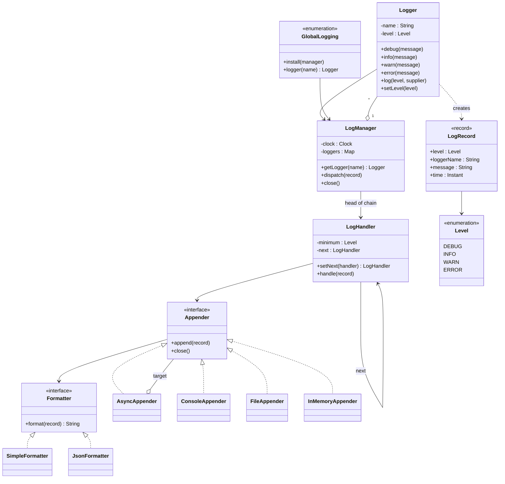
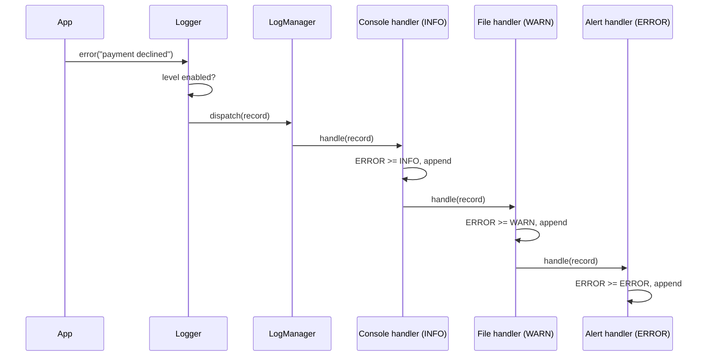

# Design a Logging Framework

## Problem Statement

The interviewer says: "Design a logging framework like Log4j. An application logs messages with a level. The framework writes each message to one or more destinations, in a chosen format. It must be easy to add a new destination, and logging must not slow down the application." The problem tests Chain of Responsibility, Strategy, and a Singleton-or-injection decision. Follow the procedure in [How to Approach an LLD Interview](../../how-to-approach-lld.md).

## Clarifying Questions

| Question | Answer that this design assumes |
|---|---|
| Which levels? | `DEBUG`, `INFO`, `WARN`, `ERROR`, in this order. A message is enabled if its level is at or above the threshold |
| Where can the framework write? | Console, a file, and memory (for tests and the demo). A new destination is a new class |
| Can each destination have its own minimum level? | Yes. For example, the console shows `INFO` and above, the file shows `WARN` and above, and an alert destination shows `ERROR` only |
| Can the format change per destination? | Yes. A plain text formatter and a JSON formatter |
| Is the level set per logger? | Yes. Each named logger has a level that changes at run time. A parent-child hierarchy of names is out of scope (see Extensions) |
| Must logging be asynchronous? | Optional. A destination can be wrapped so that the caller only puts the record on a queue |
| What if a destination fails (disk full)? | The application must not fail. The framework counts the failure and continues with the next destination |
| Many threads log at the same time? | Yes |
| How does the application get a logger? | From a `LogManager` that the application creates and passes in (dependency injection). A global holder is shown as the alternative |
| Time source? | A `java.time.Clock` is injected, so a test or a demo uses fixed timestamps |
| Out of scope | Exceptions and stack traces, log rotation, configuration files, structured fields. See Extensions |

## Requirements

Functional requirements:

1. A caller gets a named logger and calls `debug`, `info`, `warn`, `error`, or `log(level, supplier)`.
2. A logger drops a message whose level is below the logger's level. A caller can change the level at run time.
3. The framework passes each record through a chain of handlers. Each handler has a minimum level and one appender. The handler writes the record if the record's level is high enough, and then passes it to the next handler.
4. An appender writes a record to a destination: console, file, or memory.
5. A formatter turns a record into text. Each appender has its own formatter.
6. The caller can pass a `Supplier<String>` so that the text is built only if the level is enabled.
7. An async appender wraps another appender and writes on its own thread. Closing the framework drains the queue.
8. A failure in one appender does not reach the caller and does not stop the next handler.

Non-functional requirements:

- Adding a level handler, an appender, or a formatter needs a new class and no edit in the logger.
- Thread safety: many threads log at the same time, and no line is lost or interleaved.
- Logging does not throw into application code.
- Deterministic tests: the clock is injected.

## Entities and Relationships

| Type | Kind | Responsibility |
|---|---|---|
| `Level` | Enum | The levels, with `atLeast` for the comparison |
| `LogRecord` | Value object (`record`) | Level, logger name, message, and time of one event. Immutable, so any thread can read it |
| `Logger` | Entity | A named front object. Checks the level, builds the record with the clock, and sends it to the manager |
| `LogManager` | Entity | Creates and caches loggers (one per name), owns the clock and the head of the handler chain |
| `LogHandler` | Entity (chain link) | Has a minimum level, an appender, and a next handler. Writes if the level is high enough, then forwards |
| `Appender` | Interface | Writes one record to a destination. Implementations: `ConsoleAppender`, `FileAppender` (writes to a `java.io.Writer`, which production code opens on a file), `InMemoryAppender`, `AsyncAppender` |
| `Formatter` | Interface | Turns a record into a `String`. Implementations: `SimpleFormatter`, `JsonFormatter` |
| `GlobalLogging` | Singleton (`enum`) | The optional global access point to one `LogManager` |
| `TickingClock` | Test helper | A `Clock` that advances one second on each call |

Relationships:

- `Logger` refers to its `LogManager` (association). The manager owns many loggers (composition) and the head `LogHandler`.
- `LogHandler` has one `Appender` and one next `LogHandler`. A chain of handlers is a singly linked list.
- An `Appender` has one `Formatter`.
- `AsyncAppender` is an `Appender` that has an `Appender` (Decorator).

## Class Diagram



The path of one message:



## Design Patterns Used

| Pattern | Where | Reason | Rejected alternative |
|---|---|---|---|
| Chain of Responsibility ([behavioral patterns](../../fundamentals/08-behavioral-patterns.md)), in the variant where every handler sees the record | `LogHandler` and `setNext` | The record passes along the handlers. Each handler decides by its own level whether to write. The logger does not know how many handlers exist, so a new level rule is a new link | (1) One method with `if (level >= WARN) file.write(...)` for each destination. Each new destination edits the logger. (2) A `List<LogHandler>` that the manager loops over. The loop gives the same behavior with less code, and it is a good answer. The linked chain is better only when a handler must stop the record or change it for the handlers after it (see the note below the table) |
| Strategy (same page) | `Appender` (where to write) and `Formatter` (how to write) | The two choices vary on their own. Console with JSON and file with plain text are both valid. `k` appenders and `f` formatters need `k + f` classes | Subclasses `JsonConsoleLogger`, `TextFileLogger`, and so on, which need `k * f` classes |
| Decorator ([structural patterns](../../fundamentals/07-structural-patterns.md)) | `AsyncAppender` wraps any `Appender` | The async behavior applies to every destination. A wrapper adds it without a new class for each appender | An `AsyncFileAppender`, an `AsyncConsoleAppender`, and so on |
| Dependency injection, with a Singleton as the alternative ([creational patterns](../../fundamentals/06-creational-patterns.md), [architectural patterns](../../fundamentals/10-architectural-patterns.md)) | `LogManager` is a normal class. `GlobalLogging` is the Singleton access point | See the trade-off below | See below |
| Registry (a cache of instances by key) | `LogManager.getLogger(name)` uses `computeIfAbsent` | One `Logger` for each name, so a level change on a logger affects all code that uses the name | A `new Logger(name)` in each class, which creates many unrelated loggers |

### Singleton or injection

A logger is the case where candidates reach for a Singleton, and interviewers expect you to discuss it.

| Question | Injected `LogManager` | Global holder (`GlobalLogging`) |
|---|---|---|
| Call site | The class receives a `Logger` in its constructor | Any code calls `GlobalLogging.logger("Name")` |
| Tests | Each test builds its own manager with an in-memory appender and a fixed clock | All tests share one global. A test must install and reset it, and tests cannot run in parallel without risk |
| Hidden dependency | No. The constructor shows the dependency | Yes. The class works only if some other code installed the manager first |
| Convenience | Needs wiring in `main` | One line anywhere |
| Failure mode | The compiler forces the wiring | A runtime `IllegalStateException` if nobody installed the manager |

Recommendation: inject the manager or the logger, and offer a global holder only for code that cannot receive a parameter (static initializers, legacy code). The common Java frameworks offer a static lookup, because application code gets its logger in a static field: SLF4J has `LoggerFactory.getLogger(...)`, Log4j 2 has `LogManager.getLogger(...)`, and `java.util.logging` has `Logger.getLogger(...)`. Behind the static call, each one keeps a configurable registry, so a test can still change the appenders. The demo shows both. See the Singleton discussion in [creational patterns](../../fundamentals/06-creational-patterns.md) and the "Singleton overuse" entry in [anti-patterns](../../fundamentals/11-anti-patterns.md).

On the chain: in the Gang of Four (GoF) book, the intent of Chain of Responsibility is to pass a request along the chain until one object handles it. That classic form stops at the first handler that handles the request. This design forwards to every handler, because each destination is independent. The structure is the same. Only the rule "stop after handling" is absent. This variant, where every handler sees the request, is closer to a pipeline or a filter chain (as in servlet filters). Say this in the interview, so that the interviewer knows that you know the classic form. If you need the stop rule (for example, "the first matching rule wins"), add a boolean `stopsChain` to the handler.

For comparison, the real frameworks attach a collection of destinations to a logger, not a linked chain:

- `java.util.logging`: a `Logger` has a list of `Handler` objects (`addHandler`). The logger has a level, and each handler has its own level (`Handler.setLevel`) and an optional `Filter`. By default a logger also publishes to the handlers of its parent logger, recursively up the tree (`setUseParentHandlers(true)`). A logger with a `null` level inherits the effective level of its nearest ancestor.
- Log4j 2: a logger configuration refers to appenders through `AppenderRef` elements. An `AppenderRef` can have a `level` attribute, which is the threshold for that appender. With additivity `true` (the default), a logger also passes each event to the appenders of its parent logger.
- Logback: more than one appender can be attached to a logger. The output of logger L goes to the appenders of L and of its ancestors (additivity, `true` by default). A request of level p is enabled if p is at or above the effective level of the logger. A per-appender threshold is a `ThresholdFilter` on the appender, not a level attribute.

The parent-to-ancestor walk in all three is the closest real analog of this chain: an event passes from one set of handlers to the next, and it does not stop after the first one writes it.

## Key Code

The complete runnable program is in [`Main.java`](Main.java). Run it with `java Main.java`.

### Levels and records

```java
enum Level {
    DEBUG, INFO, WARN, ERROR;

    boolean atLeast(Level other) {
        return compareTo(other) >= 0;
    }
}
```

```java
record LogRecord(Level level, String loggerName, String message, Instant time) { }
```

### A clock that the test controls

The `Logger` asks the injected clock for the time. `TickingClock` advances one second at each call, so the demo output has fixed timestamps.

```java
// A clock that moves one second on each call, so the demo prints fixed timestamps.
class TickingClock extends Clock {
    private final AtomicLong seconds = new AtomicLong();
    private final Instant start;

    TickingClock(Instant start) {
        this.start = start;
    }

    @Override
    public ZoneId getZone() {
        return ZoneOffset.UTC;
    }

    @Override
    public Clock withZone(ZoneId zone) {
        return this;
    }

    @Override
    public Instant instant() {
        return start.plusSeconds(seconds.getAndIncrement());
    }
}
```

### Formatters (Strategy)

```java
interface Formatter {
    String format(LogRecord record);
}
```

```java
class SimpleFormatter implements Formatter {
    @Override
    public String format(LogRecord r) {
        return r.time() + " " + r.level() + " [" + r.loggerName() + "] " + r.message();
    }
}
```

### Appenders (Strategy)

```java
interface Appender {
    void append(LogRecord record);

    default void close() { }
}
```

```java
class ConsoleAppender implements Appender {
    private final PrintStream out;
    private final Formatter formatter;

    ConsoleAppender(PrintStream out, Formatter formatter) {
        this.out = out;
        this.formatter = formatter;
    }

    @Override
    public synchronized void append(LogRecord record) {
        out.println(formatter.format(record));
    }
}
```

`FileAppender` writes to a `java.io.Writer`. The appender does not open the file itself, so a test or the demo passes a `StringWriter` and the program does not touch the disk. The appender flushes after each record. A flush per record costs speed, but a crash then loses no line that `append` returned for. Log4j 2 makes the same choice by default (its `immediateFlush` option). `close` closes the writer. `IOException` becomes `UncheckedIOException`, a `RuntimeException`, so `LogHandler` counts the failure.

```java
// Writes to any Writer. Production code passes a writer that Files.newBufferedWriter opens.
class FileAppender implements Appender {
    private final Writer writer;
    private final Formatter formatter;

    FileAppender(Writer writer, Formatter formatter) {
        this.writer = writer;
        this.formatter = formatter;
    }

    @Override
    public synchronized void append(LogRecord record) {
        try {
            writer.write(formatter.format(record));
            writer.write(System.lineSeparator());
            writer.flush(); // one flush per record: slower, but a crash loses no written line
        } catch (IOException e) {
            throw new UncheckedIOException("Cannot write log record", e);
        }
    }

    @Override
    public synchronized void close() {
        try {
            writer.close();
        } catch (IOException e) {
            throw new UncheckedIOException("Cannot close log writer", e);
        }
    }
}
```

Production code opens the file and passes the writer. Pass `CREATE` and `APPEND` explicitly. Without options, `Files.newBufferedWriter` uses `CREATE`, `TRUNCATE_EXISTING`, and `WRITE`, so each start of the application erases the old log.

<!-- fragment -->
```java
// Not in Main.java: the demo uses a StringWriter instead of a file.
Writer writer = Files.newBufferedWriter(Path.of("app.log"), StandardCharsets.UTF_8,
        StandardOpenOption.CREATE, StandardOpenOption.APPEND);
LogHandler file = new LogHandler(Level.WARN, new FileAppender(writer, new SimpleFormatter()));
```

`newBufferedWriter` throws `IOException` if it cannot open the file. The wiring code handles that at start-up, before the first record.

### Async appender (Decorator)

The caller thread puts the record on a bounded `ArrayBlockingQueue`. If the queue is full, `put` blocks the caller, so no record is lost. One worker thread takes records and writes them to the target. The worker catches a `RuntimeException` from the target and counts it. Without that catch, one failure ends the worker thread, the queue fills, and every caller then blocks in `put` forever. `close` puts a stop marker on the queue, and waits for the worker. The worker has written every earlier record by then.

```java
// Decorator: puts records on a bounded queue. One worker thread writes them to the target.
class AsyncAppender implements Appender {
    private static final LogRecord STOP = new LogRecord(Level.ERROR, "", "", Instant.EPOCH);
    private final BlockingQueue<LogRecord> queue;
    private final Appender target;
    private final Thread worker;
    private final AtomicInteger failures = new AtomicInteger();

    AsyncAppender(Appender target, int capacity) {
        this.target = target;
        this.queue = new ArrayBlockingQueue<>(capacity);
        this.worker = new Thread(this::drain, "async-appender");
        this.worker.start();
    }

    @Override
    public void append(LogRecord record) {
        try {
            queue.put(record); // blocks when the queue is full, so no record is lost
        } catch (InterruptedException e) {
            Thread.currentThread().interrupt();
        }
    }

    private void drain() {
        try {
            while (true) {
                LogRecord record = queue.take();
                if (record == STOP) {
                    return;
                }
                try {
                    target.append(record);
                } catch (RuntimeException e) {
                    failures.incrementAndGet(); // a failing target must not stop the worker
                }
            }
        } catch (InterruptedException e) {
            Thread.currentThread().interrupt();
        }
    }

    int failures() {
        return failures.get();
    }

    @Override
    public void close() {
        try {
            queue.put(STOP);
            worker.join();
        } catch (InterruptedException e) {
            Thread.currentThread().interrupt();
        }
        target.close();
    }
}
```

### The handler chain (Chain of Responsibility)

`handle` writes the record when the level is high enough, and then always forwards. A failure in the appender is counted and does not leave the method.

```java
// Chain of Responsibility: each handler writes records at or above its level, then forwards.
class LogHandler {
    private final Level minimum;
    private final Appender appender;
    private final AtomicInteger failures = new AtomicInteger();
    private LogHandler next;

    LogHandler(Level minimum, Appender appender) {
        this.minimum = minimum;
        this.appender = appender;
    }

    LogHandler setNext(LogHandler next) {
        this.next = next;
        return next;
    }

    void handle(LogRecord record) {
        if (record.level().atLeast(minimum)) {
            try {
                appender.append(record);
            } catch (RuntimeException e) {
                failures.incrementAndGet(); // logging must not break the caller
            }
        }
        if (next != null) {
            next.handle(record);
        }
    }

    int failures() {
        return failures.get();
    }

    void close() {
        appender.close();
        if (next != null) {
            next.close();
        }
    }
}
```

### Logger and manager

```java
class Logger {
    private final String name;
    private final LogManager manager;
    private volatile Level level;
```

The `Supplier<String>` overload avoids building the message when the level is off.

```java
    void log(Level candidate, Supplier<String> message) {
        if (!isEnabled(candidate)) {
            return;
        }
        Instant now = manager.clock().instant();
        manager.dispatch(new LogRecord(candidate, name, message.get(), now));
    }
```

```java
class LogManager {
    private final Clock clock;
    private final Level defaultLevel;
    private final LogHandler head;
    private final Map<String, Logger> loggers = new ConcurrentHashMap<>();

    LogManager(Clock clock, Level defaultLevel, LogHandler head) {
        this.clock = clock;
        this.defaultLevel = defaultLevel;
        this.head = head;
    }

    Logger getLogger(String name) {
        return loggers.computeIfAbsent(name, n -> new Logger(n, this, defaultLevel));
    }
```

### Wiring in `main`

`setNext` returns the next handler, so the chain is built in one line.

```java
        // The demo gives the file appender a StringWriter, so it does not touch the disk.
        StringWriter fileSink = new StringWriter();
        InMemoryAppender alerts = new InMemoryAppender(new JsonFormatter());

        // Chain: console (INFO and above) -> file (WARN and above) -> alerts (ERROR only).
        LogHandler console = new LogHandler(Level.INFO,
                new ConsoleAppender(System.out, new SimpleFormatter()));
        LogHandler file = new LogHandler(Level.WARN,
                new FileAppender(fileSink, new SimpleFormatter()));
        LogHandler alert = new LogHandler(Level.ERROR, alerts);
        console.setNext(file).setNext(alert);

        LogManager manager = new LogManager(clock, Level.INFO, console);
        Logger orders = manager.getLogger("OrderService");
        Logger payments = manager.getLogger("Payments");
```

### The global holder

```java
// Singleton form: simple to call from anywhere, but it is global mutable state.
enum GlobalLogging {
    INSTANCE;

    private final AtomicReference<LogManager> manager = new AtomicReference<>();

    static void install(LogManager logManager) {
        INSTANCE.manager.set(logManager);
    }

    static Logger logger(String name) {
        LogManager current = INSTANCE.manager.get();
        if (current == null) {
            throw new IllegalStateException("Logging is not installed");
        }
        return current.getLogger(name);
    }
}
```

## Concurrency

What can race, and how the design prevents it:

| Shared state | Race | Prevention |
|---|---|---|
| `LogManager.loggers` | Two threads ask for the same new name and create two loggers | `ConcurrentHashMap.computeIfAbsent` runs the factory once for each key |
| `Logger.level` | One thread calls `setLevel`, another reads it | The field is `volatile`. A reader sees the latest write. The check is one read, so no lock is needed |
| Console and file output | Two threads write at the same time, so lines mix or a write is lost | `ConsoleAppender` and `FileAppender` use `synchronized` `append`. Each record and its line separator are written as one unit. `FileAppender.close` takes the same lock, so it cannot close the writer in the middle of a record |
| `InMemoryAppender.lines` | `ArrayList` is not thread-safe | `synchronized` `append` and `lines`. `lines` returns a copy |
| Handler chain | A thread reads `next` while another changes it | The chain is built before the manager is created. After that, nothing changes it. The `final` field `head` in `LogManager` publishes the chain safely |
| `LogHandler.failures` | Lost increments | `AtomicInteger` |
| Async queue | Producers and the worker share the queue | `ArrayBlockingQueue` is thread-safe. A bounded queue gives back-pressure |
| Async worker | A target that throws ends the worker thread. Then the queue fills, and producers and `close` block forever | `drain` catches `RuntimeException` for each record and counts it in `AsyncAppender.failures` |
| `GlobalLogging.manager` | `install` races with `logger` | `AtomicReference` |

Points to state in an interview:

- **Order.** Each thread's records stay in order, because the queue is first in, first out and each thread puts its records one after another. Records from different threads interleave in an order that nobody controls. The timestamp comes from the caller thread, so the order in the output may differ from the order of the timestamps across threads. The demo checks the per-thread order and prints a boolean.
- **A slow appender slows the caller** in the synchronous design, because the caller thread does the write, and other callers wait for the appender lock. This is the reason to use `AsyncAppender`.
- **Back-pressure policy.** `put` blocks when the queue is full. Other choices: drop the new record, drop the oldest record, or drop everything below `ERROR`. Dropping loses data, and blocking slows the caller. State your choice. Recommendation: block, and make the policy a parameter if the interviewer asks.
- **Shutdown.** `close` must run after the producers stop. A record that a thread logs after `close` waits in the queue with no worker, and `put` blocks forever if the queue is full. A production framework adds a `closed` flag that makes `append` return, and drains in a shutdown hook.
- **The demo is deterministic** because it joins the producer threads, calls `close` (which drains the queue), and only then prints.

See [concurrency in LLD](../../fundamentals/09-concurrency-in-lld.md) for the comparison of `synchronized`, locks, and concurrent collections, and for the producer-consumer pattern.

## Extensions

| Change | How the design handles it |
|---|---|
| Log the exception and its stack trace | Add a `Throwable thrown` component to `LogRecord` (or an `Optional<Throwable>`), and add `error(String, Throwable)` to `Logger`. `SimpleFormatter` and `JsonFormatter` print the class and the message. No change to handlers or appenders |
| Context for each request (a request ID on every line) | Add a `Map<String, String> context` to `LogRecord`. A `ThreadLocal<Map<String, String>>` holds the values. Logback (through the SLF4J `MDC` class) calls this per-thread map the mapped diagnostic context (MDC). Log4j 2 calls it the Thread Context Map, also referred to as MDC, in its `ThreadContext` class. `Logger.log` copies it into the record, because the async worker runs on another thread. Formatters print the map |
| Logger hierarchy (`com.shop.orders` inherits from `com.shop`) | `LogManager.getLogger` finds the parent by the dotted name. `Logger` takes its level from the nearest ancestor that sets one. The handler chain stays the same |
| Rolling files (new file at 10 MB or at midnight) | Add `RollingFileAppender implements Appender` that holds a `RollingPolicy` (Strategy: by size, by time). It checks the policy before each write |
| Filter by content or by logger name | Add `interface LogFilter { boolean accept(LogRecord r); }` and give each `LogHandler` a list of filters. `handle` writes only if all accept |
| Configuration from a file | Add a `LogConfigLoader` (Factory) that reads names and levels, builds appenders and handlers, and returns a `LogManager`. The domain classes do not change |
| Overflow policy for the async queue | Add `OverflowPolicy` (Strategy: `BLOCK`, `DROP_NEWEST`, `DROP_OLDEST`) and pass it to `AsyncAppender`. `append` calls `queue.offer` for the drop policies |
| Send logs over the network | Add `NetworkAppender implements Appender`. Wrap it in `AsyncAppender`, so a slow network does not block the caller |

## Common Mistakes

- **Building the message before the level check.** `logger.debug("user " + expensive())` runs `expensive()` even if `DEBUG` is off. Use a `Supplier`, or check `isEnabled`.
- **One class with `if (level == ...)` chains and a `switch` on the destination.** Each new destination edits it. Use Strategy for the destination and the chain for the levels.
- **A Singleton logger with a hard-coded clock and console.** A test cannot read the output or fix the time. Inject the clock and the appenders.
- **Letting a logging failure reach the caller.** A full disk must not stop an order. Catch the failure at the handler, count it, and continue.
- **Not closing the async queue.** The worker in this design is not a daemon thread, so the JVM does not exit while it waits on the queue. With a daemon worker, the JVM exits and loses the records that are still in the queue. Always drain on shutdown, for example in a shutdown hook.
- **A worker thread that dies on the first exception.** The queue then fills, and every caller blocks. Catch the failure inside the worker loop.
- **Opening the log file with the default options.** `Files.newBufferedWriter(path)` truncates the file. Pass `CREATE` and `APPEND`.
- **A shared `SimpleDateFormat` or `ArrayList` with no lock.** Neither class is thread-safe. Use immutable `Instant` values or the thread-safe `DateTimeFormatter`, and lock the list.
- **A mutable `LogRecord`.** Handlers on different threads see partial changes. Use a `record`.
- **An unbounded async queue.** A burst of records uses all memory. Bound the queue, and decide the overflow policy.
- **Printing real timestamps in a test.** The test then fails on each run. Inject a `Clock`.
- **Many levels of inheritance for appenders and formatters.** Combine small objects instead of subclasses.

## 45-Minute Plan

| Minutes | What to do |
|---|---|
| 0 to 5 | Ask the clarifying questions above. Write the numbered requirements. Ask: "Is async in scope? Is a Singleton required?" |
| 5 to 10 | Name the entities: level, record, logger, handler, appender, formatter. Say that a record is an immutable value object |
| 10 to 18 | Draw the class diagram. Say: "Chain of Responsibility for the level handlers, Strategy for the appender and the formatter, Decorator for async." Name the rejected alternatives: an `if` chain, and a subclass for each pair |
| 18 to 22 | Write the signatures: `Logger`, `LogManager`, `LogHandler`, `Appender`, `Formatter` |
| 22 to 36 | Write `Level`, `LogRecord`, `Appender` and one implementation, `Formatter`, `LogHandler`, `Logger`, `LogManager`. Run one `error` message through the chain aloud |
| 36 to 41 | Concurrency and the async appender: the shared appender, the bounded queue, the drain on close. Discuss Singleton against injection |
| 41 to 45 | Extensions: exception logging, context map, logger hierarchy, rolling files. For each, name the new class and the unchanged classes |

## Expected Output

<!-- expected-output -->
```text
== 1. Levels and the handler chain ==
2026-01-01T00:00:00Z INFO [OrderService] order 1001 created
2026-01-01T00:00:01Z WARN [Payments] card gateway is slow
2026-01-01T00:00:02Z ERROR [Payments] payment declined
same logger for the same name: true
== 2. Lazy messages ==
debug message built while DEBUG is off: 0
debug message built while DEBUG is on: 1
== 3. A failing appender does not break the application ==
2026-01-01T00:00:04Z INFO [Risky] still delivered to the next handler
failures counted by the broken handler: 1
== 4. File and alert appenders ==
file lines:
  2026-01-01T00:00:01Z WARN [Payments] card gateway is slow
  2026-01-01T00:00:02Z ERROR [Payments] payment declined
alert lines:
  {"time":"2026-01-01T00:00:02Z","level":"ERROR","logger":"Payments","message":"payment declined"}
== 5. Async appender ==
lines delivered after close: 203
first three:
  2026-01-01T00:00:05Z INFO [Audit] event 1
  2026-01-01T00:00:06Z INFO [Audit] event 2
  2026-01-01T00:00:07Z INFO [Audit] event 3
per-thread order kept: true
failures in the async worker: 0
== 6. Global logger (Singleton) and its cost ==
2026-02-01T00:00:00Z INFO [Legacy] called through the global holder
```
