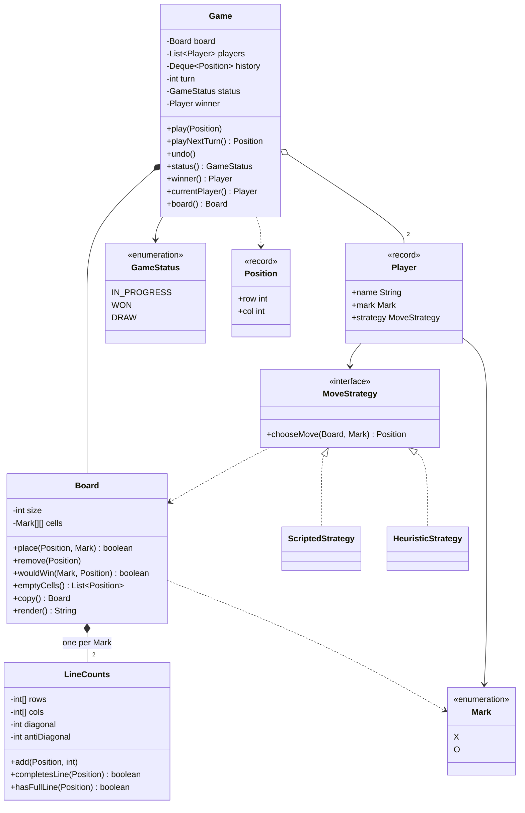
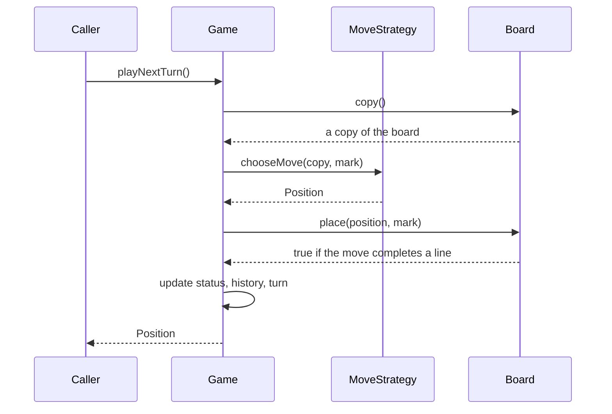

# Design Tic-Tac-Toe

This case study designs a tic-tac-toe game for an LLD (low-level design) interview. The game looks small, and that is the reason interviewers use it: the 45 minutes go to the object model, to one good algorithm (the O(1) win check), and to the follow-up questions (undo, a bigger board, an AI player). The runnable program is in [`Main.java`](Main.java). Run it with `java Main.java` from this folder. The procedure that this page follows is in [How to approach an LLD interview](../../how-to-approach-lld.md).

## Problem Statement

"Design a tic-tac-toe game. Two players take turns to place their mark on a board. The first player with a full row, column, or diagonal wins. If the board is full and nobody won, the game is a draw. Make the board size configurable."

The interviewer adds these follow-ups during the round: "How fast is your win check?", "Add undo", "Add a computer player", "What changes if the winner needs 4 in a row on a 10x10 board?"

## Clarifying Questions

Ask these in the first 5 minutes. Write each answer as a numbered requirement, and label every unanswered question as an assumption.

| # | Question | Answer that this design assumes |
|---|---|---|
| 1 | How much code do you expect: a class diagram with signatures, or compiling code? | Compiling code for the core flow, plus the class diagram |
| 2 | Is the board always 3x3? | No. The board is N x N, and a winner needs a full row, column, or diagonal of N marks |
| 3 | How many players? | Exactly two, each with a different mark (`X` and `O`) |
| 4 | Who moves first? | The first player that the caller passes to the game |
| 5 | Are the players humans, computers, or both? | Both. A player has a move strategy, so the game does not care which |
| 6 | What happens on an invalid move (an occupied cell, a cell outside the board, a move after the game ended)? | The game throws `IllegalMoveException`, and the state does not change. The same player stays on turn |
| 7 | Do we need undo? | Yes, unlimited, back to the empty board. Undo of the winning move reopens the game |
| 8 | Is the UI in scope? | No. The board has a `render()` method that returns text. Any UI reads the game through its methods |
| 9 | Do several threads call the game at the same time (an online game)? | Assumption: possible. The game protects its state with one lock |
| 10 | Is persistence in scope? | No. State is in memory |
| 11 | Which extensions are likely? | A computer player, K in a row on a larger board, a move timer, an observer for a UI |

## Requirements

### Functional requirements

1. **R1.** Create a game with an N x N board and two players. N is at least 2.
2. **R2.** The players take turns. A turn places the mark of the current player on one empty cell.
3. **R3.** The game rejects a move that is outside the board, on an occupied cell, or after the game ended.
4. **R4.** A move that completes a row, a column, or one of the two diagonals ends the game with that player as the winner.
5. **R5.** If the board is full and no player won, the game ends as a draw.
6. **R6.** The caller can undo the last move, and can repeat the undo back to the empty board.
7. **R7.** A player is either scripted (for a human or a test) or computed (an AI). The game treats both the same way.
8. **R8.** The caller can print the board as text.

### Non-functional requirements

1. **N1.** The win check takes O(1) time for each move. A full scan of the board for each move is O(N^2) and does not meet N1.
2. **N2.** Undo takes O(1) time.
3. **N3.** A rejected move leaves the game unchanged.
4. **N4.** Calls from several threads do not corrupt the state (see [Concurrency](#concurrency)).
5. **N5.** A new player type, a new board size, and a new rule are additions, not rewrites.

## Entities and Relationships

Take the nouns of the problem statement: game, board, player, mark, cell, move, row, column, diagonal, winner, draw. Sort them with the method from [domain modeling](../../fundamentals/05-domain-modeling.md):

| Noun | Kind | Reason |
|---|---|---|
| `Game` | Entity (the aggregate root) | Owns the turn, the status, the history, and the rules of play. The caller uses only `Game` |
| `Board` | Entity | Owns the cells and the win counters. Protects the invariant "a cell holds at most one mark" |
| `Player` | Value object (`record`) | A name, a mark, and a strategy. Immutable |
| `Mark` | Enum | A fixed set: `X` and `O`. A class for each mark would have no different behavior |
| `Position` | Value object (`record`) | A row and a column. Two positions with the same numbers are equal |
| `GameStatus` | Enum | `IN_PROGRESS`, `WON`, `DRAW` |
| `MoveStrategy` | Interface | How a player chooses a position. The extension point for the AI |
| `LineCounts` | Helper class | Counts the marks of one player in each row, column, and diagonal |
| `IllegalMoveException` | Exception | A business failure that the caller can handle |
| Cell, row, column, diagonal | Not classes | A cell is an array slot. A line is an index into a counter array |
| Winner | Not a class | A `Player` reference in `Game` |

Relationships:

- `Game` composes one `Board`. The board lives and ends with the game (composition).
- `Game` has two `Player` objects (association, multiplicity 2).
- `Player` refers to a `Mark` and to a `MoveStrategy` (association). The strategy is the Strategy pattern.
- `Board` composes one `LineCounts` object for each `Mark`.
- `ScriptedStrategy` and `HeuristicStrategy` realize `MoveStrategy`.
- `MoveStrategy` depends on `Board`. `Game` passes the strategy a copy of the board, not the game itself. The strategy can read the copy and try moves on it, but it cannot call `play` or `undo`, and it cannot change the real board. This choice also avoids a dependency cycle (`Game` to `Player` to `MoveStrategy` and back to `Game`).

The central modeling decision: a mark is an enum, not a class hierarchy. `X` and `O` behave the same way, so a subclass for each would add no behavior. See the rule in [OOP](../../fundamentals/01-oop.md) and the anti-pattern in [anti-patterns](../../fundamentals/11-anti-patterns.md).

## Class Diagram



The flow of one turn, from the caller to the result:



## Design Patterns Used

| Pattern | Where | Reason | Rejected alternative |
|---|---|---|---|
| Strategy ([behavioral patterns](../../fundamentals/08-behavioral-patterns.md)) | `MoveStrategy` with `ScriptedStrategy` and `HeuristicStrategy` | The statement says that players can be humans or computers. The requirement smell is "several ways to do the same thing". A new AI is a new class and no edit in `Game` | A `boolean isComputer` flag in `Player` and an `if` in `Game`. Each new player type edits `Game` (a violation of the Open-Closed Principle, see [SOLID](../../fundamentals/02-solid.md)) |
| History stack (a light form of Command or Memento) | `Deque<Position>` in `Game`, and `Board.remove` | Undo needs only the position of each move, because the opposite of `place` is `remove`. Storing positions is enough | A full Command class with `execute()` and `undo()` for each move. It adds a class for no gain here. Use Command if moves have different effects (for example, a game with captures). A Memento that copies the whole board for each move costs O(N^2) memory per move |
| State as an enum | `GameStatus` | The status only guards the move: "no move after the game ended". Behavior does not change per state in other methods | The State pattern with a class for each state. Use it only if each state changes the behavior of several methods |
| Encapsulated win counters | `LineCounts` | Turns the win check from O(N) or O(N^2) into O(1) | Scanning the row, column, and diagonals after each move |
| Immutable value objects | `Position`, `Player` (records) | Equal by value, safe to share and to store in the history | Mutable `Cell` objects with coordinates |

Not used, on purpose:

- **Singleton.** A game is an object. Two games can exist in one process, and each test creates its own. See [creational patterns](../../fundamentals/06-creational-patterns.md).
- **Observer.** No requirement asks for a notification. An extension below adds it.
- **Factory.** `new Game(size, first, second)` is enough. A factory would add a class with no variation behind it.

## Key Code

The code below is copied from [`Main.java`](Main.java). The full program has the demo and the remaining small classes.

### Moves: the Strategy interface

A move strategy receives a copy of the board and its own mark. It returns a position. The strategy gets a copy, and not the `Game`, for two reasons. First, the strategy cannot cheat or corrupt the game: it has no access to `play`, `undo`, or the real board. Second, a search strategy can call `place` and `remove` on the copy to try moves. The `Player` record joins a name, a mark, and a strategy.

```java
interface MoveStrategy {
    // Receives a copy of the board, so the strategy cannot change the game.
    Position chooseMove(Board board, Mark self);
}

record Player(String name, Mark mark, MoveStrategy strategy) { }
```

### The O(1) win check

The idea: a row is full for one player when that player has N marks in it. The board does not scan the row. It keeps one counter for each row, one for each column, one for the main diagonal, and one for the anti-diagonal, for each player. A move at `(r, c)` adds 1 to the counter of row `r` and the counter of column `c`. If `r == c`, it adds 1 to the diagonal counter. If `r + c == N - 1`, it adds 1 to the anti-diagonal counter. If any of these counters now equals N, the move won.

Why this is correct: each cell holds at most one mark. A counter of N for player `X` in row `r` means that `X` holds N cells in a row of N cells, so `X` holds the whole row. The counters are per player, so an `O` mark never raises an `X` counter.

Cost: a move changes at most 4 counters, so the time is O(1). The memory is 2N + 2 integers for each player, which is O(N). The cell array uses O(N^2), and the game needs it to print the board and to reject a move on an occupied cell.

```java
class LineCounts {
    private final int[] rows;
    private final int[] cols;
    private int diagonal;
    private int antiDiagonal;
    private final int size;

    LineCounts(int size) {
        this.size = size;
        this.rows = new int[size];
        this.cols = new int[size];
    }

    void add(Position p, int delta) {
        rows[p.row()] += delta;
        cols[p.col()] += delta;
        if (p.row() == p.col()) {
            diagonal += delta;
        }
        if (p.row() + p.col() == size - 1) {
            antiDiagonal += delta;
        }
    }

    boolean completesLine(Position p) {
        return rows[p.row()] + 1 == size
                || cols[p.col()] + 1 == size
                || (p.row() == p.col() && diagonal + 1 == size)
                || (p.row() + p.col() == size - 1 && antiDiagonal + 1 == size);
    }

    boolean hasFullLine(Position p) {
        return rows[p.row()] == size
                || cols[p.col()] == size
                || (p.row() == p.col() && diagonal == size)
                || (p.row() + p.col() == size - 1 && antiDiagonal == size);
    }
}
```

### The board: place, remove, and a look-ahead

`place` checks the move, writes the mark, updates the counters, and returns whether the move won. It checks everything before it changes anything, so a rejected move leaves the board unchanged (requirement N3). `remove` is the exact inverse, and it makes undo O(1). `wouldWin` asks the counters whether a mark at a position would complete a line, without changing the board. The AI uses it. `wouldWin` is correct only for an empty position, and the AI passes only empty positions.

```java
    // Places a mark and returns true if the move completes a line. O(1).
    boolean place(Position p, Mark mark) {
        if (!contains(p)) {
            throw new IllegalMoveException("Position " + p + " is outside the board");
        }
        if (cells[p.row()][p.col()] != null) {
            throw new IllegalMoveException("Cell " + p + " is already taken");
        }
        cells[p.row()][p.col()] = mark;
        filled++;
        LineCounts own = counts.get(mark);
        own.add(p, 1);
        return own.hasFullLine(p);
    }

    // Reverses place(). O(1).
    void remove(Position p) {
        Mark mark = cells[p.row()][p.col()];
        cells[p.row()][p.col()] = null;
        filled--;
        counts.get(mark).add(p, -1);
    }

    boolean wouldWin(Mark mark, Position p) {
        return counts.get(mark).completesLine(p);
    }
```

`copy` builds a new board and replays `place` for each mark, so the copy has its own cells and its own counters. It costs O(N^2), the same as the `emptyCells` scan that a strategy runs anyway. `Game` uses `copy` twice: it passes a copy to the strategy, and `Game.board()` returns a copy as a snapshot for the caller.

```java
    // Returns an independent board with the same marks and counters. O(N^2).
    Board copy() {
        Board copy = new Board(size);
        for (int r = 0; r < size; r++) {
            for (int c = 0; c < size; c++) {
                if (cells[r][c] != null) {
                    copy.place(new Position(r, c), cells[r][c]);
                }
            }
        }
        return copy;
    }
```

### The game: play and undo

`Game` is the aggregate root. `play` checks the status, asks the board to place the mark, records the move, and then sets the status or passes the turn. `undo` pops the last position, removes it from the board, and gives the turn back.

When `undo` runs after a win or a draw, the turn did not pass at the end of that move, so `undo` must not rotate the turn. The `if (status == GameStatus.IN_PROGRESS)` check in `undo` handles this case.

```java
    synchronized void play(Position p) {
        if (status != GameStatus.IN_PROGRESS) {
            throw new IllegalMoveException("The game is over");
        }
        Player player = players.get(turn);
        boolean won = board.place(p, player.mark());
        history.push(p);
        if (won) {
            status = GameStatus.WON;
            winner = player;
        } else if (board.isFull()) {
            status = GameStatus.DRAW;
        } else {
            turn = (turn + 1) % players.size();
        }
    }

    synchronized void undo() {
        if (history.isEmpty()) {
            throw new IllegalMoveException("Nothing to undo");
        }
        board.remove(history.pop());
        if (status == GameStatus.IN_PROGRESS) {
            turn = (turn - 1 + players.size()) % players.size();
        }
        status = GameStatus.IN_PROGRESS;
        winner = null;
    }
```

### A computer player

`HeuristicStrategy` uses `wouldWin` for both a winning move and a blocking move. It plays in this order: win now, block the opponent, take the center, take the first empty cell. It does not look ahead, so it can lose to a fork (a move that creates two threats). It is a short example of the Strategy pattern, and not a perfect player.

```java
class HeuristicStrategy implements MoveStrategy {
    @Override
    public Position chooseMove(Board board, Mark self) {
        Mark opponent = self == Mark.X ? Mark.O : Mark.X;
        List<Position> empty = board.emptyCells();
        for (Position p : empty) {
            if (board.wouldWin(self, p)) {
                return p;
            }
        }
        for (Position p : empty) {
            if (board.wouldWin(opponent, p)) {
                return p;
            }
        }
        Position center = new Position(board.size() / 2, board.size() / 2);
        if (empty.contains(center)) {
            return center;
        }
        return empty.get(0);
    }
}
```

## Concurrency

**What can race.** `play` is a compound action: check the status, check the cell, write the mark, add to the history, change the status, and change the turn. If two threads call `play` at the same time, both can pass the cell check for the same cell, or both can believe that it is their turn. The result is a lost mark, a corrupt history, or two winners. The same race exists between `play` and `undo`.

**The fix.** Every method that reads or changes the mutable state of `Game` (`play`, `playNextTurn`, `undo`, `status`, `winner`, `currentPlayer`, `board`) is `synchronized`, so each call runs as one step. One game has one lock. This is correct because the work inside the lock is O(1), and a turn-based game has little contention. A lock for each row or each cell would not help: a move touches a row, a column, and the shared status, so it needs a consistent view of all of them. See [concurrency in LLD](../../fundamentals/09-concurrency-in-lld.md) for the lock choices.

**A strategy runs inside the lock.** `playNextTurn` calls `chooseMove` while it holds the game lock. The strategy receives a private copy of the board, so it cannot see a half-finished move and cannot change the game. A slow strategy (a deep search) would block other callers for the whole search. For an online game, take the snapshot with `game.board()` (a short critical section), run the search outside the lock on the snapshot, and then call `play` with the result. Between the snapshot and the `play` call, another thread can move, so `play` must check that the move is still for the current turn (see the next paragraph).

**Snapshots for readers.** `Game.board()` is `synchronized` and returns a copy. A UI thread that renders the copy sees a consistent board, and a change to the copy does not reach the game. The copy costs O(N^2) for each call, which is acceptable for a board that a person reads.

**Turn ownership for an online game.** In the demo, `play(Position)` plays for the current player. In an online game, two clients can send a move for the same turn. The method should take the player (`play(Player, Position)`) and reject a move from the player who is not on turn. This check is inside the same lock.

Do not add threads to this design unless the requirement asks for them. A single-threaded game needs no lock. The lock is cheap, and it prevents corruption when a caller shares the game between threads.

## Extensions

Each row gives the change and the classes that change. The classes that are not named stay as they are.

| Extension | Class changes | Notes |
|---|---|---|
| **A perfect AI.** The computer never loses | Add `MinimaxStrategy implements MoveStrategy`. It calls `place`, `remove`, and `emptyCells` on the board copy that it receives, to try moves and take them back, and it picks the best score. `Game`, `Board`, and `Player` stay | The search changes only its own copy, so the real game is safe. The O(1) `place` and `remove` (with the O(1) win check in `place`) are the reason that each search step is cheap. On a 3x3 board, plain minimax visits 549,946 game positions (counted by a short script, with the root as one position), which is small. Alpha-beta pruning cuts this. A large board needs a depth limit |
| **K in a row on an N x N board** (for example 4 in a row on 10x10) | Add a `WinRule` interface with `boolean isWin(Board, Position, Mark)`. Add `FullLineRule` (the current counters) and `KInARowRule` (scan the 4 directions from the last move, at most `2(K-1)+1` cells each). `Board.place` calls the rule. `Game` stays | The counters work only for "a full line". With K < N, a line of K marks can start at many cells, so the check scans from the last move. The cost is O(K) for each move, which is still independent of N |
| **More than two players, or more marks** | Replace `Mark` with a larger enum or an id. Change the `Game` constructor to take a `List<Player>` of any size, and check that the marks are distinct. `HeuristicStrategy` must block every opponent, not one. The counters already exist for each mark. `Game.turn` already rotates with a modulo | With more than two players, a full line of N marks becomes hard to reach on an N x N board, so choose a larger board or a shorter winning line (see the K in a row extension) |
| **Redo** | Add a second `Deque<Position> undone` in `Game`. `undo` pushes to it. `play` clears it. `redo` pops it and calls the internal place logic | `Board` stays |
| **Move timer** (a player loses the turn after 30 seconds) | Add a time source to `Game` (a `java.time.Clock`, or a small `TimeSource` interface) and a `turnStartedAt` field. `play` rejects a late move, or a scheduler calls `skipTurn()`. Inject the time source so a test controls the time | See the injected `TimeSource` in the [rate limiter](../03-rate-limiter/README.md) |
| **UI or network notifications** | Add `GameListener` with `onMove(Position, Mark)` and `onFinish(GameStatus)`. `Game` keeps a list of listeners and calls them after each move, preferably outside the lock | Observer pattern, see [behavioral patterns](../../fundamentals/08-behavioral-patterns.md) |
| **Score across several games** | Add `Match` that owns a list of finished games, and a `Scoreboard`. `Game` stays | Aggregation: `Match` has many `Game` objects |
| **Persistence and replay** | Save `history` as a list of positions, plus the board size and the players. A replay creates a new `Game` and calls `play` for each position | The history is the only data that a replay needs, because the state is a function of the moves |
| **A 3D board or a different shape** | Make `Board` an interface with `place`, `remove`, `wouldWin`, `emptyCells`, and `copy`. Add `GridBoard` and `CubeBoard` | Introduce the interface only when a second board exists |

## Common Mistakes

| Mistake | Why it hurts | Fix |
|---|---|---|
| Checking the win with a scan of the whole board after each move | O(N^2) for each move. The interviewer asks for O(1) | Keep the row, column, and diagonal counters for each player |
| One counter array for both players, without a sign | A row with 2 `X` and 1 `O` reaches the count 3 and the game reports a false win | Use one counter set for each mark (as here), or one counter with +1 for `X` and -1 for `O` and test `abs(count) == N` |
| Forgetting the anti-diagonal (`r + c == N - 1`), or checking the diagonal for every move | A missed win, or wasted work | Update the diagonal counter only when `r == c`, and the anti-diagonal counter only when `r + c == N - 1` |
| A class for each mark (`XPlayer`, `OPlayer`) or for each cell | Class explosion for no new behavior | An enum for the mark and a record for the player |
| `char[][]` for the board with `'-'` as the empty marker, and checks scattered everywhere | Magic characters, and no place for the invariant | Hide the cells in `Board`. Use `null` or an enum constant for empty, in one place |
| Putting the rules, the input, and the printing in one class (`TicTacToe` with `main`, `scanner`, and the board) | Hard to test, and the AI and the UI cannot reuse it | Keep `Game` and `Board` free of input and output. `Main` and the strategies handle input |
| Passing the whole `Game` (or the live `Board`) to the AI | The AI can call `play` or change cells, and a search on the live board corrupts the game if it throws or runs on another thread | Pass a copy of the board (as `playNextTurn` does), or a read-only view |
| Making `Player` own the turn logic | The player must know the game | `Game` owns the turn. A player only chooses a position |
| Changing the state before the move is valid | An invalid move leaves a half-changed state | Validate first, then change (the order in `Board.place`) |
| Undo that does not reverse the counters, or that rotates the turn after a win | The next win check is wrong, or the wrong player moves | `remove` mirrors `place`. `undo` rotates the turn only if the game was in progress |
| Returning `-1`, `false`, or `null` for an invalid move | The caller can ignore the result, and the game continues in a bad state | Throw `IllegalMoveException` |
| Hard-coding 3 | The follow-up "make it N x N" needs a rewrite | Use `size` everywhere from the start |
| A Singleton `Game` | No second game, and tests share state | Create `Game` objects with `new` |
| Ignoring threads, or locking every method with different locks | A race, or a deadlock | One lock for one game, and an explanation |

## 45-Minute Plan

The times follow the budget in [How to approach an LLD interview](../../how-to-approach-lld.md#time-budget).

| Minutes | Step | What to present |
|---|---|---|
| 0 to 5 | Introductions | Listen. Repeat the problem in one sentence |
| 5 to 10 | Clarify | Ask the questions in the table above. Fix these points: N x N, two players, undo, AI as an extension. Write R1 to R8 |
| 10 to 15 | Use cases and entities | List: start a game, play a move, finish with a win or a draw, undo. Show the entity table: `Game`, `Board`, `Player`, `Mark`, `Position`. Say that `Mark` is an enum |
| 15 to 23 | Relationships, diagram, patterns | Draw `Game`, `Board`, `Player`, `MoveStrategy`, and the enums. Say "Strategy for players, because the statement says human or computer" and name the rejected alternative. Say "no State pattern, an enum is enough" |
| 23 to 27 | Signatures | `play(Position)`, `undo()`, `status()`, `Board.place`, `MoveStrategy.chooseMove` |
| 27 to 39 | Core code | Write `Position`, `Mark`, `LineCounts`, `Board.place`, `Game.play`. Explain the counters with a 3x3 example. Run one scripted game in your head |
| 39 to 41 | Concurrency | "`play` is a check-then-act. One lock for each game. The work in the lock is O(1)" |
| 41 to 45 | Extensions | Undo (already there, O(1)), K in a row (a `WinRule` interface), minimax (a new `MoveStrategy`), notifications (a listener list). Leave time for questions |

If you run short of time, write `LineCounts` and `Game.play`, and describe `undo` as "pop the history, call `remove`, rotate the turn". A working O(1) win check scores higher than a complete undo with no win check.

## Expected Output

The demo has six parts: a scripted win (R2, R4), invalid moves (R3), undo (R6), a draw (R5), a 4x4 board (R1), and the AI as Bob (R7). The output is the same on each run, because every move is scripted or computed from the board.

<!-- expected-output -->
```text
== 1. Scripted win on a 3x3 board ==
Alice (X) plays (0,0)
Bob (O) plays (0,1)
Alice (X) plays (1,1)
Bob (O) plays (0,2)
Alice (X) plays (2,2)
X O O
. X .
. . X
Status: WON, winner: Alice
== 2. Invalid moves ==
Rejected (occupied cell): Cell (1,1) is already taken
Rejected (outside the board): Position (3,0) is outside the board
Current player after rejects: Bob
Rejected (game over): The game is over
== 3. Undo ==
After one undo, next player: Bob
Before undo: WON, winner: Bob
After undo of the winning move: IN_PROGRESS, next player: Bob
X X O
X . .
. . O
== 4. Draw ==
X O X
X O O
O X X
Status: DRAW
== 5. 4x4 board, win on a column ==
X O . .
X O . .
X O . .
X . . .
Status: WON, winner: Alice
== 6. Heuristic AI as Bob ==
Alice (X) plays (0,0)
Bob (O) plays (1,1)
Alice (X) plays (0,1)
Bob (O) plays (0,2)
Alice (X) plays (2,0)
Bob (O) plays (1,0)
Alice (X) plays (2,2)
Bob (O) plays (1,2)
X X O
O O O
X . X
Status: WON, winner: Bob
```
