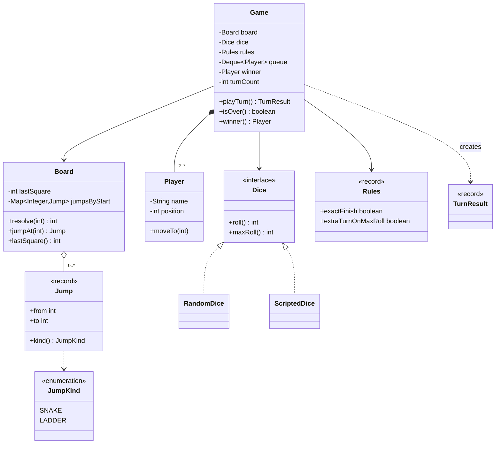
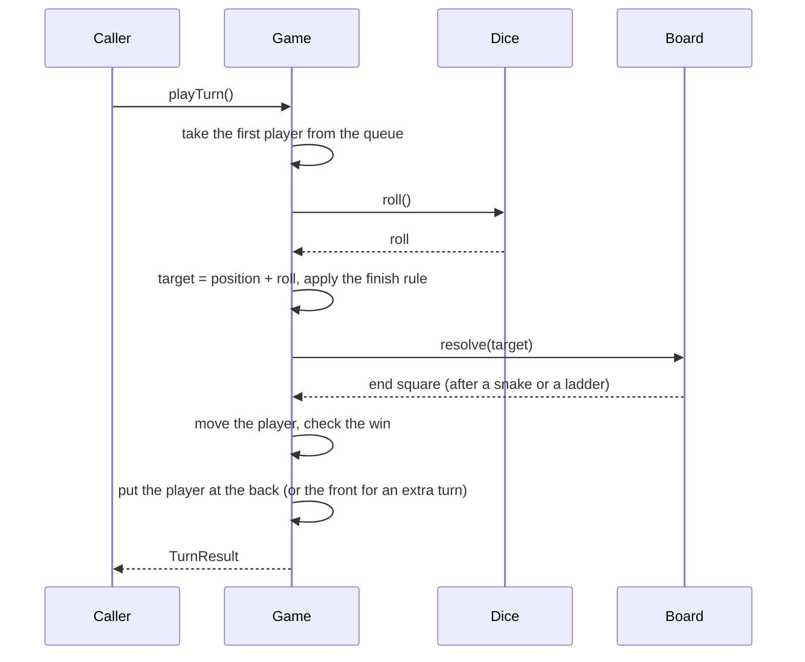

# Design Snake and Ladder

This case study designs the snake and ladder board game for an LLD (low-level design) interview. The game has no skill: dice decide each move. The interview tests how you model a small game with rules that change (the dice, the finish rule, the extra turn), how you validate the board, and how you keep the demo deterministic. The runnable program is in [`Main.java`](Main.java). Run it with `java Main.java` from this folder. The procedure that this page follows is in [How to approach an LLD interview](../../how-to-approach-lld.md). The sibling game design is [tic-tac-toe](../09-tic-tac-toe/README.md).

## Problem Statement

"Design a snake and ladder game. The board has 100 squares. Some squares have a snake head or a ladder bottom. Two or more players start off the board and take turns to roll a die. A player moves forward by the number rolled. A ladder moves the player up. A snake moves the player down. The first player to reach square 100 wins."

The interviewer adds follow-ups: "Use two dice", "Roll again on a 6", "The player needs the exact number to finish", "Make the dice testable", "Generate the snakes and ladders at random".

## Clarifying Questions

| # | Question | Answer that this design assumes |
|---|---|---|
| 1 | How much code do you expect? | Compiling code for the core flow, plus the class diagram |
| 2 | What is the board size, and where do the players start? | The last square is a parameter (100 by default). The board is a line of squares `1..N`. A player starts on square 0, which is off the board |
| 3 | How many players? | Two or more. The caller gives the names. The turn order is the order of the list |
| 4 | What is the dice? One die, two dice, or a loaded die? | The dice is an interface. The default is one die with 6 faces. The roll is the sum of the dice |
| 5 | Does the player need the exact number to reach the last square? | A rule decides. In the standard rules, a roll that goes past the last square does not move the player |
| 6 | Does a roll of 6 give an extra turn? | A rule decides. It is off in the standard rules and on in a second rule set |
| 7 | Can a snake or a ladder end where another one starts? | No. The board rejects this setup. It prevents chains and loops |
| 8 | Can a snake or a ladder start on square 1 or on the last square? | A jump may start on square 1. A jump may not start on the last square, because the game ends there |
| 9 | When does the game end? | When the first player reaches the last square. The others do not continue |
| 10 | Do players block each other (two players on one square)? | No. Several players can share a square |
| 11 | Is a UI in scope? | No. The game returns a result for each turn, and a UI prints it |
| 12 | Do several threads use one game? | Assumption: possible. The turn method uses one lock |
| 13 | Is the demo deterministic? | Yes. The demo uses scripted dice or a seeded `Random` |

## Requirements

### Functional requirements

1. **R1.** Create a board with a last square and a list of jumps. A jump is a snake (it moves a player down) or a ladder (it moves a player up).
2. **R2.** The board rejects an invalid setup: a jump that does not change the square, a jump outside the board, a jump that starts on the last square, two jumps that start on the same square, and a jump that ends where another jump starts.
3. **R3.** Create a game with two or more players, a dice, and a rule set.
4. **R4.** A turn rolls the dice for the player at the front of the queue, moves the player, applies a snake or a ladder, and returns a description of the turn.
5. **R5.** The finish rule is exact: if the roll goes past the last square, the player stays. A second rule can let the player finish with any roll that reaches or passes the last square.
6. **R6.** An optional rule gives the player an extra turn after the highest possible roll.
7. **R7.** The first player on the last square wins, and the game rejects further turns.
8. **R8.** The dice is replaceable: a random dice with a seed, and a scripted dice for tests.

### Non-functional requirements

1. **N1.** One turn takes O(1) time. The jump lookup is a hash map lookup.
2. **N2.** The demo and the tests are deterministic.
3. **N3.** A new dice type, a new jump kind, or a new rule is an addition and not a rewrite.
4. **N4.** Calls from several threads do not corrupt the turn order (see [Concurrency](#concurrency)).

## Entities and Relationships

Take the nouns: game, board, square, snake, ladder, player, dice, die, roll, turn, position, winner. Sort them with the method from [domain modeling](../../fundamentals/05-domain-modeling.md):

| Noun | Kind | Reason |
|---|---|---|
| `Game` | Entity (aggregate root) | Owns the turn queue, the rules, the winner, and the turn count |
| `Board` | Immutable object (not an entity) | Owns the last square and the jumps. Protects the board invariants (R2). It has no state that changes, so it is closer to a value object than to an entity, and two games can share it. It stays a class without value equality, because no code compares two boards |
| `Player` | Entity | Has an identity (the name) and a changing position |
| `Jump` | Value object (`record`) | A start square and an end square. A snake and a ladder are one concept: the kind comes from the direction |
| `JumpKind` | Enum | `SNAKE` or `LADDER`. Derived from `to > from` |
| `Dice` | Interface | The Strategy for rolling. The extension point |
| `RandomDice`, `ScriptedDice` | Classes | Two implementations of `Dice` |
| `Rules` | Value object (`record`) | Two flags: exact finish and extra turn on the maximum roll |
| `TurnResult` | Value object (`record`) | The facts of one turn, for the caller to print or to log |
| Square | Not a class | A number. A `Square` class with a number and an optional jump would be a second way to store the same data |
| Snake, ladder | Not separate classes | They have the same data and the same behavior (move to `to`). See below |

The central modeling decision: **a snake and a ladder are the same type**. Both are "if you land on `from`, move to `to`". The only difference is the sign of `to - from`. Two subclasses, `Snake` and `Ladder`, would have no different behavior. This is the "class for a difference in data" mistake that [OOP](../../fundamentals/01-oop.md) and [anti-patterns](../../fundamentals/11-anti-patterns.md) describe. If a later requirement gives a kind its own behavior (for example, a snake that also skips a turn), the `Jump` record becomes an interface at that time (see the Extensions).

Relationships:

- `Game` composes a queue of `Player` objects (multiplicity 2..*).
- `Game` has one `Board` (association). The caller creates the board and passes it in, so two games can share one immutable board.
- `Game` has one `Dice` (association, injected). `Game` has one `Rules` (association).
- `Board` has 0..* `Jump` objects (aggregation).
- `RandomDice` and `ScriptedDice` realize `Dice`.
- `Game` creates a `TurnResult` for each turn (dependency).

## Class Diagram



The flow of one turn:



## Design Patterns Used

| Pattern | Where | Reason | Rejected alternative |
|---|---|---|---|
| Strategy ([behavioral patterns](../../fundamentals/08-behavioral-patterns.md)) | `Dice` with `RandomDice` and `ScriptedDice` | The statement says the dice can vary (one die, two dice, loaded), and the tests need a fixed sequence. The requirement smell is "several ways to do the same thing". A new dice is a new class | A `Random` field in `Game`, with an `if (testing)` flag. A test then cannot set the rolls, and a new dice edits `Game` |
| Dependency injection ([architectural patterns](../../fundamentals/10-architectural-patterns.md)) | `Game` receives `Board`, `Dice`, and `Rules` in the constructor | The caller chooses the setup, and a test passes a scripted dice | `Game` creates its own `Board` and `Random`. This hides the dependencies and makes the demo non-deterministic |
| Value objects | `Jump`, `Rules`, `TurnResult` | Immutable, equal by data, safe to share | Mutable setters on a `Rules` object |
| Rules as a record of flags | `Rules` | Two rules exist. A record with two booleans is the simplest form | A `Rule` interface with a chain of rule objects. Use it when there are more than three rules, or when a rule has its own logic (see the Extensions) |
| Queue for the turn order | `Deque<Player>` | Rotation is `pollFirst` then `addLast`. An extra turn is `addFirst`. A finished player is not put back, which is the whole change for the "rank all players" extension | An `int currentIndex` with `(i + 1) % n`. It also works: an extra turn is "do not advance the index". Removal of a finished player from a list needs an index correction, which the queue avoids. [Tic-tac-toe](../09-tic-tac-toe/README.md) uses the index, because its two players never leave the game |
| Map from start square to jump | `Board.jumpsByStart` | One lookup for each turn, O(1) | A `Cell[]` array with an optional jump in each cell. It also works for 100 squares, and uses more memory for a large board. A scan of the jump list for each turn is O(J) |
| State pattern | Not used | The game has two states, in progress and over, and `winner != null` tells them apart | A `GameState` hierarchy. It adds classes and no new behavior. See [behavioral patterns](../../fundamentals/08-behavioral-patterns.md) for when it fits |

## Key Code

The code below is copied from [`Main.java`](Main.java).

### Jumps, rules, and the dice contract

A `Jump` has a `kind()` that depends on the direction, so the board stores snakes and ladders in one collection. `Rules` holds the two rule flags. `Dice` has `roll()` and `maxRoll()`. The game uses `maxRoll()` to know when a roll is the highest possible roll (for the extra turn rule), so it does not hard-code the number 6.

```java
enum JumpKind { SNAKE, LADDER }

record Jump(int from, int to) {
    JumpKind kind() {
        return to > from ? JumpKind.LADDER : JumpKind.SNAKE;
    }
}

record Rules(boolean exactFinish, boolean extraTurnOnMaxRoll) {
    static final Rules STANDARD = new Rules(true, false);
    static final Rules EXTRA_TURN_ON_MAX = new Rules(true, true);
}

interface Dice {
    int roll();

    int maxRoll();
}
```

### Two dice implementations

`RandomDice` rolls `count` dice with `faces` faces, and it sums them. It receives the `Random` from the caller. The caller passes `new Random(7)`: a `Random` with a seed returns the same sequence on each run, because the `java.util.Random` class specifies its algorithm. `ScriptedDice` returns a fixed list of values, and it fails with `NoSuchElementException` if the script is too short. The test then fails loudly. The first constructor argument of `ScriptedDice` is the highest possible roll, and the other arguments are the script: `new ScriptedDice(6, 3, 4)` rolls 3, then 4.

```java
class RandomDice implements Dice {
    private final Random random;
    private final int count;
    private final int faces;

    RandomDice(Random random, int count, int faces) {
        this.random = random;
        this.count = count;
        this.faces = faces;
    }

    @Override
    public int roll() {
        int total = 0;
        for (int i = 0; i < count; i++) {
            total += random.nextInt(faces) + 1;
        }
        return total;
    }

    @Override
    public int maxRoll() {
        return count * faces;
    }
}
```

```java
class ScriptedDice implements Dice {
    private final int maxRoll;
    private final Deque<Integer> values = new ArrayDeque<>();

    ScriptedDice(int maxRoll, int... script) {
        this.maxRoll = maxRoll;
        for (int value : script) {
            values.addLast(value);
        }
    }

    @Override
    public int roll() {
        return values.removeFirst();
    }

    @Override
    public int maxRoll() {
        return maxRoll;
    }
}
```

### The board and its validation

The constructor checks each jump with `validate`, and it checks that no two jumps start on the same square. Then it checks that no jump ends where another starts. This last rule makes a jump final: a player lands on the end square, and the end square has no jump. Without the rule, a ladder could end on a snake head (a chain), or two jumps could form a loop (for example, a ladder 4 -> 9 and a snake 9 -> 4). If `resolve` followed jumps until it reached a square without a jump, a loop would never end. If `resolve` applies only one jump (as here), the player stops on a snake head and does not slide down, which breaks the game rule. The board rule removes both problems, so `resolve` needs only one lookup.

```java
    Board(int lastSquare, List<Jump> jumps) {
        if (lastSquare < 2) {
            throw new IllegalArgumentException("Board needs at least 2 squares");
        }
        this.lastSquare = lastSquare;
        for (Jump jump : jumps) {
            validate(jump);
            if (jumpsByStart.put(jump.from(), jump) != null) {
                throw new IllegalArgumentException("Two jumps start on square " + jump.from());
            }
        }
        for (Jump jump : jumps) {
            if (jumpsByStart.containsKey(jump.to())) {
                throw new IllegalArgumentException(
                        "Jump " + jump.from() + "->" + jump.to() + " ends where another starts");
            }
        }
    }

    private void validate(Jump jump) {
        if (jump.from() == jump.to()) {
            throw new IllegalArgumentException("A jump must change the square: " + jump.from());
        }
        if (jump.from() < 1 || jump.from() >= lastSquare) {
            throw new IllegalArgumentException("A jump cannot start on square " + jump.from()
                    + " (valid: 1.." + (lastSquare - 1) + ")");
        }
        if (jump.to() < 1 || jump.to() > lastSquare) {
            throw new IllegalArgumentException("A jump ends outside the board: " + jump.to());
        }
    }
```

`resolve` returns the end square of a jump, or the same square if there is no jump. The lookup is O(1).

```java
    // Returns the square after a snake or ladder, or the same square if there is none.
    int resolve(int square) {
        Jump jump = jumpsByStart.get(square);
        return jump == null ? square : jump.to();
    }

    Jump jumpAt(int square) {
        return jumpsByStart.get(square);
    }
```

### One turn

`playTurn` runs the whole turn. The steps: take the first player, roll, compute the target, apply the finish rule, resolve a snake or a ladder, move the player, check the win, and put the player back in the queue. The method is `synchronized`, so one turn is one step (see [Concurrency](#concurrency)).

Two details: when the roll goes past the last square, the standard rules set `target = from`, so the player stays and `board.resolve(from)` finds no jump (an end square never has a jump, by the board rule). When the player reaches the last square, the player is not put back in the queue, and `winner` is set.

```java
    synchronized TurnResult playTurn() {
        if (isOver()) {
            throw new IllegalStateException("The game is over");
        }
        Player player = queue.pollFirst();
        int roll = dice.roll();
        turnCount++;
        int from = player.position();
        int target = from + roll;
        String note = "";
        if (target > board.lastSquare()) {
            if (rules.exactFinish()) {
                target = from;
                note = "needs exact roll, stays";
            } else {
                target = board.lastSquare();
            }
        }
        int end = board.resolve(target);
        Jump jump = board.jumpAt(target);
        if (jump != null) {
            note = jump.kind().name().toLowerCase(Locale.ROOT);
        }
        player.moveTo(end);
        boolean extraTurn = rules.extraTurnOnMaxRoll() && roll == dice.maxRoll();
        if (end == board.lastSquare()) {
            winner = player;
            note = note.isEmpty() ? "wins" : note + ", wins";
        } else if (extraTurn) {
            queue.addFirst(player);
            note = note.isEmpty() ? "extra turn" : note + ", extra turn";
        } else {
            queue.addLast(player);
        }
        return new TurnResult(player.name(), roll, from, target, end, note);
    }
```

## Concurrency

**What can race.** A turn is a compound action: take the first player from the queue, roll, move the player, and put the player back. If two threads call `playTurn` at the same time, both can take different players and both can roll in an interleaved order. Worse, both can read the `winner` as `null`, and both can set it, or a `Deque` operation can run in a bad interleaving, because `ArrayDeque` is not thread-safe. A scripted dice can also lose the order of its values.

**The fix.** `playTurn` is `synchronized`, so one thread plays one whole turn at a time. One game has one lock. The work in the lock is O(1). The dice roll is inside the lock on purpose: it keeps the order of the rolls the same as the order of the turns, which a seeded dice needs for repeatable results. See [concurrency in LLD](../../fundamentals/09-concurrency-in-lld.md) for the comparison of lock choices.

**Known limit.** `isOver`, `winner`, `turnCount`, and `players` are `synchronized` too, so a reader on another thread sees the state after a complete turn. `players()` returns a copy of the list, but each `Player` object is mutable, so the caller sees live positions without the lock. A UI should read the `TurnResult` and not the `Player` objects.

**What does not race.** The `Board` has no mutable state after the constructor, so many games and threads can share one board without a lock. Several games at the same time share nothing else, if each game has its own `Dice` and `Random`. A `Random` object is thread-safe, but two games that share one `Random` get a sequence that depends on the thread schedule, so share nothing in a test.

A turn-based game needs no more concurrency than this. Do not add threads for the players. The players take turns, so a thread for each player would only wait for its turn.

## Extensions

| Extension | Class changes | Notes |
|---|---|---|
| **Two dice, or a different die.** Roll two dice and move by the sum | Create `new RandomDice(random, 2, 6)`. No class changes | `maxRoll()` returns 12, so the extra turn rule uses 12. The rule is "the highest possible roll", and that is the reason that `maxRoll()` is in the interface. A "double" rule (two equal dice) needs a `Dice` that returns the individual values: add `int[] rollEach()` or a `DiceRoll` record with the values and the sum |
| **A loaded die.** A die that favors some faces | Add `WeightedDice implements Dice`. It holds the weights, and it picks a face with one `random.nextDouble()` | `Game` stays |
| **Three sixes in a row lose the turn.** A rule that needs a counter | Add `int consecutiveMax` to `Player` (or a map in `Game`). In `playTurn`, count the extra turns, and cancel the move and the extra turn on the third | `Rules` gets a new flag or a limit (`maxConsecutiveExtraTurns`). `Board` and `Dice` stay |
| **Bounce back on overshoot.** A player who passes the last square moves back by the excess | Replace the boolean `exactFinish` with a `FinishRule` interface: `StayRule`, `BounceRule`, `AnyRollRule`. `Game` calls `rules.finish().resolve(from, roll, last)` | Strategy again. Do this when there are three or more finish variants. Two variants fit in a flag |
| **The player needs a 1 (or a 6) to start.** | Add `boolean started` to `Player` and a `startRoll` to `Rules`. The first check in `playTurn` skips a move if the player has not started and the roll is not the start roll | `Board` and `Dice` stay |
| **Rank all players.** The game continues until all but one finish | Keep a `List<Player> finishOrder`. When a player reaches the last square, add the player to the list and do not put the player back in the queue. The game is over when the queue has one player | `Board` and `Dice` stay. `winner()` becomes `ranking()` |
| **Random board generation.** The game creates snakes and ladders | Add `BoardFactory.random(size, snakes, ladders, Random)`. The factory picks distinct squares and builds `Jump` objects. The `Board` constructor still validates them. A builder can check that the last square stays reachable | `Game` stays. Use a seeded `Random` for a repeatable test |
| **Special squares** (skip a turn, extra roll, teleport) | Turn `Jump` into a `SquareEffect` interface with `apply(Player, Game)`. `Jump` becomes one effect. `Board` maps a square to an effect | This is the point where a class hierarchy for the square effects is right, because each effect has its own behavior |
| **UI and logging.** Notify a screen after each turn | Add `GameListener.onTurn(TurnResult)`. `Game` keeps a list and calls the listeners after each turn, preferably after the lock is released | Observer pattern. See [behavioral patterns](../../fundamentals/08-behavioral-patterns.md) |
| **Undo the last turn** | Store a `TurnRecord` with the player, the old position, and where the player went in the queue (the back after a normal turn, the front after an extra turn, nowhere after a win). `undo` removes the player from that end of the queue (`pollLast` or `pollFirst`), puts the player at the front, restores the old position, clears `winner`, and decrements `turnCount` | Each turn changes one player and the queue, so the record is small. Undo does not rewind a `Random`: the next roll after an undo is a new value, not the undone one. If the replay must give the same roll, store the roll in the record and replay it |
| **Online play** | Add the player id to `playTurn(playerId)` and reject a call from a player who is not first in the queue. Keep the check inside the lock | `Dice` stays on the server. The client never rolls |

## Common Mistakes

| Mistake | Why it hurts | Fix |
|---|---|---|
| `Snake` and `Ladder` as two subclasses of `Cell` or `Jump` with the same behavior | Two classes for a difference in data | One `Jump` record. The kind comes from the direction |
| A `Cell` object for each square, with the logic in the cell | 100 objects, and a board that is hard to validate | A map from the start square to the jump. Squares are numbers |
| A `Random` created inside `Game` | The demo and the tests are not repeatable, and the dice cannot change | Inject a `Dice`. Use a seeded `Random` or a scripted dice in tests |
| `Math.random()` in the demo | No seed, so the output changes on each run | `new Random(seed)` |
| No board validation | A snake that ends on a ladder, or a loop, or a jump from the last square, breaks the game or loops forever | Validate in the `Board` constructor. Reject chains and loops |
| A roll that passes the last square is not handled | The position is above the last square, or an index error occurs | Apply the finish rule before the jump lookup |
| Checking the win before the snake or ladder | A ladder that ends on the last square is missed, or a snake on the last square is applied | Resolve the jump first, then check the position. The board does not allow a jump from the last square |
| Hard-coding 6 for the extra turn | Two dice break the rule | Ask the dice for `maxRoll()` |
| Hard-coding 100 | A different board needs a rewrite | A `lastSquare` parameter |
| The player moves itself (`player.roll(dice, board)`) | The player knows the board and the rules | `Game` owns the turn. `Player` holds a name and a position |
| Printing inside `Game` | The game cannot be reused with a UI or a test | Return a `TurnResult` |
| A thread for each player | The threads only wait for their turn, and the order is random | One thread calls `playTurn` in a loop |

## 45-Minute Plan

The times follow the budget in [How to approach an LLD interview](../../how-to-approach-lld.md#time-budget). This is a smaller problem than the parking lot, so use the spare time for the rules and the extensions.

| Minutes | Step | What to present |
|---|---|---|
| 0 to 5 | Introductions | Listen. Repeat the problem in one sentence |
| 5 to 10 | Clarify | Ask the questions in the table above. Fix the points: board size, start on square 0, exact finish, extra turn, a rule against chains. Write R1 to R8 |
| 10 to 15 | Use cases and entities | List: create the board, create the game, play a turn, find the winner. Show the entity table. Say that a snake and a ladder are one `Jump` type |
| 15 to 23 | Relationships, diagram, patterns | Draw `Game`, `Board`, `Jump`, `Player`, `Dice`, `Rules`. Say "Strategy for the dice, because the dice varies and the tests need a fixed sequence", and name the rejected alternative. Say "no State pattern" and give the reason |
| 23 to 27 | Signatures | `Game.playTurn()`, `Board.resolve(int)`, `Dice.roll()`, `Dice.maxRoll()` |
| 27 to 39 | Core code | Write `Jump`, `Dice` with `ScriptedDice`, `Board` with validation, and `Game.playTurn`. Walk through one turn with a ladder and one turn with a snake |
| 39 to 41 | Concurrency | "`playTurn` is a compound action on the queue. One lock for each game. The board is immutable and needs no lock" |
| 41 to 45 | Extensions | Two dice (no code change), the finish rule as an interface, three sixes, special squares as `SquareEffect`, a listener for the UI. Leave time for questions |

If you run short of time, write `Board.resolve` and `Game.playTurn`, and describe the validation as "reject a jump that does not change the square, an invalid start square, and a chain".

## Expected Output

The demo has four parts: scripted dice on a 20-square board with the exact finish rule (R4, R5, R7), the extra turn rule (R6), invalid boards (R2), and a seeded random game on a 100-square board with three players (R8). The output is the same on each run: the first two parts use scripted dice, and the last part uses `new Random(7)`.

<!-- expected-output -->
```text
== 1. Scripted dice, exact finish ==
Asha rolls 3: 0 -> 3 -> 11 (ladder)
Ben rolls 4: 0 -> 4
Asha rolls 3: 11 -> 14 -> 7 (snake)
Ben rolls 2: 4 -> 6 -> 15 (ladder)
Asha rolls 6: 7 -> 13
Ben rolls 2: 15 -> 17 -> 4 (snake)
Asha rolls 6: 13 -> 19
Ben rolls 5: 4 -> 9
Asha rolls 3: 19 -> 19 (needs exact roll, stays)
Ben rolls 6: 9 -> 15
Asha rolls 1: 19 -> 20 (wins)
Winner: Asha
== 2. Extra turn on the highest roll ==
Asha rolls 6: 0 -> 6 -> 15 (ladder, extra turn)
Asha rolls 4: 15 -> 19
Ben rolls 1: 0 -> 1
Asha rolls 1: 19 -> 20 (wins)
Winner: Asha
== 3. Invalid board setups ==
Rejected: A jump must change the square: 5
Rejected: Two jumps start on square 4
Rejected: Jump 4->9 ends where another starts
Rejected: A jump cannot start on square 20 (valid: 1..19)
== 4. Seeded dice on a 100-square board ==
Asha rolls 5: 0 -> 5
Ben rolls 3: 0 -> 3
Chen rolls 4: 0 -> 4 -> 14 (ladder)
Asha rolls 5: 5 -> 10
Ben rolls 5: 3 -> 8
Chen rolls 5: 14 -> 19
Asha rolls 5: 10 -> 15
Ben rolls 6: 8 -> 14
Turns played: 183
Winner: Chen
Asha ends on square 88
Ben ends on square 83
Chen ends on square 100
```
