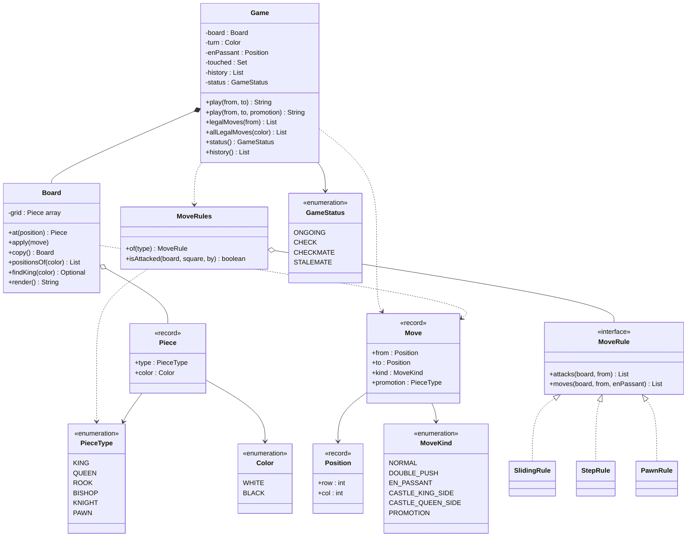
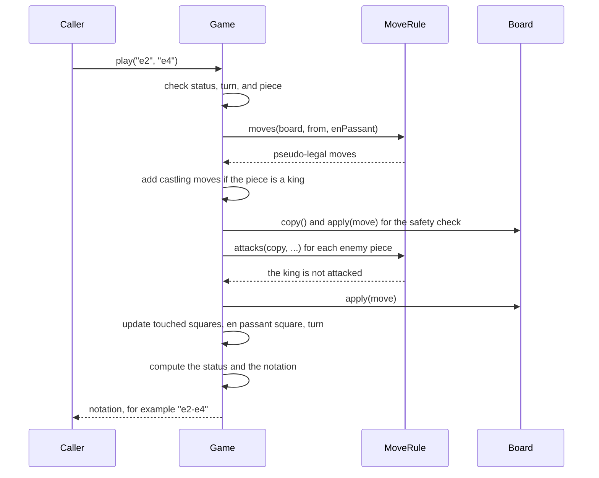

# Design Chess

## Problem Statement

The interviewer says: "Design a chess game for two players. The program holds the board and the pieces, checks that each move is legal, and tells the players when the game ends. Include castling, en passant, and pawn promotion. Keep the history of the moves." Chess is a popular LLD problem because the rules are well known and the model has a real design choice: one class for each piece, or one movement rule for each kind of movement. Follow the procedure in [How to Approach an LLD Interview](../../how-to-approach-lld.md).

## Clarifying Questions

| Question | Answer that this design assumes |
|---|---|
| Who plays? | Two human players who take turns. A player is only "the side to move". An AI player is an extension (see Extensions) |
| Which rules are in scope? | All piece movements, check, checkmate, stalemate, castling, en passant, and promotion |
| Which draw rules are in scope? | Only stalemate. Threefold repetition, the fifty-move rule, and insufficient material are extensions |
| How does a player enter a move? | As two squares in text form, for example `e2` and `e4`. The code parses them. A graphical user interface is out of scope |
| What happens on an illegal move? | The game throws `IllegalMoveException` with the reason. The game state does not change, and the same player moves again |
| What does a pawn become on promotion? | The caller names the piece. If the caller names none, the pawn becomes a queen |
| Do we need undo? | No. The game keeps a history of the move notations. Undo is an extension |
| Is there a chess clock? | No. A clock is an extension |
| Do many threads call the game? | Yes, for example one thread for each player connection. The game rejects a move when it is not that side's turn |
| Storage? | In memory. One `Game` object holds one game |

## Requirements

Functional requirements:

1. The game starts with the standard position and White to move.
2. A player moves a piece from one square to another. The game accepts the move only if the move is legal for that piece in that position.
3. A move is illegal if it leaves the mover's own king in check, even when the piece itself may move that way.
4. The game supports castling (king side and queen side), en passant, and pawn promotion.
5. After each move, the game reports the status: ongoing, check, checkmate, or stalemate. After checkmate or stalemate, the game rejects all moves.
6. The game keeps the move history in a readable notation.
7. A caller asks for the legal moves of a side, for example to show the possible moves of a selected piece.

Non-functional requirements:

- Adding or changing a movement rule must not change `Game` or `Board`.
- A rejected move does not change the board, the turn, or the history.
- Two threads that move at the same time cannot both succeed for the same turn.
- The program is deterministic. The same moves give the same output.

## Entities and Relationships

| Type | Kind | Responsibility |
|---|---|---|
| `Game` | Entity (the aggregate root) | Owns the board, the turn, the history, the castling and en passant data, and the status. Exposes `play`. Applies the rules that need the whole position: check, castling, status |
| `Board` | Entity | Holds the 8 by 8 grid. Applies a move, including the three special moves. Copies itself for look-ahead |
| `Piece` | Value object (`record`) | A piece type and a color. It has no position and no history |
| `PieceType`, `Color` | Enums | The six kinds of piece. The two sides, with their direction and home row |
| `Position` | Value object (`record`) | A square (row and column). Rejects a square outside the board. Parses and prints names such as `e4` |
| `Move` | Value object (`record`) | A start square, an end square, a `MoveKind`, and a promotion piece type if any |
| `MoveKind` | Enum | `NORMAL`, `DOUBLE_PUSH`, `EN_PASSANT`, two castling kinds, `PROMOTION` |
| `MoveRule` | Interface (Strategy) | Two questions about one piece: which squares does it attack, and which pseudo-legal moves does it have |
| `SlidingRule`, `StepRule`, `PawnRule` | Classes | The three movement rules. Rook, bishop, and queen share `SlidingRule` with different direction tables. King and knight share `StepRule` with different offset tables |
| `MoveRules` | Utility | Maps each `PieceType` to its `MoveRule`. Answers "is this square attacked by this side?" |
| `GameStatus` | Enum | `ONGOING`, `CHECK`, `CHECKMATE`, `STALEMATE` |
| `IllegalMoveException` | Exception | Carries the reason why a move was refused |

Terms: a **pseudo-legal move** is a move that obeys the movement rule of the piece but may leave the own king in check. A **legal move** is a pseudo-legal move that does not leave the own king in check. A square is **attacked** by a side if one of its pieces could capture an enemy piece on that square. A piece attacks a square even if it may not move there because the move would leave its own king in check (FIDE Laws of Chess, Articles 3.1.2 and 3.1.3). For that reason `attacks` ignores pins.

The rules in this page follow the [FIDE Laws of Chess](https://handbook.fide.com/chapter/E012023) (applied from 1 January 2023). Article 3 defines the moves of the pieces, castling, check, and legal moves. Article 5 defines checkmate and stalemate.

Relationships:

- `Game` owns one `Board` (composition) and uses `MoveRules` to generate moves (dependency).
- `Board` holds up to 32 `Piece` values (aggregation). A `Piece` value does not know its square. The board knows it.
- `MoveRules` holds one `MoveRule` for each `PieceType`. The rules are stateless, so all games share them.
- `Game` records the history as a list of strings. A richer history is an extension.

Where the rules live: a movement rule needs only the board and one square, so it lives in a `MoveRule`. A rule that needs the whole position (check, castling rights, en passant, status) lives in `Game`. This split is the central design decision of the case study.

## Class Diagram



The sequence of one call to `play`:



## Design Patterns Used

| Pattern | Where | Reason | Rejected alternative |
|---|---|---|---|
| Strategy ([behavioral patterns](../../fundamentals/08-behavioral-patterns.md)) | `MoveRule` with `SlidingRule`, `StepRule`, `PawnRule`, registered in `MoveRules` | The only difference between a rook and a bishop is a table of directions. A strategy object holds the table and the loop. Six piece types need three rule classes. A new piece type (a variant piece) needs one `MoveRule` and one entry in the registry | An abstract `Piece` class with six subclasses that each implement `canMove`. See the next paragraph |
| Template Method through a `default` method ([behavioral patterns](../../fundamentals/08-behavioral-patterns.md)) | `MoveRule.moves` calls the abstract `attacks` and filters out squares with own pieces | `SlidingRule` and `StepRule` need no more than "attacked squares minus own pieces", so they inherit the default. Only `PawnRule` overrides `moves`, because a pawn moves and attacks in different ways | Copy the filter into each rule class (duplicated code) |
| Immutable value objects ([OOP](../../fundamentals/01-oop.md), [domain modeling](../../fundamentals/05-domain-modeling.md), [design principles](../../fundamentals/03-design-principles.md)) | `Piece`, `Position`, `Move` | A piece and a square are equal if their data is equal. Immutable values are safe to put in a `Set` (the `touched` set) and in a `List` that several threads read | Mutable `Piece` objects that store their own position and a `hasMoved` flag. The board and the piece then hold the same fact twice and can disagree |
| Flyweight in spirit ([structural patterns](../../fundamentals/07-structural-patterns.md)) | `MoveRules` holds one shared, stateless `MoveRule` for each piece type | 32 pieces share 6 rule objects, and the rules need no per-piece data | One rule object for each piece, created in the constructor of the piece |
| Static factory ([creational patterns](../../fundamentals/06-creational-patterns.md)) | `Board.initial()` | The setup of the standard position has a name. The constructor stays empty, and `copy()` can build an empty board | A public constructor with a flag "standard position" |
| Memento (extension) ([behavioral patterns](../../fundamentals/08-behavioral-patterns.md)) | Not in the code. Used for undo (see Extensions) | A snapshot of the board and the rule data restores a position | Replaying all moves from the start. It works, and it is slower |

Why this design rejects one subclass for each piece: the classic answer is `abstract class Piece` with `King`, `Queen`, `Rook`, `Bishop`, `Knight`, and `Pawn`. It is a valid answer for a 45-minute round, and you can present it if you state the trade-off. This design rejects it for two reasons:

1. Rook, bishop, and queen repeat the same sliding loop. A subclass design either copies the loop into three classes, or adds a `SlidingPiece` base class that takes a direction table. The second option is already the Strategy design with an extra layer of inheritance: the difference between the pieces is data, not behavior.
2. The look-ahead for the check test copies the board. Subclass designs often give each piece its own state (its square, a `hasMoved` flag). A board of such objects needs a deep copy, and the piece and the board hold the same fact twice. A board of immutable `Piece` values needs a copy of an array.

Promotion is not a reason to choose either design. Both replace the pawn with a new object: `new Queen(color)` in the subclass design, `new Piece(QUEEN, color)` here.

The price of the Strategy design: a rule reads the type of the piece from the board and dispatches through a map. A reader who expects `King.canMove` has to look in `MoveRules`. This is a small price for a design where a new movement is a data change.

Why `attacks` and `moves` are two methods: a pawn moves forward but attacks diagonally. The question "does the enemy attack this square?" needs the attack squares. If the code used pawn moves for that question, a pawn would seem to attack the square in front of it, and it would not attack an empty square on the diagonal. The king cannot move into an attacked square, and castling needs three squares that no enemy attacks. Both rules use `attacks`.

The [OOP page](../../fundamentals/01-oop.md) explains why composition and data beat a deep inheritance tree here. The [SOLID page](../../fundamentals/02-solid.md) explains the Open-Closed Principle that the registry serves. The [anti-patterns page](../../fundamentals/11-anti-patterns.md) lists the "God object". `Game` is at risk of becoming one, and the design keeps the movement rules out of it for that reason.

## Key Code

The complete runnable program is in [`Main.java`](Main.java). Run it with `java Main.java`.

### Values: pieces, squares, and moves

A `Piece` holds a type and a color and nothing else. `Position` rejects a square outside the board in its compact constructor, so every `Position` in the program is valid. `Move` is data, and `MoveKind` tells the board how to apply it.

```java
record Piece(PieceType type, Color color) {
    char symbol() {
        return color == Color.WHITE ? type.letter() : Character.toLowerCase(type.letter());
    }
}
```

```java
record Position(int row, int col) {
    Position {
        if (!isValid(row, col)) {
            throw new IllegalArgumentException("Off the board: " + row + "," + col);
        }
    }

    static boolean isValid(int row, int col) {
        return row >= 0 && row < 8 && col >= 0 && col < 8;
    }

    static Position parse(String square) {
        if (square.length() != 2) {
            throw new IllegalArgumentException("Bad square: " + square);
        }
        return new Position(square.charAt(1) - '1', square.charAt(0) - 'a');
    }

    @Override
    public String toString() {
        return "" + (char) ('a' + col) + (char) ('1' + row);
    }
}
```

```java
enum MoveKind {
    NORMAL, DOUBLE_PUSH, EN_PASSANT, CASTLE_KING_SIDE, CASTLE_QUEEN_SIDE, PROMOTION
}
```

```java
record Move(Position from, Position to, MoveKind kind, PieceType promotion) {
    static Move normal(Position from, Position to) {
        return new Move(from, to, MoveKind.NORMAL, null);
    }
}
```

### The movement rule

`attacks` is the one method that a rule must write. The default `moves` method turns the attacked squares into pseudo-legal moves: a square is a move if it does not hold a piece of the same color.

```java
interface MoveRule {
    // Squares that the piece attacks. A square with a piece of the same color is included,
    // because that piece is defended.
    List<Position> attacks(Board board, Position from);

    // The pseudo-legal moves: the piece obeys its own movement rule, but the move may still
    // leave its own king in check. The Game removes those moves.
    default List<Move> moves(Board board, Position from, Position enPassant) {
        Color mine = board.at(from).color();
        List<Move> result = new ArrayList<>();
        for (Position to : attacks(board, from)) {
            Piece target = board.at(to);
            if (target == null || target.color() != mine) {
                result.add(Move.normal(from, to));
            }
        }
        return result;
    }
}
```

`SlidingRule` walks along each direction until it leaves the board or meets a piece. It includes the square of the piece that blocks the line, because that piece is attacked (or defended). The `moves` method then removes it if the piece has the same color. A rook, a bishop, and a queen differ only in the direction table.

```java
class SlidingRule implements MoveRule {
    private final int[][] directions;

    SlidingRule(int[][] directions) {
        this.directions = directions;
    }

    @Override
    public List<Position> attacks(Board board, Position from) {
        List<Position> squares = new ArrayList<>();
        for (int[] d : directions) {
            int row = from.row() + d[0];
            int col = from.col() + d[1];
            while (Position.isValid(row, col)) {
                Position square = new Position(row, col);
                squares.add(square);
                if (board.at(square) != null) {
                    break;
                }
                row += d[0];
                col += d[1];
            }
        }
        return squares;
    }
}
```

`StepRule` has the same shape without the inner loop. The knight and the king use it. A knight does not care about pieces in between, so one step in the table is the whole rule.

```java
class StepRule implements MoveRule {
    private final int[][] offsets;

    StepRule(int[][] offsets) {
        this.offsets = offsets;
    }

    @Override
    public List<Position> attacks(Board board, Position from) {
        List<Position> squares = new ArrayList<>();
        for (int[] d : offsets) {
            int row = from.row() + d[0];
            int col = from.col() + d[1];
            if (Position.isValid(row, col)) {
                squares.add(new Position(row, col));
            }
        }
        return squares;
    }
}
```

`PawnRule` is the one rule that overrides `moves`. A pawn pushes one square if it is empty. From its start row it may push two squares if both are empty. It captures diagonally if an enemy piece stands there. It captures en passant if the diagonal square is the en passant target and an enemy pawn stands beside it. The second test matters when a caller asks for the moves of the side that just moved: without it, a White pawn on d2 would get a false en passant capture on e3 right after White played e2-e4. When a move reaches the last row, the rule returns one move for each promotion piece.

```java
    public List<Move> moves(Board board, Position from, Position enPassant) {
        Color color = board.at(from).color();
        List<Move> result = new ArrayList<>();
        Position one = new Position(from.row() + color.forward(), from.col());
        if (board.at(one) == null) {
            addMove(result, from, one, color);
            int startRow = color.homeRow() + color.forward();
            Position two = new Position(one.row() + color.forward(), from.col());
            if (from.row() == startRow && board.at(two) == null) {
                result.add(new Move(from, two, MoveKind.DOUBLE_PUSH, null));
            }
        }
        for (Position diagonal : attacks(board, from)) {
            Piece target = board.at(diagonal);
            if (target != null && target.color() != color) {
                addMove(result, from, diagonal, color);
            } else if (target == null && diagonal.equals(enPassant)
                    && isEnemyPawn(board.at(new Position(from.row(), diagonal.col())), color)) {
                result.add(new Move(from, diagonal, MoveKind.EN_PASSANT, null));
            }
        }
        return result;
    }

    // En passant needs the enemy pawn that made the double step beside this pawn.
    private static boolean isEnemyPawn(Piece piece, Color color) {
        return piece != null && piece.type() == PieceType.PAWN && piece.color() != color;
    }

    // A pawn that reaches the last row produces one move for each promotion piece.
    private void addMove(List<Move> result, Position from, Position to, Color color) {
        if (to.row() == color.opposite().homeRow()) {
            for (PieceType type : PROMOTIONS) {
                result.add(new Move(from, to, MoveKind.PROMOTION, type));
            }
        } else {
            result.add(Move.normal(from, to));
        }
    }
```

`MoveRules` is the registry. Four tables (straight, diagonal, the eight neighbors, and the knight jumps) are the whole movement knowledge of the program, apart from the pawn. The method `isAttacked` asks every piece of the attacking side.

```java
final class MoveRules {
    private static final int[][] STRAIGHT = {{1, 0}, {-1, 0}, {0, 1}, {0, -1}};
    private static final int[][] DIAGONAL = {{1, 1}, {1, -1}, {-1, 1}, {-1, -1}};
    private static final int[][] EIGHT = {{1, 0}, {-1, 0}, {0, 1}, {0, -1},
        {1, 1}, {1, -1}, {-1, 1}, {-1, -1}};
    private static final int[][] KNIGHT_JUMPS = {{1, 2}, {2, 1}, {-1, 2}, {-2, 1},
        {1, -2}, {2, -1}, {-1, -2}, {-2, -1}};
    private static final Map<PieceType, MoveRule> RULES = new EnumMap<>(PieceType.class);

    static {
        RULES.put(PieceType.ROOK, new SlidingRule(STRAIGHT));
        RULES.put(PieceType.BISHOP, new SlidingRule(DIAGONAL));
        RULES.put(PieceType.QUEEN, new SlidingRule(EIGHT));
        RULES.put(PieceType.KNIGHT, new StepRule(KNIGHT_JUMPS));
        RULES.put(PieceType.KING, new StepRule(EIGHT));
        RULES.put(PieceType.PAWN, new PawnRule());
    }

    private MoveRules() {
    }

    static MoveRule of(PieceType type) {
        return RULES.get(type);
    }

    static boolean isAttacked(Board board, Position square, Color by) {
        for (Position from : board.positionsOf(by)) {
            if (of(board.at(from).type()).attacks(board, from).contains(square)) {
                return true;
            }
        }
        return false;
    }
}
```

### The board applies moves

The board does not check rules. It trusts the move. The three special moves change more than the two squares of the move, and the `switch` on the `MoveKind` is the only place that knows how: en passant removes the captured pawn from the square beside the start square, castling moves the rook, and promotion replaces the piece.

```java
    // Applies a move that the rules already accepted. Handles the three special moves.
    void apply(Move move) {
        Piece piece = at(move.from());
        int row = move.from().row();
        put(move.from(), null);
        switch (move.kind()) {
            case EN_PASSANT -> put(new Position(row, move.to().col()), null);
            case CASTLE_KING_SIDE -> moveRook(row, 7, 5);
            case CASTLE_QUEEN_SIDE -> moveRook(row, 0, 3);
            case PROMOTION -> piece = new Piece(move.promotion(), piece.color());
            default -> { }
        }
        put(move.to(), piece);
    }
```

### The game decides what is legal

`play` is the only public way to change the game. It checks the status, the square, and the turn. It finds the pseudo-legal moves that end on the target square. It chooses the promotion move. Then it runs the safety test, applies the move, and updates the data that the next move needs: the touched squares, the en passant square, the turn, and the status.

```java
    synchronized String play(String from, String to, PieceType promotion) {
        if (status.isOver()) {
            throw new IllegalMoveException("The game is over: " + status);
        }
        Position source = Position.parse(from);
        Position target = Position.parse(to);
        Piece piece = board.at(source);
        if (piece == null) {
            throw new IllegalMoveException("No piece on " + source);
        }
        if (piece.color() != turn) {
            throw new IllegalMoveException("It is " + turn + "'s turn");
        }
        List<Move> candidates = pseudoMoves(source).stream()
                .filter(m -> m.to().equals(target)).toList();
        if (candidates.isEmpty()) {
            throw new IllegalMoveException(piece.type() + " cannot move from " + source
                    + " to " + target);
        }
        PieceType wanted = promotion == null ? PieceType.QUEEN : promotion;
        Move move = candidates.stream()
                .filter(m -> m.promotion() == null || m.promotion() == wanted)
                .findFirst()
                .orElseThrow(() -> new IllegalMoveException("Cannot promote to " + wanted));
        if (!isSafe(move, turn)) {
            throw new IllegalMoveException("The move leaves the king in check");
        }
        String text = notation(piece, move, board.at(target) != null);
        board.apply(move);
        touched.add(source);
        touched.add(target);
        enPassant = move.kind() == MoveKind.DOUBLE_PUSH
                ? new Position((source.row() + target.row()) / 2, source.col()) : null;
        turn = turn.opposite();
        status = computeStatus();
        text += status == GameStatus.CHECKMATE ? "#" : status == GameStatus.CHECK ? "+" : "";
        history.add(text);
        return text;
    }
```

The safety test plays the move on a copy of the board and asks whether the king is attacked. The real board never holds an illegal position, so no rollback code exists.

```java
    // Plays the move on a copy of the board and checks that the king is not attacked.
    private boolean isSafe(Move move, Color color) {
        Board copy = board.copy();
        copy.apply(move);
        Position king = copy.findKing(color).orElseThrow();
        return !MoveRules.isAttacked(copy, king, color.opposite());
    }
```

The status uses the same two questions. If the side to move has a legal move, the game goes on (with or without check). If it has none, the answer depends on the check: checkmate if the king is attacked, stalemate if not. These are the FIDE definitions: a king is in check if an enemy piece attacks it (Article 3.9.1), no move may leave the own king in check (Article 3.9.2), checkmate wins the game (Article 5.1.1), and stalemate, "the player to move has no legal move and his/her king is not in check", draws it (Article 5.2.1). The demo reaches stalemate in Game 5.

```java
    private GameStatus computeStatus() {
        Position king = board.findKing(turn).orElseThrow();
        boolean inCheck = MoveRules.isAttacked(board, king, turn.opposite());
        boolean canMove = !allLegalMoves(turn).isEmpty();
        if (inCheck) {
            return canMove ? GameStatus.CHECK : GameStatus.CHECKMATE;
        }
        return canMove ? GameStatus.ONGOING : GameStatus.STALEMATE;
    }
```

### Castling at design level

Castling is legal if the king and the rook have not moved, the squares between them are empty, the king is not in check, and the king does not cross or land on an attacked square (FIDE Article 3.8.2: the king moves two squares toward the rook, and the rook moves to the square that the king crossed. Article 3.8.2.1: the right is lost for good if the king or that rook has moved. Article 3.8.2.2: castling is prevented for now if the start, crossed, or end square of the king is attacked, or if a piece stands between the king and the rook). The design does not store a `hasMoved` flag on each piece. It records every square that a move has left or entered in the set `touched`. A square that was never touched still holds its starting piece. So an untouched king square and an untouched rook square prove that neither piece has moved. A rook that leaves its corner and comes back has still touched the corner, so the right is lost, as the rules require. A rook that an enemy piece captures on its corner also ends the right on that side: the capture enters the corner, so `play` adds the corner to `touched`. Without that, the code would later find an enemy piece on the corner and "castle" with it. The demo (Game 3) shows this case: a black bishop captures the rook on h1, and White cannot castle king side although f1 and g1 are empty.

```java
    // A square that no move has left or entered still holds its starting piece. So an
    // untouched king square and an untouched rook square mean that neither piece has moved.
    private List<Move> castlingMoves(Color color) {
        List<Move> result = new ArrayList<>();
        int row = color.homeRow();
        Position king = new Position(row, 4);
        if (touched.contains(king) || MoveRules.isAttacked(board, king, color.opposite())) {
            return result;
        }
        if (canCastle(color, 7, new int[] {5, 6}, new int[] {5, 6})) {
            result.add(new Move(king, new Position(row, 6), MoveKind.CASTLE_KING_SIDE, null));
        }
        if (canCastle(color, 0, new int[] {1, 2, 3}, new int[] {2, 3})) {
            result.add(new Move(king, new Position(row, 2), MoveKind.CASTLE_QUEEN_SIDE, null));
        }
        return result;
    }
```

```java
    private boolean canCastle(Color color, int rookCol, int[] emptyCols, int[] safeCols) {
        int row = color.homeRow();
        if (touched.contains(new Position(row, rookCol))) {
            return false;
        }
        for (int col : emptyCols) {
            if (board.at(new Position(row, col)) != null) {
                return false;
            }
        }
        for (int col : safeCols) {
            if (MoveRules.isAttacked(board, new Position(row, col), color.opposite())) {
                return false;
            }
        }
        return true;
    }
```

The `emptyCols` and `safeCols` differ on the queen side: the square next to the rook (column b) must be empty, but the king does not cross it, so it may be attacked.

### En passant and promotion at design level

En passant needs one fact about the previous move: the square that a pawn skipped with a double push. `Game` stores it in `enPassant` and sets it to `null` after every other move, so the right lasts for exactly one move (FIDE Articles 3.7.3.1 and 3.7.3.2: the capture is legal only on the move right after the double step). `PawnRule` reads it and also checks that the enemy pawn stands beside the capturing pawn. The board removes the captured pawn, which stands beside the start square and not on the target square.

Promotion needs a choice. FIDE Article 3.7.3.3 says that the pawn must become a queen, a rook, a bishop, or a knight of the same color, as part of the same move. `PawnRule` returns four moves for the same squares, one for each piece type. `Game.play` selects the one that the caller asked for, or the queen if the caller gave none. A request for a king or a pawn finds no matching move, and `play` rejects it.

## Concurrency

The shared state is the whole position: the board, the turn, the touched squares, the en passant square, and the history. A move reads the turn and the board, and then it changes both. This is a check-then-act sequence. Without a lock, two threads that both play for White can both pass the turn check, and both apply a move. The board then holds two White moves in one turn.

The design prevents the race with one rule: every method of `Game` that other classes call is `synchronized`, so the game is one critical section. The second thread waits. When it enters, the turn has changed, and the move is rejected. The demo (Game 6) starts two threads with two different White moves. The output does not say which thread wins, because that depends on the schedule. It prints only what is the same in every run: exactly one move is accepted, the history has one entry, and Black is next to move.

Other points:

- The look-ahead in `isSafe` runs on a private copy of the board, so it does not share data with any thread.
- The rule objects in `MoveRules` have no mutable field. They are safe to share between games and threads. The registry map is filled in a static initializer and never changes afterwards.
- `render()` and `history()` return a new `String` and an immutable copy, so a reader never sees a half-applied move, and the caller cannot change the game through them.
- Do not use finer locks. A chess game has one sequence of moves by definition. A lock for each row would not add parallelism and would add the risk of deadlock.
- Many games run in parallel without any coordination, because a `Game` has no static mutable data.

See [concurrency in LLD](../../fundamentals/09-concurrency-in-lld.md) for lock granularity and the check-then-act pattern.

## Extensions

| Change | How the design handles it |
|---|---|
| Undo (takeback) | Add `record Snapshot(Board board, Color turn, Position enPassant, Set<Position> touched, GameStatus status)` and a `Deque<Snapshot>` in `Game`. `play` pushes a snapshot of the position before it applies the move. `undo()` pops one and restores the fields. This is the Memento pattern. `Board.copy()` already exists. A second design stores the inverse of each move (Command pattern), and it needs the captured piece in the `Move` |
| Draw rules (repetition, fifty moves, insufficient material) | Add `DRAWN` to `GameStatus`. Add `Map<String, Integer> positionCounts` in `Game`, keyed by the board render plus the turn, the castling rights, and the en passant square. Add an `int halfMoveClock` that resets on a pawn move or a capture. `computeStatus` checks them. A separate `DrawRule` interface with one class for each rule keeps `Game` short |
| Chess clock | Inject a `Clock`. Add a `TimeControl` class that holds the remaining time of each side. `Game.play` charges the time of the mover. Add `TIMEOUT` to `GameStatus`. The injected clock keeps the tests deterministic |
| Computer player | Add `interface Player { Move chooseMove(Game game); }`. `RandomPlayer` picks from `allLegalMoves`. A minimax player copies the game state with the `Snapshot` above and calls `allLegalMoves` at each ply. `Game` needs a public `Move` overload of `play`, and nothing else changes |
| Chess variants (Chess960, a new piece) | A new piece type is one `PieceType` entry plus one `MoveRule` in the registry. Chess960 replaces `Board.initial()` by a `BoardSetup` strategy and replaces the fixed columns in `castlingMoves` by the start columns of the king and the rooks from the setup |
| Standard algebraic notation and PGN export | Add `interface NotationFormatter { String format(Move move, Board before, GameStatus status); }`. The present format is one implementation. The standard format needs disambiguation when two pieces of one type can reach the same square, so the formatter needs `allLegalMoves` of the position before the move |
| Spectators and a move feed | Add `interface GameListener { void onMove(String notation, GameStatus status); }` (Observer) and a `List<GameListener>` in `Game`. `play` calls the listeners after the move, outside the critical part if the listeners are slow. Use a `CopyOnWriteArrayList` |
| Resign and draw offer | Add `RESIGNED` and `DRAW_AGREED` to `GameStatus`, and the methods `resign(Color)` and `offerDraw(Color)` to `Game`. Both are `synchronized` and check that the game is not over |

## Common Mistakes

- **Checking only the movement rule.** A move that leaves the own king in check is illegal. Pinned pieces and a king that steps next to an enemy king break this rule most often. Generate pseudo-legal moves, then filter them by the safety test.
- **Using pawn pushes as attacks.** The pawn attacks the two forward diagonals, also when they are empty. A king may not step to such a square. Keep `attacks` and `moves` separate.
- **Tracking castling rights with "the rook is on its start square now".** A rook that moved away and came back has lost the right. A rook that was captured on its start square is gone, and an enemy piece may now stand there. Record that a piece moved, or that a square was touched, and treat a capture on the rook square as a touch.
- **Allowing castling out of check or through check.** All three squares of the king path (start, crossed, and end) must be free of attack. The rook may be attacked, and on the queen side the square next to the rook may be attacked.
- **En passant that lasts longer than one move.** Clear the target square after every move that is not a double push.
- **Removing the wrong pawn in en passant.** The captured pawn stands beside the start square, in the start row and the target column. It does not stand on the target square.
- **A promotion that is always a queen, with no choice.** A pawn may become a queen, a rook, a bishop, or a knight. Support the choice, with the queen as the default.
- **Testing legality on the real board and "undoing" the move.** A missed undo path (an exception, an early return) leaves a corrupt board. Test on a copy.
- **Forgetting stalemate.** A side with no legal move and no check is not in checkmate. Checkmate and stalemate differ only in the check test, so handle both in one place.
- **Putting all rules into `Game` in one long `if` chain per piece.** The class becomes a God object, and a new piece edits it. Use a strategy for each movement.
- **Mixing rendering and input parsing with the rules.** Print the board outside `Game`, and parse text at the edge. The rules then work with a console, a GUI, and a network client.
- **Changing the turn before the move is validated.** A rejected move must leave the game unchanged.

## 45-Minute Plan

| Minutes | What to do |
|---|---|
| 0 to 5 | Ask the clarifying questions above. Write the numbered requirements. Say "Assumption: two human players, all piece rules and the three special moves, stalemate yes, other draw rules no, in memory" |
| 5 to 10 | List the use cases (play a move, list the legal moves, get the status, read the history). Name the entities: `Game`, `Board`, `Piece`, `Position`, `Move`. Say that `Piece`, `Position`, and `Move` are immutable values |
| 10 to 18 | Draw the class diagram. State the central decision aloud: "One subclass for each piece, or one movement rule for each kind of movement? I choose rules, because three pieces share one sliding loop that differs only in a direction table, and immutable pieces make the board copy for the check test a plain array copy. I name the subclass design as the alternative". Draw `MoveRule` and its three classes |
| 18 to 22 | Write the signatures: `Game.play`, `Game.legalMoves`, `MoveRule.attacks`, `MoveRule.moves`, `Board.apply` |
| 22 to 36 | Write `Position`, `Piece`, `Move`, the `Board` (grid, `apply`, `copy`), `SlidingRule`, `StepRule`, `PawnRule`. Then `Game.play` with the safety test and `computeStatus`. Run "fool's mate" in your head |
| 36 to 40 | Cover the special moves at design level: `touched` set for castling, `enPassant` square for en passant, four moves for promotion. Concurrency: `synchronized` public methods, and the check-then-act race on the turn |
| 40 to 45 | Extensions: undo with Memento, draw rules, a computer player. For each, name the new class and say which classes stay the same |

If the interviewer asks for code in a shorter time, write the board, the sliding and step rules, and `play` without the special moves. Name the special moves and say where each one goes.

## Expected Output

The demo plays six scripted games. Game 1 shows the rejected moves and the fool's mate. Game 2 shows check and the moves that do not resolve it. Game 3 shows castling for both sides, a king that lost the right to castle, and a rook that was captured on its home square. Game 4 shows en passant and a promotion with a capture. Game 5 plays Sam Loyd's ten-move stalemate: after White's tenth move, Black is not in check and has no legal move. Game 6 shows two threads that move at the same time. The notation uses the start square and the end square: `-` for a move, `x` for a capture, `+` for check, `#` for checkmate, `=Q` for promotion, `O-O` for castling.

<!-- expected-output -->
```text
== Game 1: rejected moves, then fool's mate ==
8 r n b q k b n r
7 p p p p p p p p
6 . . . . . . . .
5 . . . . . . . .
4 . . . . . . . .
3 . . . . . . . .
2 P P P P P P P P
1 R N B Q K B N R
  a b c d e f g h
Legal moves for WHITE at the start: 20
Rejected e7-e5: It is WHITE's turn
Rejected a1-a3: ROOK cannot move from a1 to a3
Rejected e2-e5: PAWN cannot move from e2 to e5
WHITE: f2-f3
BLACK: e7-e5
WHITE: g2-g4
BLACK: Qd8-h4#
Status: CHECKMATE, winner: BLACK
Rejected a2-a3: The game is over: CHECKMATE
History: f2-f3 e7-e5 g2-g4 Qd8-h4#
8 r n b . k b n r
7 p p p p . p p p
6 . . . . . . . .
5 . . . . p . . .
4 . . . . . . P q
3 . . . . . P . .
2 P P P P P . . P
1 R N B Q K B N R
  a b c d e f g h

== Game 2: check, and moves that leave the king in check ==
WHITE: e2-e4
BLACK: f7-f6
WHITE: Qd1-h5+
Status: CHECK
Rejected a7-a6: The move leaves the king in check
Rejected e8-f7: The move leaves the king in check
BLACK: g7-g6
Status: ONGOING

== Game 3: castling ==
Rejected e1-g1: KING cannot move from e1 to g1
WHITE: e2-e4
BLACK: e7-e5
WHITE: Ng1-f3
BLACK: Ng8-f6
WHITE: Bf1-c4
BLACK: Bf8-c5
WHITE: O-O
BLACK: O-O
History: e2-e4 e7-e5 Ng1-f3 Ng8-f6 Bf1-c4 Bf8-c5 O-O O-O
8 r n b q . r k .
7 p p p p . p p p
6 . . . . . n . .
5 . . b . p . . .
4 . . B . P . . .
3 . . . . . N . .
2 P P P P . P P P
1 R N B Q . R K .
  a b c d e f g h
-- A king that moved loses the right to castle
WHITE: e2-e4
BLACK: e7-e5
WHITE: Ng1-f3
BLACK: Ng8-f6
WHITE: Bf1-c4
BLACK: Bf8-c5
WHITE: Ke1-e2
BLACK: Nb8-c6
WHITE: Ke2-e1
BLACK: a7-a6
Rejected e1-g1: KING cannot move from e1 to g1
-- A rook captured on its home square ends the right to castle
WHITE: g2-g4
BLACK: b7-b6
WHITE: Ng1-f3
BLACK: Bc8-b7
WHITE: Bf1-h3
BLACK: Bb7xf3
WHITE: e2-e3
BLACK: Bf3xh1
Rejected e1-g1: KING cannot move from e1 to g1

== Game 4: en passant and promotion ==
WHITE: e2-e4
BLACK: a7-a6
WHITE: e4-e5
BLACK: d7-d5
WHITE: e5xd6(e.p.)
BLACK: Ng8-f6
WHITE: d6xc7
BLACK: Nb8-c6
WHITE: c7xd8=Q+
BLACK: Ke8xd8
History: e2-e4 a7-a6 e4-e5 d7-d5 e5xd6(e.p.) Ng8-f6 d6xc7 Nb8-c6 c7xd8=Q+ Ke8xd8
8 r . b k . b . r
7 . p . . p p p p
6 p . n . . n . .
5 . . . . . . . .
4 . . . . . . . .
3 . . . . . . . .
2 P P P P . P P P
1 R N B Q K B N R
  a b c d e f g h

== Game 5: stalemate (Sam Loyd's ten-move line) ==
WHITE: e2-e3
BLACK: a7-a5
WHITE: Qd1-h5
BLACK: Ra8-a6
WHITE: Qh5xa5
BLACK: h7-h5
WHITE: Qa5xc7
BLACK: Ra6-h6
WHITE: h2-h4
BLACK: f7-f6
WHITE: Qc7xd7+
BLACK: Ke8-f7
WHITE: Qd7xb7
BLACK: Qd8-d3
WHITE: Qb7xb8
BLACK: Qd3-h7
WHITE: Qb8xc8
BLACK: Kf7-g6
WHITE: Qc8-e6
Status: STALEMATE, winner: none
Legal moves for BLACK: 0
Rejected g6-g5: The game is over: STALEMATE
8 . . . . . b n r
7 . . . . p . p q
6 . . . . Q p k r
5 . . . . . . . p
4 . . . . . . . P
3 . . . . P . . .
2 P P P P . P P .
1 R N B . K B N R
  a b c d e f g h

== Game 6: two threads move for WHITE at the same time ==
Moves accepted: 1
Moves in history: 1
Next to move: BLACK
```
