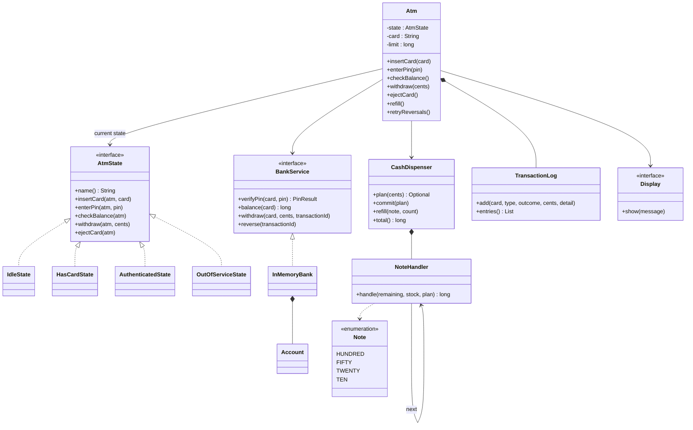
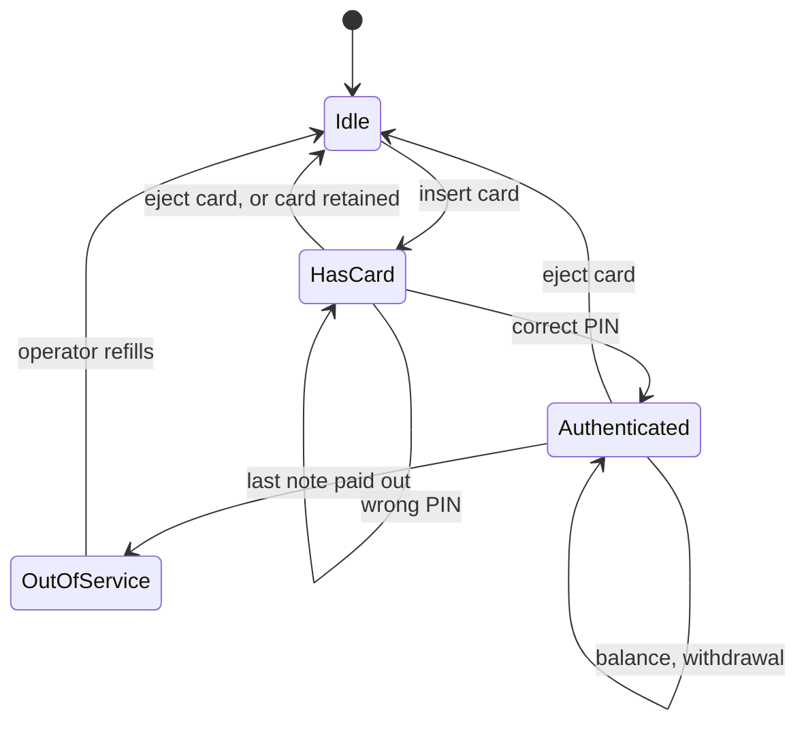
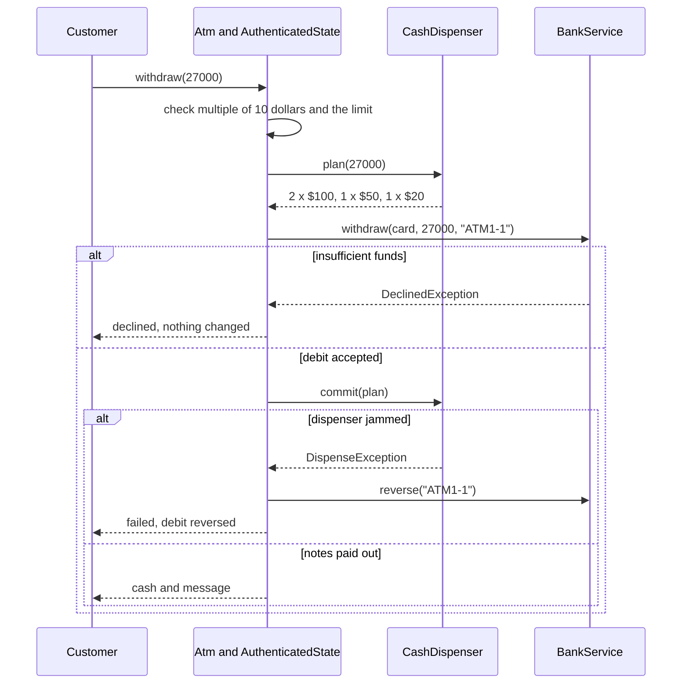

# Design an ATM

## Problem Statement

The interviewer says: "Design an ATM. A customer inserts a card, enters a PIN, checks the balance, and withdraws cash. The machine pays the cash in notes. The machine talks to the bank to verify the PIN and to debit the account." This problem tests the State pattern (the session), Chain of Responsibility (the notes), and the order of the steps in a withdrawal, because a wrong order loses money. Follow the procedure in [How to Approach an LLD Interview](../../how-to-approach-lld.md).

## Clarifying Questions

| Question | Answer that this design assumes |
|---|---|
| Which transactions are in scope? | Balance inquiry and cash withdrawal. Deposit, transfer, and PIN change are extensions |
| Which notes does the machine hold? | $100, $50, $20, and $10. The machine pays whole notes only, so an amount must be a multiple of $10 |
| How is money stored? | As a `long` number of cents. The code never uses `double` for money |
| Who verifies the PIN? | The bank, through the `BankService` interface. The ATM never sees the stored PIN |
| How many wrong PINs are allowed? | Three in a row. The bank counts them for the card, across all machines. On the third failure the bank blocks the card and the ATM retains it |
| Is there a limit for one withdrawal? | Yes, $500, set when the machine is created. A daily limit is bank policy and is an extension |
| What if the machine cannot pay the amount with its notes? | The machine declines before it debits the account, and it says so |
| What if the dispenser fails after the bank debit? | The ATM asks the bank to reverse the debit. If the bank does not answer the reversal, the ATM keeps it in a queue and sends it again later |
| What if the bank does not answer the debit? | The ATM does not know whether the bank debited the account. It pays no cash and sends a reversal for the transaction id, which undoes the debit if there was one |
| Are transaction ids unique? | Assumption: yes, for the life of the bank's records. The demo builds them from the ATM id and a counter. Recommendation: keep the counter across restarts (or add a date to the id), because the bank answers a repeated id with the first answer and would not debit again |
| What if the machine has no cash? | It enters the `OutOfService` state until the operator refills it |
| Is a user interface in scope? | No. A `Display` interface receives the messages. The demo prints them |
| Do we keep a log of the transactions? | Yes. An append-only log with a sequence number and a masked card number. No timestamps, so that the demo output is stable |
| Storage? | In memory. The bank is an in-memory fake behind the `BankService` interface |

## Requirements

Functional requirements:

1. The customer inserts a card. The ATM accepts the card only when it is idle.
2. The customer enters a PIN. The bank verifies it. A wrong PIN lets the customer try again. After the third failure in a row the bank blocks the card, and the ATM retains it.
3. After a correct PIN, the customer checks the balance or withdraws cash, as often as the customer wants, until the customer takes the card back.
4. A withdrawal must be a positive multiple of $10 and at most the limit. The machine must have notes that add up to the amount. The account must hold the amount.
5. The ATM pays the amount with the largest notes first (Chain of Responsibility).
6. If the dispenser fails after the debit, the ATM reverses the debit. If the reversal fails, the ATM queues it and retries it until the bank accepts it.
7. The bank answers a repeated transaction id with the answer of the first request, and a reversal is safe to repeat.
8. When the last note leaves the machine, the ATM returns the card and enters `OutOfService`. The operator refills it.
9. Every PIN check, balance inquiry, withdrawal, and retried reversal goes into the transaction log, with the outcome.

Non-functional requirements:

- An action that does not fit the current state is rejected and changes nothing.
- The rules "in state X, action Y does Z" exist only in the state classes. A new state needs a new class and no edit in the old states.
- The customer never receives cash without a debit. The order of the steps guarantees this (see the withdrawal sequence).
- The customer does not lose money without cash. The step order alone cannot guarantee this. It needs a reversal that the ATM retries until the bank accepts it, and a reconciliation of the logs after a crash (see Concurrency).
- Two ATMs that use one account at the same time cannot overdraw it.
- The log shows the last four digits of the card number only, and never shows a PIN.

## Entities and Relationships

| Type | Kind | Responsibility |
|---|---|---|
| `Atm` | Entity (the context) | Holds the current state, the card of the session, the cash dispenser, the log, the queue of pending reversals, and the collaborators. Exposes the public operations and delegates each one to the current state |
| `AtmState` | Interface | The contract of a state: `insertCard`, `enterPin`, `checkBalance`, `withdraw`, `ejectCard`. Each method throws `IllegalStateException` by default |
| `IdleState`, `HasCardState`, `AuthenticatedState`, `OutOfServiceState` | Classes | The four states. Each one overrides only the actions that are valid in it |
| `BankService` | Interface (port) | What the ATM needs from the bank: `verifyPin`, `balance`, `withdraw`, `reverse` |
| `InMemoryBank`, `Account` | Classes | A fake bank for the demo. It keeps one record for each transaction id. `Account` owns the balance, the PIN, and the failed attempts, and protects them with its own lock |
| `CashDispenser` | Entity | Counts the notes of each value. Plans a payment, and removes the notes when the plan is committed. Can jam |
| `NoteHandler` | Class (a link in the chain) | Takes as many notes of one value as it can and passes the remainder to the next handler |
| `Note` | Enum | The four note values, from the largest to the smallest |
| `TransactionLog`, `LogEntry` | Classes | The append-only record of events. `LogEntry` is an immutable `record` |
| `TxType`, `Outcome`, `PinResult` | Enums | The kind of event, its result, and the answer of the bank to a PIN |
| `Display` | Interface | Receives the messages for the customer |
| `DeclinedException`, `BankUnavailableException`, `DispenseException` | Exceptions | The bank declined the debit. The bank did not answer, so the outcome is unknown. The hardware failed |
| `Cents` | Utility | Formats an amount of cents as dollars |

Relationships:

- `Atm` has one current `AtmState` (association that changes at run time) and four state objects that it owns (composition).
- `Atm` owns one `TransactionLog` (composition). It uses one `CashDispenser`, one `BankService`, and one `Display`, which it receives in its constructor (association, dependency injection).
- `CashDispenser` owns the chain of `NoteHandler` objects (composition). Each handler refers to the next one.
- `InMemoryBank` owns many `Account` objects (composition).
- The states call back into the machine through package-private hook methods. The states hold no data.

Why the PIN check lives in the bank: the ATM is not a safe place for secrets. When the issuing bank verifies the PIN online, [ISO 9564-1](https://www.iso.org/standard/68669.html) (*Financial services — Personal Identification Number (PIN) management and security — Part 1: Basic principles and requirements for PINs in card-based systems*, edition 2017) requires that the PIN is encrypted on its way from the PIN entry device to the issuer. The PIN entry device encodes the PIN in a PIN block and encrypts the block with an approved algorithm. The device must be physically secured, so that nobody can extract PINs or keys from it. This design keeps the same boundary: the ATM forwards the PIN and has no way to compare it by itself. Assumption: the demo passes the PIN as a `String` for brevity, and it does not encrypt it.

Recommendation: in Java, hold a PIN or a password in a `char[]` and overwrite the array after use. A `String` is immutable, so no method can overwrite or zero its contents. The [JCA Reference Guide](https://docs.oracle.com/en/java/javase/21/security/java-cryptography-architecture-jca-reference-guide.html) (section "Using Password-Based Encryption") gives this reason and says to "collect and store security sensitive information in a char array instead". The [`java.io.Console` javadoc](https://docs.oracle.com/en/java/javase/21/docs/api/java.base/java/io/Console.html) says to "manually zero the returned character array after processing to minimize the lifetime of sensitive data in memory", for example with `Arrays.fill(pin, ' ')`.

## Class Diagram



The state transitions:



A machine that starts with no notes begins in `OutOfService`. After a session ends, the ATM goes to `Idle` if the dispenser holds cash, and to `OutOfService` if not.

The order of the steps in a withdrawal:



Each point where the withdrawal can fail, and what the design does:

| Failure point | State of the money | What the ATM does |
|---|---|---|
| Amount not a multiple of $10, or above the limit | Nothing changed | Declines. No transaction id is used |
| The notes cannot form the amount | Nothing changed | Declines before the bank call |
| The bank declines the debit | Nothing changed | Declines. The bank records the id as declined, so a repeated request is declined again |
| The bank does not answer the debit (`BankUnavailableException`) | Unknown: the bank may have debited | Pays no cash. Sends `reverse` for the id. If the bank debited, the reversal credits the money back. If the debit request has not arrived yet, the bank records the id as reversed and refuses the debit when it arrives |
| The dispenser fails after the debit | Debited, no cash | Sends `reverse`. The log shows FAILED and "The debit was reversed" |
| The reversal itself fails (`BankUnavailableException`) | Debited, no cash | Queues the id with the card in `pendingReversals`. `retryReversals` (called by a timer or the operator) sends it again. The log shows "The reversal is pending" and later a REVERSAL entry. A repeated reversal credits only once, so a retry is always safe |
| The ATM crashes between the debit and the dispense | Debited, no cash, and the queue in memory is lost | Out of scope for the code. Recommendation: write the pending transaction to persistent storage before the dispense, and reconcile the records of the bank and the ATM after the restart |

The physical case of a partial dispense (the dispenser pays some notes and then jams) needs the dispenser to count the notes that left, and a reversal of the rest. This design treats a jam as "no notes left the machine". Assumption: `commit` is all or nothing.

## Design Patterns Used

| Pattern | Where | Reason | Rejected alternative |
|---|---|---|---|
| State ([behavioral patterns](../../fundamentals/08-behavioral-patterns.md)) | `AtmState` and its four classes | What "enter PIN" or "withdraw" means depends on the session. Each state class holds the rules of its own state, and the `default` methods reject all other actions in one place | An `enum` status field with a `switch` in each operation. A new state edits every method. With two states this is simpler. This machine has four states and five actions |
| Chain of Responsibility ([behavioral patterns](../../fundamentals/08-behavioral-patterns.md)) | `NoteHandler` links for $100, $50, $20, $10 | Each link knows one note value and one rule: take what fits, pass the rest. A new note value is one new link, and the chain code does not change. `plan` asks the chain and gets the notes, or a remainder that is not zero | A `for` loop over a sorted array of notes. It is shorter, and it is the better choice if the interviewer does not ask for the chain. A loop and a chain give the same result. The chain's advantage is that each link can carry its own rule (for example "at most 10 notes of this value") |
| Dependency injection and a port ([architectural patterns](../../fundamentals/10-architectural-patterns.md)) | `BankService`, `Display`, `CashDispenser` | The ATM does not know whether the bank is a fake or a remote service. The test passes the fake, and the demo passes a silent display in the concurrency run | `new RealBank()` inside the ATM. The ATM then cannot run without a network |
| Proxy for the real bank ([structural patterns](../../fundamentals/07-structural-patterns.md)) | A production class `RemoteBankService implements BankService` (not in the demo) | It hides the network call, the timeout, and the retry behind the same interface | Calling the HTTP client from the state classes |
| Immutable value objects ([OOP](../../fundamentals/01-oop.md), [domain modeling](../../fundamentals/05-domain-modeling.md)) | `LogEntry`, `Note` | A log entry never changes after it is written. The `record` gives a safe copy to every reader | A mutable log entry class with setters |
| Command (extension) ([behavioral patterns](../../fundamentals/08-behavioral-patterns.md)) | Not in the code. Used when the list of transactions grows (see Extensions) | One `Transaction` object for each kind of transaction keeps `AuthenticatedState` from growing a method for each one | Adding one method to `AtmState` and to every state for each new transaction |

Why the states hold no data: the card number, the log, and the cash live in `Atm` and its collaborators. A state class has no field, so the ATM creates each state once. See the [vending machine case study](../07-vending-machine/README.md) for the same decision with a longer discussion.

Why a greedy chain can fail: the chain takes the largest notes first. With an unlimited stock of $10 notes, that always works. With a limited stock it can fail while a solution exists. Example: the machine holds one $50 note, three $20 notes, and no $10 notes. The customer asks for $60. The chain takes the $50 note, the remainder is $10, and no handler can pay it. The three $20 notes would pay $60. This design accepts the limit and declines. The extension "exact payment search" replaces the plan step with a search that backs off (see `makeChange` in the [vending machine case study](../07-vending-machine/README.md)). State the limit in the interview before the interviewer finds it.

The [SOLID page](../../fundamentals/02-solid.md) explains the Open-Closed Principle that State and the chain serve. The [design principles page](../../fundamentals/03-design-principles.md) explains fail-fast validation and why the money is `long` cents.

## Key Code

The complete runnable program is in [`Main.java`](Main.java). Run it with `java Main.java`.

### Notes and the bank port

`Note` is an enum from the largest to the smallest value. The order matters, because the chain follows the order of `Note.values()`. All amounts are `long` cents.

```java
enum Note {
    HUNDRED(10_000), FIFTY(5_000), TWENTY(2_000), TEN(1_000);

    private final long cents;

    Note(long cents) {
        this.cents = cents;
    }

    long cents() {
        return cents;
    }

    String label() {
        return "$" + cents / 100;
    }

    static long smallest() {
        return TEN.cents;
    }
}
```

`BankService` is everything that the ATM needs from the bank. The transaction id makes `withdraw` safe to retry, and `reverse` undoes a debit. Both calls are idempotent: a repeated call has the same effect as one call.

```java
interface BankService {
    PinResult verifyPin(String card, String pin);

    long balance(String card);

    // Debits the account. A repeated call with the same transaction id does not debit again:
    // it gets the answer of the first call. Throws BankUnavailableException if the bank does
    // not answer.
    void withdraw(String card, long cents, String transactionId) throws DeclinedException;

    // Credits back a debit that the ATM could not turn into cash. Safe to repeat. A reversal
    // of an id that the bank has not seen blocks a later debit with that id.
    void reverse(String transactionId);
}
```

The bank side keeps the PIN, the balance, and the failed attempts in `Account`. Each method is `synchronized`, so the PIN counter and the balance are safe when several ATMs use one account. The method `debit` checks the balance and changes it in one step.

```java
    synchronized PinResult checkPin(String candidate) {
        if (blocked) {
            return PinResult.BLOCKED;
        }
        if (pin.equals(candidate)) {
            failedAttempts = 0;
            return PinResult.OK;
        }
        failedAttempts++;
        if (failedAttempts >= MAX_FAILED_ATTEMPTS) {
            blocked = true;
            return PinResult.BLOCKED;
        }
        return PinResult.WRONG_PIN;
    }
```

```java
    // The check and the change of the balance are one step, so two ATMs cannot both pass.
    synchronized boolean debit(long cents) {
        if (balance < cents) {
            return false;
        }
        balance -= cents;
        return true;
    }
```

`InMemoryBank` keeps one `Transaction` record for each transaction id, with the status `DEBITED`, `DECLINED`, or `REVERSED`. It never removes a record. A design that removes the record on a reversal has a bug: a late duplicate of the debit request then debits a second time.

```java
    private enum TxStatus { DEBITED, DECLINED, REVERSED }

    private record Transaction(String card, long cents, TxStatus status) { }

    private final Map<String, Account> accounts = new ConcurrentHashMap<>();
    // One record for each transaction id. The bank never removes a record, so a repeated
    // request gets the first answer.
    private final Map<String, Transaction> transactions = new ConcurrentHashMap<>();
    private volatile boolean reversalsFailing;
```

`withdraw` decides the outcome in `ConcurrentHashMap.computeIfAbsent`. The javadoc of that method says that "the entire method invocation is performed atomically" and that the function "is invoked exactly once per invocation of this method if the key is absent, else not at all". So two concurrent requests with one id cannot both debit, and the second request cannot return before the first one has an outcome. A repeated request reads the stored status and gets the same answer as the first one. The function calls `Account.debit`, which takes the account lock inside the map's lock for that key. No code path takes these two locks in the other order, so they cannot deadlock. The same javadoc says that the computation "should be short and simple", because it can block other updates of the map. Recommendation: a bank that stores its records in a database gets the same effect from a database transaction and a unique constraint on the transaction id.

```java
    public void withdraw(String card, long cents, String transactionId) {
        // computeIfAbsent is atomic for one key: the debit runs at most once for each id.
        Transaction tx = transactions.computeIfAbsent(transactionId, id -> {
            boolean debited = accounts.get(card).debit(cents);
            return new Transaction(card, cents, debited ? TxStatus.DEBITED : TxStatus.DECLINED);
        });
        switch (tx.status()) {
            case DEBITED -> { }
            case DECLINED -> throw new DeclinedException("Insufficient funds");
            case REVERSED -> throw new DeclinedException("The transaction was reversed");
        }
    }
```

`reverse` changes the record in `compute`, which is atomic for the key in the same way. A `DEBITED` record becomes `REVERSED`, and the account gets the money back. A second reversal finds `REVERSED` and does nothing, so a retry credits only once. A reversal for an id that the bank has not seen leaves a `REVERSED` record. This matters when the debit request was slow on the network: the ATM gave up and reversed, and the debit arrives later. The bank then refuses it. The flag `reversalsFailing` is a test hook for the demo.

```java
    public void reverse(String transactionId) {
        if (reversalsFailing) {
            throw new BankUnavailableException("The bank did not answer");
        }
        transactions.compute(transactionId, (id, tx) -> {
            if (tx == null) {
                // The debit request has not arrived. The record blocks it if it arrives later.
                return new Transaction(null, 0, TxStatus.REVERSED);
            }
            if (tx.status() == TxStatus.DEBITED) {
                accounts.get(tx.card()).credit(tx.cents());
                return new Transaction(tx.card(), tx.cents(), TxStatus.REVERSED);
            }
            return tx;
        });
    }
```

### Chain of Responsibility for the notes

Each handler takes as many notes of its value as it can, limited by the stock and by the remaining amount. It records them in the plan and passes the remainder on. The last handler returns what is left. The caller reads a remainder of zero as success.

```java
// One link of the chain. It takes as many notes of its value as it can, and passes the rest on.
class NoteHandler {
    private final Note note;
    private final NoteHandler next;

    NoteHandler(Note note, NoteHandler next) {
        this.note = note;
        this.next = next;
    }

    long handle(long remaining, Map<Note, Integer> stock, Map<Note, Integer> plan) {
        int count = (int) Math.min(remaining / note.cents(), stock.getOrDefault(note, 0));
        if (count > 0) {
            plan.put(note, count);
        }
        long left = remaining - count * note.cents();
        return next == null ? left : next.handle(left, stock, plan);
    }
}
```

The dispenser builds the chain from the smallest note to the largest, so that each new handler has the previous one as its successor. `plan` runs the chain on the stock and does not change the stock. `commit` removes the notes, and it fails if the hardware is jammed.

```java
    // Notes are declared from the largest to the smallest. The chain starts at the largest.
    private static NoteHandler buildChain() {
        Note[] notes = Note.values();
        NoteHandler handler = null;
        for (int i = notes.length - 1; i >= 0; i--) {
            handler = new NoteHandler(notes[i], handler);
        }
        return handler;
    }
```

```java
    // Finds the notes for the amount. Does not change the stock.
    synchronized Optional<Map<Note, Integer>> plan(long cents) {
        Map<Note, Integer> plan = new EnumMap<>(Note.class);
        long left = chain.handle(cents, stock, plan);
        return left == 0 ? Optional.of(plan) : Optional.empty();
    }
```

```java
    synchronized void commit(Map<Note, Integer> plan) {
        if (jammed) {
            throw new DispenseException("The dispenser is jammed");
        }
        for (Map.Entry<Note, Integer> entry : plan.entrySet()) {
            if (stock.getOrDefault(entry.getKey(), 0) < entry.getValue()) {
                throw new DispenseException("The notes are no longer in the machine");
            }
        }
        plan.forEach((note, count) -> stock.merge(note, -count, Integer::sum));
    }
```

### The state contract and the states

The interface gives every action a default that throws. A state overrides only what is valid in it. The ATM never asks "which state?". It calls the method.

```java
interface AtmState {
    String name();

    default void insertCard(Atm atm, String card) {
        throw new IllegalStateException("Cannot insert a card in state " + name());
    }

    default void enterPin(Atm atm, String pin) {
        throw new IllegalStateException("Cannot enter a PIN in state " + name());
    }

    default void checkBalance(Atm atm) {
        throw new IllegalStateException("Cannot check the balance in state " + name());
    }

    default void withdraw(Atm atm, long cents) {
        throw new IllegalStateException("Cannot withdraw in state " + name());
    }

    default void ejectCard(Atm atm) {
        throw new IllegalStateException("Cannot eject a card in state " + name());
    }
}
```

`IdleState` accepts a card and moves to `HasCard`. It stores nothing itself: it asks the ATM to start the session.

```java
class IdleState implements AtmState {
    @Override
    public String name() {
        return "Idle";
    }

    @Override
    public void insertCard(Atm atm, String card) {
        atm.startSession(card);
        atm.display().show("Card accepted. Enter your PIN");
        atm.setState(atm.hasCardState());
    }
}
```

`HasCardState` sends the PIN to the bank and acts on the three answers. A correct PIN moves to `Authenticated`. A wrong PIN keeps the state, so the customer can try again. A blocked card ends the session, and the ATM keeps the card.

```java
class HasCardState implements AtmState {
    @Override
    public String name() {
        return "HasCard";
    }

    @Override
    public void enterPin(Atm atm, String pin) {
        switch (atm.bank().verifyPin(atm.card(), pin)) {
            case OK -> {
                atm.report(TxType.PIN, Outcome.SUCCESS, 0, "PIN accepted");
                atm.setState(atm.authenticatedState());
            }
            case WRONG_PIN -> atm.report(TxType.PIN, Outcome.DECLINED, 0, "Wrong PIN");
            case BLOCKED -> {
                atm.report(TxType.PIN, Outcome.DECLINED, 0, "Card not accepted");
                atm.endSession("Card retained. Contact your bank");
            }
        }
    }

    @Override
    public void ejectCard(Atm atm) {
        atm.endSession("Card returned");
    }
}
```

`AuthenticatedState` holds the one rule that matters most: the order of the steps in `withdraw`. First the cheap local checks, then the plan, then the debit, then the cash. The debit comes before the cash, because the bank can reverse a debit but a machine cannot take back notes. The plan comes before the debit, so a customer is never charged for an amount that the machine cannot pay. Each failure after the debit ends in `reverseOrQueue`, so no path leaves a debit without a reversal attempt.

```java
    public void withdraw(Atm atm, long cents) {
        if (cents <= 0 || cents % Note.smallest() != 0) {
            atm.report(TxType.WITHDRAWAL, Outcome.DECLINED, cents,
                    "Enter a multiple of " + Cents.format(Note.smallest()));
            return;
        }
        if (cents > atm.limit()) {
            atm.report(TxType.WITHDRAWAL, Outcome.DECLINED, cents,
                    "The limit for one withdrawal is " + Cents.format(atm.limit()));
            return;
        }
        Optional<Map<Note, Integer>> plan = atm.dispenser().plan(cents);
        if (plan.isEmpty()) {
            atm.report(TxType.WITHDRAWAL, Outcome.DECLINED, cents,
                    "This machine cannot pay that amount with its notes");
            return;
        }
        Map<Note, Integer> notes = plan.get();
        String transactionId = atm.nextTransactionId();
        try {
            atm.bank().withdraw(atm.card(), cents, transactionId);
        } catch (DeclinedException e) {
            atm.report(TxType.WITHDRAWAL, Outcome.DECLINED, cents, e.getMessage());
            return;
        } catch (BankUnavailableException e) {
            // The bank may have debited the account. The reversal undoes the debit if it exists.
            boolean reversed = atm.reverseOrQueue(transactionId);
            atm.report(TxType.WITHDRAWAL, Outcome.FAILED, cents, "The bank did not answer."
                    + (reversed ? " No cash, no debit" : " No cash. The reversal is pending"));
            return;
        }
        try {
            atm.dispenser().commit(notes);
        } catch (DispenseException e) {
            boolean reversed = atm.reverseOrQueue(transactionId);
            atm.report(TxType.WITHDRAWAL, Outcome.FAILED, cents, e.getMessage()
                    + (reversed ? ". The debit was reversed" : ". The reversal is pending"));
            return;
        }
        atm.report(TxType.WITHDRAWAL, Outcome.SUCCESS, cents,
                "Dispensed " + Cents.format(cents) + ": " + CashDispenser.describe(notes));
        if (atm.dispenser().total() == 0) {
            atm.endSession("Card returned. Out of cash");
        }
    }
```

`OutOfServiceState` rejects cards with a message. The operator's `refill` is the only way out.

```java
class OutOfServiceState implements AtmState {
    @Override
    public String name() {
        return "OutOfService";
    }

    @Override
    public void insertCard(Atm atm, String card) {
        atm.display().show("Out of service. Card not accepted");
    }
}
```

### The machine (context)

The ATM keeps the collaborators and the card of the session. Its constructor chooses the first state from the cash in the dispenser.

```java
class Atm {
    private record PendingReversal(String transactionId, String card) { }

    private final String id;
    private final BankService bank;
    private final CashDispenser dispenser;
    private final Display display;
    private final TransactionLog log = new TransactionLog();
    private final long limit;
    private final AtmState idle = new IdleState();
    private final AtmState hasCard = new HasCardState();
    private final AtmState authenticated = new AuthenticatedState();
    private final AtmState outOfService = new OutOfServiceState();
    private final List<PendingReversal> pendingReversals = new ArrayList<>();
    private AtmState state;
    private String card;
    private int transactionCounter;

    Atm(String id, BankService bank, CashDispenser dispenser, Display display, long limit) {
        this.id = id;
        this.bank = bank;
        this.dispenser = dispenser;
        this.display = display;
        this.limit = limit;
        this.state = dispenser.total() > 0 ? idle : outOfService;
    }
```

Each public operation is `synchronized` and delegates to the current state.

```java
    // Public operations: each one holds the ATM lock and delegates to the current state.
    public synchronized void insertCard(String card) {
        state.insertCard(this, card);
    }

    public synchronized void enterPin(String pin) {
        state.enterPin(this, pin);
    }

    public synchronized void checkBalance() {
        state.checkBalance(this);
    }

    public synchronized void withdraw(long cents) {
        state.withdraw(this, cents);
    }

    public synchronized void ejectCard() {
        state.ejectCard(this);
    }
```

Two hooks show the shape of the rest. `endSession` returns to `Idle` or `OutOfService` according to the cash that is left. `report` shows a message and logs the same event, so the screen and the log cannot disagree.

```java
    // Ends the session and chooses the next state from the cash that is left.
    void endSession(String message) {
        display.show(message);
        card = null;
        state = dispenser.total() > 0 ? idle : outOfService;
    }
```

```java
    // Shows a message to the customer and writes the same event to the transaction log.
    void report(TxType type, Outcome outcome, long cents, String message) {
        display.show(message);
        log.add(card, type, outcome, cents, message);
    }
```

`reverseOrQueue` sends a reversal and, if the bank does not answer, keeps it with the card number for the log. `retryReversals` sends the queued reversals in order and stops at the first one that fails again. Recommendation: in production, retry each reversal until the bank acknowledges it, and keep the queue in persistent storage. Here the queue is in memory, and the demo calls `retryReversals` after the bank recovers.

```java
    // Sends the reversal. If the bank does not answer, keeps it for retryReversals.
    boolean reverseOrQueue(String transactionId) {
        try {
            bank.reverse(transactionId);
            return true;
        } catch (BankUnavailableException e) {
            pendingReversals.add(new PendingReversal(transactionId, card));
            return false;
        }
    }
```

```java
    // A timer or the operator calls this. It sends each pending reversal again, in order.
    public synchronized void retryReversals() {
        Iterator<PendingReversal> it = pendingReversals.iterator();
        while (it.hasNext()) {
            PendingReversal pending = it.next();
            try {
                bank.reverse(pending.transactionId());
            } catch (BankUnavailableException e) {
                return;
            }
            it.remove();
            display.show("Reversal " + pending.transactionId() + " accepted by the bank");
            log.add(pending.card(), TxType.REVERSAL, Outcome.SUCCESS, 0,
                    "Reversal of " + pending.transactionId());
        }
    }
```

## Concurrency

Three things can race.

1. **One ATM, two threads.** An operator thread calls `refill()` while a customer thread withdraws. The check-then-act pairs are "is the state `OutOfService`, then switch it" and "plan the notes, then remove them". The design prevents the race with one rule: each public method of `Atm` is `synchronized`, so the machine is one critical section. The hooks that the states call run inside a public method and hold the lock already. Java monitors are reentrant, so a state may call the machine again. `CashDispenser` also has `synchronized` methods, because the operator loads notes through it. `commit` checks the stock again before it removes notes, so a plan that is out of date fails and does not take notes that are not there.
2. **Two ATMs, one account.** This is the case that decides whether the bank loses money. Two ATMs read the balance at the same time, both see $100, and both pay $80. The design prevents this in `Account.debit`: the test "balance is at least the amount" and the subtraction are one `synchronized` step. The demo (the last block of the output) runs two threads on two ATMs with one account of $100 and two withdrawals of $80. The output does not say which ATM pays, because that depends on the schedule. It prints what is the same in every run: one approved withdrawal, and a final balance of $20.00.
3. **PIN guesses from two ATMs.** If the attempt counter were in the ATM, an attacker could use three ATMs for nine guesses. The counter is in `Account`, and `checkPin` is `synchronized`, so all machines share one count.

The debit and the reversal are idempotent. The bank keeps one record for each transaction id and never removes it, so a retry after a network timeout does not debit twice, a repeated reversal credits once, and a debit that arrives after its reversal is refused. Two concurrent requests with one id are decided in one atomic `computeIfAbsent` call. The ATM builds the id from its own id and a counter (see the clarifying question on unique ids).

Trade-offs:

- One lock for the whole ATM is the simplest correct choice. A physical ATM serves one customer at a time, so a finer lock gives no gain.
- In this design the ATM holds its lock during the bank call. With a real remote bank, a slow call under the lock blocks the operator's `refill`. The extension "bank unavailable" runs the call with a timeout.
- The queue of pending reversals is guarded by the ATM lock, like the rest of the machine. `retryReversals` is `synchronized`, so a timer thread may call it during a session.
- A crash between the debit and the dispense leaves a debit without cash, and it loses the in-memory queue of pending reversals. Assumption: the real bank and the ATM reconcile their logs after a restart. This design logs every event, and the transaction id links the two sides. The reconciliation itself is out of scope.

See [concurrency in LLD](../../fundamentals/09-concurrency-in-lld.md) for check-then-act and lock granularity.

## Extensions

| Change | How the design handles it |
|---|---|
| Cash deposit | Add `deposit(long cents)` to `AtmState` (default throws) and to `AuthenticatedState`. Add `BankService.deposit(card, cents, transactionId)`. Rename `CashDispenser` to a `CashCassette` that also accepts notes: `accept(Map<Note, Integer>)`. For a cheque, the bank holds the amount until it clears, so the call returns a pending status |
| More transaction types (transfer, mini statement, PIN change) | Add `interface Transaction { void execute(Atm atm); }` with `BalanceInquiry`, `Withdrawal`, `Transfer`. `AuthenticatedState` gets one method `run(Transaction)` and no longer grows a method for each type. The logic of `withdraw` moves into `Withdrawal` unchanged. This is the Command pattern |
| Daily withdrawal limit | The limit is bank policy, because the bank sees all machines. Add `withdrawnToday` and a day marker to `Account`, with an injected `Clock`. `debit` refuses when the total passes the limit and throws `DeclinedException("Daily limit reached")`. The ATM needs no change |
| Inactivity timeout | Inject a `Clock` and a `ScheduledExecutorService`. `HasCardState` and `AuthenticatedState` schedule `atm.ejectCard()` after 30 seconds of silence and cancel the task on each action. The public methods are already `synchronized`, so the timer thread is safe. The task checks that the session is still the same one |
| Bank unavailable | The code already handles one failed call: a debit without an answer ends in a reversal, and a failed reversal goes into the retry queue. The extension adds retries of the debit itself: `RemoteBankService` retries `withdraw` with the same transaction id (the bank returns the first answer), with a timeout for each call. After the last retry the ATM declines with "Try again later" and sends `reverse`. A circuit breaker in `RemoteBankService` stops the calls while the bank is down. A `ScheduledExecutorService` calls `retryReversals` every minute, and the queue moves to persistent storage |
| Exact payment search | Replace `plan` by a search that tries fewer large notes when the greedy chain fails (the search from the vending machine case). A `DispensePolicy` interface (Strategy) with `GreedyPolicy`, `MinimumNotesPolicy`, and `PreserveSmallNotesPolicy` lets the operator choose |
| Cardless withdrawal with a one-time code | Replace the `String card` by `interface Credential` with `CardCredential` and `CodeCredential`. `IdleState.insertCard` becomes `identify(Credential)`. `BankService.verifyPin` takes a `Credential`. The other states do not change |
| Receipt printing and alerts | Add `interface TransactionListener { void onEvent(LogEntry entry); }` (Observer). `Atm.report` notifies the listeners after it logs. A `ReceiptPrinter` and a `LowCashAlert` are two listeners |

## Common Mistakes

- **A `switch` on a status field in every method.** Each new state edits every method. Use State.
- **Dispensing cash before the debit.** If the bank is down or the account is empty, the machine has paid for nothing. Debit first, because a debit can be reversed and cash cannot.
- **Debiting before the machine knows that it can pay.** The customer is charged for an amount that the machine cannot give. Plan the notes first. Commit them after the debit.
- **No reversal path.** The dispenser jams after the debit, and the customer loses the money. The reversal must exist, and it must be idempotent.
- **A reversal that is sent once.** The reversal call can fail like any network call. Queue it and retry it until the bank accepts it.
- **An idempotency record that the bank deletes.** If the bank removes the record of a transaction id on a reversal or a decline, a late duplicate of the debit request debits again. Keep the record, with its status.
- **`double` for money.** `0.1 + 0.2` is not `0.3` in binary floating point. Use `long` cents or `BigDecimal`.
- **A PIN check in the ATM.** The ATM would need the stored PIN. Keep the check in the bank behind an interface.
- **The attempt counter in the ATM or in the session.** Attackers insert the card again, or use another machine. Count in the bank, per card.
- **Telling the customer why a card is refused.** A message such as "unknown card" or "card blocked" tells an attacker more than needed. This design answers an unknown card and a blocked card with the same message, "Card not accepted", and retains the card in both cases. A wrong PIN on a valid card gets "Wrong PIN", because the customer needs to know that a retry is possible.
- **A log with the full card number or the PIN.** Mask the card number and never log a PIN.
- **Check-then-act on the balance outside the account.** Reading the balance in the ATM and then debiting lets two machines overdraw the account. The check and the debit are one atomic step in the bank.
- **A `Singleton` ATM.** The ATM is a normal object. A test needs many instances, and the concurrency demo uses two.
- **Hard-coded note values in an `if` chain.** A new note value then edits the dispense code. Use a table or a chain.

## 45-Minute Plan

| Minutes | What to do |
|---|---|
| 0 to 5 | Ask the clarifying questions above. Write the numbered requirements. Say "Assumption: balance and withdrawal, four note values, the bank verifies the PIN, in memory" |
| 5 to 10 | List the use cases (insert card, enter PIN, check balance, withdraw, eject, refill). Name the entities: `Atm`, `BankService`, `CashDispenser`, `TransactionLog`. Say that money is `long` cents |
| 10 to 18 | Draw the state diagram first (four states, the transitions). Then the class diagram: `Atm`, `AtmState` and its four states, `BankService`, `CashDispenser` with the chain. Say "I use State because the same button means different things in each step of the session. I use a chain for the notes, and I know that a loop is the simpler alternative" |
| 18 to 22 | Write the signatures of `Atm`, `AtmState`, `BankService`. Draw the withdrawal sequence and say the order: validate, plan, debit, dispense, reverse on failure, queue the reversal if it fails. Name the failure points from the table |
| 22 to 36 | Write `Note`, `NoteHandler`, `CashDispenser.plan`, `AtmState`, `IdleState`, `HasCardState`, then `AuthenticatedState.withdraw`. Run one withdrawal of $270 in your head |
| 36 to 40 | Concurrency: `synchronized` public methods on the ATM, and an atomic debit in the bank. Name the two-ATMs race. Say that the PIN counter lives in the bank |
| 40 to 45 | Extensions: deposit, more transaction types with Command, daily limit, bank unavailable. For each, name the new class and the classes that stay the same. Name the limit of the greedy chain |

## Expected Output

The demo runs three scenes. ATM 1 shows one session with a wrong PIN, a balance inquiry, a withdrawal, the declines from the ATM and from the bank, a dispenser fault with a reversal, a dispenser fault where the reversal fails and the ATM retries it, a blocked card, and the transaction log. ATM 2 holds few notes and shows a payment that its notes cannot form, the out-of-service state, and the refill. The bank scene sends repeated debits and reversals with one transaction id, and a debit that arrives after its reversal. The last scene runs two ATMs and two threads against one account. Card numbers in the log show the last four digits.

<!-- expected-output -->
```text
== ATM 1: one session, several transactions ==
State: Idle, cash: $700.00
-- Actions without a card
Error: Cannot check the balance in state Idle
Error: Cannot withdraw in state Idle
-- Wrong PIN, then the right PIN
Card accepted. Enter your PIN
Wrong PIN
State: HasCard
PIN accepted
State: Authenticated
Balance $1000.00
-- Withdraw 270 dollars
Dispensed $270.00: 2 x $100, 1 x $50, 1 x $20
Balance $730.00
-- Withdrawals that the ATM declines
Enter a multiple of $10.00
The limit for one withdrawal is $500.00
Enter a multiple of $10.00
-- Withdrawal that the bank declines
Card returned
Card accepted. Enter your PIN
PIN accepted
Insufficient funds
Balance $200.00
Error: Cannot insert a card in state Authenticated
Card returned
-- Dispenser fault: the ATM reverses the debit
Card accepted. Enter your PIN
PIN accepted
The dispenser is jammed. The debit was reversed
Balance $730.00
Card returned
-- Dispenser fault while the bank cannot take the reversal
Card accepted. Enter your PIN
PIN accepted
The dispenser is jammed. The reversal is pending
Balance $680.00
Card returned
Reversal ATM1-4 accepted by the bank
Balance after the retry: $730.00
-- Three wrong PINs block the card
Card accepted. Enter your PIN
Wrong PIN
Wrong PIN
Card not accepted
Card retained. Contact your bank
State: Idle
Card accepted. Enter your PIN
Card not accepted
Card retained. Contact your bank
State: Idle
-- Transaction log of ATM1
#1 ****4444 PIN DECLINED - Wrong PIN
#2 ****4444 PIN SUCCESS - PIN accepted
#3 ****4444 BALANCE SUCCESS - Balance $1000.00
#4 ****4444 WITHDRAWAL SUCCESS $270.00 Dispensed $270.00: 2 x $100, 1 x $50, 1 x $20
#5 ****4444 BALANCE SUCCESS - Balance $730.00
#6 ****4444 WITHDRAWAL DECLINED $15.00 Enter a multiple of $10.00
#7 ****4444 WITHDRAWAL DECLINED $600.00 The limit for one withdrawal is $500.00
#8 ****4444 WITHDRAWAL DECLINED - Enter a multiple of $10.00
#9 ****8888 PIN SUCCESS - PIN accepted
#10 ****8888 WITHDRAWAL DECLINED $300.00 Insufficient funds
#11 ****8888 BALANCE SUCCESS - Balance $200.00
#12 ****4444 PIN SUCCESS - PIN accepted
#13 ****4444 WITHDRAWAL FAILED $50.00 The dispenser is jammed. The debit was reversed
#14 ****4444 BALANCE SUCCESS - Balance $730.00
#15 ****4444 PIN SUCCESS - PIN accepted
#16 ****4444 WITHDRAWAL FAILED $50.00 The dispenser is jammed. The reversal is pending
#17 ****4444 BALANCE SUCCESS - Balance $680.00
#18 ****4444 REVERSAL SUCCESS - Reversal of ATM1-4
#19 ****2222 PIN DECLINED - Wrong PIN
#20 ****2222 PIN DECLINED - Wrong PIN
#21 ****2222 PIN DECLINED - Card not accepted
#22 ****2222 PIN DECLINED - Card not accepted

== ATM 2: few notes ==
Card accepted. Enter your PIN
PIN accepted
This machine cannot pay that amount with its notes
Dispensed $100.00: 2 x $50
Dispensed $20.00: 1 x $20
Card returned. Out of cash
State: OutOfService, cash: $0.00
Out of service. Card not accepted
State: Idle, cash: $50.00

== Bank: a repeated transaction id gets the first answer ==
After two debits with id TEST-1: $680.00
After two reversals: $730.00
TEST-1: declined, The transaction was reversed
TEST-2: declined, The transaction was reversed
Final balance: $730.00

== Two ATMs, one account with 100 dollars ==
Approved withdrawals: 1
Final balance: $20.00
```
