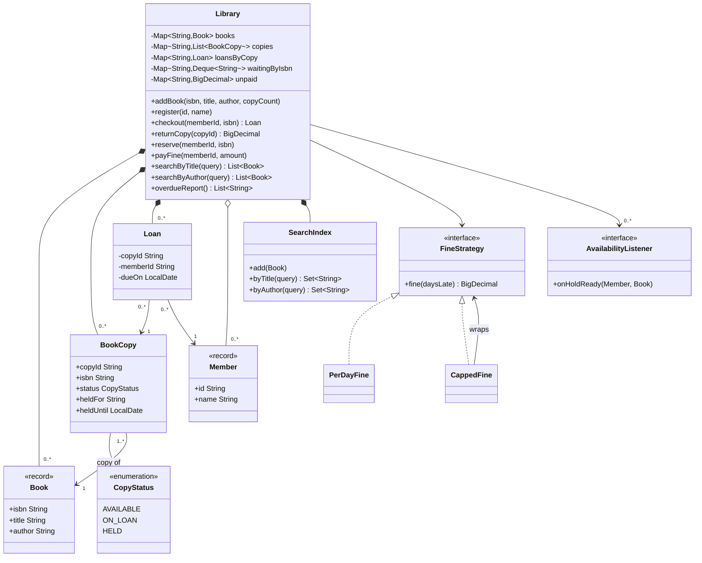
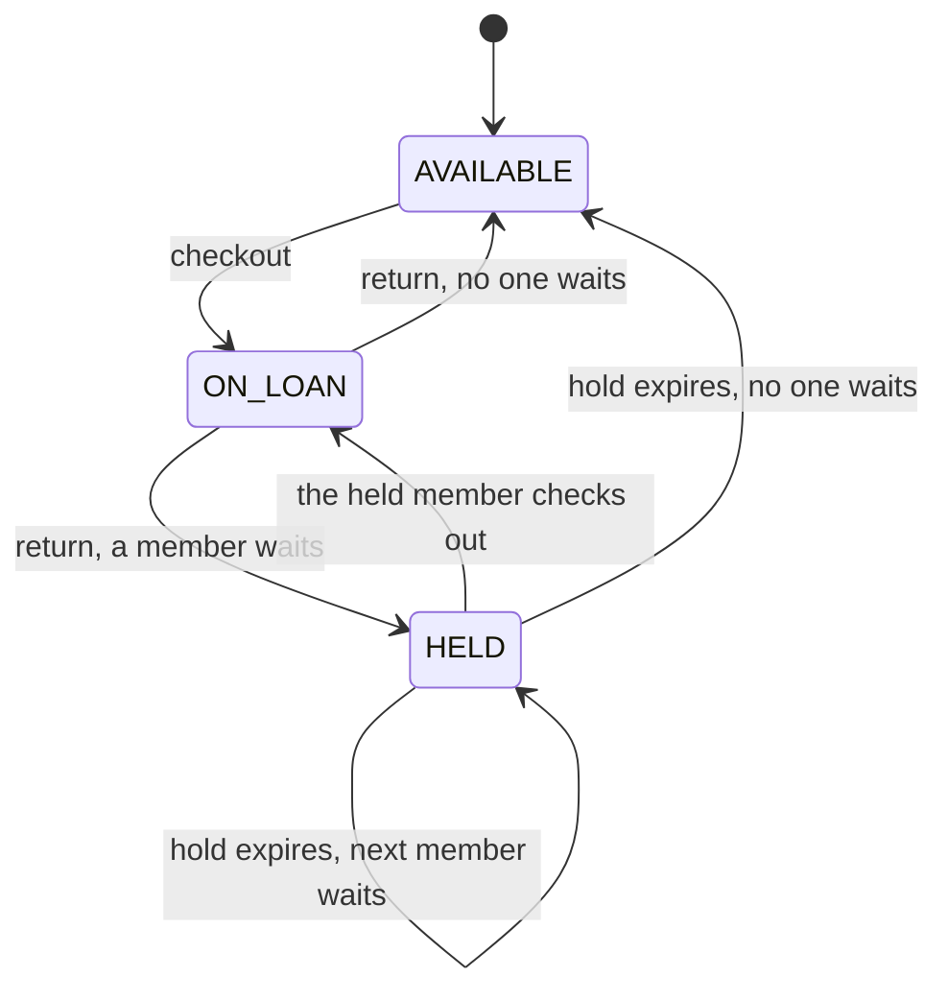
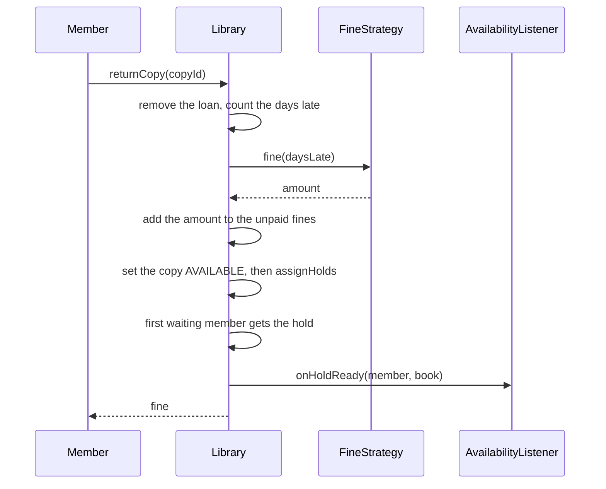

# Design a Library Management System

This case study designs a library system for an LLD (low-level design) interview. The system tracks books and their physical copies, members, loans, reservations, and fines. It also searches the catalog and tells a member when a reserved book is ready. The interview tests three things: whether you separate a book from a copy of the book, whether you move rules (loan period, fine amount) out of the entities, and whether the system stays correct when two members want the last copy. The runnable program is in [`Main.java`](Main.java). Run it with `java Main.java` from this folder. The procedure that this page follows is in [How to approach an LLD interview](../../how-to-approach-lld.md). The domain modeling page uses a library statement as its worked example: [domain modeling](../../fundamentals/05-domain-modeling.md).

## Problem Statement

"Design a library management system. The library owns books. A book can have several physical copies. Members borrow copies for a fixed period and return them. A member who returns a copy late pays a fine. A member can search for books by title or by author. If all copies of a book are on loan, a member can reserve the book and gets a notification when a copy is ready."

The interviewer adds follow-ups: "A member has a limit on the number of loans", "Renew a loan", "Different member types have different limits", "Search by a prefix of the title", "Two members take the last copy at the same time".

## Clarifying Questions

| # | Question | Answer that this design assumes |
|---|---|---|
| 1 | How much code do you expect? | Compiling code for the core flows (borrow, return, reserve, search), plus the class diagram |
| 2 | Is a book the same as a copy? | No. A **book** is a title with an ISBN (a catalog entry). A **copy** is one physical item. A book has one or more copies. A loan is for a copy |
| 3 | Who uses the system? | Members borrow, return, reserve, and search. A librarian adds books and registers members. Both use one Java API in this design |
| 4 | How long is a loan? | 14 days. The number is a constructor parameter |
| 5 | Is there a limit on loans? | Yes: 2 active loans for each member in the demo. The limit is a constructor parameter. Member types with different limits are an extension |
| 6 | How is a fine computed? | A rule object computes it from the number of days late. The demo uses 0.50 for each day, with a cap of 10.00 for each loan |
| 7 | What happens to a member with an unpaid fine? | The member cannot borrow until the member pays the fine |
| 8 | What does a reservation do? | A member reserves a book only if no copy is available. When a copy returns, the system holds it for the first member in the queue (first in, first out) |
| 9 | How long does a hold last? | 3 days. After that, the hold expires and the next member in the queue gets the copy |
| 10 | How does the system notify the member? | Through a listener interface. The demo listener collects messages in a list. An email or SMS sender is another listener |
| 11 | How does search work? | By words in the title, or by words in the author name. All words in the query must match. Case does not matter. Prefix search and typo tolerance are out of scope |
| 12 | Does time matter in the tests? | Yes. The system reads time from an injected `Clock`, so the demo moves the date by hand and its output is deterministic |
| 13 | Is storage in memory? | Yes. A database is out of scope. The design has one class per store, so a repository interface can replace each one |
| 14 | Do several threads use the system? | Assumption: yes. Two members can take the last copy at the same time. The design uses one lock for the whole library |
| 15 | Can a member renew, and can a copy be lost or damaged? | Out of scope. Both appear in the Extensions section |

## Requirements

### Functional requirements

1. **R1.** Add a book (ISBN, title, author) with a number of copies. Adding copies to an existing book is allowed.
2. **R2.** Register a member.
3. **R3.** A member borrows a copy of a book. The loan has a due date: the borrow date plus the loan period.
4. **R4.** A borrow fails if the member has an unpaid fine, has reached the loan limit, or if no copy is available to this member.
5. **R5.** A member returns a copy. If the return date is after the due date, the system computes a fine and adds it to the member's unpaid fines.
6. **R6.** A member pays a fine, fully or in part.
7. **R7.** A member reserves a book when no copy is available. The system keeps one queue for each book.
8. **R8.** When a copy returns, the system holds it for the first member in the queue and notifies the member. Only that member can borrow the copy. If the member does not borrow it in time, the hold expires and the copy goes to the next member.
9. **R9.** A member searches by title words or by author words.
10. **R10.** The system lists overdue loans with the fine so far.

### Non-functional requirements

1. **N1.** Search does not scan every book. It uses an inverted index (a map from a word to the books that contain the word).
2. **N2.** The fine rule and the loan rules are replaceable without a change to `Library` (Open-Closed Principle, see [SOLID](../../fundamentals/02-solid.md)).
3. **N3.** Time comes from an injected `Clock`. The demo is deterministic.
4. **N4.** Two members cannot borrow the same copy (see [Concurrency](#concurrency)).
5. **N5.** Money uses `BigDecimal`, never `double`. See [domain modeling](../../fundamentals/05-domain-modeling.md).

## Entities and Relationships

Take the nouns of the statement: library, book, copy, member, loan, reservation, fine, notification, title, author, due date. Sort them with the method from [domain modeling](../../fundamentals/05-domain-modeling.md):

| Noun | Kind | Responsibility |
|---|---|---|
| `Library` | Service (aggregate root) | The entry point. Owns the stores, applies the rules, and keeps the invariants |
| `Book` | Value object (`record`) | A catalog entry: ISBN, title, author. Two copies of one book share one `Book` |
| `BookCopy` | Entity | One physical item. Has a copy ID and a status: `AVAILABLE`, `ON_LOAN`, or `HELD` |
| `Member` | Value object (`record`) | The member ID and the name. The state of a member (loans, fines) lives in `Library` maps |
| `Loan` | Entity | One borrowing of one copy by one member, with a due date |
| Reservation | Not a class | A member ID in the queue (`Deque<String>`) for an ISBN. A reservation has no data besides the member and the position |
| `FineStrategy` | Interface (Strategy) | Computes the fine from the days late |
| `PerDayFine`, `CappedFine` | Classes | Two fine rules. `CappedFine` wraps another rule (Decorator) |
| `AvailabilityListener` | Interface (Observer) | Receives "a hold is ready" events |
| `SearchIndex` | Class | Two inverted indexes: title words and author words |
| `ManualClock` | Class | A `Clock` that the demo moves by hand |
| `CopyStatus` | Enum | `AVAILABLE`, `ON_LOAN`, `HELD` |

The central modeling decision: **a book and a copy are two types**. A book answers "what is it?" (title, author). A copy answers "which one is it, and where is it?" (status, loan). If you merge them into one `Book` class with a `borrowed` flag, the library cannot own two copies of one title, and search returns one entry for each copy. This is the most frequent mistake in this problem.

A second decision: **the fine is computed at return time and stored as an unpaid amount**. A fine is a fact about a past event. It does not change when the rule changes later.

Relationships:

- `Library` has many `Book` objects and many `BookCopy` objects (composition). The copies are grouped by ISBN. A copy refers to its book by ISBN and not by object, because the copy and the book are two stores.
- `Library` has many `Member` objects (aggregation) and many `Loan` objects (composition).
- A `Loan` refers to one copy and one member by ID (association).
- `Library` has one `FineStrategy` and one `Clock` (association, injected). It has zero or more `AvailabilityListener` objects (association).
- `PerDayFine` and `CappedFine` realize `FineStrategy`. `CappedFine` also has one `FineStrategy` (the wrapped rule).
- `Library` owns one `SearchIndex` (composition).

## Class Diagram



The life cycle of a copy:



The flow of a return with a waiting member:



## Design Patterns Used

| Pattern | Where | Reason | Rejected alternative |
|---|---|---|---|
| Strategy ([behavioral patterns](../../fundamentals/08-behavioral-patterns.md)) | `FineStrategy` with `PerDayFine` | The statement says rules change. A new fine rule is a new class | A `switch` or an `if` on the rule inside `returnCopy`. Each new rule would edit `Library` |
| Decorator ([structural patterns](../../fundamentals/07-structural-patterns.md)) | `CappedFine` wraps a `FineStrategy` | A cap is a rule on top of another rule. Wrapping gives "per day, capped" without a `CappedPerDayFine` class | A `cap` field in every fine class. Each new rule would repeat the cap code |
| Observer ([behavioral patterns](../../fundamentals/08-behavioral-patterns.md)) | `AvailabilityListener` | The library must not know how to send an email or an SMS. It tells the listeners that a hold is ready | A direct call to an `EmailService` inside `assignHolds`. The library would depend on one channel |
| Dependency injection ([architectural patterns](../../fundamentals/10-architectural-patterns.md)) | `Library` receives the `Clock`, the `FineStrategy`, and the limits | Tests and the demo control time and rules | `LocalDate.now()` inside the methods. A late-return test would need a real wait |
| Value objects (`record`) | `Book`, `Member` | Immutable, equal by data, safe to share between threads | Mutable classes with setters |
| Inverted index | `SearchIndex` | Search cost depends on the number of matches and not on the catalog size | A loop over all books with `contains`. It costs O(books) for each query |
| Enum for the copy status | `CopyStatus` | Three states, and the transitions are short. Two status checks in `findBorrowable` are enough | The State pattern with one class for each status. It adds three classes with almost no behavior. See [behavioral patterns](../../fundamentals/08-behavioral-patterns.md) for when State pays off |
| Queue | `Deque<String>` for each ISBN | First in, first out. `pollFirst` takes the next member | A list with index arithmetic |
| Facade | `Library` is the single entry point | One class gives one method for each use case | Callers that talk to the stores. They could break the invariants |

`Library` is the facade for all use cases, so it is large. In a real code base, you split it into `CatalogService`, `LoanService`, and `ReservationService`. In a 45-minute round, one class keeps the code short, and you say aloud how you would split it. The [anti-patterns page](../../fundamentals/11-anti-patterns.md) calls the unsplit form a risk (God object).

## Key Code

The code below is copied from [`Main.java`](Main.java).

### Entities and value objects

A `Book` is a catalog entry, and a `BookCopy` is a physical item. `BookCopy` has mutable status fields that only `Library` changes, while it holds its lock.

```java
record Book(String isbn, String title, String author) { }

record Member(String id, String name) { }

enum CopyStatus { AVAILABLE, ON_LOAN, HELD }

final class BookCopy {
    final String copyId;
    final String isbn;
    CopyStatus status = CopyStatus.AVAILABLE;
    String heldFor;
    LocalDate heldUntil;

    BookCopy(String copyId, String isbn) {
        this.copyId = copyId;
        this.isbn = isbn;
    }
}
```

A `Loan` stores the copy ID, the member ID, and the due date. It has no `returnedOn` field, because the library removes the loan when the copy returns. A loan history is an extension.

```java
final class Loan {
    private final String copyId;
    private final String memberId;
    private final LocalDate dueOn;

    Loan(String copyId, String memberId, LocalDate dueOn) {
        this.copyId = copyId;
        this.memberId = memberId;
        this.dueOn = dueOn;
    }

    String copyId() { return copyId; }
    String memberId() { return memberId; }
    LocalDate dueOn() { return dueOn; }
}
```

### Fine rules

`CappedFine` wraps another `FineStrategy`. Both use `BigDecimal`.

```java
interface FineStrategy {
    BigDecimal fine(long daysLate);
}

record PerDayFine(BigDecimal perDay) implements FineStrategy {
    public BigDecimal fine(long daysLate) {
        return perDay.multiply(BigDecimal.valueOf(daysLate)).setScale(2, RoundingMode.HALF_UP);
    }
}

record CappedFine(FineStrategy inner, BigDecimal cap) implements FineStrategy {
    public BigDecimal fine(long daysLate) {
        return inner.fine(daysLate).min(cap);
    }
}
```

### Listener and clock

`AvailabilityListener` is the Observer interface. `ManualClock` extends `java.time.Clock`. The demo moves the date with `advanceDays`.

```java
interface AvailabilityListener {
    void onHoldReady(Member member, Book book);
}
```

```java
final class ManualClock extends Clock {
    private volatile LocalDate today;

    ManualClock(LocalDate start) {
        this.today = start;
    }

    void advanceDays(int days) {
        today = today.plusDays(days);
    }

    @Override public ZoneId getZone() {
        return ZoneOffset.UTC;
    }

    @Override public Clock withZone(ZoneId zone) {
        return this;
    }

    @Override public Instant instant() {
        return today.atStartOfDay().toInstant(ZoneOffset.UTC);
    }
}
```

### Search index

The index maps each lowercase word to the sorted set of ISBNs that contain the word. A query with several words intersects the sets. A `TreeSet` keeps the result order stable. `toLowerCase(Locale.ROOT)` gives the same result on every machine. The no-argument `toLowerCase()` uses the default locale, and in a Turkish locale it turns `I` into a dotless `ı`, so the word "JAVA IN PRACTICE" would not match "in".

```java
final class SearchIndex {
    private final Map<String, Set<String>> titleTokens = new TreeMap<>();
    private final Map<String, Set<String>> authorTokens = new TreeMap<>();

    void add(Book book) {
        for (String token : tokens(book.title())) {
            titleTokens.computeIfAbsent(token, k -> new TreeSet<>()).add(book.isbn());
        }
        for (String token : tokens(book.author())) {
            authorTokens.computeIfAbsent(token, k -> new TreeSet<>()).add(book.isbn());
        }
    }

    Set<String> byTitle(String query) {
        return lookup(titleTokens, query);
    }

    Set<String> byAuthor(String query) {
        return lookup(authorTokens, query);
    }

    private static Set<String> lookup(Map<String, Set<String>> index, String query) {
        Set<String> result = null;
        for (String token : tokens(query)) {
            Set<String> hits = index.getOrDefault(token, Set.of());
            if (result == null) {
                result = new TreeSet<>(hits);
            } else {
                result.retainAll(hits);
            }
        }
        return result == null ? new TreeSet<>() : result;
    }

    private static List<String> tokens(String text) {
        return Arrays.stream(text.toLowerCase(Locale.ROOT).split("[^a-z0-9]+"))
                .filter(token -> !token.isEmpty())
                .toList();
    }
}
```

### The library: state and the borrow flow

The constructor takes the rules. `checkout` checks the member first (fine, limit) and then looks for a copy. A held copy is borrowable only by the member that holds it.

```java
final class Library {
    private final Clock clock;
    private final FineStrategy fineStrategy;
    private final int maxLoans;
    private final int loanDays;
    private final int holdDays;
    private final Map<String, Book> books = new TreeMap<>();
    private final Map<String, List<BookCopy>> copies = new TreeMap<>();
    private final Map<String, BookCopy> copiesById = new TreeMap<>();
    private final Map<String, Member> members = new TreeMap<>();
    private final Map<String, Loan> loansByCopy = new TreeMap<>();
    private final Map<String, Deque<String>> waitingByIsbn = new TreeMap<>();
    private final Map<String, BigDecimal> unpaid = new TreeMap<>();
    private final SearchIndex index = new SearchIndex();
    private final List<AvailabilityListener> listeners = new ArrayList<>();

    Library(Clock clock, FineStrategy fineStrategy, int maxLoans, int loanDays, int holdDays) {
        this.clock = clock;
        this.fineStrategy = fineStrategy;
        this.maxLoans = maxLoans;
        this.loanDays = loanDays;
        this.holdDays = holdDays;
    }
```

```java
    synchronized Loan checkout(String memberId, String isbn) {
        refreshHolds();
        Member member = member(memberId);
        if (unpaidFine(memberId).signum() > 0) {
            throw new LibraryException("unpaid fine " + unpaidFine(memberId));
        }
        if (activeLoans(memberId) >= maxLoans) {
            throw new LibraryException("loan limit " + maxLoans + " reached");
        }
        BookCopy copy = findBorrowable(isbn, member.id());
        copy.status = CopyStatus.ON_LOAN;
        copy.heldFor = null;
        copy.heldUntil = null;
        Loan loan = new Loan(copy.copyId, memberId, LocalDate.now(clock).plusDays(loanDays));
        loansByCopy.put(copy.copyId, loan);
        return loan;
    }

    synchronized BigDecimal returnCopy(String copyId) {
        Loan loan = loansByCopy.remove(copyId);
        if (loan == null) {
            throw new LibraryException("copy " + copyId + " is not on loan");
        }
        long daysLate = ChronoUnit.DAYS.between(loan.dueOn(), LocalDate.now(clock));
        BigDecimal fine = daysLate > 0 ? fineStrategy.fine(daysLate) : BigDecimal.ZERO;
        if (fine.signum() > 0) {
            unpaid.merge(loan.memberId(), fine, BigDecimal::add);
        }
        BookCopy copy = copyById(copyId);
        copy.status = CopyStatus.AVAILABLE;
        assignHolds(copy.isbn);
        return fine;
    }
```

`findBorrowable` returns the copy that this member holds, or else an available copy. The order matters. Assume that a book has two copies, and both are on loan. Bob reserves the book. Copy 1 returns and becomes `HELD` for Bob. Copy 2 returns, the queue is empty, and copy 2 becomes `AVAILABLE`. If the method took the first borrowable copy in list order, and copy 2 came first in the list, Bob would borrow copy 2. Copy 1 would then stay `HELD` for Bob for 3 days, and no other member could borrow it.

```java
    private BookCopy findBorrowable(String isbn, String memberId) {
        if (!books.containsKey(isbn)) {
            throw new LibraryException("unknown book " + isbn);
        }
        List<BookCopy> list = copies.get(isbn);
        for (BookCopy copy : list) {
            if (copy.status == CopyStatus.HELD && memberId.equals(copy.heldFor)) {
                return copy;
            }
        }
        for (BookCopy copy : list) {
            if (copy.status == CopyStatus.AVAILABLE) {
                return copy;
            }
        }
        throw new LibraryException("no copy available, reserve the book");
    }
```

### Reservation and holds

A member reserves a book only when no copy is available. `assignHolds` runs when a copy becomes available. It takes the next waiting member, holds the copy, and notifies the listeners. `refreshHolds` releases the holds whose date has passed.

```java
    synchronized void reserve(String memberId, String isbn) {
        refreshHolds();
        member(memberId);
        if (!books.containsKey(isbn)) {
            throw new LibraryException("unknown book " + isbn);
        }
        if (availableCopies(isbn) > 0) {
            throw new LibraryException("a copy is available, borrow it");
        }
        Deque<String> queue = waitingByIsbn.computeIfAbsent(isbn, k -> new ArrayDeque<>());
        if (queue.contains(memberId)) {
            throw new LibraryException("already waiting");
        }
        queue.addLast(memberId);
    }
```

```java
    private void assignHolds(String isbn) {
        Deque<String> queue = waitingByIsbn.get(isbn);
        for (BookCopy copy : copies.get(isbn)) {
            if (queue == null || queue.isEmpty()) {
                return;
            }
            if (copy.status == CopyStatus.AVAILABLE) {
                copy.status = CopyStatus.HELD;
                copy.heldFor = queue.pollFirst();
                copy.heldUntil = LocalDate.now(clock).plusDays(holdDays);
                Member member = members.get(copy.heldFor);
                listeners.forEach(l -> l.onHoldReady(member, books.get(isbn)));
            }
        }
    }

    private void refreshHolds() {
        LocalDate today = LocalDate.now(clock);
        for (List<BookCopy> list : copies.values()) {
            for (BookCopy copy : list) {
                if (copy.status == CopyStatus.HELD && today.isAfter(copy.heldUntil)) {
                    copy.status = CopyStatus.AVAILABLE;
                    copy.heldFor = null;
                    copy.heldUntil = null;
                    assignHolds(copy.isbn);
                }
            }
        }
    }
```

### Overdue report

```java
    synchronized List<String> overdueReport() {
        LocalDate today = LocalDate.now(clock);
        return loansByCopy.values().stream()
                .filter(loan -> loan.dueOn().isBefore(today))
                .sorted(Comparator.comparing(Loan::dueOn).thenComparing(Loan::copyId))
                .map(loan -> {
                    long late = ChronoUnit.DAYS.between(loan.dueOn(), today);
                    String title = books.get(copyById(loan.copyId()).isbn).title();
                    return member(loan.memberId()).name() + " | " + title
                            + " | days late: " + late + " | fine so far " + fineStrategy.fine(late);
                })
                .toList();
    }
```

## Concurrency

**What races.** The core action is "find an available copy, then mark it on loan". This is a check-then-act sequence. Without protection, two threads can both see the copy as `AVAILABLE`, and both create a loan for it. The other shared state has the same problem: the reservation queue (two members join at the same time), the unpaid fine map (a payment and a return), and the hold assignment (a return and an expiry).

**The design.** Every public method of `Library` is `synchronized`. One monitor protects all state, so each use case runs as one step. The demo starts two threads that borrow the last copy of one book at the same moment. Exactly one thread succeeds, and the other gets a `LibraryException`. The demo prints the count of successes (always 1), and it does not print which thread won, because that depends on the schedule.

**Why one lock.** A library has little write traffic, and one lock is simple and correct. It has no deadlock risk, because no method takes a second lock. Reads (`searchByTitle`) also take the lock, so they wait for a write. This is acceptable for the expected load.

**When one lock is not enough.** Recommendation: if profiling shows contention, use one lock for each ISBN. `checkout` and `reserve` touch the copies and the queue of one ISBN, so they need only that lock. The member-level checks (fine, limit) need a second lock for the member. Without the member lock, two checkouts of two different books by one member run under two different ISBN locks, both see one active loan, and both pass a limit of 2. Then you need a fixed lock order (for example, member lock, then ISBN lock) to avoid deadlock. The [concurrency page](../../fundamentals/09-concurrency-in-lld.md) shows the lock granularity choices and lock ordering.

**The same rule in a database.** With a database, the copy row and the member row take the place of the monitor. Three forms work (see `kb/databases/04-transactions-and-isolation.md`):

- **A locking read.** `SELECT ... FROM copy WHERE copy_id = ? FOR UPDATE` takes an exclusive lock on each row that it returns. The lock lasts until the transaction commits or rolls back. Another transaction that runs `UPDATE`, `DELETE`, or `SELECT ... FOR UPDATE` on the same row waits for the commit. A plain `SELECT` does not wait in PostgreSQL, or in MySQL InnoDB at the default isolation level (`REPEATABLE READ`), because both read a committed version of the row (MVCC, multi-version concurrency control). PostgreSQL, MySQL (InnoDB), and Oracle support `FOR UPDATE` in a `SELECT`. SQL Server does not. It uses the table hints `WITH (UPDLOCK, ROWLOCK)` instead. To take any free copy of a book without a wait for a copy that another transaction locked, add `SKIP LOCKED` (PostgreSQL 9.5 and later, MySQL 8.0 and later, Oracle). In PostgreSQL and MySQL syntax: `SELECT ... WHERE isbn = ? AND status = 'AVAILABLE' LIMIT 1 FOR UPDATE SKIP LOCKED`.
- **A conditional update.** `UPDATE copy SET status = 'ON_LOAN' WHERE copy_id = ? AND status = 'AVAILABLE'`, then check that the row count is 1. If it is 0, another member took the copy first.
- **An optimistic version column.** Read the row with its `version`, and update with `WHERE copy_id = ? AND version = ?`. A row count of 0 means a conflict, and the caller retries.

The loan limit needs the same care: lock the member row (`SELECT ... FROM member WHERE id = ? FOR UPDATE`) before the transaction counts the active loans. Without that lock, two transactions for one member can both count one loan and both insert a second one. This anomaly is a write skew.

**The listener call.** `assignHolds` calls the listeners while it holds the lock. This has four risks:

1. A slow listener (a real email call) blocks every other caller of the library.
2. A listener that throws an exception stops the other listeners, and the exception reaches the caller of `returnCopy` after the library has already changed its state.
3. A listener that calls back into `Library` (for example, an automatic checkout) enters the monitor again, because `synchronized` is reentrant. It then changes the state while `assignHolds` is in the middle of its loop.
4. A listener that takes its own lock creates a second lock. If another thread takes the two locks in the opposite order, the two threads deadlock.

Recommendation: collect the events in a local list inside the lock, and call the listeners after the lock is released. The listener list then needs a snapshot, because `addListener` can run at the same time: copy the list inside the lock, or use a `CopyOnWriteArrayList`. The events must be published even when the method throws after it changed the state (for example, `checkout` assigns an expired hold to the next member in `refreshHolds` and then rejects the caller), so the publish step goes in a `finally` block. An event that a listener receives after the lock can be stale: the hold may have expired before the member reads the message. Add the hold end date to the event, so that the message can state it. Another option is a queue: the library puts the events on a `BlockingQueue`, and a worker thread calls the listeners. The demo keeps the call inside the lock to keep the code short, and its listener only adds a string to a list.

**Lazy hold expiry.** No background thread expires holds. `refreshHolds` runs at the start of `checkout`, `reserve`, `availableCopies`, and `waiting`. So the next member gets the notification only when one of these calls runs. In the demo, Carol gets her notification on day 25, when Bob tries to borrow. Extension 9 replaces the scan with a scheduled task.

## Extensions

| # | Follow-up | Change to the design |
|---|---|---|
| 1 | Member types with different limits and loan periods (student, staff) | Add an interface `MembershipPolicy` with `maxLoans()` and `loanDays()`. Add a `MembershipPolicy` field to `Member` (a record component). `Library` reads the limits from the member's policy and drops its two `int` constructor parameters. `Library.checkout` changes in two lines |
| 2 | Renew a loan | Add `Library.renew(copyId)`. It checks that no member waits for the ISBN and that the loan is not overdue. It replaces the `Loan` with a new one that has a later due date (`Loan` is immutable). Add a `renewals` count to `Loan` and a limit in the policy |
| 3 | Prefix search ("effec" finds "Effective Java") | The two maps are already `TreeMap` objects. Change their declared type from `Map` to `NavigableMap`, because `subMap` and `tailMap` are not on `Map`. In `lookup`, treat each query word as a prefix: take the union of the ISBN sets of all keys that start with the word, then intersect across the words as now. The keys that start with `prefix` are `index.tailMap(prefix, true)`, read in order until a key does not start with `prefix`. The shorter form `index.subMap(prefix, prefix + Character.MAX_VALUE)` is correct here, because `tokens` keeps only `[a-z0-9]` characters. In general it misses keys that have the character `\uFFFF` after the prefix (the upper bound is exclusive, and `"ab\uFFFFx"` sorts after `"ab\uFFFF"`). A trie is the alternative. It stores each shared prefix once. Hide the choice behind a `SearchIndex` interface |
| 4 | Lost or damaged copy | Add `LOST` and `DAMAGED` to `CopyStatus`. Add `Library.markLost(copyId)`. It ends the active loan and adds a replacement-cost charge to the unpaid fines. `findBorrowable` already skips copies that are not `AVAILABLE`, so it needs no change |
| 5 | Loan history and reports | Add a `LoanRecord` record (copy, member, borrowed on, returned on, fine). `returnCopy` appends a record to a `List<LoanRecord>` or calls a `LoanHistory` interface. The overdue report stays unchanged |
| 6 | Notify by email and SMS | Add classes `EmailListener` and `SmsListener` that implement `AvailabilityListener`. Register both with `addListener`. `Library` does not change. Add retry logic inside the listener, or put a queue between the library and the listener |
| 7 | Store data in a database | Extract interfaces `BookRepository`, `CopyRepository`, `LoanRepository` from the maps. `Library` receives them in the constructor. The `synchronized` methods become one transaction each. The copy row gets a version column or a row lock. See [architectural patterns](../../fundamentals/10-architectural-patterns.md) |
| 8 | Cancel a reservation | Add `Library.cancelReservation(memberId, isbn)`. It removes the member from the queue. If the member holds a copy, it releases the copy and calls `assignHolds` |
| 9 | Hold expiry without a scan | `refreshHolds` scans all copies on each call. Replace it with a `PriorityQueue` of `(heldUntil, copyId)` and pop the expired entries. A scheduled task can also run it. See `kb/lld/case-studies/16-task-scheduler/README.md` for a scheduler design |

## Common Mistakes

| Mistake | Why it hurts | Fix |
|---|---|---|
| One `Book` class with a `borrowed` flag | The library cannot hold two copies of one title. Search returns a result for each copy | Separate `Book` (catalog entry) from `BookCopy` (physical item). The loan refers to the copy |
| Fine rules inside `Member` or `Loan` | Each rule change edits an entity. Tests need real dates | A `FineStrategy` and a `Clock` that the caller injects |
| `double` for the fine | Rounding errors in money | `BigDecimal` with an explicit scale and rounding mode |
| `LocalDate.now()` in the logic | The result depends on the day that the test runs | Inject a `Clock`. Use `LocalDate.now(clock)` |
| Scanning all books for each search | O(books) for each query | An inverted index |
| A `Reservation` class with a status, dates, and getters that carry no behavior | The class adds code and no rule | Start with a queue of member IDs. Add a class when a reservation gets its own data (a priority, an expiry date for each reservation) |
| A reservation for an available book | The member waits for a copy that is on the shelf | `reserve` rejects the call when a copy is available |
| The copy returns and goes to `AVAILABLE` while members wait | A third member jumps the queue | `returnCopy` calls `assignHolds`, which gives the copy to the first waiting member |
| A hold with no expiry | One member who never comes blocks the copy forever | `heldUntil` and `refreshHolds` |
| No lock around check-then-act | Two members borrow the same copy | One lock, or one lock for each ISBN, around "find a copy and mark it on loan" |
| `checkout` takes the first borrowable copy in list order | A member who holds one copy borrows another, and the held copy stays blocked until the hold expires | Look for the copy that this member holds first, then for an available copy |
| `payFine` accepts any amount | A negative payment raises the debt. An amount with 3 decimals breaks the 2-decimal scale | Reject an amount that is not positive or has more than 2 decimals |
| `toLowerCase()` without a locale in the search index | In a Turkish default locale, `"IN"` becomes `"ın"`, and the search misses words | `toLowerCase(Locale.ROOT)` |
| Calling the email service while the library lock is held | One slow call blocks the library | Notify after the lock, or queue the event |
| `Library` imports `EmailService` | The core depends on one channel | The `AvailabilityListener` interface |

## 45-Minute Plan

| Minutes | Part | What to present |
|---|---|---|
| 0 to 5 | Clarify | Ask the questions in the table above. Ask about a copy versus a book first. Write the numbered requirements and the assumptions |
| 5 to 10 | Entities | Sort the nouns. Say why `Book` and `BookCopy` are separate. Say why a reservation is a queue entry and not a class |
| 10 to 17 | Diagram and signatures | Draw the class diagram. Write the public method signatures of `Library`. Draw the copy life cycle (three states) |
| 17 to 20 | Patterns | Name Strategy (fines), Observer (notifications), and Dependency injection (clock). Give the rejected alternative for each |
| 20 to 35 | Code | Write `Book`, `BookCopy`, `Loan`, `FineStrategy`, then `checkout` and `returnCopy`. Write the demo with a manual clock. Name the rest and skip it (search index, overdue report) |
| 35 to 40 | Concurrency | Show the check-then-act race on the last copy. Show the lock. Say what you do when the lock is too coarse |
| 40 to 45 | Extensions | Answer two or three of the extensions: member types, renewal, database storage. For each, name the class to add and the classes that stay the same |

If the interviewer asks for less code, drop the search index and keep the loan and reservation flow. If the interviewer asks for more depth, show the hold expiry and the notification after the lock.

## Expected Output

The output of `java Main.java`. Dates come from the manual clock, so the output is the same on each run.

<!-- expected-output -->
```text
== Catalog and search ==
title 'java': [Effective Java, Java Concurrency in Practice]
title 'java concurrency': [Java Concurrency in Practice]
author 'martin': [Clean Code, Refactoring]
== Loan, reservation, late return (day 0) ==
alice borrows Effective Java, due 2026-03-15
bob borrows Effective Java: rejected (no copy available, reserve the book)
reservations for 222: [bob, carol]
== Day 20: alice returns late ==
fine: 3.00, unpaid: 3.00
inbox: [Bob: 'Effective Java' is ready to borrow]
alice borrows Clean Code with unpaid fine: rejected (unpaid fine 3.00)
alice pays a negative amount: rejected (payment must be positive, with at most 2 decimals)
alice borrows a third book: rejected (loan limit 2 reached)
== Day 25: bob's hold expired ==
bob borrows Effective Java: rejected (no copy available, reserve the book)
carol borrows Effective Java, due 2026-04-09
inbox: [Bob: 'Effective Java' is ready to borrow, Carol: 'Effective Java' is ready to borrow]
== Concurrent checkout of the last copy ==
successful checkouts of 444: 1
available copies of 444: 0
== Day 40: overdue report ==
Alice | Clean Code | days late: 6 | fine so far 3.00
Alice | Java Concurrency in Practice | days late: 6 | fine so far 3.00
Carol | Effective Java | days late: 1 | fine so far 0.50
```
