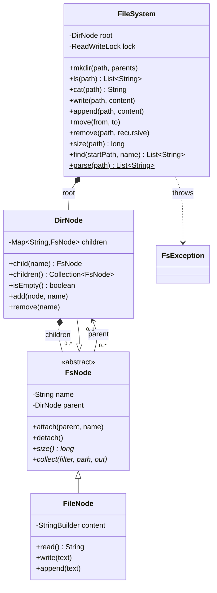
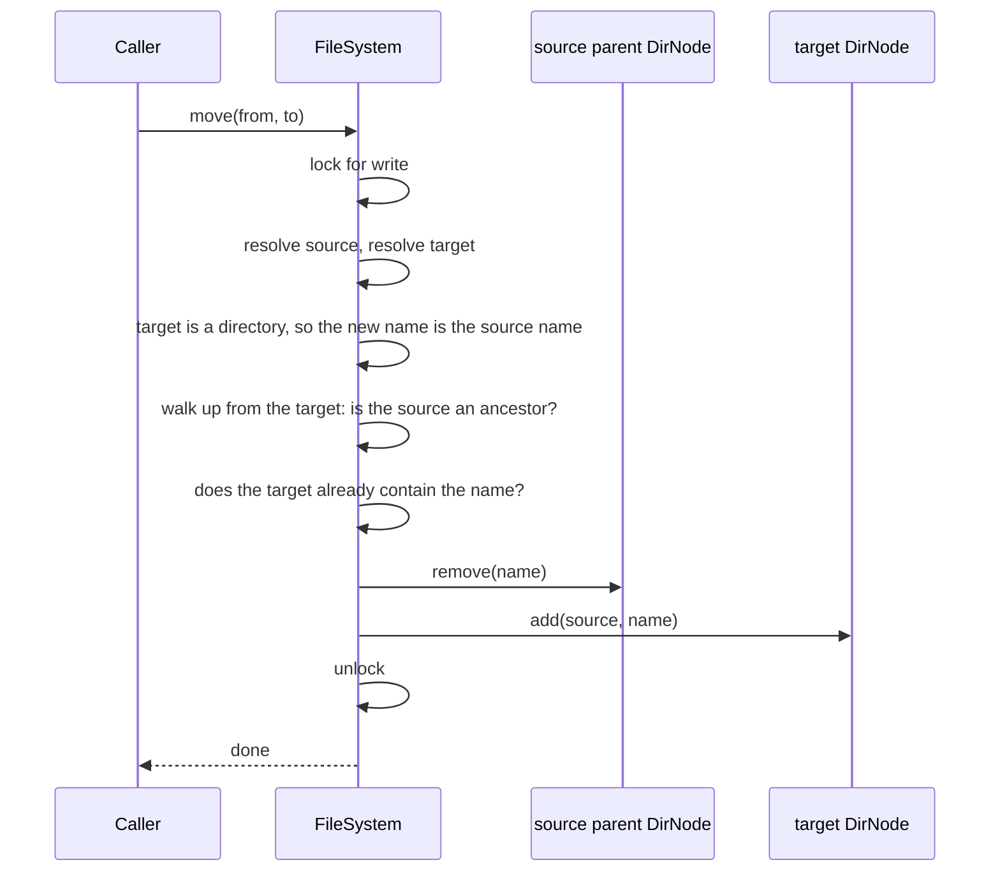

# Design an In-Memory File System

This case study designs an in-memory file system for an LLD (low-level design) interview. The system has files and directories, and it supports the commands `mkdir -p`, `ls`, `cat`, `write`, `mv`, `rm`, and a size calculation. The interview tests one pattern above all: Composite. A directory contains files and other directories, and the caller treats both through one type. The interview also tests three rules that candidates often get wrong: path normalization (`.`, `..`, and `..` at the root), a move into the own subtree, and a delete of a non-empty directory. The runnable program is in [`Main.java`](Main.java). Run it with `java Main.java` from this folder. The procedure that this page follows is in [How to approach an LLD interview](../../how-to-approach-lld.md).

## Problem Statement

"Design an in-memory file system. It has files and directories. A directory can contain files and other directories. Support these operations: create a directory (and the missing parent directories), list a directory, read a file, write a file, move or rename a file or directory, delete a file or directory, and compute the size of a file or directory."

The interviewer adds follow-ups: "Add `find` by name", "Add a current directory and relative paths", "Support file permissions", "Support hard links", "Make it thread-safe", "Show the total size in O(1)".

A related LeetCode problem is 588, "Design In-Memory File System" (Hard). It asks for `ls`, `mkdir`, `addContentToFile`, and `readContentFromFile`. The LLD round asks for more: move, delete, size, errors, and thread safety.

## Clarifying Questions

| # | Question | Answer that this design assumes |
|---|---|---|
| 1 | How much code do you expect? | Compiling code for the commands and the node classes, plus the class diagram |
| 2 | Which paths are valid? | Absolute paths that start with `/`, with names separated by `/`. A relative path is an error. A current directory and relative paths are Extension 1 |
| 3 | What do `.` and `..` mean? | `.` is the same directory. `..` is the parent directory. `..` at the root is the root. POSIX allows this rule, and Linux applies it. The design removes `.` and `..` from the text of the path before it walks the tree (see [Path normalization](#path-normalization)) |
| 4 | Are empty parts and a trailing `/` allowed? | Yes. `//home///alice/` is the same as `/home/alice`. Assumption: a trailing `/` after a file name is accepted. Linux rejects it with "Not a directory" |
| 5 | Which names are valid? | Any non-empty text without `/`. The names `.` and `..` are reserved, so no node has them. Names are case-sensitive: `Notes.txt` and `notes.txt` are two files |
| 6 | Does `mkdir` create missing parents? | Only with the `parents` flag (like `mkdir -p`). Without the flag, a missing parent is an error, and a directory that exists is an error. With the flag, a directory that exists is not an error. A file on the path is an error in both modes |
| 7 | What does `write` do when the file exists? | `write` replaces the content. `append` adds to the end. If the file does not exist, `write` and `append` create it. The parent directory must exist. `write` does not create parents |
| 8 | What does `ls` return? | For a directory: the names of its children, sorted by `String.compareTo` (code-point order, so `B` comes before `a`). A directory name ends with `/`. For a file: a list with the file name, as in Linux `ls` |
| 9 | What is the size of a file and of a directory? | The size of a file is the length of its content in `char` values (`String.length()`). The size of a directory is the sum of the sizes of all files below it. A directory adds no size of its own. A real file system counts bytes and blocks |
| 10 | What does `mv` do when the target is an existing directory? | It moves the source into that directory and keeps the source name. If the target does not exist, `mv` renames or moves the source to the target path, and the parent of the target must exist |
| 11 | What does `mv` do when the target name exists? | It fails. Linux `mv` replaces an existing file. This design rejects the move, so that no data is lost by accident. Replacement is a flag in Extension 10 |
| 12 | Can a directory move into itself or into its own subtree? | No. The design rejects it, as Linux does. The move would create a cycle and detach the subtree from the root |
| 13 | What does `rm` do on a directory? | An empty directory is removed without a flag (like `rmdir` or `rm -d`). A non-empty directory needs the `recursive` flag (like `rm -r`). The root cannot be removed, and `..` that resolves to the root counts as the root |
| 14 | Is the content text or bytes? | Text (`String`). Bytes are Extension 6 |
| 15 | File metadata (time, owner, permissions) and links? | Out of scope. See Extensions 2, 5, and 7 |
| 16 | Do several threads use the file system? | Assumption: yes. The design uses one read-write lock for the whole tree |
| 17 | Is the output deterministic? | Yes. Directories keep their children in a `TreeMap`, so the order is sorted. The demo prints no times |

## Requirements

### Functional requirements

1. **R1.** `mkdir(path, parents)` creates a directory. With `parents`, it creates the missing parent directories, and an existing directory is not an error.
2. **R2.** `ls(path)` lists a directory in sorted order. For a file, it returns the file name.
3. **R3.** `cat(path)` returns the content of a file.
4. **R4.** `write(path, content)` creates or replaces a file. `append(path, content)` creates a file or adds to its end.
5. **R5.** `move(from, to)` moves or renames a file or directory, with the rules in questions 10 to 12.
6. **R6.** `remove(path, recursive)` deletes a file or a directory. A non-empty directory needs `recursive`. The root cannot be deleted.
7. **R7.** `size(path)` returns the size of a file or the total size of a directory.
8. **R8.** `find(startPath, name)` returns the paths of all nodes with the given name, below the start path and including the start path.
9. **R9.** Each path accepts `.`, `..`, repeated `/`, and a trailing `/`.
10. **R10.** The system reports each error with an `FsException` whose message names the path and the cause: no such file or directory, not a directory, is a directory, already exists, directory not empty, target exists, move into itself, remove the root.

### Non-functional requirements

1. **N1.** Resolving a path costs O(d log c), where d is the number of names in the path and c is the largest number of children of a directory on the path. Each step is one `TreeMap` lookup. A `HashMap` makes each step O(1) on average, but then `ls` must sort.
2. **N2.** `size` and `find` on a directory cost O(n), where n is the number of nodes below it. Extension 3 makes `size` O(1).
3. **N3.** The caller treats files and directories through one type (Composite).
4. **N4.** A new node type (a link, a device) is an addition to the sealed hierarchy, and the compiler lists each `switch` that must handle it.
5. **N5.** Calls from several threads do not corrupt the tree, and a reader never sees a node that is in no directory (see [Concurrency](#concurrency)).

## Entities and Relationships

Take the nouns: file system, file, directory, path, name, content, size, parent, child, root. Sort them with the method from [domain modeling](../../fundamentals/05-domain-modeling.md):

| Noun | Kind | Responsibility |
|---|---|---|
| `FileSystem` | Service (facade) | The entry point. Parses paths, finds nodes, applies the rules (no move into itself, no delete of the root), and holds the lock |
| `FsNode` | Sealed abstract class (Composite component) | The common type. Holds the name and the parent. Declares `size()` and `collect(...)` |
| `FileNode` | Final class (Composite leaf) | Holds the text content. Its size is the content length |
| `DirNode` | Final class (Composite container) | Holds the children in a `TreeMap` from name to node. Its size is the sum of the sizes of its children. It sets the parent and the name of a child in `add`, and clears the parent in `remove` |
| `FsException` | Unchecked exception | The one error type of the file system |
| Path | Not a class | A `String` that `FileSystem.parse` turns into a list of names. A `Path` value class is a good addition when relative paths arrive (Extension 1) |
| Name | Not a class | The key of a child in its parent's map. The node also keeps its name, so that `find` and `ls` can print it |
| Root | Not a class | A `DirNode` with an empty name and no parent. It is the start of each path |

The central modeling decision: **`FsNode` is a `sealed` abstract class with two permitted subclasses, and each node keeps a parent reference**.

- The sealed class tells the compiler and the reader that a node is a file or a directory and nothing else. `FileSystem` uses `switch` over the node type with no `default` branch. If a third node type joins the `permits` list, the compiler reports each such `switch` that does not handle it. Sealed classes are a standard feature (not preview) since Java 17 ([JEP 409](https://openjdk.org/jeps/409)). Pattern matching for `switch`, including `case null`, is a standard feature since Java 21 ([JEP 441](https://openjdk.org/jeps/441)).
- The parent reference lets a node leave its directory in O(log c) during `move` and `remove`, with no search from the root. It also turns the "move into its own subtree" check into a walk up from the target directory to the root.
- The name is stored twice: as the map key in the parent and as a field in the node. `DirNode.add` writes both, so a rename cannot leave them different.

Relationships:

- `FsNode` is the Composite component. `FileNode` and `DirNode` extend it (inheritance).
- `DirNode` has 0..* `FsNode` children (composition: a child is removed with its directory).
- Each `FsNode` has 0..1 parent `DirNode` (association). Only the root has no parent.
- `FileSystem` has one root `DirNode` (composition) and one lock (composition).

## Class Diagram



The flow of `mv /home/alice/docs /tmp`:



## Design Patterns Used

| Pattern | Where | Reason | Rejected alternative |
|---|---|---|---|
| Composite ([structural patterns](../../fundamentals/07-structural-patterns.md)) | `FsNode`, `FileNode`, `DirNode` | A directory contains files and directories. `size()` and `collect()` work on both through one type. The recursion lives in `DirNode` | One `Node` class with a `boolean isDirectory`, a nullable `content`, and a nullable `children` map. Each method needs an `if`, and a file could hold children by mistake |
| Facade ([structural patterns](../../fundamentals/07-structural-patterns.md)) | `FileSystem` | Callers use paths and do not touch nodes. `FileSystem` keeps the rules (no move into itself, no delete of the root) in one place | Public node classes that callers change. A caller could break the tree |
| Sealed hierarchy and pattern matching ([OOP](../../fundamentals/01-oop.md)) | `abstract sealed class FsNode permits FileNode, DirNode`, and `switch` in `ls`, `mkdir`, and `fileForWrite` | The set of node types is closed. The compiler checks that each `switch` handles each type | A plain abstract class with `isDirectory()` and casts. A wrong cast fails only at run time, and a new subclass breaks no build |
| Recursive traversal with a `Predicate` | `collect` in each node | The same walk serves `find` by name now and `find` by size or type later. The `Predicate` decides which nodes match. Each class owns its part of the walk | A separate traversal class that tests `instanceof` on each node |
| Sorted map for children | `TreeMap<String, FsNode>` | `ls` is sorted, and the output is deterministic | `HashMap`. Its iteration order is not specified. Sort in `ls` instead, if you need the O(1) average lookup |
| Higher-order helper | `inRead` takes a `Supplier`, and `inWrite` takes a `Runnable` | The lock and `try/finally` code exist once. No write operation returns a value, so `inWrite` needs no `return null` | Repeat `lock()`, `try`, `finally`, `unlock()` in each method |
| Visitor | Not used | It would add a visitor interface for two operations. Both are one method in each node class, and the pattern `switch` covers the rest | A `Visitor` interface with `visitFile` and `visitDir`. Use it when the operations grow and the node classes should stay small. See [behavioral patterns](../../fundamentals/08-behavioral-patterns.md) |

## Key Code

The code below is copied from [`Main.java`](Main.java).

### The Composite: node, file, and directory

`FsNode` holds the name and the parent. `attach` and `detach` are the only methods that change them, and only `DirNode` calls them. `size()` and `collect()` are abstract. The caller calls them on any node, and the right class answers.

```java
abstract sealed class FsNode permits FileNode, DirNode {
    private String name;
    private DirNode parent;

    FsNode(String name) {
        this.name = name;
    }

    String name() { return name; }
    DirNode parent() { return parent; }
    void attach(DirNode newParent, String newName) {
        this.parent = newParent;
        this.name = newName;
    }
    void detach() { this.parent = null; }

    abstract long size();
    abstract void collect(Predicate<FsNode> filter, String path, List<String> out);
}
```

`FileNode` is the leaf. Its size is the content length. `read` returns a new `String`, so the caller cannot change the content through the result.

```java
final class FileNode extends FsNode {
    private StringBuilder content = new StringBuilder();

    FileNode(String name) {
        super(name);
    }

    String read() { return content.toString(); }
    void write(String text) { content = new StringBuilder(text); }
    void append(String text) { content.append(text); }

    @Override long size() { return content.length(); }

    @Override void collect(Predicate<FsNode> filter, String path, List<String> out) {
        if (filter.test(this)) {
            out.add(path);
        }
    }
}
```

`DirNode` is the container. It keeps the children in a `TreeMap`. Its `size()` and `collect()` call the same methods on each child. This is the recursion of the Composite. `add` writes the map key and the node name together.

```java
final class DirNode extends FsNode {
    private final Map<String, FsNode> children = new TreeMap<>();

    DirNode(String name) {
        super(name);
    }

    FsNode child(String childName) { return children.get(childName); }
    Collection<FsNode> children() { return children.values(); }
    boolean isEmpty() { return children.isEmpty(); }

    void add(FsNode node, String childName) {
        children.put(childName, node);
        node.attach(this, childName);
    }

    void remove(String childName) {
        FsNode node = children.remove(childName);
        if (node != null) {
            node.detach();
        }
    }

    @Override long size() {
        long total = 0;
        for (FsNode node : children.values()) {
            total += node.size();
        }
        return total;
    }

    @Override void collect(Predicate<FsNode> filter, String path, List<String> out) {
        if (filter.test(this)) {
            out.add(path);
        }
        for (FsNode node : children.values()) {
            String childPath = path.equals("/") ? "/" + node.name() : path + "/" + node.name();
            node.collect(filter, childPath, out);
        }
    }
}
```

### Path normalization

`parse` turns a path into a list of names. It skips empty parts and `.`. For `..`, it removes the last name. At the root, the list is empty, and `pollLast` on an empty `ArrayDeque` returns `null` and changes nothing. So `..` at the root stays at the root.

```java
    static List<String> parse(String path) {
        if (!path.startsWith("/")) {
            throw new FsException("path must be absolute: " + path);
        }
        Deque<String> parts = new ArrayDeque<>();
        for (String part : path.split("/")) {
            if (part.isEmpty() || part.equals(".")) {
                continue;
            }
            if (part.equals("..")) {
                parts.pollLast();
            } else {
                parts.addLast(part);
            }
        }
        return new ArrayList<>(parts);
    }
```

| Input | Names after `parse` | Linux result |
|---|---|---|
| `/` | `[]` (the root) | The root |
| `//home///alice/` | `[home, alice]` | Same |
| `/home/./alice` | `[home, alice]` | Same |
| `/home/bob/../alice` | `[home, alice]` | Same, if `/home/bob` is a directory |
| `/..` and `/../..` | `[]` (the root) | The root. [POSIX section 4.13](https://pubs.opengroup.org/onlinepubs/9799919799/basedefs/V1_chap04.html) says that in the root directory, `..` may refer to the root itself, and Linux does so |
| `/../../home` | `[home]` | Same |
| `/missing/../home` | `[home]` | Error "No such file or directory", because Linux looks up `missing` first |
| `/home/alice/notes.txt/..` | `[home, alice]` | Error "Not a directory", because `notes.txt` is a file |
| `home/alice` | Error: path must be absolute | A relative path from the current directory |

This text-only normalization is the same rule as `java.nio.file.Path.normalize()`, which does not access the file system. It differs from Linux in the last three rows, and the [Javadoc of `normalize`](https://docs.oracle.com/en/java/javase/21/docs/api/java.base/java/nio/file/Path.html#normalize()) states a second risk: if a name before `..` is a symbolic link, the normalized path can name a different file. This design has no links, so the risk does not apply. Say both differences in the interview. The fix for the first one is to resolve `..` during the walk with the parent reference (`current = current.parent()`, or the root if there is none), and to fail when a name on the way is missing or is a file. The Linux rules are in [path_resolution(7)](https://man7.org/linux/man-pages/man7/path_resolution.7.html).

### Path resolution

`tryResolve` walks from the root. It returns `null` if a name is missing or a file is in the middle of the path. `resolve` turns `null` into an exception. `directory`, `file`, and `fileForWrite` add the type checks. `fileForWrite` resolves the parent directory, then switches on the child: no child creates a file, a file is returned, and a directory is an error.

```java
    private FsNode tryResolve(List<String> parts) {
        FsNode current = root;
        for (String part : parts) {
            if (!(current instanceof DirNode dir)) {
                return null;
            }
            current = dir.child(part);
            if (current == null) {
                return null;
            }
        }
        return current;
    }

    private FsNode resolve(List<String> parts, String path) {
        FsNode node = tryResolve(parts);
        if (node == null) {
            throw new FsException("no such file or directory: " + path);
        }
        return node;
    }

    private DirNode directory(List<String> parts, String path) {
        if (resolve(parts, path) instanceof DirNode dir) {
            return dir;
        }
        throw new FsException("not a directory: " + path);
    }

    private FileNode file(String path) {
        if (resolve(parse(path), path) instanceof FileNode file) {
            return file;
        }
        throw new FsException("is a directory: " + path);
    }

    private FileNode fileForWrite(String path) {
        List<String> parts = parse(path);
        if (parts.isEmpty()) {
            throw new FsException("is a directory: " + path);
        }
        DirNode parent = directory(parts.subList(0, parts.size() - 1), path);
        String name = parts.get(parts.size() - 1);
        return switch (parent.child(name)) {
            case null -> {
                FileNode created = new FileNode(name);
                parent.add(created, name);
                yield created;
            }
            case FileNode file -> file;
            case DirNode dir -> throw new FsException("is a directory: " + path);
        };
    }
```

### mkdir

For each name in the path, the loop switches on the child. A missing child is created only if it is the last name or the `parents` flag is set. A file on the path is an error. An existing directory as the last name is an error only without `parents`. `mkdir /` with no flag fails, because the root exists. `mkdir -p /` succeeds and changes nothing.

```java
final class FileSystem {
    private final DirNode root = new DirNode("");
    private final ReadWriteLock lock = new ReentrantReadWriteLock();

    void mkdir(String path, boolean parents) {
        inWrite(() -> {
            List<String> parts = parse(path);
            if (parts.isEmpty() && !parents) {
                throw new FsException("already exists: " + path);
            }
            DirNode current = root;
            for (int i = 0; i < parts.size(); i++) {
                String part = parts.get(i);
                boolean last = i == parts.size() - 1;
                switch (current.child(part)) {
                    case null -> {
                        if (!last && !parents) {
                            throw new FsException("no such file or directory: " + path);
                        }
                        DirNode created = new DirNode(part);
                        current.add(created, part);
                        current = created;
                    }
                    case FileNode file -> throw new FsException("not a directory: " + path);
                    case DirNode dir -> {
                        if (last && !parents) {
                            throw new FsException("already exists: " + path);
                        }
                        current = dir;
                    }
                }
            }
        });
    }
```

### Read operations and write

`ls` switches on the node type. The `switch` has no `default` branch, so the compiler checks that it covers both permitted subclasses. `ls` returns a new list, so the caller cannot change the tree through it.

```java
    List<String> ls(String path) {
        return inRead(() -> switch (resolve(parse(path), path)) {
            case FileNode file -> List.of(file.name());
            case DirNode dir -> {
                List<String> names = new ArrayList<>();
                for (FsNode child : dir.children()) {
                    names.add(child instanceof DirNode ? child.name() + "/" : child.name());
                }
                yield names;
            }
        });
    }

    String cat(String path) {
        return inRead(() -> file(path).read());
    }

    void write(String path, String content) {
        inWrite(() -> fileForWrite(path).write(content));
    }

    void append(String path, String content) {
        inWrite(() -> fileForWrite(path).append(content));
    }

    long size(String path) {
        return inRead(() -> resolve(parse(path), path).size());
    }

    List<String> find(String startPath, String name) {
        return inRead(() -> {
            FsNode start = resolve(parse(startPath), startPath);
            List<String> out = new ArrayList<>();
            String shown = "/" + String.join("/", parse(startPath));
            start.collect(node -> node.name().equals(name), shown, out);
            return out;
        });
    }
```

### Move

`move` finds the source and decides the target directory and the new name. Then it applies three checks in this order:

1. The source is not the root.
2. The source is not the target directory and not an ancestor of it. The loop walks up from the target directory through the parent references. This check rejects `mv /home/alice /home/alice` and `mv /home/alice /home/alice/docs`. A check on the path text (`to.startsWith(from)`) is wrong: `/home/al` is a text prefix of `/home/alice`, and `..` in `to` hides the relation.
3. The target directory has no child with the new name.

Only after all checks pass does `move` detach the source and attach it again. So a failed move changes nothing.

```java
    void move(String from, String to) {
        inWrite(() -> {
            FsNode source = resolve(parse(from), from);
            if (source == root) {
                throw new FsException("cannot move the root");
            }
            List<String> targetParts = parse(to);
            FsNode existing = tryResolve(targetParts);
            DirNode targetDir;
            String newName;
            if (existing instanceof DirNode dir) {
                targetDir = dir;
                newName = source.name();
            } else {
                if (targetParts.isEmpty()) {
                    throw new FsException("bad target: " + to);
                }
                newName = targetParts.get(targetParts.size() - 1);
                targetDir = directory(targetParts.subList(0, targetParts.size() - 1), to);
            }
            for (FsNode up = targetDir; up != null; up = up.parent()) {
                if (up == source) {
                    throw new FsException("cannot move a directory into itself");
                }
            }
            if (targetDir.child(newName) != null) {
                throw new FsException("target exists: " + newName);
            }
            source.parent().remove(source.name());
            targetDir.add(source, newName);
        });
    }
```

### Remove

`remove` rejects the root, including a path such as `/tmp/..` that normalizes to the root. It rejects a non-empty directory without `recursive`. A recursive remove detaches the subtree in O(log c). The garbage collector frees the nodes below it, so the method does not need to visit them.

```java
    void remove(String path, boolean recursive) {
        inWrite(() -> {
            FsNode node = resolve(parse(path), path);
            if (node == root) {
                throw new FsException("cannot remove the root");
            }
            if (node instanceof DirNode dir && !dir.isEmpty() && !recursive) {
                throw new FsException("directory not empty: " + path);
            }
            node.parent().remove(node.name());
        });
    }
```

### Locking helpers

```java
    private <T> T inRead(Supplier<T> action) {
        lock.readLock().lock();
        try {
            return action.get();
        } finally {
            lock.readLock().unlock();
        }
    }

    private void inWrite(Runnable action) {
        lock.writeLock().lock();
        try {
            action.run();
        } finally {
            lock.writeLock().unlock();
        }
    }
```

## Concurrency

### What can race

| Shared state | Broken sequence | Invariant | Fix in this design |
|---|---|---|---|
| The children map of a directory | Two `mkdir` or `write` calls check that a name is free, then both add it | A name appears once in a directory | The write lock covers the check and the add |
| The `TreeMap` itself | Two writers rebalance the tree at the same time | The map is not corrupt. `TreeMap` is not thread-safe | One writer at a time |
| A node during `move` | A reader resolves the path between the remove and the add | Each node is in exactly one directory, or deleted | `move` runs under the write lock. Readers wait |
| Two moves | `mv /a /b/x` and `mv /b /a/y` each check "no cycle" and each succeed | The tree has no cycle | Both moves run one after the other, so the second check sees the first move |
| The content of a file | `cat` reads the `StringBuilder` while `append` grows it | `cat` returns a content that some write produced | `cat` takes the read lock, and `append` takes the write lock |

### The design: one read-write lock

`FileSystem` has one `ReentrantReadWriteLock`. Each read operation (`ls`, `cat`, `size`, `find`) takes the read lock. Many readers can hold it at the same time. Each write operation (`mkdir`, `write`, `append`, `move`, `remove`) takes the write lock, and it runs alone. The demo starts 4 threads that create 25 files each in `/shared`. After the threads end, the directory has 100 files with 4 characters each. Without the lock, the threads could lose files or throw an exception from the `TreeMap`.

Three facts about `ReentrantReadWriteLock` matter here (see the [Javadoc](https://docs.oracle.com/en/java/javase/21/docs/api/java.base/java/util/concurrent/locks/ReentrantReadWriteLock.html). The home page of the lock classes is `kb/java/08-java-util-concurrent.md`):

1. A thread cannot upgrade a read lock to the write lock. If a method takes the read lock to resolve a path and then asks for the write lock to change the tree, the thread waits for itself forever. So each write operation in this design takes the write lock first and resolves the path inside it.
2. A thread that holds the write lock can also take the read lock (downgrade). This design does not need it.
3. The default mode is not fair. The Javadoc says that a nonfair lock can postpone a reader or a writer without limit under contention. Pass `true` to the constructor for fair mode, at a cost in throughput.

### Why one lock

`move` changes two directories. With a lock for each directory, `move` needs two locks. Two moves in opposite directions (`mv /a/x /b` and `mv /b/y /a`) can then take the locks in opposite orders and deadlock. One lock for the whole tree has no lock order, so it has no deadlock. Its cost: two writers in unrelated directories wait for each other. For an in-memory tree, a write holds the lock for one `TreeMap` lookup for each name in its path and at most two map changes, and it does no I/O, so the wait is short.

### When one lock is not enough

Recommendation: if profiling shows contention on the write lock, use one lock for each directory.

- **Lookups use lock coupling** (also called hand-over-hand locking). The thread locks the root, then locks the child, then releases the root, and so on down the path. It holds at most two directory locks at a time, and a writer can change a directory that the reader has passed.
- **Each operation that changes two directories locks both parents in a fixed order**: ancestor before descendant. The [concurrency page](../../fundamentals/09-concurrency-in-lld.md) shows lock ordering.
- **A move between two directories needs one more lock.** The two parent locks do not prevent the cycle race in the table above, because `mv /a /b/x` and `mv /b /a/y` lock different pairs of directories. Linux has the same problem. Its VFS (virtual file system) first takes one rename lock for the whole file system (`s_vfs_rename_mutex`). Then it locks the two parents, ancestor first, or the parent of the source first if neither is an ancestor of the other. Then it checks that neither node is a descendant of the other (see [Directory Locking](https://docs.kernel.org/filesystems/directory-locking.html)). The rename lock makes moves between directories run one at a time, so the ancestor check stays true until the move ends. A rename inside one directory needs only that directory's lock.

### What the lock does not protect

`cat` returns a `String` copy of the content (the `StringBuilder` stays inside the node). `ls` and `find` return new lists. So the caller cannot change the tree without the lock. A method that returned the internal `children()` collection, or the `StringBuilder`, would leak the state. Other threads could then read or change it outside the lock.

## Extensions

Each row names the classes to add, the classes to change, and the classes that stay.

| # | Follow-up | Add | Change | Stay |
|---|---|---|---|---|
| 1 | A current directory and relative paths (`cd`, `pwd`) | A `Session` class with a `String cwd` (an absolute path) and a reference to the `FileSystem`. `Session.absolute(String path)` returns `path` if it starts with `/`, else `cwd + "/" + path`. `cd` checks that the target is a directory and stores the normalized path. `pwd` returns `cwd` | `FsNode` gets `path()`, which walks the parent chain to the root. Store the path, not the `DirNode`: if another thread removes the current directory, the stored path fails at the next call with "no such file or directory", and a stored `DirNode` would point to a detached subtree | `FileSystem`, because it still takes absolute paths |
| 2 | File permissions and owners | A record `Permissions(String owner, int mode)`, a `User` record, and a `SecureFileSystem` that has the same methods as `FileSystem`, checks the rights, and delegates (Proxy pattern). It checks "execute" on each directory of the path and "read" or "write" on the last node | `FsNode` gets a `Permissions` field. `FileSystem` gets a method that returns the nodes of a path, so the proxy can check each one inside the same lock | The operations in `FileSystem`, `DirNode.add`, `DirNode.remove` |
| 3 | `size` in O(1) | Nothing | `DirNode` gets a `long totalSize`. `DirNode.add` adds `node.size()` to this directory and each ancestor. `DirNode.remove` subtracts it. `FileNode.write` and `append` compute the change in length and call `parent().adjust(delta)`, which walks up to the root. `DirNode.size()` returns the field. `move` needs no change, because it calls `remove` and `add`. Writes cost O(depth), and `size` costs O(1) | `FileSystem`, `collect` |
| 4 | `find` with other criteria (a size, a type, a name pattern) | A method `FileSystem.find(String start, Predicate<FsNode> filter)` | The name search calls the new method with `node -> node.name().equals(name)` | `collect` in both node classes, because it already takes a `Predicate`. For many unrelated operations over the tree, move to a Visitor |
| 5 | Symbolic links and hard links | A symbolic link is a `final class LinkNode extends FsNode` that holds a target path. A hard link needs no new class: it is a second map entry that points to the same `FileNode` | Add `LinkNode` to the `permits` list. The compiler then reports each `switch` that does not handle it. `tryResolve` follows a link and counts the hops (Linux stops after 40 and returns `ELOOP`). `parse` can no longer remove `..` by text, because `..` after a link goes to the parent of the target. For a hard link, the single `parent` field no longer holds: the name moves out of the node into the map key only, and `FileNode` gets a link count. `remove` frees the content when the count reaches 0. Hard links to directories stay forbidden, as in Linux, because they make cycles | `DirNode` storage, the lock |
| 6 | Binary content and large files | Nothing, or a `Block` class for fixed-size blocks | `FileNode` holds a `byte[]` or a list of blocks. Add `readBytes` and `writeBytes(long offset, byte[] data)`. The `String` methods become wrappers with an explicit charset (`StandardCharsets.UTF_8`). `size` returns bytes, not `char` values | `DirNode`, `FileSystem` paths and rules |
| 7 | Metadata (created, modified time) | Nothing. Use `java.time.Clock` | `FsNode` gets `Instant created` and `Instant modified`. `FileSystem` receives a `Clock` in its constructor and passes `clock.instant()` to the nodes, so a test can fix the time. `write`, `append`, `add`, and `remove` update `modified` on the node or its parent directory | The Composite, the lock |
| 8 | Undo for `rm` and `mv` | A `Command` interface with `execute()` and `undo()`, and `MoveCommand` and `RemoveCommand`. `RemoveCommand` keeps the removed node and its parent, so `undo` attaches the same subtree again | `FileSystem` keeps a `Deque<Command>` of executed commands. Each command runs under the write lock. See [behavioral patterns](../../fundamentals/08-behavioral-patterns.md) | The node classes |
| 9 | `cp -r` (copy) | `FsNode.deepCopy()`: `FileNode` copies its content, `DirNode` copies each child and adds the copies to the new directory. This is the Prototype pattern. See [creational patterns](../../fundamentals/06-creational-patterns.md) | `FileSystem.copy(from, to)` resolves both paths like `move`, rejects a target inside the source with the same ancestor walk (Linux `cp -r` rejects it too: if the copy adds each child to the target while it walks the source, the walk sees the new children), and attaches the copy | `move`, `remove` |
| 10 | `mv` replaces an existing file (Linux behavior) | A `boolean replace` parameter, or an enum `MoveOption { FAIL_IF_EXISTS, REPLACE }` | In `move`, if the target name exists and is a file, and the source is a file, remove the old file first. A directory replaces only an empty directory, as `rename(2)` requires | All other operations |
| 11 | Glob patterns (`/home/*/notes.txt`) | A `GlobMatcher` that splits the pattern at `/` and turns each part into a regular expression: `*` becomes `[^/]*`, `?` becomes `[^/]`, and `Pattern.quote` protects the other characters | A recursive method walks the tree one part at a time. A part without `*` or `?` is a direct `child(name)` lookup | The node classes |

`java.nio.file.FileSystems.getDefault().getPathMatcher("glob:*.txt")` also matches one part: `matcher.matches(Path.of("notes.txt"))` is `true`, and `*` does not cross a `/`. Recommendation: use the regular expression form. The default `PathMatcher` is the matcher of the host file system. Its [Javadoc](https://docs.oracle.com/en/java/javase/21/docs/api/java.base/java/nio/file/FileSystem.html#getPathMatcher(java.lang.String)) says that details such as case sensitivity are implementation-dependent. `Path.of(name)` can also throw `InvalidPathException` on Windows for a name that the in-memory system allows.

## Common Mistakes

| Mistake | Why it hurts | Fix |
|---|---|---|
| One `Node` class with `isDirectory`, `content`, and `children` | A file can have children. Each method has an `if`. A new node type edits all methods | Composite: `FsNode` with `FileNode` and `DirNode` |
| `File` and `Directory` with no common type | `ls` and `mv` need two versions, and a directory cannot hold both kinds in one collection | A common supertype for the component |
| `isDirectory()` and casts in every method | A wrong cast fails at run time. A new node type compiles and then fails | A sealed hierarchy with `instanceof` patterns or a `switch` with no `default` |
| A `List` of children | Each lookup costs O(c), and a duplicate name is possible | A map from name to node |
| `HashMap` for the children, and `ls` prints the map order | The order is not specified. The demo output can change between JDK versions | `TreeMap`, or sort in `ls` |
| No parent reference | `move` and `remove` must search from the root. The "move into itself" check is hard | Each node keeps its parent. `DirNode` sets it in `add` and clears it in `remove` |
| Path handling with `split("/")` and no checks | `//`, `.`, `..`, and a trailing `/` break the walk. `"/a".split("/")` returns `["", "a"]`, so the first part is empty | A `parse` method that skips empty parts and handles `.` and `..` |
| `..` at the root throws an error, or walks to `null` | `cd /..` fails, and a `NullPointerException` follows | `..` at the root stays at the root |
| A text check `to.startsWith(from)` to reject a move into the own subtree | `/home/al` is a prefix of `/home/alice`, so a legal move fails. `..` in `to` hides an illegal move | Walk up from the resolved target directory and compare nodes |
| A `move` that adds before it removes, or that does not check the ancestors | Moving a directory into itself makes a cycle. The subtree leaves the tree, and `size()` never ends | Check the ancestors and the target name first. Then remove, then add |
| A `move` that changes the map key but not the node name | `ls` prints the new name, and `find` prints the old one | One method (`DirNode.add`) writes both |
| A `rm` that deletes a non-empty directory without a flag | A small mistake deletes a whole tree | Require `recursive` |
| A `rm` that visits each node to delete it | O(n) work that the garbage collector already does | Detach the subtree from its parent |
| A `rm /` that the code does not block, or that it blocks only for the text `"/"` | `rm -r /tmp/..` deletes everything | Compare the resolved node with the root |
| `mkdir` that fails when the directory exists, even with `-p` | `mkdir -p` is a command that is safe to repeat | With `parents`, an existing directory is not an error |
| `mkdir -p` that replaces a file on the path with a directory | The file and its content disappear | A file on the path is an error |
| Return of `children()` as a mutable collection from `ls` | A caller changes the tree and skips the lock | Return a new list of names |
| No lock, or a lock for each read only | Two writers corrupt the `TreeMap` | One read-write lock for all, or one lock for each directory with a lock order |
| Read lock first, then the write lock in the same thread | `ReentrantReadWriteLock` does not upgrade, and the thread waits for itself | Take the write lock first in each write operation |
| A cached total size that some writes forget to update | `size` returns a wrong number | Compute it on demand first. Add the cached total only when a requirement asks for O(1), and update the ancestors in `DirNode.add`, `DirNode.remove`, and `FileNode` writes only |

## 45-Minute Plan

| Minutes | Part | What to say or draw |
|---|---|---|
| 0 to 5 | Clarify | Ask about paths (absolute only, `.` and `..`, `..` at the root), the `mkdir -p` rule, the `mv` rules (into a directory, onto an existing name, into its own subtree), the `rm` rule for a non-empty directory, and the size definition. Write the numbered requirements and the assumptions |
| 5 to 10 | Entities | Name `FileSystem`, `FsNode`, `FileNode`, `DirNode`. Say that the structure is a tree, and a directory contains files and directories. Name the Composite pattern and say why. Say that each node keeps a parent reference, and why |
| 10 to 15 | Diagram and signatures | Draw the class diagram with the sealed hierarchy. Write the signatures of the 9 operations of `FileSystem`. Say which errors each operation throws |
| 15 to 18 | Patterns | Composite for the tree, Facade for `FileSystem`, a sealed hierarchy with `switch` instead of casts. Say why you do not use Visitor yet |
| 18 to 33 | Code | Write `FsNode`, `FileNode`, `DirNode` with `size`. Then `parse` and say the `..` rule at the root. Then `tryResolve`, `mkdir`, `write`, `cat`, `ls`. Then `move` with the ancestor walk, and `remove` with the root check. Run the demo, or trace one `mv` and one `rm` by hand |
| 33 to 39 | Concurrency | Name the compound actions (`mkdir` check-then-add, `move` remove-then-add). Show the read-write lock and the rule "write lock first, no upgrade". Explain why one lock has no deadlock, and what a lock for each directory needs: lock coupling, a lock order, and a rename lock |
| 39 to 45 | Extensions | Answer two or three: relative paths with a `Session`, permissions with a Proxy, O(1) size with a cached total, symbolic links. For each, name the classes to add, to change, and to keep |

If the interviewer asks for less code, write `mkdir`, `write`, `cat`, and `ls`, and describe `move` and `remove` with their checks. If the interviewer asks for more depth, write the cached size (Extension 3) or the resolution of `..` with the parent reference. If you run short on time, keep `parse`, the ancestor check in `move`, and the non-empty check in `remove`. Those three rules are where candidates lose points.

## Expected Output

The output of `java Main.java`. The tree keeps its children sorted, and the demo prints only results that do not depend on the thread schedule, so the output is the same on each run.

<!-- expected-output -->
```text
== mkdir and write ==
ls /: [home/, tmp/]
ls /home/alice: [docs/, notes.txt]
ls /home/alice/notes.txt: [notes.txt]
== cat, append, size ==
cat: buy milk and eggs
size /home/alice/notes.txt: 17
size /home/alice: 33
size /home: 43
find notes.txt under /: [/home/alice/notes.txt, /home/bob/notes.txt]
== path resolution ==
cat via '..': buy milk and eggs
ls /../..: [home/, tmp/]
mkdir -p on an existing directory: ok
mkdir on an existing directory: error (already exists: /home/alice)
mkdir the root: error (already exists: /)
relative path: error (path must be absolute: home/alice/notes.txt)
missing file: error (no such file or directory: /home/alice/none.txt)
mkdir without -p: error (no such file or directory: /a/b)
cat a directory: error (is a directory: /home)
write to a directory: error (is a directory: /home/alice)
file as parent: error (not a directory: /home/alice/notes.txt/x)
== move ==
ls /tmp: [notes.txt]
ls /tmp: [old-notes.txt]
move into own subtree: error (cannot move a directory into itself)
move onto itself: error (cannot move a directory into itself)
move onto existing file: error (target exists: todo.txt)
ls /tmp: [docs/, old-notes.txt]
path of todo.txt: [/tmp/docs/todo.txt]
== delete ==
rm non-empty directory: error (directory not empty: /home)
rm empty directory: ok
ls /: [tmp/]
rm root: error (cannot remove the root)
rm /tmp/.. (the root): error (cannot remove the root)
== concurrent writes ==
files in /shared: 100
size /shared: 400
```
