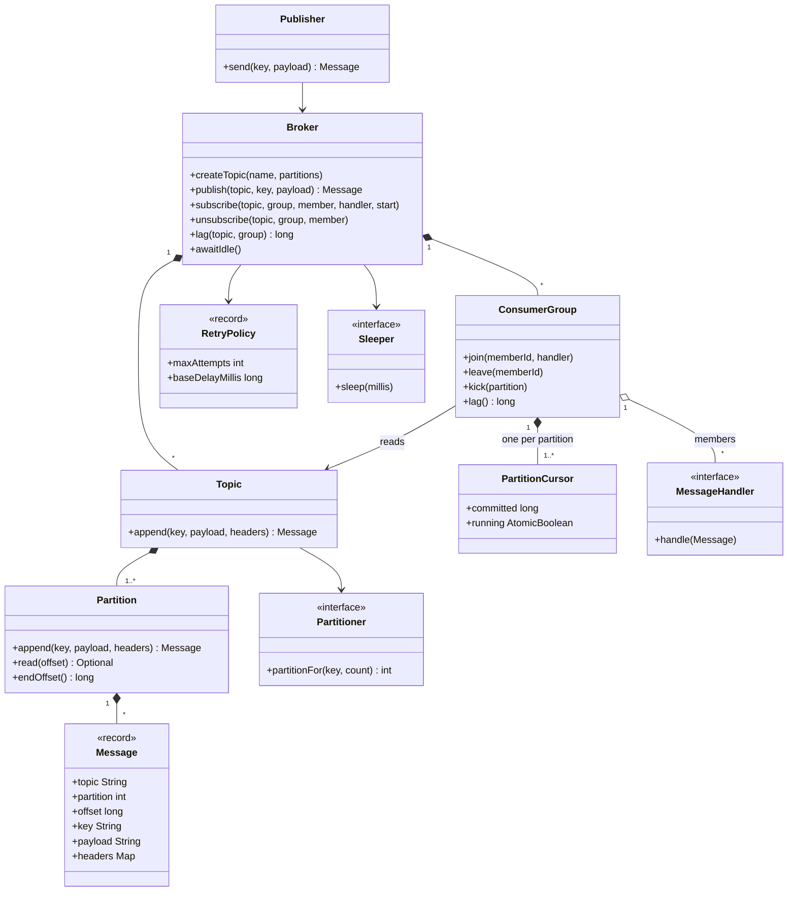

# Design a Pub-Sub Message Queue

A publish-subscribe system lets producers send messages to a named topic without knowing who reads them. Consumers read the messages at their own speed. This case study designs a small in-memory broker with topics, partitions, consumer groups, committed offsets, at-least-once delivery, retry with backoff, a dead-letter queue, and a thread-safe core. The distributed version (replication, disk logs, many brokers) is in `kb/hld/case-studies/14-distributed-message-queue.md`. The delivery guarantees, ordering, and dead-letter queues of real systems (Kafka, RabbitMQ, SQS) have their home in `kb/hld/fundamentals/08-message-queues-and-streams.md`. This page builds the class design that an LLD round asks for. Follow the steps in [how to approach an LLD interview](../../how-to-approach-lld.md).

## Problem Statement

"Design an in-memory publish-subscribe message queue. Publishers send messages to a topic. Subscribers receive the messages of the topics that they subscribe to. Several subscribers that form a group share the work of one topic. A message must not be lost when a subscriber fails. The broker serves many threads at the same time."

## Clarifying Questions

| Question | Answer that this design assumes |
|---|---|
| One process or a network service? | One process. All classes run in one JVM. A network layer is an extension |
| Does each subscriber get every message, or do subscribers share the messages? | Both, with consumer groups. Every group gets every message of the topic. Inside one group, each message goes to one member |
| Is the order of messages important? | Yes, for messages with the same key. A topic has partitions. The key selects the partition, and a partition keeps the order of its messages. There is no order across partitions |
| What does a consumer group remember? | One committed offset for each partition. The offset is the position of the next message to deliver |
| What delivery guarantee? | At-least-once. The group commits an offset only after the handler finishes. A message can reach a handler more than once, and it is not lost |
| What happens when a handler throws? | The broker retries the same message with exponential backoff. After the last attempt, the broker moves the message to a dead-letter topic and continues with the next message |
| Where does a new group start reading? | The caller chooses: `EARLIEST` (replay the whole log) or `LATEST` (only new messages) |
| Are messages kept after delivery? | Yes. The log keeps all messages, so a new group can replay. Retention is an extension |
| Can members join and leave? | Yes. The broker moves the partitions among the members of the group |
| Is delivery push or pull? | Push. The broker calls the handler of the member. A pull API (`poll`) is an extension |
| How do the tests wait for the consumers? | `awaitIdle()` waits until all delivery work is done. The demo injects a `Sleeper` so that the backoff does not wait in real time |
| Persistence? | No. The data is in memory |

## Requirements

### Functional

1. `createTopic(name, partitions)` creates a topic and its dead-letter topic.
2. `publish(topic, key, payload)` appends a message to the partition that the key selects, and returns the message with its offset.
3. `subscribe(topic, group, member, handler, start)` adds a member to a consumer group. The first subscribe creates the group.
4. Each group receives every message of the topic. Each partition has one member in the group, so the messages of one partition reach the handler in offset order.
5. The group stores a committed offset for each partition, and `lag` reports the number of messages that the group has not processed.
6. A failed handler call is retried with backoff. After the last attempt, the message goes to `<topic>.dlq` with headers that name the source, the group, the number of attempts, and the error.
7. `unsubscribe` removes a member. The partitions of that member move to the other members.
8. Invalid input (a topic with 0 partitions, an unknown topic, a retry policy with 0 attempts) is rejected with an `IllegalArgumentException`.

### Non-functional

1. Thread safety: many publishers and many handler threads run at the same time. The log has no lost message and no duplicate offset.
2. Order: for one partition and one group, the handler sees the messages in offset order, one message at a time.
3. Isolation: a slow or failing handler blocks only its own partition. Another group continues while at least one worker thread is free (see Concurrency).
4. Publish cost: O(1) under a lock that covers one partition. A publisher does not wait for a handler.
5. Testability: no class calls `Thread.sleep` or reads the system clock. The backoff goes through a `Sleeper`, and the demo waits with `awaitIdle()`.
6. Memory: the log grows with each message. The design has no retention limit (see Extensions).

## Entities and Relationships

| Entity | Responsibility | Relationships |
|---|---|---|
| `Broker` | The entry point. Owns the topics and the groups, and runs the worker pool. Creates topics, accepts publishes, and manages subscriptions. Moves failed messages to the dead-letter topic | Has many `Topic` and many `ConsumerGroup`. Uses a `RetryPolicy` and a `Sleeper` |
| `Topic` | A named stream of messages that has one or more partitions. Selects the partition for a key | Has many `Partition`. Uses a `Partitioner` |
| `Partition` | An append-only log. The offset of a message is its index in the log | Has many `Message` |
| `Message` | A value object: topic, partition, offset, key, payload, and headers | Created by the `Partition` |
| `Publisher` | A producer handle for one topic. It hides the broker API from the code that sends | Uses `Broker` |
| `ConsumerGroup` | A set of members that share one topic. Keeps the committed offset of each partition, assigns the partitions to the members, and delivers the messages | Has many `PartitionCursor` and many members. Reads one `Topic` |
| `PartitionCursor` | The state of one group in one partition: the committed offset and a flag that says whether a delivery task runs | Belongs to a `ConsumerGroup` |
| Member (`record Member`) | A subscriber in a group: an id and a `MessageHandler` | Belongs to a `ConsumerGroup` |
| `MessageHandler` | The interface that the application implements. `handle(Message)` may throw | Called by the `ConsumerGroup` |
| `Partitioner` | Strategy that maps a key to a partition number | Used by `Topic` |
| `RetryPolicy` | A value object: the maximum number of attempts and the first backoff delay | Used by the `Broker` and the `ConsumerGroup` |
| `Sleeper` | Waits for the backoff time. The demo replaces it with a recorder | Used by the `ConsumerGroup` through the `Broker` |

The central choice is the pair "log and cursor". The log (`Partition`) stores each message once and never changes it. Each group has its own cursor over the log. A new group needs only a new cursor, and a replay needs only a cursor that moves back. A design that copies each message into a queue for each subscriber has no replay and uses more memory.

## Class Diagram



## Design Patterns Used

The [behavioral patterns page](../../fundamentals/08-behavioral-patterns.md) describes Observer and Strategy. The [concurrency in LLD page](../../fundamentals/09-concurrency-in-lld.md) describes the producer-consumer structure and the lock choices that this design uses. The [SOLID page](../../fundamentals/02-solid.md) describes dependency inversion, which the `Sleeper` and the `MessageHandler` apply.

| Pattern | Where | Reason | Alternative that the design rejected |
|---|---|---|---|
| Observer | A `MessageHandler` observes a topic through its group | The publisher does not know the subscribers. A new subscriber needs no change in the publisher code | Direct calls from the publisher to each subscriber. The publisher would know all subscribers, and one slow subscriber would block it. `java.util.Observable` is deprecated since Java 9 and also calls observers in the caller thread |
| Producer-consumer with a log | `Partition` is the buffer. The delivery tasks are the consumers | The log lets the publisher continue at once and lets each group read at its own speed. The log also supports replay | A `BlockingQueue` for each subscriber. A message that a consumer takes is gone, so there is no replay and no offset to commit. The broker would copy each message once for each subscriber |
| Strategy | `Partitioner` | The rule that maps a key to a partition changes by use case (hash, round robin, a custom rule). The `Topic` does not know the rule | An `if` on a mode flag inside `Topic` |
| Value object | `Message`, `RetryPolicy`, `GroupKey` (records) | A message never changes after the append. Immutable objects are safe to share between the publisher and handler threads | Mutable message classes. A handler could change the stored message |
| Dependency injection | `Sleeper` in the `Broker` constructor | The demo records the backoff time and does not wait for it. The output is exact, and the run is fast | `Thread.sleep` inside the delivery loop. The demo would need real waiting, and the retry behavior would be hard to test |
| Mediator (in the broker role) | `Broker` | Publishers and subscribers talk only to the broker. They never refer to one another | A subscriber list inside each publisher. That is a many-to-many web of references |
| Competing consumers (a messaging pattern, not a GoF pattern) | The members of one group share the partitions | A group scales out by adding members. Each message is processed by one member of the group | Every member reads every message. That is the fan-out between groups, and it does not share work |
| No Singleton | `Broker` is a normal class | Tests create a broker for each case. Several brokers can exist in one program. See the [anti-patterns page](../../fundamentals/11-anti-patterns.md) | A static broker. It hides global state, and tests would depend on each other |

## Key Code

The excerpts below are copied from `Main.java` in this folder. The `Main` class runs the demo and prints the output that the last section shows.

### Messages and policies

`Message` carries its position (topic, partition, offset), so a handler can build a stable id from it. The headers are copied into an immutable map. `RetryPolicy` holds the retry rule, and `delayAfterFailure` gives the exponential backoff: the delay doubles after each failed attempt.

```java
record Message(String topic, int partition, long offset, String key, String payload,
               Map<String, String> headers) {
    Message {
        headers = Map.copyOf(headers);
    }

    String id() {
        return topic + "-" + partition + "-" + offset;
    }
}

@FunctionalInterface
interface MessageHandler {
    void handle(Message message) throws Exception;
}

@FunctionalInterface
interface Partitioner {
    int partitionFor(String key, int partitionCount);

    static Partitioner byKeyHash() {
        return (key, count) -> Math.floorMod(key.hashCode(), count);
    }
}

@FunctionalInterface
interface Sleeper {
    void sleep(long millis) throws InterruptedException;
}

enum StartPosition { EARLIEST, LATEST }

record RetryPolicy(int maxAttempts, long baseDelayMillis) {
    RetryPolicy {
        if (maxAttempts < 1) {
            throw new IllegalArgumentException("maxAttempts must be at least 1");
        }
        if (baseDelayMillis < 0) {
            throw new IllegalArgumentException("baseDelayMillis must not be negative");
        }
    }

    // Exponential backoff: the delay doubles after each failed attempt.
    long delayAfterFailure(int failedAttempts) {
        return baseDelayMillis << (failedAttempts - 1);
    }
}
```

### Log, topic, and publisher

A `Partition` is a list that only grows. The `synchronized` methods make "read the size, create the message with that offset, add it" one step, so two publishers never get the same offset. A `Topic` selects the partition with the `Partitioner`. A `Publisher` is a thin handle for one topic.

```java
final class Partition {
    private final String topic;
    private final int id;
    private final List<Message> log = new ArrayList<>();

    Partition(String topic, int id) {
        this.topic = topic;
        this.id = id;
    }

    // The offset of a message is its index in the log. The lock makes append and size atomic.
    synchronized Message append(String key, String payload, Map<String, String> headers) {
        Message message = new Message(topic, id, log.size(), key, payload, headers);
        log.add(message);
        return message;
    }

    synchronized Optional<Message> read(long offset) {
        return offset < log.size() ? Optional.of(log.get((int) offset)) : Optional.empty();
    }

    synchronized long endOffset() {
        return log.size();
    }
}

final class Topic {
    private final String name;
    private final Partition[] partitions;
    private final Partitioner partitioner;

    Topic(String name, int partitionCount, Partitioner partitioner) {
        this.name = name;
        this.partitioner = partitioner;
        this.partitions = new Partition[partitionCount];
        for (int i = 0; i < partitionCount; i++) {
            partitions[i] = new Partition(name, i);
        }
    }

    Message append(String key, String payload, Map<String, String> headers) {
        Objects.requireNonNull(key, "key");
        int index = partitioner.partitionFor(key, partitions.length);
        return partitions[index].append(key, payload, headers);
    }

    Partition partition(int index) {
        return partitions[index];
    }

    int partitionCount() {
        return partitions.length;
    }
}
```

```java
final class Publisher {
    private final Broker broker;
    private final String topic;

    Publisher(Broker broker, String topic) {
        this.broker = broker;
        this.topic = topic;
    }

    Message send(String key, String payload) {
        return broker.publish(topic, key, payload);
    }
}
```

### Consumer group: cursors and membership

A `PartitionCursor` is the state of one group in one partition. `committed` is the offset of the next message to deliver. `running` is true while a delivery task runs for the partition. `join` and `leave` change the member list under the group lock. `rebalance` gives partition `p` to member `p mod n` and publishes the result as an immutable map in a `volatile` field, so the delivery tasks read a consistent assignment without a lock.

```java
final class PartitionCursor {
    final AtomicBoolean running = new AtomicBoolean();
    volatile long committed;

    PartitionCursor(long start) {
        this.committed = start;
    }
}

final class ConsumerGroup {
    private record Member(String id, MessageHandler handler) { }

    private final String name;
    private final Topic topic;
    private final Broker broker;
    private final PartitionCursor[] cursors;
    private final List<Member> members = new ArrayList<>();   // guarded by this
    private volatile Map<Integer, Member> assignment = Map.of();

    ConsumerGroup(String name, Topic topic, StartPosition start, Broker broker) {
        this.name = name;
        this.topic = topic;
        this.broker = broker;
        this.cursors = new PartitionCursor[topic.partitionCount()];
        for (int p = 0; p < cursors.length; p++) {
            long startOffset = start == StartPosition.EARLIEST ? 0 : topic.partition(p).endOffset();
            cursors[p] = new PartitionCursor(startOffset);
        }
    }

    synchronized void join(String memberId, MessageHandler handler) {
        for (Member member : members) {
            if (member.id().equals(memberId)) {
                throw new IllegalArgumentException("duplicate member: " + memberId);
            }
        }
        members.add(new Member(memberId, handler));
        rebalance();
    }

    synchronized void leave(String memberId) {
        if (!members.removeIf(member -> member.id().equals(memberId))) {
            throw new IllegalArgumentException("unknown member: " + memberId);
        }
        rebalance();
    }

    // Partition p goes to member p mod n. The caller holds the group lock.
    private void rebalance() {
        Map<Integer, Member> next = new HashMap<>();
        for (int p = 0; p < cursors.length && !members.isEmpty(); p++) {
            next.put(p, members.get(p % members.size()));
        }
        assignment = Map.copyOf(next);
        for (int p = 0; p < cursors.length; p++) {
            kick(p);
        }
    }
```

### Consumer group: delivery

`kick` starts a delivery task for one partition unless one already runs. The compare-and-set on `running` guarantees that at most one task for each partition and group delivers messages. This is what keeps the order. `drain` reads the message at the committed offset, calls `deliver`, and commits the next offset after `deliver` returns. When `drain` ends, it clears `running` and checks again for work. This second check closes the gap in which a publisher appends a message after the last read and before `running` becomes false.

`deliver` runs the handler up to `maxAttempts` times and waits for the backoff time between the attempts. If all attempts fail, it sends the message to the dead-letter topic. After that, `drain` commits the offset, so one bad message does not block the partition.

```java
    // Starts a drain task for the partition unless one already runs. At most one task runs for
    // each partition, so the messages of a partition reach the handler in offset order.
    void kick(int partition) {
        PartitionCursor cursor = cursors[partition];
        if (cursor.running.compareAndSet(false, true)) {
            try {
                broker.submitDrain(() -> drain(partition));
            } catch (RejectedExecutionException e) {
                cursor.running.set(false);   // the broker is shut down
            }
        }
    }

    private void drain(int partition) {
        PartitionCursor cursor = cursors[partition];
        try {
            while (true) {
                Member member = assignment.get(partition);
                if (member == null) {
                    return;
                }
                Optional<Message> next = topic.partition(partition).read(cursor.committed);
                if (next.isEmpty()) {
                    return;
                }
                deliver(member, next.get());
                cursor.committed = next.get().offset() + 1;   // commit after the handler finished
            }
        } catch (InterruptedException e) {
            Thread.currentThread().interrupt();   // the message stays uncommitted
        } finally {
            cursor.running.set(false);
            if (hasWork(partition) && !Thread.currentThread().isInterrupted()) {
                kick(partition);   // a message or a member arrived after the last check
            }
        }
    }

    private void deliver(Member member, Message message) throws InterruptedException {
        RetryPolicy policy = broker.retryPolicy();
        Exception lastError = null;
        for (int attempt = 1; attempt <= policy.maxAttempts(); attempt++) {
            try {
                member.handler().handle(message);
                return;
            } catch (Exception e) {
                lastError = e;
                if (attempt < policy.maxAttempts()) {
                    broker.sleeper().sleep(policy.delayAfterFailure(attempt));
                }
            }
        }
        broker.deadLetter(message, name, policy.maxAttempts(), lastError);
    }

    private boolean hasWork(int partition) {
        return assignment.get(partition) != null
                && cursors[partition].committed < topic.partition(partition).endOffset();
    }
```

### The broker

The broker owns the topics, the groups, and the worker pool. `publish` appends the message and then kicks each group that reads the topic. `subscribe` creates the group on the first call (`computeIfAbsent` runs the creation once, even if two threads subscribe together) and joins the member.

```java
final class Broker {
    private static final String DLQ_SUFFIX = ".dlq";

    private final Map<String, Topic> topics = new ConcurrentHashMap<>();
    private final Map<GroupKey, ConsumerGroup> groups = new ConcurrentHashMap<>();
    private final Map<String, List<ConsumerGroup>> groupsByTopic = new ConcurrentHashMap<>();
    private final ExecutorService workers;
    private final RetryPolicy retryPolicy;
    private final Sleeper sleeper;
    private final Partitioner partitioner;
    private final Object idleLock = new Object();
    private int inFlight;   // drain tasks that are queued or running. Guarded by idleLock.

    Broker(int workerThreads, RetryPolicy retryPolicy, Sleeper sleeper) {
        this(workerThreads, retryPolicy, sleeper, Partitioner.byKeyHash());
    }

    Broker(int workerThreads, RetryPolicy retryPolicy, Sleeper sleeper, Partitioner partitioner) {
        this.workers = Executors.newFixedThreadPool(workerThreads, task -> {
            Thread thread = new Thread(task);
            thread.setDaemon(true);
            return thread;
        });
        this.retryPolicy = retryPolicy;
        this.sleeper = sleeper;
        this.partitioner = partitioner;
    }

    RetryPolicy retryPolicy() {
        return retryPolicy;
    }

    Sleeper sleeper() {
        return sleeper;
    }

    // Creates the topic and its dead-letter topic. A second call with the same name does nothing.
    void createTopic(String name, int partitionCount) {
        if (partitionCount < 1) {
            throw new IllegalArgumentException("partitions must be positive");
        }
        topics.computeIfAbsent(name, n -> new Topic(n, partitionCount, partitioner));
        if (!name.endsWith(DLQ_SUFFIX)) {
            createTopic(name + DLQ_SUFFIX, 1);
        }
    }

    Message publish(String topicName, String key, String payload) {
        return publish(topicName, key, payload, Map.of());
    }

    Message publish(String topicName, String key, String payload, Map<String, String> headers) {
        Message message = topicOrThrow(topicName).append(key, payload, headers);
        for (ConsumerGroup group : groupsByTopic.getOrDefault(topicName, List.of())) {
            group.kick(message.partition());
        }
        return message;
    }

    void createGroup(String topicName, String groupName, StartPosition start) {
        Topic topic = topicOrThrow(topicName);
        groups.computeIfAbsent(new GroupKey(topicName, groupName), key -> {
            ConsumerGroup group = new ConsumerGroup(groupName, topic, start, this);
            groupsByTopic.computeIfAbsent(topicName, t -> new CopyOnWriteArrayList<>()).add(group);
            return group;
        });
    }

    // The start position counts only when this call creates the group.
    void subscribe(String topicName, String groupName, String memberId, MessageHandler handler,
                   StartPosition start) {
        createGroup(topicName, groupName, start);
        groupOrThrow(topicName, groupName).join(memberId, handler);
    }

    void unsubscribe(String topicName, String groupName, String memberId) {
        groupOrThrow(topicName, groupName).leave(memberId);
    }
```

Dead letters, the task counter, and `awaitIdle` are the remaining parts. `deadLetter` copies the message to `<topic>.dlq` with headers. `submitDrain` counts each task that is queued or running. `awaitIdle` waits until that count is 0. A task that publishes a new message starts the follow-up task before it ends, so the count cannot reach 0 while work remains.

```java
    // A message that failed all attempts goes to "<topic>.dlq".
    // A dead letter that fails is dropped.
    void deadLetter(Message message, String group, int attempts, Exception error) {
        if (message.topic().endsWith(DLQ_SUFFIX)) {
            return;
        }
        Map<String, String> headers = Map.of(
                "source", message.id(),
                "group", group,
                "attempts", String.valueOf(attempts),
                "error", error.getClass().getSimpleName() + ": " + error.getMessage());
        publish(message.topic() + DLQ_SUFFIX, message.key(), message.payload(), headers);
    }

    void submitDrain(Runnable drain) {
        synchronized (idleLock) {
            inFlight++;
        }
        try {
            workers.execute(() -> {
                try {
                    drain.run();
                } finally {
                    finishDrain();
                }
            });
        } catch (RejectedExecutionException e) {
            finishDrain();
            throw e;
        }
    }

    private void finishDrain() {
        synchronized (idleLock) {
            if (--inFlight == 0) {
                idleLock.notifyAll();
            }
        }
    }

    // Waits until no drain task is queued or running. A task that publishes a new message
    // starts its follow-up task before it ends, so the count never drops to 0 too early.
    void awaitIdle() throws InterruptedException {
        synchronized (idleLock) {
            while (inFlight > 0) {
                idleLock.wait();
            }
        }
    }
```

### A subscriber with a dead-letter consumer

The demo method below shows how an application uses the API: it subscribes a handler that rejects bad payloads, subscribes a second group to the dead-letter topic, publishes three messages, and waits.

```java
    static void deadLetterQueue() throws Exception {
        System.out.println("== Dead-letter queue ==");
        List<Long> delays = Collections.synchronizedList(new ArrayList<>());
        Broker broker = new Broker(2, new RetryPolicy(3, 50), delays::add);
        broker.createTopic("payments", 1);
        Recorder seen = new Recorder();
        broker.subscribe("payments", "ledger", "l1", m -> {
            if (m.payload().startsWith("bad")) {
                throw new IllegalArgumentException("cannot parse " + m.payload());
            }
            seen.add("ledger", m.payload());
        }, StartPosition.EARLIEST);
        broker.subscribe("payments.dlq", "ops", "o1", m -> {
            seen.add("dead letter", m.payload());
            new TreeMap<>(m.headers()).forEach((k, v) -> seen.add("header", k + " = " + v));
        }, StartPosition.EARLIEST);
        broker.publish("payments", "acc-1", "pay-1");
        broker.publish("payments", "acc-1", "bad-2");
        broker.publish("payments", "acc-1", "pay-3");
        broker.awaitIdle();
        System.out.println("ledger processed: " + seen.get("ledger"));
        System.out.println("dead letters: " + seen.get("dead letter"));
        seen.get("header").forEach(header -> System.out.println("  header " + header));
        System.out.println("backoff delays in ms: " + delays + ", lag: "
                + broker.lag("payments", "ledger"));
        broker.shutdown();
    }
```

## Concurrency

**What can race.**

| Shared state | Broken sequence | Invariant |
|---|---|---|
| The log of a partition | Two publishers read the same size and give the same offset | Each offset belongs to one message. The offsets have no gap |
| The delivery task of a partition and group | Two tasks read the same committed offset and deliver the same message twice at the same time | At most one task at a time delivers messages and writes `committed` for each partition and group. Order of delivery equals offset order |
| The end of a delivery task | A publisher appends a message after the task read "no message" and before the task cleared `running`. Nobody delivers the message | A message is never stranded in the log while a member exists |
| The member list and the assignment | A member leaves while a task reads the assignment | A task reads one consistent assignment |
| A rebalance during a delivery | A member joins or leaves while the task delivers a message of the partition. The old member and the new member both deliver from the partition, or the new member starts at an older offset | Two members never deliver messages of one partition at the same time. The committed offset never moves back |
| Group creation | Two threads subscribe to a new group at the same time and create two groups | One group for each topic and group name |
| The committed offset | A thread reads an offset that another thread wrote earlier, but sees an old value | The thread that reads the lag sees the latest commit |
| The in-flight counter | `awaitIdle` sees 0 while a follow-up task is not yet counted | `awaitIdle` returns only when no work remains |

**How the design prevents each race.**

| Race | Fix | Reason |
|---|---|---|
| Duplicate offsets | `Partition.append`, `read`, and `endOffset` are `synchronized` | The lock covers one partition. Publishers of different partitions do not wait for each other. The critical section is one `ArrayList.add` |
| Two delivery tasks for one partition and group | `PartitionCursor.running` is an `AtomicBoolean`. `kick` starts a task only if `compareAndSet(false, true)` succeeds. Only the task that won the compare-and-set reads the log, calls the handler, and writes `committed` | The flag is a lock-free "one runner" token. After the old task clears the flag, its last steps (`hasWork`, `kick`, and the counter decrement) can overlap a new task. These steps do not deliver and do not write `committed`, so they do not break the order |
| Stranded message | At the end of `drain`, the task clears `running` and then checks `hasWork`. If there is work, it calls `kick` again | See the proof below the table |
| Assignment changes | `assignment` is an immutable `Map` in a `volatile` field. `join` and `leave` are `synchronized` and replace the whole map | A task reads one snapshot before each message. A change takes effect for the next message. Ordering holds, because the cursor, not the member, defines the next message |
| Rebalance during a delivery | The rebalance does not start a second task: its `kick` fails the compare-and-set while the task runs. The running task reads the new assignment before its next message | One task delivers the partition, so two members never deliver it at the same time. Only that task writes `committed`, and it writes only `offset + 1` of the message that it just finished, so the offset never moves back. See the note on retries below the table |
| Double group creation | `ConcurrentHashMap.computeIfAbsent` | The mapping function runs once for each key (see the `ConcurrentHashMap` javadoc) |
| Visibility of the commit | `committed` is `volatile` | Only the delivery task writes it. `lag` reads it from any thread |
| Early `awaitIdle` | `submitDrain` increments `inFlight` before it submits the task, and the task decrements in `finally` | A task that starts a follow-up task increments the counter before its own decrement |

**Proof that no message is stranded.** The publisher does two steps: (P1) it appends the message under the partition lock, and (P2) it calls `compareAndSet(false, true)` on `running`. A task that ends does two steps: (T1) it sets `running` to false, and (T2) it reads `endOffset()` under the partition lock in `hasWork`. Lock actions and volatile reads and writes are synchronization actions. The Java Memory Model puts all synchronization actions of a run in one total order that agrees with the program order of each thread, and a volatile read sees the last write before it in that order (JLS 17.4.4). An `AtomicBoolean` write has the memory effect of a volatile write, and `compareAndSet` has the memory effects of a volatile read and a volatile write, also when it fails (`java.util.concurrent.atomic` package javadoc and `VarHandle.compareAndSet`). The proof splits on the value that P2 reads:

1. P2 reads `false`. The compare-and-set succeeds, and the publisher submits a new task. The `ExecutorService` javadoc says that the actions of a thread before it submits a task happen-before the actions of the task, so the new task sees the message that P1 appended.
2. P2 reads `true`. That value comes from the successful compare-and-set of some task T, and T has not yet cleared the flag, because P2 sees the last write before it. So T1 of task T comes after P2, and T2 comes after T1. P1 comes before P2 in the publisher's program order. Thus P1 comes before T2, the unlock at the end of P1 happens-before the lock in T2, and T2 sees the new size. `hasWork` returns true, and T calls `kick`.

The same argument holds for a member that joins: `join` writes the `volatile` field `assignment` and then calls `kick`, and the task clears `running` and then reads `assignment`. A plain `boolean` flag or a plain field for the assignment would break the proof. Each thread could then see an old value of the other thread's write, and both could miss the message.

If both the publisher and the ending task find work, both call `kick`. Only one compare-and-set succeeds, so only one new task starts.

**Retries during a rebalance.** `deliver` reads the member once, before the first attempt. The message in progress and all its retries stay with that member, even after `leave` for that member returns. The next message goes to the member of the new assignment. `leave` does not wait for the call in progress to end. If the application needs "no more calls after `leave` returns", `leave` must wait until the partition's task is no longer running. Kafka differs here: after a rebalance, the new owner of a partition starts at the last committed offset, so it can receive again a message that the old owner processed and did not commit. The Kafka documentation describes the same effect for a consumer that fails after it processed messages and before it saved its position: "when the new process takes over the first few messages it receives will already have been processed". This design has one cursor for each group in one process, so a rebalance does not cause a duplicate.

**An `Error` in a handler.** `deliver` catches `Exception`, not `Error`. If a handler throws an `Error` (for example `StackOverflowError`), the `Error` leaves `drain`, the `finally` block finds the same uncommitted message, and `kick` starts a new task for it. The task delivers the same message again with no backoff and no dead letter. The loop repeats for as long as the handler throws. Recommendation: in production code, wrap each handler call and treat a handler `Error` as a failure of the message, or stop the group and report the error.

The demo runs four publisher threads with 250 messages each and two members in one group. After `awaitIdle`, it checks that the handlers saw all 1000 messages, that the lag is 0, and that the messages of each publisher arrived in order. The demo prints only these results, because the interleaving between partitions changes from run to run.

**Delivery guarantee.** The group commits an offset only after `deliver` returns: after a handler call returned without an exception, or after the last failed attempt and the copy to the dead-letter topic. In this in-memory broker, a crash of the process loses the log and the offsets together, so nothing is delivered again after a restart. With the persistence extension (a durable log and an `OffsetStore`), a crash between the handler call and the commit has this effect: the group restarts at the old offset and delivers the message again. A crash between the copy to the dead-letter topic and the commit puts a second copy in the dead-letter topic. This is at-least-once delivery. Inside one run, the duplicate appears in the demo through a retry: the handler fails after it did its work, and the next attempt delivers the same message again. The consumer must tolerate duplicates. The standard method is an idempotent handler: the handler uses `Message.id()` (topic, partition, offset) as the key of its write, so a repeated delivery writes the same entry. `Message.id()` detects a repeated delivery of one log entry. It does not detect a publisher that sends the same business event twice, because each publish gets a new offset. For that case, the handler uses a business key (for example an order id). A broker that commits before the handler call has at-most-once delivery: it loses the message if the handler fails.

Exactly-once: the Kafka documentation (design, "Message Delivery Semantics") says that Kafka gives exactly-once delivery when it reads, processes, and writes data on Kafka topics, with the transactional producer and read-committed consumers. For other systems, it says: "Exactly-once delivery for other destination systems generally requires cooperation with such systems". The same section names one method: "letting the consumer store its offset in the same place as its output". Design statement for this broker: the broker alone cannot give exactly-once processing for a handler that writes to an outside system. The handler gets an exactly-once effect only if it is idempotent, or if it writes its output and the processed offset (or the `Message.id()`) in one transaction of its own store. Source: [Kafka documentation, Message Delivery Semantics](https://kafka.apache.org/41/design/design/#message-delivery-semantics). Recommendation: say "at-least-once plus idempotent consumers" in the interview.

**Order.** Order holds inside one partition and one group, because one task at a time reads the partition in offset order, and a retry repeats the same message before the next one starts. Order does not hold across partitions. Messages with the same key have the same partition, so they keep their order.

**Head-of-line blocking.** The delivery task retries inside the loop. During the backoff, the task holds a worker thread, and the messages behind the failing message wait. This keeps the order and the code simple. It has a cost: one failing message delays its partition by the sum of the delays (100 ms plus 200 ms in the demo). The alternative is a retry topic: the broker moves the message to a delayed retry topic at once and continues. That change loses the order inside the partition. See Extensions.

**Worker threads.** The pool has a fixed size. A blocking handler uses one worker for as long as it blocks. If all workers block, no group makes progress. Recommendation: say that the pool size bounds the number of partitions that make progress at the same time, and that handlers must not block for long.

!!! note "Where the other thread-safety details live"
    The [concurrency in LLD page](../../fundamentals/09-concurrency-in-lld.md) compares the lock choices. The primitives (`AtomicBoolean`, `ConcurrentHashMap`, executors) are described on `kb/java/08-java-util-concurrent.md`.

## Extensions

| Extension | Class changes |
|---|---|
| Retention (delete old messages) | Give `Partition` a `baseOffset` and trim the head of the log when a time or size limit is reached. `read(offset)` returns an "offset out of range" result when the offset is below `baseOffset`. A cursor that is behind the base moves to `baseOffset` (or fails, by a `ResetPolicy`). Store the log as segments of fixed size and delete whole segments, so that a trim does not copy the remaining messages |
| Persistence (survive a restart) | Extract a `LogStorage` interface from `Partition` (`append`, `read`, `endOffset`). Add `FileLogStorage` as a second implementation. Add an `OffsetStore` interface that saves the committed offsets of the groups. The `Broker` reads both at start. `ConsumerGroup` calls `offsetStore.save` after each commit |
| Pull API (`poll`) and manual commit | Add `Consumer` with `poll(maxMessages)` and `commit(offset)`. `ConsumerGroup` then serves messages on request, and the group no longer pushes them to a handler. The at-least-once rule stays: commit only after processing. Add `seek(partition, offset)` for replay |
| Non-blocking retry (retry topic) | In `deliver`, publish the failed message to `<topic>.retry` with a header `notBefore`, and commit the offset at once. A scheduler (see `kb/lld/case-studies/16-task-scheduler/README.md`) delivers it to the original topic at the due time. The order inside the partition is lost for the retried message. Name this trade-off |
| Filtering by header or by topic pattern | Add `Predicate<Message>` to the member, or a `TopicMatcher` that expands `orders.*`. `ConsumerGroup.drain` skips a message that the filter rejects and commits its offset |
| Backpressure (bounded log) | Give `Partition` a capacity. `append` blocks or throws when the log is full and the slowest group is behind. To block, replace the `synchronized` methods with a `ReentrantLock` and a `Condition` (or use `wait` and `notifyAll` on the partition), and signal it when the slowest group commits. Add `lag` limits per group, and a metric that the publisher can read |
| Member failure detection | Give each member a `lastHeartbeat` time that comes from a `TimeSource` (as in the scheduler case study). A scheduled task removes the members that missed the session timeout, and calls `leave`. This gives automatic rebalance when a member dies |
| Message TTL and delayed messages | Add `deliverAt` and `expiresAt` to `Message`. The cursor skips an expired message. A delayed message waits in a `DelayQueue` or a `PriorityQueue` until `deliverAt` (see the task scheduler case study) |
| Exactly-once effect | Add `IdempotentHandler implements MessageHandler`. It wraps a handler and a store of processed `Message.id()` values. It skips a message that the store already holds. The store write and the effect must be one transaction |
| Metrics | Add a `BrokerMetrics` observer that counts published, delivered, retried, and dead-lettered messages, and reports the lag of each group. The `Broker` and `ConsumerGroup` call it. A `Decorator` around `MessageHandler` can time each handler call |

## Common Mistakes

| Mistake | Problem | Fix |
|---|---|---|
| One `BlockingQueue` for the whole topic, and each subscriber takes from it | A message goes to one subscriber only, so there is no fan-out. There is also no offset and no replay | Keep a log. Give each group its own cursor |
| One queue for each subscriber, filled by the publisher | The publisher call blocks when one queue is full. The broker copies each message. No replay | A shared log with cursors |
| Commit the offset before the handler runs | A failure after the commit loses the message (at-most-once) | Commit after the handler returns, and make the handler idempotent |
| Retry forever | One poison message blocks its partition for ever | A maximum number of attempts, then a dead-letter topic |
| Retry in a tight loop, with no delay | The handler fails again at once, and the dependency that failed gets more load | Exponential backoff, and a maximum delay. Add random jitter in production |
| Call the handler inside `publish` | A slow handler slows the publisher. An exception in the handler reaches the publisher | Deliver on worker threads |
| A thread for each subscriber | The number of threads grows with the subscribers. Order across the threads of one group is lost | A fixed pool, and one delivery task for each partition and group |
| Two threads read the same partition of the same group | The messages arrive out of order, and a message is delivered twice | One runner for each partition and group (the compare-and-set flag) |
| Check "any message left" and then clear the running flag without a second check | A message that arrives between the two steps stays in the log | Clear the flag first, and then check again |
| Use `ArrayList` for the log without a lock | Two publishers can write the same slot. The reader can see a half-written list | A lock that covers the partition |
| Use the message payload as its identity | Two equal payloads look like one message | Identify a message by topic, partition, and offset |
| Make `Message` mutable | A handler changes the stored message, and other groups see the change | A record with an immutable map (`Map.copyOf`) |
| `Thread.sleep` for the backoff and for the test wait | Tests are slow, and the output depends on time | Inject a `Sleeper`, and wait with `awaitIdle()` |
| Say "exactly once" without a condition | Exactly-once processing with an outside system needs the cooperation of that system (see Concurrency) | Say "at-least-once with idempotent consumers", or "the handler stores its output and the offset in one transaction" |

## 45-Minute Plan

| Minutes | Part | What to present |
|---|---|---|
| 0-5 | Clarify | Ask the questions of the table above. State the assumptions: in-memory, partitions, consumer groups, at-least-once, push delivery |
| 5-10 | Entities and API | Write the `Broker` methods (`createTopic`, `publish`, `subscribe`, `lag`), the `Message` record, and the `MessageHandler` interface. Explain "log plus cursor" in two sentences |
| 10-15 | Diagram | Draw `Broker`, `Topic`, `Partition`, `ConsumerGroup`, `PartitionCursor`. Say where the offset lives (in the group, not in the message) |
| 15-27 | Core code | Write `Partition.append` and `read`. Write `ConsumerGroup.kick`, `drain`, and `deliver`. Show that the offset is committed after the handler |
| 27-33 | Failure handling | Explain the retry with backoff, the dead-letter topic, and the delivery guarantee. Say "at-least-once, so the handler must be idempotent" |
| 33-39 | Concurrency | Name the races: duplicate offsets, two runners for one partition, and the stranded message. Explain the partition lock, the `AtomicBoolean` runner flag, and the second check |
| 39-43 | Extensions | Answer retention, persistence, the pull API, and the retry topic |
| 43-45 | Questions | Ask what the interviewer wants to see in more depth (distributed version, ordering, exactly once) |

## Expected Output

The demo uses a recording `Sleeper`, so the backoff does not wait. The demo waits with `awaitIdle()` and prints only results that do not depend on the thread schedule: the per-partition order and the totals.

<!-- expected-output -->

```text
== Two groups, three partitions ==
audit p0: [a1:order-4, a1:order-8]
audit p1: [a1:order-1, a1:order-2, a1:order-5, a1:order-6]
audit p2: [a1:order-3, a1:order-7]
billing p0: [b1:order-4, b1:order-8]
billing p1: [b2:order-1, b2:order-2, b2:order-5, b2:order-6]
billing p2: [b1:order-3, b1:order-7]
== Offsets, lag, and start position ==
lag while the group has no member: 4
lag after the member joins: 0, committed offsets: [4]
dashboard received [cpu-1, cpu-2, cpu-3, cpu-4, cpu-5, cpu-6]
replay received [cpu-1, cpu-2, cpu-3, cpu-4, cpu-5, cpu-6]
latest-only received [cpu-5, cpu-6]
== Retry with backoff: at-least-once delivery ==
handler calls for one message: 3
backoff delays in ms: [100, 200]
distinct effects: [sent emails-0-0], lag: 0
== Dead-letter queue ==
ledger processed: [pay-1, pay-3]
dead letters: [bad-2]
  header attempts = 3
  header error = IllegalArgumentException: cannot parse bad-2
  header group = ledger
  header source = payments-0-1
backoff delays in ms: [50, 100], lag: 0
== Members join and leave ==
two members: {0=m1, 1=m2, 2=m1, 3=m2}
three members: {0=m1, 1=m2, 2=m3, 3=m1}
one member: {0=m1, 1=m1, 2=m1, 3=m1}
m1 handled 12 of 12, lag: 0
== Four publisher threads, 250 messages each ==
delivered 1000 of 1000, lag: 0
messages of each publisher arrived in order: true
== Validation ==
rejected: partitions must be positive
rejected: unknown topic: nope
rejected: maxAttempts must be at least 1
```
