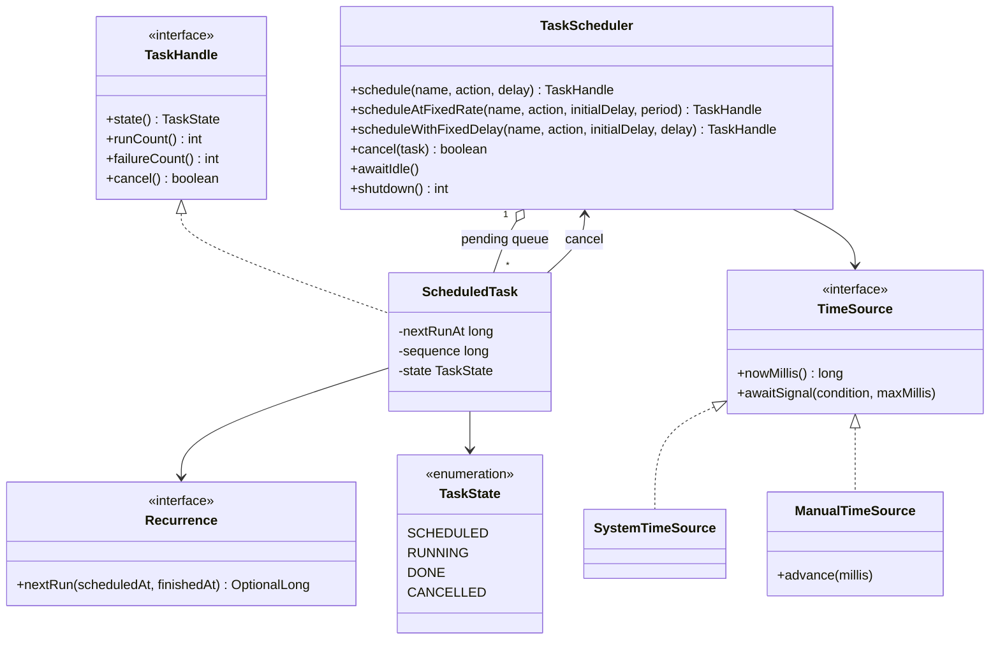

# Design a Task Scheduler

A task scheduler runs work at a later time, or again and again at a fixed interval. This case study builds one for a single process: a priority queue ordered by run time, one dispatcher thread that waits for the earliest task, a pool of worker threads that run the tasks, cancellation, and an injected clock so that the demo is exact. The JDK has `ScheduledThreadPoolExecutor`, which solves the same problem. An interview asks you to build the core of it, so this page shows how the parts fit. The distributed version (many machines, a durable store, leader election) is in `kb/hld/case-studies/20-distributed-job-scheduler.md`. The thread primitives have their home in [java.util.concurrent: Executors, Locks, Atomics, and Synchronizers](../../../java/08-java-util-concurrent.md). Follow the steps in [how to approach an LLD interview](../../how-to-approach-lld.md).

## Problem Statement

"Design a task scheduler. A client submits a task that runs once after a delay, or a task that runs repeatedly at an interval. A pool of worker threads runs the tasks. A client can cancel a task. Many threads submit tasks at the same time."

## Clarifying Questions

| Question | Answer that this design assumes |
|---|---|
| One process or many machines? | One process. The tasks are in memory and are lost when the process stops. Persistence is an extension |
| What is a task? | A `Runnable` with a name. A task that returns a value is an extension |
| What time unit and precision? | Milliseconds. A task runs at the due time or later. The scheduler does not promise a start at the exact millisecond |
| What kinds of tasks? | One-time (after a delay) and recurring, with two rules: fixed rate and fixed delay |
| What is the difference between the two recurring rules? | Fixed rate: the next run is due at the previous due time plus the period. After a late run, the runs that were missed are already due, and they run one after another to catch up. Fixed delay: the next run is due at the finish time of the previous run plus the delay. Both rules give the same due times as `ScheduledExecutorService.scheduleAtFixedRate` and `scheduleWithFixedDelay` (see Concurrency) |
| Can two runs of one recurring task overlap? | No. The next run is queued only after the previous run finishes |
| Several tasks are due at the same time. Which runs first? | The task that was queued first. The scheduler is first-in-first-out for equal times |
| What if a task throws an exception? | The scheduler counts the failure and goes on. A recurring task keeps its schedule. (`ScheduledThreadPoolExecutor` suppresses later runs after an exception and stores the exception in the `ScheduledFuture`, so name this choice) |
| What does cancel do to a running task? | It does not interrupt the run. It stops the later runs. A task that is still in the queue never starts. A task that the dispatcher already handed to the worker pool is `RUNNING`, even if it waits for a free worker. That run still happens (see Concurrency) |
| What happens at shutdown? | The scheduler discards the pending tasks, lets the running tasks finish, and then stops the workers |
| Priorities between tasks? | No. Only the due time and the queue order count. Priority is an extension |
| How do we test time? | The clock is an interface. The demo uses a manual clock that it moves by hand, so no test waits in real time |
| How many tasks? | Many thousands. An operation on the queue costs O(log n). A cancel costs O(n) (see Concurrency) |

## Requirements

### Functional

1. `schedule(name, task, delay)` runs a task once, no earlier than `delay` milliseconds from now.
2. `scheduleAtFixedRate(name, task, initialDelay, period)` runs a task repeatedly at a fixed rate.
3. `scheduleWithFixedDelay(name, task, initialDelay, delay)` runs a task repeatedly, with a fixed wait between the end of a run and the start of the next run.
4. Each submit returns a `TaskHandle`. The handle gives the state, the number of runs, the number of failures, and `cancel()`.
5. A worker pool of a fixed size runs the tasks. Tasks that are due at the same time run in parallel when workers are free.
6. `cancel()` removes a pending task, or stops a recurring task from running again.
7. `shutdown()` discards the pending tasks, waits for the running tasks, and stops the threads. A submit after shutdown fails.
8. Invalid input (a negative delay, a period of 0) is rejected.

### Non-functional

1. Thread safety: many threads submit and cancel at the same time. No task runs twice for one due time, and no task is lost.
2. Efficiency: the dispatcher thread sleeps until the earliest due time. It does not poll in a loop.
3. Cost: submit and dispatch cost O(log n) for n pending tasks. Cancel costs O(n).
4. A long task does not delay the dispatcher. Only the tasks run on the worker threads.
5. Testability: no class reads the system clock except `SystemTimeSource`. The demo output is the same in every run.
6. No task code runs while the scheduler lock is held.

## Entities and Relationships

| Entity | Responsibility | Relationships |
|---|---|---|
| `TaskScheduler` | The entry point. Keeps the queue of pending tasks, runs the dispatcher thread, and hands due tasks to the workers. Handles cancel and shutdown | Has many `ScheduledTask`. Uses a `TimeSource` and an `ExecutorService` |
| `ScheduledTask` | One task: the action, the next due time, the state, and the counters | Implements `TaskHandle`. Has one `Recurrence` |
| `TaskHandle` | The interface that the client sees: `state`, `runCount`, `failureCount`, `cancel` | Implemented by `ScheduledTask` |
| `TaskState` | An enum: `SCHEDULED`, `RUNNING`, `DONE`, `CANCELLED` | Used by `ScheduledTask` |
| `Recurrence` | Strategy: from the due time and the finish time of a run, it gives the next due time, or nothing | Implemented by lambdas: `ONCE`, `fixedRate`, `fixedDelay` |
| `TimeSource` | The interface that reads the time and waits on a condition for a given time | Implemented by `SystemTimeSource` and `ManualTimeSource` |
| `PriorityQueue` (JDK) | Keeps the pending tasks. The head is the task with the earliest due time | Owned by `TaskScheduler` |
| Worker pool (JDK `ExecutorService`) | Runs the task code | Owned by `TaskScheduler` |
| Dispatcher thread | Waits for the head of the queue, and hands it to the pool when it is due | Owned by `TaskScheduler` |

The central choice is the split into two kinds of thread. One dispatcher thread only waits and moves tasks. The workers run the task code. A task that takes 10 seconds blocks one worker and does not delay the dispatch of the next task.

## Class Diagram



## Design Patterns Used

The [behavioral patterns page](../../fundamentals/08-behavioral-patterns.md) describes Strategy and Command. The [concurrency in LLD page](../../fundamentals/09-concurrency-in-lld.md) describes the lock, the condition, and the producer-consumer structure that this design uses. The [SOLID page](../../fundamentals/02-solid.md) describes dependency inversion and interface segregation.

| Pattern | Where | Reason | Alternative that the design rejected |
|---|---|---|---|
| Strategy | `Recurrence` | One-time, fixed rate, and fixed delay differ only in the rule for the next due time. A new rule (a cron expression) is one new implementation, and the scheduler does not change | An `enum Mode` with a `switch` in the scheduler. Each new rule edits the scheduler |
| Command | The task is a `Runnable` | The scheduler does not know what a task does. It only runs it later | A scheduler that knows task types. It would change for each new task |
| Producer-consumer | The dispatcher produces the work, and the workers consume it | The dispatcher stays free to wait for the next due time, and long tasks run in parallel | One thread that waits and runs the task. A long task delays all later tasks |
| Dependency injection | `TimeSource` | The demo moves the clock by hand and waits for the result with `awaitIdle()`. The output is exact and the run is fast | `System.currentTimeMillis()` and `Thread.sleep` in the scheduler. A test would wait in real time and would be unreliable |
| Interface segregation (handle) | `TaskHandle` | The client can read the state and cancel. It cannot change the due time or the queue | Return the `ScheduledTask` class. The client could change its fields |
| Priority queue (a data structure, not a GoF pattern) | `PriorityQueue` ordered by due time, then by sequence number | The earliest task is at the head in O(1). `add` and `poll` cost O(log n). `remove(Object)` costs O(n) (see Concurrency). The sequence number makes equal times first-in-first-out | A sorted list (insert costs O(n)), or a scan of all tasks at each tick (O(n) at each tick) |
| Explicit state (enum) | `TaskState` | The transitions are few (`SCHEDULED`, `RUNNING`, `DONE`, `CANCELLED`). An enum plus a check under the lock is enough | A State pattern with one class for each state. It is more code than four states need |

### Rejected alternatives for the core

| Alternative | Why the design rejected it |
|---|---|
| `DelayQueue` | It fits well with a real clock. A `DelayQueue` is an unbounded blocking queue of `Delayed` elements, and `take()` returns an element only when its `getDelay` is 0 or less. In the JDK 21 source, `take()` reads `getDelay(NANOSECONDS)` of the head and then calls `awaitNanos(delay)` on a private `Condition`. Only an `offer` that puts a new element at the head signals that condition. So with a `getDelay` that reads a manual clock, `advance()` does not wake the taker. The taker waits the full real-time delay that it read before the wait, and then calls `getDelay` again. If the manual clock has not reached the due time by then, the taker waits again. In one run on JDK 21 (a manual clock, a task due at 2000 ms, `advance` after 200 ms of real time), `take()` returned after approximately 2000 ms of real time. Without an `advance`, `poll(1500 ms)` returned `null`. The demo would be slow and its timing would depend on real time. With `SystemTimeSource`, `DelayQueue` is a valid and shorter implementation. Name it in the interview |
| `java.util.Timer` | One thread runs all tasks, so a long task delays the others. The `Timer` javadoc calls `ScheduledThreadPoolExecutor` a more versatile replacement |
| One thread for each task that calls `Thread.sleep` | The number of threads grows with the number of tasks, and a cancel needs an interrupt |
| A loop that polls the queue every millisecond | The loop uses CPU when nothing is due, and a task can be late by one poll period |
| `ScheduledThreadPoolExecutor` | This is the right choice on the job. The interview asks for the design behind it. Say so |

## Key Code

The excerpts below are copied from `Main.java` in this folder. The `Main` class runs the demo and prints the output that the last section shows.

### Time

The scheduler reads the time and waits through `TimeSource`. `awaitSignal` waits on a condition. The system source waits for a real time span. The manual source waits only for a signal, because time does not pass until the demo calls `advance`. `advance` calls the listeners, and the scheduler registered a listener that wakes the dispatcher.

```java
// The scheduler reads time and waits through this interface, so a demo can move time by hand.
interface TimeSource {
    long nowMillis();

    // Waits on the condition for at most maxMillis of this source's time.
    // The caller holds the lock of the condition.
    void awaitSignal(Condition condition, long maxMillis) throws InterruptedException;

    // The source calls the listener when time changes without a real wait.
    default void onChange(Runnable listener) { }
}

final class SystemTimeSource implements TimeSource {
    @Override
    public long nowMillis() {
        return TimeUnit.NANOSECONDS.toMillis(System.nanoTime());   // monotonic
    }

    @Override
    public void awaitSignal(Condition condition, long maxMillis) throws InterruptedException {
        condition.await(maxMillis, TimeUnit.MILLISECONDS);
    }
}

final class ManualTimeSource implements TimeSource {
    private final AtomicLong now = new AtomicLong();
    private final List<Runnable> listeners = new CopyOnWriteArrayList<>();

    @Override
    public long nowMillis() {
        return now.get();
    }

    // Time passes only when advance() runs, so the wait ends only on a signal.
    @Override
    public void awaitSignal(Condition condition, long maxMillis) throws InterruptedException {
        condition.await();
    }

    @Override
    public void onChange(Runnable listener) {
        listeners.add(listener);
    }

    void advance(long millis) {
        now.addAndGet(millis);
        listeners.forEach(Runnable::run);
    }
}
```

### Recurrence, state, and handle

`Recurrence.nextRun` receives the due time of the run that ended and its finish time. Fixed rate returns the due time plus the period. Fixed delay returns the finish time plus the delay. `ONCE` returns nothing, so the task is done.

```java
// Strategy: the rule that decides when a task runs again.
@FunctionalInterface
interface Recurrence {
    Recurrence ONCE = (scheduledAt, finishedAt) -> OptionalLong.empty();

    OptionalLong nextRun(long scheduledAt, long finishedAt);

    static Recurrence fixedRate(long periodMillis) {
        if (periodMillis <= 0) {
            throw new IllegalArgumentException("period must be positive");
        }
        return (scheduledAt, finishedAt) -> OptionalLong.of(scheduledAt + periodMillis);
    }

    static Recurrence fixedDelay(long delayMillis) {
        if (delayMillis <= 0) {
            throw new IllegalArgumentException("delay must be positive");
        }
        return (scheduledAt, finishedAt) -> OptionalLong.of(finishedAt + delayMillis);
    }
}

enum TaskState { SCHEDULED, RUNNING, DONE, CANCELLED }

interface TaskHandle {
    long id();

    String name();

    TaskState state();

    int runCount();

    int failureCount();

    // True if this call stops the task from starting another run.
    boolean cancel();
}
```

`ScheduledTask` holds the fields that change. The comment says which lock protects them.

```java
final class ScheduledTask implements TaskHandle {
    private final long id;
    private final String name;
    private final TaskScheduler scheduler;
    final Runnable action;
    final Recurrence recurrence;
    // The fields below change only while the scheduler lock is held.
    long nextRunAt;
    long sequence;
    volatile TaskState state = TaskState.SCHEDULED;
    volatile int runs;
    volatile int failures;

    ScheduledTask(long id, String name, Runnable action, Recurrence recurrence, long firstRunAt,
                  TaskScheduler scheduler) {
        this.id = id;
        this.name = name;
        this.action = action;
        this.recurrence = recurrence;
        this.nextRunAt = firstRunAt;
        this.scheduler = scheduler;
    }

    boolean repeats() {
        return recurrence != Recurrence.ONCE;
    }
```

### The scheduler: fields, construction, and submit

The queue is ordered by the due time, then by a sequence number that increases at each enqueue. The factory method `start` creates the scheduler first and starts the dispatcher thread after the constructor ends, so no thread sees a half-built object. The three `schedule` methods differ only in the `Recurrence`.

```java
final class TaskScheduler {
    private final TimeSource time;
    private final ExecutorService workers;
    private final Thread dispatcher;
    private final ReentrantLock lock = new ReentrantLock();
    private final Condition wakeup = lock.newCondition();   // the dispatcher waits here
    private final Condition idle = lock.newCondition();     // awaitIdle() waits here
    // The head is the task with the earliest run time. Ties go to the task queued first.
    private final PriorityQueue<ScheduledTask> queue = new PriorityQueue<>(
            Comparator.comparingLong((ScheduledTask t) -> t.nextRunAt)
                    .thenComparingLong(t -> t.sequence));
    private long nextId;
    private long nextSequence;
    private int running;
    private boolean shutdown;

    private TaskScheduler(int workerThreads, TimeSource time) {
        this.time = time;
        this.workers = Executors.newFixedThreadPool(workerThreads, task -> {
            Thread thread = new Thread(task);
            thread.setDaemon(true);
            return thread;
        });
        this.dispatcher = new Thread(this::dispatchLoop);
        this.dispatcher.setDaemon(true);
    }

    static TaskScheduler start(int workerThreads, TimeSource time) {
        TaskScheduler scheduler = new TaskScheduler(workerThreads, time);
        time.onChange(scheduler::wakeDispatcher);
        scheduler.dispatcher.start();
        return scheduler;
    }

    TaskHandle schedule(String name, Runnable action, long delayMillis) {
        return add(name, action, delayMillis, Recurrence.ONCE);
    }

    TaskHandle scheduleAtFixedRate(String name, Runnable action, long initialDelayMillis,
                                   long periodMillis) {
        return add(name, action, initialDelayMillis, Recurrence.fixedRate(periodMillis));
    }

    TaskHandle scheduleWithFixedDelay(String name, Runnable action, long initialDelayMillis,
                                      long delayMillis) {
        return add(name, action, initialDelayMillis, Recurrence.fixedDelay(delayMillis));
    }
```

`add` validates the input and enqueues the task under the lock. `enqueue` wakes the dispatcher if the new task is the new head, because the dispatcher may wait for a later time.

```java
    private TaskHandle add(String name, Runnable action, long delayMillis, Recurrence recurrence) {
        Objects.requireNonNull(action, "action");
        if (delayMillis < 0) {
            throw new IllegalArgumentException("delay must not be negative");
        }
        lock.lock();
        try {
            if (shutdown) {
                throw new IllegalStateException("scheduler is shut down");
            }
            ScheduledTask task = new ScheduledTask(
                    nextId++, name, action, recurrence, time.nowMillis() + delayMillis, this);
            enqueue(task);
            return task;
        } finally {
            lock.unlock();
        }
    }

    // The caller holds the lock.
    private void enqueue(ScheduledTask task) {
        task.sequence = nextSequence++;
        task.state = TaskState.SCHEDULED;
        queue.add(task);
        if (queue.peek() == task) {
            wakeup.signalAll();   // the dispatcher must wait for this earlier time
        }
    }
```

### Dispatch, run, and complete

The dispatcher thread holds the lock while it decides, and releases it while it waits. If the queue is empty, it waits for a signal. If the head is not yet due, it waits for the remaining time (or for a signal that a new head arrived). If the head is due, it removes the head, marks it `RUNNING`, counts it, and hands it to the worker pool. The task code runs on a worker, outside the lock.

When the run ends, `complete` takes the lock, updates the counters, asks the `Recurrence` for the next due time, and queues the task again or marks it `DONE`. The next run is queued only now, so two runs of one task never overlap. A failing run is counted, and the schedule continues.

```java
    // The dispatcher is the only thread that moves tasks from the queue to the workers.
    private void dispatchLoop() {
        lock.lock();
        try {
            while (!shutdown) {
                ScheduledTask head = queue.peek();
                if (head == null) {
                    wakeup.await();
                    continue;
                }
                long delay = head.nextRunAt - time.nowMillis();
                if (delay > 0) {
                    time.awaitSignal(wakeup, delay);
                    continue;
                }
                queue.poll();
                head.state = TaskState.RUNNING;
                running++;
                workers.execute(() -> runTask(head));
            }
        } catch (InterruptedException e) {
            Thread.currentThread().interrupt();
        } finally {
            lock.unlock();
        }
    }

    private void runTask(ScheduledTask task) {
        boolean failed = true;
        try {
            task.action.run();
            failed = false;
        } catch (RuntimeException e) {
            // The failure is counted below. The schedule goes on.
        } finally {
            complete(task, failed);
        }
    }

    private void complete(ScheduledTask task, boolean failed) {
        lock.lock();
        try {
            task.runs++;
            if (failed) {
                task.failures++;
            }
            running--;
            if (task.state == TaskState.RUNNING) {
                OptionalLong next = shutdown ? OptionalLong.empty()
                        : task.recurrence.nextRun(task.nextRunAt, time.nowMillis());
                if (next.isPresent()) {
                    task.nextRunAt = next.getAsLong();
                    enqueue(task);
                } else {
                    task.state = TaskState.DONE;
                }
            }
            idle.signalAll();
        } finally {
            lock.unlock();
        }
    }
```

### Cancel, idle, and shutdown

`cancel` works under the lock. It returns `false` for a task that is done or cancelled, and for a one-time task that has started. For a pending task, it removes the task from the queue. For a running recurring task, it only marks the task `CANCELLED`, and `complete` does not queue it again.

```java
    boolean cancel(ScheduledTask task) {
        lock.lock();
        try {
            TaskState state = task.state;
            if (state == TaskState.DONE || state == TaskState.CANCELLED) {
                return false;
            }
            if (state == TaskState.RUNNING && !task.repeats()) {
                return false;   // the only run has started, and the scheduler does not interrupt it
            }
            if (state == TaskState.SCHEDULED) {
                queue.remove(task);   // O(n): the price of an exact pending count
            }
            task.state = TaskState.CANCELLED;
            idle.signalAll();
            return true;
        } finally {
            lock.unlock();
        }
    }
```

`awaitIdle` is the test hook. It waits until no task runs and no task is due. The demo calls it after each `advance`.

```java
    // Waits until no task runs and no task is due. A demo calls it after it moves the clock.
    void awaitIdle() throws InterruptedException {
        lock.lock();
        try {
            while (running > 0 || hasDueTask()) {
                idle.await();
            }
        } finally {
            lock.unlock();
        }
    }

    private boolean hasDueTask() {
        ScheduledTask head = queue.peek();
        return head != null && head.nextRunAt <= time.nowMillis();
    }
```

`shutdown` discards the pending tasks, wakes the dispatcher so that it ends, waits for the dispatcher, and then stops the pool.

```java
    // Discards the pending tasks, lets the running tasks finish, and returns the discard count.
    int shutdown() throws InterruptedException {
        int discarded;
        lock.lock();
        try {
            shutdown = true;
            discarded = queue.size();
            for (ScheduledTask task : queue) {
                task.state = TaskState.CANCELLED;
            }
            queue.clear();
            wakeup.signalAll();
            idle.signalAll();
        } finally {
            lock.unlock();
        }
        dispatcher.join();
        workers.shutdown();
        workers.awaitTermination(10, TimeUnit.SECONDS);
        return discarded;
    }
```

### Using the scheduler

The demo method below compares the two recurring rules. It moves the clock by 350 ms in one step, and it counts the runs.

```java
    static void fixedRateAgainstFixedDelay() throws Exception {
        System.out.println("== Fixed rate and fixed delay after a pause of 350 ms ==");
        ManualTimeSource clock = new ManualTimeSource();
        TaskScheduler scheduler = TaskScheduler.start(2, clock);
        AtomicInteger rate = new AtomicInteger();
        AtomicInteger delay = new AtomicInteger();
        scheduler.scheduleAtFixedRate("rate", rate::incrementAndGet, 100, 100);
        scheduler.scheduleWithFixedDelay("delay", delay::incrementAndGet, 100, 100);
        advanceTo(clock, scheduler, 350);
        System.out.println("t=350 fixed rate ran " + rate.get()
                + ", fixed delay ran " + delay.get());
        advanceTo(clock, scheduler, 450);
        System.out.println("t=450 fixed rate ran " + rate.get()
                + ", fixed delay ran " + delay.get());
        scheduler.shutdown();
    }
```

## Concurrency

**What can race.**

| Shared state | Broken sequence | Invariant |
|---|---|---|
| The queue of pending tasks | Two threads add tasks while the dispatcher removes the head. `PriorityQueue` is not thread-safe | The heap stays valid. No task is lost |
| The dispatcher's wait | The dispatcher reads the head and starts to wait. A thread adds an earlier task before the wait begins. The dispatcher sleeps too long | The dispatcher always waits for the current earliest due time |
| The state of a task | `cancel` runs while the dispatcher hands the task to a worker | A task that `cancel` removed does not run. A task that started is not started again |
| Re-queue of a recurring task | `cancel` runs while a run ends. The task is queued again after the cancel | A cancelled task does not run again |
| Shutdown | A run ends and queues its task after the queue was cleared | No task is queued after shutdown |
| The task state and counters | A worker updates `state` and `runs` while a client thread reads them through the handle. Without a visibility rule, the client can read an old value | The client reads the latest value |
| The idle check | `awaitIdle` looks at the queue while the dispatcher holds a due task between the poll and the count | `awaitIdle` does not return while a task is due or running |

**How the design prevents each race.**

| Race | Fix | Reason |
|---|---|---|
| Queue corruption | One `ReentrantLock` guards the queue, the counters `running`, `nextId`, and `nextSequence`, the `shutdown` flag, and the task fields `nextRunAt`, `sequence`, and the state changes | One lock gives one rule. The critical sections are short (a heap operation), and no task code runs inside them |
| Lost wakeup | The dispatcher reads the head and calls `await` while it holds the lock. `await` releases the lock and starts the wait as one step. `enqueue` signals under the same lock | A new head either arrives before the dispatcher reads the queue, and the dispatcher sees it. Or it arrives after the wait began, and the signal wakes the dispatcher |
| Spurious wakeup and changed time | The dispatcher runs in a `while` loop and reads the head and the time again after each wakeup | A wakeup that has no reason costs one extra check |
| Cancel against dispatch | `cancel` and the removal of the head both run under the lock, and the state changes in the same section | The dispatcher removes the head and sets `RUNNING` in one section. `cancel` sees either `SCHEDULED` (and removes the task) or `RUNNING` (see the phase table below) |
| Cancel against re-queue | `complete` queues the task only if the state is still `RUNNING` | `cancel` set `CANCELLED` under the lock. `complete` sees it and does not queue |
| Shutdown | `complete` checks the `shutdown` flag under the lock | After `shutdown`, a finished task becomes `DONE` and is not queued |
| Stale counters | The fields `runs`, `failures`, and `state` are `volatile`, and only code under the lock writes them | A reader on any thread sees the latest value. The writes are not lost, because one writer at a time holds the lock |
| Idle check | `awaitIdle` checks `running > 0` or a due head under the lock. The dispatcher polls the head and increments `running` in one section | There is no moment in which the task is neither queued nor counted |

**Cancel in each phase of a task.** `cancel` and every state change run under the one lock, so `cancel` sees the task in exactly one of these phases:

| Phase when `cancel` takes the lock | State | What `cancel` does | Result |
|---|---|---|---|
| In the queue | `SCHEDULED` | Removes the task from the queue and sets `CANCELLED`. Returns `true` | The task never starts. The dispatcher cannot poll it, because the removal and the poll both need the lock |
| Being dispatched | (none) | Waits for the lock. The dispatcher polls the head, sets `RUNNING`, increments `running`, and calls `workers.execute` in one locked section | `cancel` sees `SCHEDULED` before that section or `RUNNING` after it, never a state in between |
| Handed to the pool, waiting for a free worker | `RUNNING` | One-time task: returns `false`. Recurring task: sets `CANCELLED` and returns `true` | The run that waits in the pool still starts, because `runTask` does not check the state. For a recurring task, `complete` sees `CANCELLED` and does not queue the next run |
| Running on a worker | `RUNNING` | Same as the row above | The run is not interrupted. A recurring task is not queued again |
| Finished, recurring task queued again | `SCHEDULED` | Same as "In the queue" | The next run never starts |
| Done or cancelled | `DONE` or `CANCELLED` | Returns `false` | No change |

`RUNNING` means "handed to the worker pool", not "the code has started". If all workers are busy, a one-time task can wait in the pool and is no longer cancellable. To make that wait cancellable, add a `DISPATCHED` state: `runTask` takes the lock, changes `DISPATCHED` to `RUNNING`, and skips the action if the state is `CANCELLED`. The return value differs from `FutureTask.cancel(false)`: that method returns `true` for a task that has started and not finished (it marks the future cancelled and lets the run go on), while `cancel` here returns `false` for a one-time task that has started.

**Fixed rate and fixed delay compared with `ScheduledExecutorService`.** The javadoc of `scheduleAtFixedRate` says that runs "will commence after initialDelay, then initialDelay + period, then initialDelay + 2 * period, and so on", and that a run that takes longer than the period makes later runs "start late, but will not concurrently execute". `ScheduledThreadPoolExecutor` computes the next time as the previous due time plus the period, as `Recurrence.fixedRate` does. So both catch up in the same way: after a late run, the missed runs are already due and run one after another. In one run on JDK 21, `ScheduledThreadPoolExecutor.scheduleAtFixedRate` with period 100 ms and a first run that took 350 ms started its runs at approximately 109, 469, 469, 469, 510, 603, and 701 ms. The demo shows the same rule with a manual clock: a jump from 0 to 350 gives 3 fixed-rate runs (due at 100, 200, 300) and 1 fixed-delay run. For `scheduleWithFixedDelay`, the javadoc defines the delay "between the termination of one execution and the commencement of the next", as `Recurrence.fixedDelay` does. With `SystemTimeSource`, time comes from `System.nanoTime()` and never jumps, so a "pause" means a run that took long, a busy pool, or a stopped process. The real differences from `ScheduledThreadPoolExecutor` are three: an exception does not stop the schedule here, the time source is injected, and `cancel` has the semantics of the table above. The `java.util.Timer` javadoc names the same fixed-rate behavior: after a delay, "two or more executions will occur in rapid succession to 'catch up'".

**Task code outside the lock.** The scheduler calls `workers.execute` while it holds the lock. This call only puts the task in the pool queue, and the fixed pool has an unbounded queue, so the call does not block. If you use a bounded queue with a caller-runs policy, the task could run inside the lock. Do not use that setup here. The task code itself never runs in the dispatcher.

**Why one lock is enough.** Each operation (add, dispatch, complete) touches the queue for O(log n) work, and cancel for O(n). The tasks themselves run outside the lock. Assumption: in an LLD round, the submit rate is low enough that one lock is not the bottleneck. If a profile shows contention on the lock, the options are several schedulers (each has its own queue, and a hash of the task name selects one), or a timing wheel, which gives O(1) insert for timers.

**Cancel costs O(n).** `PriorityQueue.remove(Object)` scans the heap. The design pays this price to keep `pendingCount` exact and to keep the head valid. The alternative is lazy cancel: mark the task as cancelled, leave it in the queue, and skip it when it reaches the head. Cancel then costs O(1), and a cancelled task holds memory until its due time. `ScheduledThreadPoolExecutor` has the lazy form by default (see `setRemoveOnCancelPolicy`). A `TreeSet` ordered by (time, sequence) gives O(log n) cancel with eager removal. An indexed heap gives the same: each task stores its index in the heap array, and the heap updates the index at each move. `ScheduledThreadPoolExecutor` does this. Its JDK source says that the stored index cuts removal "down from O(n) to O(log n)". It removes a cancelled task at once only if `setRemoveOnCancelPolicy(true)` is set.

**Starvation.** The pool has a fixed size. If all workers run long tasks, due tasks wait. The scheduled time is the earliest start time, not a promise. Recommendation: say that a task must not block for a long time, and that long work needs its own pool.

**Time.** `SystemTimeSource` reads `System.nanoTime()`, which is a monotonic clock. A wall clock can move backward when an operator sets it, and a delay computed from it would be wrong. A cron-like rule that is tied to calendar time needs the wall clock (see Extensions).

!!! note "Where the other thread-safety details live"
    The [concurrency in LLD page](../../fundamentals/09-concurrency-in-lld.md) compares `synchronized`, `ReentrantLock`, atomics, and concurrent collections. The rate limiter case study, `kb/lld/case-studies/03-rate-limiter/README.md`, uses the same injected-clock idea.

## Extensions

| Extension | Class changes |
|---|---|
| Cron expressions ("every weekday at 09:00") | Add `CronRecurrence implements Recurrence`. Its `nextRun` computes the next matching calendar time with `java.time`. It ignores `finishedAt`. The scheduler does not change. It needs a wall-clock `TimeSource` and a time zone |
| Priority among tasks that are due together | Add an `int priority` to `ScheduledTask` and a third key in the comparator: time, then priority, then sequence. A task with a higher priority runs first among tasks with the same due time. To avoid starvation of low priorities, add aging |
| Retry of a failed task with backoff | Pass a `failed` flag to `Recurrence.nextRun`, or add a `RetryingRecurrence` decorator. It returns `finishedAt + backoff` after a failure, up to a maximum number of attempts |
| Tasks with a result (`Callable`) and a future | Add `schedule(Callable<V>, delay)` that returns `ScheduledFuture<V>` (or a `CompletableFuture<V>`). `ScheduledTask` holds a `CompletableFuture`. `runTask` calls the `Callable` and completes the future with the result or the exception, because only `runTask` has the result |
| Timeout for a running task | `dispatchLoop` calls `workers.submit` instead of `execute` and stores the returned `Future` in a new field of `ScheduledTask`. A watchdog task (scheduled by the scheduler itself) calls `cancel(true)` on that future when the run is too long. The task must handle interruption |
| Durability (survive a restart) | Add a `TaskStore` interface (`save`, `delete`, `loadAll`). `add` saves a task, `complete` deletes a finished one. At start, the scheduler loads the tasks and queues them. Delivery becomes at-least-once, because a crash between the run and the delete repeats the run |
| Distributed scheduler | A shared store holds the tasks. Each node claims a due task with a lease (an atomic update that sets the owner and the expiry). An expired lease lets another node take over. See `kb/hld/case-studies/20-distributed-job-scheduler.md` |
| Missed runs after a pause (misfire policy) | Add `MisfirePolicy` (a Strategy): `RUN_ALL` (the fixed-rate behavior of this code and of `ScheduledThreadPoolExecutor`), `SKIP_MISSED` (jump to the next future due time), or `RUN_ONCE`. `complete` applies it |
| Dependencies between tasks (run B after A) | Add `thenSchedule(TaskHandle next)` or a `dependsOn` list. `complete` queues the dependents when all their prerequisites are `DONE`. Detect cycles when the dependency is added |
| Millions of timers | Replace the `PriorityQueue` with a hashed or hierarchical timing wheel (Varghese and Lauck, 1987). Insert and cancel cost O(1) for each timer. In a hierarchical wheel, a timer moves down at most once for each level of the wheel before it expires. The precision is one tick of the wheel. The `TaskScheduler` interface stays the same |
| Metrics | Add a `SchedulerListener` that receives `onStart`, `onFinish`, and `onFailure`, with the lateness (start time minus due time). Lateness shows pool starvation |

## Common Mistakes

| Mistake | Problem | Fix |
|---|---|---|
| Use `Thread.sleep` in a loop to wait for the next task | The loop wastes CPU or reacts late. A task added during the sleep is late | Wait on a `Condition` with a timeout, and signal it when a new head arrives |
| Compute the wait before taking the lock | An earlier task can arrive between the computation and the wait, and the dispatcher misses it | Read the head and start the wait under one lock |
| Use `if` instead of `while` around `await` | A spurious wakeup or a changed head runs the wrong task | Loop and read the state again |
| Run the task code in the dispatcher thread | One long task delays all later tasks | Hand the task to a worker pool |
| Run the task code while the lock is held | A slow or blocking task freezes `schedule` and `cancel` for all callers | Release the lock before you call the task |
| Use `HashMap` or an unsorted list, and scan for the earliest task | Each tick costs O(n) | A `PriorityQueue` (or a `DelayQueue`) |
| Compare tasks only by time | Tasks with equal times run in an arbitrary order | Add a sequence number as the tie-breaker |
| Re-queue a recurring task at dispatch time | Two runs of one task can overlap, and a slow run piles up | Queue the next run when the current run ends |
| Mix up fixed rate and fixed delay | A task that should run every 5 minutes drifts, or it runs in bursts after a pause | Fixed rate: previous due time plus period. Fixed delay: finish time plus delay |
| Let an exception end the schedule and never look at it | `ScheduledThreadPoolExecutor` suppresses all later runs after an exception. It stores the exception in the `ScheduledFuture` (`isDone()` becomes true, and `get()` throws `ExecutionException`). If no code checks the future, nobody sees that the task stopped | Catch the exception inside the task or in the scheduler, count it, and decide the policy |
| Read `System.currentTimeMillis()` in many classes | Tests need real waiting and are slow and unreliable | Inject a `TimeSource` |
| Return the internal task class from `schedule` | The client can change the due time or the state | Return an interface with the few methods that a client needs |
| Forget `shutdown` | Non-daemon worker threads keep the JVM alive | Provide `shutdown`, and state what it does with the pending tasks |

## 45-Minute Plan

| Minutes | Part | What to present |
|---|---|---|
| 0-5 | Clarify | Ask the questions of the table above. State the assumptions: one process, millisecond time, fixed rate and fixed delay, no overlap of one task, failure does not stop the schedule |
| 5-10 | Entities and API | Write `schedule`, `scheduleAtFixedRate`, `cancel`, and `shutdown`. Introduce `TaskHandle`. Say "one dispatcher thread, many worker threads" |
| 10-15 | Diagram | Draw `TaskScheduler`, `ScheduledTask`, `Recurrence`, and `TimeSource`. Say "Strategy for the recurrence, injected time source" |
| 15-28 | Core code | Write the `PriorityQueue` with the comparator (time, then sequence). Write the dispatch loop: peek, compute the delay, `await`, poll, hand to the pool. Write `complete` with the re-queue |
| 28-34 | Concurrency | Explain the one lock, the lost wakeup, the `while` loop, and why the task code runs outside the lock |
| 34-39 | Cancel and shutdown | Explain the states, the O(n) removal, and the lazy alternative. Explain the shutdown policy |
| 39-43 | Extensions | Answer cron, priority, durability, and the distributed version. Name `ScheduledThreadPoolExecutor` and `DelayQueue` |
| 43-45 | Questions | Ask what the interviewer wants to see in more depth |

## Expected Output

The demo uses a manual clock. It moves the clock, waits with `awaitIdle()`, and then prints. The demo prints only results that do not depend on the thread schedule: the one-time order uses a single worker, and the other scenarios print counts and states.

<!-- expected-output -->

```text
== One-time tasks run in due order ==
pending: 4, executed: []
t=50 pending: 4, executed: []
t=100 pending: 3, executed: [email@100]
t=200 pending: 1, executed: [email@100, cleanup@200, audit@200]
t=300 pending: 0, executed: [email@100, cleanup@200, audit@200, report@300]
== Recurring task and cancellation ==
t=100 heartbeats: 1
t=200 heartbeats: 2
t=300 heartbeats: 3
cancel returns: true
t=600 heartbeats: 3, state: CANCELLED
second cancel returns: false
pending before cancel: 1
cancel returns: true
pending: 0, runs: 0, state: CANCELLED
== Fixed rate and fixed delay after a pause of 350 ms ==
t=350 fixed rate ran 3, fixed delay ran 1
t=450 fixed rate ran 4, fixed delay ran 2
== Three workers run three due tasks at the same time ==
tasks that passed the barrier: 3
== A failing run does not stop the schedule ==
runs: 3, failures: 1, state: SCHEDULED
== Four threads schedule 250 tasks each ==
pending: 1000, executed: 0
t=100 pending: 0, executed: 1000
== Shutdown and validation ==
discarded by shutdown: 3
rejected: scheduler is shut down
rejected: delay must not be negative
rejected: period must be positive
```
