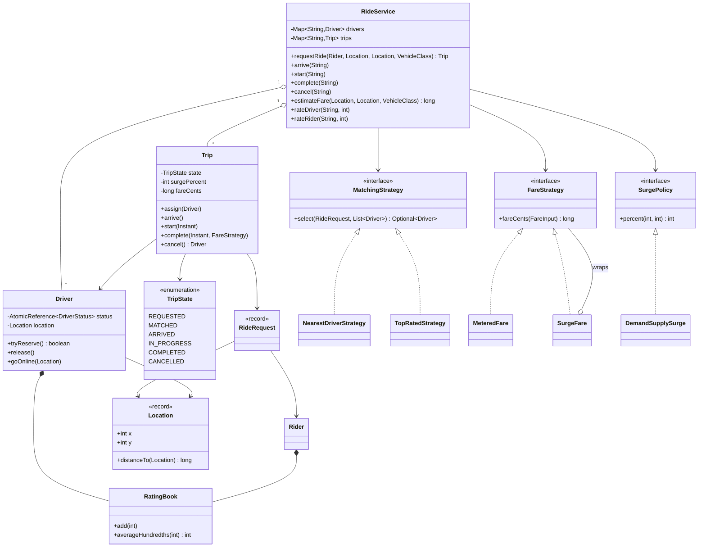
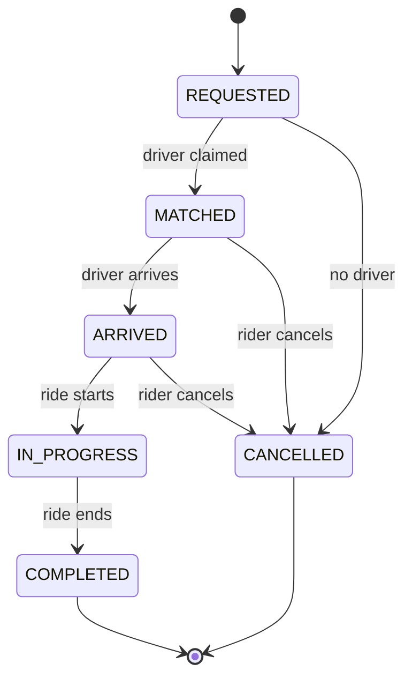
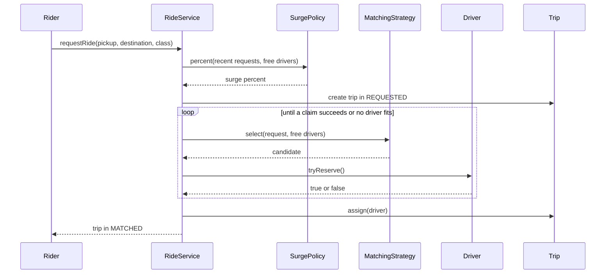

# Design a Ride-Sharing Service

A ride-sharing service pairs riders with nearby drivers and prices the trip. The LLD version of the problem tests four skills from [how to approach an LLD interview](../../how-to-approach-lld.md): find the points that vary (matching rule, fare rule), model the trip as a state machine, keep money in integers, and stop two riders from taking the same driver. The folder holds this page and one runnable `Main.java`. Run it with `java Main.java` (JDK 21).

This page covers the classes inside one program. The distributed version (location index at scale, geo-sharding, dispatch across regions) belongs to the HLD case study `kb/hld/case-studies/11-ride-hailing-and-proximity.md`.

## Problem Statement

Design a ride-sharing service. Drivers go online and report their location. A rider requests a ride from a pickup point to a destination. The system finds a suitable free driver near the pickup point and assigns the driver. The trip moves through its stages: the driver arrives, the ride starts, the ride ends. The system computes the fare, and the fare rises when demand is high compared with the number of free drivers (surge). After the trip, the rider and the driver rate each other. A rider can cancel before the ride starts.

## Clarifying Questions

Ask these in the first 5 minutes. Each row gives the answer that this design assumes.

| Question | Assumed answer |
|---|---|
| Is this the in-process design or the distributed system? | The in-process design. Classes, interfaces, and one program. The HLD page covers scale |
| How does the system model location? | A point on a flat street grid, in meters. Distance is the Manhattan distance (the sum of the horizontal and vertical distance). Real maps need a routing service, which is an extension |
| Which vehicle classes exist? | Economy and premium. A rider gets a driver of the requested class |
| How does the system pick a driver? | The rule can change. The demo has nearest driver and top rated driver. Both use a maximum pickup distance |
| What happens when no driver is free? | The request fails with a clear error. No waiting queue. A retry queue is an extension |
| How does the fare work? | Base fare plus a price per kilometer plus a price per minute, with a minimum fare. The fare uses the planned distance (pickup to destination) and the real ride time |
| How does surge work? | The surge percent follows the ratio of recent requests to free drivers. The system fixes the surge percent when the rider requests, and the trip keeps it. A cap limits the surge |
| What is the price unit? | Integer cents (`long`). Never `double` |
| Which trip stages exist? | Requested, matched, arrived, in progress, completed, cancelled |
| Who can cancel, and when? | The rider, before the ride starts. A cancellation fee is an extension |
| How do ratings work? | After a completed trip, each side gives 1 to 5 stars, once. The average rating feeds the top-rated matching rule |
| Do several riders request at the same time? | Yes. Two riders must never get the same driver |
| Storage and interface? | In memory. A Java API. No UI and no network layer |

## Requirements

### Functional

1. A driver registers with a vehicle class. The driver goes online at a location and the system marks the driver as available.
2. A rider requests a ride with a pickup, a destination, and a vehicle class. The system returns a trip that has an assigned driver, or refuses the request when no driver fits.
3. The matching rule is replaceable (Strategy).
4. A trip moves through the states `REQUESTED`, `MATCHED`, `ARRIVED`, `IN_PROGRESS`, and `COMPLETED`. The rider can cancel until the ride starts. The trip refuses every other transition.
5. The fare rule is replaceable (Strategy). Surge pricing is a layer on top of the base fare.
6. The system gives a fare estimate before the request. The final fare uses the real ride time.
7. A completed trip releases the driver. The driver is available again at the destination.
8. The rider and the driver rate each other once per completed trip. The system keeps the average rating of each person.

### Non-functional

1. Two riders who request at the same time never get the same driver.
2. Two calls that change the same trip (for example cancel and start) never leave the trip in a mixed state.
3. The system injects the time source, so the demo has the same fares and the same surge on every run.
4. A new matching rule, fare rule, or vehicle class changes few existing classes.
5. Matching scans all drivers: O(D) for D drivers. The Extensions section shows a grid index that cuts the scan to the nearby cells.

## Entities and Relationships

| Entity | Responsibility | Relationships |
|---|---|---|
| `RideService` | Facade. Takes requests, runs matching, drives the trip, and records the demand for surge | Has many `Driver` and many `Trip`. Uses one `MatchingStrategy`, one `FareStrategy`, one `SurgePolicy`, and one `Clock` |
| `Rider` | A person who requests rides. Holds a rating | Has one `RatingBook` |
| `Driver` | A person who gives rides. Holds a vehicle class, a location, a status, and a rating. Claims itself in one atomic step | Has one `RatingBook`. Assigned to zero or one active `Trip` |
| `DriverStatus` | Enum: `OFFLINE`, `AVAILABLE`, `ON_TRIP` | |
| `Location` | Record. A point on the grid, with a distance method | Used by `Driver` and `RideRequest` |
| `RideRequest` | Record. Rider, pickup, destination, vehicle class | Input of `MatchingStrategy` |
| `Trip` | One ride. Holds the state, the driver, the surge percent, the times, and the fare | Refers to `RideRequest` and `Driver`. Owns a `TripState` |
| `TripState` | Enum with one method per event. Each state allows only its own transitions | Used by `Trip` |
| `MatchingStrategy` | Chooses a driver from a list of candidates | Implemented by `NearestDriverStrategy`, `TopRatedStrategy` |
| `FareStrategy` | Computes the fare in cents from a `FareInput` | Implemented by `MeteredFare`. `SurgeFare` wraps another `FareStrategy` |
| `SurgePolicy` | Computes the surge percent from the recent requests and the free drivers | Implemented by `DemandSupplySurge` |
| `RatingBook` | Collects star ratings. Gives the average | Used by `Rider` and `Driver` |

Why the trip holds the surge percent: the rider saw a price when requesting. If the trip asked the surge policy again at completion, the price could change during the ride. The trip stores the percent once, and the fare uses it.

Why `Driver` has an `AtomicReference<DriverStatus>`: the status is the one field that two threads compete for. The claim must check and change the status in one step.

## Class Diagram



See [UML class and sequence diagrams](../../fundamentals/04-uml-class-and-sequence-diagrams.md) for the notation. The trip states and their transitions:



The request flow in order:



## Design Patterns Used

| Pattern | Where | Why | Rejected alternative |
|---|---|---|---|
| Strategy | `MatchingStrategy` | The matching rule is the part that product teams change most (nearest, best rated, fewest rides today, pooled rides). Each rule is one class and `RideService` does not change | A `switch` on a mode enum in `RideService`. Each new rule edits the service and breaks the Open-Closed Principle |
| Strategy | `FareStrategy` | Fare rules differ by city and by vehicle class. A new rule is one class | A fare method on `VehicleClass`. It fixes one rule for every city |
| Decorator | `SurgeFare` wraps `FareStrategy` | Surge is a multiplier on any base fare. The wrapper adds it without a new fare class for each combination | A `surge` flag inside `MeteredFare`. Every fare class then repeats the surge code. Subclasses such as `SurgeMeteredFare` multiply the classes |
| State | `TripState` | The legal actions depend on the stage. A cancelled trip cannot start. The enum holds the rule for each state, so `Trip` has no `if (state == ...)` chain | Boolean flags (`started`, `cancelled`). Flags allow impossible combinations such as started and cancelled |
| Facade | `RideService` | One entry point hides matching, surge, and state changes. Callers use `requestRide`, `start`, `complete` | Callers that use drivers, strategies, and trips directly. Each caller repeats the order of the steps |
| Value objects (records) | `Location`, `RideRequest`, `FareInput`, `Rate` | They are immutable, so threads share them without a lock | Mutable classes with setters |

The design implements `TripState` as an enum with one method per event. This keeps the whole machine in one place (about 70 lines). The alternative is one class per state behind a `TripState` interface, as in the textbook State pattern. Choose the class-per-state form when each state has its own data or a lot of behavior, for example a `RideInProgress` state that holds the route and the meter. Here the states carry no data of their own, so the enum is smaller. See [behavioral patterns](../../fundamentals/08-behavioral-patterns.md) for Strategy and State, [structural patterns](../../fundamentals/07-structural-patterns.md) for Decorator, and [SOLID](../../fundamentals/02-solid.md) for the Open-Closed Principle.

The design does not use Observer. Riders and drivers do not receive push messages in this program. Extensions covers the listener that sends them. The design does not use Singleton for `RideService`. The demo builds three services in one run, and each has its own clock and its own drivers. See [creational patterns](../../fundamentals/06-creational-patterns.md).

## Key Code

### Location and the driver

`Location` is a record. `distanceTo` is the Manhattan distance in meters. The `Driver` class holds the one atomic operation of the design: `tryReserve` changes the status from `AVAILABLE` to `ON_TRIP` in one step, and exactly one caller wins.

```java
record Location(int x, int y) {
    /** Manhattan distance in meters on a street grid. */
    long distanceTo(Location other) {
        return Math.abs((long) x - other.x) + Math.abs((long) y - other.y);
    }

    @Override
    public String toString() {
        return "(" + x + "," + y + ")";
    }
}
```

```java
final class Driver {
    private final String id;
    private final String name;
    private final VehicleClass vehicleClass;
    private final AtomicReference<DriverStatus> status =
            new AtomicReference<>(DriverStatus.OFFLINE);
    private final RatingBook ratings = new RatingBook();
    private volatile Location location = new Location(0, 0);

    Driver(String id, String name, VehicleClass vehicleClass) {
        this.id = id;
        this.name = name;
        this.vehicleClass = vehicleClass;
    }

    String id() {
        return id;
    }

    String name() {
        return name;
    }

    VehicleClass vehicleClass() {
        return vehicleClass;
    }

    Location location() {
        return location;
    }

    void moveTo(Location newLocation) {
        this.location = newLocation;
    }

    DriverStatus status() {
        return status.get();
    }

    RatingBook ratings() {
        return ratings;
    }

    boolean isAvailable() {
        return status.get() == DriverStatus.AVAILABLE;
    }

    void goOnline(Location where) {
        this.location = where;
        status.compareAndSet(DriverStatus.OFFLINE, DriverStatus.AVAILABLE);
    }

    /** Atomic claim. Exactly one caller wins when several riders pick this driver. */
    boolean tryReserve() {
        return status.compareAndSet(DriverStatus.AVAILABLE, DriverStatus.ON_TRIP);
    }

    void release() {
        status.compareAndSet(DriverStatus.ON_TRIP, DriverStatus.AVAILABLE);
    }
}
```

### Matching strategies

A strategy only reads the candidates and suggests one driver. It does not claim the driver, because claiming needs the atomic step in `Driver`. Both strategies break ties by driver id, so the result does not depend on the iteration order of the driver map.

```java
interface MatchingStrategy {
    Optional<Driver> select(RideRequest request, List<Driver> candidates);
}
```

```java
/** Takes the closest driver inside the pickup radius. Ties go to the lower driver id. */
final class NearestDriverStrategy implements MatchingStrategy {
    private final long maxPickupMeters;

    NearestDriverStrategy(long maxPickupMeters) {
        this.maxPickupMeters = maxPickupMeters;
    }

    @Override
    public Optional<Driver> select(RideRequest request, List<Driver> candidates) {
        Driver best = null;
        long bestDistance = Long.MAX_VALUE;
        for (Driver driver : candidates) {
            long distance = driver.location().distanceTo(request.pickup());
            if (distance > maxPickupMeters) {
                continue;
            }
            if (distance < bestDistance
                    || (distance == bestDistance && driver.id().compareTo(best.id()) < 0)) {
                best = driver;
                bestDistance = distance;
            }
        }
        return Optional.ofNullable(best);
    }
}
```

`TopRatedStrategy` has the same shape. It compares the rating first, then the distance, then the id. A driver without ratings counts as 4.00 (400 hundredths), so a new driver can win a match. This default is an assumption.

### The trip state machine

Each constant overrides only the events that it allows. The default methods at the end throw an `IllegalStateException` for all other events. A new event adds one default method and the overrides in the states that allow it.

```java
enum TripState {
    REQUESTED {
        @Override
        TripState onMatch() {
            return MATCHED;
        }

        @Override
        TripState onCancel() {
            return CANCELLED;
        }
    },
    MATCHED {
        @Override
        TripState onArrive() {
            return ARRIVED;
        }

        @Override
        TripState onCancel() {
            return CANCELLED;
        }
    },
    ARRIVED {
        @Override
        TripState onStart() {
            return IN_PROGRESS;
        }

        @Override
        TripState onCancel() {
            return CANCELLED;
        }
    },
    IN_PROGRESS {
        @Override
        TripState onComplete() {
            return COMPLETED;
        }
    },
    COMPLETED,
    CANCELLED;

    TripState onMatch() {
        throw illegal("match");
    }

    TripState onArrive() {
        throw illegal("arrive");
    }

    TripState onStart() {
        throw illegal("start");
    }

    TripState onComplete() {
        throw illegal("complete");
    }

    TripState onCancel() {
        throw illegal("cancel");
    }

    private IllegalStateException illegal(String action) {
        return new IllegalStateException("cannot " + action + " a trip in state " + this);
    }
}
```

`Trip` guards each transition with `synchronized`, so one thread changes the state at a time.

```java
    synchronized void assign(Driver matched) {
        state = state.onMatch();
        driver = matched;
    }

    synchronized void arrive() {
        state = state.onArrive();
    }

    synchronized void start(Instant now) {
        state = state.onStart();
        startedAt = now;
    }

    synchronized void complete(Instant now, FareStrategy fares) {
        state = state.onComplete();
        long seconds = Duration.between(startedAt, now).toSeconds();
        long minutes = (seconds + 59) / 60;
        long meters = request.pickup().distanceTo(request.dropoff());
        fareCents = fares.fareCents(
                new FareInput(request.vehicleClass(), meters, minutes, surgePercent));
    }

    /** Returns the driver that the trip held, or null if no driver was assigned. */
    synchronized Driver cancel() {
        state = state.onCancel();
        return driver;
    }
```

### Fares and surge

`FareInput` carries everything that a fare rule can need. All money is `long` cents. The fare rounds down to whole cents on the distance part and rounds half up on the surge part.

```java
record FareInput(VehicleClass vehicleClass, long meters, long minutes, int surgePercent) {
}
```

```java
record Rate(long baseCents, long perKmCents, long perMinuteCents, long minimumCents) {
}
```

```java
final class MeteredFare implements FareStrategy {
    private final Map<VehicleClass, Rate> rates;

    MeteredFare(Map<VehicleClass, Rate> rates) {
        this.rates = Map.copyOf(rates);
    }

    static Map<VehicleClass, Rate> standardRates() {
        return Map.of(VehicleClass.ECONOMY, new Rate(250, 120, 30, 500),
                VehicleClass.PREMIUM, new Rate(400, 200, 50, 800));
    }

    @Override
    public long fareCents(FareInput input) {
        Rate rate = rates.get(input.vehicleClass());
        long fare = rate.baseCents() + input.meters() * rate.perKmCents() / 1000
                + input.minutes() * rate.perMinuteCents();
        return Math.max(rate.minimumCents(), fare);
    }
}
```

`SurgeFare` is a Decorator. It calls the wrapped strategy and multiplies the result by the percent that the trip stored. `(fare * percent + 50) / 100` rounds half up in integer arithmetic.

```java
/** Decorator: multiplies the fare of another strategy by the surge percent. */
final class SurgeFare implements FareStrategy {
    private final FareStrategy inner;

    SurgeFare(FareStrategy inner) {
        this.inner = inner;
    }

    @Override
    public long fareCents(FareInput input) {
        return (inner.fareCents(input) * input.surgePercent() + 50) / 100;
    }
}
```

```java
interface SurgePolicy {
    int percent(int recentRequests, int availableDrivers);
}
```

```java
/** Surge follows the ratio of recent requests to free drivers. 100 means no surge. */
final class DemandSupplySurge implements SurgePolicy {
    private final int capPercent;

    DemandSupplySurge(int capPercent) {
        this.capPercent = capPercent;
    }

    @Override
    public int percent(int recentRequests, int availableDrivers) {
        if (availableDrivers == 0) {
            return capPercent;
        }
        int ratio = 100 * recentRequests / availableDrivers;
        return Math.max(100, Math.min(capPercent, ratio));
    }
}
```

See [domain modeling](../../fundamentals/05-domain-modeling.md) for why money must not use `double`.

### The service

`requestRide` records the demand, reads the surge percent, creates the trip, and claims a driver. If no driver fits, the trip moves to `CANCELLED` and the service throws. The service puts the trip into the `trips` map only after `assign`. If the map held the trip earlier, a `cancel` call with its id could run between the claim and the assign. Then `assign` would throw, and the claimed driver would stay `ON_TRIP` with no trip to release it. `claimDriver` loops because the list of free drivers can be stale when the claim happens. `demand` keeps the request times of the last 10 minutes (the demo's window) in a queue and drops the old ones.

```java
    Trip requestRide(Rider rider, Location pickup, Location dropoff, VehicleClass vehicleClass) {
        RideRequest request = new RideRequest(rider, pickup, dropoff, vehicleClass);
        int percent = surge.percent(demand(true), availableDrivers(vehicleClass).size());
        Trip trip = new Trip("T-" + tripSeq.incrementAndGet(), request, percent, clock.instant());
        Driver driver = claimDriver(request);
        if (driver == null) {
            trip.cancel();
            throw new NoDriverAvailableException(request);
        }
        trip.assign(driver);
        // Publish the trip only after it holds its driver. A cancel between the claim and
        // the assign would make assign throw and leave the driver stuck in ON_TRIP.
        trips.put(trip.id(), trip);
        return trip;
    }

    private Driver claimDriver(RideRequest request) {
        while (true) {
            Optional<Driver> candidate = matching.select(request,
                    availableDrivers(request.vehicleClass()));
            if (candidate.isEmpty()) {
                return null;
            }
            if (candidate.get().tryReserve()) {
                return candidate.get();
            }
            // Another rider took this driver between select and tryReserve. Select again.
        }
    }

    /** Counts the requests inside the window. The new request counts when record is true. */
    private int demand(boolean record) {
        Instant now = clock.instant();
        synchronized (recentRequests) {
            while (!recentRequests.isEmpty()
                    && recentRequests.peekFirst().isBefore(now.minus(demandWindow))) {
                recentRequests.pollFirst();
            }
            if (record) {
                recentRequests.addLast(now);
                return recentRequests.size();
            }
            return recentRequests.size() + 1;
        }
    }
```

`complete` moves the driver to the destination and frees the driver. `cancel` frees the driver only if the trip had one.

```java
    void complete(String tripId) {
        Trip trip = trip(tripId);
        trip.complete(clock.instant(), fares);
        Driver driver = trip.driver();
        driver.moveTo(trip.request().dropoff());
        driver.release();
    }

    void cancel(String tripId) {
        Driver driver = trip(tripId).cancel();
        if (driver != null) {
            driver.release();
        }
    }
```

## Concurrency

Four things can race in this design.

### Race 1: two riders get the same driver

The wrong form checks the driver and then changes the status:

<!-- fragment -->
```java
// Wrong: check, then act. Two riders can both see an available driver.
if (driver.isAvailable()) {
    driver.setStatus(DriverStatus.ON_TRIP);
}
```

Rider A and rider B both read `AVAILABLE`. Both set `ON_TRIP`. Both trips now name one driver. The result depends on the thread schedule, so the bug appears rarely.

The design fixes this in two layers:

1. `Driver.tryReserve` uses `AtomicReference.compareAndSet(AVAILABLE, ON_TRIP)`. The check and the change are one atomic step. Exactly one caller gets `true`.
2. `RideService.claimDriver` loops. The strategy chooses from a snapshot that can be stale. If `tryReserve` returns `false`, another rider claimed the driver after the snapshot. The loop reads the free drivers again, and the claimed driver is no longer in the list. The loop ends when a claim succeeds or when no driver fits. A failed claim means that another thread made progress, so no thread blocks another.

The demo (section 6) starts 8 riders at the same moment with 2 free drivers. The result is always 2 matched, 6 refused, and 2 distinct drivers. The demo prints only these numbers, because the other details depend on the schedule.

### Race 2: two calls change one trip

A rider can press cancel at the moment the driver presses start. Both methods read the state and then write it. `Trip` marks every transition `synchronized`, so one call runs first. If the cancel runs first, `onStart` finds `CANCELLED` and throws. If the start runs first, `onCancel` finds `IN_PROGRESS` and throws. The trip never ends in a mixed state. The lock belongs to one trip, so other trips do not wait.

### Race 3: the driver status after a cancel or a completion

`cancel` and `complete` both end with `driver.release()`. The guard against a double release is the state machine, not the compare-and-set. `Trip` allows exactly one of cancel and complete to succeed, and the other call throws before it reaches `release`. So `RideService` calls `release` once per trip.

The compare-and-set `(ON_TRIP, AVAILABLE)` alone does not protect a trip. It does not know which trip holds the driver. Suppose a stale `release` for trip T-1 arrives after the driver took trip T-2. The status is `ON_TRIP` again, so the compare-and-set succeeds and frees a driver who is on T-2. A stricter design stores the trip id in the driver (`AtomicReference<String> currentTrip`) and releases with `compareAndSet(tripId, null)`, so only the trip that holds the driver can free it.

### Race 4: the demand window and the driver location

The queue of request times is an `ArrayDeque`, which is not thread-safe. The code accesses it only inside `synchronized (recentRequests)`. The driver location is a `volatile` field that holds an immutable `Location`, so a reader always sees a complete point and never a half-written one.

### What the design accepts

| State | Protection | Reason |
|---|---|---|
| Driver status | `AtomicReference` with `compareAndSet` | One variable, one step |
| Trip state, driver, times | `synchronized` methods on `Trip` | Several fields change together |
| Request times | `synchronized` block on the queue | The prune and the add are one step |
| Driver and trip maps | `ConcurrentHashMap` | Many readers, few writers |
| Trip numbers | `AtomicLong` | Unique ids without a lock |
| Ratings | `synchronized` in `RatingBook` | The sum and the count change together |
| `Location`, `RideRequest`, `FareInput` | Immutable records | Nothing to protect |

The surge percent reads the demand count and the free-driver count in two separate steps. Between the two reads, another thread can change a value. Two riders who request at the same moment can see slightly different percents. This is acceptable: surge is a price signal and not a guarantee. A strict design computes the surge from one snapshot under one lock, at the cost of a lock on every request.

Why no global lock: a lock on `requestRide` serializes all riders, and the lock would cover the scan of all drivers. The atomic claim lets riders work in parallel. They conflict only when they pick the same driver. See [concurrency in LLD](../../fundamentals/09-concurrency-in-lld.md) for the comparison of locks and atomics, and `kb/java/08-java-util-concurrent.md` for the primitives.

!!! tip "What to say in the interview"
    "The one thing that must be exact is the driver claim, so I use an atomic compare-and-set on the driver status. The strategy only suggests. If the claim fails, I ask the strategy again. The trip state changes under a per-trip lock."

## Extensions

Interviewers ask for these changes. Each row names the classes that change.

| Extension | Change | Unchanged |
|---|---|---|
| Faster matching with a location index | Add a `DriverIndex` interface with `update(Driver)` and `near(Location, long)`. The first implementation is a grid: a `Map<Long, Set<Driver>>` where the key is the cell of the location. `goOnline` and `moveTo` update the index. `availableDrivers` reads only the cell of the pickup and its 8 neighbors. The scan drops from O(D) to the drivers in 9 cells. Real systems use geohash or quadtree cells (see `kb/hld/case-studies/11-ride-hailing-and-proximity.md`) | Strategies, `Trip`, fare classes |
| Pooled rides (shared trips) | Add a `PoolTrip` that holds several `RideRequest` values and a route. Add a `PoolMatchingStrategy` that returns an existing pool trip with a free seat when the detour is small. `Trip` becomes an interface with `SingleTrip` and `PoolTrip` | `FareStrategy`, `SurgePolicy` |
| Cancellation fee | Add a `CancellationPolicy` interface (Strategy) with `feeCents(TripState, Duration sinceMatch)`. `RideService.cancel` asks it and returns the fee. The policy charges nothing in `MATCHED` for the first 2 minutes and a fixed amount after the driver arrives | `TripState` (it already allows the cancel) |
| Driver accepts or rejects | Add the state `OFFERED` between `REQUESTED` and `MATCHED`. The service offers the trip to one driver at a time with a timeout (injected `Clock`). On a reject or a timeout, the service tries the next driver that the strategy returns, and skips drivers that already refused | `FareStrategy`, `Rider` |
| Surge by zone | Add a `Zone` record and a `ZoneResolver` that maps a `Location` to a zone. `RideService` keeps one demand queue per zone and passes the zone counts to `SurgePolicy`. The policy interface stays the same. Only the counts change | `SurgeFare`, `Trip` |
| Notifications to riders and drivers | Add a `TripListener` interface with `onStateChange(Trip)`. `RideService` keeps a `CopyOnWriteArrayList` of listeners and calls them after each transition (Observer). A push sender implements the interface. See the notification service case study `kb/lld/case-studies/24-notification-service/README.md` | Strategies, `TripState` |
| Payment | Add a `PaymentGateway` interface with `charge(String idempotencyKey, long cents)`. `complete` calls it with the trip id as the key. A failure moves the trip to `PAYMENT_FAILED`. See `kb/lld/case-studies/18-shopping-cart-and-orders/README.md` for the idempotency pattern | `MatchingStrategy`, `Driver` |
| Real routes | Replace the Manhattan distance with a `RoutingService` interface that returns the distance and the expected time. `Location.distanceTo` stays for the first filter. The fare input then uses the route distance | `FareStrategy`, `TripState` |
| Driver goes offline | Add `Driver.goOffline()` with `compareAndSet(AVAILABLE, OFFLINE)`. A driver on a trip finishes the trip first. The claim loop already skips drivers that are not available | Strategies |

## Common Mistakes

1. Starting with a class diagram of fifteen classes before the clarifying questions. State the assumptions on matching, surge, and cancellation first.
2. Modeling `Rider` and `Driver` as subclasses of a `User` class with no behavior of their own. They have different data and different roles. Share only what is common (a rating), and prefer composition (`RatingBook`). See [OOP](../../fundamentals/01-oop.md).
3. Putting the matching `if` chain or the fare formula inside `RideService`. Each new rule edits the service. Use the two Strategy interfaces.
4. Keeping the trip state as several boolean flags. Flags allow impossible combinations. Use one state with checked transitions.
5. Checking `driver.isAvailable()` and then changing the status. This is the race above. Use an atomic claim.
6. Using `double` for the fare. Use `long` cents or `BigDecimal`.
7. Computing the surge at completion time. The rider saw a price at request time. Store the percent in the trip.
8. Reading `Instant.now()` inside the fare or the surge code. A test cannot fix the time. Inject a `Clock`.
9. A global `synchronized` on the whole service. It is correct, but it serializes all requests. State the trade-off and show the finer form.
10. Mixing the matching and the claim in one step. Then the strategy has side effects, and a failed claim leaves a half-changed state. Keep the strategy pure.
11. Forgetting to free the driver on cancel or on completion. The driver is then stuck in `ON_TRIP`.
12. Starting with a quadtree or geohash index before the basic design works. Mention the index as an extension, and build it only when the interviewer asks.

## 45-Minute Plan

| Minutes | What to do | Output |
|---|---|---|
| 0 to 5 | Ask the questions of the table above. State assumptions: in-process, grid locations, cents, surge fixed at request | A numbered requirement list |
| 5 to 10 | List use cases (go online, request, ride, cancel, rate). Name the entities. Mark the variation points: matching, fare, surge. Mark the state machine | Entity list and three Strategy points |
| 10 to 17 | Draw the class diagram with 10 classes and the state diagram. Write the signatures of `requestRide`, `MatchingStrategy`, `FareStrategy` | Diagram and signatures |
| 17 to 35 | Write the code of the first column of the table below. Name the classes of the second column, give one sentence each, and skip their code | Compiling core |
| 35 to 41 | Explain the claim race and the loop. Explain the per-trip lock. Say why no global lock | Concurrency answer |
| 41 to 45 | Answer three extensions: location index, cancellation fee, driver accept or reject | Extension answers |

`Main.java` is the complete reference, about 780 lines with the demo. That is more than a candidate writes in 45 minutes. The first column below is about 220 lines in the form that `Main.java` uses, and that is tight for the 18 minutes of coding. Write the classes without getters and Javadoc. Write `TripState` with two constants in full (`REQUESTED` and `MATCHED`) and name the other transitions, which saves about 40 lines:

| Write in the round | Only in `Main.java` (name it, or add it if the interviewer asks) |
|---|---|
| `Location`, `RideRequest`, `VehicleClass`, `DriverStatus` | `TopRatedStrategy` (one sentence: "same shape, compares the rating first") |
| The `status` field of `Driver` with `tryReserve` and `release` | `RatingBook` and `rateDriver`, `rateRider` |
| `MatchingStrategy` and `NearestDriverStrategy` | `DemandSupplySurge` and the demand window (give the formula in words) |
| `TripState` (two constants in full) | `estimateFare` and the `TripState` constants that you named |
| `Trip.assign`, `start`, `complete`, `cancel` (`synchronized`) | The exception classes, `describe`, and the `Trip` getters |
| `FareStrategy`, `MeteredFare`, and the `SurgeFare` decorator (10 lines) | `MutableClock` |
| `RideService.requestRide`, `claimDriver`, `complete`, `cancel` | The demo in `main` and the thread scenario |

If the interviewer wants a diagram only, spend the freed time on the sequence diagram and on the surge design. See [machine coding round](../../machine-coding-round.md) for the 90-minute version, where you add tests and a demo `main` method. Related case studies: `kb/lld/case-studies/18-shopping-cart-and-orders/README.md` (state machine and idempotent payment), `kb/lld/case-studies/21-food-delivery/README.md` (delivery partner assignment), and `kb/lld/case-studies/04-elevator-system/README.md` (dispatch Strategy).

## Expected Output

<!-- expected-output -->
```text
== 1. Match, ride, pay, rate ==
estimate ECONOMY: 11.50
T-1 MATCHED Asha surge 100%
T-1 COMPLETED Asha surge 100% fare 12.70
Asha is AVAILABLE at (3000,2000)
Asha rating 4.50 (2), Ravi rating 4.00 (1)
rate the driver again: refused (the driver of T-1 is already rated)
== 2. Compare matching strategies ==
nearest: Asha
topRated: Ben
nearest within 400 m: nobody
== 3. Cancel ==
T-2 MATCHED Asha surge 100%
T-2 CANCELLED Asha surge 100%
driver free again: 3 ECONOMY available
start a cancelled trip: refused (cannot start a trip in state CANCELLED)
== 4. Surge pricing ==
Ana: surge 100%, next quote 23.00
Bo: surge 200%, next quote 28.75
Cy: no ECONOMY driver near (0,0)
after 11 minutes and one new driver: 11.50
== 5. Illegal transitions ==
complete a MATCHED trip: refused (cannot complete a trip in state MATCHED)
rate before completion: refused (trip T-4 is MATCHED, not COMPLETED)
== 6. Eight riders, two drivers, same moment ==
matched=2 refused=6 distinctDrivers=2
```
