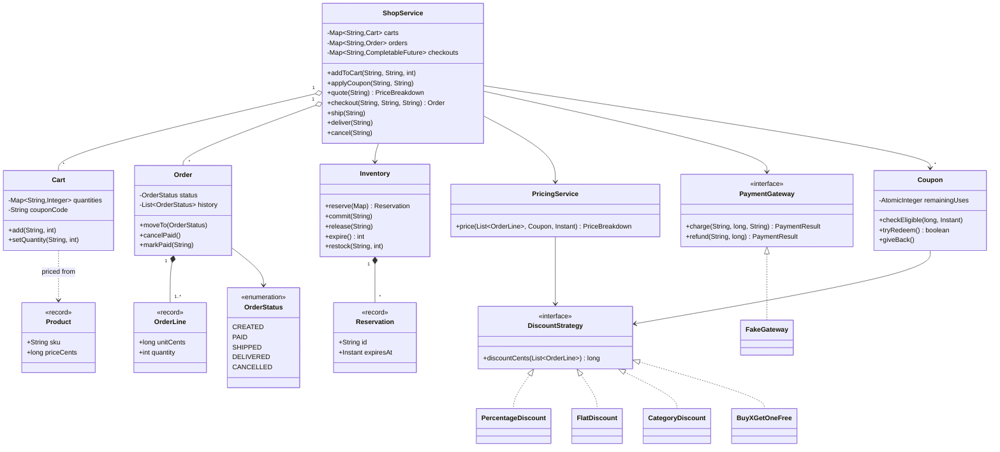
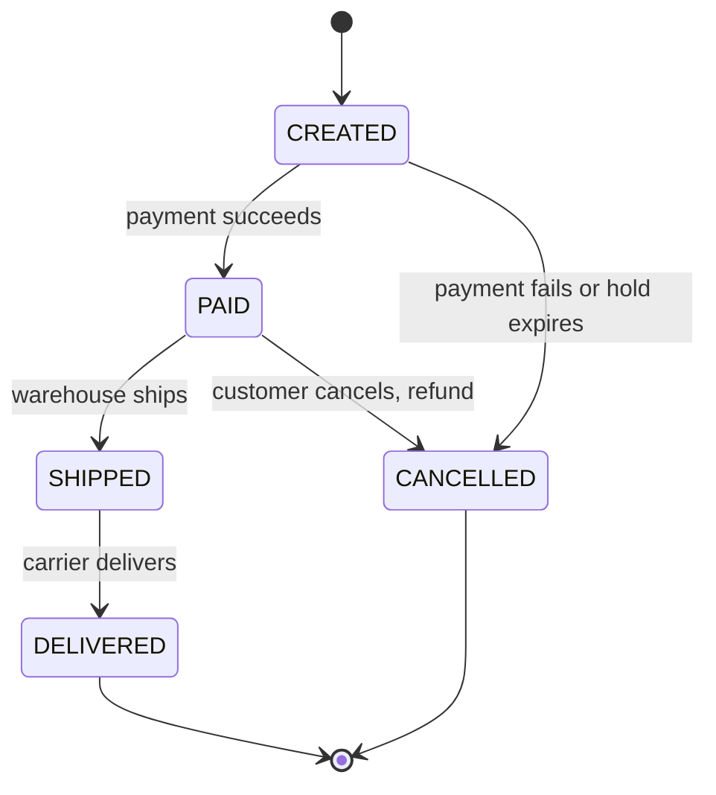
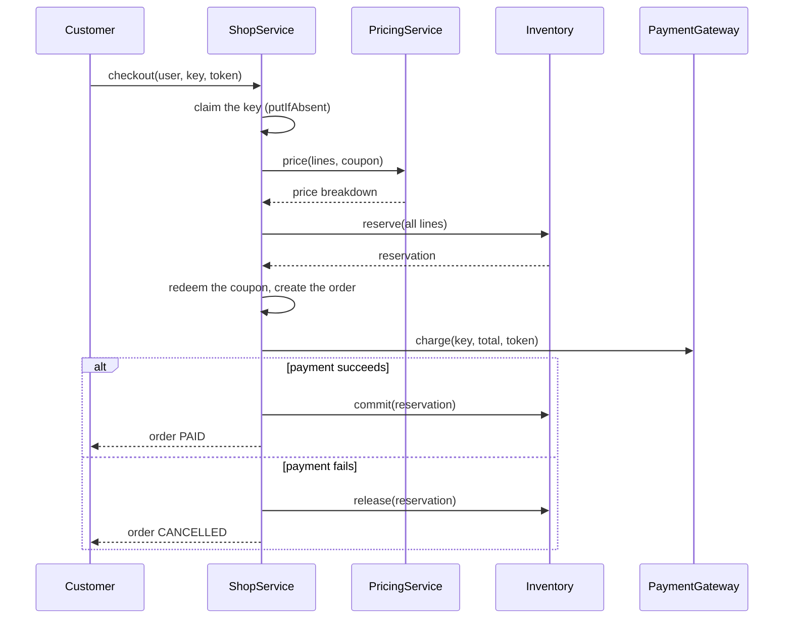

# Design a Shopping Cart and Order System

A shopping cart with checkout looks like a CRUD problem. The hard parts sit in checkout: hold the stock, apply the discount, charge the customer, and survive a retry, a decline, and two clicks on the pay button. The problem tests the procedure from [how to approach an LLD interview](../../how-to-approach-lld.md): model money and stock correctly, use Strategy where the pricing rules vary, use a state machine for the order, and make checkout safe under concurrency. The folder holds this page and one runnable `Main.java`. Run it with `java Main.java` (JDK 21).

This page covers the classes inside one program. The distributed versions belong to the HLD case studies `kb/hld/case-studies/13-payment-system.md` (payments, idempotency at scale) and `kb/hld/case-studies/24-ecommerce-flash-sale.md` (stock under extreme load).

## Problem Statement

Design the cart and order part of an online shop. A catalog lists products with prices and a stock count. A customer adds products to a cart, changes quantities, and applies a coupon code. At checkout the system holds the stock, computes the price with the discounts, charges the customer through a payment service, and creates an order. The order moves through its stages: paid, shipped, delivered. The customer can cancel a paid order until it ships. If the customer clicks the pay button twice, or the network repeats the request, the system must charge once and create one order.

## Clarifying Questions

Ask these in the first 5 minutes. Each row gives the answer that this design assumes.

| Question | Assumed answer |
|---|---|
| Is this the in-process design or the distributed system? | The in-process design. The HLD pages cover scale |
| What is the price unit? | Integer cents (`long`). Never `double` |
| Does the cart reserve stock? | No. Adding to a cart does not hold stock. Checkout holds the stock until the payment ends. A cart that holds stock lets idle carts block real buyers |
| What happens when stock is too low at checkout? | The whole checkout fails with a message that names the product. No partial order |
| Which discount types exist? | Percentage with a cap, flat amount, percentage on one category, and "buy x, get one free". More types can follow |
| How do coupons work? | A code maps to one discount rule. A coupon has an expiry time, a minimum subtotal, and a use limit. A cart holds at most one coupon |
| Do automatic promotions and a coupon combine? | Yes. The system adds all discounts, each computed on the original lines. The total discount never exceeds the subtotal |
| Which price applies? | The catalog price at checkout. The order copies the price, so later price changes do not change old orders |
| What does the order cover? | Product lines, the price breakdown, the coupon code, the payment reference, and the status history |
| Which order stages exist? | Created, paid, shipped, delivered, cancelled |
| Who can cancel and when? | The customer, while the order is paid and not shipped. The system refunds the payment and returns the stock |
| How does payment work? | A `PaymentGateway` interface with `charge` and `refund`. A charge carries an idempotency key. The demo uses a fake gateway |
| How does the system treat a repeated checkout? | The same customer and the same idempotency key return the same order and charge once |
| Tax and shipping fees? | Out of scope. Extensions covers both |
| Storage and interface? | In memory. A Java API. No UI and no network layer |

## Requirements

### Functional

1. A catalog holds products with a SKU, a name, a category, a price in cents, and a stock count.
2. A customer has one cart. The customer adds a product, sets a quantity (0 removes the product), and removes a product.
3. A customer applies one coupon code to the cart. The system checks the coupon (known, not expired, minimum subtotal, uses left) and refuses it with a reason if a rule fails.
4. The system prices a cart: subtotal, discounts, total. The discount rules are replaceable (Strategy).
5. Checkout holds the stock for all lines at once (all or nothing), prices the cart, charges the payment, and then confirms the stock. A hold has a time limit.
6. If the payment fails, the system releases the stock and the coupon use, and marks the order cancelled.
7. If the hold has expired when the payment ends (its time is over, whether or not the sweeper has released it), the system refunds the payment and cancels the order.
8. An order follows the state machine `CREATED -> PAID -> SHIPPED -> DELIVERED`. A paid order can move to `CANCELLED`. The order refuses every other transition.
9. Checkout is idempotent: one customer and one key produce one order and one charge.
10. If the payment call throws (for example, a timeout), the system undoes the hold, the coupon use, and the order. A retry with the same key asks the gateway again, and the gateway does not charge twice.

### Non-functional

1. Concurrent buyers never sell more units than the stock holds.
2. A coupon with N uses is redeemed at most N times, also when buyers check out at the same moment.
3. Two requests with the same idempotency key cause one charge.
4. The system injects the time source, so tests fix the expiry of coupons and holds.
5. A new discount type, payment provider, or order stage changes few existing classes.
6. The reservation uses one lock for all products. This is simple and correct. The Concurrency section shows the finer forms.

## Entities and Relationships

| Entity | Responsibility | Relationships |
|---|---|---|
| `ShopService` | Facade. Runs the cart operations and the checkout flow | Uses `Inventory`, `PricingService`, `PaymentGateway`, and `Clock`. Has many `Cart`, `Order`, `Coupon`, and `Product` |
| `Product` | Record. SKU, name, category, price in cents | Used by `Cart` pricing and `OrderLine` |
| `Cart` | The products and quantities of one customer, plus the coupon code | Holds SKUs and quantities. Not shared between customers |
| `OrderLine` | Record. A copy of the product data and the quantity at checkout time | Part of an `Order` |
| `Inventory` | Counts available and held units. Reserves, confirms, releases, and expires holds | Owns many `Reservation` |
| `Reservation` | Record. A hold: id, units per SKU, expiry time | Held by `Inventory` |
| `DiscountStrategy` | Computes a discount from the lines | Implemented by `PercentageDiscount`, `FlatDiscount`, `CategoryDiscount`, `BuyXGetOneFree` |
| `Coupon` | A code with a discount rule, an expiry, a minimum subtotal, and a use counter | Has one `DiscountStrategy` |
| `PricingService` | Adds the automatic promotions and the coupon, caps the discount at the subtotal, and returns a `PriceBreakdown` | Uses `DiscountStrategy` and `Coupon` |
| `PriceBreakdown` | Record. Subtotal, discount, total | Part of an `Order` |
| `Order` | The result of a checkout. Holds lines, price, and the status with its history | Has many `OrderLine`. Has one `OrderStatus` |
| `OrderStatus` | Enum. Each constant lists the stages that can follow it | Used by `Order` |
| `PaymentGateway` | Interface. `charge` with an idempotency key, and `refund` | Implemented by `FakeGateway` here, and by a provider adapter in production |

Why `OrderLine` copies the product data: a price or a name can change after the purchase. The order must show what the customer bought and paid. A reference to the live `Product` would change old orders.

Why the cart does not hold prices: the cart shows the current catalog price, and the checkout takes the price at that moment. An extension (price lock) changes this rule.

## Class Diagram



See [UML class and sequence diagrams](../../fundamentals/04-uml-class-and-sequence-diagrams.md) for the notation. The order states and their transitions:



The checkout flow in order:



## Design Patterns Used

| Pattern | Where | Why | Rejected alternative |
|---|---|---|---|
| Strategy | `DiscountStrategy` | Marketing creates new discount types often. Each type is one class, and `PricingService` does not change | An `if (type == PERCENT) ... else if ...` chain in the pricing code. Each new type edits the chain and breaks the Open-Closed Principle |
| State machine (enum) | `OrderStatus.next()` | The legal moves depend on the stage. One table holds all rules. `Order.moveTo` checks the table, so no caller can skip a stage | A `status` string that any code sets. A typo or a wrong order then goes unnoticed |
| Adapter | `PaymentGateway` | The shop depends on a small interface. A provider SDK sits behind one adapter class. Tests use a fake | Calls to a provider SDK inside `ShopService`. The service then depends on one provider and tests need the network |
| Facade | `ShopService` | One entry point hides the order of the steps in checkout | Callers that use inventory, pricing, and payment themselves. Each caller repeats the order of the steps and the failure handling |
| Idempotency key | `ShopService.checkout`, `PaymentGateway.charge` | A client retry must not create a second order or a second charge | Trusting the client to click once |
| Value objects (records) | `Product`, `OrderLine`, `PriceBreakdown`, `Reservation` | They are immutable, so threads share them without a lock | Mutable classes with setters |

The design uses an enum table for the order stages, and the ride-sharing case study (`kb/lld/case-studies/17-ride-sharing/README.md`) uses constant-specific methods for the trip stages. Both are valid. The table is shorter when the stages only differ in which moves they allow. Use the textbook State pattern with one class per state when each stage has its own behavior, for example a `Shipped` state that creates a tracking code. See [behavioral patterns](../../fundamentals/08-behavioral-patterns.md) for Strategy and State, [SOLID](../../fundamentals/02-solid.md) for the Open-Closed Principle and the Dependency Inversion Principle behind the gateway interface, and [domain modeling](../../fundamentals/05-domain-modeling.md) for money as integer cents and for the copy of data in `OrderLine`.

The design does not use Singleton for the service or the inventory. The demo builds two shops in one run. See [creational patterns](../../fundamentals/06-creational-patterns.md).

## Key Code

### Money, stock, and the reservation

The inventory keeps two counters for each SKU: available units and held units. A hold moves units from available to held. A commit removes the held units (the sale is final). A release moves them back. `reserve` checks all lines first and changes the counters only if every line fits.

```java
record Reservation(String id, Map<String, Integer> items, Instant expiresAt) {
}

final class Inventory {
    private final Map<String, Integer> available = new HashMap<>();
    private final Map<String, Integer> reserved = new HashMap<>();
    private final Map<String, Reservation> reservations = new HashMap<>();
    private final Clock clock;
    private final Duration holdTime;
    private final AtomicLong seq = new AtomicLong();

    Inventory(Clock clock, Duration holdTime) {
        this.clock = clock;
        this.holdTime = holdTime;
    }
```

```java
    /** All or nothing: either every item is held, or nothing changes. */
    synchronized Reservation reserve(Map<String, Integer> items) {
        for (Map.Entry<String, Integer> item : items.entrySet()) {
            int free = available(item.getKey());
            if (free < item.getValue()) {
                throw new OutOfStockException(item.getKey(), item.getValue(), free);
            }
        }
        for (Map.Entry<String, Integer> item : items.entrySet()) {
            available.merge(item.getKey(), -item.getValue(), Integer::sum);
            reserved.merge(item.getKey(), item.getValue(), Integer::sum);
        }
        Reservation reservation = new Reservation("R-" + seq.incrementAndGet(),
                Map.copyOf(items), clock.instant().plus(holdTime));
        reservations.put(reservation.id(), reservation);
        return reservation;
    }

    /** The sale is final. The held units leave the stock. */
    synchronized void commit(String reservationId) {
        Reservation reservation = reservations.remove(reservationId);
        if (reservation == null) {
            throw new ReservationExpiredException(reservationId);
        }
        if (!reservation.expiresAt().isAfter(clock.instant())) {
            // The hold timed out, and the sweeper has not run yet.
            giveBack(reservation);
            throw new ReservationExpiredException(reservationId);
        }
        reservation.items().forEach((sku, qty) -> reserved.merge(sku, -qty, Integer::sum));
    }

    /** The sale failed. The held units return to the available stock. */
    synchronized void release(String reservationId) {
        Reservation reservation = reservations.remove(reservationId);
        if (reservation != null) {
            giveBack(reservation);
        }
    }

    /** Releases every hold whose time is over. Returns the number of holds released. */
    synchronized int expire() {
        Instant now = clock.instant();
        List<Reservation> late = new ArrayList<>();
        for (Reservation reservation : reservations.values()) {
            if (!reservation.expiresAt().isAfter(now)) {
                late.add(reservation);
            }
        }
        for (Reservation reservation : late) {
            reservations.remove(reservation.id());
            giveBack(reservation);
        }
        return late.size();
    }

    private void giveBack(Reservation reservation) {
        reservation.items().forEach((sku, qty) -> {
            reserved.merge(sku, -qty, Integer::sum);
            available.merge(sku, qty, Integer::sum);
        });
    }
```

`expire` is the sweeper. A scheduled task calls it every few seconds in a real system. If a checkout dies after the hold, the hold still ends after its time limit. `commit` also checks the expiry time itself, so a hold whose time is over cannot become a sale in the seconds before the sweeper runs. Recommendation: make the hold time longer than the gateway timeout, so that only a broken payment call outlasts the hold.

### Discount strategies

```java
interface DiscountStrategy {
    long discountCents(List<OrderLine> lines);
}
```

```java
final class PercentageDiscount implements DiscountStrategy {
    private final int percent;
    private final long capCents;

    PercentageDiscount(int percent, long capCents) {
        this.percent = percent;
        this.capCents = capCents;
    }

    @Override
    public long discountCents(List<OrderLine> lines) {
        long subtotal = 0;
        for (OrderLine line : lines) {
            subtotal += line.totalCents();
        }
        return Math.min(capCents, subtotal * percent / 100);
    }
}
```

```java
/** Every (x + 1)th unit of one product is free. */
final class BuyXGetOneFree implements DiscountStrategy {
    private final String sku;
    private final int x;

    BuyXGetOneFree(String sku, int x) {
        this.sku = sku;
        this.x = x;
    }

    @Override
    public long discountCents(List<OrderLine> lines) {
        long sum = 0;
        for (OrderLine line : lines) {
            if (line.sku().equals(sku)) {
                sum += (long) (line.quantity() / (x + 1)) * line.unitCents();
            }
        }
        return sum;
    }
}
```

`FlatDiscount` and `CategoryDiscount` have the same shape. Each strategy reads the lines and returns cents. The strategy does not know the coupon, the user, or the clock.

Rounding rule: a percentage discount uses integer division, which drops the fraction of a cent. The customer never gets more than the stated percent, and the shop keeps at most 1 cent per discount. In the demo, 15% of Bob's 1.50 is 22.5 cents, and the code gives 22 cents (`discount 0.22`). `PercentageDiscount` applies the cap after the rounding. A shop that wants round half up writes `(subtotal * percent + 50) / 100`. State the rule in the interview, because the interviewer often asks.

### Coupon and pricing

The coupon holds the rules that do not change (expiry, minimum subtotal) and one counter that changes (uses left). `checkEligible` gives a clear reason to the customer. `tryRedeem` is the authoritative claim. It uses a compare-and-set loop on an `AtomicInteger`, so two buyers cannot both take the last use.

```java
final class Coupon {
    private final String code;
    private final DiscountStrategy discount;
    private final long minSubtotalCents;
    private final Instant expiresAt;
    private final AtomicInteger remainingUses;

    Coupon(String code, DiscountStrategy discount, long minSubtotalCents,
           Instant expiresAt, int maxUses) {
        this.code = code;
        this.discount = discount;
        this.minSubtotalCents = minSubtotalCents;
        this.expiresAt = expiresAt;
        this.remainingUses = new AtomicInteger(maxUses);
    }

    String code() {
        return code;
    }

    DiscountStrategy discount() {
        return discount;
    }

    /** Checks the rules that do not change the coupon. */
    void checkEligible(long subtotalCents, Instant now) {
        if (!expiresAt.isAfter(now)) {
            throw new CouponException("coupon " + code + " has expired");
        }
        if (subtotalCents < minSubtotalCents) {
            throw new CouponException("coupon " + code + " needs a subtotal of at least "
                    + Main.money(minSubtotalCents));
        }
        if (remainingUses.get() <= 0) {
            throw new CouponException("coupon " + code + " is used up");
        }
    }

    /** Atomic claim of one use. */
    boolean tryRedeem() {
        while (true) {
            int left = remainingUses.get();
            if (left <= 0) {
                return false;
            }
            if (remainingUses.compareAndSet(left, left - 1)) {
                return true;
            }
        }
    }

    void giveBack() {
        remainingUses.incrementAndGet();
    }
}
```

`PricingService` adds the automatic promotions and the coupon discount, and caps the sum at the subtotal. A total never goes below zero.

```java
final class PricingService {
    private final List<DiscountStrategy> automatic;

    PricingService(List<DiscountStrategy> automatic) {
        this.automatic = List.copyOf(automatic);
    }

    PriceBreakdown price(List<OrderLine> lines, Coupon coupon, Instant now) {
        long subtotal = 0;
        for (OrderLine line : lines) {
            subtotal += line.totalCents();
        }
        long discount = 0;
        for (DiscountStrategy promotion : automatic) {
            discount += promotion.discountCents(lines);
        }
        if (coupon != null) {
            coupon.checkEligible(subtotal, now);
            discount += coupon.discount().discountCents(lines);
        }
        discount = Math.min(discount, subtotal);
        return new PriceBreakdown(subtotal, discount, subtotal - discount);
    }
}
```

See [domain modeling](../../fundamentals/05-domain-modeling.md) for why money must not use `double`.

### The order state machine

Each status lists the statuses that can follow it. `moveTo` is the only way to change the status, and it is `synchronized`, so two threads cannot interleave the check and the change.

```java
enum OrderStatus {
    CREATED, PAID, SHIPPED, DELIVERED, CANCELLED;

    Set<OrderStatus> next() {
        return switch (this) {
            case CREATED -> EnumSet.of(PAID, CANCELLED);
            case PAID -> EnumSet.of(SHIPPED, CANCELLED);
            case SHIPPED -> EnumSet.of(DELIVERED);
            case DELIVERED, CANCELLED -> EnumSet.noneOf(OrderStatus.class);
        };
    }
}
```

```java
    synchronized void moveTo(OrderStatus next) {
        if (!status.next().contains(next)) {
            throw new IllegalStateException(
                    "order " + id + " cannot move from " + status + " to " + next);
        }
        status = next;
        history.add(next);
    }

    /** Only a paid order can be cancelled by the customer. */
    synchronized void cancelPaid() {
        if (status != OrderStatus.PAID) {
            throw new IllegalStateException(
                    "order " + id + " is " + status + ", only a PAID order can be cancelled");
        }
        moveTo(OrderStatus.CANCELLED);
    }

    synchronized void markPaid(String reference) {
        moveTo(OrderStatus.PAID);
        paymentRef = reference;
    }
```

### The payment interface

`charge` takes an idempotency key. If the gateway sees the same key again, it returns the stored answer and does not charge a second time. The fake gateway stores the answer for each key, a decline included.

Stripe is one provider with this feature. Its [idempotent requests documentation](https://docs.stripe.com/api/idempotent_requests) states these rules for API v1:

- Stripe saves the status code and the body of the first request with a key, once the endpoint has started to run. A retry with the same key gets the saved response, `500` errors included.
- Stripe compares the parameters of a retry with the first request, and returns an error if they differ.
- Stripe saves nothing if the parameters fail validation or the request conflicts with another request that runs at the same time. The client can retry these requests.
- Stripe can remove a key after it is at least 24 hours old. A request that reuses a removed key runs as a new request.
- Stripe advises against personal data (for example, an email address) in a key, and suggests V4 UUIDs.

The shop sends the key `userId:key` to the fake gateway. Recommendation: a production adapter maps that scoped key to a random UUID that it stores with the order, so no customer id reaches the provider.

`FakeGateway` also has two test hooks. `beforeCharge` runs code during the charge (the demo advances the clock with it). `loseNextResponse` makes the next charge succeed and then throw `PaymentTimeoutException`, as a network timeout does after the provider charged the card.

```java
record PaymentResult(boolean success, String reference, String message) {
}
```

```java
interface PaymentGateway {
    PaymentResult charge(String idempotencyKey, long amountCents, String paymentToken);

    PaymentResult refund(String paymentReference, long amountCents);
}
```

```java
    public synchronized PaymentResult charge(String key, long amountCents, String token) {
        PaymentResult known = answers.get(key);
        if (known != null) {
            return known;
        }
        beforeCharge.run();
        PaymentResult result;
        if (token.equals("tok_decline")) {
            result = new PaymentResult(false, null, "card declined");
        } else {
            charges++;
            result = new PaymentResult(true, "PAY-" + charges, "ok");
        }
        answers.put(key, result);
        if (loseNextResponse) {
            loseNextResponse = false;
            throw new PaymentTimeoutException(key);
        }
        return result;
    }
```

### Checkout

`checkout` has two jobs. The first job is idempotency: the first call for a key does the work, and every other call for the same key waits for the first call and returns its result. The second job is the sequence in `placeOrder`: price, hold the stock, redeem the coupon, create the order, charge, then confirm the stock. Each failure path undoes the steps before it.

```java
    Order checkout(String userId, String idempotencyKey, String paymentToken) {
        String scopedKey = userId + ":" + idempotencyKey;
        CompletableFuture<Order> mine = new CompletableFuture<>();
        CompletableFuture<Order> existing = checkouts.putIfAbsent(scopedKey, mine);
        if (existing != null) {
            return await(existing);
        }
        try {
            Order order = placeOrder(userId, scopedKey, paymentToken);
            mine.complete(order);
            return order;
        } catch (RuntimeException | Error e) {
            checkouts.remove(scopedKey, mine);
            mine.completeExceptionally(e);
            throw e;
        }
    }

    private static Order await(CompletableFuture<Order> future) {
        try {
            return future.join();
        } catch (CompletionException e) {
            if (e.getCause() instanceof RuntimeException cause) {
                throw cause;
            }
            throw e;
        }
    }

    private Order placeOrder(String userId, String scopedKey, String paymentToken) {
        Cart cart = cart(userId);
        List<OrderLine> lines = lines(cart);
        if (lines.isEmpty()) {
            throw new ShopException("the cart of " + userId + " is empty");
        }
        Coupon coupon = coupon(cart.couponCode());
        PriceBreakdown price = pricing.price(lines, coupon, clock.instant());
        Map<String, Integer> wanted = new TreeMap<>();
        for (OrderLine line : lines) {
            wanted.put(line.sku(), line.quantity());
        }
        Reservation hold = inventory.reserve(wanted);
        if (coupon != null && !coupon.tryRedeem()) {
            inventory.release(hold.id());
            throw new CouponException("coupon " + coupon.code() + " is used up");
        }
        Order order = new Order("O-" + orderSeq.incrementAndGet(), userId, lines, price,
                coupon == null ? null : coupon.code());
        orders.put(order.id(), order);

        PaymentResult payment;
        try {
            payment = gateway.charge(scopedKey, price.totalCents(), paymentToken);
        } catch (RuntimeException e) {
            // The outcome is unknown. Undo the local steps. A retry with the same key asks
            // the gateway again, and the gateway returns its first answer if it charged.
            abandon(order, hold, coupon);
            throw e;
        }
        if (!payment.success()) {
            abandon(order, hold, coupon);
            return order;
        }
        try {
            inventory.commit(hold.id());
        } catch (ReservationExpiredException e) {
            gateway.refund(payment.reference(), price.totalCents());
            abandon(order, hold, coupon);
            return order;
        }
        order.markPaid(payment.reference());
        cart.clear();
        return order;
    }

    private void abandon(Order order, Reservation hold, Coupon coupon) {
        inventory.release(hold.id());
        if (coupon != null) {
            coupon.giveBack();
        }
        order.moveTo(OrderStatus.CANCELLED);
    }
```

The stored future decides what a retry with the same key gets. Three cases exist:

| Case | What the first call does | What a retry with the same key gets |
|---|---|---|
| The checkout succeeds | Completes the future with the `PAID` order | The same `PAID` order. No new charge |
| The payment is declined | Undoes the hold and the coupon use, cancels the order, and completes the future with the `CANCELLED` order | The same `CANCELLED` order. The client uses a new key for a new attempt, as with Stripe, where a retry gets the saved decline |
| The checkout throws (`OutOfStockException`, `CouponException`, an empty cart, or a timeout from the gateway) | Undoes every local step that ran, removes the key with `remove(key, mine)`, then completes the future exceptionally | Callers that already wait on the future get the same exception. A later retry finds no key and runs a new attempt |

The two-argument `remove(key, mine)` removes the entry only if it still holds this call's future. The code removes the key before it completes the future, so a waiter that retries at once does not find the failed future again.

The timeout case needs the gateway key. When the gateway charged the card but the response was lost, the retry runs `placeOrder` again: a new hold, a new coupon claim, and a new order. The gateway sees the same key and returns the stored success, so the customer pays once and the new order becomes `PAID`. The demo (section 10) shows this path: the first try fails, the retry returns `O-6 PAID` with 1 new charge in total. The first order, `O-5`, stays `CANCELLED`.

This form leaves two risks, and an interviewer can ask about both:

1. The first call released the stock. If another buyer takes the last unit before the retry, the retry fails with `OutOfStockException`, but the gateway charged the card. A reconciliation job must find and refund such charges.
2. If the client never retries, the charge has no order. The same job finds it.

The "Unknown payment outcome" extension removes both risks: it keeps the order and the hold until the outcome is known.

The cancel method refunds the payment and returns the stock. It uses `Order.cancelPaid`, which refuses every status except `PAID`.

```java
    /** The customer cancels a paid order. The shop refunds and restocks. */
    void cancel(String orderId) {
        Order order = order(orderId);
        order.cancelPaid();
        gateway.refund(order.paymentRef(), order.price().totalCents());
        for (OrderLine line : order.lines()) {
            inventory.restock(line.sku(), line.quantity());
        }
    }
```

## Concurrency

Five things can race in this design.

### Race 1: two buyers take the last unit

The wrong form checks the stock and then changes it:

<!-- fragment -->
```java
// Wrong: check, then act. Two buyers can both see one unit left.
if (stock.get(sku) >= quantity) {
    stock.put(sku, stock.get(sku) - quantity);
}
```

Buyer A and buyer B both read 1. Both subtract 1. The stock becomes -1 or 0 after two sales of one unit. The result depends on the schedule.

The design makes `Inventory.reserve` `synchronized`. The check for all lines and the change for all lines run as one step under one lock. The lock gives two guarantees. The stock never goes below zero. A checkout with two lines never holds one line and fails on the other, because the code changes nothing until every line fits.

The demo (section 7) starts 10 buyers at the same moment for 3 mugs. The result is always 3 paid, 7 sold out, 0 mugs left, 0 held, and 3 charges.

Trade-off: one lock serializes all reservations, also for different products. This is correct and short. It is enough for the machine-coding round. Two finer forms exist:

1. One lock for each SKU. A checkout locks the SKUs of its lines in sorted order. The fixed order prevents deadlock between two checkouts that share SKUs. See [concurrency in LLD](../../fundamentals/09-concurrency-in-lld.md) for lock ordering.
2. A database conditional update: `UPDATE stock SET available = available - ? WHERE sku = ? AND available >= ?`. The row count tells whether the claim worked. This is the form that survives several application servers.

### Race 2: the same checkout arrives twice

A customer double-clicks, or a mobile client retries after a timeout. Both requests carry the same key. `checkouts.putIfAbsent(key, future)` is atomic. Exactly one request puts its future into the map and does the work. The other requests receive the existing future and wait for it. All callers get the same `Order` object.

The wrong form checks the map first and puts afterward. Two threads can both see "not present" and both run the checkout.

The key is scoped by customer (`userId:key`), so two customers cannot collide on the same key text. The shop sends the scoped key to the gateway too. If the gateway got the raw key, customer B who reuses the key text of customer A would get A's stored success, and B's order would become `PAID` without a charge. The demo (section 8) sends 5 requests with one key: 1 order and 1 new charge.

The gateway also receives the key. This second layer matters when the process crashes after the charge and the client retries against a new process. The gateway returns the stored answer, and the customer pays once.

A production system also stores a fingerprint of the request with the key. A request that reuses a key with a different cart must fail and not return the old order. Stripe does the same check on its side. The `checkouts` map in this design grows without limit. A production system removes entries after a fixed time, for example 24 hours, the minimum age at which Stripe may remove a key.

### Race 3: the last use of a coupon

`Coupon.checkEligible` reads the counter and gives an early, readable error. It is not the guard, because the counter can change right after the read. The guard is `tryRedeem`: a compare-and-set loop that decrements the counter only if it is above zero. If the payment later fails or throws, or the hold has expired, `abandon` calls `giveBack`, which increments the counter. A customer who cancels a paid order does not get the coupon use back. This is a business rule of this design, and a shop can choose the other rule. The demo (section 9) starts 5 buyers on a coupon with 2 uses: 2 redeemed, 3 rejected, and no hold stays behind for the 3 rejected buyers (the code throws before it holds stock, or it releases the hold before it throws).

### Race 4: two actions on one order

A customer cancels while the warehouse ships. Both call `moveTo` on the same order. The method is `synchronized`, so one call runs first. If the ship runs first, the cancel finds `SHIPPED` and `cancelPaid` throws. If the cancel runs first, the ship finds `CANCELLED` and `moveTo` throws. The order never ends in a mixed state. The code refunds only after `cancelPaid` succeeds, so a refund cannot happen for a shipped order.

### Race 5: the payment finishes after the hold ended

A slow payment can outlast the hold. The sweeper then releases the units, and another buyer can take them. When the first payment succeeds, `commit` finds no reservation, or finds a reservation whose time is over, and throws `ReservationExpiredException`. The checkout refunds the payment and cancels the order. The customer sees a cancelled order and gets the money back. The alternative, selling units that another buyer holds, oversells. The demo (section 6) shows this path with a gateway that advances the clock during the charge. Two variants are friendlier to the customer: `commit` tries to reserve the units again before the refund, or the checkout extends the hold when the payment call starts.

### Summary

| State | Protection | Reason |
|---|---|---|
| Stock counters and holds | `synchronized` methods on `Inventory` | Several counters change together |
| Idempotency map | `ConcurrentHashMap.putIfAbsent` with a `CompletableFuture` | Atomic claim of a key. Waiters get the result |
| Coupon uses | `AtomicInteger` with a compare-and-set loop | One variable, one step |
| Order status and history | `synchronized` methods on `Order` | Status and history change together |
| Cart | `synchronized` methods on `Cart` | Two browser tabs can change one cart |
| Order numbers | `AtomicLong` | Unique ids without a lock |
| `Product`, `OrderLine`, `PriceBreakdown`, `Reservation` | Immutable records | Nothing to protect |

The checkout holds no lock while it waits for the payment. A lock around the gateway call would block every other buyer for the duration of a network call. The state between the steps is safe because the hold, the coupon claim, and the key claim each protect their own part.

See [java.util.concurrent: Executors, Locks, Atomics, and Synchronizers](../../../java/08-java-util-concurrent.md) for the primitives.

!!! tip "What to say in the interview"
    "Checkout is a saga of small steps: claim the key, hold the stock, claim the coupon, charge, confirm. Each step has an atomic guard, and each failure path undoes the earlier steps. I never hold a lock across the payment call."

## Extensions

Interviewers ask for these changes. Each row names the classes that change.

| Extension | Change | Unchanged |
|---|---|---|
| Tax and shipping fee | Add a `TaxStrategy` and a `ShippingStrategy` (both Strategy) that take the lines and the address. `PricingService` adds `taxCents` and `shippingCents` to `PriceBreakdown`. Tax applies after the discount, and the strategy returns the amount for each line | `Inventory`, `Order` state machine, `PaymentGateway` |
| Asynchronous payment (redirect, wallet, bank transfer) | Add the status `PAYMENT_PENDING` between `CREATED` and `PAID`. `checkout` returns the pending order. A callback method `onPaymentResult(orderId, PaymentResult)` finishes it. The hold time covers the wait. The sweeper cancels orders that stay pending | `DiscountStrategy`, `Cart` |
| Unknown payment outcome (timeout) | Catch the timeout in `placeOrder` and keep the order in `PAYMENT_PENDING` with its hold. A reconciliation job learns the outcome. It looks up the payment by the order id that the shop stored on the payment (for example, as metadata), or it repeats the charge with the same key. The repeat is safe only while the gateway keeps the key (at Stripe, at least 24 hours): it then replays the stored answer or charges exactly once. After the gateway removes the key, a repeat runs as a new charge. Do not release the stock before the answer is known. `checkout` keeps the key in the map, so a client retry returns the pending order | `Inventory`, strategies |
| Returns and refunds | Add `RETURN_REQUESTED` and `RETURNED` after `DELIVERED`, and a `ReturnPolicy` (Strategy) that decides the refund amount and the time window. A return calls `gateway.refund` and `inventory.restock` | `PricingService`, `Cart` |
| Several coupons and best-of rules | Make `Cart` hold a list of codes. Add a `CouponCombiner` interface with `StackAll` and `BestOne` implementations. `PricingService` calls it in place of the sum | `DiscountStrategy` classes |
| Price lock in the cart | Store the unit price in the cart line when the customer adds the product, with a time limit. `lines` in `ShopService` reads the cart price if it has not expired. The `OrderLine` copy stays the same | `Inventory`, `PaymentGateway` |
| Stock per warehouse | Change the `Inventory` key from SKU to `(warehouse, SKU)`. Add a `FulfillmentStrategy` that chooses the warehouse for each line (nearest, cheapest). The reservation records the warehouse | Pricing, order states |
| Persistence | Add repository interfaces (`OrderRepository`, `CartRepository`, `StockRepository`) with in-memory and database implementations. `ShopService` takes them through the constructor. The stock claim becomes the conditional `UPDATE` from the Concurrency section, and the idempotency map becomes a table with a unique key | Strategies, state machine |
| Order events | Add an `OrderListener` interface with `onStatusChange(Order)` and call the listeners after each transition (Observer). An email sender and an analytics collector implement it. See `kb/lld/case-studies/24-notification-service/README.md` | `Inventory`, pricing |
| Per-customer coupon limit | Add a concurrent set of used coupon codes (`ConcurrentHashMap.newKeySet()`) to a `CustomerProfile`. `checkEligible` reads it for a readable early error. `placeOrder` claims the entry next to `tryRedeem` with `Set.add`, which returns `false` if the entry exists. `abandon` removes the entry again | `PricingService`, strategies |

## Common Mistakes

1. Starting with a class diagram before the clarifying questions. State the assumptions on stock holds, discount stacking, and payment first.
2. Using `double` for prices and discounts. Use `long` cents or `BigDecimal`, and state the rounding rule for percentages.
3. Reserving stock when the customer adds to the cart. Idle carts then block real buyers. Hold the stock at checkout.
4. Checking the stock and then subtracting it in two steps. This is the race above. Make the check and the change one atomic step.
5. Reserving the lines one by one without a rollback. A failure on line 3 leaves lines 1 and 2 held. Reserve all lines in one step or undo the earlier lines.
6. Charging first and reserving stock afterward. Then the shop charges customers for goods that it cannot sell. Hold the stock first, charge second, and confirm last.
7. Holding a lock while calling the payment service. Every other checkout waits for the network. Use per-step atomic guards.
8. No idempotency key. A retry creates a second order and a second charge.
9. Checking `containsKey` and then `put` for the idempotency map. Use `putIfAbsent`.
10. Putting the discount `if` chain inside `Cart` or `Order`. Use `DiscountStrategy`.
11. Keeping the order status as a free `String` or an enum with a public setter. Check the transitions in one place.
12. Storing a reference to the live `Product` in the order. Copy the data into `OrderLine`, so price changes do not rewrite old orders.
13. Forgetting to give back the coupon use or the stock on a failed payment. The coupon or the stock then stays lost.
14. Letting a discount exceed the subtotal. A negative total makes the shop pay the customer.

## 45-Minute Plan

| Minutes | What to do | Output |
|---|---|---|
| 0 to 5 | Ask the questions of the table above. State assumptions: cents, hold at checkout, discounts add up, price at checkout | A numbered requirement list |
| 5 to 10 | List use cases (cart, coupon, checkout, cancel). Name the entities. Mark the variation points: discount, payment. Mark the state machine | Entity list and two Strategy points |
| 10 to 17 | Draw the class diagram with 10 classes and the order state diagram. Write the signatures of `checkout`, `DiscountStrategy`, `PaymentGateway` | Diagram and signatures |
| 17 to 35 | Write the code of the first column of the table below. Name the classes of the second column, give one sentence each, and skip their code | Compiling core |
| 35 to 41 | Explain the stock race, the idempotency key, and the coupon counter. Say why no lock covers the payment call | Concurrency answer |
| 41 to 45 | Answer three extensions: asynchronous payment, returns, tax | Extension answers |

`Main.java` is the complete reference, about 940 lines with the demo. That is more than a candidate writes in 45 minutes. The first column below is about 220 lines in the form that `Main.java` uses, and that is tight for the 18 minutes of coding. Write the classes without getters and Javadoc. If time runs short, write `placeOrder` up to the charge and the decline path, and say the other failure paths in words:

| Write in the round | Only in `Main.java` (name it, or add it if the interviewer asks) |
|---|---|
| `Product`, `OrderLine`, `PriceBreakdown` records | `FlatDiscount`, `CategoryDiscount`, `BuyXGetOneFree` (one sentence: "same shape") |
| `Inventory.reserve` and `commit` | `Cart` (say: a map from SKU to quantity, and one coupon code) |
| `DiscountStrategy` and `PercentageDiscount` | `Inventory.release`, `Inventory.expire` (the sweeper), and the expiry check in `commit` |
| `PricingService.price` | `Coupon.checkEligible` messages and `giveBack` |
| `OrderStatus.next` and `Order.moveTo` | `ShopService.cancel` with the refund and the restock |
| `PaymentGateway` interface | The exception classes, `PaymentResult` details, `FakeGateway` and its test hooks |
| `ShopService.checkout` with `putIfAbsent`, and `placeOrder` with the decline path and `abandon` | `MutableClock`, the demo in `main`, `runTogether`, and the thread scenarios |
| `Coupon.tryRedeem` | The timeout path of `placeOrder` (explain it in the concurrency part) |

If the interviewer wants a diagram only, spend the freed time on the checkout sequence diagram and on the failure paths. See [machine coding round](../../machine-coding-round.md) for the 90-minute version, where you add tests and a demo `main` method. Related case studies: `kb/lld/case-studies/17-ride-sharing/README.md` (trip state and driver claim), `kb/lld/case-studies/23-digital-wallet/README.md` (idempotency keys and ledger), and `kb/lld/case-studies/20-hotel-booking/README.md` (inventory by date).

## Expected Output

<!-- expected-output -->
```text
== 1. Cart and price ==
cart: SKU-LAPTOP x1, SKU-NOTEBOOK x1, SKU-PEN x3
no coupon: subtotal 508.00, discount 1.50, total 506.50
SAVE10: subtotal 508.00, discount 21.50, total 486.50
== 2. Coupon rules ==
unknown code: refused (unknown coupon NOPE)
expired code: refused (coupon FLAT5 has expired)
subtotal too low: refused (coupon SAVE10 needs a subtotal of at least 50.00)
stationery code: done
bob: subtotal 1.50, discount 0.22, total 1.28
== 3. Checkout and idempotent retry ==
laptops before: 5
O-1 PAID alice total 486.50 items=3 coupon=SAVE10
laptops after: 4, reserved 0
same key returns the same order: true, charges=1
checkout with an empty cart: refused (the cart of alice is empty)
== 4. Declined payment ==
O-2 CANCELLED carol total 158.00 items=1
headphones: 10 available, 0 reserved
O-3 PAID carol total 158.00 items=1
== 5. Order lifecycle ==
O-1 SHIPPED alice total 486.50 items=3 coupon=SAVE10
cancel a shipped order: refused (order O-1 is SHIPPED, only a PAID order can be cancelled)
ship a delivered order: refused (order O-1 cannot move from DELIVERED to SHIPPED)
O-3 CANCELLED carol total 158.00 items=1
headphones: 10 available, refunds=1
history O-1: [CREATED, PAID, SHIPPED, DELIVERED]
history O-3: [CREATED, PAID, CANCELLED]
== 6. Hold expires during a slow payment ==
O-4 CANCELLED dave total 79.00 items=1
headphones: 10 available, refunds=2
== 7. Ten buyers, three mugs ==
paid=3 soldOut=7 mugsLeft=0 reserved=0 charges=3
== 8. Five clicks on the pay button ==
distinctOrders=1 newCharges=1 notebooksLeft=18
== 9. A coupon with two uses, five buyers ==
redeemed=2 rejected=3 pensLeft=42 reserved=0
== 10. The gateway charges, then the response is lost ==
first try: refused (no answer from the gateway for key frank:key-6)
retry with the same key: O-6 PAID frank total 1.50 items=1, new charges=1
```
