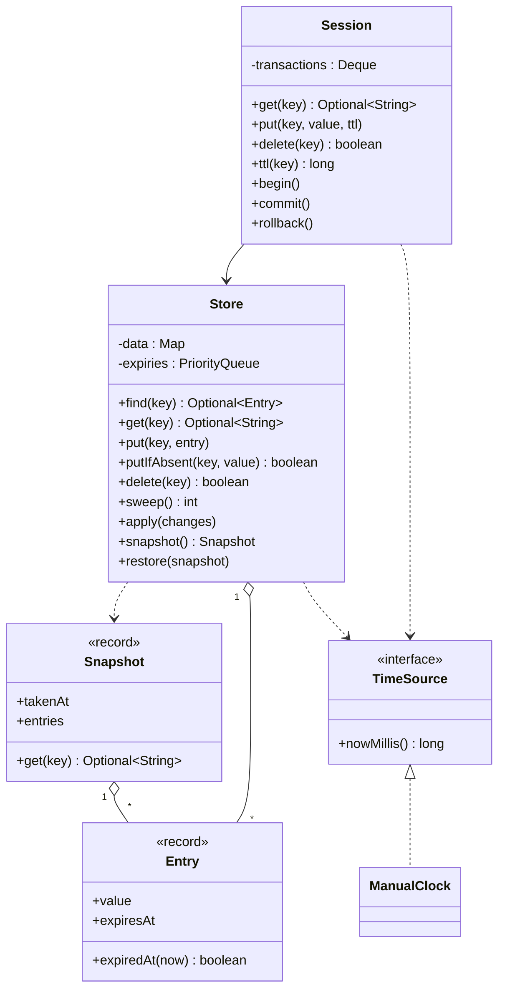
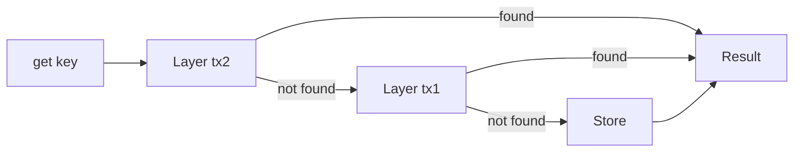

# Design an In-Memory Key-Value Store with TTL

This case study designs the classes of an in-memory key-value store: `get`, `put`, and `delete`, a time to live (TTL) on each key, nested transactions with `begin`, `commit`, and `rollback`, and point-in-time snapshots. `Main.java` in this folder runs the whole design with `java Main.java`. The page follows the procedure in [How to approach an LLD interview](../../how-to-approach-lld.md).

## Problem Statement

The interviewer says: "Design an in-memory key-value store like a small Redis. A client stores a value under a key and reads it back. A key can have a TTL: after the TTL the key does not exist. The store supports transactions: a client calls `begin`, changes keys, and then calls `commit` or `rollback`. Transactions can nest. The store can take a snapshot and go back to it later. Many threads use the store at the same time."

The problem tests three things. The first is a clean split between the storage and the rules about time. The second is the choice of how to implement a transaction. The third is correct locking. A candidate who writes only a `HashMap` wrapper has solved 20 percent of the problem.

## Clarifying Questions

Ask these questions in the first 5 minutes. Each row gives the answer that this design assumes.

| Question | Assumed answer |
|---|---|
| What are the keys and values? | Both are `String`. The design does not depend on the type. See Extensions for other value types |
| What does a TTL mean exactly? | A TTL is a duration in milliseconds. The key exists for that duration after the `put` call, and then it does not exist |
| Does a second `put` on the same key reset the TTL? | Yes. A `put` replaces the whole entry, so a `put` without a TTL makes the key permanent |
| Must an expired key leave memory at once? | No. The store must never return an expired value. The store may remove the entry later |
| How is time read? | From an injected `TimeSource`. The demo uses a manual clock, so the output is deterministic |
| What does a transaction isolate? | The writes of an open transaction are visible only to the session that owns it. Other sessions read the last committed state |
| What happens when two sessions change the same key? | The last commit wins. The store does not detect write conflicts (see Extensions for the version check) |
| Do transactions nest? | Yes. `commit` of an inner transaction merges its changes into the outer one. `rollback` discards only the inner changes |
| Does `commit` close only the innermost transaction, or all open ones? | Only the innermost one, and the same for `rollback`. Some interviewers state the other rule (one `commit` closes every open transaction). Ask, because the code differs: that rule merges all layers into one map and applies it |
| When does the TTL clock of a `put` inside a transaction start? | At the `put` call, not at the commit. The deadline is fixed when the entry is created. Redis differs: it queues the commands of a `MULTI` block and runs them at `EXEC`, so an `EXPIRE` counts from `EXEC`. Redis also has no nesting, and no rollback of commands that `EXEC` has run. `DISCARD` only drops the queue before `EXEC` |
| What does a snapshot hold? | A copy of all live keys at one moment. A snapshot is read-only. The store can restore it |
| Is there persistence? | No. Everything is in memory. The design leaves a place for it (see Extensions) |
| How many threads? | Many. Each thread uses its own session. The store is shared |
| Is there a size limit or eviction? | No. See the LRU case study `kb/lld/case-studies/02-lru-and-lfu-cache/README.md` for the eviction policies |

## Requirements

### Functional

| # | Requirement |
|---|---|
| F1 | `put(key, value)` stores a value that does not expire |
| F2 | `put(key, value, ttl)` stores a value that expires `ttl` milliseconds later. The store never returns the value after that moment |
| F3 | `get(key)` returns the value, or nothing if the key is absent or expired |
| F4 | `delete(key)` removes the key and tells the caller whether the key existed |
| F5 | `ttl(key)` returns the remaining time, `-1` for a key with no TTL, and `-2` for an absent key (the same convention as the Redis `TTL` command, which returns seconds; Redis `PTTL` returns milliseconds, as this method does) |
| F6 | Expired entries leave memory by two means: lazy expiry (when a caller reads the key) and active expiry (a `sweep` call that removes every entry that is due) |
| F7 | `begin` opens a transaction. `commit` makes its changes part of the parent transaction, or part of the store if it is the outermost. `rollback` discards its changes |
| F8 | A commit of the outermost transaction applies all its changes at once. No other thread sees half of them |
| F9 | `snapshot` returns a read-only copy of the live keys. `restore` replaces the store content with a snapshot |
| F10 | `putIfAbsent(key, value)` is one atomic step. Exactly one of many concurrent callers succeeds |

### Non-functional

| # | Requirement |
|---|---|
| N1 | Correct under concurrency: no lost updates inside one operation, no torn commit, no torn snapshot |
| N2 | Testable time: the design reads time from a `TimeSource`, so a test controls expiry |
| N3 | `get` takes O(1) expected time. `put` takes O(1) expected time without a TTL, and O(log h) time with a TTL, where h is the heap size (a heap insert). The heap can hold stale records, so h can be larger than the number of keys |
| N4 | `rollback` takes O(1) time, whatever the number of changes in the transaction |
| N5 | Open for extension: a new value type, a new eviction rule, or a write-ahead log must not change the transaction code |

## Entities and Relationships

Apply noun-verb analysis from [Domain modeling](../../fundamentals/05-domain-modeling.md) to the problem statement. Nouns: store, key, value, TTL, transaction, snapshot, client. Verbs: put, get, delete, expire, begin, commit, rollback, snapshot, restore.

| Type | Kind | Responsibility | Relationships |
|---|---|---|---|
| `Entry` | Value object (`record`) | A value and its absolute deadline `expiresAt`. A constant `DELETED` marks a delete inside a transaction | Held by `Store`, `Session`, `Snapshot` |
| `Store` | Shared object, the lock unit | The committed data, the deadline heap, lazy and active expiry, atomic commit, snapshot, restore | Has 0..* `Entry`. Uses `TimeSource` |
| `Session` | One client's view | The stack of open transactions. Reads go through the stack and then to the store. Not thread-safe | Uses `Store` and `TimeSource` |
| Transaction layer | A `Map<String, Entry>` in the session | The uncommitted changes of one `begin`. A layer is a plain map, not a class | Stacked in `Session` |
| `Snapshot` | Immutable record | A sorted copy of the live entries and the time of the copy | Created by `Store` |
| `TimeSource` | Interface | The current time in milliseconds | Used by `Store` and `Session` |
| `ManualClock` | Implementation | A clock that the demo advances by hand | Implements `TimeSource` |

!!! note "Why two classes, Store and Session"
    The store holds the committed state, and many threads share it. A transaction belongs to one client. If `begin` lived on the store, two threads would share one transaction stack, and one thread would commit the work of the other. A `Session` gives each client its own stack and keeps the `Store` free of that state. This is the same split as a database connection and a database.

## Class Diagram



Read the diagram from the left. A `Session` is the API that a client uses. It talks to one `Store`. The `Store` and the `Session` both read the time from a `TimeSource`.

A read inside nested transactions walks the layers from the newest to the oldest and then reaches the store:



If a layer holds the key, the walk stops there. A layer entry `DELETED` means "the key is gone in this transaction", so the result is absent.

## Design Patterns Used

| Pattern | Where | Why | Rejected alternative |
|---|---|---|---|
| Memento ([behavioral patterns](../../fundamentals/08-behavioral-patterns.md)) | `Snapshot` and `Store.restore` | The snapshot saves the state of the store in an object that the outside cannot change, and `restore` brings the state back. The `Store` creates and reads its own snapshot, so no caller needs the internals | A `copy()` method that returns a second live `Store`. The caller could write to the copy, and it is not a point in time |
| Overlay layers for transactions (a form of Unit of Work, see [architectural patterns](../../fundamentals/10-architectural-patterns.md)) | One `Map<String, Entry>` for each open `begin` | A write goes to the top layer only. `rollback` drops the layer in O(1). `commit` merges the layer. Other sessions never see an uncommitted write | An undo log: write to the store at once and record the old value, then replay the log backwards on `rollback`. Reads are faster, but every other session sees uncommitted data, and `rollback` is O(changes) |
| Tombstone value | `Entry.DELETED` | A delete inside a transaction must hide the key in the layers below. A missing key in the layer would mean "ask the lower layer" | Removing the key from the layer. The old value would show through |
| Dependency injection ([creational patterns](../../fundamentals/06-creational-patterns.md)) | `TimeSource` comes in through the constructor | A test controls time and needs no `sleep` | `System.currentTimeMillis()` inside the store. A test of a TTL would wait in real time |
| Immutable value objects ([design principles](../../fundamentals/03-design-principles.md)) | `Entry` and `Snapshot` are records | A reader gets a value that no thread can change. A change makes a new `Entry` | A mutable `Entry` with a `setValue`. Two sessions would share it and change it |
| Session object (one client context, like a database connection) | `Session` | Each client gets its own transaction stack. The client sees one small API, and the session hides the layer walk and the commit. `Session` is not a pure Facade, because it owns state (the stack) | `begin` and `commit` on `Store`. All threads would share one stack |
| Strategy ([behavioral patterns](../../fundamentals/08-behavioral-patterns.md)) | Not used in version 1 | No requirement asks for a choice of expiry or eviction rule. See Extensions | An `ExpiryPolicy` interface now. It adds code with no use (YAGNI) |

Two decisions need a number.

| Decision | Chosen | Cost | Alternative and its cost |
|---|---|---|---|
| How to find due entries | Min-heap of `(deadline, key, entry)` records | `put` with a TTL costs O(log n). `sweep` costs O(k log n) for k due entries. Stale records stay in the heap until their deadline | Scan all keys on each sweep: O(n) for each sweep. Redis uses a different method that samples keys with a TTL (see `kb/databases/08-redis.md`). A sample bounds the work, but it leaves some expired keys in memory |
| How to take a snapshot | Copy the live entries into a `TreeMap` | O(n log n) time (a `TreeMap` insert for each entry) and O(n) memory for each snapshot, with the store lock held | A persistent (immutable) map, for example a hash array mapped trie (HAMT): the snapshot keeps a reference to the current root, so taking it costs O(1). The cost moves to the writes: each `put` copies the path from the root to the changed leaf, O(log n) time and memory. Or copy-on-write of the whole map: the snapshot shares the map in O(1), and the first write after a snapshot copies the map in O(n). Say it in the interview, and do not build it |

## Key Code

The excerpts below are copied from `Main.java`. The file also has the demo and the `ManualClock`.

### Entry: a value with an absolute deadline

`Entry` stores the deadline as an absolute time (`expiresAt`), not as a duration. An absolute deadline makes the expiry check one comparison, and it does not change as time passes. `Entry.create` turns a TTL into a deadline and rejects a TTL that is zero or negative.

```java
record Entry(String value, long expiresAt) {
    static final long NO_TTL = -1;
    private static final long NEVER = Long.MAX_VALUE;
    static final Entry DELETED = new Entry(null, NEVER);

    static Entry create(String value, long ttlMillis, long now) {
        if (ttlMillis == NO_TTL) {
            return new Entry(value, NEVER);
        }
        if (ttlMillis <= 0) {
            throw new IllegalArgumentException("TTL must be positive: " + ttlMillis);
        }
        return new Entry(value, Math.addExact(now, ttlMillis));
    }

    boolean expiredAt(long now) {
        return expiresAt <= now;
    }

    boolean hasTtl() {
        return expiresAt != NEVER;
    }
}
```

### Store: data, heap, and lazy expiry

The store keeps the committed entries in a `HashMap` and the deadlines in a `PriorityQueue`. Every method is `synchronized`, so the store has one lock.

```java
final class Store {
    private record Expiry(long expiresAt, String key, Entry entry) { }

    private final TimeSource clock;
    private final Map<String, Entry> data = new HashMap<>();
    private final PriorityQueue<Expiry> expiries =
            new PriorityQueue<>(Comparator.comparingLong(Expiry::expiresAt));

    Store(TimeSource clock) {
        this.clock = clock;
    }

    synchronized Optional<Entry> find(String key) {
        return Optional.ofNullable(liveEntry(key));
    }

    synchronized Optional<String> get(String key) {
        return find(key).map(Entry::value);
    }

    synchronized void put(String key, Entry entry) {
        data.put(key, entry);
        if (entry.hasTtl()) {
            expiries.add(new Expiry(entry.expiresAt(), key, entry));
        }
    }
```

`liveEntry` is the one place that reads a key. It removes an expired entry and returns `null`, so no read path can return an expired value. This is lazy expiry. It costs nothing for keys that nobody reads, but those keys stay in memory. Active expiry solves that.

```java
    // Lazy expiry: an expired entry is removed when a caller reads it.
    private Entry liveEntry(String key) {
        Entry entry = data.get(key);
        if (entry != null && entry.expiredAt(clock.nowMillis())) {
            data.remove(key);
            return null;
        }
        return entry;
    }
```

### Active expiry: the sweep

`sweep` pops the heap while the head is due. A heap record can be stale: the key may have been overwritten, deleted, or already removed by a read. The check `data.get(key) == entry` compares object identity, so a stale record removes nothing. A record stays in the heap until its deadline, even if the entry is gone. This wastes memory when one key is overwritten many times with a long TTL (see Extensions).

```java
    // Active expiry: remove every entry whose deadline has passed.
    synchronized int sweep() {
        long now = clock.nowMillis();
        int removed = 0;
        while (!expiries.isEmpty() && expiries.peek().expiresAt() <= now) {
            Expiry due = expiries.poll();
            if (data.get(due.key()) == due.entry()) {   // skip stale records
                data.remove(due.key());
                removed++;
            }
        }
        return removed;
    }
```

In production, a `ScheduledExecutorService` calls `sweep` every second or so. The demo calls it by hand, so the output is deterministic.

### Session: the transaction stack

A session holds a stack of layers (`Deque`). `push` adds a layer on top, and iteration starts at the top. Without a transaction, a write goes straight to the store.

```java
// One client. A session is not thread-safe: each thread uses its own session.
final class Session {
    private final Store store;
    private final TimeSource clock;
    private final Deque<Map<String, Entry>> transactions = new ArrayDeque<>();
```

```java
    void put(String key, String value, long ttlMillis) {
        Entry entry = Entry.create(value, ttlMillis, clock.nowMillis());
        if (transactions.isEmpty()) {
            store.put(key, entry);
        } else {
            transactions.peek().put(key, entry);
        }
    }
```

`resolve` reads through the layers. The first layer that has the key decides: a `DELETED` entry or an expired entry gives "absent", and the walk does not continue to the lower layers. If no layer has the key, the store answers.

```java
    // Read through the layers: the newest transaction first, then the store.
    private Entry resolve(String key) {
        for (Map<String, Entry> layer : transactions) {
            Entry entry = layer.get(key);
            if (entry != null) {
                boolean gone = entry == Entry.DELETED || entry.expiredAt(clock.nowMillis());
                return gone ? null : entry;
            }
        }
        return store.find(key).orElse(null);
    }
```

`begin`, `commit`, and `rollback` are short because the layers are plain maps. An inner `commit` merges its map into the parent layer with `putAll`, so the newer value wins. The outermost `commit` calls `Store.apply`. `rollback` pops the layer.

```java
    void begin() {
        transactions.push(new HashMap<>());
    }

    void commit() {
        Map<String, Entry> top = popOrThrow();
        if (transactions.isEmpty()) {
            store.apply(top);
        } else {
            transactions.peek().putAll(top);
        }
    }

    void rollback() {
        popOrThrow();
    }

    int depth() {
        return transactions.size();
    }
```

### Atomic commit, snapshot, and restore

`apply` runs inside the store lock. It applies every change of a transaction in one critical section, so another thread sees either none or all of them. A change that is `DELETED` or already expired removes the key.

```java
    // Commit: apply all changes of a transaction in one critical section.
    synchronized void apply(Map<String, Entry> changes) {
        long now = clock.nowMillis();
        for (Map.Entry<String, Entry> change : changes.entrySet()) {
            Entry entry = change.getValue();
            if (entry == Entry.DELETED || entry.expiredAt(now)) {
                data.remove(change.getKey());
            } else {
                put(change.getKey(), entry);
            }
        }
    }
```

`snapshot` copies the live entries under the same lock, so a snapshot is a consistent view. `restore` clears the store and the heap and puts the snapshot entries back.

```java
    synchronized Snapshot snapshot() {
        long now = clock.nowMillis();
        SortedMap<String, Entry> copy = new TreeMap<>();
        for (Map.Entry<String, Entry> e : data.entrySet()) {
            if (!e.getValue().expiredAt(now)) {
                copy.put(e.getKey(), e.getValue());
            }
        }
        return new Snapshot(now, copy);
    }

    synchronized void restore(Snapshot snapshot) {
        long now = clock.nowMillis();
        data.clear();
        expiries.clear();
        for (Map.Entry<String, Entry> e : snapshot.entries().entrySet()) {
            if (!e.getValue().expiredAt(now)) {
                put(e.getKey(), e.getValue());
            }
        }
    }
```

## Concurrency

### What can race

| Shared state | Broken sequence | Invariant | Fix in this design |
|---|---|---|---|
| A key | `if (!exists(k)) put(k, v)` from two threads | `putIfAbsent` has one winner | `putIfAbsent` is one `synchronized` method |
| The data map and the heap | One thread `put`s while another `sweep`s | The map and the heap agree | Every `Store` method takes the one store lock |
| A commit | A reader sees `a` after the commit and `b` before it | All changes of a transaction appear together (F8) | `apply` writes all changes under the store lock. A reader that uses `snapshot` takes the same lock |
| A multi-key read | `get(a)` then `get(b)` while a commit runs between the calls | A consistent pair | Two separate `get` calls are not atomic. Use `snapshot` for a consistent read of several keys |
| The transaction stack | Two threads use one `Session` | One owner for each stack | A session is not thread-safe. Each thread creates its own. This is a rule of use, not a lock |
| Time | A clock that moves back | Deadlines stay valid | Use a monotonic `TimeSource` in production, for example one built on `System.nanoTime()`. Its javadoc defines it for elapsed time only, not tied to the wall clock. `System.currentTimeMillis()` follows the wall clock, so it jumps when an operator or NTP changes the system time |

### The fix: one lock for the store

Every public method of `Store` is `synchronized`. The critical sections are short: map and heap operations with no I/O. One lock keeps the design easy to reason about, and it makes `apply`, `snapshot`, and `restore` atomic at no extra cost. See the lock granularity table in [Concurrency in LLD](../../fundamentals/09-concurrency-in-lld.md).

| Choice | Result |
|---|---|
| One lock for the store (this design) | Correct and simple. All operations wait for each other. A `snapshot` of a large store holds the lock for O(n) time |
| `ConcurrentHashMap` and no store lock | Single-key reads and writes scale. But `apply` (many keys) and `snapshot` are not atomic, and the heap needs its own lock. A reader can see half a commit |
| Striped locks (a lock for each group of keys) | `get` and `put` on different groups run in parallel. A commit must take every lock that it touches in a fixed order to avoid deadlock, and a snapshot must take all of them |
| `ReadWriteLock` | Many readers in parallel. But `get` writes (lazy expiry removes the entry), so a read is not read-only here. The gain is small |

Recommendation: start with one lock and say so. Then say: "If the lock is a bottleneck, I stripe the keys and lock the stripes in index order for a multi-key commit." Do not build the striped version unless the interviewer asks.

The demo shows two guarantees with threads. Eight threads call `putIfAbsent("leader", ...)` after a `CountDownLatch` releases them together. Exactly one wins. Then a writer thread commits 300 transactions, each setting `a` and `b` to the same number. Two reader threads take 300 snapshots each and count the snapshots where `a` is different from `b`. The count is 0, because `apply` and `snapshot` use the same lock.

```java
        AtomicInteger winners = new AtomicInteger();
        CountDownLatch go = new CountDownLatch(1);
        Thread[] candidates = new Thread[8];
        for (int i = 0; i < candidates.length; i++) {
            String name = "node-" + i;
            candidates[i] = new Thread(() -> {
                await(go);
                if (store.putIfAbsent("leader", name)) {
                    winners.incrementAndGet();
                }
            });
            candidates[i].start();
        }
        go.countDown();
        for (Thread t : candidates) {
            t.join();
        }
        String leader = store.get("leader").orElseThrow();
        System.out.println("putIfAbsent winners among 8 threads: " + winners.get()
                + ", leader is a candidate: " + leader.startsWith("node-"));
```

```java
        AtomicInteger torn = new AtomicInteger();
        Thread writer = new Thread(() -> {
            Session w = new Session(store, clock);
            for (int i = 1; i <= 300; i++) {
                w.begin();
                w.put("a", String.valueOf(i));
                w.put("b", String.valueOf(i));
                w.commit();
            }
        });
        Thread[] readers = new Thread[2];
        for (int i = 0; i < readers.length; i++) {
            readers[i] = new Thread(() -> {
                for (int n = 0; n < 300; n++) {
                    Snapshot snap = store.snapshot();
                    if (!snap.get("a").equals(snap.get("b"))) {
                        torn.incrementAndGet();
                    }
                }
            });
        }
        writer.start();
        for (Thread t : readers) {
            t.start();
        }
        writer.join();
        for (Thread t : readers) {
            t.join();
        }
        System.out.println("Torn snapshots (a differs from b): " + torn.get());
        System.out.println("Final a=" + store.get("a").orElseThrow() + ", b="
                + store.get("b").orElseThrow());
```

The output does not depend on the schedule. Each line prints a count that the lock fixes: one winner, zero torn snapshots, and the final value 300.

### Why `get` writes

`get` can remove an expired entry, so it changes the map. A `ReadWriteLock` with a read lock for `get` would race with that removal. The design takes the full lock for `get`. If reads must run in parallel, the lazy removal moves out of `get`: `get` only checks the deadline, and `sweep` does all the removals.

### Isolation level of a session

The precise term is **read committed**. An isolation level is the set of anomalies (wrong results from interleaved transactions) that the store prevents. This design prevents two of them:

- **Dirty read** (a session reads a value that another transaction has not committed): uncommitted writes stay in the layers of their own session.
- **Dirty write** (a transaction overwrites an uncommitted value of another transaction): the store holds only committed values. Two paths write to it, `apply` for a commit and `Store.put` or `Store.delete` for a write outside a transaction. Both run under the store lock, one after the other.

A read that no layer answers goes to the store and gets the newest committed value, even if another session committed after `begin`. So the session does not read from a fixed point in time, and these anomalies are possible:

| Anomaly | Example with sessions A and B | Result |
|---|---|---|
| Lost update | `n` is 5. A and B each `begin`, `get("n")` (5), and `put("n", "6")`. A commits, then B commits | `n` is 6, not 7. B's commit overwrites A's commit with no check (the last commit wins) |
| Non-repeatable read | A reads `x` (1). B commits `x = 2`. A reads `x` again | A gets 2. Two reads of one key in one transaction differ |
| Read skew | `a` and `b` must be equal. A reads `a` (1). B commits `a = 2, b = 2`. A reads `b` | A sees `a = 1, b = 2`, a pair that never existed. Use `snapshot` for a consistent multi-key read |
| Write skew | A reads `a` and writes `b`. B reads `b` and writes `a`. Both commit | A rule that involves both keys can break. Neither commit touches the key that the other one wrote |

The design is not snapshot isolation. Under snapshot isolation, a transaction reads from the state at `begin`, and the second of two concurrent writers of one key aborts (first committer wins). That rule prevents the lost update, the non-repeatable read, and the read skew, but not the write skew. The version check in Extensions adds optimistic concurrency control: `apply` checks, under the store lock, that no key that the session read has a new version (a key that the session found absent counts as a read too). The version must come from one store-wide counter that every write path stamps (commit, `put`, `delete`, and an expiry). A per-entry counter is not enough: it restarts when a key is deleted and created again, so a changed key can show its old version number. With the store-wide stamp, the transactions that commit are serializable (their commit order is a valid serial order), so the check also prevents the write skew. See `kb/databases/04-transactions-and-isolation.md` for the isolation levels.

### More than one server

The locks protect one JVM. For many servers the store needs a partition by key (consistent hashing) and replication. That is a distributed design problem: see the HLD case study `kb/hld/case-studies/03-key-value-store.md`.

## Extensions

Each row names the classes to add, the classes to change, and the classes that stay.

| Change | Add | Change | Stay |
|---|---|---|---|
| Typed values (counters, lists, hashes) | A `Value` sealed interface with `StringValue`, `ListValue`, and so on. Commands such as `incrementBy` | `Entry.value` becomes `Value`. `Store` gets `compute(key, fn)` that runs the function under the lock | `TimeSource`, `Session` layers, `Snapshot` |
| Evict the least recently used key when the store is full | An `EvictionPolicy` interface (Strategy) and `LruEviction`. See `kb/lld/case-studies/02-lru-and-lfu-cache/README.md` | `Store.put` asks the policy after it writes. `Store.liveEntry` tells the policy about each read | `Entry`, `Session`, `Snapshot` |
| A background sweeper | `ExpirySweeper` that owns a `ScheduledExecutorService` and calls `store.sweep()` at a fixed delay. It has `start` and `close` | Nothing in `Store`. `sweep` is already thread-safe | `Entry`, `Session`, all demos |
| Write-ahead log and recovery | A `WriteAheadLog` interface and `FileLog` (a log of `put` and `delete` records). A `recover` method that replays the log | `Store.put`, `delete`, and `apply` append to the log before they change the map. A snapshot becomes a checkpoint that lets the log shrink | `Session`, `Entry`, `TimeSource`. See `kb/databases/06-storage-engines.md` for the log idea |
| Conflict detection (optimistic locking) | A `long version` in `Entry`, taken from one store-wide counter that every write increments. A `ConflictException` | A `Session` records the version of each key that it reads (0 for an absent key, and the store also stamps a delete). `Store.apply` checks the versions inside the lock and rejects the commit if one changed. See the version number section in [Concurrency in LLD](../../fundamentals/09-concurrency-in-lld.md) | `TimeSource`, `Snapshot`, the layer maps |
| Stale heap records pile up | None | `Store` counts stale records. When they exceed half of the heap, it rebuilds the heap from `data`. Or it uses a `TreeSet` ordered by (deadline, key), so an overwrite removes the old record in O(log n) | `Session`, `Entry` |
| Watch a key (notify on change) | A `Listener` interface (Observer) | `Store.apply` and `put` collect the changed keys inside the lock and call the listeners after the lock is released | `Session` layers, `Snapshot` |
| Cheaper snapshots | A persistent map (for example a hash array mapped trie) in place of `HashMap` | `Store.data`, `snapshot`, and `restore`. A snapshot becomes a reference to the old root, taken in O(1). Each `put` becomes O(log n) for the path copy. The old root still holds entries that expired before the snapshot, so `Snapshot.get` and `keys` filter by `expiredAt(takenAt)`, and `restore` rebuilds the heap from the restored root | `Session`, `Entry`, `TimeSource` |

## Common Mistakes

| Mistake | Why it fails | Fix |
|---|---|---|
| Store the TTL as a duration and compare it with the age | The entry needs a second field, the creation time, and each check does arithmetic | Store one absolute `expiresAt` |
| Check expiry in `get` only | `delete`, `putIfAbsent`, `ttl`, and `snapshot` return wrong answers for an expired key | One private `liveEntry` method that every path uses |
| Only a background thread removes expired keys | A key lives a little past its deadline, and a test needs `sleep` | Lazy expiry makes the answer exact. The thread only frees memory |
| Only lazy expiry | A key that nobody reads stays in memory for ever | Add active expiry (a sweep) |
| Scan all keys in the sweep | O(n) for each run, with the lock held | A min-heap of deadlines, so a sweep touches only due keys |
| Remove the key when a heap record is due, with no check | An overwritten key loses its new value | Compare the heap record with the current entry |
| `System.currentTimeMillis()` inside the store | The test cannot control time | Inject a `TimeSource` |
| Copy the whole store on `begin` | O(n) for each `begin`, and the copy hides concurrent commits | Keep one layer of changes for each `begin` |
| Write through to the store and keep an undo log, with no isolation | Other sessions see uncommitted data. If the client thread dies before `commit` or `rollback`, the dirty data stays in the store | Layers, or a lock that is held for the whole transaction |
| Delete a key in a transaction by removing it from the layer | The older value in the lower layer shows through | Write a tombstone (`DELETED`) |
| `commit` of an inner transaction writes to the store | The outer `rollback` can no longer undo it | Merge into the parent layer. Only the outermost commit reaches the store |
| Two threads share one `Session` | The stack of layers is shared. One thread commits the work of the other | One session for each client or thread |
| Read several keys with several `get` calls and expect one consistent view | A commit can run between the calls | Use `snapshot` for a consistent read |
| `if (get(k) == null) put(k, v)` | Check-then-act race | An atomic `putIfAbsent` |
| A mutable `Entry` or a `Snapshot` that exposes the live map | The caller changes state without the lock | Records, and a copy made under the lock |

## 45-Minute Plan

| Minutes | Part | What to say or draw |
|---|---|---|
| 0-5 | Clarify | The questions above, mainly: what a TTL means, lazy and active expiry, transaction isolation, nesting, thread count. Write the assumptions |
| 5-10 | Entities and use cases | `Store`, `Entry`, `Session`, `Snapshot`, `TimeSource`. Say why a session and a store are two classes. List the operations |
| 10-17 | Class diagram | Draw the classes above. Draw the layer walk. Explain the overlay against the undo log, and the heap against the scan |
| 17-22 | Signatures | The methods of `Session` and `Store`. Say which ones are atomic |
| 22-34 | Code | Write `Entry`, `Store.put`, `liveEntry`, `sweep`. Then `Session.resolve`, `begin`, `commit`, `rollback`. Skip snapshot until the end |
| 34-40 | Concurrency | One store lock. `putIfAbsent` against check-then-act. Atomic `apply`. A session is one thread. Say how you would stripe |
| 40-45 | Extensions | Eviction (Strategy), write-ahead log, optimistic version check, a background sweeper |

If you run short on time, cut the snapshot and the typed values. Keep the TTL with lazy expiry, the layered transactions, and the lock. Those three are what the interviewer scores.

## Expected Output

The program prints the text below. The clock is a `ManualClock`, so every expiry is deterministic. The program joins all threads before it prints their results, and it prints only results that do not depend on the schedule.

<!-- expected-output -->
```text
== Get, put, delete ==
get name: ada
get city: <absent>
delete name: true
delete name again: false
== Lazy expiry ==
ttl token: 5000 ms
after 3000 ms: ttl 2000 ms, get t-1
after 5000 ms: ttl -2, get <absent>
entries held in memory: 0
== Active expiry ==
entries held before sweep: 4
sweep removed: 2
entries held after sweep: 2
sweep removed: 1, live keys: [d]
== Overwrite resets the TTL ==
sweep removed: 0, get k: v2
== Nested transactions ==
inside tx1: x=2, y=1, depth 1
other session: x=1, y=<absent>
inside tx2: x=<absent>, depth 2
after tx2 rollback: x=2
after tx1 commit: other session x=2, y=1
tx4 merged into tx3: z=9, other session z=<absent>
after tx3 rollback: x=2, z=<absent>
commit with no transaction: No open transaction
key that expired inside the tx: <absent>
== Snapshots ==
snapshot keys: [d, k, x, y], x=2
live keys now: [d, k, w, x], x=changed
after restore: [d, k, x, y], x=2, y=1
== Concurrency ==
putIfAbsent winners among 8 threads: 1, leader is a candidate: true
Torn snapshots (a differs from b): 0
Final a=300, b=300
```

## Sources

- [Redis `EXPIRE` command, section "How Redis expires keys"](https://redis.io/docs/latest/commands/expire/): the passive expiry on access and the active expiry that samples keys with a TTL.
- [Redis `TTL` command](https://redis.io/docs/latest/commands/ttl/): the return values -2 (no key) and -1 (no expiry). [`PTTL`](https://redis.io/docs/latest/commands/pttl/) returns the same values in milliseconds.
- [Redis transactions](https://redis.io/docs/latest/develop/using-commands/transactions/): `MULTI` queues commands, `EXEC` runs them, `DISCARD` drops the queue, and Redis does not roll back commands that ran.
- [`System.nanoTime()` javadoc, Java SE 21](https://docs.oracle.com/en/java/javase/21/docs/api/java.base/java/lang/System.html#nanoTime()): a time source for elapsed time, not for wall-clock time.
- [H. Berenson et al., "A Critique of ANSI SQL Isolation Levels", SIGMOD 1995](https://www.microsoft.com/en-us/research/publication/a-critique-of-ansi-sql-isolation-levels/): the definitions of dirty write, lost update, read skew, write skew, and snapshot isolation.
- [PostgreSQL documentation, "Transaction Isolation"](https://www.postgresql.org/docs/current/transaction-iso.html): which anomalies each isolation level allows in a real database.
