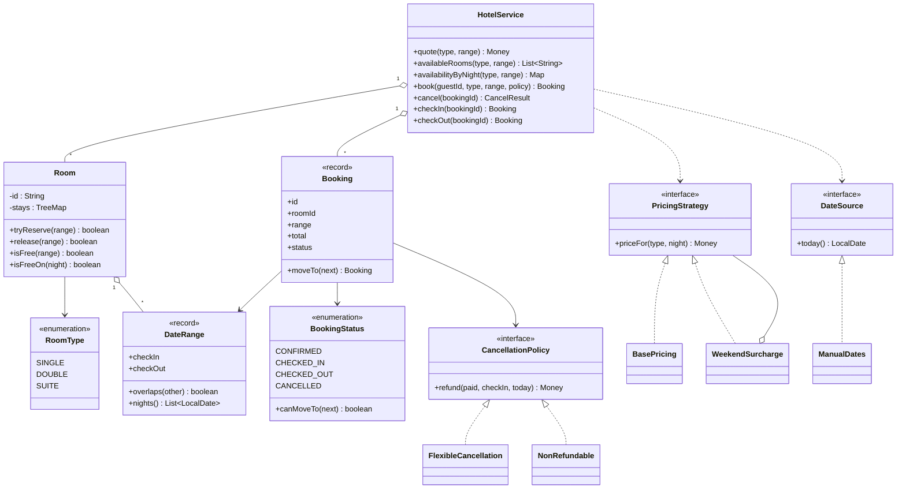
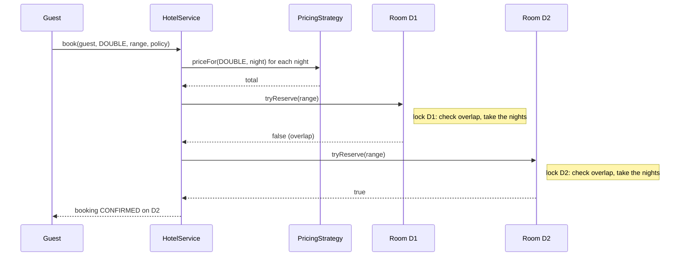
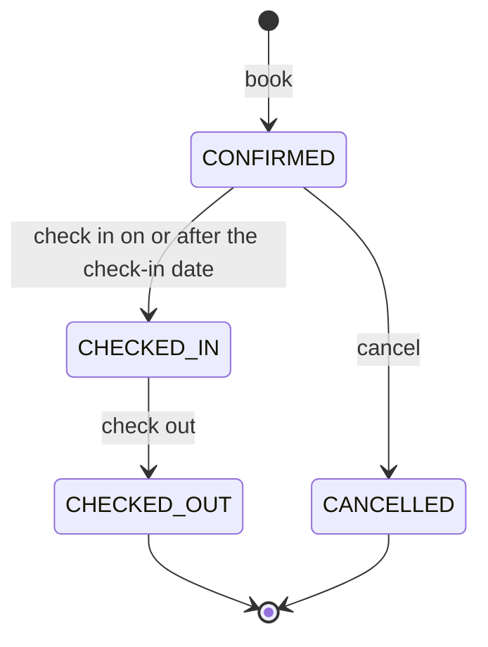

# Design a Hotel Booking System

This case study designs the classes behind a hotel booking system: room types, availability for a range of dates, a booking that must not double-book a room, a cancellation policy, and pricing. The hard part is concurrency: two guests must not get the same room for overlapping nights. `Main.java` in this folder runs the whole design with `java Main.java`. The page follows the procedure in [How to approach an LLD interview](../../how-to-approach-lld.md).

## Problem Statement

The interviewer says: "Design a hotel booking system. A hotel has rooms of different types: single, double, suite. A guest searches for a room type and a range of dates, sees the price, and books. Two guests must not get the same room on the same night. A guest can cancel, and the refund depends on how early the guest cancels. The price changes with the day of the week."

This problem looks like the movie ticket problem, but it has two differences. A seat is taken for one show, and a room is taken for a range of nights, so the conflict test is an overlap test on intervals. A hotel also has no seat hold with a timer. See [Movie ticket booking](../05-movie-ticket-booking/README.md) for the hold with an expiry, and [Concurrency in LLD](../../fundamentals/09-concurrency-in-lld.md) for the tools.

## Clarifying Questions

Ask these questions in the first 5 minutes. Each row gives the answer that this design assumes.

| Question | Assumed answer |
|---|---|
| One hotel or many? | One hotel. See Extensions for many properties |
| What does the guest book? | A room type and a range of dates. The system picks a physical room |
| How is a range of dates read? | The guest sleeps the nights from check-in up to, but not including, the check-out date. A guest who checks out on the 12th and a guest who checks in on the 12th can use the same room |
| Which room does the system pick? | The first free room of that type, in room id order. The order is string order, so `D10` comes before `D2`. Give ids a fixed width (`D02`) if the order matters. In one thread this rule is deterministic, and a strategy can replace it (see Extensions) |
| Is there a payment step? | No. A booking is `CONFIRMED` at once. Payment and a hold with a timer are in Extensions |
| How is the price computed? | The sum of the price of each night. The price of a night depends on the room type and on the day of the week: Friday and Saturday nights cost 25 percent more |
| What does cancellation refund? | It depends on a policy that the guest picks at booking. The demo has two: flexible (full refund 3 or more days before check-in, 50 percent 1 or 2 days before, nothing later) and non-refundable |
| Can a guest cancel after check-in? | No |
| How is the current date read? | From an injected `DateSource`. The demo uses a manual date, so the output is deterministic |
| Many threads? | Yes. Many guests book at the same time in one JVM |
| Money? | A `long` in minor units (cents). Never `double` |
| Storage? | In memory |

## Requirements

### Functional

| # | Requirement |
|---|---|
| F1 | A guest asks for the free rooms of a type for a range of dates, and for the number of free rooms on each night |
| F2 | A guest asks for the price of a stay before booking |
| F3 | A guest books a room type for a range of dates. The system assigns a free room, or it rejects the request |
| F4 | A room has at most one booking on any night (no double booking) |
| F5 | A booking cannot start in the past |
| F6 | A guest cancels a confirmed booking. The room becomes free for those nights. The cancellation policy of the booking decides the refund |
| F7 | A booking moves through `CONFIRMED`, `CHECKED_IN`, `CHECKED_OUT`, and `CANCELLED`. Only the legal moves are allowed |
| F8 | The price rule and the cancellation rule are replaceable without a change in the booking code |

### Non-functional

| # | Requirement |
|---|---|
| N1 | Correct under concurrency: no double booking, one refund for each cancellation |
| N2 | Testable time: the design reads the date from an injected `DateSource` |
| N3 | The overlap check takes O(log s) time for a room with s stays |
| N4 | A room has its own lock. A booking takes one room lock at a time, so a deadlock between rooms is not possible |
| N5 | Open for extension: a new price rule, refund rule, or room choice rule is a new class |

## Entities and Relationships

Apply noun-verb analysis from [Domain modeling](../../fundamentals/05-domain-modeling.md) to the problem statement. Nouns: hotel, room, room type, guest, date range, booking, price, policy. Verbs: search, book, cancel, check in, check out, price.

| Type | Kind | Responsibility | Relationships |
|---|---|---|---|
| `RoomType` | Enum | `SINGLE`, `DOUBLE`, `SUITE`. A type has no behavior of its own, so an enum is enough | Used by `Room`, `Booking`, `PricingStrategy` |
| `Room` | Entity, the lock unit | One physical room. It owns its calendar (a sorted map of stays) and its lock. `tryReserve` checks and takes the nights in one step | Has 0..* `DateRange` |
| `DateRange` | Value object (`record`) | A check-in date and a check-out date. It knows `overlaps` and `nights` | Used by `Room`, `Booking` |
| `Booking` | Immutable record with a status | One guest, one room, a range, a total, a policy, a status | Refers to a room by id. Holds a `CancellationPolicy` |
| `BookingStatus` | Enum with a transition rule | `CONFIRMED`, `CHECKED_IN`, `CHECKED_OUT`, `CANCELLED` | Used by `Booking` |
| `HotelService` | Facade | The public API: search, quote, book, cancel, check in, check out. It runs the flow across rooms and bookings | Has 1..* `Room`. Has 0..* `Booking` |
| `PricingStrategy` | Interface (Strategy) | The price of one night | Used by `HotelService` |
| `BasePricing`, `WeekendSurcharge` | Implementations | A rate for each room type. A decorator that adds a percentage on Friday and Saturday nights | Implement `PricingStrategy`. `WeekendSurcharge` wraps another one |
| `CancellationPolicy` | Interface (Strategy) | The refund for a cancellation on a given day | Held by `Booking` |
| `FlexibleCancellation`, `NonRefundable` | Implementations | The two demo policies | Implement `CancellationPolicy` |
| `DateSource` | Interface | The current date | Used by `HotelService` |
| `Money` | Value object | An amount in minor units (`long`) | Used by `Booking`, `PricingStrategy`, `CancellationPolicy` |

!!! note "Where the calendar lives"
    The calendar of a room (which nights are taken) belongs to the **room**, not to the booking and not to a shared table. The invariant "no two stays of one room overlap" involves one room only, so one object and one lock can own it. A booking is a record of what happened. The room is the object that says whether a night is free.

The central decision: each `Room` guards its own calendar with its own lock. Section "Concurrency" gives the reasons and the alternatives.

## Class Diagram



Read the diagram from the top. `HotelService` is the only class that a caller needs. `Room` holds the calendar and the lock. The three interfaces are the points where a test or a new rule plugs in.

The booking flow takes one room lock at a time. The loop tries the rooms in id order, and the first room that accepts the range wins:



The booking moves through these states. `BookingStatus.canMoveTo` implements the arrows.



## Design Patterns Used

| Pattern | Where | Why | Rejected alternative |
|---|---|---|---|
| Strategy ([behavioral patterns](../../fundamentals/08-behavioral-patterns.md)) | `PricingStrategy` and `CancellationPolicy` | The interviewer changes the price rule and the refund rule. A new rule is a new class. The guest picks the cancellation policy at booking, so each `Booking` holds its own policy object | An `if` on the day of the week in `quote` and an `if` on the days before check-in in `cancel`. Each new rule changes tested code (breaks the open-closed principle, see [SOLID](../../fundamentals/02-solid.md)) |
| Decorator ([structural patterns](../../fundamentals/07-structural-patterns.md)) | `WeekendSurcharge` wraps any `PricingStrategy` | Price rules stack: base rate, then weekend, then season, then a discount. Each rule is one small class, and the order is set in the wiring | One `SeasonalWeekendDiscountPricing` class for every combination. The number of classes grows with the number of combinations |
| Facade ([structural patterns](../../fundamentals/07-structural-patterns.md)) | `HotelService` | The caller needs one entry point for each use case. The service runs the flow across rooms and bookings | The caller calls rooms, pricing, and policies itself |
| Enum with a transition table (a light State) | `BookingStatus.canMoveTo` | The status only guards the legal moves. The booking does not behave differently in each status | The full State pattern, with one class for each status. It adds four classes for one `switch` |
| Dependency injection ([creational patterns](../../fundamentals/06-creational-patterns.md)) | `PricingStrategy` and `DateSource` come in through the constructor | A test controls the date and the price rule | `LocalDate.now()` inside the service. A test of "cancel 2 days before" would depend on the real date |
| Immutable value objects ([OOP](../../fundamentals/01-oop.md)) | `Booking`, `DateRange`, and `Money` are records | A reader gets a snapshot that no thread can change. A status change makes a new `Booking` | A mutable `Booking` with `setStatus`. Two threads could change it at once |
| Aggregate as the lock unit ([domain modeling](../../fundamentals/05-domain-modeling.md)) | `Room` owns its calendar and its lock | The invariant "no overlap" involves one room, so one object owns it | One global lock, or a table of nights that every thread locks |
| Observer | Not used in version 1 | No requirement asks for a notification | A listener list now. It adds code with no use. See Extensions |

One modeling decision needs a comparison. A hotel can track inventory in two ways:

| Approach | How it works | Strength | Weakness |
|---|---|---|---|
| Room calendar (this design) | Each physical room has a sorted map of its stays. A booking takes one room | Simple invariant. A booking needs one lock. The guest knows the room, and room-specific rules (floor, view) fit | The system picks a room at booking time, so a later booking may fail for want of a contiguous free room, though the type has enough free nights in total (fragmentation) |
| Counters for each room type and night | A table `(type, night) -> free count`. A booking decrements the count of each night | No fragmentation. The counters accept a booking if no night has more bookings than rooms of the type. For stays (intervals), that condition is enough: the minimum number of rooms that holds all stays equals the largest number of stays on one night. Giving each guest any free room at check-in, in check-in order, reaches that minimum. This needs interchangeable rooms: a maintenance block on one specific room breaks it. The system assigns a room at check-in. Booking sites sell this way: the guest books a room type, not a room number | A booking for 3 nights must change 3 counters as one step. Either one lock for the type covers all 3 decrements, or the code decrements the counters one by one and adds back the ones already taken if one count is 0 (a compensation). Room-specific rules need a second model |

Recommendation: draw the room calendar in the interview, because it gives a simple lock. Then say that a real booking site sells room types, and describe the counter model.

## Key Code

The excerpts below are copied from `Main.java`. The file also has the demo, `ManualDates`, and `BookingException`.

### Money, DateRange, and the booking state machine

`Money` holds a `long` in minor units (cents). Do not use `double` for money. `percent` rounds down to a whole minor unit.

```java
record Money(long minor) {
    static final Money ZERO = new Money(0);

    Money {
        if (minor < 0) {
            throw new IllegalArgumentException("Money cannot be negative");
        }
    }

    Money plus(Money other) {
        return new Money(Math.addExact(minor, other.minor));
    }

    // Rounds down to a whole minor unit.
    Money percent(int percent) {
        return new Money(minor * percent / 100);
    }

    @Override
    public String toString() {
        return String.format(Locale.ROOT, "%d.%02d", minor / 100, minor % 100);
    }
}
```

`DateRange` is a half-open interval: the check-in night counts and the check-out date does not. Two ranges overlap if each one starts before the other one ends. This test is the heart of the problem, and the half-open form handles "check out on the 12th, check in on the 12th" without a special case.

```java
// A stay: the guest sleeps the nights from checkIn up to, but not including, checkOut.
record DateRange(LocalDate checkIn, LocalDate checkOut) {
    DateRange {
        if (!checkOut.isAfter(checkIn)) {
            throw new IllegalArgumentException("Check-out must be after check-in");
        }
    }

    boolean overlaps(DateRange other) {
        return checkIn.isBefore(other.checkOut) && other.checkIn.isBefore(checkOut);
    }

    List<LocalDate> nights() {
        return checkIn.datesUntil(checkOut).toList();
    }

    @Override
    public String toString() {
        return checkIn + ".." + checkOut;
    }
}
```

The status enum holds the transition rule. `Booking` is an immutable record, and `moveTo` returns a new `Booking` or throws.

```java
enum BookingStatus {
    CONFIRMED, CHECKED_IN, CHECKED_OUT, CANCELLED;

    boolean canMoveTo(BookingStatus next) {
        return switch (this) {
            case CONFIRMED -> next == CHECKED_IN || next == CANCELLED;
            case CHECKED_IN -> next == CHECKED_OUT;
            case CHECKED_OUT, CANCELLED -> false;
        };
    }
}

record Booking(String id, String guestId, String roomId, RoomType type, DateRange range,
               Money total, CancellationPolicy policy, BookingStatus status) {
    Booking moveTo(BookingStatus next) {
        if (!status.canMoveTo(next)) {
            throw new BookingException(
                    "Booking " + id + " cannot move from " + status + " to " + next);
        }
        return new Booking(id, guestId, roomId, type, range, total, policy, next);
    }

    String describe() {
        return id + " " + guestId + " " + roomId + " " + range + " " + status + " " + total;
    }
}
```

### The two Strategy interfaces and the Decorator

The price of a stay is the sum of the price of each night. `WeekendSurcharge` is a Decorator: it wraps another `PricingStrategy` and adds a percentage on Friday and Saturday nights.

```java
interface PricingStrategy {
    Money priceFor(RoomType type, LocalDate night);
}

final class BasePricing implements PricingStrategy {
    private final Map<RoomType, Money> nightlyRate;

    BasePricing(Map<RoomType, Money> nightlyRate) {
        this.nightlyRate = new EnumMap<>(nightlyRate);
    }

    @Override
    public Money priceFor(RoomType type, LocalDate night) {
        return nightlyRate.get(type);
    }
}

// Decorator: adds a percentage on Friday and Saturday nights to any other strategy.
final class WeekendSurcharge implements PricingStrategy {
    private final PricingStrategy inner;
    private final int surchargePercent;

    WeekendSurcharge(PricingStrategy inner, int surchargePercent) {
        this.inner = inner;
        this.surchargePercent = surchargePercent;
    }

    @Override
    public Money priceFor(RoomType type, LocalDate night) {
        Money base = inner.priceFor(type, night);
        DayOfWeek day = night.getDayOfWeek();
        boolean weekend = day == DayOfWeek.FRIDAY || day == DayOfWeek.SATURDAY;
        return weekend ? base.plus(base.percent(surchargePercent)) : base;
    }
}
```

A cancellation policy decides the refund from the amount paid, the check-in date, and today. The service passes the date in, so the policy has no clock of its own.

```java
interface CancellationPolicy {
    Money refund(Money paid, LocalDate checkIn, LocalDate today);
}

final class FlexibleCancellation implements CancellationPolicy {
    @Override
    public Money refund(Money paid, LocalDate checkIn, LocalDate today) {
        long daysBefore = ChronoUnit.DAYS.between(today, checkIn);
        if (daysBefore >= 3) {
            return paid;
        }
        return daysBefore >= 1 ? paid.percent(50) : Money.ZERO;
    }
}

final class NonRefundable implements CancellationPolicy {
    @Override
    public Money refund(Money paid, LocalDate checkIn, LocalDate today) {
        return Money.ZERO;
    }
}

record CancelResult(Booking booking, Money refund) { }
```

### Room: the calendar and the lock

`Room` keeps its stays in a `TreeMap` sorted by check-in date. The stays of one room never overlap, so the overlap test needs one lookup: `lowerEntry(checkOut)`, the last stay that starts strictly before the new check-out. If that stay ends after the new check-in, the ranges overlap. If it does not, the new range is free. The cost is O(log s).

Proof that one lookup is enough, for a new range `[in, out)`:

1. A stay that starts on or after `out` cannot overlap, because the new range ends on or before the day that stay starts. So only stays that start before `out` matter.
2. The stays do not overlap, so if stay P starts before stay Q, P also ends on or before the start of Q. Among the stays that start before `out`, the last one, L, therefore has the latest check-out.
3. If L ends on or before `in`, every earlier stay also ends on or before `in`, and no stay overlaps. If L ends after `in`, L overlaps, because L also starts before `out`.

Two edge cases follow from the half-open ranges. A stay that ends on the new check-in day (L ends on `in`) does not block: `!checkOut.isAfter(in)` is true. In the demo, carol books D1 from the 13th, the day alice checks out of D1, and gets it. A stay that starts on the new check-out day does not block either, because `lowerEntry` is strictly less than `out`. With `floorEntry`, that stay would be found and would wrongly reject the request. Check-in dates are unique keys in one room, because two stays that start on the same day overlap.

`tryReserve` checks and takes the nights in one `synchronized` method. This one method is the answer to the double booking.

```java
// One physical room. The room owns its calendar and its lock.
final class Room {
    private final String id;
    private final RoomType type;
    private final TreeMap<LocalDate, DateRange> stays = new TreeMap<>();   // by check-in

    Room(String id, RoomType type) {
        this.id = id;
        this.type = type;
    }

    String id() {
        return id;
    }

    RoomType type() {
        return type;
    }

    // Check and take in one step: this method is the answer to the double booking.
    synchronized boolean tryReserve(DateRange range) {
        if (!isFree(range)) {
            return false;
        }
        stays.put(range.checkIn(), range);
        return true;
    }

    synchronized boolean release(DateRange range) {
        return stays.remove(range.checkIn(), range);
    }

    synchronized boolean isFree(DateRange range) {
        // The stays do not overlap, so only the last stay that starts before our
        // check-out can reach into our range.
        Map.Entry<LocalDate, DateRange> last = stays.lowerEntry(range.checkOut());
        return last == null || !last.getValue().checkOut().isAfter(range.checkIn());
    }

    synchronized boolean isFreeOn(LocalDate night) {
        Map.Entry<LocalDate, DateRange> last = stays.floorEntry(night);
        return last == null || !last.getValue().checkOut().isAfter(night);
    }
}
```

### HotelService: search, book, cancel

The service builds its room lists once in the constructor, in room id order. After that, `roomsByType` and `roomsById` are never changed. Threads read them without a lock, and that is safe for two reasons: both fields are `final`, so every thread sees the maps as the constructor left them (JLS 17.5), and the demo starts its threads after the constructor returns (`Thread.start` happens-before every action of the new thread). `bookings` is a `ConcurrentHashMap`.

```java
final class HotelService {
    private final Map<RoomType, List<Room>> roomsByType = new EnumMap<>(RoomType.class);
    private final Map<String, Room> roomsById = new HashMap<>();
    private final Map<String, Booking> bookings = new ConcurrentHashMap<>();
    private final AtomicInteger bookingSeq = new AtomicInteger();
    private final PricingStrategy pricing;
    private final DateSource dates;

    HotelService(List<Room> rooms, PricingStrategy pricing, DateSource dates) {
        List<Room> ordered = new ArrayList<>(rooms);
        ordered.sort(Comparator.comparing(Room::id));
        for (Room room : ordered) {
            roomsByType.computeIfAbsent(room.type(), t -> new ArrayList<>()).add(room);
            roomsById.put(room.id(), room);
        }
        this.pricing = pricing;
        this.dates = dates;
    }
```

The availability methods are advisory. Each room is read on its own, so the answer can be old when the guest acts. The booking call checks again.

```java
    // Advisory: each room is read on its own, so the answer can be old when the caller acts.
    List<String> availableRooms(RoomType type, DateRange range) {
        List<String> free = new ArrayList<>();
        for (Room room : roomsOf(type)) {
            if (room.isFree(range)) {
                free.add(room.id());
            }
        }
        return free;
    }

    Map<LocalDate, Integer> availabilityByNight(RoomType type, DateRange range) {
        Map<LocalDate, Integer> freeCount = new TreeMap<>();
        for (LocalDate night : range.nights()) {
            int count = 0;
            for (Room room : roomsOf(type)) {
                if (room.isFreeOn(night)) {
                    count++;
                }
            }
            freeCount.put(night, count);
        }
        return freeCount;
    }
```

`book` quotes the price first, so a bad request fails before any room changes. Then it tries the rooms in order. The booking id is created only after a room accepts the range, so a rejected request uses no id.

```java
    Booking book(String guestId, RoomType type, DateRange range, CancellationPolicy policy) {
        if (range.checkIn().isBefore(dates.today())) {
            throw new BookingException("Check-in " + range.checkIn() + " is in the past");
        }
        Money total = quote(type, range);
        for (Room room : roomsOf(type)) {
            if (room.tryReserve(range)) {
                Booking booking = new Booking("H-" + bookingSeq.incrementAndGet(), guestId,
                        room.id(), type, range, total, policy, BookingStatus.CONFIRMED);
                bookings.put(booking.id(), booking);
                return booking;
            }
        }
        throw new BookingException("No " + type + " room is free for " + range);
    }
```

`cancel` uses `computeIfPresent` to change the status. `ConcurrentHashMap` runs the lambda atomically for one key, and the lambda throws if the move is illegal. If the lambda throws, the map keeps the old value (the `computeIfPresent` javadoc states this). If five threads cancel one booking, one thread moves it to `CANCELLED`, and the other four get an exception. Only the winner releases the room and computes a refund. `computeIfPresent` returns `null` for an unknown id, and the helper `found` turns that into a `BookingException`.

```java
    CancelResult cancel(String bookingId) {
        // computeIfPresent runs the lambda for one key at a time, so only one cancel wins.
        Booking cancelled = found(bookingId, bookings.computeIfPresent(bookingId,
                (id, booking) -> booking.moveTo(BookingStatus.CANCELLED)));
        roomsById.get(cancelled.roomId()).release(cancelled.range());
        Money refund = cancelled.policy()
                .refund(cancelled.total(), cancelled.range().checkIn(), dates.today());
        return new CancelResult(cancelled, refund);
    }
```

`checkIn` has a date rule on top of the status rule. Both rules run inside the same lambda, so the check and the change are one step.

```java
    Booking checkIn(String bookingId) {
        return found(bookingId, bookings.computeIfPresent(bookingId, (id, booking) -> {
            if (dates.today().isBefore(booking.range().checkIn())) {
                throw new BookingException("Too early to check in " + id);
            }
            return booking.moveTo(BookingStatus.CHECKED_IN);
        }));
    }
```

`found` is the helper that `cancel`, `checkIn`, and `checkOut` share.

```java
    // computeIfPresent returns null if the id is unknown. Turn that into a clear error.
    private static Booking found(String bookingId, Booking updated) {
        if (updated == null) {
            throw new BookingException("Unknown booking " + bookingId);
        }
        return updated;
    }
```

## Concurrency

### What can race

| Shared state | Broken sequence | Invariant | Fix in this design |
|---|---|---|---|
| The calendar of one room | Check "free", then take the nights | No two stays of a room overlap (F4) | `Room.tryReserve` is `synchronized`. Check and take are one step |
| The choice of a room | Thread A finds D1 free, thread B finds D1 free, both want D1 | One guest gets D1 | `tryReserve` returns `false` for the loser. The loser tries the next room |
| Booking status | Two threads cancel one booking | One refund for each booking | `computeIfPresent` runs `moveTo`, which rejects the second cancel |
| Booking id counter | Two threads get the same id | Ids are unique | `AtomicInteger` |
| Room registry | A thread reads while another adds a room | A reader sees a complete map | The maps are built in the constructor and never changed |
| Availability answer | A search says "free", and a booking takes the room before the guest books | None. The answer is advisory | `book` checks again, inside the room lock |

### The race, shown

The wrong form checks the overlap and adds the stay in two steps. This class keeps a hook between the two steps, so the demo can force the schedule. Two threads both pass the check, and both add the same range.

```java
// The wrong form: the check and the write are two steps. Kept for the demo only.
final class UnsafeRoom {
    private final List<DateRange> stays = new CopyOnWriteArrayList<>();

    boolean reserve(DateRange range, Runnable betweenCheckAndAct) {
        for (DateRange stay : stays) {
            if (stay.overlaps(range)) {
                return false;
            }
        }
        betweenCheckAndAct.run();   // test hook: both threads pass the check first
        stays.add(range);
        return true;
    }
}
```

The demo uses a `CyclicBarrier` as the hook. Without the barrier the same interleaving happens only when the schedule matches, which is rare and hard to reproduce. That is why this bug reaches production. The output line is `No lock, 2 threads, 1 room, same dates: 2 bookings succeeded`.

```java
    private static void runConcurrencyDemo(ManualDates dates) throws Exception {
        UnsafeRoom unsafe = new UnsafeRoom();
        CyclicBarrier barrier = new CyclicBarrier(2);
        AtomicInteger unsafeWins = new AtomicInteger();
        runTogether(List.of(
                () -> unsafeReserve(unsafe, barrier, unsafeWins),
                () -> unsafeReserve(unsafe, barrier, unsafeWins)));
        System.out.println("No lock, 2 threads, 1 room, same dates: " + unsafeWins.get()
                + " bookings succeeded");
```

### The fix: one lock for each room

Ten threads book a double room for the same nights, and the hotel has three double rooms. Each thread loops over the rooms. A room accepts the first thread that reaches it and rejects the others. Exactly three bookings succeed and seven are rejected, in every run. The assignment of threads to rooms changes between runs, so the demo prints only the counts.

```java
        HotelService hotel = new HotelService(List.of(
                new Room("D1", RoomType.DOUBLE), new Room("D2", RoomType.DOUBLE),
                new Room("D3", RoomType.DOUBLE)),
                new BasePricing(Map.of(RoomType.DOUBLE, new Money(12_000))), dates);
        AtomicInteger booked = new AtomicInteger();
        AtomicInteger rejected = new AtomicInteger();
        List<Runnable> guests = new ArrayList<>();
        for (int i = 0; i < 10; i++) {
            String guest = "guest-" + i;
            guests.add(() -> {
                try {
                    hotel.book(guest, RoomType.DOUBLE, range(20, 23), new NonRefundable());
                    booked.incrementAndGet();
                } catch (BookingException e) {
                    rejected.incrementAndGet();
                }
            });
        }
        runTogether(guests);
        System.out.println("10 threads, 3 rooms, same dates: " + booked.get() + " booked, "
                + rejected.get() + " rejected");
        System.out.println("Rooms still free: " + hotel.availableRooms(RoomType.DOUBLE,
                range(20, 23)));
```

Six overlapping requests compete for one suite. Which requests win depends on the schedule, so the demo prints the facts that never depend on it: at least one booking succeeded, and no two bookings overlap.

```java
        HotelService suite = new HotelService(List.of(new Room("SU1", RoomType.SUITE)),
                new BasePricing(Map.of(RoomType.SUITE, new Money(30_000))), dates);
        int[][] requests = {{10, 12}, {11, 13}, {12, 14}, {10, 11}, {13, 15}, {11, 12}};
        List<Runnable> overlapping = new ArrayList<>();
        for (int[] r : requests) {
            overlapping.add(() -> {
                try {
                    suite.book("g", RoomType.SUITE, range(r[0], r[1]), new NonRefundable());
                } catch (BookingException e) {
                    // The other guests hold the room. The request is rejected.
                }
            });
        }
        runTogether(overlapping);
        List<Booking> held = suite.bookingsOf("g");
        boolean overlapFree = true;
        for (Booking a : held) {
            for (Booking b : held) {
                if (a != b && a.range().overlaps(b.range())) {
                    overlapFree = false;
                }
            }
        }
        System.out.println("6 overlapping requests, 1 room: at least one booked: "
                + !held.isEmpty() + ", no two bookings overlap: " + overlapFree);
```

Why one lock for each room, and not one lock for each type or one lock for the hotel:

| Choice | Result |
|---|---|
| Lock for each room (this design) | A booking needs one room, so it takes one lock at a time. Guests who book different rooms run in parallel. No deadlock is possible, because no thread holds two locks |
| Lock for each room type | Correct. A multi-room booking becomes easy, because one lock covers all rooms of the type. But every guest of a type waits for the others, and the search of the rooms runs inside the lock |
| One lock for the hotel | Correct and the simplest. Guests of different types wait for each other for no reason |
| Optimistic version on each room | Good when conflicts are rare. A hot night (a concert in town) has many conflicts, and each loser retries |
| Counter for each (type, night) with atomic decrements | A 3-night booking needs 3 decrements. If the second one fails, the first one needs an undo (a compensation), or one lock for the type covers all 3 decrements |

Recommendation: start with the lock for each room and say so. Then say: "If the interviewer asks for a booking of several rooms, I call `tryReserve` on the rooms one by one in id order, and if one fails, I release the rooms that I took." No thread holds two locks, so no deadlock is possible. The cost: a concurrent request can find a room taken for a moment and fail, and two multi-room requests can both fail where one of them could succeed. If the interviewer wants no such failure, the alternative is to lock all the rooms of the type in id order, check them all, and then reserve. That holds several locks, so the fixed order is required. Do not build either version unless the interviewer asks. See the lock granularity table in [Concurrency in LLD](../../fundamentals/09-concurrency-in-lld.md).

### Deadlock

Each `book` call takes one room lock at a time and releases it before it tries the next room. The `cancel` call takes the lock of the map entry for one key, and then releases it before it takes the room lock. No thread holds two locks, so no deadlock is possible. A multi-room booking with release on failure keeps this property. Only the variant that holds several room locks at once changes it: then every thread must take the locks in the same order (by room id), which is the rule from the wallet transfer case in [Concurrency in LLD](../../fundamentals/09-concurrency-in-lld.md).

### The gap between reserve and save

`book` reserves the nights in the room and then puts the booking into the map. Between these two steps, the room is taken but the booking does not exist. No other thread can cancel the booking, because no thread knows its id yet. If the process failed between the two steps, the room would stay taken for no booking. In one JVM this cannot happen without a crash, and a crash loses the memory too. With a database, both writes belong in one transaction.

### Visibility

`Booking`, `DateRange`, and `Money` are immutable. A thread that reads a `Booking` gets a complete object. The calendar of a room is only read and changed inside `synchronized` methods, and a lock release happens-before the next lock acquire on the same lock (JLS 17.4.5).

### More than one server

The locks protect one JVM. With two servers, two guests can still book the same room. The fix moves into the database. One way is a table of room nights with a unique key on (room id, night), so the second `INSERT` fails. Another way is a range column with an exclusion constraint, which PostgreSQL supports. The PostgreSQL `daterange` type stores a range in the half-open form `[)` by default, the same form as `DateRange`. The `=` operator on the scalar `room_id` column needs the `btree_gist` extension (PostgreSQL syntax):

<!-- sql-skip: postgresql -->
```sql
CREATE EXTENSION btree_gist;
CREATE TABLE booking (
    id      text PRIMARY KEY,
    room_id text NOT NULL,
    stay    daterange NOT NULL,
    EXCLUDE USING gist (room_id WITH =, stay WITH &&)
);
```

The constraint rejects a second row for the same room whose `stay` overlaps (`&&`) an existing one. A cancelled booking must leave the table. If the table keeps cancelled rows with a `status` column, the constraint needs a `WHERE (status <> 'CANCELLED')` clause, so it checks only the active bookings. The booking code catches the constraint error and tries the next room. See `kb/databases/04-transactions-and-isolation.md` for isolation and locks, and `kb/hld/case-studies/12-ticket-booking.md` for the distributed design of a booking system.

## Extensions

Each row names the classes to add, the classes to change, and the classes that stay.

| Change | Add | Change | Stay |
|---|---|---|---|
| Book several rooms in one request, all or none | None | `HotelService.book` gets a count. It calls `tryReserve` on the rooms one by one in id order and keeps the rooms that accept. If it cannot get the count, it releases the rooms already taken and rejects the request. No thread holds two locks. A concurrent single-room request can see one of these rooms taken for a moment and fail | `Room`, `Booking`, the policies |
| Sell room types and assign the room at check-in (counter model) | `TypeInventory` with a map of night to free count, and one lock for each type | `HotelService.book` decrements the counters of all nights inside the type lock. `Booking.roomId` is empty until check-in. A new `assignRoom` step at check-in | `PricingStrategy`, `CancellationPolicy`, `BookingStatus` |
| A choice of room (floor, view, nearest to the last booking) | `RoomChoiceStrategy` interface (Strategy), with `LowestIdFirst` and `HighestFloorFirst` | `HotelService.book` asks the strategy for the order of the rooms to try | `Room`, `Booking`, pricing |
| More price rules (high season, long stay discount, coupon) | `SeasonPricing` and `LongStayDiscount`, each a Decorator on `PricingStrategy` | The wiring in `main` | `HotelService`, `Room`, `Booking` |
| Tiered refund (100 percent, then 50 percent, then none) | `TieredRefund implements CancellationPolicy` with a list of (days, percent) pairs | The wiring | `HotelService`, `Room` |
| Payment with a hold that expires | A `PENDING_PAYMENT` status, a `PaymentGateway` port, and a hold deadline in `Booking`. See [Movie ticket booking](../05-movie-ticket-booking/README.md) for the full pattern | `BookingStatus.canMoveTo`. `HotelService.book` creates a pending booking. A new `pay` step. An `expireLapsed` method releases rooms | `Room`, pricing |
| Change the dates of a booking | `Room.tryMove(old, next)` | Under the one room lock, `tryMove` removes the old stay, checks the new range, and puts the old stay back if the check fails. A `HotelService.modify` method calls it, and replaces the `Booking` with `computeIfPresent`. "Reserve the new range, then release the old one" fails when the guest extends the stay in the same room, because the new range overlaps the guest's own old stay. If the same room is not free, `modify` can try another room with `tryReserve` and release the old stay only after that succeeds | Policies, `PricingStrategy` |
| Many hotels, and search by city | A `Hotel` entity with its rooms and its pricing. A `HotelDirectory` | `HotelService` becomes one service for each hotel. Search loops over hotels | `Room`, `DateRange`, `Booking` |
| Notify the guest on confirmation and cancellation | `BookingListener` interface (Observer) and `EmailListener` | `HotelService` keeps a listener list and calls it **after** the room lock is released | `Room`, pricing |
| Block a room for maintenance | A `MAINTENANCE` kind of stay | `Room` accepts a stay that has no booking. `tryReserve` handles it the same way | `HotelService.book` |
| Free memory of old stays | A `purgeBefore(date)` method on `Room` | A scheduled job calls it for each room | `HotelService`, `Booking` |

## Common Mistakes

| Mistake | Why it fails | Fix |
|---|---|---|
| A `booked` flag on `Room` | A room is free on some nights and taken on others. One flag cannot say that | A calendar of stays for each room |
| Treat the check-out date as a night | A guest who leaves on the 12th blocks a guest who arrives on the 12th | A half-open range: check-in included, check-out excluded |
| `if (room.isFree(range)) room.reserve(range)` with no lock | Check-then-act race. Two guests get one room | One `synchronized` method for the check and the take |
| Scan every stay to test the overlap | O(s) for each booking, and a long-lived room has thousands of stays | A sorted map and one lookup |
| Test the overlap with `start1 <= end2 && start2 <= end1` | The closed form blocks the same-day turnover | `start1 < end2 && start2 < end1` for half-open ranges |
| `double` for the price | Rounding errors in totals and refunds | `long` in minor units, or `BigDecimal` |
| `LocalDate.now()` inside the logic | The test cannot control the date | Inject a `DateSource` |
| `if` on the day of the week in the booking method | Each new price rule changes the booking code | A `PricingStrategy` and Decorators |
| A mutable status with no transition rule | A checked-out booking can be cancelled. Two threads can set different final states | One enum, a transition rule, and an atomic update |
| Refund before the status changes | Two cancels both pay a refund | Change the status first. Only the winner pays |
| Hold two room locks in different orders | Deadlock | One lock at a time, or a fixed order by room id |
| One `Hotel` class with 40 methods | Many reasons to change. Hard to lock correctly | A facade over small classes. One lock owner for each invariant |
| Trust a search result at booking time | The room can be gone when the guest books | The booking checks again in the room lock |

## 45-Minute Plan

| Minutes | Part | What to say or draw |
|---|---|---|
| 0-5 | Clarify | The questions above, mainly: half-open dates, who picks the room, price rule, refund rule, concurrency. Write the assumptions |
| 5-10 | Entities and use cases | List `Room`, `RoomType`, `DateRange`, `Booking`. Say that the calendar belongs to the room. Name the use cases: search, quote, book, cancel |
| 10-17 | Class diagram and states | Draw `HotelService`, `Room`, `Booking`, the two Strategy interfaces. Draw the booking states. Explain the Decorator for pricing and the room calendar against the counter model |
| 17-22 | Signatures | The public methods of `HotelService`. Say which ones throw |
| 22-34 | Code | Write `DateRange.overlaps`, `Room.tryReserve` and `isFree`, `HotelService.book`, `cancel`. Then the two Strategy implementations. Skip the search methods and name them |
| 34-40 | Concurrency | Show the check-then-act race on a room. Fix it with the lock for each room. Explain why one lock at a time means no deadlock. Say how the database enforces the rule for many servers |
| 40-45 | Extensions | Booking of several rooms (lock order), the counter model, payment hold (link to the ticket booking), notifications (Observer), more price rules (Decorator) |

If you run short on time, cut check-in and check-out and the availability by night. Keep the overlap test, the lock, and the two Strategy interfaces. Those are what the interviewer scores.

## Expected Output

The program prints the text below. The date comes from a `ManualDates`, so the prices, the refunds, and the rejections are deterministic. The program joins all threads before it prints their results, and it prints only results that do not depend on the schedule.

<!-- expected-output -->
```text
== Availability and price ==
DOUBLE rooms free on each night of 2026-11-10..2026-11-15: [3, 3, 3, 3, 3]
Quote DOUBLE 2026-11-10..2026-11-13: 360.00
Quote DOUBLE 2026-11-12..2026-11-15 (Fri and Sat nights): 420.00
== Book ==
alice: H-1 alice D1 2026-11-10..2026-11-13 CONFIRMED 360.00
bob: H-2 bob D2 2026-11-12..2026-11-15 CONFIRMED 420.00
carol: H-3 carol D1 2026-11-13..2026-11-14 CONFIRMED 150.00
DOUBLE rooms free on each night of 2026-11-10..2026-11-15: [2, 2, 1, 1, 2]
Rooms free for DOUBLE 2026-11-12..2026-11-14: [D3]
erin -> rejected: No SUITE room is free for 2026-11-11..2026-11-13
frank gets the night that is free: H-5 frank SU1 2026-11-12..2026-11-13 CONFIRMED 300.00
gina -> rejected: Check-in 2026-10-30 is in the past
== Cancel ==
alice cancels 9 days before: refund 360.00 of 360.00
DOUBLE rooms free on each night of 2026-11-10..2026-11-15: [3, 3, 2, 1, 2]
bob cancels 2 days before: refund 210.00 of 420.00
carol cancels a non-refundable booking: refund 0.00 of 150.00
alice cancels again -> rejected: Booking H-1 cannot move from CANCELLED to CANCELLED
hana gets the freed room: H-6 hana D1 2026-11-10..2026-11-13 CONFIRMED 360.00
== Check in and check out ==
dave checks in: H-4 dave SU1 2026-11-10..2026-11-12 CHECKED_IN 600.00
dave cancels after check-in -> rejected: Booking H-4 cannot move from CHECKED_IN to CANCELLED
frank checks in too early -> rejected: Too early to check in H-5
frank checks in: H-5 frank SU1 2026-11-12..2026-11-13 CHECKED_IN 300.00
dave checks out: H-4 dave SU1 2026-11-10..2026-11-12 CHECKED_OUT 600.00
== Concurrency ==
No lock, 2 threads, 1 room, same dates: 2 bookings succeeded
10 threads, 3 rooms, same dates: 3 booked, 7 rejected
Rooms still free: []
6 overlapping requests, 1 room: at least one booked: true, no two bookings overlap: true
5 threads cancel one booking: 1 refund issued
```

## Sources

- [`TreeMap` javadoc, Java SE 21](https://docs.oracle.com/en/java/javase/21/docs/api/java.base/java/util/TreeMap.html): `lowerEntry` returns the greatest key strictly less than the given key, and `floorEntry` the greatest key less than or equal to it.
- [`ConcurrentHashMap` javadoc, Java SE 21](https://docs.oracle.com/en/java/javase/21/docs/api/java.base/java/util/concurrent/ConcurrentHashMap.html): `computeIfPresent` runs atomically, and the mapping is unchanged if the remapping function throws.
- [JLS 17, sections 17.4.5 and 17.5](https://docs.oracle.com/javase/specs/jls/se21/html/jls-17.html): an unlock happens-before every later lock of the same monitor, and the guarantees of `final` fields.
- [PostgreSQL documentation, "Range Types"](https://www.postgresql.org/docs/current/rangetypes.html): the `[)` canonical form of `daterange`, and section "Constraints on Ranges" with the `EXCLUDE USING GIST` example and `btree_gist`.
