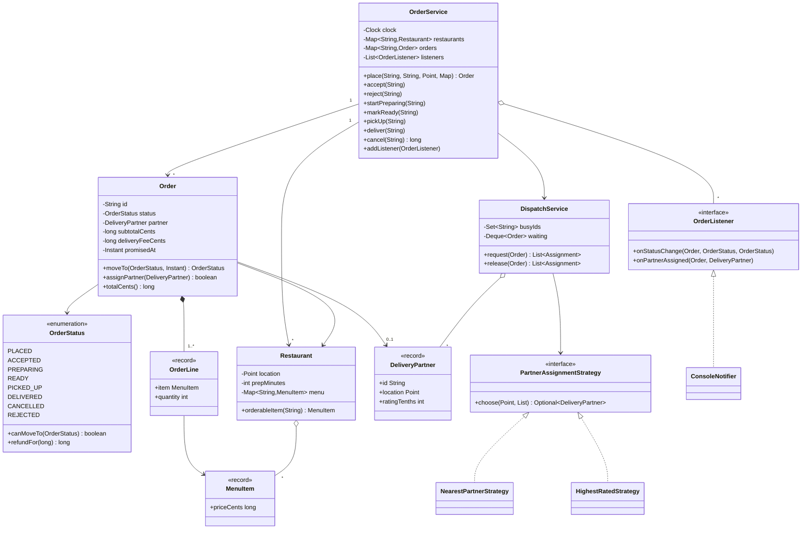
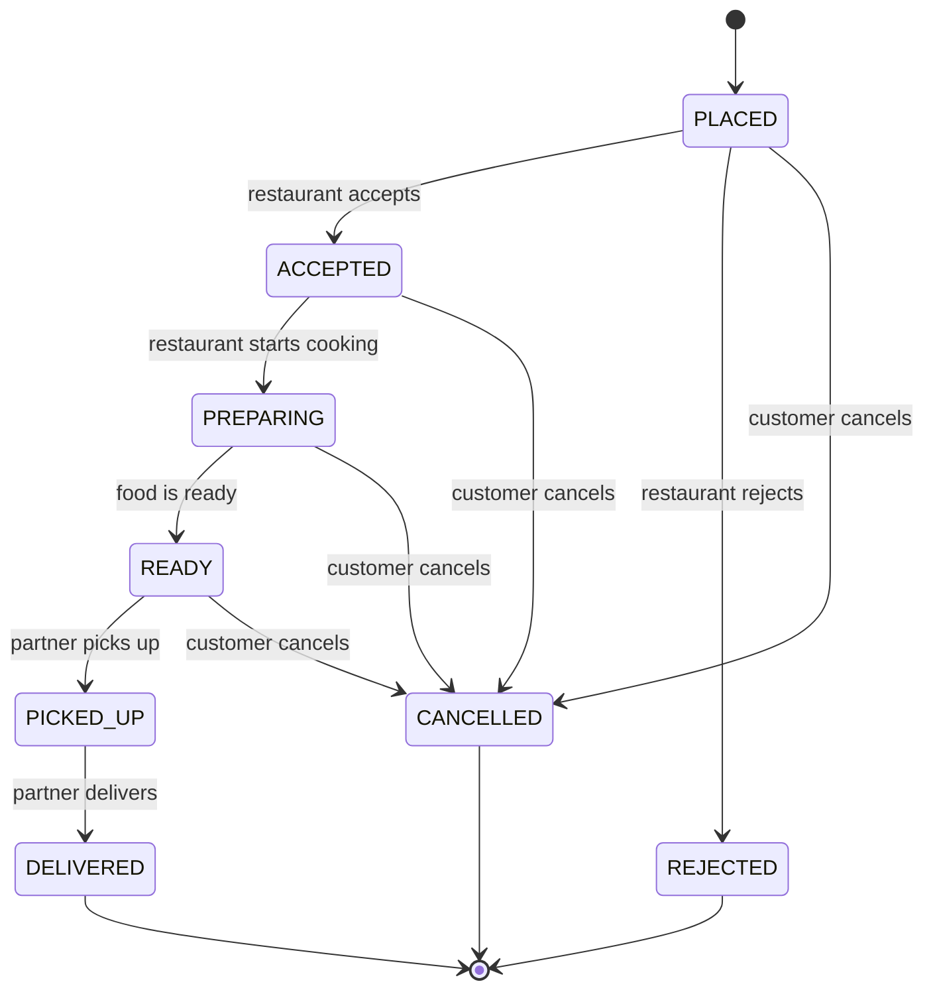
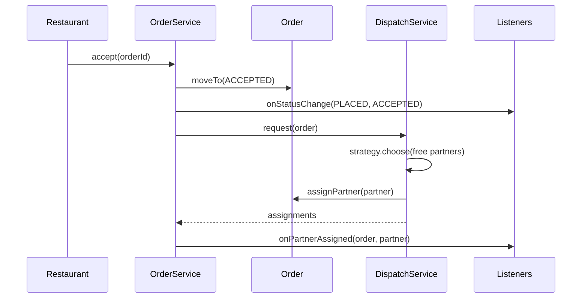

# Design a Food Delivery System

This case study designs the core of a food delivery app for an LLD (low-level design) interview. A customer orders from a restaurant, the restaurant prepares the food, a delivery partner brings it, and everyone gets status updates. The interview tests three things: a clean order life cycle (the State idea), a delivery partner assignment that is easy to replace (Strategy), and status notifications that do not couple the order to its audience (Observer). The runnable program is in [`Main.java`](Main.java). Run it with `java Main.java` from this folder. The procedure that this page follows is in [How to approach an LLD interview](../../how-to-approach-lld.md).

## Problem Statement

"Design a food delivery system. Restaurants publish menus. A customer places an order with one restaurant. The restaurant accepts and prepares the order. The system assigns a delivery partner, who picks up the food and delivers it. The customer can cancel before pickup. Everyone who follows the order gets a notification when its status changes."

The interviewer adds these follow-ups during the round: "What if no partner is free?", "How do you choose the partner?", "Two orders become ready at the same time and one partner is free. What happens?", "How do you refund a cancelled order?", "Add batching: one partner carries two orders."

## Clarifying Questions

Ask these in the first 5 minutes. Write each answer as a numbered requirement, and label every unanswered question as an assumption.

| # | Question | Answer that this design assumes |
|---|---|---|
| 1 | How much code do you expect: a class diagram with signatures, or compiling code? | Compiling code for the order flow and the assignment, plus the class diagram |
| 2 | Which two or three flows matter most? | Place an order, move it through its life cycle, assign a partner, notify |
| 3 | Can one order contain items from several restaurants? | No. One order has one restaurant. A cart with several restaurants is an extension |
| 4 | What does an order contain? | Menu items with a quantity. Prices come from the menu at the time of the order |
| 5 | Who changes the order status? | The restaurant accepts, rejects, starts cooking, and marks ready. The partner picks up and delivers. The customer cancels |
| 6 | When does the system look for a partner? | When the restaurant accepts the order. The partner can travel to the restaurant while the food cooks |
| 7 | What if no partner is free? | The order waits in a first-in-first-out queue. The next freed partner takes the oldest waiting order |
| 8 | How does the system choose a partner? | A replaceable rule. The design ships two: nearest to the restaurant, and highest rated |
| 9 | When can the customer cancel, and what is the refund? | Until the partner picks up the food. Refund: 100% before cooking starts, 50% while cooking, 0% when the food is ready |
| 10 | How are prices and the delivery fee computed? | Money in `long` cents. Delivery fee: 200 cents plus 50 cents for each unit of distance. Distance is the Manhattan distance on a grid |
| 11 | How is the delivery time promised? | The restaurant preparation time plus 3 minutes for each unit of distance. The system reads the time from an injected `Clock` |
| 12 | Do many threads call the system at the same time? | Yes. Several restaurants accept orders at the same moment, and they compete for the same partners |
| 13 | Is payment in scope? | No. The order stores the total, and a payment interface is an extension |
| 14 | Is storage in memory? | Yes. A database is out of scope |
| 15 | Which extensions are likely? | Batching, surge fees, partner decline and timeout, ratings, live location |

## Requirements

### Functional requirements

1. **R1.** A restaurant has a name, a location, a preparation time, and a menu of items with prices.
2. **R2.** A customer places an order of one or more items with a positive quantity from one open restaurant. The system rejects an unknown restaurant, an unknown item, a sold-out item, a zero quantity, an empty order, and a closed restaurant.
3. **R3.** The system computes the subtotal, the delivery fee, the total, and a promised delivery time when it creates the order.
4. **R4.** An order has a life cycle: `PLACED`, `ACCEPTED`, `PREPARING`, `READY`, `PICKED_UP`, `DELIVERED`, and the end states `CANCELLED` and `REJECTED`. The system rejects every other move.
5. **R5.** When the restaurant accepts an order, the system assigns a free delivery partner, chosen by a replaceable strategy. If no partner is free, the order waits.
6. **R6.** A partner works on one order at a time. When the partner finishes or the order is cancelled, the partner becomes free and takes the oldest waiting order.
7. **R7.** The system rejects a pickup if no partner is assigned.
8. **R8.** The customer cancels until pickup. The refund depends on the status at the time of the cancel.
9. **R9.** Listeners receive each status change and each partner assignment.

### Non-functional requirements

1. **N1.** A partner never serves two orders at once, also when several threads accept orders at the same time.
2. **N2.** A rejected request leaves all state unchanged.
3. **N3.** The delivery time and the promised time read from an injected clock, so tests are deterministic.
4. **N4.** A new assignment rule, a new listener, or a new fee rule is a new class, not an edit of the order flow.
5. **N5.** A slow listener does not block other orders (listeners run outside the locks).

## Entities and Relationships

Take the nouns of the problem statement: restaurant, menu, item, customer, order, status, delivery partner, location, notification. Sort them with the method from [domain modeling](../../fundamentals/05-domain-modeling.md):

| Noun | Kind | Reason |
|---|---|---|
| `Order` | Entity (the aggregate root of one order) | Has an identity and a life cycle. Owns the status and the assigned partner. Protects the rule "only legal status moves" |
| `Restaurant` | Entity | Has an identity. Owns its menu, its open flag, and its sold-out items |
| `OrderStatus` | Enum with behavior | A fixed set of states. Each constant knows its legal next states and its refund percentage |
| `MenuItem` | Value object (`record`) | Id, name, price in cents. Immutable. The order copies the item, so a later price change does not change old orders |
| `OrderLine` | Value object (`record`) | A menu item and a quantity |
| `DeliveryPartner` | Value object (`record`) | Id, name, location, rating. Whether the partner is busy is not a field, because it belongs to the dispatcher (see below) |
| `Point` | Value object (`record`) | A location on a grid, with a distance method |
| `DispatchService` | Service | Owns the busy set and the waiting queue. The only class that assigns partners |
| `PartnerAssignmentStrategy` | Interface | How to choose one partner from the free ones. The extension point |
| `OrderService` | Service (facade) | The entry point for every use case. Validates, changes the status, and notifies |
| `OrderListener` | Interface | The observer of status changes and assignments |
| `ManualClock` | Test double | A `java.time.Clock` that moves only when the caller advances it |
| `OrderException` | Exception | A business failure that the caller can handle |
| Customer | Not a class here | An id string. The design does not need customer data. A `Customer` entity appears when addresses and payment methods are in scope |
| Menu | Not a class here | A map in `Restaurant`. It has no behavior of its own |

Relationships:

- `OrderService` has one `DispatchService`, many `Restaurant` objects, many `Order` objects, and many `OrderListener` objects (association).
- `Order` has one `Restaurant` (association), a list of `OrderLine` objects (composition: the lines end with the order), and at most one `DeliveryPartner` (association).
- `DispatchService` has many `DeliveryPartner` objects (association) and one `PartnerAssignmentStrategy`. `NearestPartnerStrategy` and `HighestRatedStrategy` realize the interface.
- `Restaurant` has many `MenuItem` objects (aggregation).
- `ConsoleNotifier` and `EventCounter` realize `OrderListener`.

Two modeling decisions matter in the interview.

!!! note "Who owns the busy flag"
    A `busy` field on `DeliveryPartner` looks natural, but it creates two owners of one fact: the partner and the dispatcher. The dispatcher must decide "who is free" and "assign" in one step, so it keeps the busy set itself, under one lock. The partner stays an immutable record, which strategies read without a lock.

!!! note "A pure strategy"
    The strategy receives the pickup point and the list of free partners and returns one partner. It does not change any state. All mutation (mark busy, set the partner on the order) stays in `DispatchService`, under the lock. A strategy that marked the partner busy would move the race into every strategy.

## Class Diagram



The order life cycle as a state diagram:



The flow of an accepted order, from the restaurant to the customer:



## Design Patterns Used

| Pattern | Where | Reason | Rejected alternative |
|---|---|---|---|
| State ([behavioral patterns](../../fundamentals/08-behavioral-patterns.md)), in its light form: an enum that holds the transition table and the refund percentage | `OrderStatus` and `Order.moveTo` | The statement says "the order moves through a life cycle", and the allowed actions depend on the status. The requirement smell is "behavior depends on the current state". The enum keeps all legal moves in one `switch`, and `Order.moveTo` is the only place that changes the status | A class for each status (`PlacedState`, `AcceptedState`, ...), each with its own methods. Use that form if each state gets different behavior in many methods, for example different cancel fees, different allowed edits, and different timers. Here only two things differ by state (the next states and the refund), so eight classes would add code for no gain. The other rejected form: a `String status` or booleans (`isAccepted`, `isPicked`) that allow impossible combinations |
| Strategy ([behavioral patterns](../../fundamentals/08-behavioral-patterns.md)) | `PartnerAssignmentStrategy` with `NearestPartnerStrategy` and `HighestRatedStrategy` | The statement leaves the choice rule open ("assign a partner"), and real systems change it often. The requirement smell is "several ways to do the same thing". A new rule is a new class | An `if` or `switch` on a rule name inside `DispatchService`. Each new rule edits the dispatcher (a violation of the Open-Closed Principle, see [SOLID](../../fundamentals/02-solid.md)) |
| Observer ([behavioral patterns](../../fundamentals/08-behavioral-patterns.md)) | `OrderListener`, called by `OrderService` | The customer app, the restaurant screen, and the partner app all need the same events. The order must not know them. A new audience is a new listener | `OrderService` calls `customerApp.push(...)`, `restaurantScreen.update(...)`, and so on. Each new audience edits the service. Another rejected form: a base class `Notifiable` inside `Order` |
| Facade ([structural patterns](../../fundamentals/07-structural-patterns.md)) | `OrderService` | Callers need one entry point for each use case. The facade validates, changes the status, runs the dispatcher, and notifies, in the right order | Callers use `Order`, `DispatchService`, and the listeners directly. Each caller then repeats the sequence and can get it wrong |
| Immutable value objects | `MenuItem`, `OrderLine`, `DeliveryPartner`, `Point` (records) | Safe to share between threads, to copy into an order, and to pass to a strategy without a lock | Mutable data classes with setters. A price change would change old orders |
| Injected time source | `java.time.Clock` in `OrderService`, and `ManualClock` in the demo | The promised time and the delivered time depend on the time. A fixed, controlled clock makes tests deterministic | `Instant.now()` inside the service. Tests cannot control the time |

Not used, on purpose:

- **Singleton** for the service. Tests and the demo create several services, each with its own state. See [creational patterns](../../fundamentals/06-creational-patterns.md).
- **Factory** for orders. `OrderService.place` builds the order, and it is the only place that does.
- **Command** for status changes. The methods on `OrderService` are enough until the system needs an audit log or an undo.

## Key Code

The code below is copied from [`Main.java`](Main.java). The full program has the demo and the remaining small classes.

### Value objects and the status enum

The records are immutable and compare by value. `OrderStatus` is the state machine: `canMoveTo` lists the legal moves, and `refundFor` gives the refund for a cancel in that status. A status with no legal move (`DELIVERED`, `CANCELLED`, `REJECTED`) is an end state. Adding a status makes the compiler complain about the `switch` until the new case is handled, because the `switch` expression has no `default` branch.

```java
record Point(int x, int y) {
    int distanceTo(Point other) {
        return Math.abs(x - other.x) + Math.abs(y - other.y);
    }
}

record MenuItem(String id, String name, long priceCents) { }

record OrderLine(MenuItem item, int quantity) {
    long totalCents() {
        return item.priceCents() * quantity;
    }
}

record DeliveryPartner(String id, String name, Point location, int ratingTenths) { }
```

```java
enum OrderStatus {
    PLACED(100), ACCEPTED(100), PREPARING(50), READY(0),
    PICKED_UP(0), DELIVERED(0), CANCELLED(0), REJECTED(0);

    private final int refundPercent;

    OrderStatus(int refundPercent) {
        this.refundPercent = refundPercent;
    }

    boolean canMoveTo(OrderStatus next) {
        return switch (this) {
            case PLACED -> next == ACCEPTED || next == REJECTED || next == CANCELLED;
            case ACCEPTED -> next == PREPARING || next == CANCELLED;
            case PREPARING -> next == READY || next == CANCELLED;
            case READY -> next == PICKED_UP || next == CANCELLED;
            case PICKED_UP -> next == DELIVERED;
            case DELIVERED, CANCELLED, REJECTED -> false;
        };
    }

    boolean isCancellable() {
        return canMoveTo(CANCELLED);
    }

    long refundFor(long totalCents) {
        return totalCents * refundPercent / 100;
    }
}
```

### The order: one door for status changes

`moveTo` is `synchronized`, so the check "is this move legal?" and the write of the new status form one step. The rule "no pickup without a partner" (R7) is also inside `moveTo`, because it reads the status and the partner, and both must be read under the same lock as the write. It returns the old status, so the caller (for example `cancel`) works with the status that was true when the move happened, and not with a value that it read earlier.

```java
    synchronized OrderStatus moveTo(OrderStatus next, Instant now) {
        if (!status.canMoveTo(next)) {
            throw new OrderException(
                    "Order " + id + " cannot move from " + status + " to " + next);
        }
        if (next == OrderStatus.PICKED_UP && partner == null) {
            throw new OrderException("Order " + id + " has no delivery partner yet");
        }
        OrderStatus old = status;
        status = next;
        if (next == OrderStatus.DELIVERED) {
            deliveredAt = now;
        }
        return old;
    }

    /** Sets the partner, unless the order was cancelled. Returns whether it set the partner. */
    synchronized boolean assignPartner(DeliveryPartner partner) {
        if (status == OrderStatus.CANCELLED) {
            return false;
        }
        this.partner = partner;
        return true;
    }
```

`assignPartner` refuses a cancelled order under the same lock, so the dispatcher cannot give a partner to an order that a customer cancelled a moment before (see the Concurrency section).

### The assignment strategy

A strategy receives the pickup point and the free partners, and returns one partner or nothing. It reads only. The tie-breaker on the partner id makes the result the same on each run: a `Comparator` without a final unique key leaves ties to the order of the list.

```java
interface PartnerAssignmentStrategy {
    Optional<DeliveryPartner> choose(Point pickup, List<DeliveryPartner> available);
}

class NearestPartnerStrategy implements PartnerAssignmentStrategy {
    @Override
    public Optional<DeliveryPartner> choose(Point pickup, List<DeliveryPartner> available) {
        return available.stream().min(Comparator
                .comparingInt((DeliveryPartner p) -> p.location().distanceTo(pickup))
                .thenComparing(DeliveryPartner::id));
    }
}

class HighestRatedStrategy implements PartnerAssignmentStrategy {
    @Override
    public Optional<DeliveryPartner> choose(Point pickup, List<DeliveryPartner> available) {
        return available.stream().min(Comparator
                .comparingInt((DeliveryPartner p) -> -p.ratingTenths())
                .thenComparingInt(p -> p.location().distanceTo(pickup))
                .thenComparing(DeliveryPartner::id));
    }
}

record Assignment(Order order, DeliveryPartner partner) { }
```

### The dispatcher: assign without a double booking

`DispatchService` has one lock. `request` puts the order at the end of the waiting queue and then tries to serve the queue from the front. `release` frees the partner (or removes a waiting order that was cancelled) and serves the queue again. `drainWaiting` is the only code that marks a partner busy, and it runs inside the lock. The check "is the partner free?" and the write "the partner is busy" are therefore one step. `doubleBookings` exists only to prove this in the demo: `busyIds.add` returns `false` if the partner was already busy, and the counter stays 0. The two `CANCELLED` checks (in `request`, and in `Order.assignPartner`) close the race between `accept` and `cancel` (see the Concurrency section): a cancelled order never enters the queue, and a cancelled order never gets a partner.

```java
class DispatchService {
    private final List<DeliveryPartner> partners;
    private final PartnerAssignmentStrategy strategy;
    private final Set<String> busyIds = new HashSet<>();
    private final Deque<Order> waiting = new ArrayDeque<>();
    private int peakBusy;
    private int doubleBookings;

    DispatchService(List<DeliveryPartner> partners, PartnerAssignmentStrategy strategy) {
        this.partners = List.copyOf(partners);
        this.strategy = strategy;
    }

    /** Assigns a free partner to the order, or queues the order if no partner is free. */
    synchronized List<Assignment> request(Order order) {
        if (order.status() == OrderStatus.CANCELLED) {
            return List.of();
        }
        waiting.addLast(order);
        return drainWaiting();
    }

    /** Frees the partner of the order, or removes the order from the queue. */
    synchronized List<Assignment> release(Order order) {
        DeliveryPartner partner = order.partner();
        if (partner != null) {
            busyIds.remove(partner.id());
        } else {
            waiting.remove(order);
        }
        return drainWaiting();
    }

    private List<Assignment> drainWaiting() {
        List<Assignment> made = new ArrayList<>();
        while (!waiting.isEmpty()) {
            Order next = waiting.peekFirst();
            List<DeliveryPartner> free = partners.stream()
                    .filter(p -> !busyIds.contains(p.id())).toList();
            Optional<DeliveryPartner> chosen = strategy.choose(next.restaurant().location(), free);
            if (chosen.isEmpty()) {
                break;
            }
            waiting.removeFirst();
            if (!next.assignPartner(chosen.get())) {
                continue;
            }
            if (!busyIds.add(chosen.get().id())) {
                doubleBookings++;
            }
            peakBusy = Math.max(peakBusy, busyIds.size());
            made.add(new Assignment(next, chosen.get()));
        }
        return made;
    }

    synchronized int freePartnerCount() {
        return partners.size() - busyIds.size();
    }

    synchronized int waitingCount() {
        return waiting.size();
    }

    synchronized int peakBusy() {
        return peakBusy;
    }

    synchronized int doubleBookings() {
        return doubleBookings;
    }
}
```

The queue has a rule: the oldest waiting order is served first, and the loop stops at the first order that finds no partner. With the same pickup rule for every order this is fair. If a later order could be served while the first cannot (for example, the strategy filters by distance), the loop would need to skip, which is an extension.

### The service: validate, change, notify

`place` checks the request before it creates anything, so a rejected request changes nothing. It computes the fee and the promised time from the injected clock. The loop over `quantities` is the only place that reads the menu.

```java
    Order place(String customerId, String restaurantId, Point deliverTo,
                Map<String, Integer> quantities) {
        Restaurant restaurant = restaurants.get(restaurantId);
        if (restaurant == null) {
            throw new OrderException("Unknown restaurant " + restaurantId);
        }
        if (!restaurant.isOpen()) {
            throw new OrderException(restaurant.name() + " is closed");
        }
        if (quantities.isEmpty()) {
            throw new OrderException("An order needs at least one item");
        }
        List<OrderLine> lines = new ArrayList<>();
        for (Map.Entry<String, Integer> entry : quantities.entrySet()) {
            if (entry.getValue() <= 0) {
                throw new OrderException("Quantity must be positive for " + entry.getKey());
            }
            lines.add(new OrderLine(restaurant.orderableItem(entry.getKey()), entry.getValue()));
        }
        int distance = restaurant.location().distanceTo(deliverTo);
        long fee = BASE_FEE_CENTS + FEE_PER_DISTANCE_CENTS * distance;
        Duration eta = Duration.ofMinutes(
                restaurant.prepMinutes() + (long) MINUTES_PER_DISTANCE * distance);
        String id = "O-" + sequence.incrementAndGet();
        Order order = new Order(id, customerId, restaurant, deliverTo, lines, fee,
                clock.instant().plus(eta));
        orders.put(id, order);
        notifyStatus(order, null, OrderStatus.PLACED);
        return order;
    }
```

`accept` moves the order and then asks the dispatcher for a partner. `pickUp` is a plain transition, because `moveTo` refuses an order that has no partner. `cancel` checks the status first only to give a clear message: if another thread changes the status between this check and `moveTo`, `moveTo` still rejects an illegal move. `cancel` computes the refund from the status that `moveTo` returned, and then releases the partner so the next waiting order can start.

```java
    void accept(String orderId) {
        Order order = find(orderId);
        transition(order, OrderStatus.ACCEPTED);
        publish(dispatch.request(order));
    }
```

```java
    void pickUp(String orderId) {
        transition(find(orderId), OrderStatus.PICKED_UP);
    }

    void deliver(String orderId) {
        Order order = find(orderId);
        transition(order, OrderStatus.DELIVERED);
        publish(dispatch.release(order));
    }

    /** Cancels the order and returns the refund in cents. */
    long cancel(String orderId) {
        Order order = find(orderId);
        if (!order.status().isCancellable()) {
            throw new OrderException(
                    "Order " + orderId + " cannot be cancelled in status " + order.status());
        }
        OrderStatus before = transition(order, OrderStatus.CANCELLED);
        publish(dispatch.release(order));
        return before.refundFor(order.totalCents());
    }
```

`transition` changes the status, and then notifies every listener. The listeners run after the order lock is released, on the thread that made the change. `publish` sends the assignments that the dispatcher made.

```java
    private OrderStatus transition(Order order, OrderStatus next) {
        OrderStatus from = order.moveTo(next, clock.instant());
        notifyStatus(order, from, next);
        return from;
    }

    private void notifyStatus(Order order, OrderStatus from, OrderStatus to) {
        for (OrderListener listener : listeners) {
            listener.onStatusChange(order, from, to);
        }
    }

    private void publish(List<Assignment> assignments) {
        for (Assignment a : assignments) {
            for (OrderListener listener : listeners) {
                listener.onPartnerAssigned(a.order(), a.partner());
            }
        }
    }
```

### The listener interface

`onPartnerAssigned` has a default empty body, so a listener that cares only about status changes does not have to implement it.

```java
interface OrderListener {
    void onStatusChange(Order order, OrderStatus from, OrderStatus to);

    default void onPartnerAssigned(Order order, DeliveryPartner partner) { }
}
```

## Concurrency

**What can race.** Many restaurants accept orders at the same time, and each accepted order asks for a partner. The dispatch step is a check-then-act: read the free partners, choose one, mark it busy. If two threads read the same free partner, both choose it, and one partner serves two orders. A second race sits in the waiting queue: one thread adds an order while another thread frees a partner and drains the queue, and an order can stay in the queue while a partner is free.

The wrong form, with the race marked:

<!-- fragment -->
```java
// Wrong: two threads can both read the same free partner.
List<DeliveryPartner> free = partners.stream().filter(p -> !busy.contains(p.id())).toList();
DeliveryPartner chosen = strategy.choose(pickup, free).orElseThrow();  // both choose p1
busy.add(chosen.id());                                                  // both mark p1 busy
order.assignPartner(chosen);                                            // both assign p1
```

**The fix.** `DispatchService.request` and `DispatchService.release` are `synchronized`. The free list, the choice, the busy write, and the queue change run under one lock. The shared state that the lock protects is the invariant "a partner id is in `busyIds` if and only if the partner serves an order", and "an order waits only if no partner is free". The lock covers a short, CPU-only section: a filter over the partner list and the strategy call. The lock does not cover I/O. See [concurrency in LLD](../../fundamentals/09-concurrency-in-lld.md) for the choice between `synchronized`, `ReentrantLock`, and atomics.

**Lock granularity.** There is one lock for all partners. This is correct and simple. It is also a bottleneck if one service assigns partners for a whole city. The refinement is one dispatcher for each zone (a map from zone id to `DispatchService`), because orders in different zones do not compete for the same partners. This is a striped design with a business key.

**The order has its own lock.** `Order.moveTo`, `assignPartner`, and the getters are `synchronized` on the order. Two threads that move the same order (the customer cancels while the restaurant starts cooking) run one after the other, and the second one sees the new status and gets either a legal move or an `OrderException`. The refund uses the status that `moveTo` returned, so a cancel that races with `startPreparing` gets the refund that matches the status at the moment of the cancel.

**Lock order.** `DispatchService` calls `order.status()`, `order.partner()`, and `order.assignPartner(...)` while it holds the dispatcher lock. This takes the dispatcher lock first, and then the order lock. `Order` never calls the dispatcher. The order is therefore always the inner lock, and no thread takes the two locks in the opposite order, so a deadlock between them is not possible.

**Listeners run outside the locks.** `OrderService` notifies after `moveTo` returns and after `request` or `release` returns. A listener can be slow, can throw, or can call back into the service, and none of these can hold the dispatcher lock or an order lock. A listener that throws stops the loop over the remaining listeners. A production version wraps each call in `try`/`catch`, or sends the events to a queue that a separate thread reads (see the extensions).

The cost of this choice is the order of events. Two threads that change one order notify on their own threads after their locks are released, so a listener can receive `PREPARING -> READY` before `ACCEPTED -> PREPARING`. An assignment event can also come from another thread: a `deliver` of order A frees a partner, and the thread of A publishes the assignment for order B. Each event carries `from` and `to`, so a listener can detect an old event. If a listener needs the exact order, add a version number to `Order` (incremented in `moveTo`) and let the listener drop events with a lower version, or send all events through one queue for each order.

**Accept versus cancel.** `accept` runs two steps: `moveTo(ACCEPTED)`, then `dispatch.request(order)`. A cancel can run between them. Without a guard, this order of events leaks a partner: the cancel moves the order to `CANCELLED` and calls `release`, which finds no partner and no queued order and does nothing; then `request` queues the cancelled order, and the dispatcher marks a partner busy for an order that nobody will deliver or cancel again. That partner is never freed. The guard is the check `order.status() == CANCELLED` in `request`. It is correct in every order of events, because the cancel thread changes the status before it takes the dispatcher lock:

- If `request` takes the dispatcher lock first, the order is queued or gets a partner. The later `release` removes it from the queue or frees the partner.
- If `release` takes the dispatcher lock first, the status is already `CANCELLED` when `request` reads it (the dispatcher lock orders the two calls, so the write is visible), and `request` does nothing.

`Order.assignPartner` refuses a cancelled order, and `drainWaiting` then drops that order and serves the next one. This check must be inside the order lock, together with the write of the partner. A separate `next.status()` check in `drainWaiting` would be a check-then-act: the cancel thread could change the status between the check and `assignPartner`, because `moveTo` takes the order lock and not the dispatcher lock. With the check inside `assignPartner`, one of two things happens. If the cancel comes first, `assignPartner` returns `false` and no partner is marked busy. If `assignPartner` comes first, the cancel's `release` sees the partner and frees it. In both cases no partner leaks, and no listener receives an assignment for an order that was already cancelled.

**A partner goes to the oldest waiting order exactly once.** Only `drainWaiting` takes an order out of the queue for an assignment, with `removeFirst`, under the dispatcher lock, so each order gets at most one partner. A partner is freed only by `release`, and `release` runs once for each order, because `deliver` and `cancel` both end in a final status and `moveTo` lets only one of them happen. A cancel of a waiting order removes it from the queue with `waiting.remove(order)`, and `drainWaiting` then serves the next order in the queue.

**No pickup without a partner.** The rule "no pickup without a partner" reads the status and the partner. It is inside `moveTo`, under the order lock, and `assignPartner` writes the partner under the same lock. A check in `OrderService` before `moveTo` would be a check-then-act: the status could change between the check and the move.

**The demo proves the result, not the order.** Eight orders are accepted by eight threads at the same time, and three partners are free. The final output shows what does not depend on the schedule: exactly 3 orders get a partner, they get 3 different partners, 5 orders wait, and all 8 orders are delivered once the partners are freed one after the other. Which 3 orders win is not printed, because it depends on the schedule.

This design protects one JVM. Several servers need a database transaction, a unique constraint, or a lock service. That belongs to the HLD.

## Extensions

Each row gives the change and the classes that change. The classes that are not named stay as they are.

| Extension | Class changes | Notes |
|---|---|---|
| **Partner declines or times out** | Add `OrderStatus` value or an event `PARTNER_REASSIGNING`. Add `DispatchService.decline(Order, DeliveryPartner)`: it frees the partner, puts the order at the front of `waiting`, and adds the partner id to an `excluded` set that the order holds. `Order.assignPartner` accepts a replacement. A `Clock`-driven `AssignmentTimeoutTask` calls `decline` if no confirmation arrives in 60 seconds | The strategy sees only partners that are not excluded for this order. The partner check in `moveTo` already runs under the order lock, so a re-assignment through `assignPartner` cannot race with a pickup |
| **Batching: one partner carries two orders** | Replace the busy set by a `Map<String, Integer> load` with a capacity (for example 2). Add `BatchingStrategy implements PartnerAssignmentStrategy`. It prefers a partner who already goes to a nearby restaurant. `DispatchService` marks a partner busy when `load == capacity`. `Order` keeps its own partner reference | The interface takes the load into account, so the strategy needs a richer input than a list of free partners. Introduce a `PartnerView(partner, load, route)` record for the input |
| **Surge pricing and delivery-fee rules** | Add `FeePolicy` with `long feeCents(Restaurant, Point, Instant)`. Add `DistanceFeePolicy` (the current rule), `SurgeFeePolicy` (decorates another policy and multiplies the fee by a factor when demand is high), and `FreeDeliveryPolicy`. `OrderService.place` calls the policy and loses its two constants | Strategy for the rule and Decorator for the surge. See [structural patterns](../../fundamentals/07-structural-patterns.md) |
| **Coupons and discounts** | Add `DiscountPolicy` with `long discountCents(Order)`. Add `Order.totalCents()` as subtotal plus fee minus discount. Add a `CouponService` that validates the code and its usage limit (a check-then-act that needs its own lock or an atomic counter) | Keep the discount an input to the order total and not a field that every rule edits |
| **Payment and refund** | Add `PaymentGateway` with `charge(Order)` and `refund(Order, long)`. `OrderService.place` calls `charge`, and `cancel` calls `refund` with the computed amount. Add an idempotency key to `charge` so a retry does not charge twice | The wallet case study covers idempotency keys: see `kb/lld/case-studies/23-digital-wallet/README.md` |
| **Ratings** | Add `Rating(orderId, restaurantRating, partnerRating)` and a `RatingService`. `DeliveryPartner` becomes an entity with a running average, or the service keeps the average in a map. `HighestRatedStrategy` reads the average | A rating is allowed once for each delivered order. Check the status in `RatingService` |
| **Live location and ETA updates** | Add `LocationUpdate(partnerId, Point)` and `DispatchService.updateLocation`. Keep the locations in a `ConcurrentHashMap<String, Point>`. `NearestPartnerStrategy` reads the map. Add an `EtaCalculator` interface. A listener method `onEtaChange` carries the new ETA | A partner location is read often and written often, so use a concurrent map and not the dispatcher lock |
| **Scheduled orders** | Add `scheduledFor` to `Order` and a status `SCHEDULED` before `PLACED`. Add a `ScheduledOrderRunner` with a `PriorityQueue` by time, driven by the injected `Clock` | The same closing-queue idea as the [online auction](../22-online-auction/README.md) |
| **Several restaurants in one cart** | Add `Cart` and `SubOrder`. `Order` becomes a parent of one `SubOrder` for each restaurant. Each `SubOrder` has its own life cycle, and the parent status is a function of the child statuses | The state machine stays per sub-order, so `OrderStatus` does not change |
| **Search and ranking of restaurants** | Add `RestaurantSearchService` with an index by cuisine and name, and a `RankingStrategy` (distance, rating, ETA). `Restaurant` gets a cuisine and a rating | A separate read side. A distributed search index is an HLD topic |
| **Durable notifications** | Add `NotificationQueue` (a `BlockingQueue<OrderEvent>`) and a worker thread. A single listener puts events into the queue, and the worker calls the real listeners | Decouples slow listeners from the order flow. The notification-service case study covers channels and retries: see `kb/lld/case-studies/24-notification-service/README.md` |

## Common Mistakes

| Mistake | Why it hurts | Fix |
|---|---|---|
| A `String status` or booleans for the order state | Impossible combinations (`isDelivered` and `isCancelled`) and a status check scattered in many methods | An enum with a transition table, and one method that changes the status |
| Letting any caller set the status (`order.setStatus(...)`) | The order cannot protect its life cycle. A delivered order can become `PLACED` | `moveTo` validates the move. The service is the only caller |
| A `busy` flag inside `DeliveryPartner`, changed by strategy code | Two owners of one fact, and a race between the check and the write | The dispatcher owns the busy set and changes it under one lock |
| Choosing the partner with a check, then marking it busy in a second step, with no lock | Two orders get the same partner | One lock around the choice and the write (or one atomic operation) |
| No answer to "what if no partner is free?" | The order is lost or the system throws | A waiting queue and a drain when a partner becomes free |
| A strategy that depends on the order of the input list, with no tie-breaker | Different runs choose different partners | A comparator that ends with a unique key (the partner id) |
| `if (type.equals("nearest")) ... else if (type.equals("rating"))` in the dispatcher | Every new rule edits the dispatcher | A `PartnerAssignmentStrategy` interface |
| Calling listeners while holding a lock | A slow or failing listener blocks every order, or a listener that calls back causes a deadlock | Notify after the lock is released, or send events to a queue |
| `double` for prices | Rounding errors in totals and refunds | `long` cents, or `BigDecimal`. See [domain modeling](../../fundamentals/05-domain-modeling.md) |
| `Instant.now()` or `System.currentTimeMillis()` in the service | Tests cannot control the time. The promised time cannot be tested | Inject a `Clock` |
| An order that refers to the live `MenuItem` price | A price change changes a placed order | Copy the item and its price into the order line (the record is immutable) |
| Releasing the partner on cancel, but not checking the status when the order asks for a partner | A cancel that runs between `accept` and the dispatcher request leaves a partner busy forever | The dispatcher skips a cancelled order in `request` and in the queue |
| Computing the refund from a status that the code read earlier | A cancel that races with a status change gets the wrong refund | Use the status that the atomic status change returned |
| A separate subclass for each status with duplicated code | Class explosion for small differences | An enum first. Use State classes when the behavior differs a lot |
| One huge `OrderManager` class with menus, orders, partners, and notifications | A God object: no single responsibility, hard to test. See [anti-patterns](../../fundamentals/11-anti-patterns.md) | Split by responsibility: restaurant data, order life cycle, dispatch, notification |

## 45-Minute Plan

The times follow the budget in [How to approach an LLD interview](../../how-to-approach-lld.md#time-budget).

| Minutes | Step | What to present |
|---|---|---|
| 0 to 5 | Introductions | Listen. Repeat the problem in one sentence |
| 5 to 10 | Clarify | Ask the questions in the table above. Fix these points: one restaurant for each order, partner assigned at accept, a waiting queue, a replaceable assignment rule, cancel until pickup. Write R1 to R9 |
| 10 to 15 | Use cases and entities | List: place, accept, cook, pick up, deliver, cancel, notify. Show the entity table: `Order`, `Restaurant`, `OrderStatus`, `DeliveryPartner`, `DispatchService`. Say that the status is an enum with a transition table |
| 15 to 23 | Relationships, diagram, patterns | Draw `OrderService`, `Order`, `OrderStatus`, `DispatchService`, the strategy interface, and the listener interface. Draw the state diagram. Say "Strategy for assignment, Observer for notifications, State as an enum", and name the rejected alternative for each |
| 23 to 27 | Signatures | `place`, `accept`, `cancel`, `Strategy.choose`, `DispatchService.request` and `release`, `OrderListener.onStatusChange` |
| 27 to 39 | Core code | Write `OrderStatus.canMoveTo`, `Order.moveTo`, `Strategy` with `Nearest`, `DispatchService.request` with `drainWaiting`, and `OrderService.accept`. Run one order in your head from `PLACED` to `DELIVERED` |
| 39 to 41 | Concurrency | "Assignment is check-then-act. One lock in the dispatcher covers the choice, the busy write, and the queue. A cancel between accept and request must not leak a partner, so `request` skips a cancelled order. Listeners run outside the locks. Order after dispatcher is the lock order" |
| 41 to 45 | Extensions | Partner declines, batching, surge fee, payment, ratings. Leave time for questions |

If you run short of time, write `OrderStatus`, `Order.moveTo`, and `DispatchService`, and describe the service as "validate, change the status, notify, ask the dispatcher". A correct state machine and a correct dispatcher score higher than a complete service with a race.

## Expected Output

The demo has five parts. Part 1 runs one order through its full life cycle with status notifications, a fee, and a promised time (R2 to R5, R9). Part 2 shows reject and cancel with three refund levels (R8). Part 3 shows invalid requests (R2, R4, R7), a cancel of a waiting order, and a cancel that frees a partner for the oldest waiting order (R6). Part 4 shows two assignment strategies on the same data (R5). Part 5 accepts eight orders from eight threads with three partners (R6, N1). The output is the same on each run: the clock is manual, every move is scripted, and the concurrent part prints only results that do not depend on the schedule.

<!-- expected-output -->
```text
== 1. Order lifecycle with status notifications ==
[12:00] O-1 created (customer alice)
Subtotal $26.50, delivery fee $4.50, total $31.00
Promised delivery by 12:30
[12:02] O-1 PLACED -> ACCEPTED (customer alice)
[12:02] O-1 partner Asha
[12:03] O-1 ACCEPTED -> PREPARING (customer alice)
[12:15] O-1 PREPARING -> READY (customer alice)
[12:16] O-1 READY -> PICKED_UP (customer alice)
[12:30] O-1 PICKED_UP -> DELIVERED (customer alice)
Final status: DELIVERED at 12:30, on time: true
== 2. Reject and cancel ==
[12:00] O-1 created (customer bob)
[12:00] O-1 PLACED -> REJECTED (customer bob)
[12:00] O-2 created (customer bob)
[12:00] O-2 PLACED -> ACCEPTED (customer bob)
[12:00] O-2 partner Asha
[12:00] O-2 ACCEPTED -> CANCELLED (customer bob)
Refund before cooking: $16.00
[12:00] O-3 created (customer bob)
[12:00] O-3 PLACED -> ACCEPTED (customer bob)
[12:00] O-3 partner Asha
[12:00] O-3 ACCEPTED -> PREPARING (customer bob)
[12:00] O-3 PREPARING -> CANCELLED (customer bob)
Refund while cooking: $8.00
[12:00] O-4 created (customer bob)
[12:00] O-4 PLACED -> ACCEPTED (customer bob)
[12:00] O-4 partner Asha
[12:00] O-4 ACCEPTED -> PREPARING (customer bob)
[12:00] O-4 PREPARING -> READY (customer bob)
[12:00] O-4 READY -> PICKED_UP (customer bob)
Cancel after pickup rejected: Order O-4 cannot be cancelled in status PICKED_UP
Free partners after cancels: 1
== 3. Invalid requests ==
Unknown restaurant rejected: Unknown restaurant r9
Unknown item rejected: Item pasta is not on the menu of Pizza Place
Zero quantity rejected: Quantity must be positive for cola
Empty order rejected: An order needs at least one item
Sold out item rejected: Tiramisu is sold out
Closed restaurant rejected: Pizza Place is closed
Skip a step rejected: Order O-1 cannot move from PLACED to READY
Orders waiting for a partner: 2
Orders waiting after a waiting order is cancelled: 1
Pick up without a partner rejected: Order O-3 has no delivery partner yet
After O-2 is cancelled, O-3 gets partner Ben, waiting orders: 0
Pick up with a partner: accepted
== 4. Partner assignment strategies ==
NearestPartnerStrategy picks Chen
HighestRatedStrategy picks Ben
== 5. Concurrent partner assignment ==
Orders with a partner: 3
Distinct partners used: 3
Orders waiting for a partner: 5
Delivered orders: 8
Peak busy partners: 3
Double bookings detected: 0
Status events seen: 48
Partner assignment events seen: 8
```
