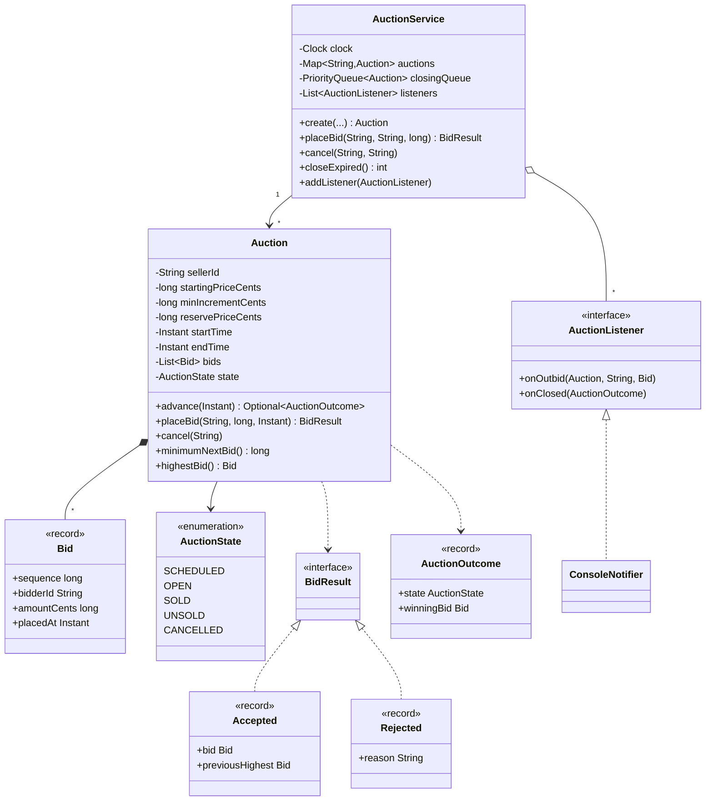
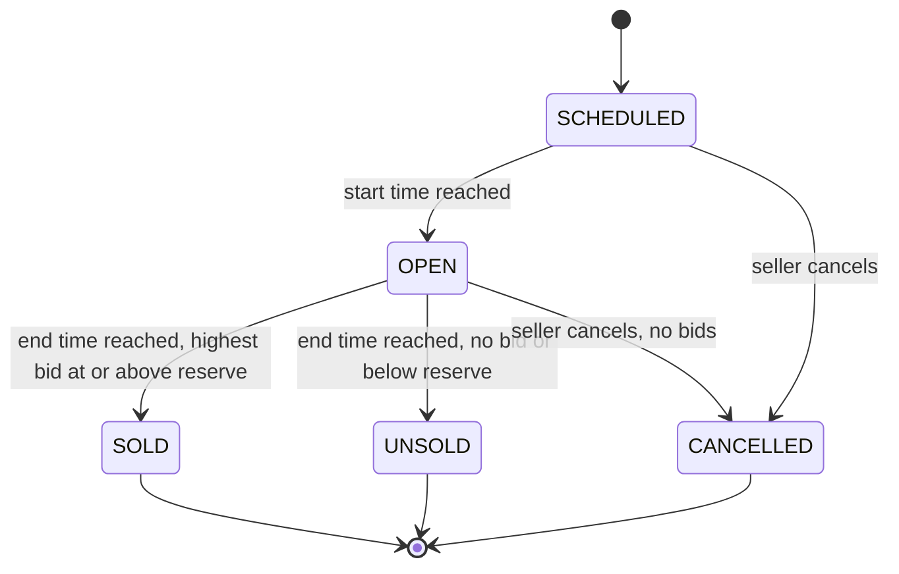
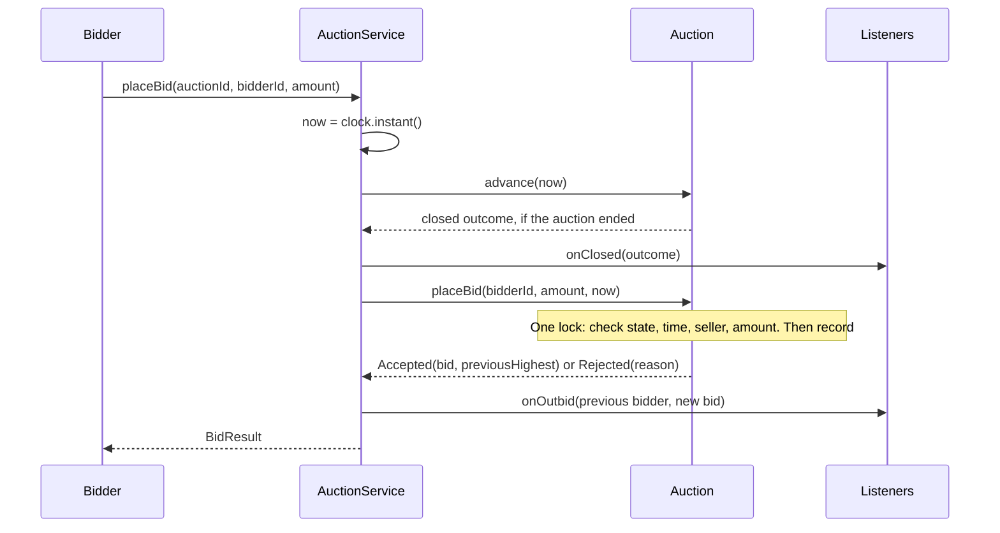

# Design an Online Auction System

This case study designs an online auction for an LLD (low-level design) interview. The problem looks like a CRUD (create, read, update, delete) exercise, and it hides one hard requirement: many bidders bid on the same item at the same moment, and the system must pick the right highest bid in a correct order. The other two ideas are time (the auction closes by itself at the end time) and notification (the winner and the outbid bidders hear about it). The runnable program is in [`Main.java`](Main.java). Run it with `java Main.java` from this folder. The procedure that this page follows is in [How to approach an LLD interview](../../how-to-approach-lld.md).

## Problem Statement

"Design an online auction system. A seller lists an item with a starting price and an end time. Buyers place bids. Each bid must be higher than the current highest bid. When the end time passes, the auction closes, the highest bidder wins, and the system tells the winner. Several buyers can bid at the same time."

The interviewer adds these follow-ups during the round: "Two buyers bid the same amount at the same moment. Who wins?", "What happens to a bid that arrives at the end time?", "How does the auction close without a person?", "Add a reserve price", "Add auto-bidding", "Stop last-second sniping."

## Clarifying Questions

Ask these in the first 5 minutes. Write each answer as a numbered requirement, and label every unanswered question as an assumption.

| # | Question | Answer that this design assumes |
|---|---|---|
| 1 | How much code do you expect: a class diagram with signatures, or compiling code? | Compiling code for the bid flow and the close, plus the class diagram |
| 2 | Which auction type? | English (ascending): the price goes up, and the highest bid wins. Other types are an extension |
| 3 | What is the minimum bid? | The starting price for the first bid. After that, the highest bid plus a minimum increment that the seller sets |
| 4 | Is there a reserve price? | Yes, optional. If the highest bid is below the reserve at the end time, the item is not sold. A reserve of 0 means no reserve |
| 5 | Does an auction have a start time? | Yes. Before the start time the auction is scheduled, and it rejects bids |
| 6 | Can the seller bid on their own item? | No. The system rejects it |
| 7 | Can the highest bidder raise their own bid? | Yes, by at least the increment. The system sends no outbid notice, because nobody was outbid |
| 8 | What if two bids have the same amount? | The first accepted bid holds the lead. The second bid is below the minimum (the highest bid plus the increment), so the system rejects it |
| 9 | What if a bid arrives at exactly the end time? | The auction is closed at the end time. A bid at the end time or later is rejected |
| 10 | Who closes the auction? | The system. A scheduler closes expired auctions, and each bid also checks the time. No person is needed |
| 11 | Who gets a notification? | The previous high bidder (outbid), the winner (won), and the seller (sold or not sold) |
| 12 | Can the seller cancel? | Yes, if the auction has not ended and has no bids |
| 13 | Do many threads bid on the same auction at the same time? | Yes. This is the core requirement |
| 14 | How is the end time measured? | By an injected `Clock`. The demo uses a manual clock |
| 15 | Money format? | `long` cents |
| 16 | Is payment, shipping, or search in scope? | No. Extensions |
| 17 | Is storage in memory? | Yes |

## Requirements

### Functional requirements

1. **R1.** A seller creates an auction with an item, a starting price, a minimum increment, an optional reserve price, a start time, and an end time. The end time is after the start time.
2. **R2.** An auction has the states `SCHEDULED`, `OPEN`, `SOLD`, `UNSOLD`, and `CANCELLED`. `SCHEDULED` becomes `OPEN` at the start time. `OPEN` becomes `SOLD` or `UNSOLD` at the end time.
3. **R3.** A bidder places a bid on an open auction. The system accepts the bid if the amount is at least the minimum next bid. The minimum next bid is the starting price if there is no bid, and the highest bid plus the increment otherwise.
4. **R4.** The system rejects a bid if the auction has not started, has ended, or was cancelled, if the bidder is the seller, or if the amount is too low. A rejection returns a reason and changes nothing.
5. **R5.** The system keeps accepted bids in the order of acceptance. Their amounts strictly increase, so the last accepted bid is the highest.
6. **R6.** At the end time, the auction closes. If the highest bid reaches the reserve price, the auction is `SOLD` and the highest bidder wins. If not, the auction is `UNSOLD`.
7. **R7.** The system notifies the outbid bidder, the winner, and the seller.
8. **R8.** The seller cancels an auction that has no bids and has not ended.

### Non-functional requirements

1. **N1.** Concurrent bids on one auction are processed one at a time, so the highest bid is always the maximum of the accepted bids, and the accepted amounts strictly increase.
2. **N2.** An auction closes exactly once, and exactly one notification set is sent, also if a bid and the scheduler close it at the same time.
3. **N3.** Bids on different auctions do not block one another.
4. **N4.** The end time and the start time read from an injected clock, so tests are deterministic.
5. **N5.** A slow listener does not block bidding (listeners run outside the locks).
6. **N6.** A new auction type, a new bidding rule, or a new listener is an addition and not a rewrite.

## Entities and Relationships

Take the nouns of the problem statement: seller, item, auction, bid, bidder, starting price, end time, highest bid, winner, notification. Sort them with the method from [domain modeling](../../fundamentals/05-domain-modeling.md):

| Noun | Kind | Reason |
|---|---|---|
| `Auction` | Entity (the aggregate root) | Has an identity and a life cycle. Owns its bids, its state, and all rules for accepting a bid. The caller changes the bids only through the auction |
| `Bid` | Value object (`record`) | A sequence number, the bidder id, the amount, and the time. Immutable. Never edited after acceptance |
| `AuctionState` | Enum | A fixed set of states: `SCHEDULED`, `OPEN`, `SOLD`, `UNSOLD`, `CANCELLED` |
| `BidResult` | Sealed interface with two records, `Accepted` and `Rejected` | A rejected bid is a normal result in an auction, and not an error. A result type forces the caller to handle both outcomes |
| `AuctionOutcome` | Value object (`record`) | The result of a close: the auction, the final state, and the winning bid. Sent to the listeners |
| `AuctionService` | Service (facade) | The entry point. Reads the clock once, calls the auction, schedules closing, and notifies |
| `AuctionListener` | Interface | The observer. Receives outbid and closed events |
| `ManualClock` | Test double | A `java.time.Clock` that moves only when the caller advances it |
| `AuctionException` | Exception | An invalid request (a bad price, an unknown auction, a forbidden cancel) |
| Item | Not a class here | The auction holds the item name. An `Item` entity with a description, a category, and images is an extension, and it does not change the bidding logic |
| Seller, bidder | Not classes here | User ids (strings). A `User` entity appears when profiles and contact data are in scope |
| Winner, highest bid | Not classes | A `Bid` reference that the auction derives from its bid list |

Relationships:

- `AuctionService` has many `Auction` objects (association), one `Clock`, many `AuctionListener` objects, and one closing queue of auctions that is ordered by end time.
- `Auction` composes many `Bid` objects. The bids exist only for their auction (composition). The auction has one `AuctionState`.
- `Auction.placeBid` returns a `BidResult`, which is `Accepted` or `Rejected`.
- `Auction.advance` returns an `AuctionOutcome` when it closes the auction.
- `ConsoleNotifier` and `EventCounter` realize `AuctionListener`.

!!! note "Why the highest bid is not a field"
    `Auction.highestBid()` reads the last element of the bid list. A separate `highestBid` field is a second copy of one fact, and the two copies can disagree after a bug. Because accepted bids strictly increase, the last bid is the highest, and the bid list is the single source of truth. It also gives the history for free.

## Class Diagram



The life cycle of an auction:



The flow of one bid:



## Design Patterns Used

| Pattern | Where | Reason | Rejected alternative |
|---|---|---|---|
| State ([behavioral patterns](../../fundamentals/08-behavioral-patterns.md)), in its light form: an enum and one transition method | `AuctionState` and `Auction.advance` | The statement says "the auction closes at the end time", and bids are legal only in one state. The requirement smell is "behavior depends on the current state". All time-based moves go through one method, `advance`, so the rule "SCHEDULED to OPEN to SOLD or UNSOLD" lives in one place | A class for each state with its own `placeBid`. The behavior differs only in the accept check, so five classes would add code for no gain. A `boolean isOpen` and a `boolean isClosed`, which allow impossible combinations |
| Observer ([behavioral patterns](../../fundamentals/08-behavioral-patterns.md)) | `AuctionListener`, called by `AuctionService` | The winner, the seller, and the outbid bidder each need a message, and the auction must not know how to send one. A new channel is a new listener | The auction calls an `EmailSender` and an `SmsSender` itself. The auction then depends on delivery details, and each new channel edits it |
| Result object (a sealed interface with records) | `BidResult`, `Accepted`, `Rejected` | A rejected bid is a common event, and a thrown exception costs more than a return value and hides the case from the type checker. A `switch` over the sealed type checks that the caller handles both cases (Java 21) | Exceptions for rejected bids. They are right for invalid requests (an unknown auction), and wrong for an expected, frequent outcome. Another rejected form: `boolean`, which loses the reason |
| Facade ([structural patterns](../../fundamentals/07-structural-patterns.md)) | `AuctionService` | One entry point reads the clock once, runs the close check, places the bid, and notifies, in the right order | Callers call `Auction` and the listeners themselves and repeat the sequence |
| Scheduler on a priority queue | `closingQueue` in `AuctionService`, ordered by end time | Closing needs the earliest end time first. A `PriorityQueue` gives the next due auction in O(1) and removes it in O(log n). A tick polls only the due auctions, so the cost is proportional to the number of auctions that close, and not to all auctions | Scanning every auction on every tick: O(n) for each tick. One timer thread for each auction: many threads, and no deterministic test |
| Injected time source | `Clock` | Closing depends on the time. A manual clock makes the demo and the tests deterministic | `Instant.now()` inside the auction |
| Immutable value objects | `Bid`, `AuctionOutcome` (records) | A bid never changes after acceptance, so it is safe to share with listeners and to keep in the history | A mutable `Bid` with setters |

Not used, on purpose:

- **Singleton** for the service. Each test or demo creates its own service. See [creational patterns](../../fundamentals/06-creational-patterns.md).
- **Strategy** for the bidding rule. One auction type needs no variation point. The extension "other auction types" adds it when a second type exists.
- **Command** for bids. The bid list is already the history.

## Key Code

The code below is copied from [`Main.java`](Main.java). The full program has the demo and the remaining small classes.

### Results, bids, and the state enum

A bid is a record. The result of a bid is a sealed interface with two records, so a `switch` over it must handle `Accepted` and `Rejected`, and the compiler checks that. `Accepted` carries the previous highest bid, which the service uses to notify the outbid bidder. `AuctionOutcome` is what the listeners receive when an auction closes.

```java
record Bid(long sequence, String bidderId, long amountCents, Instant placedAt) { }

sealed interface BidResult permits Accepted, Rejected { }

record Accepted(Bid bid, Bid previousHighest) implements BidResult { }

record Rejected(String reason) implements BidResult { }

enum AuctionState {
    SCHEDULED, OPEN, SOLD, UNSOLD, CANCELLED;

    boolean isFinished() {
        return this == SOLD || this == UNSOLD || this == CANCELLED;
    }
}

/** The result of a close, sent to the listeners once. */
record AuctionOutcome(Auction auction, AuctionState state, Bid winningBid) { }
```

### The auction: one lock, all rules

Every method that reads or changes the bids or the state is `synchronized` on the auction. `placeBid` checks the state, the time, the seller, and the amount, and then records the bid, all in one step. This is the answer to "concurrent bids": the check "is the amount high enough?" and the write "this is the new highest bid" cannot be separated by another bid.

`advance` is the only method that changes the state by time. It runs two moves in order: `SCHEDULED` to `OPEN` at the start time, and `OPEN` to `SOLD` or `UNSOLD` at the end time. It returns an `AuctionOutcome` only to the call that closes the auction. A second call finds the state already closed and returns an empty `Optional`. Therefore exactly one caller sends the notifications.

`placeBid` receives the time as a parameter, and does not read the clock. The service reads the clock once and passes the same `now` to `advance` and to `placeBid`. The two calls then agree on whether the auction has ended.

```java
    synchronized Optional<AuctionOutcome> advance(Instant now) {
        if (state == AuctionState.SCHEDULED && !now.isBefore(startTime)) {
            state = AuctionState.OPEN;
        }
        if (state == AuctionState.OPEN && !now.isBefore(endTime)) {
            Bid winning = highestBid();
            boolean sold = winning != null && winning.amountCents() >= reservePriceCents;
            state = sold ? AuctionState.SOLD : AuctionState.UNSOLD;
            return Optional.of(new AuctionOutcome(this, state, sold ? winning : null));
        }
        return Optional.empty();
    }

    /** Checks all rules and records the bid in one step, under the auction lock. */
    synchronized BidResult placeBid(String bidderId, long amountCents, Instant now) {
        if (state == AuctionState.SCHEDULED) {
            return new Rejected("auction has not started");
        }
        if (state == AuctionState.CANCELLED) {
            return new Rejected("auction was cancelled");
        }
        if (state != AuctionState.OPEN || !now.isBefore(endTime)) {
            return new Rejected("auction has ended");
        }
        if (bidderId.equals(sellerId)) {
            return new Rejected("the seller cannot bid");
        }
        if (amountCents < minimumNextBid()) {
            return new Rejected("minimum bid is " + Main.money(minimumNextBid()));
        }
        Bid previous = highestBid();
        Bid bid = new Bid(bids.size() + 1, bidderId, amountCents, now);
        bids.add(bid);
        return new Accepted(bid, previous);
    }
```

The minimum next bid depends on the highest bid. The highest bid is the last bid, because every accepted bid is higher than the one before.

```java
    synchronized long minimumNextBid() {
        return bids.isEmpty() ? startingPriceCents : highestBid().amountCents() + minIncrementCents;
    }

    synchronized Bid highestBid() {
        return bids.isEmpty() ? null : bids.get(bids.size() - 1);
    }
```

### The service: one clock reading, then close, bid, notify

`placeBid` reads the clock once. It lets the auction advance (a bid can be the first call after the end time, so the bid closes the auction), places the bid, and notifies the outbid bidder after the auction lock is released. If the new bid comes from the bidder who already led, nobody was outbid, and the service sends no notice. `cancel` follows the same pattern.

```java
    BidResult placeBid(String auctionId, String bidderId, long amountCents) {
        Auction auction = find(auctionId);
        Instant now = clock.instant();
        auction.advance(now).ifPresent(this::publishClosed);
        BidResult result = auction.placeBid(bidderId, amountCents, now);
        if (result instanceof Accepted accepted && accepted.previousHighest() != null
                && !accepted.previousHighest().bidderId().equals(bidderId)) {
            for (AuctionListener listener : listeners) {
                listener.onOutbid(auction, accepted.previousHighest().bidderId(), accepted.bid());
            }
        }
        return result;
    }

    void cancel(String auctionId, String requesterId) {
        Auction auction = find(auctionId);
        auction.advance(clock.instant()).ifPresent(this::publishClosed);
        auction.cancel(requesterId);
    }
```

### Auto-close with a priority queue

The closing queue orders the auctions by end time, and by id when two end at the same moment, so the close order is the same on each run. `closeExpired` is the scheduler tick. In production a `ScheduledExecutorService` calls it every second. In the demo the test calls it after it advances the manual clock. The method removes the due auctions from the queue under the queue lock, then calls `advance` for each one after it has released the queue lock. The queue lock and an auction lock are never held together.

```java
    private final PriorityQueue<Auction> closingQueue = new PriorityQueue<>(
            Comparator.comparing(Auction::endTime).thenComparing(Auction::id));
```

```java
    /** Closes every auction whose end time has passed. Returns how many this call closed. */
    int closeExpired() {
        Instant now = clock.instant();
        List<Auction> due = new ArrayList<>();
        synchronized (closingQueue) {
            while (!closingQueue.isEmpty() && !closingQueue.peek().endTime().isAfter(now)) {
                due.add(closingQueue.poll());
            }
        }
        int closed = 0;
        for (Auction auction : due) {
            Optional<AuctionOutcome> outcome = auction.advance(now);
            outcome.ifPresent(this::publishClosed);
            closed += outcome.isPresent() ? 1 : 0;
        }
        return closed;
    }
```

Two mechanisms close an auction: the tick (active close) and the check in `placeBid` and `cancel` (lazy close). The lazy close makes the result correct even when the tick is late: no bid is accepted after the end time. The tick makes the notification arrive on time even when nobody bids. Both use `Auction.advance`, so they cannot close the same auction twice.

### The listener interface

```java
interface AuctionListener {
    void onOutbid(Auction auction, String previousBidderId, Bid newBid);

    void onClosed(AuctionOutcome outcome);
}
```

## Concurrency

**What can race.** Many bidders bid on one auction at the same moment. `placeBid` is a check-then-act: read the highest bid, compare the amount, write the new bid. If two threads both read the old highest bid, both pass the check, and both write. The result: two accepted bids with the same amount (or the lower bid written last, so the highest bid is no longer the highest). A second race is between a bid and the close: a bid can pass the time check just before the end time, while the scheduler closes the auction.

The wrong form, which the demo runs with a `CyclicBarrier` as a test hook. The hook holds both threads after the check, so both see the old value. The real race has the same effect when the schedule matches, which can be rare and is hard to reproduce.

```java
class UnsafeHighBid {
    private long highest;

    boolean bid(long amount, CyclicBarrier afterCheck) {
        if (amount > highest) {
            try {
                afterCheck.await();
            } catch (Exception e) {
                throw new IllegalStateException(e);
            }
            highest = amount;
            return true;
        }
        return false;
    }
}
```

Two threads bid the same amount. Both pass the check, and both write. The demo prints `Accepted bids of the same amount: 2`. The correct count is 1.

**The fix.** `Auction.placeBid` and `Auction.advance` are `synchronized` on the auction, so each call is one step. The shared state that the lock protects is the invariant "accepted bids strictly increase, and the state matches the time". The demo shows two results.

- **Ten bids with the same amount.** Exactly 1 is accepted and 9 are rejected, in every run. The first bid to take the lock wins. The other nine see the new highest bid, and their amount is below the minimum next bid. This holds because the minimum increment is positive (`create` rejects an increment of 0 or less): with an increment of 0, an equal amount would pass the check `amount >= highest + 0`.
- **Twenty bids with different amounts.** The schedule decides how many are accepted, because a low bid that arrives after a higher bid is rejected. The final result does not depend on the schedule: the highest bid is the largest amount, the accepted amounts strictly increase, and the number of outbid notices is the number of accepted bids minus one. The last fact holds because each of the twenty bidders bids once, so no accepted bid is a raise by the bidder who already leads. These facts are what the demo prints. The demo does not print the order of the accepted bids or their number.

**Ordering.** The auction lock gives all accepted bids one total order, and the `sequence` number records it. Two bids never get the same position. For equal amounts, the bid that takes the lock first holds the lead. This is the "first bid wins" rule, and it follows from the lock, and not from the timestamps of the bids. A timestamp from the client is not safe for ordering: clocks differ, and two bids can have the same millisecond. If the requirement is "the earliest bid by arrival time at the server wins", the lock order is that time.

**Alternatives that the design rejected.**

| Option | Why rejected |
|---|---|
| One global lock for the whole service | Bids on different auctions would wait for one another (violates N3). Correct, but it limits throughput |
| `AtomicReference<Bid>` with a compare-and-set loop for the highest bid | It protects the highest bid only. A bid must also check the state and the time, and the state can change at the same moment. Two variables need one lock. A compare-and-set loop is a good fit if the auction has no state, no time check, and no reserve |
| `ConcurrentHashMap.compute` on the auction id | It works, and it hides the lock inside the map. The explicit lock on `Auction` keeps the rules in the class that owns them |
| A single-threaded bid queue for each auction (an actor) | A good design for a large scale, because each auction has one writer and no lock. It adds a thread or an executor for each auction. See the extension about a bid queue |

**Lock granularity.** One lock for each auction. Bids on different auctions run in parallel. Bids on a hot auction (a popular item in the last seconds) wait for one another, and each critical section is short: a few comparisons and one list append.

**Two locks, and why they cannot deadlock.** The service has the lock of the closing queue, and each auction has its own lock. `closeExpired` takes the queue lock to poll the due auctions, releases it, and only then calls `advance`, which takes the auction lock. No thread holds both locks at once, so there is no lock order to violate. `create` takes the queue lock, with no auction lock held.

**The rule at the end time.** The auction is open while `now < endTime`. At `now == endTime` it is closed. The three time checks use the same rule:

| Code | Check | At `now == endTime` |
|---|---|---|
| `Auction.advance` | `!now.isBefore(endTime)` closes | Closes the auction |
| `Auction.placeBid` | `!now.isBefore(endTime)` rejects | Rejects the bid with "auction has ended" |
| `closeExpired` | `!endTime.isAfter(now)` polls | Polls the auction, and `advance` closes it |

A bid at exactly the end time is therefore rejected on both paths. On the lazy path, `advance(now)` closes the auction before `placeBid` runs, and `placeBid` then sees the state `SOLD` or `UNSOLD`. If the tick closed the auction first, `advance` returns empty, and `placeBid` sees the closed state. In both orders, the bid is rejected and one close happens.

**Exactly one close and one notification.** `advance` changes the state from `OPEN` to `SOLD` or `UNSOLD`, and it returns an outcome only in the call that makes this change. The auction lock serializes all calls to `advance`. After the first close, the state is never `OPEN` again (no method sets `OPEN` after `SCHEDULED`), so every later call returns an empty `Optional`. `publishClosed` runs only for a present outcome, so the listeners receive exactly one `onClosed` for each auction, whichever path (tick, bid, or cancel) closes it. A `SCHEDULED` auction whose start and end times have both passed moves to `OPEN` and then to `UNSOLD` in one call. A `CANCELLED` auction is never closed by `advance`, and it sends no `onClosed`.

**Close versus bid.** The scheduler thread and a bidder thread can call `advance` at the same time. The auction lock lets one of them run first. That one changes the state to `SOLD` or `UNSOLD` and returns the outcome. The other one finds the state closed, returns an empty `Optional`, and (for a bid) gets `Rejected("auction has ended")`. The listeners get exactly one `onClosed`. A bid whose `now` is before the end time is accepted only if it holds the lock before the close happens. A bid that holds the lock after the close is rejected, and that is correct, because the close is the first action in the order of the lock.

**Listeners run outside the locks.** The service notifies after the auction call returns. A slow or failing listener cannot block bidding on that auction. A listener that throws stops the remaining listeners for that event. A production version catches the exception for each listener, or sends the events to a queue that a worker reads.

The cost of this choice is the order of events. Each thread notifies after it releases the lock, so the listeners can receive events in a different order than the lock order. Example: bob's bid at 12:59 is accepted, and bob's thread pauses before it sends alice the outbid notice; the scheduler closes the auction and sends "bob won". Alice then receives "outbid" after the close. The notices are still correct, because each one carries the bid that it reports. If a listener needs the lock order, it uses `Bid.sequence`: a listener that has seen sequence 5 drops a notice about sequence 4.

**Memory visibility.** `ManualClock.now` is `volatile`, because the demo advances the clock on the main thread, and the bidder threads read it. The `Auction` fields are visible through the lock. `Bid` is a record with final fields, so it is safely published through the list.

This design protects one JVM. Several servers need one writer for each auction (a partition key), a database row lock, or an optimistic version column. See [concurrency in LLD](../../fundamentals/09-concurrency-in-lld.md) for the single-process tools, and the HLD for the distributed version.

## Extensions

Each row gives the change and the classes that change. The classes that are not named stay as they are.

| Extension | Class changes | Notes |
|---|---|---|
| **Anti-sniping (soft close)**: a bid in the last 2 minutes moves the end time by 2 minutes | `Auction.endTime` becomes mutable (guarded by the auction lock). `placeBid` extends it when `endTime - now < window`. `Accepted` carries the new end time when the bid extended it. The closing queue stores immutable entries `record CloseEntry(Instant closeAt, Auction auction)`, ordered by `closeAt`, and not the auctions themselves. When a bid extends the end time, the service adds a new entry with the new time. `closeExpired` polls the due entries and calls `advance` for each one. For an old entry, `advance` returns empty, because the auction is still open until its new end time, and the service drops the entry | A `PriorityQueue` must not hold an element whose key changes: the heap does not re-sort, so an auction with a later end time can stay at the head and stop the tick before due auctions behind it. Immutable entries plus "drop the old entry on poll" (lazy deletion) avoid a removal from the middle of the heap |
| **Proxy (automatic) bidding**: the bidder sets a maximum, and the system bids for them | Add `Auction.maxBids` (a map of bidder to maximum) and `ProxyBidStrategy`. `placeBid` stores the maximum, and sets the visible highest bid to the smaller of the highest maximum and the second-highest maximum plus the increment (the visible price rises only as far as needed). The bidder with the highest maximum leads. For two equal maximums, the earlier one leads. The bid list records each visible change | All of this runs in the same critical section, so the result stays atomic. `Accepted` carries the list of bids that the call created |
| **Other auction types** (Dutch, sealed-bid, Vickrey) | Add `AuctionRules` with `BidResult accept(Auction, Bid)` and `Optional<Bid> winner(List<Bid>)`. Add `EnglishRules` (the current logic), `SealedBidRules` (hidden bids, one bid for each bidder), `VickreyRules` (winner pays the second price). `Auction` takes the rules in its constructor | Strategy. The state diagram stays. See [behavioral patterns](../../fundamentals/08-behavioral-patterns.md) |
| **Buy-it-now price** | Add `buyNowPriceCents` to `Auction`. Add `AuctionService.buyNow(auctionId, buyerId)`: under the auction lock, if the state is open and no bid reached the reserve (or by the platform rule), the state becomes `SOLD` with a bid at the buy-now price | Same lock, same `advance` style. Notify with `onClosed` |
| **Reminders ("ends in 5 minutes")** | Add `ReminderScheduler` with a second `PriorityQueue` of `(time, auction, watcher)`, driven by the same clock. Add `AuctionListener.onEndingSoon`. A tick sends due reminders | The same queue pattern as `closingQueue`. Add a `Watchlist` class that maps a bidder to auctions |
| **Payment and the second-chance offer** | Add `PaymentGateway` and a state `AWAITING_PAYMENT` after `SOLD`. If the winner does not pay in 48 hours, the next highest bidder gets an offer. The auction keeps its full bid list for this, which is why the design keeps every accepted bid | See `kb/lld/case-studies/23-digital-wallet/README.md` for holds and idempotent charges |
| **Bidder deposits (hold funds)** | Add `WalletService.hold(bidderId, amount)` and `release`. `placeBid` holds the new amount and releases the previous high bidder's hold. Both steps need the same ordering care as a transfer | Holds make "a bid you cannot pay" impossible. The wallet case study covers the lock ordering |
| **Item entity, categories, search** | Add `Item` (id, title, description, category, images) and an `ItemCatalog` with an index by category and title. `Auction` holds an `Item` and not a name | No change to bidding. A separate read side |
| **A bid queue for each auction (actor style)** | Add `AuctionActor` with a `BlockingQueue<BidCommand>` and one worker. `placeBid` puts a command into the queue, and the worker runs the rules without a lock. The caller gets a `CompletableFuture<BidResult>` | One writer for each auction removes the lock, and it makes the order of bids the order of the queue. It costs a thread or an executor slot for each active auction |
| **Persistence and replay** | Add `BidRepository` and an append-only log of `Bid` records. A new `Auction` replays the log to rebuild its state | The bid list is already an event log, and the state is a function of it and of the time |

## Common Mistakes

| Mistake | Why it hurts | Fix |
|---|---|---|
| Checking the highest bid, then writing, with no lock | Two bidders with the same amount both win, or the lower bid ends as the highest | One lock for each auction around the check and the write |
| One global lock, or no lock plus `volatile` on the highest bid | A global lock limits throughput. `volatile` gives visibility and no atomicity | A lock on the auction. Per-object granularity |
| Sorting by the client timestamp to decide who bid first | Client clocks differ and can be forged. Ties are common | The order in which the server takes the lock. Store a server-assigned sequence number |
| `Instant.now()` inside the auction | The close cannot be tested | Inject a `Clock`, and read it once for each request |
| Reading the clock twice in one request (once to check the end, once to record the bid) | The two readings can disagree around the end time | Read once, and pass the value through |
| Accepting a bid at exactly the end time | A bid and the close have the same time, and the result depends on the order | Define the rule: a bid is valid only while `now < endTime` |
| Closing only when a bid arrives (lazy close only) | An auction without a late bid never closes, and the winner never hears | A scheduler tick plus the lazy check |
| A timer thread or a `Thread.sleep` for each auction | Thousands of threads, and no deterministic test | One scheduler with a priority queue, and an injected clock |
| Closing twice (the scheduler and a bid both close) | Two winner messages, or two payments | One transition method that returns the outcome only to the call that made the change |
| Notifying inside the lock | A slow listener blocks all bidders, or a listener that calls back deadlocks | Collect the notification in the lock, and send it after the lock is released |
| Throwing an exception for every low bid | Exceptions as flow control for a common case. The caller may swallow them | A `BidResult` with `Accepted` and `Rejected` |
| `double` for prices | Rounding error in the minimum next bid | `long` cents or `BigDecimal` |
| A `highestBid` field next to the bid list | Two copies of one fact that can disagree | Derive the highest bid from the last accepted bid |
| Letting the seller bid, or letting a bidder outbid their own bid | Shill bidding, and wasted bids | Reject the seller. Decide the rule for a raise by the highest bidder and state it. This design accepts the raise and sends no outbid notice |
| Putting the rules, the scheduler, and the notifications into one `AuctionManager` | A God object. See [anti-patterns](../../fundamentals/11-anti-patterns.md) | `Auction` owns the rules, the service owns the flow, the listeners own the messages |

## 45-Minute Plan

The times follow the budget in [How to approach an LLD interview](../../how-to-approach-lld.md#time-budget).

| Minutes | Step | What to present |
|---|---|---|
| 0 to 5 | Introductions | Listen. Repeat the problem in one sentence |
| 5 to 10 | Clarify | Ask the questions in the table above. Fix these points: English auction, minimum increment, reserve price, seller cannot bid, bids at the end time are rejected, auto-close, concurrent bids. Write R1 to R8 |
| 10 to 15 | Use cases and entities | List: create, bid, close, cancel, notify. Show the entity table: `Auction`, `Bid`, `AuctionState`, `BidResult`, `AuctionService`. Say that `Auction` owns all bid rules |
| 15 to 23 | Relationships, diagram, patterns | Draw `AuctionService`, `Auction`, `Bid`, `AuctionState`, and the listener interface. Draw the state diagram. Say "State as an enum, Observer for notifications, a result type for rejected bids", and name the rejected alternative for each |
| 23 to 27 | Signatures | `create`, `placeBid(auctionId, bidderId, amount) -> BidResult`, `Auction.advance(now)`, `closeExpired()`, `AuctionListener` |
| 27 to 39 | Core code | Write `Bid`, `BidResult`, `Auction.placeBid` with the minimum next bid, `Auction.advance`, and `AuctionService.placeBid`. Run two bids and the close in your head |
| 39 to 41 | Concurrency | "`placeBid` is a check-then-act. One lock for each auction covers the check, the write, and the close. The service reads the clock once. Listeners run after the lock" |
| 41 to 45 | Extensions | Reserve price (already there), anti-sniping, proxy bidding, auction types as a Strategy. Leave time for questions |

If you run short of time, write `Bid`, `Auction.placeBid` with the lock, and `Auction.advance`, and describe the service as "read the clock, advance, place the bid, notify". A correct locked bid path scores higher than a complete scheduler with a race.

## Expected Output

The demo has eight parts. Part 1 shows the bidding rules, the outbid notice, a raise by the highest bidder (no outbid notice), the lazy close by a late bid, and the winner notification (R3 to R7). Part 2 shows a reserve price that is not met (R6), and a bid at exactly the end time: the bid closes the auction lazily, the bid is rejected, and the next tick closes nothing (N2). Part 3 shows a scheduled start (R2). Part 4 shows auto-close by end time with the scheduler tick, in end-time order (R6, N2). Part 5 shows cancellation (R8). Part 6 runs the wrong form with no lock (the race). Part 7 sends ten bids of the same amount from ten threads. Part 8 sends twenty bids of different amounts from twenty threads. The output is the same on each run: the clock is manual, every sequential step is scripted, and the concurrent parts print only results that do not depend on the schedule.

<!-- expected-output -->
```text
== 1. Bidding rules and winner notification ==
State SCHEDULED, minimum bid $100.00
alice bids $100.00: accepted
bob bids $102.00: rejected (minimum bid is $105.00)
  notify alice: outbid on Vintage camera at $105.00
bob bids $105.00: accepted
sam bids $200.00: rejected (the seller cannot bid)
carol bids $90.00: rejected (minimum bid is $110.00)
  notify bob: outbid on Vintage camera at $160.00
alice bids $160.00: accepted
alice bids $165.00: accepted
Highest bid $165.00 by alice
  [13:01] notify alice: you won Vintage camera for $165.00
  [13:01] notify sam: Vintage camera sold
bob bids $170.00: rejected (auction has ended)
State SOLD, winner alice pays $165.00
Accepted bids in order: [alice $100.00, bob $105.00, alice $160.00, alice $165.00]
== 2. Reserve price not met ==
dina bids $120.00: accepted
Clock at the end time 12:30
  [12:30] notify sam: Pocket watch closed without a sale
eve bids $250.00: rejected (auction has ended)
Closed by the tick after the lazy close: 0
State UNSOLD
== 3. Scheduled start ==
State SCHEDULED
erin bids $20.00: rejected (auction has not started)
erin bids $20.00: accepted
State OPEN
== 4. Auto-close by end time ==
fay bids $15.00: accepted
gus bids $12.00: accepted
hal bids $11.00: accepted
  [12:25] notify gus: you won Table for $12.00
  [12:25] notify sam: Table sold
  [12:25] notify hal: you won Shelf for $11.00
  [12:25] notify sam: Shelf sold
Closed by the first tick: 2
State of the Chair: OPEN
  [12:30] notify fay: you won Chair for $15.00
  [12:30] notify sam: Chair sold
Closed by the second tick: 1
Closed by the third tick: 0
== 5. Cancellation ==
Cancel by another user: rejected (only the seller can cancel)
ivy bids $10.00: accepted
Cancel with a bid: rejected (auction already has bids)
Cancel without a bid: done
ivy bids $10.00: rejected (auction was cancelled)
== 6. The race without a lock ==
Accepted bids of the same amount: 2
== 7. Ten concurrent bids of the same amount ==
Accepted 1, rejected 9
Highest bid $500.00
== 8. Twenty concurrent bids of different amounts ==
Accepted plus rejected: 20
Highest bid $300.00 by bidder20
Accepted bids strictly increasing: true
Outbid notices equal accepted bids minus one: true
```
