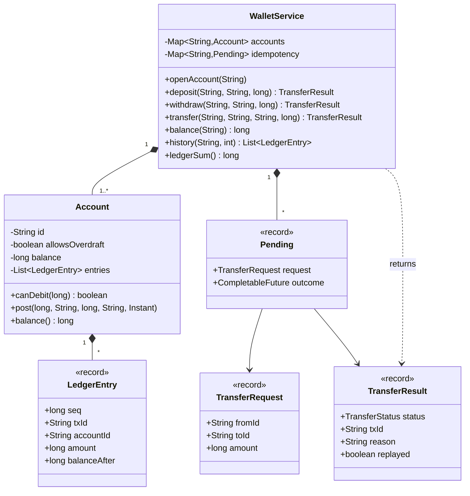
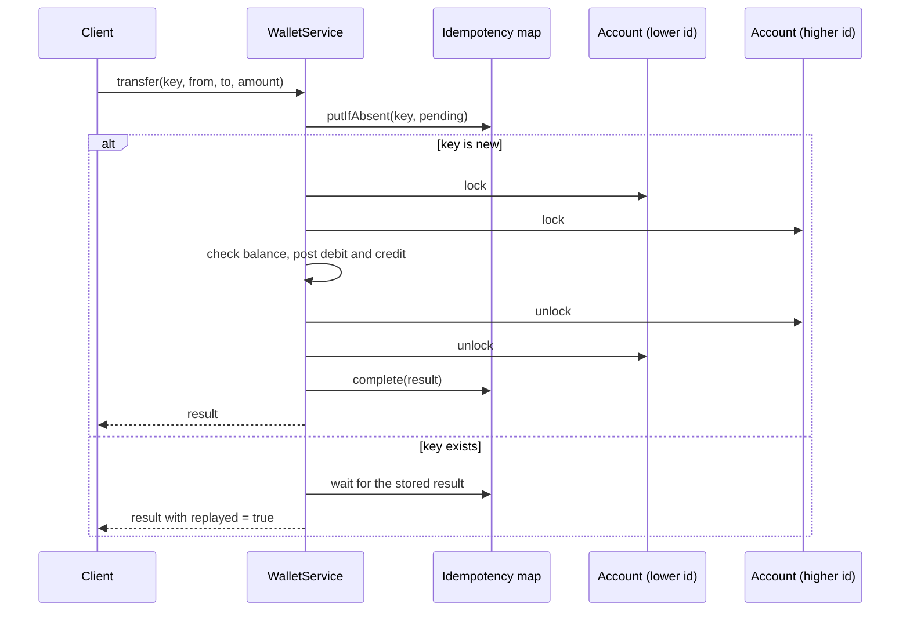

# Design a Digital Wallet

A digital wallet holds money for users and moves it between them. The problem looks like "two fields and a subtraction". It tests four things that every payment system needs: money as exact integers, a double-entry ledger that cannot lose a cent, idempotency keys that make a retry safe, and lock ordering so that concurrent transfers do not deadlock. This page follows the procedure in [how to approach an LLD interview](../../how-to-approach-lld.md). The folder holds this page and one runnable `Main.java`. Run it with `java Main.java` (JDK 21).

## Problem Statement

Design a wallet service. A user has one wallet account. The user adds money from outside (a deposit), sends money to another user (a transfer), and takes money out (a withdrawal). The user reads the balance and the transaction history. The network is unreliable: a client that gets no answer sends the same request again, and the wallet must not move the money twice. Many transfers run at the same time, and the total amount of money in the system must stay the same.

## Clarifying Questions

Ask these in the first 5 minutes. Each row gives the answer that this design assumes.

| Question | Assumed answer |
|---|---|
| How do we store money? | As a `long` in minor units (cents). No `double`. One currency. Several currencies are an extension |
| Can a balance go below zero? | No, for user accounts. The system account `EXTERNAL` can, because it represents the outside world |
| Which operations exist? | Open account, deposit, withdraw, transfer, balance, history |
| How does money enter and leave? | A deposit is a transfer from `EXTERNAL` to the user. A withdrawal is a transfer from the user to `EXTERNAL`. The wallet does not call a bank |
| How does the wallet record money movement? | In a double-entry ledger. Each transfer writes one debit entry and one credit entry. The entries of a transfer sum to zero |
| What happens when a client retries? | The client sends an idempotency key with each request. The same key with the same request returns the first result. The same key with a different request is an error |
| Who creates the key, and what is its scope? | The client creates it (for example a UUID) before the first attempt and reuses it for every retry. This demo has one key space for the whole wallet. A real API scopes the key to the caller (user or merchant), so two callers cannot collide |
| How long does the wallet keep a key? | In the demo, forever. A real wallet keeps it for a fixed window (for example 24 hours) and then deletes it. An extension shows the sweeper |
| What does a retry see while the first attempt still runs? | It waits for the first result and then returns it. It does not run the transfer a second time |
| What if the first attempt fails with a bug (an exception), not with a business rule? | The wallet releases the key and the caller gets the exception. A later retry with the same key runs again |
| Are rejected requests remembered under the key? | Yes. A retry of a declined transfer gets the same decline. A new attempt needs a new key |
| Is there a maximum amount? | Assumption: amounts fit in a `long` with room to spare. A production wallet sets a maximum per transfer and uses `Math.addExact`, which throws on overflow |
| Do we need a history? | Yes. The newest entry comes first. Each entry shows the balance after it |
| Is there a fee, a limit, or a hold? | No. These are extensions |
| Do many threads call the service at once? | Yes. Transfers between the same accounts run in both directions at the same time |
| Is storage in memory? | Yes. The Extensions section shows what changes for a database |

## Requirements

### Functional

1. A user opens an account. The account starts with balance 0.
2. A deposit adds money from `EXTERNAL`. A withdrawal sends money to `EXTERNAL`.
3. A transfer moves an amount from one account to another. It fails if the amount is not positive, if both accounts are the same, if an account does not exist, or if the source has too little money.
4. Each successful transfer writes two ledger entries with the same transaction id: a debit of the source and a credit of the destination.
5. Each request has an idempotency key. The wallet runs the request once for each key and returns the stored result for every retry.
6. The history of an account lists its ledger entries, newest first.

### Non-functional

1. The two entries of each transfer sum to 0, so the sum of all ledger entries is 0 whenever no transfer is in progress. The balance of each account equals the sum of its entries.
2. A user balance never goes below 0, also under concurrent transfers.
3. Concurrent transfers do not deadlock, including transfers in opposite directions between the same two accounts.
4. Two requests with the same key that arrive at the same time run the transfer once.
5. The clock is injected, so entry timestamps are testable.
6. A new rule (fee, limit, currency) changes few classes.

## Entities and Relationships

| Entity | Responsibility | Relationships |
|---|---|---|
| `WalletService` | Facade. Validates a request, enforces idempotency, orders the locks, and posts the entries | Has many `Account`. Uses a `Clock`. Has an idempotency map of `Pending` records |
| `Account` | Holds the balance and the entries of one account. Decides if it can pay an amount | Has many `LedgerEntry` (composition). Belongs to the service |
| `LedgerEntry` | One signed line of the ledger: transaction id, account, amount, balance after, memo, time | Immutable record. Two entries share one transaction id |
| `TransferRequest` | The payload of a request: source, destination, amount. Two requests are equal if the three fields are equal | Held in `Pending` for the key check |
| `TransferResult` | The outcome: `COMPLETED` or `REJECTED`, the transaction id, a reason, and a `replayed` flag | Stored under the idempotency key |
| `Pending` | An idempotency record: the request and a `CompletableFuture` of the result | Private to the service |
| `IdempotencyConflictException` | Thrown when a key comes back with a different request | |
| `EXTERNAL` | A system account (`WalletService.EXTERNAL`) with `allowsOverdraft = true`. It stands for the world outside the wallet. Its balance is minus the money inside the wallet | An `Account` |

Why `EXTERNAL` is an account and not a special case: with it, a deposit and a withdrawal are ordinary transfers. They write two entries, they take two locks in order, and the sum of all entries stays 0. The wallet has one code path for all money movement, so it has one place to get right.

### Double-entry bookkeeping, precisely

Double-entry bookkeeping is a rule for the ledger: every movement of money writes at least two entries, and the entries of one movement sum to zero. In this design, every transfer writes exactly two entries with the same transaction id:

- a **debit** entry on the source account, with a negative amount (money leaves);
- a **credit** entry on the destination account, with the same amount, positive (money arrives).

Because each pair sums to zero, the sum of all entries in the ledger is zero. Because each account also keeps its balance as the running sum of its own entries, a balance can be rebuilt from the entries at any time. If a bug writes one side only, or changes a balance without an entry, one of the two checks (`ledgerSum() == 0`, `reconciles()`) fails.

The first three transactions of the demo:

| Transaction | Entry on the source | Entry on the destination | Sum of the pair | `EXTERNAL` | alice | bob | Sum of all balances |
|---|---|---|---|---|---|---|---|
| TX-1: deposit 10000 to alice | `EXTERNAL` -10000 | alice +10000 | 0 | -10000 | 10000 | 0 | 0 |
| TX-2: alice sends 2500 to bob | alice -2500 | bob +2500 | 0 | -10000 | 7500 | 2500 | 0 |
| TX-3: bob withdraws 500 | bob -500 | `EXTERNAL` +500 | 0 | -9500 | 7500 | 2000 | 0 |

After TX-3, the wallet holds 9500 for its users, and `EXTERNAL` shows -9500. The money that users hold equals minus the balance of `EXTERNAL`. Without `EXTERNAL`, a deposit would write one entry only, and the sum of the ledger would equal the money in the wallet. The audit would then have no fixed target value.

A note on the sign convention: this page uses one signed amount for each entry. Negative means money leaves the account. Accounting textbooks instead define debit and credit by account type (a debit increases an asset account and decreases a liability account). A user wallet balance is a liability of the wallet company. The signed form gives the same invariant (the entries of a transaction sum to zero), and it is the common form in code. Say which convention you use if the interviewer asks.

## Class Diagram



See [UML class and sequence diagrams](../../fundamentals/04-uml-class-and-sequence-diagrams.md) for the notation. The flow of one transfer:



## Design Patterns Used

| Pattern | Where | Why | Rejected alternative |
|---|---|---|---|
| Facade | `WalletService` | One entry point hides the idempotency check, the lock order, and the double entry. Callers cannot post one side of a transfer | Public `Account.debit` and `Account.credit`. A caller can write one entry and break the sum |
| Value objects (records) | `LedgerEntry`, `TransferRequest`, `TransferResult` | They are immutable, so threads share them with no lock. Record equality gives the same-request check for free | Mutable classes with setters |
| Double-entry bookkeeping | Two entries for each transfer | The two entries of a transfer sum to 0, so the whole ledger sums to 0 when no transfer runs. A bug that loses or creates money makes the audit fail. See [domain modeling](../../fundamentals/05-domain-modeling.md) for value objects and money | A balance field only. A bug changes one balance and nothing shows it |
| Idempotent receiver | `Pending` and the `idempotency` map | A client retries after a timeout. The wallet returns the first result and runs nothing | No keys. A retry moves the money twice |
| Ordered locking | `execute` locks the smaller id first | Removes the circular wait, so no deadlock. See [concurrency in LLD](../../fundamentals/09-concurrency-in-lld.md) | `tryLock` with a timeout and a retry. It works, but it can livelock and the code is longer |
| Future as a pending result | `CompletableFuture` in `Pending` | A second request with the same key that arrives while the first runs waits for the result, with no lock held | `computeIfAbsent` that runs the transfer inside the mapping function. The javadoc says that some update operations on the map by other threads may be blocked while the computation runs, so the computation should be short and simple. A transfer that waits for two account locks is not short |

The design does not use State for the account (active, frozen, closed). The statement has no such rule. A `status` field is an extension. See [behavioral patterns](../../fundamentals/08-behavioral-patterns.md). It does not use Singleton for the service. The service is passed to its callers, so tests build a fresh wallet. See [creational patterns](../../fundamentals/06-creational-patterns.md).

## Key Code

### Entries and results

A `LedgerEntry` is a signed line. A negative amount is a debit. A positive amount is a credit. The entry stores the balance after it, so the history needs no replay.

```java
/** One line of the ledger. A negative amount is a debit. A positive amount is a credit. */
record LedgerEntry(long seq, String txId, String accountId, long amount, long balanceAfter,
                   String memo, Instant at) {
    @Override
    public String toString() {
        return "#" + seq + " " + txId + " " + (amount < 0 ? "DEBIT " : "CREDIT ")
                + Math.abs(amount) + " balance=" + balanceAfter + " (" + memo + ")";
    }
}
```

`TransferResult` has two outcomes. A business failure (not enough money) is a result, not an exception. The reason is that the wallet stores the result under the key, and a retry must return the same answer.

```java
record TransferResult(TransferStatus status, String txId, String reason, boolean replayed) {
    static TransferResult completed(String txId) {
        return new TransferResult(TransferStatus.COMPLETED, txId, "", false);
    }

    static TransferResult rejected(String reason) {
        return new TransferResult(TransferStatus.REJECTED, "-", reason, false);
    }

    TransferResult asReplay() {
        return new TransferResult(status, txId, reason, true);
    }
}
```

```java
final class IdempotencyConflictException extends RuntimeException {
    IdempotencyConflictException(String key) {
        super("idempotency key " + key + " was used with a different request");
    }
}
```

### The account

`Account` owns its balance and its entries. It does not lock itself. The service locks the accounts in order, because a transfer needs two accounts at once, and a lock inside each method cannot make two accounts atomic. The comments on `canDebit` and `post` state this rule. The reads (`balance`, `entriesNewestFirst`) use `synchronized`, so a reader sees a consistent value.

```java
/** An account. Its balance and its entries change only while a caller holds its monitor. */
final class Account {
    private final String id;
    private final boolean allowsOverdraft;
    private long balance;                                      // guarded by this
    private final List<LedgerEntry> entries = new ArrayList<>(); // guarded by this

    Account(String id, boolean allowsOverdraft) {
        this.id = id;
        this.allowsOverdraft = allowsOverdraft;
    }

    String id() {
        return id;
    }

    /** The caller must hold the monitor of this account. */
    boolean canDebit(long amount) {
        return allowsOverdraft || balance >= amount;
    }

    /** The caller must hold the monitor of this account. */
    void post(long seq, String txId, long amount, String memo, Instant at) {
        balance += amount;
        entries.add(new LedgerEntry(seq, txId, id, amount, balance, memo, at));
    }

    synchronized long balance() {
        return balance;
    }

    synchronized List<LedgerEntry> entriesNewestFirst(int limit) {
        List<LedgerEntry> copy = new ArrayList<>(entries);
        Collections.reverse(copy);
        return copy.subList(0, Math.min(limit, copy.size()));
    }

    synchronized long entrySum() {
        long sum = 0;
        for (LedgerEntry e : entries) {
            sum += e.amount();
        }
        return sum;
    }
}
```

### The service: idempotency

`transfer` runs the request once for each key. `putIfAbsent` is atomic, so exactly one caller gets `null` and runs the transfer. Every other caller finds the first `Pending`. If the request differs, the key was reused by mistake. If the request is the same, the caller waits for the first result with `join` and returns a copy that has `replayed = true`.

The `Pending` record goes into the map before the transfer runs. This is the reason for the `CompletableFuture`: a record must exist while the result does not exist yet.

```java
    /** Runs the transfer once for each key. A retry with the same key gets the first result. */
    TransferResult transfer(String key, String fromId, String toId, long amount) {
        TransferRequest request = new TransferRequest(fromId, toId, amount);
        Pending mine = new Pending(request, new CompletableFuture<>());
        Pending existing = idempotency.putIfAbsent(key, mine);
        if (existing == null) {
            try {
                TransferResult result = execute(request);
                mine.outcome().complete(result);
                return result;
            } catch (RuntimeException | Error e) {
                // An unexpected failure frees the key, so a later retry runs again.
                // This is safe only if execute changed nothing before it threw.
                idempotency.remove(key, mine);
                mine.outcome().completeExceptionally(e);   // waiters get a CompletionException
                throw e;
            }
        }
        if (!existing.request().equals(request)) {
            throw new IdempotencyConflictException(key);
        }
        return existing.outcome().join().asReplay();
    }
```

The four cases for one key:

| Case | What the caller sees |
|---|---|
| First caller | `putIfAbsent` returns `null`. The caller runs `execute`, completes the future, and returns the result with `replayed = false` |
| Same key, same request, first attempt finished | `join` returns at once. The caller returns the stored result with `replayed = true`. A stored rejection replays too |
| Same key, same request, first attempt still running | The caller blocks in `join` until the first caller completes the future. It holds no lock while it waits. Then it returns the result with `replayed = true` |
| Same key, different request | `IdempotencyConflictException`, at once. The caller does not wait |

The failure path. If `execute` throws (a bug, not a business rule), the first caller does three things:

1. `idempotency.remove(key, mine)` removes the key. The two-argument `remove` removes the entry only if it still maps to this caller's `Pending`, so it never removes a record of a later attempt.
2. `completeExceptionally(e)` wakes the waiters. `join` throws a `CompletionException` with `e` as its cause (`CompletableFuture.join` javadoc), so each waiter fails as well. A waiter does not retry by itself.
3. The first caller rethrows `e`. The catch covers `RuntimeException | Error`. If it covered only `RuntimeException`, an `Error` (for example `OutOfMemoryError`) would leave a future that never completes, and every later retry with that key would block in `join` forever.

Can two executions for one key run at the same time? No. The key stays in the map until `execute` has returned or thrown. A new caller can claim the key only after `remove`, and by then the first execution has ended. Two executions can run one after the other: the failed one, then the retry.

That sequence is safe only if the failed execution changed nothing. In this code, the checks that can fail run before the first `post`, and `post` only adds to a field and to a list. The one gap: an `Error` thrown inside the second `post` (out of memory in `entries.add`) leaves a debit with no credit, and the retry debits again. Memory has no rollback. A database closes this gap: the two entries, the balance updates, and the key record commit in one transaction, and a failure rolls back all of them. A business rejection is not an exception, so it stays stored under the key.

### The service: the transfer

`execute` checks the input, finds the accounts, and orders the locks by account id. The smaller id is locked first in every transfer, whatever the direction. The balance check and both postings happen inside the two locks, so the check and the change are one step. Each posting takes its own `seq`, and the two entries have the same `txId`. The method does not call anything slow (a bank, a fraud service) while it holds the locks.

```java
    private TransferResult execute(TransferRequest request) {
        if (request.amount() <= 0) {
            return TransferResult.rejected("amount must be positive");
        }
        if (request.fromId().equals(request.toId())) {
            return TransferResult.rejected("same account");
        }
        Account from = accounts.get(request.fromId());
        Account to = accounts.get(request.toId());
        if (from == null || to == null) {
            return TransferResult.rejected("unknown account");
        }
        // Lock ordering: every transfer locks the account with the smaller id first.
        Account first = from.id().compareTo(to.id()) < 0 ? from : to;
        Account second = first == from ? to : from;
        synchronized (first) {
            synchronized (second) {
                if (!from.canDebit(request.amount())) {
                    return TransferResult.rejected("insufficient funds");
                }
                String txId = "TX-" + txSeq.incrementAndGet();
                Instant now = clock.instant();
                from.post(entrySeq.incrementAndGet(), txId, -request.amount(),
                        "to " + to.id(), now);
                to.post(entrySeq.incrementAndGet(), txId, request.amount(),
                        "from " + from.id(), now);
                return TransferResult.completed(txId);
            }
        }
    }
```

### The checks

`ledgerSum` adds the entries of every account. `reconciles` compares each balance with the sum of its entries. Both methods lock one account at a time, not all accounts at once. If a transfer from A to B commits after the method has read A and before it reads B, the method counts the credit and misses the debit, and the sum is not 0. The result is exact only when no transfer runs, which is how the demo calls them (after `join`). A real wallet runs the audit on a consistent snapshot: a database read at one point in time, or the entries up to one sequence number.

```java
    /** Sum of all ledger entries. Double entry makes it zero. */
    long ledgerSum() {
        long sum = 0;
        for (Account account : accounts.values()) {
            sum += account.entrySum();
        }
        return sum;
    }
```

```java
    /** Checks that each balance equals the sum of its entries. */
    boolean reconciles() {
        for (Account account : accounts.values()) {
            if (account.balance() != account.entrySum()) {
                return false;
            }
        }
        return true;
    }
```

## Concurrency

Three things race: the balance check, the lock order, and the repeated key.

### Race 1: check, then act on the balance

The wrong form reads the balance, and then subtracts:

<!-- fragment -->
```java
// Wrong: check, then act. Two transfers can both pass the check.
if (from.balance() >= amount) {
    from.setBalance(from.balance() - amount);
    to.setBalance(to.balance() + amount);
}
```

Two threads each send 80 from an account that holds 100. Both read 100, both pass, and the balance becomes -60 or 20 (a lost update). The money no longer adds up. The design takes the locks of both accounts, and checks the balance inside them. The check and the postings are one step.

### Race 2: opposite transfers deadlock

Thread 1 sends from A to B. It locks A and waits for B. Thread 2 sends from B to A. It locks B and waits for A. Each thread holds what the other needs, and neither continues. This is a deadlock (a cycle in the wait-for relation).

The fix removes the circular wait. Every transfer locks the account with the smaller id first:

<!-- fragment -->
```java
Account first = from.id().compareTo(to.id()) < 0 ? from : to;
Account second = first == from ? to : from;
synchronized (first) {
    synchronized (second) {
        // check and post
    }
}
```

A thread that holds a smaller id waits only for a larger id. A cycle would need a thread that holds a larger id and waits for a smaller id, and no thread does that. The order key must be unique and stable: the account id is both. If the objects had no unique key, the order could use `System.identityHashCode` with an extra tie-breaking lock for equal hash codes (Goetz et al., *Java Concurrency in Practice*, section 10.1.2).

The same-account case. If `from` and `to` are the same account, `compareTo` returns 0, and the code picks the same object as `first` and `second`. A Java monitor is reentrant (JLS section 17.1), so the nested `synchronized` blocks would not deadlock. A non-reentrant lock (a `Semaphore` with one permit, or a `StampedLock`) would wait for itself forever. The transfer would also post a debit and a credit on one account, which moves no money and adds two useless entries. For both reasons, `execute` rejects the request before it takes a lock. See [concurrency in LLD](../../fundamentals/09-concurrency-in-lld.md) for the full demo of the wrong form with `tryLock`, and for the alternatives (a timeout, one global lock).

### Race 3: the same key arrives twice at the same time

If the retry waits until the first request ends, a map lookup is enough. If both requests run at the same time, a lookup and an insert as two steps can run the transfer twice: both threads read "no key", and both insert and run. The design uses `putIfAbsent`, which is one atomic step on a `ConcurrentHashMap`. The loser waits on the `CompletableFuture` of the winner. Scene 5 of the demo starts 8 threads with one key. The result is always 1 executed and 7 replayed, and the receiver has one ledger entry. The failure path of the key is in [the service: idempotency](#the-service-idempotency).

### The hot `EXTERNAL` account

Every deposit and every withdrawal locks `EXTERNAL`. All deposits and withdrawals therefore run one at a time, even for unrelated users. In an interview, name this cost. Two fixes:

- Split `EXTERNAL` into N system accounts (`EXTERNAL-0` to `EXTERNAL-15`) and pick one by a hash of the user id. The ledger sum stays 0, and N deposits run in parallel.
- `EXTERNAL` allows an overdraft, so it never needs a balance check. Post its entry with an atomic append (a lock-free queue and an `AtomicLong` balance) and lock only the user account. The lock order rule then covers one lock. The cost: the balance and the entry list of `EXTERNAL` no longer change in one step, so the reconcile check for `EXTERNAL` needs a snapshot.

The same problem applies to a merchant that receives many payments. The common fix there is the same split into sub-accounts.

### What the lock covers

| State | Protection | Reason |
|---|---|---|
| Balance and entries of an account | The monitor of the `Account` | The invariant (balance equals the sum of entries) spans two fields |
| Two accounts of one transfer | Both monitors, smaller id first | A transfer must be atomic across two accounts, and must not deadlock |
| Account map | `ConcurrentHashMap` | Opening an account does not need the account locks |
| Idempotency map | `ConcurrentHashMap.putIfAbsent` | One atomic claim of the key |
| Transaction and entry numbers | `AtomicLong` | Unique ids without a lock. Two transfers can finish in a different order than their numbers |
| Entries, requests, results | Immutable records | Nothing to protect |

Why no global lock: one lock for the whole wallet is correct and simple, and it is the right first answer. It serializes transfers between unrelated accounts. With one lock per account, two transfers that touch different accounts run in parallel, and the cost is the lock order. Transfers that touch the same hot account (a merchant that receives many payments) still wait for each other, with either design.

!!! tip "What to say in the interview"
    "A transfer changes two accounts, so I lock both, smaller id first, and I check the balance inside the locks. I write a debit and a credit with the same transaction id, so every transfer sums to zero and the whole ledger sums to zero. A client sends an idempotency key, and I claim the key with an atomic `putIfAbsent` before I move any money. A retry that arrives while the first attempt runs waits for its result."

### What the demo shows

Scene 6 starts 8 threads. Each thread makes 2000 transfers between 4 accounts with a seeded `Random`. The threads race, so the order of the transfers differs on every run. The demo prints only values that do not depend on the order: the final balances (each thread draws the same transfers on every run because of the seed, and no transfer fails for lack of funds because each account starts with 10,000,000; a draw where both accounts are the same is rejected on every run), the ledger sum, and the reconciliation result.

## Extensions

Interviewers ask for these changes. Each row names the classes that change.

| Extension | Change | Unchanged |
|---|---|---|
| Several currencies | Add a `Currency` to `Account` and to `TransferRequest`. Reject a transfer between two different currencies, or add an `ExchangeRateProvider` interface and write four entries (two per currency) through a currency-exchange account of the wallet. Store amounts as minor units of the account currency | The lock order, the idempotency logic |
| Transfer fee | Add a `FeePolicy` interface (Strategy) that returns the fee for a request. `execute` posts a third entry that credits a `FEES` system account. The three entries still sum to 0. The source needs amount plus fee | `Account`, idempotency |
| Daily limit and risk rules | Add a `TransferRule` interface with `Optional<String> check(request, from)`, and a list of rules (Chain of Responsibility). A stateless rule (a maximum amount per transfer) runs before the locks. A rule that reads account state (the sum of today's debits) runs inside the source account lock, next to `canDebit`. Outside the lock, two transfers both pass the limit check, which is the same check-then-act race as Race 1. A rule that calls a remote fraud service runs before the locks, and the result is a hint, not a guarantee | Ledger, accounts |
| Hold and capture (card authorization) | Add a `holds` map in `Account` and an `available` figure (balance minus holds). `canDebit` checks `available`. A capture posts the entries and removes the hold. Holds expire through the injected `Clock` | Transfer path for plain transfers |
| Reverse a transfer (refund) | Add `reverse(key, txId)`. It posts two new entries with the opposite signs and the memo "reversal of TX-n". It never edits or deletes an old entry, because the ledger is append only | `LedgerEntry`, `Account` |
| Idempotency key expiry | Store the creation time in `Pending`. A sweeper removes keys older than a window (for example 24 hours) using the `Clock`. A TTL store is shown in [key-value store with TTL](../19-key-value-store-with-ttl/README.md) | `execute` |
| Persistence | Add a `LedgerRepository` and an `IdempotencyRepository`. In a database, the two postings and the key record go in one transaction. A unique constraint on the key replaces `putIfAbsent`. `SELECT ... FOR UPDATE` on the two account rows in id order replaces the monitors. The ordering rule stays the same. See the HLD payment-system page `kb/hld/case-studies/13-payment-system.md` for the distributed version | Domain classes |
| Pagination of the history | Change `history(id, limit)` to `history(id, beforeSeq, limit)`. A cursor on `seq` stays stable while new entries arrive, and an offset does not | `Account` entries |
| Distributed wallet (one account per shard) | A transfer across two shards cannot use two monitors. Use a saga or two-phase commit. This is an HLD topic. See `kb/hld/case-studies/13-payment-system.md` and `kb/hld/fundamentals/12-reliability-patterns.md` | Not in scope here |
| Hot system account | Replace the single `EXTERNAL` with N sub-accounts chosen by a hash of the user id. `deposit` and `withdraw` pick the sub-account. `ledgerSum` is unchanged, because each sub-account follows the same double-entry rule | `Account`, `execute`, idempotency |
| Account status (frozen, closed) | Add an enum `AccountStatus` to `Account`. `canDebit` and a new `canCredit` check it. For many states with different behavior, use the State pattern | `WalletService` |

## Common Mistakes

1. Using `double` or `float` for money. Binary floating point cannot represent 0.10 exactly, and the error grows with each operation. Use `long` minor units or `BigDecimal`. See [domain modeling](../../fundamentals/05-domain-modeling.md).
2. Storing only a balance, with no ledger. When the balance is wrong, nothing shows where the money went.
3. Writing one side of a transfer. A debit with no credit creates a hole. Post both entries inside the same lock.
4. Checking the balance before the lock. This is check-then-act, and two transfers overdraw the account.
5. Locking in the order "from, then to". Two opposite transfers deadlock. Order the locks by a stable key.
6. Locking an account that appears twice (`from == to`). With a non-reentrant lock this deadlocks. With `synchronized` it does not deadlock, but it writes two entries that move nothing. Reject it first.
7. Running the transfer inside `ConcurrentHashMap.computeIfAbsent`. The javadoc says that some attempted update operations on the map by other threads may be blocked while the computation is in progress, so the computation should be short and simple. It also says that the mapping function must not modify the map, and the method may throw `IllegalStateException` if the function detectably attempts a recursive update. (In the JDK 21 source, the blocking comes from a lock on one bin of the hash table, so other keys in that bin wait too. That is an implementation detail, not a javadoc promise.) Claim the key with `putIfAbsent` and run the transfer outside the map.
8. Storing only successful results under the idempotency key. A retry of a declined transfer then runs again, and may succeed later with different funds. Decide the rule and state it.
9. Not comparing the request to the stored request. A client bug reuses a key for a different amount, and the wallet silently returns the old result.
10. Using the system clock inside the domain code. Tests cannot fix the time. Inject a `Clock`.
11. Editing or deleting a ledger entry to fix a mistake. A ledger is append only. Post a reversal.
12. Returning the internal entry list. Callers can change the history. Return a copy.
13. Calling an external service (a bank, a fraud check) while holding the account locks. The call can take seconds, and every transfer on those accounts waits. Call it before the lock or after it.
14. Catching only `RuntimeException` around the first execution. An `Error` leaves the future incomplete, and every retry with that key waits forever. Catch `RuntimeException | Error`, or complete the future in a `finally` block.
15. Releasing the idempotency key after a failure that already changed state. The retry then applies the change a second time. Release the key only when the failed attempt changed nothing, which a database transaction guarantees.
16. Running the audit (`sum of entries == 0`) while transfers run, with one lock per account. The audit reports a false error. Audit a consistent snapshot.
17. Ignoring overflow. `balance += amount` wraps around silently on a `long`. Set a maximum amount, or use `Math.addExact`.
18. Forgetting that every deposit locks `EXTERNAL`. All deposits then run one at a time. Name the hot account and the fix (sub-accounts).

## 45-Minute Plan

| Minutes | What to do | Output |
|---|---|---|
| 0 to 5 | Ask the questions of the table above. State assumptions: `long` minor units, one currency, no overdraft for users, the `EXTERNAL` account, client-generated idempotency keys, in-memory storage | A numbered requirement list |
| 5 to 10 | List use cases (deposit, withdraw, transfer, balance, history). Name the entities. State the two invariants: each transfer writes a debit and a credit that sum to 0, and each balance equals the sum of its entries. Draw the three-row double-entry table for one deposit, one transfer, and one withdrawal | Entity list, invariants, worked example |
| 10 to 15 | Draw the class diagram with 5 to 6 classes. Write the signatures of `transfer`, `balance`, and `history`. Say that a business rejection is a result, not an exception, because the wallet stores it under the key | Diagram and signatures |
| 15 to 25 | Write `LedgerEntry`, `Account` (with the "caller holds the monitor" rule), and `WalletService.execute` with the input checks, the lock order, the balance check inside the locks, and the two postings | Compiling transfer path |
| 25 to 32 | Write `transfer` with `putIfAbsent` and the `CompletableFuture`. Walk through the four key cases and the failure path (remove the key, complete the future exceptionally, rethrow). Name `history` and skip its body | Compiling idempotency path |
| 32 to 39 | Explain the races: check-then-act on the balance, the deadlock and the lock order, the same-account case, the same key at the same time. Say why `putIfAbsent` and not `get` then `put`, and why not `computeIfAbsent`. Name the hot `EXTERNAL` account | Concurrency answer |
| 39 to 45 | Answer three extensions: fee (a third entry), hold and capture, database (one transaction, a unique key constraint, `SELECT ... FOR UPDATE` in id order). Ask the interviewer a question | Extension answers |

If the interviewer wants a diagram only, spend the freed time on the sequence diagram and on the saga for a distributed wallet. For the 90-minute format see the [machine coding round](../../machine-coding-round.md). The sibling case studies [Splitwise](../06-splitwise/README.md) (balances between users) and [shopping cart and orders](../18-shopping-cart-and-orders/README.md) reuse the money rules of this page.

## Expected Output

<!-- expected-output -->
```text
== 1. Open accounts and deposit ==
TransferResult[status=COMPLETED, txId=TX-1, reason=, replayed=false]
alice=10000 external=-10000
== 2. Transfer and history ==
TransferResult[status=COMPLETED, txId=TX-2, reason=, replayed=false]
TransferResult[status=COMPLETED, txId=TX-3, reason=, replayed=false]
alice=7500 bob=2000
bob #5 TX-3 DEBIT 500 balance=2000 (to EXTERNAL)
bob #4 TX-2 CREDIT 2500 balance=2500 (from alice)
== 3. Rejected transfers ==
TransferResult[status=REJECTED, txId=-, reason=insufficient funds, replayed=false]
TransferResult[status=REJECTED, txId=-, reason=unknown account, replayed=false]
TransferResult[status=REJECTED, txId=-, reason=same account, replayed=false]
TransferResult[status=REJECTED, txId=-, reason=amount must be positive, replayed=false]
alice=7500 bob=2000
== 4. Idempotency keys ==
first:  TransferResult[status=COMPLETED, txId=TX-4, reason=, replayed=false]
retry:  TransferResult[status=COMPLETED, txId=TX-4, reason=, replayed=true]
alice=6500 bob=3000
conflict: idempotency key pay-6 was used with a different request
declined transfer replayed: true
== 5. Eight threads send the same key ==
results=8 executed=1 replayed=7
carol=700 entries=1
== 6. Concurrent transfers with lock ordering ==
a1=9998685
a2=9997223
a3=9993272
a4=10010820
ledger sum=0
every balance equals its entries: true
```
