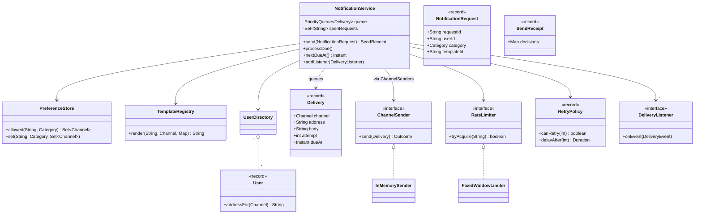
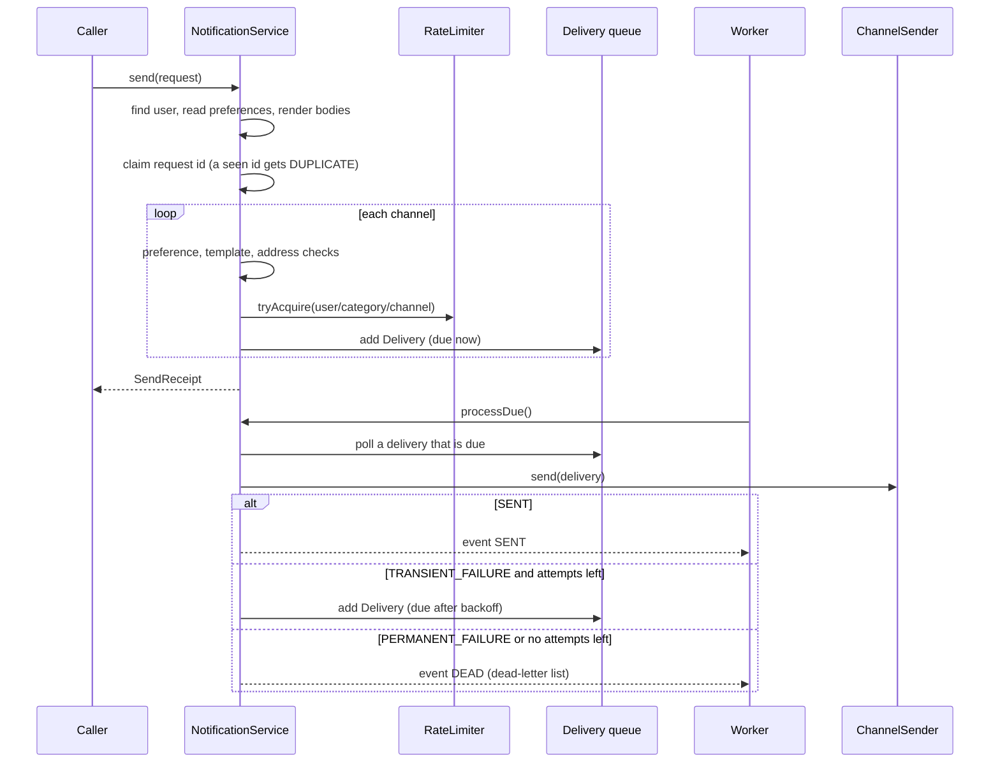

# Design a Notification Service

A notification service sends messages to users through several channels: email, SMS, and push. Many teams call it ("your order shipped", "your code is 4821", "the sale starts today"). The LLD problem is the class design inside one service: one interface for every channel, templates, user preferences, rate limits, and retries with backoff. This page follows the procedure in [how to approach an LLD interview](../../how-to-approach-lld.md). The folder holds this page and one runnable `Main.java`. Run it with `java Main.java` (JDK 21). The distributed system (queues, workers, provider failover, scale to millions) has its own page: see `kb/hld/case-studies/04-notification-system.md`.

## Problem Statement

Design a notification service. A caller (the order service, the login service, the marketing tool) asks the service to notify a user with a template and its parameters. The service chooses the channels that the user allows, renders the message for each channel, and sends it. A send can fail. The service retries a temporary failure with growing delays and gives up after a fixed number of attempts. The service limits how many messages one user receives in a time window. A caller that sends the same request twice must not cause two messages.

## Clarifying Questions

Ask these in the first 5 minutes. Each row gives the answer that this design assumes.

| Question | Assumed answer |
|---|---|
| Which channels exist? | Email, SMS, push. A new channel must be easy to add |
| Does the caller choose the channel? | No. The caller names a category and a template. The user preferences choose the channels |
| Which categories exist? | Transactional (order updates), promotional (marketing), security (login codes) |
| What are the preference defaults? | Transactional and security: all channels are on. Promotional: all channels are off until the user opts in |
| How are messages written? | A template for each channel, with `{name}` placeholders. A template may have no body for a channel |
| What happens when a template has no body for a channel, or the user has no address for it? | The service skips that channel and reports the reason |
| What is a temporary failure? | The provider times out or answers "try later". The service retries |
| What is a permanent failure? | The provider rejects the address. The service does not retry. It moves the message to a dead-letter list |
| How does the retry wait? | Exponential backoff: the wait doubles after each failed attempt, from a base of 1 s, up to a maximum delay of 30 s. At most 3 attempts in total, so the waits are 1 s (after attempt 1) and 2 s (after attempt 2). After a third failure the delivery goes to the dead-letter list. No jitter in the demo. Jitter is an extension |
| What is the rate limit? | 2 messages for each user, category, and channel in a 1-minute window (a small number to show the effect). Security messages are not limited |
| What if the caller sends the same request twice? | Each request has a request id. The service ignores a second request with the same id |
| What if the request is invalid (unknown user, unknown template, missing parameter)? | `send` throws `IllegalArgumentException`. It queues nothing, uses no rate-limit permit, and does not record the request id, so the caller can fix the request and send it again with the same id |
| Are there quiet hours (no promotions at night)? | Not in the core design. The Extensions section shows how the injected `Clock` and the due time of a delivery support them |
| Is delivery exactly once? | No. The design is at-least-once for a delivery that was sent but not acknowledged, and it ignores duplicate requests. Exactly once needs the provider to deduplicate |
| Is the send synchronous? | `send` only decides and queues. A worker loop `processDue` sends. The caller does not wait for the provider |
| Is storage in memory? | Yes. The Extensions section shows the outbox for durability |

## Requirements

### Functional

1. A request has a request id, a user, a category, a template id, and parameters.
2. The service chooses the channels from the user preferences for the category. It skips a channel when the template has no body for it or when the user has no address for it.
3. The service renders the template body for each chosen channel. A missing parameter is an error.
4. A channel sender (Strategy) sends the message. Each channel has its own sender.
5. The service limits the messages for each user, category, and channel in a time window. A category can bypass the limit.
6. The service retries a temporary failure with exponential backoff up to a maximum number of attempts. After the last attempt, or after a permanent failure, the service moves the message to a dead-letter list.
7. The service ignores a request whose request id it has seen.
8. A listener receives an event for each send, retry, and dead letter (Observer).
9. The `send` call returns a receipt that names the decision for each channel.

### Non-functional

1. The retry and the rate limit use an injected `Clock`. The demo never sleeps, so the output is the same on every run.
2. Many threads call `send` at the same time. The rate limit counts exactly, so with a limit of 2 and 16 concurrent calls, exactly 2 queue.
3. Several workers can call `processDue` at the same time. A delivery goes to one worker.
4. A new channel, a new template, or a new limit rule changes few existing classes.
5. A slow or failing provider does not block `send`.

## Entities and Relationships

| Entity | Responsibility | Relationships |
|---|---|---|
| `NotificationService` | Facade. Decides the channels, renders, applies the limit, queues, sends due deliveries, retries, and publishes events | Uses `UserDirectory`, `PreferenceStore`, `TemplateRegistry`, `ChannelSenders`, a `RateLimiter`, a `RetryPolicy`, and a `Clock`. Has many `DeliveryListener` |
| `NotificationRequest` | A caller request: request id, user, category, template id, parameters | Record |
| `SendReceipt` | The decision for each channel (`QUEUED`, `OPTED_OUT`, `NO_TEMPLATE`, `NO_ADDRESS`, `RATE_LIMITED`, `DUPLICATE`) | Record |
| `User`, `UserDirectory` | The address of a user for each channel | `User.addressFor(Channel)` |
| `PreferenceStore` | The channels that a user allows for each category, and the default | Used by the service |
| `Template`, `TemplateRegistry` | The body for each channel and the placeholder fill | A template belongs to the registry |
| `Category` | Transactional, promotional, security. Security bypasses the rate limit | Enum with one flag |
| `Channel` | Email, SMS, push | Enum |
| `Delivery` | One message for one channel: address, rendered body, attempt number, due time | Immutable record. A retry creates a new record |
| `ChannelSender` | Strategy. Sends a delivery and returns an `Outcome` | Implemented by `InMemorySender` in the demo. A real sender calls a provider |
| `ChannelSenders` | Looks up the sender of a channel | Holds a map |
| `Outcome` | `SENT`, `TRANSIENT_FAILURE`, `PERMANENT_FAILURE` | Enum |
| `RetryPolicy` | Maximum attempts, base delay, multiplier, maximum delay | Record with two methods |
| `RateLimiter`, `FixedWindowLimiter` | Allows or refuses a key. The fixed window counts for each key | Interface and one implementation |
| `DeliveryListener`, `DeliveryEvent` | Observer interface and event | The service notifies them |

The service has no class for each channel. A channel is data (an enum constant and a template body) and one `ChannelSender`. This keeps a new channel to one enum constant and one class.

## Class Diagram



See [UML class and sequence diagrams](../../fundamentals/04-uml-class-and-sequence-diagrams.md) for the notation. The flow of one request, and of one retry:



## Design Patterns Used

| Pattern | Where | Why | Rejected alternative |
|---|---|---|---|
| Strategy | `ChannelSender` | Email, SMS, and push differ in how they send. The service calls one interface. A new channel is a new class and the service does not change. See [behavioral patterns](../../fundamentals/08-behavioral-patterns.md) | A `switch` on the channel inside the service. Each new channel edits the service and breaks the Open-Closed Principle. See [SOLID](../../fundamentals/02-solid.md) |
| Strategy | `RateLimiter` | The limit algorithm can change (fixed window, sliding window, token bucket). The service calls `tryAcquire` | A counter map inside the service. The service then owns the algorithm and its tests |
| Strategy (value) | `RetryPolicy` | The backoff rule is data (attempts, base, multiplier, maximum). The service asks two questions | Retry code with constants inside `processDue` |
| Observer | `DeliveryListener` | Metrics, audit logs, and a status page need to see each step. The service must not know them | The service writes to the log and to a metrics class. It couples the service to each of them |
| Facade | `NotificationService` | One entry point hides the preference, template, limit, and queue steps. Callers send one request | Callers call the template registry and the sender themselves. Each caller repeats the rules |
| Immutable value objects (records) | `NotificationRequest`, `Delivery`, `SendReceipt`, `User`, `RetryPolicy` | Threads share them with no lock. A retry creates a new `Delivery` and never changes the old one | A mutable delivery with an `attempts` field that workers change |
| Registry | `TemplateRegistry`, `ChannelSenders`, `UserDirectory` | A lookup by id or channel, with no logic | Static maps. They hide the dependency and make tests share state |

The design does not use Singleton for the service. The service is built in `main` and passed where it is needed. See [creational patterns](../../fundamentals/06-creational-patterns.md). It does not use a State class for the delivery. A delivery has three outcomes, and the service handles them in one `switch`. If the delivery had many states with different behavior (scheduled, paused, cancelled), State would fit. See [structural patterns](../../fundamentals/07-structural-patterns.md) for Facade and Decorator.

## Key Code

### Channels, categories, and the user

`Category` carries one rule: whether it bypasses the rate limit. `User.addressFor` returns the address that a channel needs, or `null`. A `switch` expression over an enum covers each channel, and the compiler reports a missing case.

```java
enum Category {
    TRANSACTIONAL(false), PROMOTIONAL(false), SECURITY(true);

    private final boolean bypassesRateLimit;

    Category(boolean bypassesRateLimit) {
        this.bypassesRateLimit = bypassesRateLimit;
    }

    boolean bypassesRateLimit() {
        return bypassesRateLimit;
    }
}
```

```java
record User(String id, String email, String phone, String deviceToken) {
    String addressFor(Channel channel) {
        return switch (channel) {
            case EMAIL -> email;
            case SMS -> phone;
            case PUSH -> deviceToken;
        };
    }
}
```

### Preferences

`allowed` returns the channels that a user allows for a category. If the user has no setting, the default depends on the category: promotions are opt-in (off until the user turns them on), the other categories are opt-out (on until the user turns them off). The default is a product rule that also depends on the law, so it sits in one place. `set` stores an immutable copy (`Set.copyOf`), so a caller cannot change a stored preference through the set it passed or through the set that `allowed` returns.

An example of such a law (this is not legal advice): in the EU, the [ePrivacy Directive 2002/58/EC](https://eur-lex.europa.eu/eli/dir/2002/58/oj), Article 13(1) (as amended by Directive 2009/136/EC), allows electronic mail for direct marketing only to subscribers who have given prior consent. Article 13(2) makes an exception: a business that obtained a customer's email address in the context of a sale may market its own similar products or services, if the customer can object free of charge and with each message. The directive's definition of electronic mail also covers SMS. This design asks for opt-in for every promotion, which is stricter than Article 13(2) requires. Other countries have different rules. The product and legal teams decide the default, and the code keeps it in one method.

```java
/** What the user allows. A category with no entry allows nothing for PROMOTIONAL. */
final class PreferenceStore {
    private final Map<String, Map<Category, Set<Channel>>> byUser = new ConcurrentHashMap<>();

    void set(String userId, Category category, Set<Channel> channels) {
        byUser.computeIfAbsent(userId, k -> new ConcurrentHashMap<>())
                .put(category, Set.copyOf(channels));
    }

    /** Opt-in for promotions. Opt-out for the other categories. The result is read-only. */
    Set<Channel> allowed(String userId, Category category) {
        Set<Channel> chosen = byUser.getOrDefault(userId, Map.of()).get(category);
        if (chosen != null) {
            return chosen;
        }
        return category == Category.PROMOTIONAL ? Set.of() : Set.of(Channel.values());
    }
}
```

### Templates

`render` replaces each `{key}` placeholder with its parameter in one pass over the body (`Matcher.replaceAll` with a function, Java 9 and later). It returns `null` when the template has no body for the channel. It throws when a placeholder has no parameter, so a message never goes out with a raw `{name}`. The single pass matters: a loop of `String.replace` calls, one for each parameter, expands a placeholder inside a parameter value (a user named `{order}`) when that parameter comes earlier in the loop, and the map gives no fixed order. `Matcher.quoteReplacement` keeps a `$` or a `\` in a value literal.

```java
final class TemplateRegistry {
    private static final Pattern PLACEHOLDER = Pattern.compile("\\{(\\w+)}");

    private final Map<String, Template> templates = new ConcurrentHashMap<>();

    void add(Template template) {
        templates.put(template.id(), template);
    }

    /** Returns the body for the channel, or null if the template has no body for it. */
    String render(String templateId, Channel channel, Map<String, String> params) {
        Template template = templates.get(templateId);
        if (template == null) {
            throw new IllegalArgumentException("unknown template " + templateId);
        }
        String body = template.bodies().get(channel);
        if (body == null) {
            return null;
        }
        // One pass over the body: a value that contains "{x}" is not expanded again.
        return PLACEHOLDER.matcher(body).replaceAll(match -> {
            String value = params.get(match.group(1));
            if (value == null) {
                throw new IllegalArgumentException("missing parameter " + match.group(1)
                        + " in template " + templateId);
            }
            return Matcher.quoteReplacement(value);
        });
    }
}
```

### The sender Strategy

A `ChannelSender` reports one of three outcomes. It does not throw for a provider failure. The service needs to tell "try again" from "stop" and a sender knows the difference, because it reads the provider response (for example an HTTP 503 or an invalid-number code).

```java
enum Outcome { SENT, TRANSIENT_FAILURE, PERMANENT_FAILURE }
```

```java
/** Strategy: one implementation for each channel. */
interface ChannelSender {
    Outcome send(Delivery delivery);
}
```

`InMemorySender` is a test double. It records what it sends, and it fails on command for an address. `computeIfPresent` decrements the failure count in one atomic step, so two workers cannot both use the same planned failure. A real sender has the same interface and calls a provider client.

```java
/** A sender that records what it sends and fails on command. It does not call a provider. */
final class InMemorySender implements ChannelSender {
    private final List<String> sent = new CopyOnWriteArrayList<>();
    private final Map<String, Integer> transientFailuresLeft = new ConcurrentHashMap<>();
    private final Set<String> rejected = ConcurrentHashMap.newKeySet();

    void failTransiently(String address, int times) {
        transientFailuresLeft.put(address, times);
    }

    void rejectPermanently(String address) {
        rejected.add(address);
    }

    List<String> sent() {
        return sent;
    }

    @Override
    public Outcome send(Delivery delivery) {
        if (rejected.contains(delivery.address())) {
            return Outcome.PERMANENT_FAILURE;
        }
        // computeIfPresent is atomic, so two workers never use the same failure twice.
        Integer left = transientFailuresLeft.computeIfPresent(delivery.address(), (a, n) -> n - 1);
        if (left != null && left >= 0) {
            return Outcome.TRANSIENT_FAILURE;
        }
        sent.add(delivery.address() + ": " + delivery.body());
        return Outcome.SENT;
    }
}
```

### Retry policy

`delayAfter(n)` is the wait after attempt `n` fails: `baseDelay * multiplier^(n - 1)`, capped at `maxDelay`. With a base of 1 s and a multiplier of 2, the waits are 1 s, 2 s, 4 s, 8 s, and so on, up to 30 s. `canRetry(attemptsMade)` is true while the attempts made are fewer than the maximum. The demo uses `maxAttempts = 3`: attempt 1 fails and waits 1 s, attempt 2 fails and waits 2 s, and attempt 3 is the last. Scene 4 and scene 5 of the demo show this schedule. A provider can also say how long to wait (the HTTP `Retry-After` header, [RFC 9110 section 10.2.3](https://www.rfc-editor.org/rfc/rfc9110#section-10.2.3)). Recommendation: a production policy uses the larger of the two waits.

```java
/** Exponential backoff without jitter, so the demo is deterministic. */
record RetryPolicy(int maxAttempts, Duration baseDelay, double multiplier, Duration maxDelay) {
    boolean canRetry(int attemptsMade) {
        return attemptsMade < maxAttempts;
    }

    Duration delayAfter(int attemptsMade) {
        double millis = baseDelay.toMillis() * Math.pow(multiplier, attemptsMade - 1);
        return Duration.ofMillis((long) Math.min(millis, maxDelay.toMillis()));
    }
}
```

### Rate limiter

`tryAcquire` uses `ConcurrentHashMap.compute`. The javadoc says that the entire method invocation is performed atomically and that the function is invoked exactly once for each call. So the check (`used < limit`) and the update (`used + 1`) are one step, and two threads cannot both take the last permit. Because the function runs exactly once, the `boolean[] granted` array is a safe way to return a second value from the lambda: only the calling thread reads it, after `compute` returns. The function is short and does not touch the map, as the javadoc requires.

This variant anchors each window at the first permit of a key and keeps it for one `length`. A clock-aligned fixed window (the form in the [rate limiter case study](../03-rate-limiter/README.md)) starts windows at multiples of `length` instead. Both forms have the boundary burst: a user can receive `limit` messages at the end of one window and `limit` more at the start of the next, so up to twice the limit within a span shorter than one window. The `windows` map keeps one entry for every key it has seen. A production limiter removes expired windows (a sweeper, or a cache with expiry). The limiter reads the injected clock. For the other algorithms (token bucket, sliding window log, sliding window counter), see the [rate limiter case study](../03-rate-limiter/README.md) and `kb/hld/fundamentals/13-rate-limiting-algorithms.md`.

```java
/** At most `limit` permits for each key in each window. The window starts at the first permit. */
final class FixedWindowLimiter implements RateLimiter {
    private record Window(Instant start, int used) {
    }

    private final Clock clock;
    private final int limit;
    private final Duration length;
    private final Map<String, Window> windows = new ConcurrentHashMap<>();

    FixedWindowLimiter(Clock clock, int limit, Duration length) {
        this.clock = clock;
        this.limit = limit;
        this.length = length;
    }

    @Override
    public boolean tryAcquire(String key) {
        Instant now = clock.instant();
        boolean[] granted = new boolean[1];
        windows.compute(key, (k, w) -> {
            if (w == null || !now.isBefore(w.start().plus(length))) {
                granted[0] = true;
                return new Window(now, 1);
            }
            if (w.used() < limit) {
                granted[0] = true;
                return new Window(w.start(), w.used() + 1);
            }
            return w;
        });
        return granted[0];
    }
}
```

### The delivery and the service: `send`

A `Delivery` is immutable. `retryAt` builds the record for the next attempt with the attempt number plus one.

```java
/** One message for one channel. The record is immutable. A retry makes a new record. */
record Delivery(long seq, String requestId, String userId, Channel channel, String address,
                String body, int attempt, Instant dueAt) {
    Delivery retryAt(Instant next) {
        return new Delivery(seq, requestId, userId, channel, address, body, attempt + 1, next);
    }
}
```

`send` runs in three phases, and the order matters:

1. **Validate and render, with no side effects.** It finds the user, reads the preferences, and renders the body for each allowed channel. An unknown user, an unknown template, or a missing parameter throws here. Nothing is queued, no permit is used, and the request id is not recorded.
2. **Claim the request id.** `seenRequests.add` is atomic. A second request with the same id gets `DUPLICATE` for every channel.
3. **Decide each channel, take permits, and queue.** The checks run in this order: preference, template body, address, rate limit. The limiter is the last check, so a message that is skipped for another reason does not use a permit.

If phase 2 ran first, a request with a missing parameter would record its id, queue the channels before the failing one, use their permits, and then throw. The caller's corrected retry would get `DUPLICATE`, and the user would get part of the message set. `send` returns a receipt with one decision for each channel, so the caller sees why a message was not queued.

```java
    SendReceipt send(NotificationRequest request) {
        // Phase 1 has no side effects. A bad request throws here and does not use its id.
        User user = users.find(request.userId());
        if (user == null) {
            throw new IllegalArgumentException("unknown user " + request.userId());
        }
        Set<Channel> allowed = preferences.allowed(request.userId(), request.category());
        Map<Channel, String> bodies = new EnumMap<>(Channel.class);
        for (Channel channel : allowed) {
            String body = templates.render(request.templateId(), channel, request.params());
            if (body != null) {
                bodies.put(channel, body);
            }
        }
        // Phase 2 claims the request id. Phase 3 takes permits and queues.
        Map<Channel, Decision> decisions = new EnumMap<>(Channel.class);
        if (!seenRequests.add(request.requestId())) {
            for (Channel channel : Channel.values()) {
                decisions.put(channel, Decision.DUPLICATE);
            }
            return new SendReceipt(request.requestId(), decisions);
        }
        for (Channel channel : Channel.values()) {
            String body = bodies.get(channel);
            String address = user.addressFor(channel);
            if (!allowed.contains(channel)) {
                decisions.put(channel, Decision.OPTED_OUT);
            } else if (body == null) {
                decisions.put(channel, Decision.NO_TEMPLATE);
            } else if (address == null) {
                decisions.put(channel, Decision.NO_ADDRESS);
            } else if (!request.category().bypassesRateLimit()
                    && !limiter.tryAcquire(limitKey(user, request, channel))) {
                decisions.put(channel, Decision.RATE_LIMITED);
            } else {
                enqueue(new Delivery(seq.incrementAndGet(), request.requestId(), user.id(),
                        channel, address, body, 1, clock.instant()));
                decisions.put(channel, Decision.QUEUED);
            }
        }
        return new SendReceipt(request.requestId(), decisions);
    }
```

The limit key is user, category, and channel. A user who receives many promotions on email can still receive a transactional email.

```java
    private static String limitKey(User user, NotificationRequest request, Channel channel) {
        return user.id() + "/" + request.category() + "/" + channel;
    }
```

### The delivery loop

The queue is a `PriorityQueue` ordered by due time and then by sequence number. All access goes through `synchronized (queue)`. `pollDue` checks the head and removes it in one step, so two workers never take the same delivery.

```java
    private void enqueue(Delivery delivery) {
        synchronized (queue) {
            queue.add(delivery);
        }
    }
```

```java
    /** The due time of the next delivery, or null if the queue is empty. */
    Instant nextDueAt() {
        synchronized (queue) {
            return queue.isEmpty() ? null : queue.peek().dueAt();
        }
    }
```

```java
    private Delivery pollDue() {
        synchronized (queue) {
            Delivery head = queue.peek();
            if (head == null || head.dueAt().isAfter(clock.instant())) {
                return null;
            }
            return queue.poll();
        }
    }
```

`processDue` sends every delivery that is due. On a temporary failure with attempts left, it queues a new delivery with the backoff delay. On a permanent failure, or when the attempts end, it adds the delivery to the dead-letter list. A dead letter is a delivery that the service stopped trying. It stays in a separate list, so an operator can inspect it and replay it after the cause is fixed. Each step publishes an event.

```java
    /** One worker pass: send every delivery that is due now. */
    void processDue() {
        Delivery delivery;
        while ((delivery = pollDue()) != null) {
            Outcome outcome = attempt(delivery);
            switch (outcome) {
                case SENT -> publish("SENT", delivery, "");
                case PERMANENT_FAILURE -> deadLetter(delivery, " (permanent failure)");
                case TRANSIENT_FAILURE -> {
                    if (retry.canRetry(delivery.attempt())) {
                        Duration wait = retry.delayAfter(delivery.attempt());
                        enqueue(delivery.retryAt(clock.instant().plus(wait)));
                        publish("RETRY", delivery, " in " + wait.toSeconds() + "s");
                    } else {
                        deadLetter(delivery, " (retries exhausted)");
                    }
                }
            }
        }
    }
```

```java
    /** A sender that throws has a bug or met an unknown error. The delivery gets a retry. */
    private Outcome attempt(Delivery delivery) {
        try {
            return senders.forChannel(delivery.channel()).send(delivery);
        } catch (RuntimeException e) {
            publish("ERROR", delivery, " " + e.getClass().getSimpleName());
            return Outcome.TRANSIENT_FAILURE;
        }
    }
```

`attempt` protects the delivery from a sender that throws. After `pollDue`, the delivery exists only in the worker's local variable. If an exception left `processDue`, the delivery would be in neither the queue nor the dead-letter list, and it would be lost with no trace. `attempt` turns the exception into an `ERROR` event and a `TRANSIENT_FAILURE`, so the normal retry and dead-letter rules apply. The listeners have the same risk: a listener that throws stops the loop. Rule: a listener must not throw. A production `publish` catches and logs a listener exception.

A production worker calls `processDue` in a loop and waits until `nextDueAt()` or until a new delivery arrives. The demo uses `ManualClock.advanceTo(nextDueAt())` in place of a real wait. The service code is the same in both cases.

### The demo helper

The demo moves the manual clock to the next due time and runs the loop again, until the queue is empty. Each printed event shows the simulated time (`t+3s`).

```java
    /** Runs the delivery loop and moves the manual clock to the next retry time. */
    static void runUntilIdle(NotificationService service, ManualClock clock) {
        service.processDue();
        while (service.nextDueAt() != null) {
            clock.advanceTo(service.nextDueAt());
            service.processDue();
        }
    }
```

## Concurrency

The service has five pieces of shared state. Each has one rule.

| State | Protection | Reason |
|---|---|---|
| Rate-limit windows | `ConcurrentHashMap.compute` per key | Check and increment must be one step. Two threads must not both take the last permit |
| Delivery queue | `synchronized (queue)` around every access | A `PriorityQueue` is not thread-safe. `pollDue` checks the head and removes it as one step |
| Seen request ids | `ConcurrentHashMap.newKeySet().add` | `add` is atomic. The first caller gets `true`. A duplicate gets `false` |
| Listeners and dead letters | `CopyOnWriteArrayList` | Few writes and many reads. Iteration works on a snapshot |
| Preferences, users, templates | `ConcurrentHashMap` | Independent lookups and puts |
| `Delivery`, `NotificationRequest`, `RetryPolicy` | Immutable records | Nothing to protect |

### Race 1: the rate limit under many threads

The wrong form reads the count, then writes it:

<!-- fragment -->
```java
// Wrong: check, then act. 16 threads can all read used = 0.
Window w = windows.get(key);
if (w == null || w.used() < limit) {
    windows.put(key, new Window(now, w == null ? 1 : w.used() + 1));
    return true;
}
return false;
```

Many threads read the same count and all pass. The user then receives more messages than the limit. The design does the check and the update in one `compute` call. Scene 7 of the demo starts 16 threads that send a promotion to one user with a limit of 2. The result is always 2 queued and 14 limited. The demo prints only these counts, because the thread that wins depends on the schedule.

### Race 2: the same request id arrives twice

`seenRequests.add(requestId)` is atomic. One caller gets `true` and goes on. The other gets `false` and receives `DUPLICATE`. The set grows without bound in this demo. A production service keeps each id for a fixed window (for example 24 hours) and then removes it.

The crash window between the dedup and the queue. The service records the id (phase 2) before it queues the deliveries (phase 3). In this in-memory demo, a crash loses the set and the queue together, so a retry after the restart is accepted again. The window becomes real when the dedup record is durable and the queue is a separate system, for example a Redis `SET NX` for the id and a message broker for the deliveries. If the process stops after the id is written and before the deliveries are written, the caller retries, the service says `DUPLICATE`, and no message goes out. Writing the deliveries first and the id second has the opposite failure: a retry queues the messages a second time.

The fix is the transactional outbox: one database transaction inserts the request row (with a unique constraint on `request_id`) and one row for each delivery. Either all rows commit, or none do. A duplicate request fails on the unique constraint, and the service answers `DUPLICATE`. See the outbox row in Extensions for how workers claim the rows.

### Race 3: two workers poll the same delivery

If a worker called `peek` and then `poll` in two separate locked steps, two workers could take the same head. `pollDue` does the due check and `poll` in one `synchronized` block, so each delivery goes to one worker. After the poll, the worker owns the delivery and needs no lock to send it.

If a worker stops after it sent the message and before it recorded the result, the system cannot know whether the message went out. A durable system retries, and the user can get a second copy. This is the at-least-once rule. A provider that accepts an idempotency key (a delivery id) removes the duplicate. See the HLD page `kb/hld/case-studies/04-notification-system.md`.

### Do not hold the lock while sending

`processDue` takes the queue lock only for `poll` and `add`. It calls the sender outside the lock. A provider call can take seconds. If the call held the queue lock, `send` would block for the same time. See [concurrency in LLD](../../fundamentals/09-concurrency-in-lld.md) for the rule "no external call while you hold a lock".

Why not `java.util.concurrent.DelayQueue`: it is a thread-safe queue of delayed elements, and a worker can block in `take` until the head is due. Its elements compute their delay from the real time (`getDelay`), so the demo could not move a manual clock. This design keeps a `PriorityQueue` behind one lock and an injected `Clock`, so the tests never sleep. A production worker that runs on real time can use `DelayQueue` with the same `Delivery` data.

`PreferenceStore.set` calls `computeIfAbsent` with a function that only creates an empty map. The `ConcurrentHashMap.computeIfAbsent` javadoc says that some attempted update operations on the map by other threads may be blocked while the computation is in progress, so the computation should be short and simple, and that the mapping function must not modify the map. A constructor call meets both rules.

!!! tip "What to say in the interview"
    "`send` only decides and queues. Sending runs in a worker loop, so a slow provider never blocks a caller. The rate limit uses an atomic `compute`, the queue has one lock, and I never call a provider while I hold it. The clock is injected, so the retry and the limit are testable without sleeping."

## Extensions

Interviewers ask for these changes. Each row names the classes that change.

| Extension | Change | Unchanged |
|---|---|---|
| New channel (WhatsApp, Slack, in-app) | Add a constant to `Channel`. Add a `ChannelSender` class and register it in `ChannelSenders`. Add `User.addressFor` for the new constant. Add template bodies where the channel is wanted | `NotificationService`, `RetryPolicy`, rate limiter |
| Fallback channel | Add a `FallbackPolicy` (for example push, then SMS). When a delivery goes to the dead-letter list, `processDue` asks the policy for the next channel and queues a `Delivery` for it. Security codes use it | Senders, templates |
| Quiet hours (do not disturb) | Add a `QuietHours(LocalTime start, LocalTime end, ZoneId zone)` record to the user preferences. In phase 3 of `send`, convert `clock.instant()` to the user's local time with the zone. If the category is promotional and the time is inside the quiet hours, queue the `Delivery` with `dueAt` set to the next end of the quiet hours (a range such as 22:00 to 07:00 crosses midnight, so the end can be on the next day). Security codes ignore quiet hours. The rate limit counts at queue time. The `Clock` is already injected, so a test sets the time to 23:00 | Senders, retry, queue |
| Jitter in the backoff | Add a `Jitter` interface (none, full, equal) to `RetryPolicy`. Full jitter waits a random time between 0 and the exponential delay. Inject a seeded `Random` in tests. Reason: when a provider fails, many deliveries fail at the same moment, and plain exponential backoff retries all of them at the same moments again. Random waits spread the retries over time. Marc Brooker's simulation in ["Exponential Backoff And Jitter"](https://aws.amazon.com/blogs/architecture/exponential-backoff-and-jitter/) (AWS Architecture Blog, 2015) shows that backoff without jitter keeps the retries in clusters, and that full jitter needs less than half the calls of plain backoff in that test. See `kb/hld/fundamentals/12-reliability-patterns.md` | Service, senders |
| Provider failover and circuit breaker | Wrap each `ChannelSender` in a `CircuitBreakerSender` (Decorator). After N failures it returns `TRANSIENT_FAILURE` at once for a cool-down period, and a `FailoverSender` tries a second provider. See [structural patterns](../../fundamentals/07-structural-patterns.md) | Service |
| Token bucket or sliding window for the limit | Add a new `RateLimiter` implementation, as in the [rate limiter case study](../03-rate-limiter/README.md). Pass it to the constructor | Service |
| Templates with locale and versions | Change the template key to `(id, locale, version)`. `TemplateRegistry.render` takes the user locale and falls back to a default locale. Store the template version in the `Delivery` for the audit | Senders, queue |
| Digest (batch many into one) | Add a `DigestBatcher` that collects promotional requests for a user in a time window and sends one summary. It keeps a map `user -> list` with a flush time from the `Clock` | Senders |
| Scheduled notifications | Add `sendAt` to `NotificationRequest`. `send` sets `dueAt` to `sendAt`. The queue already orders by `dueAt`. A cancel method removes the delivery by request id | Queue ordering |
| Priority | Add a `priority` to `Delivery` and order the queue by priority, then due time. Security codes go before promotions. For separate throughput, use one queue and one worker pool for each priority | Senders |
| Durability (outbox) | Add a `DeliveryRepository`. `send` inserts the request row (unique `request_id`) and the delivery rows in one database transaction, which closes the crash window of Race 2. A worker claims rows in a short transaction: `SELECT ... WHERE status = 'PENDING' AND due_at <= now() ORDER BY due_at LIMIT 10 FOR UPDATE SKIP LOCKED`, then sets `status = 'IN_FLIGHT'` and `lease_until = now() + 1 minute`, then commits. The worker calls the provider after the commit, so no row lock is held during the call. It then marks the row `SENT`, or writes the next `due_at`. A row whose lease ends without a result goes back to `PENDING`, so a crashed worker loses nothing, and the user can get a second copy (at-least-once). `SKIP LOCKED` makes each worker skip rows that another worker has locked, instead of waiting for them. PostgreSQL added it in 9.5 ([release notes](https://www.postgresql.org/docs/release/9.5.0/), [SELECT, the locking clause](https://www.postgresql.org/docs/current/sql-select.html)), and MySQL InnoDB added it in 8.0.1 ([release notes](https://dev.mysql.com/doc/relnotes/mysql/8.0/en/news-8-0-1.html), [locking reads](https://dev.mysql.com/doc/refman/8.0/en/innodb-locking-reads.html)). Both manuals warn that skipping locked rows gives an inconsistent view of the data, so it is not for general transactional work, but it fits a queue-like table with many consumers | Domain rules |
| Dead-letter replay | Add `replay(deliveryId)` that creates a new `Delivery` with attempt 1 from the dead-letter list | Senders |
| Delivery receipts and webhooks | Add `Outcome.DELIVERED` through a callback from the provider. See `kb/api-design/05-webhooks-and-async-apis.md` | Preferences, templates |
| Distributed workers and queues | Replace the in-process queue with a message broker. This is the HLD design. See `kb/hld/case-studies/04-notification-system.md` and `kb/hld/fundamentals/08-message-queues-and-streams.md`. The sibling [pub-sub message queue](../15-pub-sub-message-queue/README.md) shows the in-process version of a broker | Rules, templates |

## Common Mistakes

1. Letting the caller pick the channel. Then every caller must know the user preferences. Let the caller name the category, and let the service decide.
2. A `switch` on the channel inside the service. Each new channel edits the service. Use one `ChannelSender` for each channel.
3. Sending inside `send`. A slow provider blocks the caller, and a failure turns into a caller error. Queue first, then send from a worker.
4. Retrying every failure. A permanent failure (an invalid number) never succeeds. Separate the two outcomes.
5. Retrying with a fixed delay, or at once. A provider that is down receives a burst of retries. Use exponential backoff with a maximum, and add jitter in production, so the retries of many deliveries do not arrive together (see Brooker, "Exponential Backoff And Jitter", in the jitter row of Extensions).
6. Retrying with no limit. The message stays in the queue forever. Set a maximum number of attempts and a dead-letter list.
7. Sleeping on real time in the retry code (`Thread.sleep`). The test is slow and not repeatable. Inject a `Clock`, and keep the due time in the delivery.
8. Checking the rate limit with `get`, then `put`. Concurrent callers pass together. Use an atomic update.
9. Applying the rate limit to security codes. The user cannot log in. Give the category a bypass rule, or use a separate limit.
10. A shared mutable `Delivery` with an `attempts` field. Two workers can change it. Use an immutable record, and create a new one for each retry.
11. Holding the queue lock while calling the provider. All callers wait for the slowest provider.
12. Rendering the template at send time in the worker, after the data has changed. Render when you queue, so the message shows the data of the request. The trade-off: a very long queue holds rendered text.
13. Sending promotions to every channel when the user did not opt in. This breaks the preference rule. It can also break the law: for example, Article 13 of the EU ePrivacy Directive requires prior consent for email and SMS marketing, with a narrow exception for existing customers (see the Preferences section; not legal advice). Keep the default in `PreferenceStore`.
14. Forgetting the duplicate request. A caller that retries after a timeout sends the user two messages.
15. One class for all channels with `if` branches, and the same template body for each channel. SMS has a length limit, and push has a title and a short body. Keep one body for each channel.
16. Recording the request id before the request is validated. A request with a missing parameter then uses its id and some permits, and the corrected retry gets `DUPLICATE`. Validate and render first, with no side effects, and then claim the id.
17. Letting a sender exception escape the worker loop. The polled delivery is then in no queue and no list, and nobody knows that it was lost. Turn the exception into a failure outcome.
18. Filling templates with one `String.replace` for each parameter. A parameter value that contains a placeholder is expanded again, and the result depends on the map order. Replace all placeholders in one pass.

## 45-Minute Plan

| Minutes | What to do | Output |
|---|---|---|
| 0 to 5 | Ask the questions of the table above. State assumptions: categories, preference defaults, retry rule, limit, at-least-once | A numbered requirement list |
| 5 to 10 | List use cases (send, retry, limit, opt out). Name the entities. Mark the variation points: channel, limit algorithm, retry rule | Entity list and three Strategy points |
| 10 to 17 | Draw the class diagram with 8 to 10 classes. Write the signatures of `send`, `processDue`, `ChannelSender`, and `RateLimiter` | Diagram and signatures |
| 17 to 35 | Write the code: enums, `ChannelSender` with one implementation, `RetryPolicy`, `FixedWindowLimiter`, `send` with its three phases, and `processDue` with the retry and dead-letter paths. Name the template registry and skip its body | Compiling core |
| 35 to 41 | Explain the races: the limiter (`compute`), the queue (one lock, no provider call under it), and the duplicate request with its crash window. Say "at-least-once" | Concurrency answer |
| 41 to 45 | Answer three extensions: jitter, quiet hours, outbox with `SKIP LOCKED` and a lease. Say that the distributed version is a separate design. Ask the interviewer a question | Extension answers |

If the interviewer wants a diagram only, spend the freed time on the sequence diagram, on the retry schedule (waits of 1 s and 2 s for 3 attempts), and on the move to a message broker. The sibling case studies [rate limiter](../03-rate-limiter/README.md), [pub-sub message queue](../15-pub-sub-message-queue/README.md), and [task scheduler](../16-task-scheduler/README.md) cover the limit algorithms, the broker, and the delayed execution that this design uses in a simple form. For the 90-minute format, see the [machine coding round](../../machine-coding-round.md).

## Expected Output

<!-- expected-output -->
```text
== 1. Send by user preference ==
SendReceipt[requestId=r1, decisions={EMAIL=QUEUED, SMS=OPTED_OUT, PUSH=QUEUED}]
SendReceipt[requestId=r2, decisions={EMAIL=QUEUED, SMS=QUEUED, PUSH=NO_ADDRESS}]
  [t+0s] SENT EMAIL alice attempt 1
  [t+0s] SENT PUSH alice attempt 1
  [t+0s] SENT EMAIL bob attempt 1
  [t+0s] SENT SMS bob attempt 1
EMAIL -> alice@example.com: Hello Alice, your order A-17 has shipped.
EMAIL -> bob@example.com: Hello Bob, your order B-4 has shipped.
SMS -> +15550002: Bob: order B-4 shipped.
PUSH -> tok-alice: Order A-17 is on its way
== 2. Opt-out and missing address ==
SendReceipt[requestId=r3, decisions={EMAIL=OPTED_OUT, SMS=OPTED_OUT, PUSH=OPTED_OUT}]
SendReceipt[requestId=r4, decisions={EMAIL=OPTED_OUT, SMS=OPTED_OUT, PUSH=NO_ADDRESS}]
== 3. Duplicate request id ==
SendReceipt[requestId=r1, decisions={EMAIL=DUPLICATE, SMS=DUPLICATE, PUSH=DUPLICATE}]
== 4. Retry with backoff ==
SendReceipt[requestId=r5, decisions={EMAIL=QUEUED, SMS=OPTED_OUT, PUSH=OPTED_OUT}]
  [t+0s] RETRY EMAIL carol attempt 1 in 1s
  [t+1s] RETRY EMAIL carol attempt 2 in 2s
  [t+3s] SENT EMAIL carol attempt 3
== 5. Retries run out, and a permanent failure ==
SendReceipt[requestId=r6, decisions={EMAIL=QUEUED, SMS=QUEUED, PUSH=NO_ADDRESS}]
  [t+3s] RETRY EMAIL bob attempt 1 in 1s
  [t+3s] DEAD SMS bob attempt 1 (permanent failure)
  [t+4s] RETRY EMAIL bob attempt 2 in 2s
  [t+6s] DEAD EMAIL bob attempt 3 (retries exhausted)
dead letters: 2
== 6. Rate limit per user ==
SendReceipt[requestId=p1, decisions={EMAIL=QUEUED, SMS=OPTED_OUT, PUSH=OPTED_OUT}]
SendReceipt[requestId=p2, decisions={EMAIL=QUEUED, SMS=OPTED_OUT, PUSH=OPTED_OUT}]
SendReceipt[requestId=p3, decisions={EMAIL=RATE_LIMITED, SMS=OPTED_OUT, PUSH=OPTED_OUT}]
SendReceipt[requestId=s1, decisions={EMAIL=NO_TEMPLATE, SMS=QUEUED, PUSH=NO_TEMPLATE}]
SendReceipt[requestId=s2, decisions={EMAIL=NO_TEMPLATE, SMS=QUEUED, PUSH=NO_TEMPLATE}]
SendReceipt[requestId=s3, decisions={EMAIL=NO_TEMPLATE, SMS=QUEUED, PUSH=NO_TEMPLATE}]
  [t+6s] SENT EMAIL alice attempt 1
  [t+6s] SENT EMAIL alice attempt 1
  [t+6s] SENT SMS alice attempt 1
  [t+6s] SENT SMS alice attempt 1
  [t+6s] SENT SMS alice attempt 1
SendReceipt[requestId=p4, decisions={EMAIL=QUEUED, SMS=OPTED_OUT, PUSH=OPTED_OUT}]
  [t+67s] SENT EMAIL alice attempt 1
== 7. Sixteen threads send to one user ==
queued=2 rate-limited=14
```
