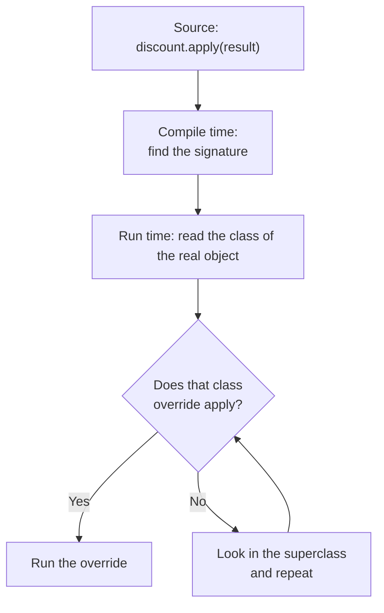
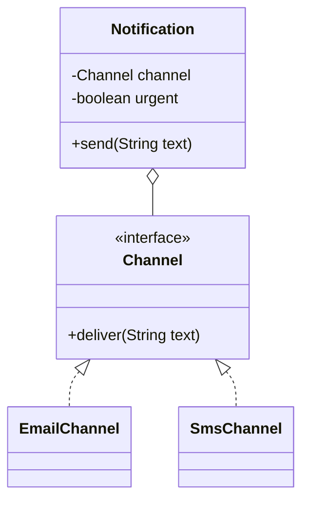

# Object-Oriented Programming for Design

## Why It Matters

Every LLD interview starts from object-oriented programming (OOP). The interviewer asks you to define the four pillars, to compare an abstract class with an interface, and to explain why a design uses composition and not inheritance. In a design round, the same ideas decide whether your class diagram survives a change request. On the job, most defects in object models come from three causes: state that any caller can change, subclasses that depend on the internals of their parent, and overloads that the compiler resolves in a way the author did not expect. This page gives the vocabulary, the Java rules, and the design judgment for these topics. The [SOLID page](02-solid.md) builds on it.

## Core Concepts

### Class, object, state, behavior

- **Class**: a type definition. It declares fields (state) and methods (behavior).
- **Object**: one instance of a class. It has its own copy of the instance fields.
- **State**: the values that the fields of an object hold at one moment.
- **Behavior**: the operations that an object offers. A method reads or changes state.
- **Invariant**: a condition about the state that must hold whenever no method is running on the object. Example: `balance >= 0`.

### Identity and equality

- **Identity**: whether two references point to the same object. Java tests identity with `==`.
- **Equality**: whether two objects represent the same value or the same entity. Java tests equality with `equals`.

`Object.equals` tests identity. A class that needs value equality overrides `equals` and `hashCode` together. The contract for both methods (reflexive, symmetric, transitive, consistent, `null`-safe, and "equal objects have equal hash codes") has its home in `kb/java/01-language-core.md`. This page uses only the result.

```java
final class Customer {
    private final String email;

    Customer(String email) {
        this.email = Objects.requireNonNull(email);
    }

    @Override
    public boolean equals(Object other) {
        return other instanceof Customer c && email.equals(c.email);
    }

    @Override
    public int hashCode() {
        return email.hashCode();
    }

    static void demo() {
        Customer a = new Customer("ada@example.com");
        Customer b = new Customer("ada@example.com");
        System.out.println(a == b);       // false: two objects
        System.out.println(a.equals(b));  // true: same email
    }
}
```

Recommendation: decide for each class whether it is a *value* (equal when the data is equal) or an *entity* (equal when the id is equal, see the [domain modeling page](05-domain-modeling.md)). Write `equals` to match that decision.

### The four pillars

| Pillar | One-sentence definition | Java tool |
|---|---|---|
| Encapsulation | An object keeps its state private and changes it only through methods that protect the invariants | `private` fields, methods, constructors |
| Abstraction | A type shows what an object does and hides how it does it | `interface`, `abstract class` |
| Inheritance | A class reuses and extends the fields and methods of another class | `extends`, `implements` |
| Polymorphism | One call site works with many types, and the runtime type selects the behavior | overriding, interfaces |

### Encapsulation

Encapsulation has two parts: hide the state, and expose operations that keep the invariants true.

A getter and a setter for every field does not hide anything. The caller can read and write the state as if the field were public. The class cannot protect an invariant, because the caller owns the logic.

Wrong form: the caller applies the business rule.

```java
class BankAccount {
    private long balanceInCents;

    public long getBalanceInCents() { return balanceInCents; }
    public void setBalanceInCents(long value) { this.balanceInCents = value; }
}

class Teller {
    void withdraw(BankAccount account, long amount) {
        // Every caller must repeat this check. One caller that forgets it
        // creates a negative balance.
        if (account.getBalanceInCents() >= amount) {
            account.setBalanceInCents(account.getBalanceInCents() - amount);
        }
    }
}
```

Problem: the rule "balance is not negative" lives in every caller. Two threads can both pass the `if` and both write. A new rule (an overdraft limit) needs a change in every caller.

Right form: the object owns the rule.

```java
class BankAccount {
    private long balanceInCents;

    public void deposit(long amountInCents) {
        if (amountInCents <= 0) {
            throw new IllegalArgumentException("amount must be positive");
        }
        balanceInCents += amountInCents;
    }

    public void withdraw(long amountInCents) {
        if (amountInCents <= 0) {
            throw new IllegalArgumentException("amount must be positive");
        }
        if (amountInCents > balanceInCents) {
            throw new IllegalStateException("insufficient funds");
        }
        balanceInCents -= amountInCents;
    }

    public long balanceInCents() { return balanceInCents; }
}
```

The class now enforces the invariant in one place. It exposes a read accessor for the balance and no setter. (Thread safety of this class is a separate topic. See the [concurrency page](09-concurrency-in-lld.md).)

Accessors are fine in two cases: a pure data carrier (a DTO or a record, see below), and a read-only view of state that other code needs. The rule is: expose operations in the language of the domain (`withdraw`), not the storage (`setBalance`).

#### Defensive copies

If a class stores a reference to a mutable object that a caller passed in, the caller keeps a handle on the internal state. If a class returns a reference to its own mutable field, the same problem occurs. A **defensive copy** is a copy that the class makes on the way in and on the way out.

```java
final class Order {
    private final List<String> itemNames;

    Order(List<String> itemNames) {
        // Copy on the way in: later changes to the caller's list do not affect the order.
        this.itemNames = List.copyOf(itemNames);
    }

    List<String> itemNames() {
        // List.copyOf returns an unmodifiable list, so no copy is needed on the way out.
        return itemNames;
    }
}
```

`List.copyOf` (Java 10 and later) returns an unmodifiable list and throws `NullPointerException` for a `null` element. For a mutable type such as `java.util.Date` or an array, copy both on the way in and on the way out. Effective Java, Item 50, gives the rule.

### Abstraction

An **abstraction** is a type whose operations describe a role and not an implementation. In Java, an `interface` is the main tool. It is a **contract**: the callers depend on the method signatures and on the documented behavior, not on the class behind them.

```java
interface PaymentGateway {
    PaymentResult charge(String customerId, long amountInCents);
}

record PaymentResult(boolean success, String reference) {}

class CardGateway implements PaymentGateway {
    @Override
    public PaymentResult charge(String customerId, long amountInCents) {
        // call the card network here
        return new PaymentResult(true, "card-" + customerId);
    }
}

class WalletGateway implements PaymentGateway {
    @Override
    public PaymentResult charge(String customerId, long amountInCents) {
        // debit the stored balance here
        return new PaymentResult(true, "wallet-" + customerId);
    }
}

class CheckoutService {
    private final PaymentGateway gateway;

    CheckoutService(PaymentGateway gateway) { this.gateway = gateway; }

    boolean pay(String customerId, long amountInCents) {
        return gateway.charge(customerId, amountInCents).success();
    }
}
```

`CheckoutService` does not know which gateway it uses. You can add a third gateway without a change to `CheckoutService`.

Encapsulation and abstraction differ in what they hide. Encapsulation hides the *state* of one class. Abstraction hides the *implementation* behind a type.

### Inheritance

**Inheritance** lets a class (the subclass) take the accessible members of another class (the superclass) with `extends`. Java classes have single inheritance: one superclass. A class can implement many interfaces.

Constructors are not inherited. Each constructor of a subclass must call a constructor of the superclass as its first statement, with `super(...)`. If the constructor does not, the compiler inserts `super()`. If the superclass has no accessible no-argument constructor, the subclass does not compile. A constructor can call another constructor of the same class with `this(...)` as its first statement. **Constructor chaining** is this sequence of calls: each constructor calls another constructor of its own class or of its superclass, up to `Object`.

!!! note "Java 25"
    The "first statement" rule holds in Java 21. JEP 513 (Flexible Constructor Bodies, final in Java 25) lets a constructor run statements before `super(...)` or `this(...)`, for example to validate arguments. Those statements can assign fields of their own class that have no initializer, but they cannot read fields or call instance methods of the object under construction. In Java 25, if `Child` in the example below removes the initializer of `name` and assigns `name` before `super()`, `init` sees `"child"`.

Rules for **method overriding** (JLS 8.4.8.1 and 8.4.8.3). A subclass method overrides a superclass instance method if it has the same name and a subsignature. The overriding method must follow these rules:

| Aspect | Rule | Example |
|---|---|---|
| Access | The overriding method may not be less accessible | `protected` can become `public`, not `private` |
| Return type | Primitive and `void`: identical. Reference type: the same type or a subtype (a *covariant return*) | `Animal create()` can become `Dog create()` |
| Checked exceptions | The overriding method may not throw a new or broader checked exception. It may throw fewer, narrower, or unchecked exceptions | `throws IOException` can become `throws FileNotFoundException` or nothing |
| `final` | A `final` method cannot be overridden | |
| `static` | A static method with the same signature *hides* the parent method. It does not override it | See the questions below |
| `private` | A private method is not inherited, so a subclass method with the same name is a new method | |
| Fields | Fields do not override. A field with the same name hides the parent field | |

Put `@Override` on every overriding method. The compiler then reports an error if the method does not override anything, for example after a typo or after a signature change in the parent.

```java
class Report {
    protected Number total() throws java.io.IOException { return 0; }
    Report copy() { return new Report(); }
}

class SalesReport extends Report {
    @Override
    public Integer total() { return 42; }          // wider access, covariant return, no throws

    @Override
    SalesReport copy() { return new SalesReport(); } // covariant return
}
```

The next program shows constructor chaining and a trap. The `Base` constructor calls an overridable method. The call runs before the field initializer of `Child`, so the method sees the default value of the field.

```java
class Child extends Base {
    private String name = "child";

    Child() {
        super();  // runs first, then the field initializers, then the rest of this constructor
        System.out.println("Child constructor, name = " + name);
    }

    @Override
    void init() {
        System.out.println("init sees name = " + name);
    }

    public static void main(String[] args) {
        new Child();
    }
}

class Base {
    Base() {
        System.out.println("Base constructor");
        init();  // calls the overridden method of the runtime type
    }

    void init() {}
}
```

Output:

<!-- expected-output -->
```text
Base constructor
init sees name = null
Child constructor, name = child
```

Recommendation: do not call an overridable method from a constructor. Effective Java, Item 19, states this rule.

#### The fragile base class problem

The **fragile base class problem** occurs when a change in a superclass that looks safe breaks a subclass, because the subclass depends on how the superclass works internally. The classic case (Effective Java, Item 18) is a set that counts the elements added to it.

Wrong form: inherit from `HashSet`.

```java
import java.util.Collection;
import java.util.HashSet;
import java.util.List;

class CountingSet<E> extends HashSet<E> {
    private int addCount = 0;

    @Override
    public boolean add(E element) {
        addCount++;
        return super.add(element);
    }

    @Override
    public boolean addAll(Collection<? extends E> elements) {
        addCount += elements.size();
        return super.addAll(elements);  // the parent implementation calls add() for each element
    }

    int addCount() { return addCount; }

    public static void main(String[] args) {
        CountingSet<String> set = new CountingSet<>();
        set.addAll(List.of("a", "b", "c"));
        System.out.println(set.addCount());  // prints 6, not 3
    }
}
```

<!-- expected-output -->
```text
6
```

`HashSet` does not declare `addAll`. It inherits `addAll` from `AbstractCollection`, which iterates over the argument and calls `add` for each element. The `AbstractCollection` javadoc describes this behavior in its "Implementation Requirements" section, but the `HashSet` documentation does not promise to keep it. The subclass counts each element twice. If a later JDK version gives `HashSet` its own `addAll` that does not call `add`, the count changes again, with no change in the subclass.

Right form: hold the set and forward the calls (composition and delegation).

```java
class CountingSet<E> {
    private final Set<E> delegate = new HashSet<>();
    private int addCount = 0;

    boolean add(E element) {
        addCount++;
        return delegate.add(element);
    }

    boolean addAll(Collection<? extends E> elements) {
        addCount += elements.size();
        boolean changed = false;
        for (E element : elements) {
            changed |= delegate.add(element);
        }
        return changed;
    }

    int addCount() { return addCount; }
}
```

This class calls only the public contract of `Set`, so a change inside `HashSet` cannot break it.

### Polymorphism

**Polymorphism** means that one expression can run different code, depending on types. Java has two kinds.

| | Compile-time (static) | Runtime (dynamic) |
|---|---|---|
| Mechanism | Overloading | Overriding |
| Who chooses | The compiler, from the *declared* types of the arguments | The JVM, from the *runtime* type of the receiver |
| When | At compile time | At each call |
| Applies to | Methods with the same name and different parameter lists | Instance methods that a subclass overrides |
| Does not apply to | | `static`, `private`, and `final` methods and to fields |

#### Dynamic dispatch

**Dynamic dispatch** is the runtime selection of the method body. For a call to an instance method of a class, the compiler emits the `invokevirtual` instruction (JVMS 6.5). At run time, the JVM looks at the class of the receiver object. It selects the method that this class declares, or, if the class does not declare it, the override in the nearest superclass. If no class in the chain declares it, the JVM selects the one non-abstract, maximally specific default method of the superinterfaces (method selection, JVMS 5.4.6). An interface call uses `invokeinterface` with the same selection rule.

```java
abstract class Discount {
    abstract long apply(long priceInCents);
}

class PercentDiscount extends Discount {
    private final int percent;
    PercentDiscount(int percent) { this.percent = percent; }
    @Override long apply(long price) { return price - price * percent / 100; }
}

class FlatDiscount extends Discount {
    private final long flat;
    FlatDiscount(long flat) { this.flat = flat; }
    @Override long apply(long price) { return Math.max(0, price - flat); }
}

class Checkout {
    static long total(long price, List<Discount> discounts) {
        long result = price;
        for (Discount discount : discounts) {
            result = discount.apply(result);  // the runtime type picks the body
        }
        return result;
    }
}
```



#### Overload resolution and its traps

**Overloading** means two or more methods in one class have the same name and different parameter lists. The compiler selects the method at compile time, from the declared types of the arguments (JLS 15.12.2). It runs three phases, in this order, and stops at the first phase that finds an applicable method:

1. **Strict invocation**: no boxing, no unboxing, no varargs. Widening of primitives and subtyping are allowed.
2. **Loose invocation**: boxing and unboxing are allowed.
3. **Variable arity invocation**: varargs are allowed.

If a phase finds more than one applicable method, the compiler picks the most specific one. If no single method is most specific, the call is *ambiguous* and does not compile.

```java
class Overloads {
    static void f(long x)      { System.out.println("f(long)"); }
    static void f(Integer x)   { System.out.println("f(Integer)"); }
    static void f(Object x)    { System.out.println("f(Object)"); }
    static void f(int... x)    { System.out.println("f(int...)"); }

    static void g(Object x)    { System.out.println("g(Object)"); }
    static void g(String x)    { System.out.println("g(String)"); }

    public static void main(String[] args) {
        f(1);                    // f(long): phase 1 allows widening, so boxing is not tried
        f(Integer.valueOf(1));   // f(Integer): phase 1 matches by subtyping
        f(1.5);                  // f(Object): phase 2 boxes double to Double
        f();                     // f(int...): only phase 3 applies

        g(null);                 // g(String): String is more specific than Object
        Object o = "text";
        g(o);                    // g(Object): the declared type of o is Object
    }
}
```

<!-- expected-output -->
```text
f(long)
f(Integer)
f(Object)
f(int...)
g(String)
g(Object)
```

Three traps appear in interviews:

- **Boxing against widening.** `f(1)` chooses the `long` method, because phase 1 comes before boxing.
- **The `null` argument.** `null` matches every reference type. The compiler picks the most specific parameter type. If you add `g(StringBuilder x)`, `g(null)` does not compile, because `String` and `StringBuilder` are unrelated and neither is more specific.
- **Declared type, not runtime type.** `g(o)` calls `g(Object)` even though `o` holds a `String`. Overloads do not dispatch on the runtime type of an argument.

A fourth trap is in the collections API: for `List<Integer> list`, `list.remove(1)` calls `remove(int index)` and removes the element at index 1. `list.remove(Integer.valueOf(1))` calls `remove(Object)` and removes the value 1.

Recommendation: do not overload a method on related types or on boxed and primitive types of the same parameter position. Give the methods different names.

### Interfaces and abstract classes in Java 21

An **interface** declares a contract. An **abstract class** is a class that you cannot instantiate and that may leave methods without a body.

| Feature | Interface | Abstract class |
|---|---|---|
| Instance fields (state) | No. Fields are `public static final` constants | Yes |
| Constructors | No | Yes |
| Abstract methods | Yes (the default for a method without a body) | Yes (with `abstract`) |
| Method bodies | `default`, `static`, and `private` methods (Java 8 and 9) | Any method |
| Inheritance count | A class implements many interfaces | A class extends one class |
| Access modifiers on members | Abstract and default methods: `public`. Static methods: `public` or `private`. Helper methods: `private` | Any |
| Purpose | A role or capability that unrelated classes share | A partial implementation with shared state for a closely related family |

Three kinds of interface method have a body:

- A **default method** gives implementations a standard behavior. Java 8 added it, so an interface can gain a method without breaking existing implementations.
- A **static method** is a utility that belongs to the interface. A class that implements the interface does not inherit it. You call it as `InterfaceName.method()`.
- A **private method** (Java 9) holds code that several default methods share. Only the interface itself can call it.

```java
interface Notifier {
    void send(String userId, String text);

    default void sendAll(List<String> userIds, String text) {
        for (String userId : userIds) {
            send(userId, decorate(text));
        }
    }

    private String decorate(String text) {
        return "[" + prefix() + "] " + text;
    }

    static String prefix() {
        return "shop";
    }
}
```

Use an interface for a role: `Comparable`, `Runnable`, `PaymentGateway`. Use an abstract class when subclasses share state or a fixed algorithm skeleton (see Template Method on the [behavioral patterns page](08-behavioral-patterns.md)) and when the family is closed. Effective Java, Item 20, recommends interfaces, because a class can implement many interfaces but extend only one class. A common design offers both: an interface and an optional *skeletal* abstract class, such as `List` and `AbstractList`.

#### The diamond problem with default methods

The **diamond problem** occurs when a type inherits the same method from two parents. Java has single inheritance of state, so the problem applies to interface methods with a body (default methods) only. Java resolves it with these rules (JLS 8.4.8, 8.4.8.4, and 9.4.1.3):

1. **A class wins.** A method that the class or one of its superclasses declares beats any interface default method.
2. **A more specific interface wins.** If interface `B` extends `A` and both declare the default method, the class uses the one from `B`.
3. **Otherwise the class must resolve the conflict.** If two unrelated interfaces both provide a default method with the same signature, the class does not compile until it overrides the method. The same rule applies if one interface provides a default method and an unrelated interface declares the same method as abstract: the compiler does not assume that the default method satisfies the other interface's contract. Inside the override, the class can call one parent with `InterfaceName.super.method()`.

```java
interface Flyer {
    default String move() { return "fly"; }
}

interface Swimmer {
    default String move() { return "swim"; }
}

class Duck implements Flyer, Swimmer {
    @Override
    public String move() {
        // Without this override, the compiler reports a conflict.
        return Flyer.super.move() + " and " + Swimmer.super.move();
    }
}
```

### Composition and inheritance

- **Inheritance** models *is-a*: a `SavingsAccount` is an `Account`.
- **Composition** models *has-a*: an `Order` has a `Payment` and a list of `OrderLine` objects.
- **Delegation**: an object receives a request and passes it to a helper object that it holds.

The advice "favor composition over inheritance" comes from the Gang of Four book and from Effective Java, Item 18. Inheritance has these costs:

- The subclass depends on the implementation of the superclass (the fragile base class problem).
- The relationship is fixed at compile time. An object cannot change its parent at run time. A composed object can swap its helper at run time.
- The subclass inherits every public method of the superclass, including methods that do not make sense for it.
- A hierarchy that grows on several axes (for example, notification *channel* and notification *urgency*) produces one class for each combination.

Wrong form: one subclass for each combination.

```java
class Notification {
    void send(String text) { System.out.println("send " + text); }
}
class EmailNotification extends Notification {}
class SmsNotification extends Notification {}
class UrgentEmailNotification extends EmailNotification {}
class UrgentSmsNotification extends SmsNotification {}
// A new channel needs two more classes. A new urgency level needs one class for each channel.
```

Right form: one class for each axis, joined by composition.

```java
interface Channel {
    void deliver(String text);
}

class EmailChannel implements Channel {
    public void deliver(String text) { System.out.println("email: " + text); }
}

class SmsChannel implements Channel {
    public void deliver(String text) { System.out.println("sms: " + text); }
}

class Notification {
    private final Channel channel;
    private final boolean urgent;

    Notification(Channel channel, boolean urgent) {
        this.channel = channel;
        this.urgent = urgent;
    }

    void send(String text) {
        channel.deliver(urgent ? "URGENT " + text : text);  // delegation
    }
}
```



Inheritance is the right choice in these cases:

- The relationship is a true *is-a* in the domain, and the subclass keeps every promise of the superclass (see the Liskov Substitution Principle on the [SOLID page](02-solid.md)).
- The superclass is designed and documented for extension, for example `AbstractList` or a framework base class.
- Both classes are in the same package or module and the same team owns both.
- The superclass is a closed hierarchy, which a sealed type states (see below).

### Access modifiers, `final`, `static`, nested classes

| Modifier | Visible to | Design use |
|---|---|---|
| `private` | The same class (and its nested classes) | State and helper methods |
| (none, package-private) | The same package | Collaborators inside one module of a design |
| `protected` | The same package and subclasses | Extension points of a class that is designed for inheritance |
| `public` | Every class | The API of the type |

Effective Java, Item 15: make each class and member as inaccessible as possible. A public member becomes a promise to every caller.

- **`final` class**: nobody can extend it. `String`, `Integer`, and every record are final. This protects an invariant that a subclass could break.
- **`final` method**: nobody can override it. Use it for a step of an algorithm that a subclass must not change.
- **`final` field**: the field is assigned once. This is the basis of immutable classes.
- **`static` member**: belongs to the class, not to an object. Static state is global state. It makes tests depend on each other, so keep it to constants and pure helper methods.

**Nested classes** have four forms:

| Form | Declaration | Holds a reference to an outer object? | Design use |
|---|---|---|---|
| Static nested class | `static class` inside a class | No | A helper that belongs to the outer class: `Builder`, a linked list `Node` |
| Inner class | `class` inside a class, no `static` | Yes | An object that works on one specific outer instance, such as an iterator |
| Local class | Inside a method | Yes, if the method is an instance method | A helper type that only one method uses |
| Anonymous class | `new Interface() { ... }` | Yes, if the code is in an instance method | A one-use implementation. A lambda replaces it for a functional interface |

The language rules for `final`, `static`, and nested classes have their home in `kb/java/01-language-core.md`. This section covers their design use only.

Prefer a static nested class. An inner class keeps its outer object reachable, so a long-lived inner object can keep a large outer object in memory.

```java
class Inventory {
    private final Map<String, Integer> stock = new HashMap<>();

    // Static nested: needs no Inventory instance.
    static final class Entry {
        final String sku;
        final int quantity;
        Entry(String sku, int quantity) { this.sku = sku; this.quantity = quantity; }
    }

    // Inner class: reads the stock map of the Inventory that created it.
    class Reader {
        int quantityOf(String sku) { return stock.getOrDefault(sku, 0); }
    }

    Reader reader() { return new Reader(); }
}
```

### Records and sealed types as modeling tools (Java 17 and later)

A **record** (final in Java 16, JEP 395) is a class for immutable data. It declares its *components* in the header. The compiler generates a private final field for each component, a public accessor, a canonical constructor, and `equals`, `hashCode`, and `toString` based on all components. A record is implicitly `final` and cannot extend a class. It can implement interfaces.

A **compact constructor** validates or normalizes the components before the fields are assigned.

```java
record Money(long amountInCents, String currency) {
    Money {
        if (amountInCents < 0) {
            throw new IllegalArgumentException("negative amount");
        }
        Objects.requireNonNull(currency);
    }

    Money plus(Money other) {
        if (!currency.equals(other.currency)) {
            throw new IllegalArgumentException("currency mismatch");
        }
        return new Money(amountInCents + other.amountInCents, currency);
    }
}
```

A record is *shallowly* immutable. If a component is a mutable object such as a `List`, copy it in the compact constructor with `List.copyOf`.

A **sealed** class or interface (final in Java 17, JEP 409) lists the classes that may extend it with `permits`. Each permitted subclass must be `final`, `sealed`, or `non-sealed`. The compiler then knows the full set of subtypes. A `switch` over a sealed type with pattern matching (final in Java 21, JEP 441) needs no `default` branch, and the compiler reports an error if you add a subtype and forget to handle it.

```java
sealed interface PaymentMethod permits Card, Wallet, BankTransfer {}

record Card(String last4) implements PaymentMethod {}
record Wallet(String walletId) implements PaymentMethod {}
record BankTransfer(String iban) implements PaymentMethod {}

class Fees {
    static long feeInCents(PaymentMethod method, long amountInCents) {
        return switch (method) {
            case Card c -> amountInCents * 3 / 100;
            case Wallet w -> 0;
            case BankTransfer b -> 50;
        };  // no default: the compiler checks that the cases cover all permitted types
    }
}
```

This page covers records and sealed types as design tools. The language details (record serialization, nested record patterns, switch rules) have their home in `kb/java/13-modern-java.md`.

Use a sealed hierarchy of records for a closed set of data variants (payment methods, events, AST nodes). Use an interface with open implementations for a role that other code must extend (a `PaymentGateway`).

## How It Works

This section collects the run-time and compile-time mechanisms that the concepts above use.

1. **Object creation.** `new Child()` allocates the object with default values (`null`, `0`, `false`) in every field, including inherited fields.
2. **Constructor chaining.** The constructor of `Child` calls `super(...)` first. The chain runs up to `Object`. After each `super(...)` call returns, the field initializers and instance initializer blocks of that class run, then the rest of its constructor body. The superclass constructor therefore finishes before the subclass fields have their initial values (see the `Base` and `Child` example above).
3. **Method call.** For each call `receiver.method(args)`, the compiler does two things. It picks the *signature* from the declared types (overload resolution). It emits an invoke instruction for that signature. For `static` methods, `private` methods, `final` methods, and constructors, no override can exist, so only one body can run. For other instance methods, the JVM chooses the body at run time from the class of the receiver.
4. **Interface default conflict.** The compiler applies the three diamond rules when it compiles the class. A conflict is a compile error, not a run-time choice.
5. **Pattern-matching `switch`.** The compiler checks that the cases cover all permitted subtypes of a sealed type. At run time, the first matching case runs.

## Trade-offs and When to Use

| Choice | Benefit | Cost | Use when |
|---|---|---|---|
| Interface | Many implementations, no shared state, easy to mock | Cannot hold state. Adding an abstract method breaks implementers | Callers need a role, and implementations are unrelated |
| Abstract class | Shared state and an algorithm skeleton | One parent only. The subclass depends on the parent | A closed family shares fields and code |
| Inheritance | Reuses code, expresses *is-a* | Tight coupling, fragile base class, fixed at compile time | True *is-a*, and the parent is designed for extension |
| Composition and delegation | Loose coupling, run-time swap, small classes | More classes, and forwarding methods | Behavior varies, or you want to reuse code without *is-a* |
| Getters and setters on every field | Compatible with frameworks that use JavaBeans | No invariants, logic leaks into callers | Pure data carriers only |
| Operations in the domain language | One place for each rule | The author must find the right operations | Domain objects with invariants |
| Record | Short, immutable, correct `equals` | Cannot extend a class. Shallow immutability | Value objects and DTOs |
| Sealed hierarchy | Complete `switch`, closed set of variants | The author must change the sealed type to add a variant | The set of variants is known and stable |
| Overloading | Short call sites | Compile-time choice surprises the reader | The parameter types are unrelated and the behavior is the same |

## Java Example

The program below combines the ideas of this page: encapsulated state with an invariant, an interface for a role, composition, a record, and a sealed hierarchy. The domain is an order with a discount.

```java
import java.util.ArrayList;
import java.util.List;

public class OopDemo {

    // Value object: a record with validation.
    record Money(long cents) {
        Money {
            if (cents < 0) throw new IllegalArgumentException("negative money");
        }
        Money plus(Money other) { return new Money(cents + other.cents); }
        Money minus(Money other) { return new Money(Math.max(0, cents - other.cents)); }
        @Override public String toString() {
            return cents / 100 + "." + String.format("%02d", cents % 100);
        }
    }

    // Closed set of discount kinds: a sealed interface of records.
    sealed interface Discount permits NoDiscount, Percent, Flat {}
    record NoDiscount() implements Discount {}
    record Percent(int percent) implements Discount {}
    record Flat(Money amount) implements Discount {}

    // Entity with an invariant. It owns its lines and exposes operations, not setters.
    static final class Order {
        private final String id;
        private final List<Money> lines = new ArrayList<>();
        private boolean placed = false;

        Order(String id) { this.id = id; }

        void addLine(Money price) {
            if (placed) throw new IllegalStateException("order " + id + " is already placed");
            lines.add(price);
        }

        Money subtotal() {
            Money sum = new Money(0);
            for (Money line : lines) sum = sum.plus(line);
            return sum;
        }

        void place() {
            if (lines.isEmpty()) throw new IllegalStateException("empty order");
            placed = true;
        }
    }

    // Role: a pricing policy. Callers depend on this interface only.
    interface PricingPolicy {
        Money price(Order order);
    }

    // Composition: the policy holds a Discount and delegates the arithmetic to it.
    static final class DiscountedPricing implements PricingPolicy {
        private final Discount discount;
        DiscountedPricing(Discount discount) { this.discount = discount; }

        @Override
        public Money price(Order order) {
            Money subtotal = order.subtotal();
            return switch (discount) {
                case NoDiscount n -> subtotal;
                case Percent p -> new Money(subtotal.cents() * (100 - p.percent()) / 100);
                case Flat f -> subtotal.minus(f.amount());
            };
        }
    }

    public static void main(String[] args) {
        Order order = new Order("A-1");
        order.addLine(new Money(1999));
        order.addLine(new Money(501));
        order.place();

        List<PricingPolicy> policies = List.of(
            new DiscountedPricing(new NoDiscount()),
            new DiscountedPricing(new Percent(10)),
            new DiscountedPricing(new Flat(new Money(300))));

        for (PricingPolicy policy : policies) {
            System.out.println(policy.price(order));
        }

        try {
            order.addLine(new Money(100));
        } catch (IllegalStateException e) {
            System.out.println("rejected: " + e.getMessage());
        }
    }
}
```

Output:

<!-- expected-output -->
```text
25.00
22.50
22.00
rejected: order A-1 is already placed
```

## Interview Angle

### Questions

??? question "Explain the four pillars of OOP with a Java example for each."

    Give the definition, then the example, then the benefit.

    - **Encapsulation:** a class keeps its state private and changes it through methods that enforce invariants. `BankAccount.withdraw` checks that the balance stays non-negative. No caller can set the balance directly.
    - **Abstraction:** a type shows what an object does and hides how. `PaymentGateway.charge(...)` hides whether the charge goes to a card network or a wallet. Callers depend on the contract.
    - **Inheritance:** a subclass reuses and extends a superclass with `extends`. `SavingsAccount extends Account` inherits `deposit`. The risk is coupling to the superclass internals, so use it only for a true *is-a* relationship.
    - **Polymorphism:** one call works on many types. `discount.apply(price)` runs `PercentDiscount.apply` or `FlatDiscount.apply`, depending on the runtime type of `discount`. The JVM selects the body at run time (dynamic dispatch). Overloading is the compile-time form.

    Trade-off to state: the pillars are tools, not goals. Inheritance is the pillar that couples classes most tightly, because the subclass depends on the parent's internals, which is why the next question matters.

??? question "What is the difference between an abstract class and an interface? When do you use each?"

    An interface declares a contract and has no instance state. A class can implement many interfaces. An abstract class can hold instance fields and constructors, and a class can extend only one.

    Since Java 8, an interface can have `default` and `static` methods, and since Java 9 `private` methods. So an interface can share *behavior*, but it still cannot share *state*.

    Use an interface for a role that unrelated classes can play (`Comparable`, `PaymentGateway`). Use an abstract class when subclasses share fields and an algorithm skeleton, and the family is closed (a Template Method base class). A common combination is an interface plus a skeletal abstract class, as in `List` and `AbstractList`.

    Edge case: adding an abstract method to an interface breaks every implementer. Adding a `default` method does not.

??? question "What is the difference between overloading and overriding?"

    Overloading means one class has several methods with the same name and different parameter lists. The compiler picks one from the declared argument types (compile-time polymorphism). Overriding means a subclass replaces an inherited instance method with the same signature. The JVM picks the body from the runtime type of the receiver (runtime polymorphism).

    Rules for overriding: the access cannot be weaker, the return type is the same or covariant, and the method cannot throw new or broader checked exceptions. Use `@Override` so the compiler checks it.

    Trap: overload resolution ignores the runtime type of the arguments. If `g(Object)` and `g(String)` exist, then `Object o = "x"; g(o);` calls `g(Object)`.

??? question "Can you override a static method? Can you override a private method?"

    No to both.

    A static method belongs to the class. If a subclass declares a static method with the same signature, it *hides* the parent method. The compiler resolves the call from the declared type of the expression, not from the runtime type, so there is no dynamic dispatch.

    A private method is not inherited. A method with the same name in a subclass is a new, unrelated method. A call inside the parent class goes to the parent method.

    Related: a `final` method cannot be overridden either, and fields do not override. A subclass field with the same name hides the parent field.

??? question "Composition or inheritance? Give an example."

    Prefer composition unless the relationship is a true *is-a* and the parent is designed for extension.

    Example: notifications. With inheritance, `UrgentEmailNotification extends EmailNotification` needs one class for each combination of channel and urgency. With composition, `Notification` holds a `Channel` and a flag, and delegates `deliver`. A new channel is one class.

    Reasons: composition does not depend on the internals of the other class (the `HashSet.addAll` counting example), it can change at run time, and it does not expose unrelated methods. The cost is forwarding code and more objects. Inheritance is the better choice for a closed, documented hierarchy such as `AbstractList`, or a sealed hierarchy of variants.

??? question "Why is `String` final?"

    `String` is final so that no subclass can break its immutability. The `String` javadoc states that strings are constant and that their values cannot change after creation. It does not give the reason for `final`. The answer below gives the design consequences that interviewers expect. If `String` were not final, a subclass could override methods or add mutable state, and every method that accepts a `String` would have to defend against it. The JDK and applications depend on the immutability in four ways.

    - Security: the JDK uses strings for class names, file paths, URLs, and permission checks. If a subclass could change the content after a check, the code could use a different value from the one that it checked.
    - Hash keys: the hash code of a string never changes, so strings work as `HashMap` keys. A key whose hash code changes after insertion becomes unreachable in the map.
    - Thread safety: an immutable object is safe to share between threads without locks.
    - Sharing: the JVM interns string literals, so equal literals share one object (JLS 3.10.5). `String` also caches its hash code after the first call to `hashCode`. Both are safe only because the content cannot change.

    Trade-off: you cannot extend `String`. Use composition and wrap it in your own type when you need extra behavior, such as an `EmailAddress` class that holds a `String`.

??? question "What breaks if a subclass overrides `equals` but not `hashCode`?"

    The contract says that equal objects must have equal hash codes. If you override only `equals`, two equal objects keep the default identity hash codes, which differ. A `HashMap` or `HashSet` uses the hash code to choose a bucket. Inside a bucket, it compares the stored hash codes first and calls `equals` only when the hash codes are equal. So the two equal objects do not match, even if they land in the same bucket, unless their identity hash codes happen to be equal. As a result, `set.contains(copy)` returns `false`, and `map.get(equalKey)` returns `null`. A set can hold two "equal" elements.

    Fix: override both methods from the same fields, or use a record, which generates both. A second hazard is `equals` in a class hierarchy. A subclass that adds a field and compares it can break symmetry and transitivity (Effective Java, Item 10). Prefer composition, or a final class, for value types.

??? question "What is the diamond problem, and how does Java handle it?"

    The diamond problem happens when a type can inherit the same method from two parents. Java classes have single inheritance, so it applies only to default methods of interfaces.

    Java applies three rules. A method from a class or superclass beats an interface default. A default method from a more specific interface beats one from its super-interface. If two unrelated interfaces provide the same default method, or one provides a default and the other declares the method abstract, the compiler reports an error and the class must override the method. The override can call a parent with `Flyer.super.move()`.

    The resolution happens at compile time, so no ambiguity reaches run time.

??? question "Why is a getter and setter for every field a design problem?"

    The class gives up control of its state. Any caller can put the object into an invalid state, so the invariants live in the callers and are repeated or forgotten. When a rule changes, every caller changes.

    Better: expose operations in the language of the domain. Instead of `setBalance`, offer `deposit` and `withdraw`, which check the rules. Instead of `setStatus(SHIPPED)`, offer `ship()`, which checks that the order is paid.

    Exceptions: records and DTOs are data carriers, and frameworks that need JavaBeans accessors are a constraint, not a design goal. Also copy mutable fields defensively.

??? question "What are records and sealed types, and how do they help design?"

    A record is a final class for immutable data. The compiler generates the constructor, the accessors, `equals`, `hashCode`, and `toString` from the components, and a compact constructor validates them. Records suit value objects such as `Money` and event messages.

    A sealed type lists its permitted subtypes. The compiler knows the complete set, so a pattern-matching `switch` needs no `default` branch, and adding a subtype causes a compile error at each switch that does not handle it. Together they model a closed set of variants, such as `PaymentMethod` = `Card` | `Wallet` | `BankTransfer`, which replaces a type code and a chain of `instanceof` checks.

    Limits: a record has shallow immutability, so copy mutable components. A sealed hierarchy is wrong for an extension point that other teams must implement.

??? question "What is the difference between a static nested class and an inner class?"

    A static nested class has no link to an instance of the outer class. An inner class (not static) holds a hidden reference to the outer instance and can read its fields. You need an outer instance to create an inner object.

    Use a static nested class for helpers such as `Builder` and `Node`. Use an inner class when the object only makes sense for one outer instance, such as an iterator. The hidden reference can keep a large outer object alive, so prefer static nested classes.

### Follow-up Questions

- You said inheritance couples the subclass to the parent. Show an example in the JDK. (`HashSet.addAll` calls `add`; also `Stack extends Vector`, which exposes `add(index, element)` to a stack.)
- Does `Object.equals` compare content? (No, it compares identity.)
- What does `super.method()` do, and can you call a grandparent method? (It calls the parent version. You cannot name a grandparent class. You can name a direct superinterface with `Interface.super.method()`.)
- Can an interface have a constructor? A static method? A private method? (No. Yes, and it is not inherited. Yes since Java 9.)
- What happens if you call an overridable method in a constructor? (The method runs on a partially built object.)
- What is a covariant return type? (A return type that is a subtype of the parent method return type.)
- What does `final` mean on a class, a method, a field, and a local variable?
- Is a record immutable? (Shallowly. The fields are final, and a mutable component stays mutable.)
- When is `protected` a design smell? (When it exposes mutable fields to every subclass, so the subclass can break an invariant.)

### Red Flags

- Defining the pillars without a Java example or without the benefit.
- "Inheritance is for code reuse." (Reuse alone is not a reason for *is-a*. Use composition.)
- "An interface cannot have method bodies." (Out of date since Java 8.)
- "Overloading is polymorphism that works on the runtime type." (It works on the declared type.)
- Making every field private with a getter and setter and calling that encapsulation.
- Modeling `Square extends Rectangle` and not seeing the substitution problem (see the [SOLID page](02-solid.md)).
- Deep class hierarchies in a design diagram with no reason.
- Saying that Java has multiple inheritance with interfaces and not mentioning the conflict rules.

## Common Mistakes

| Mistake | Problem | Fix |
|---|---|---|
| A setter for every field | No invariants, logic in the callers | Offer domain operations. Keep fields private and final where possible |
| Storing a caller's mutable list or array | The caller changes the internal state | Copy on the way in with `List.copyOf` or `clone` |
| Returning an internal mutable collection | Same problem on the way out | Return an unmodifiable view or a copy |
| Inheriting to reuse code | Coupling to the parent internals | Hold the other class and delegate |
| Calling an overridable method in a constructor | The method sees default field values | Call only `private` or `final` methods, or use a factory method |
| Overriding `equals` without `hashCode` | Hash collections lose elements | Override both from the same fields, or use a record |
| Forgetting `@Override` | A typo creates a new method silently | Put `@Override` on every override |
| Overloading with `Object` and `String`, or boxed types | The compiler picks a method the author did not expect | Use different method names |
| Using `List<Integer>.remove(int)` for a value | Removes by index | Call `remove(Integer.valueOf(x))` |
| Using an inner class for a helper | Hidden reference to the outer object | Use a static nested class |
| A type code (`int type`) with `if` chains | Each new type changes every `if` | Use polymorphism, or a sealed interface with a `switch` |
| Static mutable fields | Hidden global state, tests affect each other | Pass the state in as an object |

## Commonly Confused With

| Looks like | Difference | Deciding question |
|---|---|---|
| Abstraction vs encapsulation | Abstraction hides the implementation behind a type. Encapsulation hides the state inside a class | "Am I hiding *how it works* or *what it stores*?" |
| Overloading vs overriding | Overloading: same name, different parameters, chosen at compile time. Overriding: same signature in a subclass, chosen at run time | "Does the choice depend on the declared type or the runtime type?" |
| Method hiding vs overriding | A static method with the same signature hides the parent method. No dynamic dispatch | "Is the method static?" |
| Interface vs abstract class | Interface: contract and role, no state. Abstract class: partial implementation with state, one parent | "Do the implementations share state?" |
| Inheritance vs composition | *Is-a* versus *has-a* | "Can I say *X is a Y* in the domain, and does X keep every promise of Y?" |
| Association vs inheritance | An object that holds another object is not a subtype of it | "Does the new class need to be usable where the other class is used?" |
| Identity vs equality | `==` compares references. `equals` compares value or id | "Do I mean the same object, or the same value?" |
| Final class vs sealed class | A final class has no subclasses. A sealed class has a fixed list of subclasses | "Do I need a closed set of known variants?" |
| Record vs ordinary class | A record is a final data carrier with generated members | "Is this type only its data?" |
| Static nested vs inner class | The inner class holds an outer instance | "Does the object need an outer instance?" |

## Quick Reference Card

- Class = type, object = instance, state = field values, invariant = a condition that holds whenever no method runs on the object.
- `==` is identity. `equals` is equality. Override `equals` and `hashCode` together.
- Encapsulation: private state, operations that protect invariants, defensive copies. Do not add a setter for every field.
- Abstraction: depend on interfaces. Callers do not know the class.
- Overriding rules: access not weaker, covariant return, no new checked exceptions, `@Override` on every override. Static methods hide. Private methods are not inherited. Fields are hidden, not overridden.
- Overload resolution: strict, then loose (boxing), then varargs. Most specific wins. The declared type decides. `null` goes to the most specific reference type.
- Interface: default, static, private methods. No state. Diamond rules: class wins, more specific interface wins, else override and call `X.super.m()`.
- Prefer composition. Use inheritance for true *is-a* and for types designed for extension. Do not call an overridable method in a constructor.
- Record for value data (shallow immutability). Sealed plus pattern-matching `switch` for a closed set of variants.
- Prefer static nested over inner classes.

## Further Reading

- [JLS 21, chapter 8 (Classes)](https://docs.oracle.com/javase/specs/jls/se21/html/jls-8.html): sections 8.4.8.1 to 8.4.8.4 give the exact rules for overriding, hiding, and override-equivalent inherited methods.
- [JLS 21, section 9.4.1.3](https://docs.oracle.com/javase/specs/jls/se21/html/jls-9.html#jls-9.4.1.3): the conflict rules for default methods, with the reason that an abstract and a default method also conflict.
- [JLS 21, section 15.12.2 (Determine Method Signature)](https://docs.oracle.com/javase/specs/jls/se21/html/jls-15.html#jls-15.12.2): the three phases of overload resolution.
- [JEP 395: Records](https://openjdk.org/jeps/395), [JEP 409: Sealed Classes](https://openjdk.org/jeps/409), [JEP 441: Pattern Matching for switch](https://openjdk.org/jeps/441): the final specifications of the Java 16, 17, and 21 features used above.
- Joshua Bloch, *Effective Java*, 3rd edition (Addison-Wesley, 2018): Item 10 (`equals`), Item 15 (minimize accessibility), Item 17 (minimize mutability), Item 18 (favor composition over inheritance), Item 19 (design and document for inheritance or prohibit it), Item 20 (prefer interfaces to abstract classes), Item 50 (defensive copies).
- Erich Gamma, Richard Helm, Ralph Johnson, John Vlissides, *Design Patterns* (Addison-Wesley, 1994): the introduction gives the principle "favor object composition over class inheritance".
- [The Java Tutorials: Interfaces and Inheritance](https://docs.oracle.com/javase/tutorial/java/IandI/index.html): default methods and the conflict rules with examples. The tutorial was written for Java 8, so it does not cover private interface methods, records, or sealed types.
- [JVMS 21, section 6.5 (`invokevirtual`)](https://docs.oracle.com/javase/specs/jvms/se21/html/jvms-6.html#jvms-6.5.invokevirtual) and [section 5.4.6 (Method Selection)](https://docs.oracle.com/javase/specs/jvms/se21/html/jvms-5.html#jvms-5.4.6): how the JVM selects the method body at run time.
- [`AbstractCollection.addAll` javadoc](https://docs.oracle.com/en/java/javase/21/docs/api/java.base/java/util/AbstractCollection.html#addAll(java.util.Collection)): the documented self-use that breaks the `CountingSet` subclass.
