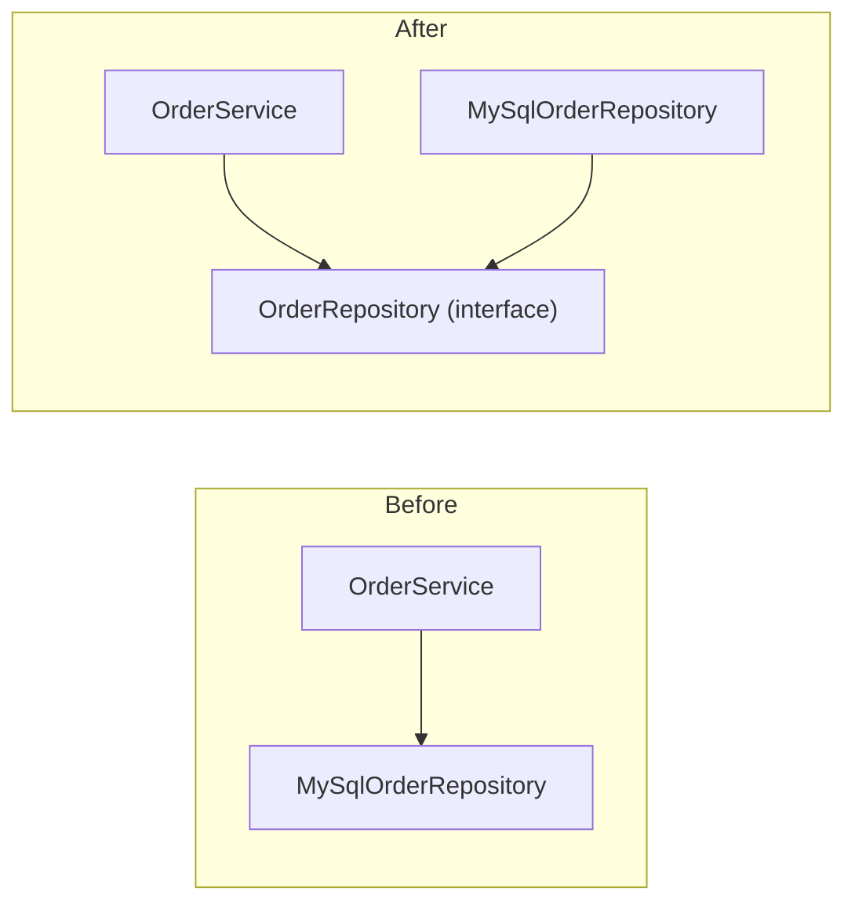

# SOLID Principles

## Why It Matters

SOLID is the most common vocabulary for judging an object-oriented design. Interviewers ask for the five principles by name, ask you to find the violation in a code sample, and ask why your class diagram follows them. On the job, SOLID gives names to the reasons that make code hard to change: classes that change for many reasons, switch statements that grow with every feature, subclasses that break their callers, interfaces that are too wide, and business logic that cannot run without a database. This page covers each principle with a definition, a Java violation, the problem it causes, the refactored code, and a way to spot the violation in a design. It also covers the limits of SOLID: the cases where applying it makes a design worse. Read the [OOP page](01-oop.md) first for the vocabulary (interface, abstract class, composition, overriding).

## Core Concepts

SOLID is an acronym for five principles. Robert C. Martin stated them in his *C++ Report* columns (1996) and in the book *Agile Software Development, Principles, Patterns, and Practices* (2002), chapters 8 to 12. Martin did not invent all five ideas: Bertrand Meyer stated the Open-Closed Principle in 1988, and Barbara Liskov stated the substitution property in 1987. Secondary sources (for example, the Wikipedia article on SOLID) credit Michael Feathers with the acronym, around 2004. No primary source for that credit is cited here.

| Letter | Principle | Martin's statement | One-line meaning |
|---|---|---|---|
| S | Single Responsibility | "There should never be more than one reason for a class to change." (draft SRP chapter of the 2002 book, distributed by Object Mentor). Later (2014): "Each software module should have one and only one reason to change." and "Gather together the things that change for the same reasons. Separate those things that change for different reasons." | One class serves one source of change |
| O | Open-Closed | "Software entities (classes, modules, functions, etc.) should be open for extension, but closed for modification." (1996 column, which calls it a paraphrase of Meyer). Later (2014): "You should be able to extend the behavior of a system without having to modify that system." | Add behavior by adding code, not by editing tested code |
| L | Liskov Substitution | "Functions that use pointers or references to base classes must be able to use objects of derived classes without knowing it." (1996 column, which calls it a paraphrase of Liskov) | A subclass keeps every promise of its parent |
| I | Interface Segregation | "Clients should not be forced to depend upon interfaces that they do not use." (1996 column) | Small, role-focused interfaces |
| D | Dependency Inversion | "A. High level modules should not depend upon low level modules. Both should depend upon abstractions. B. Abstractions should not depend upon details. Details should depend upon abstractions." (1996 column) | Policy code owns the interface. Detail code implements it |

The quotes from the 1996 columns are in sentence case here. The columns print each principle in capital letters.

Terms that this page uses:

- **Module**: a class, or a small group of classes that you change together.
- **Client**: a class that calls another class or interface.
- **Reason to change**: a source of requirements. Martin's 2014 article ties it to people: "It is people who request changes." A reason to change is a person or a group of people, for example one business function, that asks for changes. (Martin's later book *Clean Architecture*, 2017, calls this person or group an *actor*. This page uses "actor" in that sense.)
- **Coupling**: how much one class depends on another. The [design principles page](03-design-principles.md) covers coupling and cohesion.
- **Abstraction**: an interface or abstract class that hides implementation (see the [OOP page](01-oop.md)).

## How It Works

Each principle below follows the same steps: the statement, a violation, the problem, the refactoring, and how to spot the violation in a design.

### S: Single Responsibility Principle (SRP)

Statement. "There should never be more than one reason for a class to change." (Martin, draft SRP chapter). The same chapter says that Tom DeMarco and Meilir Page-Jones described the principle first, and that they "called it cohesion". Martin defines a *responsibility* as "a reason for change". His 2014 article adds that the reason is a person or a group of people (an actor): the finance department changes the pricing rules, the operations team changes the storage, the marketing team changes the e-mail text. SRP does not say "a class does one thing", and it does not say "a class has one method". A class with ten methods that serve one actor satisfies SRP.

Violation. One class serves three actors.

```java
class OrderService {
    private final Map<String, Long> orders = new HashMap<>();

    // Reason to change 1: the pricing rules (finance).
    long totalWithTax(List<Long> lineCents) {
        long sum = 0;
        for (long line : lineCents) sum += line;
        return sum + sum * 18 / 100;
    }

    // Reason to change 2: how orders are stored (operations / data team).
    void save(String orderId, long totalCents) {
        orders.put(orderId, totalCents);
        // in a real system: JDBC code
    }

    // Reason to change 3: the e-mail text and the mail provider (marketing).
    void sendReceipt(String email, String orderId, long totalCents) {
        System.out.println("To: " + email + " | order " + orderId + " | " + totalCents);
    }
}
```

Problem. A change for one actor risks the code of the other two, because the code shares one class, one test file, and one deployment. Two developers who work on pricing and on e-mail both edit this class, so merge conflicts happen. A unit test of the pricing rule must construct a class that also contains storage code. If the class is in a shared library, a change of the e-mail text forces a new release of the pricing code.

Refactoring. One class for each reason to change, and a thin coordinator.

```java
class PriceCalculator {
    long totalWithTax(List<Long> lineCents) {
        long sum = 0;
        for (long line : lineCents) sum += line;
        return sum + sum * 18 / 100;
    }
}

interface OrderRepository {
    void save(String orderId, long totalCents);
}

class InMemoryOrderRepository implements OrderRepository {
    private final Map<String, Long> orders = new HashMap<>();
    public void save(String orderId, long totalCents) { orders.put(orderId, totalCents); }
}

interface ReceiptSender {
    void send(String email, String orderId, long totalCents);
}

class ConsoleReceiptSender implements ReceiptSender {
    public void send(String email, String orderId, long totalCents) {
        System.out.println("To: " + email + " | order " + orderId + " | " + totalCents);
    }
}

class OrderService {
    private final PriceCalculator calculator;
    private final OrderRepository repository;
    private final ReceiptSender sender;

    OrderService(PriceCalculator calculator, OrderRepository repository, ReceiptSender sender) {
        this.calculator = calculator;
        this.repository = repository;
        this.sender = sender;
    }

    void placeOrder(String orderId, String email, List<Long> lineCents) {
        long total = calculator.totalWithTax(lineCents);
        repository.save(orderId, total);
        sender.send(email, orderId, total);
    }
}
```

`OrderService` still has a reason to change: the *workflow* of placing an order (the order of the steps). That is one reason, owned by one actor.

How to spot it in an interview design:

- The class name contains "And", "Manager", "Handler", or "Util", and the class holds methods from several areas.
- You can list the class methods and assign each to a different stakeholder (pricing, storage, notification).
- The class imports types from unrelated layers (JDBC, HTTP, e-mail, formatting).
- You cannot describe the class in one sentence without "and".

Counter-risk: splitting too far. A class for each method gives a design that no one can read. Split along real axes of change, not along methods.

### O: Open-Closed Principle (OCP)

Statement. Bertrand Meyer (*Object-Oriented Software Construction*, 1988) defined it: a module is *open* if it is still available for extension, and *closed* if it is available for use by other modules. Meyer's mechanism was inheritance. Martin restated the principle for abstract interfaces and polymorphism: "Software entities (classes, modules, functions, etc.) should be open for extension, but closed for modification." In practice: add a new behavior by writing a new class, without editing the class that already works and has tests.

Violation. A type code and an `if` chain.

```java
class ShippingCalculator {
    long costInCents(String method, long weightInGrams) {
        if (method.equals("STANDARD")) {
            return 500 + weightInGrams / 10;
        } else if (method.equals("EXPRESS")) {
            return 1500 + weightInGrams / 5;
        } else if (method.equals("PICKUP")) {
            return 0;
        }
        throw new IllegalArgumentException("unknown method " + method);
    }
}
```

Problem. Each new shipping method edits `costInCents`. The edit can break the existing branches. The same `if` chain can repeat in other methods (delivery time, label text), so one new method changes many places. This is a shotgun-surgery risk (see the [anti-patterns page](11-anti-patterns.md)). A misspelled string is a run-time error, not a compile error.

Refactoring. Extract the varying behavior behind an interface (the Strategy pattern, see the [behavioral patterns page](08-behavioral-patterns.md)).

```java
interface ShippingMethod {
    long costInCents(long weightInGrams);
}

class StandardShipping implements ShippingMethod {
    public long costInCents(long weightInGrams) { return 500 + weightInGrams / 10; }
}

class ExpressShipping implements ShippingMethod {
    public long costInCents(long weightInGrams) { return 1500 + weightInGrams / 5; }
}

class PickupShipping implements ShippingMethod {
    public long costInCents(long weightInGrams) { return 0; }
}

class ShippingCalculator {
    long costInCents(ShippingMethod method, long weightInGrams) {
        return method.costInCents(weightInGrams);
    }
}
```

To add `SameDayShipping`, you write a new class. `ShippingCalculator` and the three old classes do not change. The code that *chooses* the method (a factory, a map, or a configuration) still changes when you add a class. OCP moves that change to one small place. It does not remove it.

How to spot it in an interview design:

- `switch` or `if-else` on a type code, an enum, or a string, in more than one place.
- A requirement says "support more X later" (payment methods, discount types, notification channels), and the design has no interface for X.
- `instanceof` checks in a method that takes a parent type.

Limits. You cannot close a class against every change. You close it against the changes that you expect, and that the requirements name. If a variation is a closed set that does not grow, a `switch` over a sealed interface (see the [OOP page](01-oop.md)) is clearer and the compiler checks that it is complete. Add the abstraction at the *second* variation, not before. See the section on conflicts below.

### L: Liskov Substitution Principle (LSP)

Statement. Barbara Liskov gave the idea in her OOPSLA 1987 keynote "Data Abstraction and Hierarchy": "If for each object o1 of type S there is an object o2 of type T such that for all programs P defined in terms of T, the behavior of P is unchanged when o1 is substituted for o2 then S is a subtype of T." Liskov and Jeannette Wing (1994) gave the formal *subtype requirement*: "Let φ(x) be a property provable about objects x of type T. Then φ(y) should be true for objects y of type S where S is a subtype of T." Martin's 1996 form: "Functions that use pointers or references to base classes must be able to use objects of derived classes without knowing it." In words: code that uses the parent type must work with any subclass, without knowing which subclass it has.

LSP is about *behavior*, not about syntax. The compiler checks the signatures. It does not check that a subclass keeps the promises of the parent.

#### Rules for substitutable subtypes

A **precondition** is what a method requires from the caller. A **postcondition** is what a method guarantees to the caller when it returns. An **invariant** is a condition about the state that holds between method calls. A subtype must follow these rules:

| Rule | Meaning | Violation example |
|---|---|---|
| Preconditions cannot be strengthened | The subclass method accepts at least the inputs that the parent method accepts | The parent accepts any positive amount. The subclass accepts only amounts of 100 or more |
| Postconditions cannot be weakened | The subclass method guarantees at least what the parent method guarantees | The parent returns a non-null result. The subclass returns `null` |
| Invariants of the parent must hold | The subclass keeps every condition that the parent maintains | The parent keeps `balance >= 0`. The subclass allows a negative balance |
| The history constraint (Liskov and Wing) | The subclass does not allow a state change that the parent does not allow | A parent that is immutable has a mutable subclass |
| Exceptions | The subclass method throws no new checked exceptions (the compiler enforces it) and no new unchecked exceptions that the parent contract does not allow | The subclass throws `UnsupportedOperationException` for a method that the parent supports |

Java checks only the signature rules of an override: the return type (same or covariant), the access (not weaker), and the checked exceptions (not new or broader). The behavior rules are your duty. Martin's 1996 LSP column connects these rules to Meyer's *Design by Contract*, and quotes Meyer's rule: "when redefining a routine [in a derivative], you may only replace its precondition by a weaker one, and its postcondition by a stronger one." The column also states the postcondition of `Rectangle::SetWidth(w)`: the width equals `w`, and the height does not change.

#### The rectangle and square example

Mathematically, a square is a rectangle. In code with mutable setters, a `Square` is not a substitutable `Rectangle`.

Violation.

```java
class AreaCheck {
    static void resize(Rectangle r) {
        r.setWidth(5);
        r.setHeight(4);
        // A caller that knows only Rectangle expects 5 * 4 = 20.
        System.out.println(r.area());
    }

    public static void main(String[] args) {
        resize(new Rectangle());  // prints 20
        resize(new Square());     // prints 16
    }
}

class Rectangle {
    protected int width;
    protected int height;

    void setWidth(int width) { this.width = width; }
    void setHeight(int height) { this.height = height; }
    int area() { return width * height; }
}

class Square extends Rectangle {
    @Override
    void setWidth(int width) {
        this.width = width;
        this.height = width;   // keeps the square invariant
    }

    @Override
    void setHeight(int height) {
        this.width = height;
        this.height = height;
    }
}
```

<!-- expected-output -->
```text
20
16
```

Problem. `Rectangle` promises (a postcondition of `setHeight`): "the width does not change". `Square.setHeight` breaks that promise, so the subclass *weakens a postcondition*. Code that works for `Rectangle` gives a wrong result for `Square`. A caller must add `instanceof Square` checks, and that breaks OCP too.

Refactoring. Do not let the square inherit the mutable operations. Option 1: a common read-only interface and immutable value types.

```java
interface Shape {
    int area();
}

record Rectangle(int width, int height) implements Shape {
    public int area() { return width * height; }
}

record Square(int side) implements Shape {
    public int area() { return side * side; }
}
```

Option 2: if you need to resize, give the operation to the type that can keep its promise: `Shape scaled(int factor)` returns a new shape of the same kind. The lesson is general: **model by behavior, not by real-world taxonomy.** "Is-a" in the domain does not give "is-substitutable-for" in code.

A second violation: strengthening a precondition.

```java
class Account {
    protected long balanceInCents = 1_000;

    // Contract: accepts any positive amount that is at most the balance.
    void withdraw(long amountInCents) {
        if (amountInCents <= 0 || amountInCents > balanceInCents) {
            throw new IllegalArgumentException("invalid amount");
        }
        balanceInCents -= amountInCents;
    }
}

class PremiumAccount extends Account {
    @Override
    void withdraw(long amountInCents) {
        if (amountInCents < 100) {   // stronger precondition: rejects inputs the parent accepts
            throw new IllegalArgumentException("minimum withdrawal is 100");
        }
        super.withdraw(amountInCents);
    }
}
```

A caller that withdraws 50 from an `Account` works. The same call on a `PremiumAccount` fails. The fix is to remove the extra restriction from the override, or to model the minimum as a separate rule that is part of the *parent* contract.

How to spot it in an interview design:

- An override that throws `UnsupportedOperationException` or does nothing (`ReadOnlyList extends ArrayList`, `Penguin extends Bird` with `fly()` that throws).
- A caller that checks `instanceof` or `getClass()` before it calls a parent method.
- A subclass that cannot use half of the parent methods. This means that the hierarchy is probably wrong: extract a smaller parent (`Bird`, `FlyingBird`).
- A subclass that tightens validation, adds required state, or ignores a parent method argument.

### I: Interface Segregation Principle (ISP)

Statement. "Clients should not be forced to depend upon interfaces that they do not use." (Martin, "The Interface Segregation Principle", *C++ Report*, 1996. The book covers ISP in chapter 12.) A client that uses two of ten methods in an interface still depends on all ten. Each implementer must write all ten methods. If the interface changes for a method that the client does not call, the client's module must still build against the new version of the interface, and the team must retest it. Martin wrote for C++, where such a change forces the client to recompile. In Java, the binary compatibility rules (JLS chapter 13) let an existing client class file run against some changed interfaces without recompilation. The client's build and release still depend on the whole interface.

Violation. A wide interface.

```java
interface PaymentProvider {
    String charge(String customerId, long amountInCents);
    String refund(String chargeId, long amountInCents);
    String createSubscription(String customerId, String planId);
    String payout(String merchantId, long amountInCents);
}

class UpiProvider implements PaymentProvider {
    public String charge(String customerId, long amountInCents) { return "upi-charge"; }
    public String refund(String chargeId, long amountInCents) { return "upi-refund"; }

    public String createSubscription(String customerId, String planId) {
        throw new UnsupportedOperationException("UPI has no subscriptions");  // forced stub
    }

    public String payout(String merchantId, long amountInCents) {
        throw new UnsupportedOperationException("UPI has no payouts");       // forced stub
    }
}
```

Problem. `UpiProvider` must write two methods that it cannot support, and the stubs fail at run time. This also breaks LSP, because the subtype does not keep the promise of the interface. A `CheckoutService` that only calls `charge` depends on the subscription and payout methods too. A change to the signature of `createSubscription` changes the interface that `CheckoutService` builds against, and every implementer must change.

Refactoring. Split by client role.

```java
interface Charger {
    String charge(String customerId, long amountInCents);
}

interface Refunder {
    String refund(String chargeId, long amountInCents);
}

interface SubscriptionManager {
    String createSubscription(String customerId, String planId);
}

interface PayoutService {
    String payout(String merchantId, long amountInCents);
}

class UpiProvider implements Charger, Refunder {
    public String charge(String customerId, long amountInCents) { return "upi-charge"; }
    public String refund(String chargeId, long amountInCents) { return "upi-refund"; }
}

class CardProvider implements Charger, Refunder, SubscriptionManager {
    public String charge(String customerId, long amountInCents) { return "card-charge"; }
    public String refund(String chargeId, long amountInCents) { return "card-refund"; }
    public String createSubscription(String customerId, String planId) { return "card-sub"; }
}

class CheckoutService {
    private final Charger charger;   // depends on one method, not four

    CheckoutService(Charger charger) { this.charger = charger; }

    String pay(String customerId, long amountInCents) {
        return charger.charge(customerId, amountInCents);
    }
}
```

How to spot it in an interview design:

- An interface with methods from different areas (charging, payouts, reporting) that different clients call.
- An implementation that has an empty method or one that throws `UnsupportedOperationException`.
- A client that uses a small part of an interface.
- Names such as `IManager` or `IService` that collect everything.

Limits. ISP concerns the client's view. Too many one-method interfaces cause noise. A good size is the set of methods that one kind of client uses together. In Java, a class can implement several small interfaces, and a client can combine them with an intersection bound (`<T extends Charger & Refunder>`).

### D: Dependency Inversion Principle (DIP)

Statement. Martin (1996 column): "A. High level modules should not depend upon low level modules. Both should depend upon abstractions. B. Abstractions should not depend upon details. Details should depend upon abstractions." A **high-level module** holds policy: the business rules (place an order). A **low-level module** holds a detail: a database driver, an HTTP client, a file writer.

The word *inversion* has a precise meaning. In a straightforward design, the source-code dependency follows the flow of control: `OrderService` calls `MySqlOrderRepository`, so `OrderService` depends on `MySqlOrderRepository`. DIP puts an interface *between* them and places the interface with the high-level module. The low-level class then depends on the interface that the high-level module owns. The dependency arrow turns around.



Violation.

```java
class MySqlOrderRepository {
    void save(String orderId, long totalCents) {
        System.out.println("INSERT INTO orders ...");
    }
}

class OrderService {
    // Policy code builds and depends on a detail.
    private final MySqlOrderRepository repository = new MySqlOrderRepository();

    void place(String orderId, long totalCents) {
        repository.save(orderId, totalCents);
    }
}
```

Problem. You cannot test `OrderService` without MySQL code. You cannot switch to another store without editing `OrderService`. The business rules depend on the most volatile part of the system.

Refactoring. The high-level module declares the abstraction that it needs. The detail implements it. Something else supplies the implementation.

```java
interface OrderRepository {            // owned by the business layer
    void save(String orderId, long totalCents);
}

class MySqlOrderRepository implements OrderRepository {   // detail
    public void save(String orderId, long totalCents) {
        System.out.println("INSERT INTO orders ...");
    }
}

class FakeOrderRepository implements OrderRepository {    // test double
    final Map<String, Long> saved = new HashMap<>();
    public void save(String orderId, long totalCents) { saved.put(orderId, totalCents); }
}

class OrderService {
    private final OrderRepository repository;

    OrderService(OrderRepository repository) {   // dependency comes in from outside
        this.repository = repository;
    }

    void place(String orderId, long totalCents) {
        repository.save(orderId, totalCents);
    }
}
```

#### Dependency inversion and dependency injection are different things

| | Dependency Inversion Principle | Dependency Injection (DI) |
|---|---|---|
| Kind | A design principle | A technique |
| Question it answers | Which way do the source-code dependencies point? Who owns the interface? | Who creates the dependency and how does the class receive it? |
| What it says | Policy depends on an abstraction. Detail implements the abstraction | An object receives its dependencies from outside, by constructor, setter, or method argument |
| Needs a framework? | No | No. A `main` method can wire objects by hand. A container such as Spring automates it |

The two ideas are independent:

- DI without DIP: `OrderService(MySqlOrderRepository repository)`. The class receives the dependency through the constructor (DI), but it still depends on the concrete detail. The arrow did not turn around.
- DIP without DI: `OrderService` depends on the interface `OrderRepository` (DIP) and calls a factory or a `ServiceLoader` inside its constructor to get the implementation. The abstraction is right, and the class pulls its dependency instead of receiving it.

Use both together. DIP gives the shape of the dependencies. DI gives the wiring. See Fowler, "Inversion of Control Containers and the Dependency Injection pattern" (2004). The [architectural patterns page](10-architectural-patterns.md) covers constructor injection and the layer structure that follows from DIP.

How to spot it in an interview design:

- `new` of a concrete infrastructure class (repository, HTTP client, mailer, clock) inside business logic.
- Business classes that import `java.sql`, `jakarta.servlet` (formerly `javax.servlet`), or a vendor SDK.
- Calls to `LocalDateTime.now()` or `Math.random()` inside logic that you must test. A `Clock` or a random source is a dependency too.
- A design where the arrows in the class diagram all point from business classes to database classes.

Limits. Not every dependency needs an interface. `String`, `List`, `Money`, and other stable value types are fine as concrete dependencies. Invert the dependencies that are volatile (their implementation can change without a change in the business rules), expensive (network, disk), or non-deterministic (time, randomness).

## Trade-offs and When to Use

### How SOLID conflicts with YAGNI and KISS

- **YAGNI** ("You aren't gonna need it", from Extreme Programming): do not build a capability for a need that you only presume. Martin Fowler's description: a *presumptive feature* is code that supports a feature that is not yet available for use, and building it costs more than it saves when your guess is wrong. His caveat: YAGNI "does not apply to effort to make the software easier to modify", and it "is not a justification for neglecting the health of your code base".
- **KISS** ("Keep it simple, stupid"): choose the simplest design that satisfies the requirements.

SOLID principles tell you to add abstractions (interfaces, strategies, layers). YAGNI and KISS tell you to wait until the requirement exists. The conflict is real, and a team resolves it case by case.

| Situation | Better choice | Reason |
|---|---|---|
| One shipping method, no plan for another | One concrete class | An interface with one implementation adds a file and no flexibility |
| Second variation arrives | Extract the interface now (OCP) | You now have two real examples, so the abstraction is correct |
| A dependency is a database, network, or clock | Invert it from the start (DIP) | The test needs a fake from the first day, so the abstraction pays at once |
| A closed set of variants (card, wallet, bank) | A sealed interface and a `switch` | The compiler checks every case, and no extension point is needed |
| A class has three methods for three actors | Split (SRP) | The cost of the split is small, and the actors will diverge |
| A value type such as `Money` | No interface | It is stable, and an interface would hide `equals` |

Recommendation: for a varying behavior, wait for the first real change of that kind, then add the abstraction that protects against more changes of the same kind. In the table above, the first change is the arrival of the second variation. For duplicated code, the *rule of three* (from Fowler's *Refactoring*) gives a similar rule: the first time, write the code. The second time, accept the duplication. The third time, extract it. The exceptions are the volatile dependencies above, where you invert at once.

### When over-applying SOLID makes a design worse

Symptoms of over-application:

- An interface for every class, with exactly one implementation (`UserService` and `UserServiceImpl` for no reason).
- A class for each method, so that one use case spreads over ten files.
- Factories that create factories, for a variation that does not exist.
- Layers that only forward calls (a controller calls a service that calls a manager that calls a repository, and each adds nothing).
- Tests that need long setup, because each class has five collaborators that are all mocks.

Each of these costs reading time and change time. The reader must open many files to see one behavior. A design that predicts changes wrongly costs more than a simple design that you refactor when the change comes.

Wrong form: speculative abstraction.

```java
interface GreetingStrategy { String greet(String name); }

interface GreetingStrategyFactory { GreetingStrategy create(); }

class DefaultGreetingStrategy implements GreetingStrategy {
    public String greet(String name) { return "Hello, " + name; }
}

class DefaultGreetingStrategyFactory implements GreetingStrategyFactory {
    public GreetingStrategy create() { return new DefaultGreetingStrategy(); }
}
```

Right form: when only one greeting exists, write the method.

```java
class Greeter {
    String greet(String name) { return "Hello, " + name; }
}
```

In an interview, state the trade-off aloud. Say: "I use an interface here, because the requirement lists three payment methods. I use a plain class for the receipt formatter, because nothing suggests a second format. I can extract an interface when one appears." This shows judgment, which interviewers score higher than reflex.

### Summary of the five principles as design tools

| Principle | Tool | Patterns that can implement it |
|---|---|---|
| SRP | Split classes by actor | Facade or service layer as coordinator |
| OCP | Interface for the varying part | Strategy, Decorator, Template Method, Factory |
| LSP | Contracts, small parent types | Composition in place of inheritance |
| ISP | Role interfaces | Adapter to narrow a wide interface |
| DIP | Interface owned by the policy layer | Repository, Abstract Factory, DI container |

## Java Example

The program places an order. It follows all five principles: `PriceCalculator` has one reason to change (SRP), `Discount` is open for new kinds (OCP), every `Discount` keeps the same contract (LSP), `OrderService` needs only the small `Charger` and `Notifier` interfaces (ISP), and it depends on interfaces that the business layer owns (DIP). The `main` method wires the objects by hand (dependency injection without a framework).

```java
import java.util.ArrayList;
import java.util.List;

public class SolidDemo {

    // OCP + LSP: for a price >= 0, every Discount returns a value from 0 to the price.
    interface Discount {
        long applyTo(long priceInCents);
    }

    static final class NoDiscount implements Discount {
        public long applyTo(long price) { return price; }
    }

    static final class PercentDiscount implements Discount {
        private final int percent;

        PercentDiscount(int percent) {
            if (percent < 0 || percent > 100) throw new IllegalArgumentException("percent");
            this.percent = percent;
        }

        public long applyTo(long price) { return price - price * percent / 100; }
    }

    static final class FlatDiscount implements Discount {
        private final long flat;

        FlatDiscount(long flat) {
            if (flat < 0) throw new IllegalArgumentException("flat");
            this.flat = flat;
        }

        public long applyTo(long price) { return Math.max(0, price - flat); }
    }

    // SRP: only pricing rules.
    static final class PriceCalculator {
        long total(List<Long> lineCents, Discount discount) {
            long sum = 0;
            for (long line : lineCents) sum += line;
            return discount.applyTo(sum);
        }
    }

    // ISP + DIP: small interfaces that the business layer owns.
    interface Charger {
        boolean charge(String customerId, long amountInCents);
    }

    interface Notifier {
        void send(String customerId, String message);
    }

    // Details.
    static final class FakeCardCharger implements Charger {
        private final long limit;
        FakeCardCharger(long limit) { this.limit = limit; }
        public boolean charge(String customerId, long amountInCents) {
            return amountInCents <= limit;
        }
    }

    static final class RecordingNotifier implements Notifier {
        final List<String> sent = new ArrayList<>();
        public void send(String customerId, String message) {
            sent.add(customerId + ": " + message);
        }
    }

    // SRP: the workflow. DIP: depends on abstractions only.
    static final class OrderService {
        private final PriceCalculator calculator;
        private final Charger charger;
        private final Notifier notifier;

        OrderService(PriceCalculator calculator, Charger charger, Notifier notifier) {
            this.calculator = calculator;
            this.charger = charger;
            this.notifier = notifier;
        }

        boolean place(String customerId, List<Long> lineCents, Discount discount) {
            long total = calculator.total(lineCents, discount);
            boolean paid = charger.charge(customerId, total);
            notifier.send(customerId, paid ? "paid " + total : "payment failed for " + total);
            return paid;
        }
    }

    public static void main(String[] args) {
        RecordingNotifier notifier = new RecordingNotifier();
        OrderService service = new OrderService(
            new PriceCalculator(), new FakeCardCharger(5000), notifier);

        List<Long> lines = List.of(3000L, 2500L);
        service.place("ada", lines, new NoDiscount());
        service.place("ada", lines, new PercentDiscount(10));
        service.place("ada", lines, new FlatDiscount(600));

        notifier.sent.forEach(System.out::println);
    }
}
```

Output:

<!-- expected-output -->
```text
ada: payment failed for 5500
ada: paid 4950
ada: paid 4900
```

Because `OrderService` takes interfaces, a unit test passes a `FakeCardCharger` and a `RecordingNotifier`, and needs no network or database.

## Interview Angle

### Questions

??? question "Explain the SOLID principles."

    Give one sentence for each, then one example.

    - **S**: a class has one reason to change, which means one actor. `OrderService` should not contain pricing, SQL, and e-mail text.
    - **O**: add behavior by adding code, not by editing working code. Replace an `if` chain on shipping type with a `ShippingMethod` interface.
    - **L**: a subclass must keep the promises of its parent, so code that uses the parent works with any subclass. `Square extends Rectangle` fails with mutable setters.
    - **I**: do not force clients to depend on methods they do not use. Split `PaymentProvider` into `Charger`, `Refunder`, and so on.
    - **D**: business logic depends on interfaces that it owns. Infrastructure implements them. `OrderService` depends on `OrderRepository`, not on `MySqlOrderRepository`.

    Close with the trade-off: they guide design where change is likely, and they cost extra classes if applied everywhere.

??? question "What does 'a reason to change' mean in the Single Responsibility Principle? Is 'a class does one thing' correct?"

    No. "Does one thing" is a common misreading. Martin defines a responsibility as a reason to change, and ties it to an actor: a person or group that requests changes. A class that serves the finance team and the operations team has two responsibilities, even if each part is small. A class with many methods that all serve one actor has one.

    Practical test: ask "who asks for changes to this code?" If the answer is two different groups, split the class. If the class changes only when one kind of requirement changes, keep it together.

    Trade-off: splitting along every method gives a design with too many classes, so split along actors.

??? question "How does the Open-Closed Principle work in practice? Show an example."

    OCP means that you add behavior by writing new code, not by changing code that works. The usual tool is an interface for the part that varies.

    Example: shipping cost. The wrong form has `if (method.equals("EXPRESS"))` branches. Each new method edits the same function. The right form has a `ShippingMethod` interface with `StandardShipping` and `ExpressShipping` classes. Adding same-day shipping is a new class, and `ShippingCalculator` is unchanged.

    Edge cases: something still has to choose the implementation, so the change moves to one factory or configuration. You also cannot close a class against changes that you did not predict. For a closed set of variants, a `switch` on a sealed interface is simpler.

??? question "Explain the Liskov Substitution Principle with the rectangle and square example."

    LSP says that code written for a parent type must work with any subtype, without changes. The compiler checks signatures only. The subtype must also keep the behavior contract.

    A mutable `Rectangle` has `setWidth` and `setHeight`, and the caller expects that `setHeight` does not change the width. `Square extends Rectangle` overrides both setters to keep the sides equal. After `r.setWidth(5); r.setHeight(4);`, a rectangle has area 20, and a square has area 16. The subtype breaks the postcondition of the parent method, so it is not substitutable even though a square is a rectangle in geometry.

    Fix: do not inherit mutable operations. Use a `Shape` interface with immutable `Rectangle` and `Square` records, or return new objects from `scaled(...)`.

    The rules: a subtype cannot strengthen preconditions, cannot weaken postconditions, and must keep the invariants of the parent.

??? question "What are preconditions and postconditions, and how do they relate to LSP?"

    A precondition is what a method requires from its caller (for example, `amount > 0`). A postcondition is what the method guarantees after it returns (for example, the balance decreased by `amount`).

    A subclass method may *weaken* the precondition (accept more inputs) and may *strengthen* the postcondition (promise more). It must not do the reverse, because callers rely on the parent contract. If `Account.withdraw` accepts any amount from 1 up to the balance, a `PremiumAccount` that rejects amounts below 100 strengthens the precondition and breaks callers. A subclass that returns `null` where the parent promised a value weakens the postcondition.

    Java helps only partly. It enforces covariant returns and prevents new checked exceptions. Documentation and tests must cover the rest.

??? question "What is the Interface Segregation Principle? How do you recognize a violation?"

    Clients should not depend on methods they do not use. A wide interface forces implementers to write methods they cannot support, for example by throwing `UnsupportedOperationException`, and it couples every client to every method.

    Signs of a violation: a fat interface with unrelated methods, stub or throwing implementations, and a client that calls one method of ten.

    Fix: split the interface by client role (`Charger`, `Refunder`, `SubscriptionManager`) and let a class implement several of them. This also repairs the LSP violation that the throwing stubs caused.

    Trade-off: do not create an interface for each method. Group the methods that one kind of client uses together.

??? question "What is the difference between Dependency Inversion and Dependency Injection?"

    Dependency Inversion is a design principle: high-level policy depends on an abstraction, and low-level detail depends on the same abstraction. The business layer owns the interface (`OrderRepository`), and the database class implements it. The source-code dependency points from the detail to the policy, which inverts the usual direction.

    Dependency Injection is a technique: an object receives its dependencies from outside, through the constructor, a setter, or a method argument, and does not create them with `new`. Constructor injection is the strongest form: the object is complete after construction, and its dependency fields can be `final`.

    They are independent. Injecting `MySqlOrderRepository` into a constructor is DI without DIP, because the class still depends on the detail. A class that depends on the `OrderRepository` interface but calls a factory to obtain it follows DIP without DI. Use both: DIP defines the shape, and DI provides the wiring, by hand or with a container such as Spring.

??? question "Do SOLID principles ever conflict with YAGNI or KISS? How do you decide?"

    Yes. SOLID pushes you to add abstractions. YAGNI says not to build for needs that you only predict, and KISS says to choose the simplest design that works. An interface with one implementation, and a factory for a single product, follow SOLID in form and add cost for no benefit.

    Decision rule: abstract when a requirement or a second real case exists, or when the dependency is volatile, slow, or non-deterministic (database, network, clock), because you need a fake in tests at once. For a first and only variant, write a plain class and refactor when the second variant arrives, because the refactoring is small when the code is clean. For a closed set of variants, use a sealed interface and a `switch`.

    In an interview, state this reasoning aloud, because it shows judgment.

??? question "Which design pattern helps with each SOLID principle?"

    Strategy and Decorator support OCP: new behavior is a new class. Template Method supports OCP for algorithms with a fixed skeleton. Factory and Abstract Factory support DIP by hiding which class is created. The Repository pattern supports DIP and SRP by separating storage from business rules. Adapter supports ISP by presenting a narrow interface over a wide one. Facade and a service layer support SRP as coordinators. Composition in place of inheritance supports LSP, because the composed object does not claim to be a subtype.

    Say also that patterns are tools, and the principles are the reasons. If you can name the principle that a pattern serves, you show that you do not use patterns by habit.

??? question "A design has a `Bird` class with a `fly()` method and a `Penguin` subclass. What is wrong, and how do you fix it?"

    `Penguin` cannot fly. If `Penguin.fly()` throws an exception or does nothing, the subclass breaks the contract of `Bird`, and a caller that loops over a `List<Bird>` and calls `fly()` fails. This is an LSP violation, and it is also an ISP problem, because `Bird` offers `fly()` to birds that cannot use it.

    Fix: model the behavior, not the taxonomy. Make `Bird` hold only what all birds do (`eat`, `layEgg`) and add a `Flyer` interface with `fly()` for the flying birds. Code that needs to fly takes a `Flyer`. Penguin is a `Bird` and not a `Flyer`, so the compiler stops the wrong call.

### Follow-up Questions

- Does SRP mean that a class has one method? (No. It means one reason to change.)
- Is `OrderService` that coordinates three collaborators a violation of SRP? (No. The workflow is one reason to change.)
- How would you add a new discount type without editing `PriceCalculator`? (A new `Discount` class. The `Discount` interface is the extension point.)
- Give an LSP violation in the JDK. (For example, `Stack extends Vector` exposes `insertElementAt`, which breaks the stack contract. Also an unmodifiable collection throws `UnsupportedOperationException` on mutators. The `Collection` documentation declares those mutators optional, so the contract allows it, but callers must know.)
- Does DIP require an IoC container? (No. You can wire objects by hand in `main`.)
- How do you test a class that calls `LocalDateTime.now()`? (Inject a `Clock`. This is DIP applied to time.)
- Where does OCP break down? (For changes that you did not predict, and for closed sets of variants.)
- How do SRP and ISP differ? (SRP is about the reasons a class changes, seen from the class. ISP is about the methods a client needs, seen from the client.)

### Red Flags

- Reciting the letters without a code example.
- "SRP: a class should do only one thing."
- Creating an interface and a factory for every class "to follow SOLID".
- Claiming `Square extends Rectangle` is correct because "a square is a rectangle".
- Confusing DIP with DI, or saying DIP "means use Spring".
- An LSP answer that talks only about method signatures and ignores behavior.
- A design where `OrderService` calls `new MySqlRepository()`, and the candidate says that SOLID is "followed".
- Using SOLID as a reason to add a layer and not naming the change that it prepares for.

## Common Mistakes

| Mistake | Problem | Fix |
|---|---|---|
| Reading SRP as "one method per class" | Many tiny classes, scattered logic | Split by actor and by reason to change |
| Putting the `if` chain in a factory and calling it OCP | The chain still grows, but in one place only. That is acceptable only if the chain exists once | Keep the chain once. Use a map or a registry if it grows |
| Inheritance for "is-a" in the real world | Subclass breaks parent contract (LSP) | Model by behavior. Prefer composition and immutable types |
| `UnsupportedOperationException` in an implementation | LSP and ISP violation | Split the interface |
| Interface with one implementation, for every class | Noise, no benefit | Add the interface at the second implementation, or for a volatile dependency |
| Injecting a concrete class and calling it DIP | The detail still sits in the policy layer | Inject an interface that the policy layer owns |
| Interface placed in the infrastructure package | The policy layer still depends on the infrastructure package | Put the interface in the business package |
| `new` for infrastructure inside business logic | No test seam | Pass dependencies in through the constructor |
| Hidden time and randomness (`now()`, `Math.random()`) | Non-deterministic tests | Inject `Clock` and a random source |
| Applying every principle at once to a 50-line problem | Over-engineering | Apply the principle that fixes a named problem |

## Commonly Confused With

| Looks like | Difference | Deciding question |
|---|---|---|
| SRP vs high cohesion | SRP is about reasons to change (actors). Cohesion is about how strongly the members of a class relate | "Who asks to change this class?" |
| SRP vs ISP | SRP looks at one class and its change sources. ISP looks at an interface from the client side | "Is the problem in the class, or in what the client must depend on?" |
| OCP vs Strategy | OCP is the principle. Strategy is one pattern that gives it | "Which principle does this pattern serve?" |
| LSP vs inheritance rules of the compiler | The compiler checks signatures. LSP checks behavior | "Does every parent-type caller still work?" |
| ISP vs SRP for interfaces | An interface can have one reason to change and still be too wide for some clients | "Does each client use all the methods?" |
| Dependency Inversion vs Dependency Injection | Principle versus technique | "Am I talking about who owns the interface, or about how the object is passed in?" |
| Dependency Injection vs Service Locator | DI pushes dependencies in. A locator makes the class pull them from a registry | "Does the class ask for its dependencies, or receive them?" |
| SOLID vs YAGNI | SOLID shapes the abstractions. YAGNI limits when to build them | "Does a requirement or a second case exist now?" |

## Quick Reference Card

- **S**: one reason to change = one actor. Spot it: a class mixes pricing, storage, and messaging.
- **O**: extend by adding classes. Spot it: `if`/`switch` on a type code in several places. Fix: interface plus implementations (Strategy).
- **L**: a subclass keeps the parent contract: no stronger preconditions, no weaker postconditions, same invariants. Spot it: `UnsupportedOperationException`, `instanceof` before a parent call. Example: `Square extends Rectangle` with setters.
- **I**: small role interfaces. Spot it: stub methods, wide interfaces. Fix: split by client.
- **D**: policy owns the interface, detail implements it. Spot it: `new MySqlRepository()` in business logic. DI is the technique that supplies the object.
- DIP is not DI: inversion is about the direction of dependencies. Injection is about who creates the object.
- Conflicts: abstract at the second variation or for a volatile dependency. Use a plain class for the first variation. A closed set of variants fits a sealed interface and `switch`.
- Over-application symptoms: one-implementation interfaces for every class, forwarding layers, ten files for one use case.
- In an interview: name the principle, show the change that it prepares for, and state the cost.

## Further Reading

- Robert C. Martin, [The Single Responsibility Principle](https://blog.cleancoder.com/uncle-bob/2014/05/08/SingleReponsibilityPrinciple.html) (2014): the source of "reason to change" and the actor-based reading of SRP.
- Robert C. Martin, [The Open Closed Principle](https://blog.cleancoder.com/uncle-bob/2014/05/12/TheOpenClosedPrinciple.html) (2014): Martin's reading of Meyer's principle.
- Robert C. Martin, *Agile Software Development, Principles, Patterns, and Practices* (Prentice Hall, 2002), chapters 8 to 12 (SRP, OCP, LSP, DIP, ISP): the book form of the five principles. (The C# edition of 2006 is a different book, by Robert C. Martin and Micah Martin.)
- Robert C. Martin, *C++ Report* columns, 1996: [The Open-Closed Principle](https://courses.cs.duke.edu/compsci307d/current/readings/ocp.pdf), [The Liskov Substitution Principle](https://courses.cs.duke.edu/compsci307d/current/readings/lsp.pdf), [The Dependency Inversion Principle](https://courses.cs.duke.edu/compsci307d/current/readings/dip.pdf), [The Interface Segregation Principle](https://courses.cs.duke.edu/compsci307d/current/readings/isp.pdf) (copies on a Duke University course site): the original wording of four principles, and the Design by Contract reading of LSP. The same site has the [draft SRP chapter](https://courses.cs.duke.edu/compsci307d/current/readings/srp.pdf) with the "never more than one reason" wording.
- Barbara Liskov, "Data Abstraction and Hierarchy", OOPSLA 1987 keynote (*SIGPLAN Notices* 23(5), May 1988, pages 17 to 34): the first statement of the substitution property.
- Barbara H. Liskov and Jeannette M. Wing, "A Behavioral Notion of Subtyping", *ACM Transactions on Programming Languages and Systems* 16(6), 1994: the formal subtype requirement and the history constraint.
- Bertrand Meyer, *Object-Oriented Software Construction* (Prentice Hall, 1988; 2nd edition 1997): the origin of the Open-Closed Principle and of Design by Contract.
- Martin Fowler, [Inversion of Control Containers and the Dependency Injection pattern](https://martinfowler.com/articles/injection.html) (2004): the origin of the term "dependency injection" and the constructor, setter, and interface forms.
- Martin Fowler, [Yagni](https://martinfowler.com/bliki/Yagni.html): the definition of YAGNI and the cases where it does not apply.
- Joshua Bloch, *Effective Java*, 3rd edition (Addison-Wesley, 2018): Item 18 (composition over inheritance) and Item 64 (refer to objects by their interfaces).
