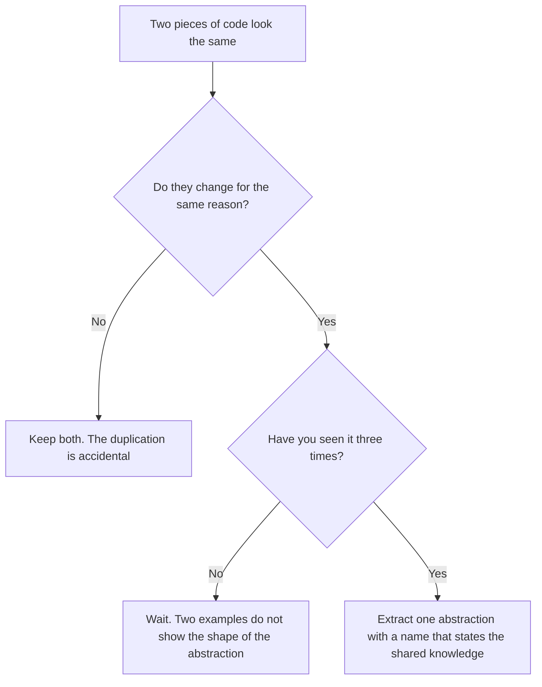

# Design Principles

A design principle is a rule of thumb that guides a design decision. Principles do not replace judgment. Each principle has a cost, and two principles can point in opposite directions. This page covers the principles that interviewers and code reviewers use besides SOLID: DRY, KISS, YAGNI, the Law of Demeter, cohesion and coupling, tell-don't-ask, immutability, the principle of least astonishment, separation of concerns, programming to an interface, and fail fast. The five SOLID principles have their own page: [SOLID](02-solid.md).

## Why It Matters

Interviewers use these principles as the vocabulary of a design review. After you draw a class diagram, the interviewer asks "Why does this class know about that class?" or "Is this abstraction needed now?" The answers use the terms on this page: coupling, cohesion, Demeter, YAGNI. On the job, the same terms appear in code review comments. A candidate who can name the principle, show the violation, and also say when the principle does not apply gives a senior-level answer. A candidate who recites the acronyms without a trade-off gives a junior-level answer.

## Core Concepts

Each term is defined here. Later sections show code.

| Principle | Definition | Source |
|---|---|---|
| DRY (Don't Repeat Yourself) | Every piece of knowledge has one single, unambiguous, authoritative representation in the system. DRY is about knowledge, not about identical text | Hunt and Thomas, *The Pragmatic Programmer* |
| KISS (Keep it simple, stupid) | Choose the simplest design that meets the requirements. Many sources attribute the phrase to the aircraft engineer Kelly Johnson. No primary source documents the attribution | Folklore |
| YAGNI (You Aren't Gonna Need It) | Do not build a feature because you think you will need it later. Build it when a requirement needs it | Extreme Programming; [Fowler](https://martinfowler.com/bliki/Yagni.html) |
| Law of Demeter | A method calls methods only on itself, its parameters, objects it creates, and its direct components. It does not call methods on objects that those calls return | Lieberherr and Holland, 1989 |
| Cohesion | How strongly the parts of one module belong together | Stevens, Myers, Constantine, 1974; Yourdon and Constantine, 1979 |
| Coupling | How much one module depends on the internals of another module | Stevens, Myers, Constantine, 1974; Myers, 1975 |
| Tell, don't ask | Tell an object what to do. Do not ask for its data and then decide for it | Hunt and Thomas |
| Immutability | An object cannot change its state after construction | *Effective Java*, Item 17 |
| Principle of least astonishment | A component behaves as a user of that component expects | No single primary source. User-interface and API design literature use the term |
| Separation of concerns | Each part of the program addresses one concern. A concern is one reason to care about the code, for example pricing, storage, or display | Dijkstra, EWD447 |
| Program to an interface | Declare variables, parameters, and return types with the abstract type (`List`), not the implementation (`ArrayList`) | GoF; *Effective Java*, Item 64 |
| Fail fast | A component reports an error at the first point where it detects the error, and does not continue with invalid data | Shore, *IEEE Software*, 2004 |

## How It Works

This section shows each principle with a violation, the problem that the violation causes, and the fix. All code uses Java 21 and a small order system.

### DRY: one source for each piece of knowledge

The violation: the tax rate `1.18` appears in three classes. The tax rate is one piece of knowledge, and the code stores it three times.

```java
class InvoicePrinter {
    BigDecimal grossTotal(BigDecimal net) {
        return net.multiply(new BigDecimal("1.18"));
    }
}

class CartView {
    String label(BigDecimal net) {
        return "Total: " + net.multiply(new BigDecimal("1.18"));
    }
}

class RefundService {
    BigDecimal refundAmount(BigDecimal net) {
        return net.multiply(new BigDecimal("1.18"));
    }
}
```

The problem: when the rate changes to `1.20`, a developer must find all three places. If the developer misses one, the invoice and the refund disagree. The compiler does not warn about the missed place.

The fix: give the knowledge one home.

```java
class TaxPolicy {
    private static final BigDecimal RATE = new BigDecimal("1.18");

    BigDecimal gross(BigDecimal net) {
        return net.multiply(RATE);
    }
}

class InvoicePrinter {
    private final TaxPolicy tax;

    InvoicePrinter(TaxPolicy tax) {
        this.tax = tax;
    }

    BigDecimal grossTotal(BigDecimal net) {
        return tax.gross(net);
    }
}
```

#### The wrong abstraction

DRY has a failure mode. Two pieces of code look the same today, but they represent different knowledge. A developer merges them into one method. Later, each caller needs a slightly different behavior. The developer adds a parameter for each difference. The method becomes a tangle of flags. Sandi Metz describes this in "The Wrong Abstraction" and writes that duplication is far cheaper than the wrong abstraction.

```java
class FeeCalculator {
    BigDecimal fee(BigDecimal amount, boolean international, boolean premium, boolean refund) {
        BigDecimal rate = new BigDecimal("0.02");
        if (international) {
            rate = rate.add(new BigDecimal("0.01"));
        }
        if (premium && !refund) {
            rate = rate.subtract(new BigDecimal("0.005"));
        }
        if (refund) {
            return BigDecimal.ZERO;
        }
        return amount.multiply(rate);
    }
}
```

Each caller must now know which flag combination gives which result. The method has three flags and 8 combinations. Most of the combinations have no meaning, for example `premium` together with `refund`. The fix is to inline the shared method back into the callers and keep separate methods for separate concepts.

```java
class FeePolicy {
    BigDecimal domesticFee(BigDecimal amount) {
        return amount.multiply(new BigDecimal("0.02"));
    }

    BigDecimal internationalFee(BigDecimal amount) {
        return amount.multiply(new BigDecimal("0.03"));
    }

    BigDecimal premiumDomesticFee(BigDecimal amount) {
        return amount.multiply(new BigDecimal("0.015"));
    }

    BigDecimal refundFee(BigDecimal amount) {
        return BigDecimal.ZERO;
    }
}
```

Use this decision flow before you remove duplication:



The "rule of three" says to remove duplication at the third occurrence. Fowler's *Refactoring* credits the rule to Don Roberts. The rule is a heuristic, not a law.

### KISS: the simplest design that works

The violation: a developer builds a plug-in system for a discount rule that has one implementation.

```java
interface DiscountRule {
    BigDecimal apply(BigDecimal total);
}

interface DiscountRuleFactory {
    DiscountRule create(String name);
}

class DiscountRuleRegistry {
    private final Map<String, DiscountRuleFactory> factories = new HashMap<>();

    void register(String name, DiscountRuleFactory factory) {
        factories.put(name, factory);
    }

    DiscountRule lookup(String name) {
        return factories.get(name).create(name);
    }
}
```

The problem: a reader must open four types to learn that the discount is 10 percent. The registry adds failure modes (a missing name gives a `NullPointerException`) that the requirement did not ask for.

The fix:

```java
class Pricing {
    BigDecimal applyMemberDiscount(BigDecimal total) {
        return total.multiply(new BigDecimal("0.90"));
    }
}
```

When the second discount rule arrives, introduce an interface. The interface then has two real implementations, and its shape comes from real needs.

### YAGNI: build what the requirement states

YAGNI is a rule about timing. Fowler names four costs of a feature that you build before a requirement needs it: the cost of build, the cost of delay (of the features you did not build instead), the cost of carry (the feature makes every later change harder), and the cost of repair (you guessed wrong and must redo it). YAGNI does not say "skip design". It says to delay the decisions that you can delay cheaply.

The violation: the requirement says "pay by card". The developer adds a `PaymentMethod` hierarchy with UPI and cryptocurrency classes.

```java
abstract class PaymentMethod {
    abstract void pay(BigDecimal amount);
}

class CardPayment extends PaymentMethod {
    void pay(BigDecimal amount) { /* card logic */ }
}

class UpiPayment extends PaymentMethod {
    void pay(BigDecimal amount) { throw new UnsupportedOperationException(); }
}

class CryptoPayment extends PaymentMethod {
    void pay(BigDecimal amount) { throw new UnsupportedOperationException(); }
}
```

The problem: two classes are dead code. They need tests, reviews, and updates when `pay` changes. The developer also guessed the shape of `pay` without knowing how UPI works.

The fix: write `CardPayment`. When the requirement for UPI arrives, extract the interface from two real implementations.

YAGNI has a limit. It applies to features and speculative flexibility. It does not apply to practices that are cheap now and costly later: input validation, a clean separation between layers, and tests. Do not use YAGNI to skip them.

### Law of Demeter: talk to your friends

Lieberherr and Holland state the law for methods. A method `m` of an object `O` may call only the methods of:

1. `O` itself;
2. the parameters of `m`;
3. objects that `m` creates;
4. the direct component objects of `O` (its fields);
5. global objects that `O` can reach (some formulations include these).

The violation, a chained call:

```java
class Address {
    private final City city;
    Address(City city) { this.city = city; }
    City getCity() { return city; }
}

class City {
    private final BigDecimal taxRate;
    City(BigDecimal taxRate) { this.taxRate = taxRate; }
    BigDecimal getTaxRate() { return taxRate; }
}

class Customer {
    private final Address address;
    Customer(Address address) { this.address = address; }
    Address getAddress() { return address; }
}

class Order {
    private final Customer customer;
    private final BigDecimal net;

    Order(Customer customer, BigDecimal net) {
        this.customer = customer;
        this.net = net;
    }

    Customer getCustomer() { return customer; }

    BigDecimal getNet() { return net; }
}

class TaxService {
    BigDecimal tax(Order order) {
        return order.getNet()
                .multiply(order.getCustomer().getAddress().getCity().getTaxRate());
    }
}
```

The problem: `TaxService` depends on the structure of four classes: `Order`, `Customer`, `Address`, and `City`. If the team moves the tax rate from `City` to a `Region` class, every caller of the chain breaks. This is a high-coupling design: the caller knows the navigation path.

The fix: each class exposes behavior and delegates to its component.

```java
class City {
    private final BigDecimal taxRate;
    City(BigDecimal taxRate) { this.taxRate = taxRate; }
    BigDecimal taxRate() { return taxRate; }
}

class Address {
    private final City city;
    Address(City city) { this.city = city; }
    BigDecimal taxRate() { return city.taxRate(); }
}

class Customer {
    private final Address address;
    Customer(Address address) { this.address = address; }
    BigDecimal taxRate() { return address.taxRate(); }
}

class Order {
    private final Customer customer;
    private final BigDecimal net;

    Order(Customer customer, BigDecimal net) {
        this.customer = customer;
        this.net = net;
    }

    BigDecimal tax() {
        return net.multiply(customer.taxRate());
    }
}
```

Now `TaxService` calls `order.tax()`. If the team moves the tax rate from `City` to a `Region` class, only `Address.taxRate()` changes. `Customer`, `Order`, and every caller outside stay the same.

Limits of the law:

- A fluent chain on one object (`builder.name("x").price(5).build()`) does not violate the law, because each call returns the same builder or a value of the same abstraction.
- A stream pipeline (`orders.stream().filter(...).map(...)`) does not violate the law. The chain works on one abstraction, the stream.
- Plain data structures (a `record` that only carries data) are different from objects with behavior. Reading `point.x()` is not a violation.
- Delegation has a price: each pass-through method adds code. If a class has ten pass-through methods, the class may be only a wrapper, and the design may need a different split.

### Cohesion

Cohesion measures how strongly the elements of one module (a class, a method, a package) belong together. High cohesion is the goal. The scale below has seven types, ranked from worst to best. Stevens, Myers, and Constantine introduced the scale in 1974. Sources disagree on whether procedural cohesion was in the 1974 paper or was added in the book *Structured Design* by Yourdon and Constantine (1979). The seven-type scale below is the form that textbooks use:

| Type (worst to best) | Meaning | Java example |
|---|---|---|
| Coincidental | Elements have no relation. They share a file | A `Utils` class with `parseDate`, `sendEmail`, and `roundPrice` |
| Logical | Elements do similar kinds of work. A parameter selects which one runs | `Exporter.export(String format)` with a `switch` for CSV, PDF, and XML |
| Temporal | Elements run at the same time | An `initEverything()` method that opens the database, loads the config, and starts the cache |
| Procedural | Elements run in a fixed order, but they share no data | A method that validates input, then writes a log, then sends a metric |
| Communicational | Elements work on the same data | A `CustomerReport` class that computes the total, the average, and the maximum of one customer's orders |
| Sequential | The output of one element is the input of the next | A pipeline: parse the file, validate the rows, convert them to entities |
| Functional | All elements contribute to one single task | `TaxCalculator`: all of its methods compute tax |

The violation, coincidental cohesion:

```java
class Utils {
    static LocalDate parseDate(String text) { return LocalDate.parse(text); }

    static void sendEmail(String to, String body) { /* SMTP call */ }

    static BigDecimal roundPrice(BigDecimal price) {
        return price.setScale(2, RoundingMode.HALF_UP);
    }
}
```

The problem: the class changes for three reasons (date format, mail provider, rounding rule). Any change recompiles and re-tests all users. No developer can predict the content of the class from its name.

The fix: place each method in a class that names its job (`DateParser`, `MailSender`, `PriceRounding`). In an interview, signs of low cohesion are class names that end in `Manager`, `Helper`, `Util`, or `Processor` and methods that use disjoint sets of fields. A method-level test: if the fields of a class split into groups and each method uses only one group, split the class along the groups.

### Coupling

Coupling measures how much one module depends on the internals of another. Low coupling is the goal. Stevens, Myers, and Constantine introduced coupling in 1974. Glenford Myers (*Reliable Software Through Composite Design*, 1975) gave the ranked types content, common, external, control, stamp, and data. Later authors on object-oriented design added message coupling. The table lists the types from worst to best:

| Type (worst to best) | Meaning | Java example |
|---|---|---|
| Content | One module reads or changes the internal data of another | Code that changes a `public` field of another class, or reads a private field with reflection |
| Common | Modules share global mutable data | Two services read and write the same `static` mutable map |
| External | Modules depend on an external format or protocol | Two modules that both parse the same fixed-width file layout |
| Control | One module passes a flag that controls the logic of another | `print(report, true)`, where `true` means "landscape" |
| Stamp | Modules pass a whole structure, but use only part of it | `sendReceipt(Order order)` that uses only `order.email()` |
| Data | Modules pass only the data that the callee needs | `sendReceipt(String email, Money total)` |
| Message | Modules communicate only through messages, for example events | A listener that receives an `OrderPaid` event |

The violation, control coupling and stamp coupling:

```java
class ReceiptSender {
    void send(Order order, boolean html) {
        String body = html
                ? "<p>Thanks for order " + order.id() + "</p>"
                : "Thanks for order " + order.id();
        System.out.println("To " + order.customerEmail() + ": " + body);
    }
}

record Order(String id, String customerEmail, List<String> lines) { }
```

The problem: the caller must know that `html` switches the logic inside `send`. The method receives a full `Order` but uses two of its fields, so any change of `Order` can affect `ReceiptSender`.

The fix: pass only the data, and replace the flag with two methods or two strategies.

```java
class ReceiptSender {
    void sendText(String email, String orderId) {
        System.out.println("To " + email + ": Thanks for order " + orderId);
    }

    void sendHtml(String email, String orderId) {
        System.out.println("To " + email + ": <p>Thanks for order " + orderId + "</p>");
    }
}
```

Coupling cannot reach zero. A system with zero coupling does nothing. The target is to couple to stable abstractions (interfaces, events, values) and not to volatile details (concrete classes, internal fields).

Cohesion and coupling are related. High cohesion inside modules tends to give low coupling between modules, because a module that does one thing needs fewer outside facts.

### Tell, don't ask

The violation: the caller reads the state of an object, decides, and writes the state back.

```java
class Account {
    private BigDecimal balance;

    Account(BigDecimal balance) { this.balance = balance; }

    BigDecimal getBalance() { return balance; }

    void setBalance(BigDecimal balance) { this.balance = balance; }
}

class TransferService {
    void withdraw(Account account, BigDecimal amount) {
        if (account.getBalance().compareTo(amount) >= 0) {
            account.setBalance(account.getBalance().subtract(amount));
        } else {
            throw new IllegalStateException("insufficient funds");
        }
    }
}
```

The problems:

- The rule "a balance cannot go below zero" lives in `TransferService`. Another service that calls `setBalance` can break the rule.
- The check and the update are two steps. Two threads can both pass the check (a race condition). See [concurrency in LLD](09-concurrency-in-lld.md).
- Every caller repeats the rule, which violates DRY.

The fix: move the behavior to the object that owns the data.

```java
class Account {
    private BigDecimal balance;

    Account(BigDecimal balance) { this.balance = balance; }

    synchronized void withdraw(BigDecimal amount) {
        if (balance.compareTo(amount) < 0) {
            throw new IllegalStateException("insufficient funds");
        }
        balance = balance.subtract(amount);
    }

    synchronized BigDecimal balance() { return balance; }
}
```

Fowler notes a limit: the principle does not forbid query methods. A report needs to read the balance. Query methods are fine when the caller does not make a decision that the object itself should make.

### Immutability

An immutable object has a state that is fixed at construction. `String`, `Integer`, `BigDecimal`, `LocalDate`, and the instances of a `record` with immutable components are examples. Benefits:

- Thread safety: no thread can see a half-updated state, so no lock is needed.
- Safe sharing: you can pass the object to any code, or use it as a `HashMap` key, without a defensive copy.
- Simpler reasoning: the state at construction is the state for the lifetime of the object.
- Failure atomicity: a method that fails cannot leave the object in a broken state.

The JLS gives a specific guarantee for `final` fields. After a constructor finishes, every thread that sees a reference to the object also sees the final values of the `final` fields that the constructor set, even if the program publishes the reference through a data race (JLS 17.5). This holds only if the constructor does not let `this` escape before it ends.

*Effective Java*, Item 17, lists five rules for an immutable class:

1. Do not provide methods that change the state (setters).
2. Make the class impossible to extend (`final` class, or a private constructor with static factories).
3. Make all fields `final`.
4. Make all fields `private`.
5. Give exclusive access to mutable components. Make a defensive copy in the constructor, and return a copy or an unmodifiable view from the getter.

The violation, an immutable-looking class with a leak:

```java
class Shipment {
    private final String id;
    private final List<String> items;

    Shipment(String id, List<String> items) {
        this.id = id;
        this.items = items;
    }

    List<String> getItems() {
        return items;
    }
}
```

The fields are `final`, but the reference is final and the list is not. The caller keeps the list that it passed in and changes it later. The caller can also change the list through `getItems()`. The class is mutable.

The fix:

```java
final class Shipment {
    private final String id;
    private final List<String> items;

    Shipment(String id, List<String> items) {
        this.id = Objects.requireNonNull(id);
        this.items = List.copyOf(items);
    }

    String id() {
        return id;
    }

    List<String> items() {
        return items;
    }

    Shipment withItem(String item) {
        List<String> next = new ArrayList<>(items);
        next.add(item);
        return new Shipment(id, next);
    }
}
```

`List.copyOf` makes an unmodifiable copy and throws `NullPointerException` if the list has a null element. `Collections.unmodifiableList` is different. It returns a read-only view of the original list, and a later change to the original list shows through the view. For a defensive copy, use `List.copyOf`.

A record has shallow immutability only. A `record Shipment(String id, List<String> items)` has a final `items` field, but the list is still mutable. Copy the list in a compact constructor:

```java
record Shipment(String id, List<String> items) {
    Shipment {
        Objects.requireNonNull(id);
        items = List.copyOf(items);
    }
}
```

The cost of immutability: each change creates a new object. For a large object that changes often (a 10 000-element list that changes in a loop), the cost matters. Use a builder to collect changes (see [creational patterns](06-creational-patterns.md)), or use a mutable object that stays inside one thread.

### Principle of least astonishment

A component should do what its name and signature suggest. The violation: a method that reads like a query but has a side effect.

```java
class Inventory {
    private final Map<String, Integer> stock = new HashMap<>();

    Inventory(Map<String, Integer> initial) {
        stock.putAll(initial);
    }

    boolean isAvailable(String sku) {
        int count = stock.getOrDefault(sku, 0);
        if (count > 0) {
            stock.put(sku, count - 1);
            return true;
        }
        return false;
    }
}
```

The problem: a caller that checks `isAvailable("KB-100")` twice removes two items from the stock. The name suggests a read, and the code writes.

The fix: separate the query and the command, and name the command by its effect.

```java
class Inventory {
    private final Map<String, Integer> stock = new HashMap<>();

    Inventory(Map<String, Integer> initial) {
        stock.putAll(initial);
    }

    boolean isAvailable(String sku) {
        return stock.getOrDefault(sku, 0) > 0;
    }

    void reserve(String sku) {
        int count = stock.getOrDefault(sku, 0);
        if (count == 0) {
            throw new IllegalStateException("out of stock: " + sku);
        }
        stock.put(sku, count - 1);
    }
}
```

The JDK has its own surprises. `List.of(...).add(x)` throws `UnsupportedOperationException`, although `List` declares `add`. The JDK documents the behavior, but many developers do not expect it. Other least-astonishment rules: a getter does not change state, `equals` and `hashCode` agree, `toString` does not throw, a method that takes a collection does not change that collection unless the name says so (`sortInPlace`), and a method returns an empty collection and not `null`.

### Separation of concerns

A concern is one aspect of the program that you can discuss on its own: pricing rules, persistence, display, security. Dijkstra used the term in 1974 (EWD447) for the practice of studying one aspect at a time. In code, it means that each module addresses one concern.

The violation: one class mixes three concerns.

```java
import java.sql.Connection;
import java.sql.PreparedStatement;
import java.sql.SQLException;

class Order {
    private final List<BigDecimal> prices = new ArrayList<>();

    void add(BigDecimal price) { prices.add(price); }

    BigDecimal total() {
        BigDecimal sum = BigDecimal.ZERO;
        for (BigDecimal price : prices) {
            sum = sum.add(price);
        }
        return sum;
    }

    String toHtml() {
        return "<h1>Order</h1><p>Total: " + total() + "</p>";
    }

    void save(Connection connection) throws SQLException {
        try (PreparedStatement stmt =
                     connection.prepareStatement("INSERT INTO orders(total) VALUES (?)")) {
            stmt.setBigDecimal(1, total());
            stmt.executeUpdate();
        }
    }
}
```

The problems: the class changes when the page design changes, when the table changes, and when the pricing changes. A unit test for `total()` needs a class that imports JDBC and HTML code. The pricing code cannot be reused in a batch job that has no HTML.

The fix: split the concerns.

```java
class Order {
    private final List<BigDecimal> prices = new ArrayList<>();

    void add(BigDecimal price) { prices.add(price); }

    BigDecimal total() {
        BigDecimal sum = BigDecimal.ZERO;
        for (BigDecimal price : prices) {
            sum = sum.add(price);
        }
        return sum;
    }
}

class OrderHtmlView {
    String render(Order order) {
        return "<h1>Order</h1><p>Total: " + order.total() + "</p>";
    }
}

interface OrderRepository {
    void save(Order order);
}
```

Separation of concerns is the general idea. The Single Responsibility Principle is one precise form of it for classes. See [SOLID](02-solid.md). Layered architecture applies the idea at the level of packages. See [architectural patterns](10-architectural-patterns.md).

### Program to an interface

Declare a variable, a parameter, or a return type with the most abstract type that offers the methods that you need.

The violation:

```java
class ReportService {
    private ArrayList<String> names = new ArrayList<>();

    ArrayList<String> topNames(HashMap<String, Integer> scores) {
        ArrayList<String> result = new ArrayList<>();
        for (Map.Entry<String, Integer> entry : scores.entrySet()) {
            if (entry.getValue() > 90) {
                result.add(entry.getKey());
            }
        }
        return result;
    }
}
```

The problem: the signature forces every caller to hold a `HashMap` and to accept an `ArrayList`. A caller that has a `TreeMap` must copy it. If the service later returns a `LinkedList` or an immutable list, the signature breaks every caller.

The fix:

```java
class ReportService {
    List<String> topNames(Map<String, Integer> scores) {
        List<String> result = new ArrayList<>();
        for (Map.Entry<String, Integer> entry : scores.entrySet()) {
            if (entry.getValue() > 90) {
                result.add(entry.getKey());
            }
        }
        return result;
    }
}
```

The same rule applies to your own types. `OrderService` depends on `PaymentGateway` (an interface), and not on `StripeGateway`. A test then passes a fake gateway. See the dependency inversion principle in [SOLID](02-solid.md).

When not to use an interface: if a class has one implementation, no test needs a fake, and no second implementation is planned, an interface adds a file and no value. Value classes (`Money`, `OrderLine`) rarely need one. Also, use the concrete type when you need a method that only the concrete type has (`ArrayList.ensureCapacity`, `ArrayList.trimToSize`).

### Fail fast

A fail-fast component detects an invalid state and reports it at once, close to the cause. Jim Shore describes the idea in "Fail Fast" (*IEEE Software*, 2004): a system that fails immediately gives a clear error at the point of the defect, and a system that continues hides the defect until later.

The violation:

```java
class Shipment {
    private final String address;
    private final int weightGrams;

    Shipment(String address, int weightGrams) {
        this.address = address;
        this.weightGrams = weightGrams;
    }

    BigDecimal cost() {
        return BigDecimal.valueOf((long) weightGrams * address.length());
    }
}
```

The problem: `new Shipment(null, -5)` succeeds. The failure comes later in `cost()` as a `NullPointerException`, possibly in another thread, hours after the bad value entered the system. The stack trace points to `cost()`, and the defect is in the caller that passed `null`.

The fix: validate at the boundary, in the constructor.

```java
class Shipment {
    private final String address;
    private final int weightGrams;

    Shipment(String address, int weightGrams) {
        this.address = Objects.requireNonNull(address, "address");
        if (weightGrams <= 0) {
            throw new IllegalArgumentException("weightGrams must be positive: " + weightGrams);
        }
        this.weightGrams = weightGrams;
    }
}
```

Rules for fail fast:

- Validate in constructors and at the entry of public methods. Put the invalid value in the message.
- Throw an unchecked exception for a programmer error (`IllegalArgumentException`, `IllegalStateException`, `NullPointerException`).
- Do not catch an exception and return a default value that hides the failure.
- Do not fail fast on user input in a way that crashes the program. For user input, validate, collect the errors, and show them. Fail fast is for violations of the contract between components.

The JDK uses fail fast in collections. The iterator of an `ArrayList` throws `ConcurrentModificationException` if the list changes during iteration. The JDK documents this as best-effort: do not use the exception as a correctness mechanism.

## Trade-offs and When to Use

Principles conflict. The table shows the common conflicts and a way to decide.

| Conflict | Why it happens | Deciding question |
|---|---|---|
| DRY and the wrong abstraction | Merging similar code creates a shared method with flags | Do both pieces change for the same reason? |
| DRY and low coupling | A shared helper couples two modules that were independent | Is the coupling cost lower than the cost of two copies? |
| YAGNI and open for extension (the O in SOLID) | Extension points are speculative features | Does a requirement or a known change need the extension point today? |
| KISS and SOLID | Many small classes and interfaces have more files than one `switch` | Does the reader need to open fewer files to change one behavior? |
| Law of Demeter and pass-through methods | Delegation methods add code | Is the class still more than a wrapper? |
| Immutability and performance | Each change allocates an object | Does a profile show that allocation is the cost? |
| Fail fast and robustness | A crash is a poor experience for the user | Is the invalid value a programmer error (fail) or a user input (validate and report)? |
| Program to an interface and YAGNI | An interface for every class doubles the file count | Is there a second implementation or a test fake? |

Recommendation: when two principles conflict, state both, choose one, and say what evidence would change your choice. This is the answer that interviewers look for.

## Java Example

The program below combines five principles. `Money` and `OrderLine` are immutable records that fail fast (constructors validate). `Order` is a final class that copies its list defensively. `pay` follows tell-don't-ask: the order checks its own rule. `Order.total()` hides the line structure, so callers do not chain through the lines (Law of Demeter). The program runs with `java Main.java`.

```java
import java.math.BigDecimal;
import java.math.RoundingMode;
import java.util.List;
import java.util.Objects;

public class Main {
    public static void main(String[] args) {
        List<OrderLine> lines = new java.util.ArrayList<>(List.of(
                new OrderLine("KB-100", 2, Money.of("25.00")),
                new OrderLine("MS-200", 1, Money.of("12.50"))));
        Order order = Order.create("ORD-1", lines);
        lines.clear();
        System.out.println("Lines after caller clears its list: " + order.lines().size());
        System.out.println("Total: " + order.total());

        try {
            order.lines().add(new OrderLine("XX-1", 1, Money.of("1.00")));
        } catch (UnsupportedOperationException e) {
            System.out.println("Cannot change the line list from outside");
        }
        try {
            order.pay(Money.of("10.00"));
        } catch (IllegalArgumentException e) {
            System.out.println("Rejected: " + e.getMessage());
        }
        Order paid = order.pay(Money.of("62.50"));
        System.out.println("Original status: " + order.status());
        System.out.println("Paid status: " + paid.status());
        try {
            paid.pay(Money.of("62.50"));
        } catch (IllegalStateException e) {
            System.out.println("Rejected: " + e.getMessage());
        }
        try {
            new OrderLine("KB-100", 0, Money.of("25.00"));
        } catch (IllegalArgumentException e) {
            System.out.println("Rejected: " + e.getMessage());
        }
    }
}

record Money(BigDecimal amount) {
    Money {
        Objects.requireNonNull(amount, "amount");
        if (amount.scale() > 2) {
            throw new IllegalArgumentException("more than 2 decimal places: " + amount);
        }
        amount = amount.setScale(2, RoundingMode.UNNECESSARY);
    }

    static Money of(String text) {
        return new Money(new BigDecimal(text));
    }

    static Money zero() {
        return of("0");
    }

    Money plus(Money other) {
        return new Money(amount.add(other.amount));
    }

    Money times(int factor) {
        return new Money(amount.multiply(BigDecimal.valueOf(factor)));
    }

    boolean isLessThan(Money other) {
        return amount.compareTo(other.amount) < 0;
    }

    @Override
    public String toString() {
        return amount.toPlainString();
    }
}

record OrderLine(String sku, int quantity, Money unitPrice) {
    OrderLine {
        Objects.requireNonNull(sku, "sku");
        Objects.requireNonNull(unitPrice, "unitPrice");
        if (quantity <= 0) {
            throw new IllegalArgumentException("quantity must be positive: " + quantity);
        }
    }

    Money subtotal() {
        return unitPrice.times(quantity);
    }
}

enum OrderStatus { NEW, PAID }

final class Order {
    private final String id;
    private final List<OrderLine> lines;
    private final OrderStatus status;

    private Order(String id, List<OrderLine> lines, OrderStatus status) {
        this.id = id;
        this.lines = lines;
        this.status = status;
    }

    static Order create(String id, List<OrderLine> lines) {
        Objects.requireNonNull(id, "id");
        List<OrderLine> copy = List.copyOf(lines);
        if (copy.isEmpty()) {
            throw new IllegalArgumentException("an order needs at least one line");
        }
        return new Order(id, copy, OrderStatus.NEW);
    }

    String id() {
        return id;
    }

    List<OrderLine> lines() {
        return lines;
    }

    OrderStatus status() {
        return status;
    }

    Money total() {
        Money sum = Money.zero();
        for (OrderLine line : lines) {
            sum = sum.plus(line.subtotal());
        }
        return sum;
    }

    Order pay(Money payment) {
        if (status == OrderStatus.PAID) {
            throw new IllegalStateException("order " + id + " is already paid");
        }
        if (payment.isLessThan(total())) {
            throw new IllegalArgumentException("payment " + payment + " is below total " + total());
        }
        return new Order(id, lines, OrderStatus.PAID);
    }
}
```

Output:

<!-- expected-output -->

```text
Lines after caller clears its list: 2
Total: 62.50
Cannot change the line list from outside
Rejected: payment 10.00 is below total 62.50
Original status: NEW
Paid status: PAID
Rejected: order ORD-1 is already paid
Rejected: quantity must be positive: 0
```

## Interview Angle

### Questions

??? question "What is the difference between DRY and avoiding duplicate code, and when does DRY hurt?"

    DRY is about duplicated knowledge, not duplicated text. Hunt and Thomas state it as: every piece of knowledge has a single, authoritative representation in the system. Two identical code blocks that encode the same business rule violate DRY. Two identical blocks that encode different rules do not.

    DRY hurts when a developer merges code that only looks the same. The shared method then needs a flag for each difference, and callers depend on flag combinations. Sandi Metz calls this the wrong abstraction. The fix is to inline the shared method and let the copies diverge.

    My test: do the two pieces change for the same reason? If yes, merge them. If no, keep both. I also wait for a third occurrence before I extract, because two examples rarely show the right shape.

??? question "Explain the Law of Demeter. Give an example and a fix."

    A method should talk only to itself, its parameters, the objects it creates, and its direct components. It should not reach through an object to the objects inside.

    Example: `order.getCustomer().getAddress().getCity().getTaxRate()`. The caller knows the structure of four classes. If the tax rate moves, every chain breaks.

    Fix: add `order.tax()` that delegates to the customer, the address, and the city. The caller depends on `Order` only.

    Limits: fluent builders and stream pipelines are not violations, because they operate on one abstraction. Data-only records are not violations. Too much delegation produces classes with many pass-through methods, which is its own smell.

??? question "What is the difference between cohesion and coupling? Which direction do you want each to go?"

    Cohesion is how strongly the parts inside one module belong together. Coupling is how much one module depends on the internals of another. I want high cohesion and low coupling.

    Cohesion example: `TaxCalculator` with methods that all compute tax has functional cohesion. A `Utils` class with date parsing, mail sending, and rounding has coincidental cohesion.

    Coupling example: passing a full `Order` to a method that needs one email is stamp coupling. Passing a boolean that switches the logic is control coupling. Two services that share a static mutable map have common coupling.

    I cannot remove all coupling, so I aim to depend on stable abstractions: interfaces, values, and events.

??? question "What does tell-don't-ask mean? Does it forbid getters?"

    It means that the caller tells an object what to do and does not read the object's data to decide for it. With `account.withdraw(amount)`, the account enforces the rule "no negative balance". With `getBalance()` and `setBalance()`, every caller must enforce the rule, and a race can happen between the check and the update.

    It does not forbid getters. A report or a display needs to read data. The principle targets the case where the caller makes a decision that belongs to the object. Fowler also warns that the principle can push people to remove useful query methods.

??? question "How do you make a class immutable in Java?"

    Follow the rules from *Effective Java*, Item 17. Make the class `final`, or give it a private constructor with static factories. Make all fields `private final`. Provide no setters. Copy mutable inputs in the constructor (`List.copyOf`), and return copies or unmodifiable views from getters. Do not let `this` escape from the constructor. Methods that "change" the object return a new object.

    A `record` gives most of this, but it is only shallowly immutable. A record with a `List` component needs a compact constructor that copies the list.

    The benefit for thread safety: no thread can see a half-updated state, so no lock is needed. The JLS (17.5) also guarantees that other threads see the final field values after construction finishes, if `this` did not escape.

??? question "Why is `Collections.unmodifiableList` not enough for an immutable class?"

    It returns a read-only view. It does not copy. If the caller keeps a reference to the original list and changes it, the view shows the change. The class is then not immutable.

    For a defensive copy, use `List.copyOf` (Java 10+). It copies the elements into an unmodifiable list and rejects null elements. For an unmodifiable view that tracks a list that the class owns and does not expose, `unmodifiableList` is acceptable.

??? question "YAGNI says do not build for the future. SOLID says design for extension. How do you resolve this?"

    They apply at different times. YAGNI says to delay a decision until a requirement needs it. The Open-Closed Principle says that when a requirement does need variation, the design lets you add it without editing tested code.

    My approach: build the simplest code for the current requirement. When the second variant arrives, refactor to an interface with two real implementations. The abstraction then has the right shape because two real cases shaped it. I add an extension point at the start only when I know the variation is coming, for example because the requirement lists three payment methods.

    YAGNI does not cover cheap practices that are costly later: validation, tests, and clean boundaries between layers.

??? question "What does fail fast mean, and when should you not use it?"

    Fail fast means that a component reports an error at the first point where it detects invalid state, and does not continue. Example: a constructor that throws `IllegalArgumentException` for a negative weight. The stack trace then points to the caller that created the bad value.

    Do not use it as a way to handle user input. A web form with an invalid email should return a validation message, not crash the request. Fail fast is for contract violations between components, which are programmer errors.

    Also, do not rely on `ConcurrentModificationException` for correctness. The JDK documents the fail-fast behavior of collection iterators as best-effort.

### Follow-up Questions

??? question "Is a long method chain always a Demeter violation?"

    No. A chain on one abstraction is not a violation. `stream().filter().map().toList()` operates on the stream. A builder chain returns the same builder. The violation is a chain that navigates through the structure of different objects: `a.getB().getC().getD()`.

??? question "How is separation of concerns different from the Single Responsibility Principle?"

    Separation of concerns is the general idea: each part addresses one aspect. It applies to methods, classes, packages, and layers. The Single Responsibility Principle is a precise rule for classes: a class has one reason to change, which means one actor that requests changes. SRP is one way to apply separation of concerns.

??? question "A teammate wants an interface for every class 'for testability'. What do you say?"

    An interface helps when there are two implementations or when a test needs a fake for a slow or external dependency, for example a payment gateway. A value class like `Money` needs no interface. An interface for every class doubles the number of files and hides the real implementation behind an indirection that no one uses. I add the interface at the boundary that needs a fake, and I add it when the need appears.

### Red Flags

- You define DRY as "never repeat code" and do not mention the wrong abstraction.
- You say "always use interfaces" or "always make everything immutable" with no cost or exception.
- You claim that `Collections.unmodifiableList` makes a class immutable.
- You state the Law of Demeter as "one dot per line".
- You propose an extension point for a variation that no requirement mentions, and you cannot say what evidence supports it.
- You treat principles as laws and cannot name a case where a principle should be broken.
- You fix a Demeter chain by making the middle objects `public` fields, which increases coupling.

## Common Mistakes

| Mistake | Why it hurts | Fix |
|---|---|---|
| Merge two similar methods and add a flag | The shared method becomes a switch for unrelated cases | Inline it. Keep separate methods |
| Count dots to check the Law of Demeter | Fluent APIs and streams are not violations. Real violations can hide in two calls | Ask whether the caller depends on the structure of objects that it does not own |
| Add getters and setters for every field and call it encapsulation | The class has no rules. Callers decide for it | Expose behavior (`withdraw`), and keep state private |
| Mark fields `final` and call the class immutable | A `final` reference to a mutable list is still mutable | Copy mutable inputs. Return copies or unmodifiable collections |
| Build an interface hierarchy for one implementation | The reader opens extra files and the abstraction is a guess | Wait for a second implementation |
| Return `null` from a method that returns a collection | Callers get `NullPointerException`, which astonishes them | Return an empty collection |
| Catch an exception, log it, and continue with a default | The system hides the defect | Let the exception propagate, or handle it with a real recovery |
| Put a boolean flag in a method signature | The caller must know what `true` means. The method does two jobs | Use two methods, or an enum, or a strategy |
| Create a `Utils` class | Coincidental cohesion. The class changes for many reasons | Move each method to the class that owns the concept |
| Apply DRY to test data | A shared fixture couples tests that change for different reasons | Let each test build its own data, with a small test builder |

## Commonly Confused With

| Looks like | Difference | Deciding question |
|---|---|---|
| DRY vs KISS | DRY removes duplicated knowledge. KISS limits the complexity of the solution. A DRY abstraction can break KISS | Is the abstraction simpler to read than the two copies? |
| YAGNI vs the Open-Closed Principle | YAGNI delays building flexibility. OCP says how to structure code when variation is needed | Does a current requirement need the variation? |
| Law of Demeter vs encapsulation | Encapsulation hides the state inside one class. Demeter limits how far a caller navigates through objects | Does the caller know the structure of objects that it does not own? |
| Tell-don't-ask vs the anemic domain model | Tell-don't-ask is the rule. An anemic model is the symptom when classes have data and no behavior | Where does the rule "balance cannot be negative" live? |
| Cohesion vs coupling | Cohesion is inside a module. Coupling is between modules | Am I asking about the parts of one class, or about two classes? |
| Separation of concerns vs SRP | SoC is the general idea at any level. SRP is the class-level rule about reasons to change | Which actor asks for the change? |
| Unmodifiable view vs immutable object | A view blocks changes through the view. An immutable object has no changes from anywhere | Can anyone still change the underlying data? |
| Fail fast vs defensive programming | Fail fast stops at the first error. Defensive code continues with a guess | Does the code hide or report the invalid state? |
| Program to an interface vs dependency inversion | The first is a coding habit for types. The second is a rule about the direction of module dependencies | Does the high-level module own the interface? |

## Quick Reference Card

- DRY: one source for each piece of knowledge. Do not merge code that changes for different reasons. Wait for the third copy.
- KISS: the simplest design that meets the requirement.
- YAGNI: no feature or extension point without a requirement. Do not skip validation, tests, or layer boundaries.
- Law of Demeter: do not navigate through the structure of other objects. Add a delegating method. Fluent APIs and streams are fine.
- Cohesion (high is good): functional is best, coincidental is worst. A `Utils` class is a smell.
- Coupling (low is good): data and message coupling are good. Control, common, and content coupling are bad.
- Tell, don't ask: put the rule in the object that owns the data.
- Immutability: `final` class, `private final` fields, no setters, copy mutable inputs, `List.copyOf`. A record is shallowly immutable.
- Least astonishment: names match behavior. A query has no side effect. Return empty collections, not `null`.
- Separation of concerns: pricing, storage, and display live in different classes.
- Program to an interface: `List`, not `ArrayList`. Add your own interface when there is a second implementation or a test fake.
- Fail fast: validate in the constructor. Use unchecked exceptions for programmer errors.
- In an interview: name the principle, show the violation, give the fix, and state when you would not apply it.

## Further Reading

- Andrew Hunt and David Thomas, *The Pragmatic Programmer*: the source of DRY and tell-don't-ask.
- Sandi Metz, [The Wrong Abstraction](https://sandimetz.com/blog/2016/1/20/the-wrong-abstraction): why duplication costs less than a wrong abstraction.
- Martin Fowler, [Yagni](https://martinfowler.com/bliki/Yagni.html): the four costs of a presumptive feature, and the limits of YAGNI.
- Martin Fowler, [TellDontAsk](https://martinfowler.com/bliki/TellDontAsk.html): the principle and Fowler's caution about it.
- Karl Lieberherr and Ian Holland, "Assuring Good Style for Object-Oriented Programs", *IEEE Software*, 1989: the Law of Demeter.
- David Bock, [The Paperboy, The Wallet, and The Law of Demeter](https://www2.ccs.neu.edu/research/demeter/demeter-method/LawOfDemeter/paper-boy/demeter.pdf), hosted on the Demeter project site: a worked example of a Demeter violation and its fix.
- W. Stevens, G. Myers, L. Constantine, "Structured Design", *IBM Systems Journal* 13(2), 1974: the origin of cohesion and coupling. Edward Yourdon and Larry Constantine, *Structured Design*, 1979, and Glenford Myers, *Reliable Software Through Composite Design*, 1975: the ranked cohesion and coupling types.
- Joshua Bloch, *Effective Java*, 3rd edition: Item 17 (minimize mutability), Item 50 (defensive copies), Item 64 (refer to objects by their interfaces).
- [JLS 17.5, final field semantics](https://docs.oracle.com/javase/specs/jls/se21/html/jls-17.html): the memory-model guarantee for `final` fields.
- [`java.util.List` javadoc (Java 21)](https://docs.oracle.com/en/java/javase/21/docs/api/java.base/java/util/List.html): `copyOf`, `of`, and the unmodifiable collection rules.
- Jim Shore, [Fail Fast](https://martinfowler.com/ieeeSoftware/failFast.pdf), *IEEE Software*, 2004 (Fowler's Design column): the argument for early failure.
- Edsger Dijkstra, [On the role of scientific thought (EWD447)](https://www.cs.utexas.edu/~EWD/transcriptions/EWD04xx/EWD447.html): the origin of "separation of concerns".
- Martin Fowler, [CodeSmell](https://martinfowler.com/bliki/CodeSmell.html) and *Refactoring*, 2nd edition: the rule of three (chapter 2, credited to Don Roberts) and the smell catalog. See also `kb/engineering-practice/02-refactoring-and-code-smells.md`.
