# UML Class, Sequence, and State Diagrams

## Why It Matters

In a low-level design (LLD) interview, you draw a class diagram within the first 15 minutes, and the interviewer reads it to decide whether your design is sound. A wrong arrow tells the interviewer that you confuse "owns" with "uses", and that costs points even if your code is right. Interviewers also ask for a sequence diagram of one critical flow, such as booking a seat, and for a state diagram of an entity with a lifecycle, such as an order. On the job, the same three diagrams are the common way to explain a design in a pull request or a design document. This page teaches the notation in Mermaid, the Java code that each notation element maps to, and the level of detail that a 45-minute round expects.

## Core Concepts

**UML** (Unified Modeling Language): a standard notation for drawing software structure and behavior. The Object Management Group (OMG) maintains the standard. An interview uses a small part of it: three diagram types.

**Mermaid**: a text-based diagram language. You write the diagram as text, and a renderer draws it. The KB uses Mermaid for all diagrams, and the MkDocs site renders it. Mermaid does not implement all of UML. This page uses only the Mermaid syntax that the Mermaid documentation lists.

**Class diagram**: a diagram of the static structure of a program. It shows classes, interfaces, enums, their members, and the relationships between them.

**Sequence diagram**: a diagram of the interactions in one scenario, ordered by time. It shows which object sends which message to which object.

**State diagram** (state machine diagram): a diagram of the states of one object over its lifetime and the events that move the object from one state to another.

**Visibility marker**: a symbol before a member name. It tells which code can access the member.

**Multiplicity**: the number of instances that take part in one end of a relationship. Example: `1..*` means "one or more".

**Navigability**: the direction in which one class holds a reference to the other. An arrowhead shows it.

**Lifecycle**: the time from the creation of an object to its deletion. Composition depends on lifecycle.

### The Six Relationships

The table lists the six relationships, with the Mermaid syntax and the Java code that each one maps to. The first four rows go from the weakest to the strongest link between two objects. The last two rows are relationships between types, not between objects.

| Relationship | Mermaid | Meaning | Java mapping |
|---|---|---|---|
| Dependency | `A ..> B` | A uses B for a short time. A does not keep B. | B is a parameter, local variable, or return type of an A method |
| Association | `A --> B` | A holds a reference to B. A knows B over a longer time. | A field of type B (or `List<B>`) in A |
| Aggregation | `A o-- B` | Association with the added meaning "A is the whole and B is a part that can exist without A" | The same field as an association. The part comes from outside, for example through the constructor |
| Composition | `A *-- B` | A owns B. B belongs to at most one A at a time, and if A is deleted, B is deleted with it. | A field that A creates itself, never shares, and drops with itself |
| Inheritance | `Parent <\|-- Child` | Child is a kind of Parent | `class Child extends Parent` |
| Realization | `Type <\|.. Impl` | Impl fulfills the contract of Type | `class Impl implements Type` |

In Mermaid, you write a realization as `Type <|.. Impl` or as `Impl ..|> Type`. Both forms draw the same relationship.

## How It Works

### Class diagram: reading one class

A class box has three parts: the name, the attributes, and the methods. In Mermaid, you write them inside braces.

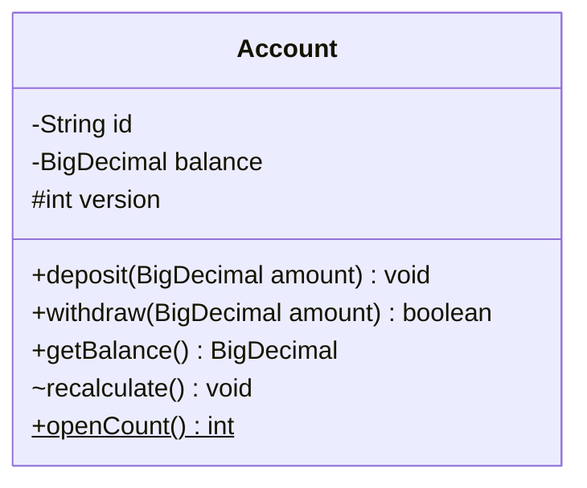

The Mermaid documentation defines these markers:

| Marker | Visibility | Java equivalent |
|---|---|---|
| `+` | Public | `public` |
| `-` | Private | `private` |
| `#` | Protected | `protected`. Java `protected` is wider than UML protected: it also gives access to all classes in the same package (JLS 6.6.2) |
| `~` | Package or internal | No modifier (package-private) |

A method may end with `$` (static) or `*` (abstract). A return type goes after the closing parenthesis, and the `$` or `*` goes after the return type: `openCount() int$`, `area() double*`. A static attribute ends with `$`. Mermaid writes a generic type with tildes: `List~OrderLine~` stands for `List<OrderLine>`. The Mermaid documentation says that a generic type cannot contain a comma, so `Map~String, Account~` does not work. Write `Map` with a note, or name a type alias.

### Class diagram: interfaces, abstract classes, enums, records

An annotation in double angle brackets marks the kind of a type.

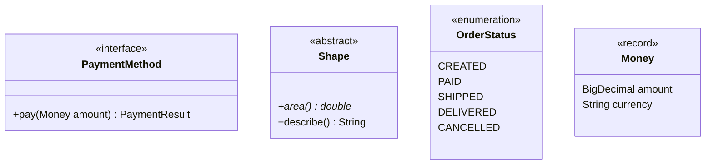

- `<<interface>>` marks a Java `interface`.
- `<<abstract>>` marks an `abstract class`. An abstract method ends with `*`.
- `<<enumeration>>` marks an `enum`. The lines inside the box are the constants.
- `<<record>>` is a free-text annotation. Mermaid prints any text that you put in `<< >>`. Use it for records and for sealed interfaces (`<<sealed interface>>`).

### Class diagram: relationships

Each subsection shows one relationship in Mermaid, the meaning, and the Java code. The domain is an order system.

#### Dependency (`..>`)

`OrderService` receives a `PaymentGateway` as a parameter. It does not keep the gateway. The dependency arrow points from the user to the used type.

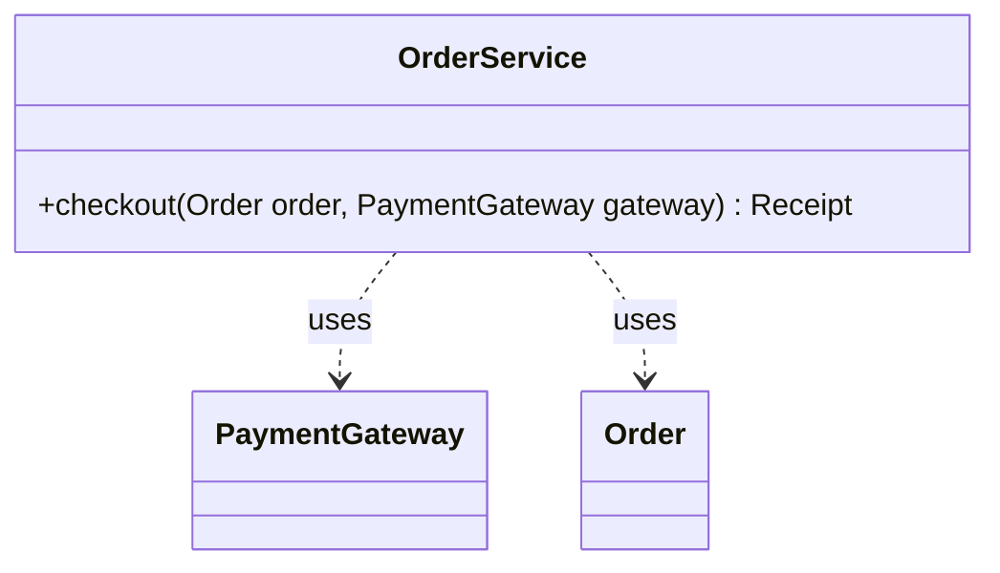

```java
record Receipt(String orderId) {}
interface PaymentGateway { void charge(BigDecimal amount); }
class Order {
    String id() { return "o-1"; }
    BigDecimal total() { return BigDecimal.TEN; }
}

class OrderService {
    Receipt checkout(Order order, PaymentGateway gateway) {
        gateway.charge(order.total());      // the parameter lives only in this call
        return new Receipt(order.id());
    }
}
```

A dependency also exists when a method creates a local object of the other type or returns it. If the other type changes, the dependent class may need a change. That is the only meaning of the arrow.

#### Association (`-->`) and multiplicity

An association means that an object of one class holds a reference to an object of the other class. Multiplicity goes in double quotes next to the class that it describes.

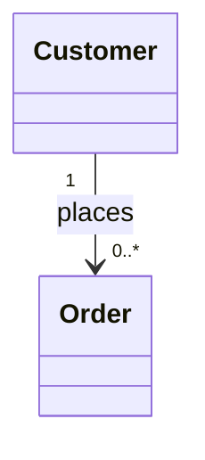

Read the line from left to right: "One `Customer` places zero or more `Order` objects." The arrowhead shows navigability: `Customer` holds the references. `Order` does not hold a reference to `Customer` in this diagram.

```java
class Order {}

class Customer {
    private final String id;
    private final List<Order> orders = new ArrayList<>();   // "0..*" maps to a collection

    Customer(String id) { this.id = id; }
    void add(Order order) { orders.add(order); }
}
```

Mapping of multiplicities to Java:

| Multiplicity | Meaning | Java field |
|---|---|---|
| `1` | Exactly one | A field that is never `null`. Make it `final` if the link never changes |
| `0..1` | Zero or one | A field that may be `null`. A getter may return `Optional<T>` |
| `*` or `0..*` | Zero or more | `List<T>` or `Set<T>`, initialized to an empty collection |
| `1..*` | One or more | A collection, plus a constructor rule that rejects an empty collection |
| `n` (a fixed number) | Exactly n | An array or a collection, plus a check of the size |

A many-to-many association, such as `Student` and `Course`, usually becomes a class of its own (`Enrollment`) with two associations. The class carries the data of the pair, for example the grade.

Arrowheads on both ends (`<-->`) show two-way navigability. A plain solid line (`--`) leaves the navigability unspecified: it does not say which class holds the reference. Draw a two-way association only if both classes need the reference. In Java, a two-way association has a cost: code must keep both fields consistent. The `add` method on one side must set the field on the other side.

#### Aggregation (`o--`)

Aggregation is an association with the added meaning "whole and part". The hollow diamond sits on the whole. By common convention, the part can exist without the whole and can belong to several wholes. The UML specification does not state these rules (see the warning below).

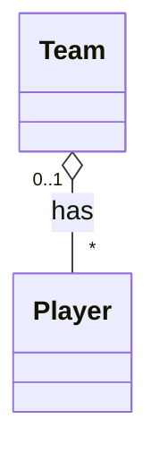

The `0..1` at the `Team` end says that a player is in at most one team and may be in none (a free agent).

```java
class Player {}

class Team {
    private final List<Player> players = new ArrayList<>();

    void sign(Player player) {          // the Player comes from outside
        players.add(player);
    }
}
```

If the team is dissolved, the `Player` objects stay alive: other code still holds them, and they may join another team. The Java code looks the same as an association. Only the intent differs.

!!! warning "Aggregation has weak semantics"
    The UML 2.5.1 specification (section 9.5.3) defines shared aggregation in one sentence: "Precise semantics of shared aggregation varies by application area and modeler." Martin Fowler writes, in his article "AggregationAndComposition" (2003), that aggregation has no semantics beyond those of a regular association, and he quotes Jim Rumbaugh, one of the authors of UML: "a modeling placebo". In an interview, use a plain association when you are unsure. Use composition only when the lifecycle rule holds. Use aggregation only if you can state in one sentence why the part outlives the whole.

#### Composition (`*--`)

Composition is the strong form. The whole owns the part. The UML 2.5.1 specification (section 9.5.3) gives two rules: a part object is included in at most one composite object at a time, and if the composite object is deleted, its parts are deleted with it. The specification also allows the whole to remove a part before the whole is deleted; that part then survives. The diamond is filled and sits on the whole.

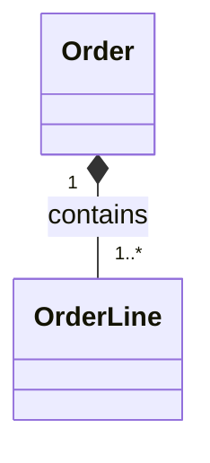

```java
record OrderLine(String sku, int quantity, BigDecimal unitPrice) {}   // immutable part

class Order {
    private final List<OrderLine> lines = new ArrayList<>();

    void addLine(String sku, int quantity, BigDecimal unitPrice) {
        lines.add(new OrderLine(sku, quantity, unitPrice));  // the whole creates the part
    }

    List<OrderLine> lines() {
        return List.copyOf(lines);        // no outside code gets the mutable list
    }
}
```

The signs of composition in Java:

1. The whole creates the part (`new OrderLine(...)` inside `Order`).
2. Outside code cannot add, remove, or change a part. Only the whole changes its parts.
3. The part holds no reference that another whole could use.
4. When the `Order` becomes unreachable, its `OrderLine` objects become unreachable too, unless outside code kept a reference to one.

`lines()` returns the same `OrderLine` objects, not copies. That is safe here only because `OrderLine` is an immutable record: a caller that keeps a line can read it but cannot change the order through it. If the part is mutable, the whole must not return it. The whole returns a copy of the part, or a read-only view (for example, a record with the values), instead.

A relational database expresses the lifecycle rule with a foreign key and `ON DELETE CASCADE`. Java has no keyword for composition. A private nested class (`private static class Line`) makes the rule stronger, because no outside code can create or name the part.

#### Inheritance (`<|--`)

The triangle points to the parent. The child is a kind of parent: it must satisfy the contract of the parent (see the Liskov substitution principle in [SOLID](02-solid.md)).

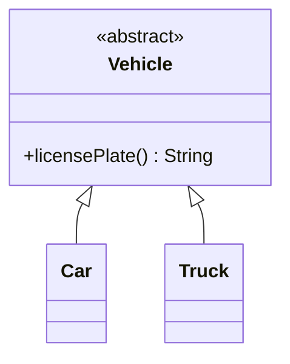

```java
abstract class Vehicle {
    abstract String licensePlate();
}
class Car extends Vehicle { String licensePlate() { return "CAR-1"; } }
class Truck extends Vehicle { String licensePlate() { return "TRK-1"; } }
```

#### Realization (`..|>`)

A dashed line with a hollow triangle shows that a class implements an interface. The triangle points to the interface.

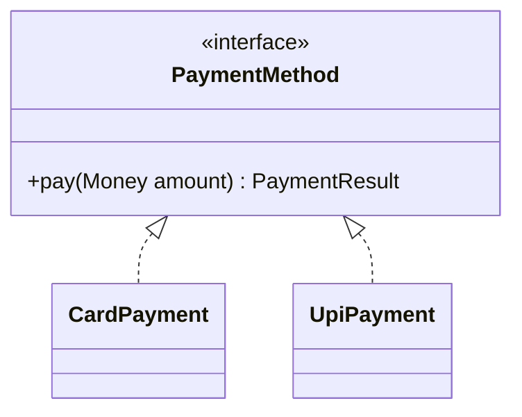

```java
record Money(BigDecimal amount, String currency) {}
enum PaymentResult { OK, FAILED }

interface PaymentMethod { PaymentResult pay(Money amount); }
class CardPayment implements PaymentMethod {
    public PaymentResult pay(Money amount) { return PaymentResult.OK; }
}
class UpiPayment implements PaymentMethod {
    public PaymentResult pay(Money amount) { return PaymentResult.OK; }
}
```

### How to choose the arrow

Ask these questions in this order. Stop at the first "yes".

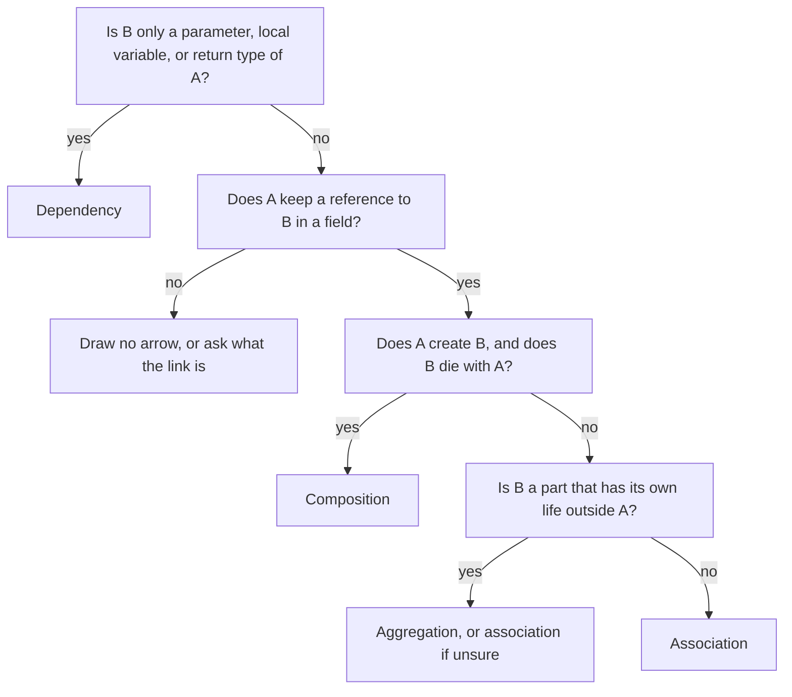

Inheritance and realization are separate: use them for `extends` and `implements`.

### Sequence diagram

A sequence diagram shows the messages between objects for one scenario. Time runs from top to bottom. Each object has a vertical line (a lifeline).

#### Elements and Mermaid syntax

| Element | Mermaid | Java meaning |
|---|---|---|
| Participant | `participant S as OrderService` | An object (or a class in a simple diagram) |
| Actor | `actor U as Customer` | A person or an outside system |
| Synchronous message | `A->>B: place(order)` | A calls a method of B and waits |
| Return message | `B-->>A: receipt` | The return value, drawn with a dashed line |
| Asynchronous message | `A-)B: publish(event)` | A sends a message and continues. Example: a queue publish or `executor.submit` |
| Activation | `activate B` and `deactivate B`, or the shorthand `A->>+B` and `B-->>-A` | The time during which a method of B runs |
| Self-message | `A->>A: validate()` | A call to a method of the same object |
| Note | `Note right of B: text` | A comment |
| Numbering | `autonumber` | A number on each message |

Blocks group messages:

| Block | Mermaid | Meaning |
|---|---|---|
| Alternative | `alt condition` ... `else other` ... `end` | `if` and `else` |
| Optional | `opt condition` ... `end` | `if` without `else` |
| Loop | `loop each line` ... `end` | `for` or `while` |
| Parallel | `par` ... `and` ... `end` | Messages that run at the same time |
| Break | `break condition` ... `end` | Leaves the flow, for example on an error |

#### Worked example: checkout

The scenario: a customer checks out an order. The service reserves stock for each line. If the customer gave a coupon, the service applies it. The service charges the payment gateway. If the charge succeeds, the service confirms the order and sends a notification without waiting. If the charge fails, the service releases the stock.

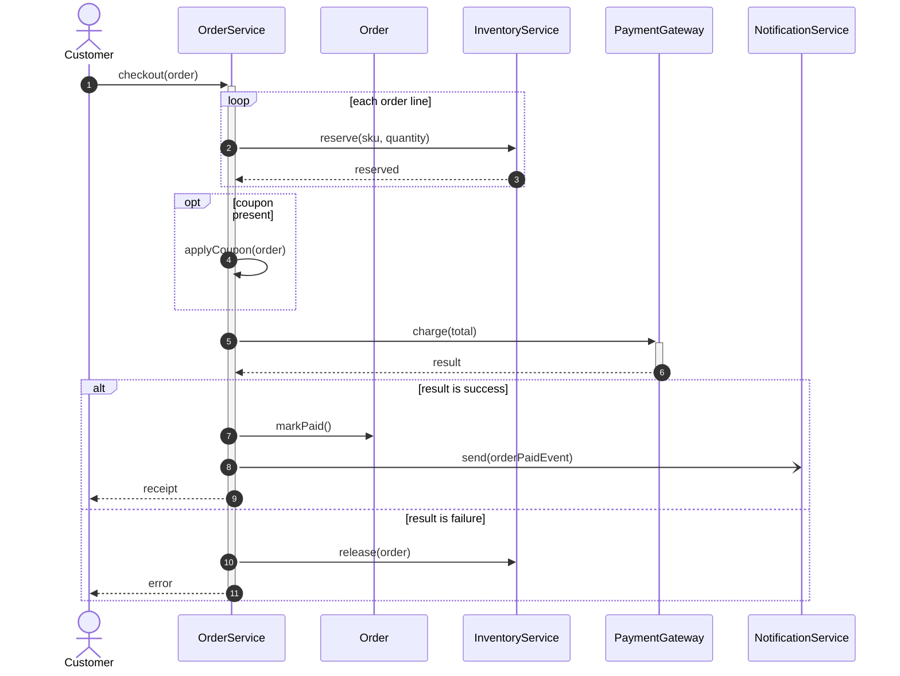

The `S->>S` arrow is a self-message: `OrderService` calls its own private method. The `markPaid()` call goes to a different object, so it goes to the `Order` lifeline. To keep the diagram short, it leaves out the reads `order.lines()` and `order.total()`.

How the diagram maps to code:

```java
record Line(String sku, int quantity) {}
record Receipt(String orderId) {}
record OrderPaid(String orderId) {}
record PaymentResult(boolean isSuccess) {}
class PaymentFailedException extends RuntimeException {
    PaymentFailedException(String id) { super(id); }
}
interface Order {
    String id();
    List<Line> lines();
    boolean hasCoupon();
    BigDecimal total();
    void markPaid();
}
interface Inventory {
    void reserve(String sku, int quantity);
    void release(Order order);
}
interface Gateway { PaymentResult charge(BigDecimal amount); }
interface NotificationService { void send(OrderPaid event); }

class OrderService {
    private final Inventory inventory;
    private final Gateway gateway;
    private final NotificationService notificationService;
    private final ExecutorService executor;

    OrderService(Inventory inventory, Gateway gateway,
                 NotificationService notificationService, ExecutorService executor) {
        this.inventory = inventory;
        this.gateway = gateway;
        this.notificationService = notificationService;
        this.executor = executor;
    }

    private void applyCoupon(Order order) {}

    Receipt checkout(Order order) {
        for (Line line : order.lines()) {                 // loop
            inventory.reserve(line.sku(), line.quantity());  // synchronous message
        }
        if (order.hasCoupon()) {                          // opt
            applyCoupon(order);                           // self-message
        }
        PaymentResult result = gateway.charge(order.total());
        if (result.isSuccess()) {                         // alt, first branch
            order.markPaid();                             // message to the Order
            OrderPaid event = new OrderPaid(order.id());
            executor.submit(() -> notificationService.send(event));  // asynchronous message
            return new Receipt(order.id());               // return message: receipt
        }
        inventory.release(order);                         // alt, else branch
        throw new PaymentFailedException(order.id());     // return message: error
    }
}
```

Use a sequence diagram when the order of calls matters, when objects in several layers take part, or when an interviewer asks "what happens when two users do this at the same time". Draw one scenario per diagram. A diagram with more than five participants is hard to read.

!!! tip "Object creation"
    Mermaid 10.3 and later support `create participant B` before the message that creates B, and `destroy B` before the message that ends it. The MkDocs site of this KB loads Mermaid 11, so it draws both. Use them to show that an object lives only inside a flow.

### State diagram

A state diagram shows the states of one entity and the events that change the state. Use it when an entity has a lifecycle with rules, such as an order that cannot ship before payment. Mermaid draws it with `stateDiagram-v2`.

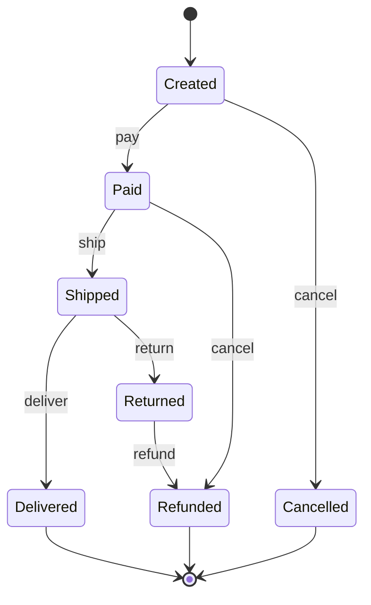

Reading rules:

- `[*]` before an arrow is the start. `[*]` after an arrow is the end.
- Each arrow has a label with the event that triggers the transition.
- A state whose only outgoing arrow goes to `[*]` is a final state. Check that each final state is intended. In the diagram above, `Delivered` is final and has no `return` arrow: this design allows a return only from `Shipped` (for example, the customer refuses the parcel). An interviewer may ask "what if the customer returns a delivered order?". The diagram makes that question visible.
- A state that no arrow reaches is unreachable. It shows a gap in the design.
- A transition that does not appear in the diagram is illegal. The code must reject it.

A composite state groups sub-states:

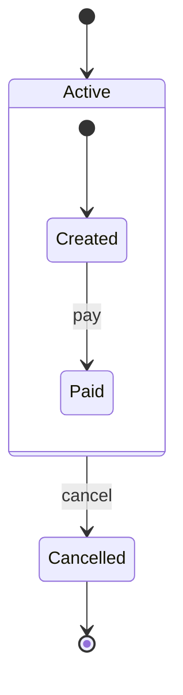

An arrow from the composite state (`Active --> Cancelled`) applies to every sub-state. Use it to avoid one `cancel` arrow for each sub-state. Mermaid does not allow an arrow between inner states of two different composite states. A choice node (`state check <<choice>>`) shows a decision with guard conditions: declare it, then draw one labeled arrow from it for each condition.

Java maps a state diagram to an `enum` of states and a check of allowed transitions. For the code, see [domain modeling](05-domain-modeling.md). For the State design pattern, in which each state is a class, see [behavioral patterns](08-behavioral-patterns.md).

### What an interviewer expects in a 45-minute round

Assumption: the round is a 45-minute LLD interview, and you draw on a whiteboard or a shared document. No public standard defines the expected level. The table below is the practice that this KB recommends.

| Diagram | Expect | Time | Draw |
|---|---|---|---|
| Class diagram | Always | 5 to 8 minutes, after you list requirements and entities | Class names, the 2 to 4 important methods of each class, interfaces and their implementations, the relationships with multiplicity where it matters |
| Sequence diagram | On request, or for one critical flow | 3 to 5 minutes | One scenario: the main success path, and one failure branch if the flow depends on it |
| State diagram | If an entity has a lifecycle (order, ticket, elevator, vending machine) | 2 to 3 minutes | The states and the transitions, with event labels |

Recommendation:

- Draw the structure that the code will have. A diagram that differs from the code costs points.
- Do not draw getters, setters, constructors, or every attribute. Draw an attribute only if it explains a relationship or a rule.
- Write the multiplicity on associations where it changes the design (`1` versus `*`).
- Name the relationship with a verb when the meaning is not obvious.
- State your notation choice in words: "Order owns its lines, so I use composition."
- Do not use a UML tool or perfect notation. A clear box-and-arrow sketch with correct arrow types is enough.

## Trade-offs and When to Use

| Diagram | Answers the question | Does not show | Use when |
|---|---|---|---|
| Class diagram | What are the types, and how do they relate? | Order of calls, runtime states | You present the structure of a design |
| Sequence diagram | Who calls whom, in what order? | All types of the system, state rules | A flow crosses several objects, or you reason about concurrency |
| State diagram | Which states exist, and which transitions are legal? | Who triggers the transitions | An entity has a lifecycle with rules |
| Plain list of classes and responsibilities | What does each class do? | Relationships | The time is short, and the relationships are obvious |

Choose the level of detail by the purpose of the diagram:

| Level | Content | Use |
|---|---|---|
| Conceptual | Names of domain classes and the main relationships | Early in the round, to agree on entities |
| Specification (design) | Interfaces, key methods, multiplicity, relationship types | The class diagram that you present for approval |
| Implementation | All members, with types and visibility | Rarely. Code states this level better than a diagram |

A diagram written as text (Mermaid) lives in version control next to the code, and a pull request can review it. A drawing tool gives more layout control but produces a binary or image file that does not diff well. In an interview, you draw by hand, so the text form matters only on the job.

## Java Example

The code below implements the order domain from the diagrams. One file holds the whole domain. The comments name the relationship that each member realizes. An order collects its lines after creation, so `Order` enforces the lower bound of `1..*` when it is paid, not in the constructor. Save the code as `Main.java` and run `java Main.java`. The output follows the code.

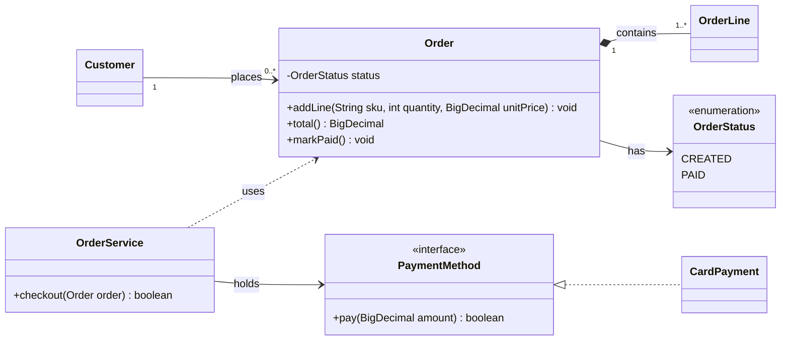

```java
import java.math.BigDecimal;
import java.util.ArrayList;
import java.util.List;

public class Main {
    public static void main(String[] args) {
        Customer customer = new Customer();
        Order order = new Order();
        order.addLine("BOOK-1", 2, new BigDecimal("12.50"));
        order.addLine("PEN-7", 1, new BigDecimal("1.20"));
        customer.place(order);

        OrderService service = new OrderService(new CardPayment());
        boolean paid = service.checkout(order);

        System.out.println("paid=" + paid + " status=" + order.status()
            + " total=" + order.total() + " orders=" + customer.orderCount());
    }
}

enum OrderStatus { CREATED, PAID }

interface PaymentMethod {                                   // realization target
    boolean pay(BigDecimal amount);
}

class CardPayment implements PaymentMethod {                // realization
    public boolean pay(BigDecimal amount) {
        return amount.signum() > 0;
    }
}

class OrderLine {
    private final String sku;
    private final int quantity;
    private final BigDecimal unitPrice;

    OrderLine(String sku, int quantity, BigDecimal unitPrice) {
        if (quantity <= 0) {
            throw new IllegalArgumentException("quantity must be positive");
        }
        this.sku = sku;
        this.quantity = quantity;
        this.unitPrice = unitPrice;
    }

    BigDecimal subtotal() {
        return unitPrice.multiply(BigDecimal.valueOf(quantity));
    }
}

class Order {
    private final List<OrderLine> lines = new ArrayList<>();   // composition: 1 to 1..*
    private OrderStatus status = OrderStatus.CREATED;          // association to an enum

    void addLine(String sku, int quantity, BigDecimal unitPrice) {
        lines.add(new OrderLine(sku, quantity, unitPrice));    // the whole creates the part
    }

    BigDecimal total() {
        BigDecimal sum = BigDecimal.ZERO;
        for (OrderLine line : lines) {
            sum = sum.add(line.subtotal());
        }
        return sum;
    }

    void markPaid() {
        if (lines.isEmpty()) {                                 // the lower bound of 1..*
            throw new IllegalStateException("an order needs at least one line");
        }
        status = OrderStatus.PAID;
    }

    OrderStatus status() { return status; }
}

class Customer {
    private final List<Order> orders = new ArrayList<>();      // association: 1 to 0..*

    void place(Order order) { orders.add(order); }
    int orderCount() { return orders.size(); }
}

class OrderService {
    private final PaymentMethod payment;                       // association, set by constructor

    OrderService(PaymentMethod payment) { this.payment = payment; }

    boolean checkout(Order order) {                            // dependency on Order
        if (payment.pay(order.total())) {
            order.markPaid();
            return true;
        }
        return false;
    }
}
```

<!-- expected-output -->

```text
paid=true status=PAID total=26.20 orders=1
```

## Interview Angle

### Questions

??? question "What is the difference between aggregation and composition?"

    Both are "whole and part" relationships, and both appear in Java as a field. The difference is the lifecycle.

    - In composition, the whole owns the part. The UML 2.5.1 specification states two rules: a part is in at most one composite at a time, and if the composite is deleted, its parts are deleted with it. Example: `Order *-- OrderLine`. If the order is deleted, its lines are deleted too. The diamond is filled.
    - In aggregation, by convention, the part can exist without the whole and may belong to several wholes. Example: `Team o-- Player`. If the team is dissolved, the players remain. The diamond is hollow.

    In both cases, the diamond sits on the whole: `Order *-- OrderLine` and `Team o-- Player`. The Java code is nearly identical, so the difference is intent. In code, composition shows as "the whole calls `new` for the part, and outside code cannot change the parts". Aggregation shows as "the part is passed in from outside, and other objects also hold it". The specification says only that the precise semantics of shared aggregation "varies by application area and modeler". So if the lifecycle rule does not clearly hold, I draw a plain association and say why.

??? question "What is the difference between association and dependency?"

    An association is a structural relationship: one class keeps a reference to the other in a field, for the lifetime of the object. A dependency is a usage relationship: a class uses another type inside a method, as a parameter, a local variable, or a return type, and does not keep it.

    In the diagram, an association is a solid line with an open arrowhead (`-->`). A dependency is a dashed line (`..>`). The deciding question: "Does the object hold the other object after the method returns?" If yes, it is an association. If no, it is a dependency. A dependency is weaker, because a change of the other type affects only the methods that use it.

??? question "How do you draw inheritance and interface implementation? How do you write them in Java?"

    Inheritance is a solid line with a hollow triangle at the parent (`Parent <|-- Child`). It maps to `extends`. Realization is a dashed line with a hollow triangle at the interface (`Type <|.. Impl`, or `Impl ..|> Type`). It maps to `implements`.

    The common error is to draw the triangle at the child, or to use a solid line for an interface. The arrow always points to the more general type. I also say why I choose each: I use realization when I want several implementations behind a contract, and inheritance when the child is a true subtype that shares state or behavior. See [OOP](01-oop.md) for the choice between the two.

??? question "How do you map a one-to-many and a many-to-many association to Java?"

    A one-to-many association `Customer "1" --> "0..*" Order` becomes a collection field in the "one" class: `List<Order> orders`, initialized to an empty list. If the diagram shows a reference back, the `Order` class gets a `Customer customer` field. The code must then keep both sides consistent, usually in one method (`customer.place(order)` also sets `order.customer`).

    A many-to-many association, such as `Student` and `Course`, becomes a third class, `Enrollment`, with a many-to-one association to each side. That class holds data that belongs to the pair, such as the grade or the date. This avoids two collections that must stay consistent, and it gives the pair a place for its rules.

??? question "What does multiplicity tell you, and how does it change the code?"

    Multiplicity states how many instances take part at one end. `1` means a required reference (a field that is never `null`, and `final` if the link never changes). `0..1` means an optional reference (a nullable field, or `Optional` in the getter). `*` means a collection. `1..*` means a collection that the constructor must fill with at least one element.

    It changes the code in three places: the field type, the constructor (it must enforce a lower bound of 1), and the add and remove methods (they enforce the upper bound, such as "a member borrows at most 5 books"). In an interview, I write multiplicity where it creates a rule.

??? question "When do you draw a sequence diagram instead of a class diagram?"

    A class diagram shows structure and does not show order. I draw a sequence diagram when the order of calls matters: a flow that crosses several layers (controller, service, repository), a flow with a failure branch (payment fails, release the stock), or a flow where two actors race (two users book the same seat). The sequence diagram makes the critical section visible: it shows the point where I must hold a lock or run a transaction.

    I draw one scenario, the main success path, and add an `alt` block for the one failure that affects the design. I use `loop` and `opt` only where they change the messages.

??? question "How do you show an object with a lifecycle, such as an order or a ticket?"

    I draw a state diagram: the states, the start and end markers, and one arrow per legal transition, labeled with the event. The diagram answers two questions: which states exist, and which transitions are allowed. Every missing arrow is an illegal transition that the code must reject.

    In Java, I model the states as an `enum` and keep the table of allowed transitions next to it, or in the entity method (`ship()` checks that the status is `PAID`). If the behavior of each state differs a lot, I use the State pattern, with one class for each state. See [domain modeling](05-domain-modeling.md) and [behavioral patterns](08-behavioral-patterns.md).

??? question "How much UML detail do you give in a 45-minute interview?"

    I give the level that explains the design and no more. For the class diagram, I draw the main classes and interfaces, the important methods (not getters and setters), the relationship type for each pair, and the multiplicity where it creates a rule. I spend about 5 to 8 minutes on it. I draw a sequence diagram for one flow if the interviewer asks or if the order of calls is the hard part. I draw a state diagram if an entity has a lifecycle. I keep the diagram and the code consistent, because the interviewer compares them.

??? question "What do the visibility markers mean, and what is `~`?"

    `+` is public, `-` is private, `#` is protected, and `~` is package-private (no modifier in Java). One difference matters in Java: a `protected` member is also visible to every class in the same package (JLS 6.6.2), so Java `protected` is wider than UML protected. I use `-` for fields, because encapsulation says that state is private. I use `+` for the methods that other classes call. I use `#` rarely, because protected members couple a subclass to its parent. See [OOP](01-oop.md) for encapsulation.

??? question "Two classes have a bidirectional relationship. Is that a problem?"

    A bidirectional association is allowed, but it has a cost. Each class holds a field for the other, the code must keep both fields consistent, and the two classes now depend on each other (a cycle). I use a one-way association when only one class needs to navigate. If both need to navigate, I put the update in one method that sets both sides, or I replace one side with a lookup by id. A cycle between packages is worse than a cycle between two classes, because it blocks independent builds and tests.

### Follow-up Questions

- You drew composition between `Order` and `OrderLine`. How does the Java code stop outside code from keeping a line?
- A `Player` moves between teams. Is `Team o-- Player` still right? What changes if a player can belong to two teams at once?
- The interviewer says "A `Car` has an `Engine`." Do you draw composition or aggregation? What question decides?
- How do you show an abstract method in Mermaid? How do you show a static method?
- How do you show on the diagram that a class creates an object but does not keep it?
- In your sequence diagram, which message is asynchronous in the code, and what does the code use for it (a thread pool, a queue)?
- In the state diagram, what happens when a client calls `ship()` on a `CREATED` order?

### Red Flags

- Draws the arrow in the wrong direction, such as the inheritance triangle at the child.
- Uses composition or aggregation for everything that has a field, without a lifecycle argument.
- Draws every relationship as the same plain line, so the diagram does not distinguish "uses" from "owns".
- Puts all attributes and every getter and setter in the boxes, and runs out of time for the design.
- Draws a diagram that the code does not match, for example an interface in the diagram and a concrete class in the code.
- Draws a class diagram without multiplicity, and cannot say whether a relationship is one-to-one or one-to-many.
- Says "UML is not important for modern development". The interview expects a clear sketch.
- Spends 15 minutes on perfect notation and has no time for code.

## Common Mistakes

| Mistake | Why it is wrong | Fix |
|---|---|---|
| Uses aggregation when the part is created and destroyed by the whole | The lifecycle rule of composition holds, so the diagram understates the coupling | Use composition. Write one sentence: "The order owns its lines" |
| Uses composition for a part that other objects share | A composite part belongs to one whole only | Use aggregation or association. Share it by reference or by id |
| Draws `A --> B` where B is only a method parameter | An association says that A keeps B | Draw `A ..> B` |
| Draws the inheritance triangle at the child | The arrow must point to the more general type | Write `Parent <\|-- Child` |
| Uses inheritance for "has-a" (a `Car` extends `Engine`) | The code gets a wrong subtype and a fragile base class | Use composition and draw `Car *-- Engine` or `Car --> Engine` |
| Draws a solid line for `implements` | A solid triangle line means `extends` | Use the dashed line `..\|>` |
| Omits multiplicity | The reader cannot tell a field from a collection | Add `"1"`, `"0..1"`, or `"*"` where it changes the code |
| Draws a many-to-many line between two classes | The pair has data and rules that have no place to live | Add an association class such as `Enrollment` |
| Draws both directions on every association | Both classes then depend on each other | Draw the one direction that the code needs |
| Shows every getter and setter | It hides the design behind noise | Show only methods that carry behavior |
| Writes `Map~String, Account~` in Mermaid | The Mermaid documentation says generic types cannot contain a comma | Write `Map` and add the types in the name of the attribute, or in a note |
| Puts text with a semicolon or an unbalanced quote in a Mermaid message | The Mermaid parser can fail or cut the line | Keep messages short. Check that the diagram renders |
| Draws a sequence diagram with all methods of all classes | The reader loses the one flow that matters | Draw one scenario, with at most five participants |

## Commonly Confused With

| Looks like | Difference | Deciding question |
|---|---|---|
| Aggregation vs composition | Both mean whole and part. Composition adds the lifecycle rule: the part belongs to one whole and dies with it | Does the part die when the whole dies? |
| Association vs dependency | An association is a field that the object keeps. A dependency is a use inside one method | Does the object hold the other object after the method returns? |
| Inheritance vs realization | Inheritance is `extends` (solid line). Realization is `implements` (dashed line) | Is the parent a class or an interface? |
| Class diagram vs sequence diagram | Structure compared with the order of calls over time | Do I show what exists or what happens? |
| Sequence diagram vs state diagram | The messages of one scenario between many objects, compared with the states of one object over time | Do I follow one scenario or one object? |
| Association vs dependency in a factory | A factory creates a product and returns it. It keeps no reference | Does the factory store the product? If not, it is a dependency |
| Class diagram vs ER diagram | An ER diagram models stored data. A class diagram also models behavior and types | Does the diagram include methods and interfaces? |
| UML `<<interface>>` vs `<<abstract>>` | An interface has no instance fields, and a class may implement many. An abstract class may have state, and a class may extend one | Does the type need fields or a shared constructor? |

## Quick Reference Card

| Notation | Mermaid | Java |
|---|---|---|
| Public, private, protected, package | `+` `-` `#` `~` | `public` `private` `protected` (none) |
| Static, abstract method | `m()$`, `m()*` | `static`, `abstract` |
| Interface, abstract class, enum | `<<interface>>`, `<<abstract>>`, `<<enumeration>>` | `interface`, `abstract class`, `enum` |
| Dependency | `A ..> B` | B in a parameter, local variable, or return type |
| Association | `A --> B` | A field `B b` |
| Aggregation | `A o-- B` | A field, with B from outside |
| Composition | `A *-- B` | A field, with B created and owned by A |
| Inheritance | `Parent <\|-- Child` | `extends` |
| Realization | `Type <\|.. Impl` | `implements` |
| Multiplicity | `"1"`, `"0..1"`, `"*"`, `"1..*"` | Reference, nullable reference, collection, collection with a check |
| Sync, return, async message | `->>`, `-->>`, `-)` | Call, return value, queue publish or `submit` |
| Blocks | `alt`/`else`, `opt`, `loop`, `par` | `if`/`else`, `if`, `for`, parallel tasks |
| State machine | `[*] --> S`, `S --> T : event` | `enum` plus a transition check |

Before the interview:

1. Draw the arrow by asking: field, or only parameter? Own and delete, or only hold?
2. Put multiplicity on the lines that create a rule.
3. Show interfaces and their implementations. Hide getters and setters.
4. Draw a sequence diagram for the one hard flow, and a state diagram for each lifecycle.
5. Make the diagram match the code that you will write.

## Further Reading

- [OMG, Unified Modeling Language 2.5.1 specification](https://www.omg.org/spec/UML/2.5.1): the primary source for the meaning of association, aggregation, composition, dependency, and realization. Section 9.5.3 defines shared and composite aggregation.
- [Martin Fowler: AggregationAndComposition](https://martinfowler.com/bliki/AggregationAndComposition.html) (2003): why aggregation adds little to association, with the Rumbaugh "modeling placebo" quote.
- [Mermaid: class diagrams](https://mermaid.js.org/syntax/classDiagram.html): the relationship syntax, multiplicity, annotations, and generic types that this page uses.
- [Mermaid: sequence diagrams](https://mermaid.js.org/syntax/sequenceDiagram.html): messages, activations, and the `alt`, `opt`, `loop`, and `par` blocks.
- [Mermaid: state diagrams](https://mermaid.js.org/syntax/stateDiagram.html): `stateDiagram-v2`, composite states, and choice nodes.
- Martin Fowler, "UML Distilled" (3rd edition, Addison-Wesley): a short book on the parts of UML that practitioners use, with the discussion of aggregation.
- [Java Language Specification, section 6.6: Access Control](https://docs.oracle.com/javase/specs/jls/se21/html/jls-6.html#jls-6.6): the rules behind the visibility markers.
