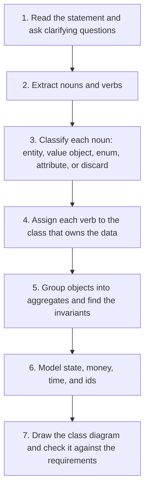
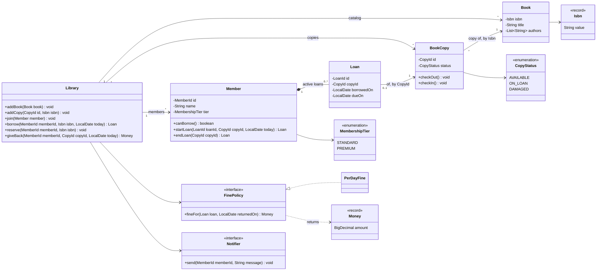

# Domain Modeling

## Why It Matters

Every LLD interview starts with a problem statement, and the first skill that the interviewer tests is whether you can turn that text into the right classes. A candidate who picks the wrong entities, or who puts a business rule in the wrong class, produces a design that cannot extend. Interviewers also check small details that show experience: `BigDecimal` for money, `java.time` for dates, an enum for a fixed set of values, a state machine for a lifecycle, and an id type that stops a caller from mixing up two ids. On the job, the same skill decides whether the code reads like the business it serves. This page teaches a repeatable way to go from a statement to a class diagram, and it ends with a complete library system in Java.

## Core Concepts

**Domain**: the business area that the software serves, such as lending books or booking seats.

**Domain model**: the set of classes, enums, and relationships that represent the concepts and the rules of the domain. A domain model is not a database schema and not a UI model.

**Ubiquitous language**: one set of terms that the team and the code share. If the business says "loan", the class is `Loan`, not `Borrowing` or `Checkout`. Eric Evans introduced the term in "Domain-Driven Design" (2003).

**Domain-Driven Design** (DDD): an approach to design that centers on the domain model and its language. This page uses its vocabulary for entities, value objects, and aggregates. It does not require the rest of DDD.

**Entity**: an object with an identity that stays the same while its state changes over time. Two entities with the same id are the same entity, even if their other fields differ. Example: a `Member`. The member changes name and tier, and remains the same member.

**Value object**: an object that has no identity. It is defined by its values, and it is immutable. Two value objects with equal values are interchangeable. Examples: `Money`, `Isbn`, `DateRange`. In Java, a `record` fits.

**Invariant**: a rule about the state of an object that must hold at all times. Example: "A member has at most 5 active loans." The class that owns the data enforces its invariants.

**Aggregate**: a cluster of entities and value objects that the code treats as one unit for changes and for consistency. The aggregate enforces the invariants that span its members.

**Aggregate root**: the one entity of an aggregate that outside code may hold and call. Outside code does not reference the inner objects directly. Example: `Order` is the root, and `OrderLine` is an inner object.

**Domain service**: a class for a domain rule that does not belong to one entity or value object, for example a fine policy that reads a loan and returns a fine.

**Application service**: a class that runs one use case. It loads the aggregates, calls their methods in order, and saves the result. It holds no business rule. Example: `Library.borrow`.

**Repository**: an object that stores and loads aggregates, and hides the storage. See [architectural patterns](10-architectural-patterns.md).

**CRC card** (Class-Responsibility-Collaborator): an index card with the class name, its responsibilities, and the classes that it works with. Kent Beck and Ward Cunningham introduced the cards in 1989.

**Responsibility**: something that a class knows or does. A class has a small number of related responsibilities (see the single responsibility principle in [SOLID](02-solid.md)).

## How It Works

The procedure has seven steps. The page applies each step to one problem statement from a library system, so that the result at the end is a complete class diagram and a working program (see Java Example).



### The problem statement

The numbers in front of the sentences are for reference only.

> 1. A library holds many books.
> 2. Each book has a title, an ISBN, and one or more authors.
> 3. The library keeps one or more physical copies of each book.
> 4. A member can borrow copies. A standard member can hold up to 5 copies at a time. A premium member can hold up to 10.
> 5. A loan lasts 14 days for a standard member and 21 days for a premium member.
> 6. If a member returns a copy after the due date, the member pays a fine of 0.50 for each late day.
> 7. If no copy of a book is available, a member can reserve the book.
> 8. When a copy returns, the library notifies the first member in the reservation queue.
> 9. A librarian adds books and copies, and removes damaged copies.

### Step 1: Ask clarifying questions

Read the statement twice, then ask about the gaps. The answers below are the assumptions of this page.

| Question | Assumed answer |
|---|---|
| Does a reservation hold a specific copy? | No. It holds a place in a queue for the book |
| Does the system record payment of a fine? | No. The system computes the fine at return time |
| Can a member renew a loan? | Not in this version. It is an extension |
| How many libraries? | One |
| Does the system store the history of loans? | Not in this version. An ended loan leaves the member |
| How many currencies? | One. The `Money` type in the Java Example therefore has no currency field. The general `Money` type in the Money section keeps the currency |

### Step 2: Noun-verb analysis

Noun-verb analysis (also called textual analysis) reads the statement and lists every noun and every verb. The nouns are candidates for classes, attributes, and enums. The verbs are candidates for methods. The technique goes back to Russell Abbott's 1983 work on program design from English descriptions, and it is a starting point, not a proof. Wrong candidates appear, and some classes do not appear in the text at all.

The nouns and verbs of the statement:

| Sentence | Nouns | Verbs |
|---|---|---|
| 1 | library, book | holds |
| 2 | title, ISBN, author | has |
| 3 | copy | keeps |
| 4 | member, copy, standard member, premium member | borrow, hold |
| 5 | loan, day | lasts |
| 6 | member, copy, due date, fine, late day | returns, pays |
| 7 | copy, book, member | reserve |
| 8 | copy, library, member, reservation queue | returns, notifies |
| 9 | librarian, book, copy | adds, removes |

### Step 3: Classify each noun

Use these questions in order:

1. Is the noun a person or system that uses the program? It is an actor. It becomes a class only if the program stores data or rules about it.
2. Does the noun have an identity and a lifecycle? It is an entity.
3. Is the noun a measured or described value that you compare by its content? It is a value object.
4. Does the noun come from a fixed set of values? It is an enum.
5. Is the noun a simple property of another noun? It is an attribute.
6. Is the noun vague, a synonym of another noun, or outside the scope? Discard it.

| Noun | Classification | Reason |
|---|---|---|
| library | Service class `Library` | It is the entry point. It has no identity in the model (one library). It coordinates |
| book | Entity `Book` | A title that the library holds. Its identity is the ISBN |
| title | Attribute of `Book` | A plain string |
| ISBN | Value object `Isbn` | It has a format rule (13 digits, and the last digit is a check digit). Equal ISBN strings mean the same ISBN |
| author | Attribute of `Book` (`List<String>`) | No rules or behavior in this statement. Promote to a class if the statement adds author search |
| copy | Entity `BookCopy` | Each physical copy has its own identity and its own status |
| member | Entity `Member` | Has an identity and changes over time |
| standard member, premium member | Enum `MembershipTier` | A fixed set. The tiers differ only in data (limit, loan days) |
| loan | Entity `Loan` | Has an identity and a lifecycle (starts, ends) |
| day, late day | Not a class | A unit of time. `java.time` supplies it |
| due date | Attribute of `Loan` (`LocalDate`) | A value that the loan stores |
| fine | Value object `Money` | An amount. No identity, because the system does not track payment |
| reservation queue | Collection in `Library` | A queue of member ids for each book |
| reservation | Entity or a queue entry | Here, an entry of member ids in a queue |
| librarian | Actor | No data or rules about librarians in the statement. Do not create a class |

Two nouns that the statement does not use: `CopyStatus` (an enum, because a copy is available, on loan, or damaged) and the ids (`MemberId`, `CopyId`, `LoanId`). They come from steps 6 and 7. The statement says "physical copy" and "book" as two things. That split is the key modeling decision: a `Book` is a title in the catalog, and a `BookCopy` is a physical item that a member holds. A design that merges them cannot say "two copies of one book, one on loan".

### Step 4: Assign the verbs

For each verb, ask "Which class owns the data that the action needs?" Craig Larman calls this rule Information Expert in his GRASP principles. The class that knows the data does the work.

| Verb | Owner | Reason |
|---|---|---|
| borrow | `Library` coordinates. `Member` checks the loan limit. `BookCopy` checks that it is available | The action touches three objects, and each object guards its own data |
| hold (limit) | `Member` | The member owns the list of active loans, and so owns the limit |
| return | `Library` coordinates. `Member` ends the loan. `BookCopy` becomes available | Same reason as borrow |
| pay (the fine) | `FinePolicy` computes the amount | The rule can change, so it sits behind an interface |
| reserve | `Library` | It owns the reservation queues |
| notify | `Notifier` interface | The channel (email, SMS) is a detail |
| add, remove | `Library` | It owns the catalog |
| lasts (14 or 21 days) | `MembershipTier` holds the number. `Member` computes the due date | The number depends on the tier |

### Step 5: Find the aggregates and their invariants

List the rules in the statement, and ask which objects must change together to keep each rule true.

| Rule | Objects involved | Where the code enforces it |
|---|---|---|
| A member holds at most 5 (or 10) active loans | `Member` and its `Loan` objects | `Member` (the aggregate root) |
| A copy is on at most one loan | `BookCopy` | `BookCopy` (status check: only an `AVAILABLE` copy goes on loan) |
| A member has an active loan for a copy only if that copy is `ON_LOAN` | `BookCopy` and `Member` | `Library` checks both aggregates and changes both in one step |
| A fine is 0.50 for each late day | `Loan` and the return date | `FinePolicy` |

The aggregates in this model:

| Aggregate | Root | Inner objects | References to other aggregates |
|---|---|---|---|
| Catalog entry | `Book` | The list of authors | None |
| Copy | `BookCopy` | Its status | The `Isbn` of its book (by id) |
| Member account | `Member` | Its active `Loan` objects | The `CopyId` of each loan (by id) |

DDD rules for aggregates. Eric Evans defines the first rule in "Domain-Driven Design". Vaughn Vernon's essay "Effective Aggregate Design" (2011) states the others as named rules: "Model True Invariants In Consistency Boundaries", "Design Small Aggregates", "Reference Other Aggregates By Identity", and "Use Eventual Consistency Outside the Boundary".

1. Outside code holds a reference to the root only. It never reaches into the aggregate for an inner object and changes it.
2. Aggregates reference other aggregates by id, not by object reference.
3. One transaction changes one aggregate. Vernon writes that "a properly designed bounded context modifies only one aggregate instance per transaction in all cases". If a rule spans two aggregates, Vernon recommends eventual consistency: the first aggregate publishes a domain event, and a subscriber updates the second aggregate later.
4. Keep aggregates small. A `Book` that holds all its copies as inner objects would load and lock every copy for each change of one copy.

The borrow use case breaks rule 3 on purpose: `Library.borrow` changes a `BookCopy` and a `Member` together. Vernon's essay allows this in a section "Reasons To Break the Rules". In its section "Ask Whose Job It Is", it reports a guideline from Evans: if the user who runs the use case is responsible for making the data consistent, make it transactionally consistent; if another user or the system is responsible, allow eventual consistency. The member who borrows a copy expects the copy and the loan to change together, so this design changes both in one step. In memory, one lock covers the step. With a database, one transaction covers it (see [concurrency in LLD](09-concurrency-in-lld.md)). The alternative is eventual consistency: the copy goes `ON_LOAN` first, and an event creates the loan. That alternative needs a rule for the case where the loan fails after the copy changed.

The statement shows the effect of rule 4. A `Book` with its copies inside would make "member A borrows copy 1" and "member B borrows copy 2" lock the same aggregate. Two separate aggregates let both happen at the same time.

### Step 6: Model state, money, time, and ids

The next sections give the detail for each of these decisions. For the library: `CopyStatus` is an enum with a transition check, `Money` replaces `double` for the fine, `LocalDate` stores the due date, and typed ids identify each entity.

### Step 7: Draw the class diagram

The diagram below is the result for the library. See [the UML page](04-uml-class-and-sequence-diagrams.md) for the notation. The aggregate roots are `Member`, `BookCopy`, and `Book`.



Two arrows reference another aggregate: `BookCopy --> Book` and `Loan --> BookCopy`. In the code, these references are ids (`Isbn` and `CopyId`), not object fields, as rule 2 in Step 5 requires. The labels "by Isbn" and "by CopyId" state this. A `Loan` has the multiplicity `0..1` at its end because a copy has at most one active loan, and the model keeps only active loans.

Check the diagram against the statement: every sentence maps to at least one element. Sentence 4 and 5 map to `MembershipTier` and `Member.canBorrow`. Sentence 6 maps to `FinePolicy`. Sentence 7 and 8 map to `Library.reserve` and `Notifier`. Sentence 9 maps to `Library.addBook`, `addCopy`, and the `DAMAGED` status. If a sentence has no element, the model has a gap.

### Entities and value objects

| Property | Entity | Value object |
|---|---|---|
| Identity | Has an id that stays the same | None. The values are the identity |
| Equality | Equal if the ids are equal | Equal if all values are equal |
| Mutability | State changes over time | Immutable. A change creates a new object |
| Lifecycle | Created, changed, ended | None. Create it, use it, drop it |
| Java form | A `final class` with an id field, and `equals` and `hashCode` on the id | A `record`, or an immutable class |
| Examples | `Member`, `BookCopy`, `Order` | `Money`, `Isbn`, `DateRange`, `Address` |

The deciding question: "If two objects have the same values, are they the same thing?" Two `Money` objects with value 5.00 USD are the same thing. Two `BookCopy` objects of the same book are not the same thing, because a member holds one and not the other.

The same concept can be an entity in one domain and a value object in another. An address is a value object in a shop (a shipping address is a set of text values). It is an entity for a postal service that tracks each address. The domain decides, not the data.

Why prefer value objects: they carry rules that would otherwise spread across the code (the 13-digit check in `Isbn`), they cannot change after creation (so they are safe to share and safe in threads), and they give a name to a concept (`Isbn` says more than `String`).

```java
record Isbn(String value) {
    Isbn {
        Objects.requireNonNull(value);
        if (!value.matches("\\d{13}")) {
            throw new IllegalArgumentException("ISBN-13 needs 13 digits: " + value);
        }
    }
}

record DateRange(LocalDate from, LocalDate to) {
    DateRange {
        if (to.isBefore(from)) {
            throw new IllegalArgumentException("to is before from");
        }
    }

    boolean overlaps(DateRange other) {
        return !to.isBefore(other.from) && !other.to.isBefore(from);
    }

    long days() {
        return java.time.temporal.ChronoUnit.DAYS.between(from, to);
    }
}
```

A `record` generates `equals`, `hashCode`, and `toString` from all its components. That is the right equality for a value object. The compact constructor validates the values, so an `Isbn` with a wrong format never exists. This example checks only the format. A full ISBN-13 check also verifies the check digit (the last digit). This is the fail-fast rule from [design principles](03-design-principles.md). Be careful with a `BigDecimal` component: its `equals` compares the scale, so `2.0` and `2.00` are not equal. The `Money` type below fixes the scale in the constructor to avoid this.

### Ids and equality

Each entity needs an id and an `equals` that uses only the id. The rules:

1. Assign the id when the object is created. A database-generated id is `null` before the first save, and an object with a `null` id breaks `equals` and `hashCode` in sets and maps. Use an id that the code creates (a `UUID`, or a counter in an in-memory design), or let the caller pass it in.
2. Use a typed id instead of a raw `String` or `long`. A method `borrow(String memberId, String copyId)` accepts the arguments in the wrong order without a compiler error. A method `borrow(MemberId memberId, CopyId copyId)` does not.
3. Compute `hashCode` from the id only. If `hashCode` uses a field that changes, an object in a `HashSet` becomes unreachable after the field changes.
4. Choose a natural id (the ISBN of a book) when the business already has a stable unique key. Choose a surrogate id (a `UUID`) when no stable key exists, or when the natural key can change.

The wrong form uses a changing field for equality:

```java
import java.util.HashSet;
import java.util.Set;

public class Main {
    public static void main(String[] args) {
        Set<BadMember> members = new HashSet<>();
        BadMember alice = new BadMember("Alice");
        members.add(alice);
        alice.rename("Alicia");
        System.out.println(members.contains(alice));    // false: the hash bucket is wrong
    }
}

final class BadMember {
    private String name;

    BadMember(String name) { this.name = name; }
    void rename(String newName) { name = newName; }

    @Override public boolean equals(Object o) {
        return o instanceof BadMember m && name.equals(m.name);
    }
    @Override public int hashCode() { return name.hashCode(); }
}
```

<!-- expected-output -->

```text
false
```

The problem: after `rename`, the object sits in the bucket for "Alice", and the lookup uses the hash of "Alicia". The set loses the member. The right form uses a typed id that never changes:

```java
record MemberId(String value) {}

final class Member {
    private final MemberId id;
    private String name;

    Member(MemberId id, String name) {
        this.id = id;
        this.name = name;
    }

    void rename(String newName) { name = newName; }

    @Override public boolean equals(Object o) {
        return o instanceof Member m && id.equals(m.id);
    }
    @Override public int hashCode() { return id.hashCode(); }
}
```

For the full `equals` and `hashCode` contract, see `kb/java/01-language-core.md` and [OOP](01-oop.md).

### Enums or class hierarchies

An enum is a fixed set of instances. A class hierarchy is a set of types, and each type may carry different data and behavior. Choose by what differs between the variants.

| The variants differ in | Use | Example |
|---|---|---|
| Only constant data (numbers, labels) | Enum with fields | `MembershipTier` (limit and days) |
| Behavior, and the set is closed and small | Enum with a method per constant | `DiscountType.PERCENT`, `DiscountType.FLAT` |
| Behavior, and the set must grow without edits to old code | Interface with one class for each variant (Strategy, see [behavioral patterns](08-behavioral-patterns.md)) | `FinePolicy` and `PerDayFine` |
| The shape of the data, and the set is closed | Sealed interface with records | `Payment`: card, UPI, cash |
| A lifecycle with rules for transitions | Enum plus a transition table, or the State pattern | `OrderStatus` |

A type needs behavior when a `switch` on it appears in several places. Move that behavior into the type itself. Three forms:

```java
// 1. Enum with data
enum MembershipTier {
    STANDARD(5, 14),
    PREMIUM(10, 21);

    private final int maxLoans;
    private final int loanDays;

    MembershipTier(int maxLoans, int loanDays) {
        this.maxLoans = maxLoans;
        this.loanDays = loanDays;
    }

    int maxLoans() { return maxLoans; }
    int loanDays() { return loanDays; }
}

// 2. Enum with behavior in each constant
enum DiscountType {
    PERCENT {
        BigDecimal apply(BigDecimal price, BigDecimal value) {
            return price.subtract(price.multiply(value).movePointLeft(2));
        }
    },
    FLAT {
        BigDecimal apply(BigDecimal price, BigDecimal value) {
            return price.subtract(value).max(BigDecimal.ZERO);
        }
    };

    abstract BigDecimal apply(BigDecimal price, BigDecimal value);
}

// 3. Sealed interface with records, when the data shape differs
sealed interface Payment permits CardPayment, UpiPayment, CashPayment {}
record CardPayment(String last4, String network) implements Payment {}
record UpiPayment(String virtualAddress) implements Payment {}
record CashPayment() implements Payment {}

class PaymentDescriber {
    String describe(Payment payment) {
        return switch (payment) {                    // the compiler checks that all cases appear
            case CardPayment c -> c.network() + " ending " + c.last4();
            case UpiPayment u -> "UPI " + u.virtualAddress();
            case CashPayment c -> "cash";
        };
    }
}
```

!!! note "Sealed types and `switch`"
    Sealed classes and interfaces became a standard feature in Java 17 (JEP 409). Pattern matching for `switch` became standard in Java 21 (JEP 441). With a sealed interface, the compiler rejects a `switch` that misses a permitted type. See [OOP](01-oop.md) for sealed types as a modeling tool.

Do not create a class hierarchy for what an enum with fields expresses. Do not use an enum with a `switch` in many places when each constant needs its own behavior. In both cases, the rule is: put the behavior with the data it uses.

### State: an enum plus a state machine

When an entity has a lifecycle, model the states as an enum and the legal transitions as data. The entity refuses an illegal transition. The table below is a reduced form of the order state diagram in [the UML page](04-uml-class-and-sequence-diagrams.md): it leaves out returns and refunds, so a paid order that the customer cancels goes to `CANCELLED`, not to `REFUNDED`. Draw the state diagram first, then copy each arrow into the table.

```java
enum OrderStatus {
    CREATED, PAID, SHIPPED, DELIVERED, CANCELLED;

    private static final Map<OrderStatus, Set<OrderStatus>> NEXT =
        new EnumMap<>(OrderStatus.class);

    static {
        NEXT.put(CREATED, EnumSet.of(PAID, CANCELLED));
        NEXT.put(PAID, EnumSet.of(SHIPPED, CANCELLED));
        NEXT.put(SHIPPED, EnumSet.of(DELIVERED));
        NEXT.put(DELIVERED, EnumSet.noneOf(OrderStatus.class));
        NEXT.put(CANCELLED, EnumSet.noneOf(OrderStatus.class));
    }

    boolean canMoveTo(OrderStatus target) {
        return NEXT.get(this).contains(target);
    }
}

class Order {
    private OrderStatus status = OrderStatus.CREATED;

    void pay()    { moveTo(OrderStatus.PAID); }
    void ship()   { moveTo(OrderStatus.SHIPPED); }
    void cancel() { moveTo(OrderStatus.CANCELLED); }

    private void moveTo(OrderStatus target) {
        if (!status.canMoveTo(target)) {
            throw new IllegalStateException(status + " cannot move to " + target);
        }
        status = target;
    }

    OrderStatus status() { return status; }
}
```

The `Order` is the only class that changes `status`, and it does so through one private method. No code can set an illegal status. The table of transitions is one place to read and one place to change.

Choose between this form and the State pattern:

| Question | Enum plus table | State pattern (one class per state) |
|---|---|---|
| Does behavior differ a lot between states? | No. The states differ in which transitions are legal | Yes. Each state has its own logic for the same operations |
| How many states? | A few to a dozen | Any, but each costs a class |
| What do you add for a new state? | One constant and table entries | One class, and changes to the transitions |
| Examples | Order, ticket, booking | Vending machine, elevator, ATM session |

Start with the enum. Move to the State pattern when the `if` and `switch` on the status spread across several methods. See [behavioral patterns](08-behavioral-patterns.md).

### Responsibilities and CRC cards

A CRC card has three parts: the class name, its responsibilities, and its collaborators (the classes it calls). Write one card for each candidate class. Walk through each use case and move a finger from card to card as the objects send messages. The walk shows three kinds of problem: a responsibility with no owner, a class with too many responsibilities, and a class that needs ten collaborators.

| Class | Responsibilities | Collaborators |
|---|---|---|
| `Library` | Add books and copies. Coordinate borrow and return. Keep reservation queues | `Member`, `BookCopy`, `FinePolicy`, `Notifier` |
| `Member` | Know the tier and the active loans. Enforce the loan limit. Start and end loans | `Loan`, `MembershipTier` |
| `BookCopy` | Know its status. Allow only legal changes of status | `CopyStatus` |
| `Loan` | Know the copy, the borrow date, and the due date | None |
| `FinePolicy` | Compute the fine for a loan and a return date | `Loan`, `Money` |
| `Notifier` | Tell a member that something happened | `MemberId` |

Check each card:

- A responsibility that starts with "and also" suggests two classes.
- A class that only holds data and has no responsibility beyond getters is a sign of an anemic model (see [anti-patterns](11-anti-patterns.md)).
- A class with more than about five collaborators does too much, or it is a coordinator that must stay thin.

### Where business rules live

A business rule is a statement about how the domain works, such as "a standard member holds at most 5 loans". Rules live with the data they use. The table gives the places, from the closest to the data to the furthest.

| Place | Holds | Example |
|---|---|---|
| Value object constructor | Rules about one value | An `Isbn` has 13 digits |
| Entity method | Rules about the entity's own state | A `BookCopy` goes from `ON_LOAN` to `AVAILABLE` only |
| Aggregate root | Rules across the inner objects | A `Member` holds at most `maxLoans` active loans |
| Domain service | Rules across aggregates, or rules that change often | `FinePolicy`, a pricing rule |
| Application service (`Library`) | The order of steps of a use case. No business rule | Check, check, change, change, notify |

Do not put business rules in these places:

- A controller or a UI class. The rule then exists in several copies.
- A repository. A repository stores and loads.
- A DTO. A DTO carries data between layers.
- A utility class with static methods that take an entity and read its fields. That pattern is the anemic model: the entity has data and no behavior.

The wrong form and the right form of one rule:

```java
record Loan(String copyId) {}

class Member {                          // wrong: the entity exposes the list, no rule inside
    List<Loan> loans = new ArrayList<>();
}

class LibraryService {
    void borrow(Member member, Loan loan) {
        if (member.loans.size() >= 5) {          // the rule lives in the service
            throw new IllegalStateException("limit");
        }
        member.loans.add(loan);                  // another service can skip the check
    }
}
```

```java
class Member {                          // right: the entity owns the rule
    private final List<Loan> loans = new ArrayList<>();
    private final int maxLoans;

    Member(int maxLoans) { this.maxLoans = maxLoans; }

    void addLoan(Loan loan) {
        if (loans.size() >= maxLoans) {
            throw new IllegalStateException("limit " + maxLoans + " reached");
        }
        loans.add(loan);
    }
}

record Loan(String copyId) {}
```

In the wrong form, any code can add to `loans` and skip the check. In the right form, the only way to add a loan goes through the check.

### Money, time, and quantities

#### Money

Never use `double` or `float` for money. Binary floating point cannot represent most decimal fractions exactly, and the errors add up.

```java
double wrong = 0.1 + 0.2;
System.out.println(wrong);                                   // 0.30000000000000004
System.out.println(wrong == 0.3);                            // false

BigDecimal right = new BigDecimal("0.1").add(new BigDecimal("0.2"));
System.out.println(right);                                   // 0.3
System.out.println(right.equals(new BigDecimal("0.3")));     // true
```

Rules for `BigDecimal`:

| Rule | Reason |
|---|---|
| Create it from a `String` or with `BigDecimal.valueOf`, not from a `double` constructor | `new BigDecimal(0.1)` is `0.1000000000000000055511151231257827021181583404541015625`, the exact value of the `double` |
| Compare with `compareTo`, not `equals` | `equals` compares the scale: `new BigDecimal("2.0").equals(new BigDecimal("2.00"))` is `false` |
| Pass a scale and a `RoundingMode` to `divide` | `BigDecimal.ONE.divide(new BigDecimal(3))` throws `ArithmeticException` ("Non-terminating decimal expansion") |
| Set the scale of every stored amount (`setScale(2, RoundingMode.HALF_EVEN)`) | The scale then does not depend on the calculation path |
| Keep the currency with the amount | An amount without a currency is not a price |
| Do not use `BigDecimal` as a `HashMap` key without a fixed scale | `equals` and `hashCode` use the scale |

`RoundingMode.HALF_EVEN` (the Javadoc calls it banker's rounding) rounds a value at exactly the half to the even neighbor. It avoids the upward bias of `HALF_UP` when you add many rounded values. Some domains require `HALF_UP` by law or by contract: use the mode that the business states. Martin Fowler's Money pattern describes a money class that handles currency and rounding.

A `Money` value object keeps the amount, the currency, and the rules together:

```java
import java.math.BigDecimal;
import java.math.RoundingMode;
import java.util.ArrayList;
import java.util.Currency;
import java.util.List;
import java.util.Objects;

public class Main {
    public static void main(String[] args) {
        Money total = Money.of("100.00", "USD");
        for (Money share : total.allocate(3)) {   // the shares sum to exactly 100.00
            System.out.println(share.amount() + " " + share.currency());
        }
    }
}

record Money(BigDecimal amount, Currency currency) {
    Money {
        Objects.requireNonNull(amount);
        Objects.requireNonNull(currency);
        amount = amount.setScale(currency.getDefaultFractionDigits(), RoundingMode.HALF_EVEN);
    }

    static Money of(String amount, String currencyCode) {
        return new Money(new BigDecimal(amount), Currency.getInstance(currencyCode));
    }

    Money plus(Money other) {
        requireSameCurrency(other);
        return new Money(amount.add(other.amount), currency);
    }

    Money times(int factor) {
        return new Money(amount.multiply(BigDecimal.valueOf(factor)), currency);
    }

    List<Money> allocate(int parts) {                // split without losing a cent
        if (parts <= 0 || amount.signum() < 0) {
            throw new IllegalArgumentException("parts must be positive, amount not negative");
        }
        long minor = amount.movePointRight(currency.getDefaultFractionDigits()).longValueExact();
        long base = minor / parts;
        long extra = minor % parts;
        List<Money> result = new ArrayList<>();
        for (int i = 0; i < parts; i++) {
            long share = base + (i < extra ? 1 : 0);
            BigDecimal value = BigDecimal.valueOf(share, currency.getDefaultFractionDigits());
            result.add(new Money(value, currency));
        }
        return result;
    }

    private void requireSameCurrency(Money other) {
        if (!currency.equals(other.currency)) {
            throw new IllegalArgumentException(currency + " and " + other.currency);
        }
    }
}
```

<!-- expected-output -->

```text
33.34 USD
33.33 USD
33.33 USD
```

`allocate` fixes a common error: `100.00 / 3` rounded to two decimals gives `33.33` three times, which sums to `99.99`. The method gives the remainder cents to the first shares. The Splitwise case study needs this rule (`kb/lld/case-studies/06-splitwise/README.md`).

An alternative stores the amount as a `long` of minor units (cents). It is fast and has no scale problems, but it does not handle currencies with other numbers of decimals without extra code, and it overflows silently unless you use `Math.addExact`. Choose `BigDecimal` for an interview unless the problem states a performance need.

#### Time

Use `java.time`, not `java.util.Date` or `Calendar`. The `java.time` types are immutable and thread-safe. Choose the type by the question that it answers:

| Type | Meaning | Use for |
|---|---|---|
| `Instant` | A point on the UTC timeline | A timestamp of an event: created at, expires at |
| `LocalDate` | A date without time and without a zone | A due date, a birthday |
| `LocalDateTime` | A date and time without a zone | A wall-clock time that the user enters, before you know the zone |
| `ZonedDateTime` | A date and time with a zone | A user-facing time that follows daylight saving rules |
| `Duration` | An amount of time in seconds and nanoseconds | A timeout, a session length |
| `Period` | An amount of time in years, months, and days | "Due in 14 days" on the calendar |
| `Clock` | A source of the current time | The dependency that you inject, so that tests control time |

`Duration` and `Period` differ across a daylight saving change. On 2026-03-08 in New York, the clocks move forward one hour. This code shows the difference:

```java
ZonedDateTime start = ZonedDateTime.of(2026, 3, 7, 12, 0, 0, 0, ZoneId.of("America/New_York"));
System.out.println(start.plusDays(1));                  // 2026-03-08T12:00-04:00[America/New_York]
System.out.println(start.plus(Duration.ofHours(24)));   // 2026-03-08T13:00-04:00[America/New_York]
```

"Tomorrow at the same time" is `plusDays(1)`. "24 hours later" is a `Duration`. Pick the one that the requirement states.

Inject a `Clock` instead of calling `Instant.now()` inside a class. A fixed clock makes tests and demos deterministic:

```java
import java.time.Clock;
import java.time.Instant;
import java.time.LocalDate;
import java.time.ZoneOffset;

public class Main {
    public static void main(String[] args) {
        Clock fixed = Clock.fixed(Instant.parse("2026-10-01T09:00:00Z"), ZoneOffset.UTC);
        System.out.println(new LoanDueCalculator(fixed).dueDate(14));   // 2026-10-15
    }
}

class LoanDueCalculator {
    private final Clock clock;

    LoanDueCalculator(Clock clock) { this.clock = clock; }

    LocalDate dueDate(int loanDays) {
        return LocalDate.now(clock).plusDays(loanDays);
    }
}
```

<!-- expected-output -->

```text
2026-10-15
```

Store timestamps as `Instant` (or UTC). Convert to a zone only at the edge, when you show a time to a user.

#### Quantities

A bare `int` for a quantity loses the unit and the rules. A quantity value object states both:

```java
enum Unit { PIECE, KILOGRAM, LITRE }

record Quantity(BigDecimal amount, Unit unit) {
    Quantity {
        if (amount.signum() < 0) {
            throw new IllegalArgumentException("quantity is negative");
        }
    }

    Quantity plus(Quantity other) {
        if (unit != other.unit) {
            throw new IllegalArgumentException(unit + " and " + other.unit);
        }
        return new Quantity(amount.add(other.amount), unit);
    }

    Quantity minus(Quantity other) {
        if (unit != other.unit) {
            throw new IllegalArgumentException(unit + " and " + other.unit);
        }
        return new Quantity(amount.subtract(other.amount), unit);   // throws below 0
    }
}
```

For a count of whole items (seats, copies), an `int` is enough, and the rule lives in the owner (`stock >= quantity` before a decrement). For integer arithmetic that may overflow, use `Math.addExact` and `Math.multiplyExact`, which throw `ArithmeticException` instead of wrapping around.

## Trade-offs and When to Use

| Decision | Option A | Option B | Choose |
|---|---|---|---|
| Entity or value object | Entity: has an id, changes over time | Value object: immutable, equal by value | Value object by default. Entity when identity and lifecycle matter |
| One class or two for book and copy | One `Book` with a count | `Book` and `BookCopy` | Two, when each copy has its own status or holder |
| Aggregate size | Large aggregate with many inner objects | Small aggregates that reference each other by id | Small. Large aggregates cause lock contention and slow loads |
| Enum or hierarchy | Enum with fields or methods | Interface with classes, or sealed records | Enum for a fixed set that differs by data. Interface for open behavior. Sealed records for different data shapes |
| State | Enum plus a transition table | State pattern | Enum first. State pattern when behavior differs per state |
| Rule placement | In the entity | In a service | Entity when the rule needs only its own data. Service when it spans aggregates or changes often |
| Money | `BigDecimal` plus currency | `long` of minor units | `BigDecimal` in interviews. `long` where speed or storage forces it |
| Ids | Typed ids | Raw `String` or `long` | Typed ids. The cost is one line for each record |
| Domain depth | Full DDD vocabulary | Plain classes with clear names | In a 45-minute round, use the terms that help and skip ceremony such as repositories for each aggregate |

Do not over-model. A class for each noun gives an unreadable diagram. A noun that is only a string with no rule stays a field. The test for a new class: does it have a rule, a behavior, or an identity? If none of these, use a field.

## Java Example

The program below is the library system from the walk-through. It shows entities (`Member`, `BookCopy`, `Book`, `Loan`), value objects (`Isbn`, `Money`, ids), enums with data (`MembershipTier`) and with a status (`CopyStatus`), the aggregate root `Member` that enforces the loan limit, a domain service `FinePolicy` behind an interface, the `Notifier` interface, and the coordinator `Library`. The `Clock` is not injected here: the demo passes the date to each method, so the output is fixed. Assumption: the library uses one currency, so this `Money` has no currency field (see Step 1).

Save the code as `Main.java` and run `java Main.java`. The expected output follows the code.

```java
import java.math.BigDecimal;
import java.math.RoundingMode;
import java.time.LocalDate;
import java.time.temporal.ChronoUnit;
import java.util.ArrayDeque;
import java.util.ArrayList;
import java.util.Deque;
import java.util.HashMap;
import java.util.List;
import java.util.Map;
import java.util.Objects;

public class Main {
    public static void main(String[] args) {
        Library library = new Library(
            new PerDayFine(Money.of("0.50")),
            (memberId, text) -> System.out.println("notify " + memberId.value() + ": " + text));

        Isbn isbn = new Isbn("9780134685991");
        library.addBook(new Book(isbn, "Effective Java", List.of("Joshua Bloch")));
        library.addCopy(new CopyId("C1"), isbn);

        MemberId alice = new MemberId("alice");
        MemberId bob = new MemberId("bob");
        library.join(new Member(alice, "Alice", MembershipTier.STANDARD));
        library.join(new Member(bob, "Bob", MembershipTier.PREMIUM));

        Loan loan = library.borrow(alice, isbn, LocalDate.of(2026, 10, 1));
        System.out.println("alice borrowed, due " + loan.dueOn());

        try {
            library.borrow(bob, isbn, LocalDate.of(2026, 10, 2));
        } catch (IllegalStateException e) {
            System.out.println("bob cannot borrow: " + e.getMessage());
            library.reserve(bob, isbn);
        }

        Money fine = library.giveBack(alice, new CopyId("C1"), LocalDate.of(2026, 10, 18));
        System.out.println("alice fine: " + fine);

        Loan second = library.borrow(bob, isbn, LocalDate.of(2026, 10, 18));
        System.out.println("bob borrowed, due " + second.dueOn());
    }
}

record Isbn(String value) {
    Isbn {
        Objects.requireNonNull(value);
        if (!value.matches("\\d{13}")) {
            throw new IllegalArgumentException("ISBN-13 needs 13 digits: " + value);
        }
    }
}

record MemberId(String value) {}
record CopyId(String value) {}
record LoanId(long value) {}

record Money(BigDecimal amount) {
    Money {
        amount = amount.setScale(2, RoundingMode.HALF_EVEN);
    }

    static Money of(String text) { return new Money(new BigDecimal(text)); }
    static Money zero() { return of("0"); }
    Money times(long factor) { return new Money(amount.multiply(BigDecimal.valueOf(factor))); }

    @Override
    public String toString() { return amount.toPlainString(); }
}

enum MembershipTier {
    STANDARD(5, 14),
    PREMIUM(10, 21);

    private final int maxLoans;
    private final int loanDays;

    MembershipTier(int maxLoans, int loanDays) {
        this.maxLoans = maxLoans;
        this.loanDays = loanDays;
    }

    int maxLoans() { return maxLoans; }
    int loanDays() { return loanDays; }
}

enum CopyStatus { AVAILABLE, ON_LOAN, DAMAGED }

final class Book {
    private final Isbn isbn;
    private final String title;
    private final List<String> authors;

    Book(Isbn isbn, String title, List<String> authors) {
        this.isbn = isbn;
        this.title = title;
        this.authors = List.copyOf(authors);
    }

    Isbn isbn() { return isbn; }
    String title() { return title; }
}

final class BookCopy {
    private final CopyId id;
    private final Isbn isbn;
    private CopyStatus status = CopyStatus.AVAILABLE;

    BookCopy(CopyId id, Isbn isbn) {
        this.id = id;
        this.isbn = isbn;
    }

    CopyId id() { return id; }
    Isbn isbn() { return isbn; }
    boolean isAvailable() { return status == CopyStatus.AVAILABLE; }

    void checkOut() {
        if (status != CopyStatus.AVAILABLE) {
            throw new IllegalStateException("copy " + id.value() + " is " + status);
        }
        status = CopyStatus.ON_LOAN;
    }

    void checkIn() {
        if (status != CopyStatus.ON_LOAN) {
            throw new IllegalStateException("copy " + id.value() + " is " + status);
        }
        status = CopyStatus.AVAILABLE;
    }
}

final class Loan {
    private final LoanId id;
    private final CopyId copyId;
    private final LocalDate borrowedOn;
    private final LocalDate dueOn;

    Loan(LoanId id, CopyId copyId, LocalDate borrowedOn, LocalDate dueOn) {
        this.id = id;
        this.copyId = copyId;
        this.borrowedOn = borrowedOn;
        this.dueOn = dueOn;
    }

    CopyId copyId() { return copyId; }
    LocalDate dueOn() { return dueOn; }
}

final class Member {
    private final MemberId id;
    private final String name;
    private final MembershipTier tier;
    private final List<Loan> activeLoans = new ArrayList<>();

    Member(MemberId id, String name, MembershipTier tier) {
        this.id = id;
        this.name = name;
        this.tier = tier;
    }

    MemberId id() { return id; }

    boolean canBorrow() { return activeLoans.size() < tier.maxLoans(); }

    Loan startLoan(LoanId loanId, CopyId copyId, LocalDate today) {
        if (!canBorrow()) {
            throw new IllegalStateException("loan limit " + tier.maxLoans() + " reached");
        }
        Loan loan = new Loan(loanId, copyId, today, today.plusDays(tier.loanDays()));
        activeLoans.add(loan);
        return loan;
    }

    Loan endLoan(CopyId copyId) {
        Loan loan = activeLoans.stream()
            .filter(l -> l.copyId().equals(copyId))
            .findFirst()
            .orElseThrow(() -> new IllegalStateException("no active loan for " + copyId.value()));
        activeLoans.remove(loan);
        return loan;
    }

    @Override
    public boolean equals(Object other) {
        return other instanceof Member m && id.equals(m.id);
    }

    @Override
    public int hashCode() { return id.hashCode(); }
}

interface FinePolicy {
    Money fineFor(Loan loan, LocalDate returnedOn);
}

final class PerDayFine implements FinePolicy {
    private final Money ratePerDay;

    PerDayFine(Money ratePerDay) { this.ratePerDay = ratePerDay; }

    @Override
    public Money fineFor(Loan loan, LocalDate returnedOn) {
        long daysLate = ChronoUnit.DAYS.between(loan.dueOn(), returnedOn);
        return daysLate <= 0 ? Money.zero() : ratePerDay.times(daysLate);
    }
}

interface Notifier {
    void send(MemberId memberId, String message);
}

final class Library {
    private final FinePolicy finePolicy;
    private final Notifier notifier;
    private final Map<Isbn, Book> books = new HashMap<>();
    private final Map<CopyId, BookCopy> copies = new HashMap<>();
    private final Map<MemberId, Member> members = new HashMap<>();
    private final Map<Isbn, Deque<MemberId>> reservations = new HashMap<>();
    private long nextLoanNumber = 1;

    Library(FinePolicy finePolicy, Notifier notifier) {
        this.finePolicy = finePolicy;
        this.notifier = notifier;
    }

    void addBook(Book book) { books.put(book.isbn(), book); }
    void addCopy(CopyId id, Isbn isbn) { copies.put(id, new BookCopy(id, isbn)); }
    void join(Member member) { members.put(member.id(), member); }

    Loan borrow(MemberId memberId, Isbn isbn, LocalDate today) {
        Member member = members.get(memberId);
        BookCopy copy = copies.values().stream()
            .filter(c -> c.isbn().equals(isbn) && c.isAvailable())
            .findFirst()
            .orElseThrow(() -> new IllegalStateException("no copy available"));
        if (!member.canBorrow()) {
            throw new IllegalStateException("member has reached the loan limit");
        }
        copy.checkOut();
        return member.startLoan(new LoanId(nextLoanNumber++), copy.id(), today);
    }

    void reserve(MemberId memberId, Isbn isbn) {
        reservations.computeIfAbsent(isbn, k -> new ArrayDeque<>()).addLast(memberId);
        System.out.println(memberId.value() + " reserved " + books.get(isbn).title());
    }

    Money giveBack(MemberId memberId, CopyId copyId, LocalDate today) {
        Loan loan = members.get(memberId).endLoan(copyId);
        BookCopy copy = copies.get(copyId);
        copy.checkIn();
        Deque<MemberId> queue = reservations.get(copy.isbn());
        if (queue != null && !queue.isEmpty()) {
            notifier.send(queue.pollFirst(), books.get(copy.isbn()).title() + " is available");
        }
        return finePolicy.fineFor(loan, today);
    }
}
```

<!-- expected-output -->

```text
alice borrowed, due 2026-10-15
bob cannot borrow: no copy available
bob reserved Effective Java
notify bob: Effective Java is available
alice fine: 1.50
bob borrowed, due 2026-11-08
```

Alice returns the copy three days after the due date (2026-10-15 to 2026-10-18), so the fine is 3 times 0.50, which is 1.50. Bob is a premium member, so his loan lasts 21 days: 2026-10-18 plus 21 days is 2026-11-08.

Points to observe in the code:

1. `Member.startLoan` is the only way to add a loan, and it enforces the limit.
2. `BookCopy.checkOut` and `checkIn` reject a copy in the wrong status.
3. `Library.borrow` checks both aggregates before it changes either one. It changes two aggregates in one step, which is the deliberate exception to rule 3 that Step 5 explains. In a system with a database, one transaction wraps these steps. In a multi-threaded program, one lock must cover the check and the change (see [concurrency in LLD](09-concurrency-in-lld.md)).
4. `Library` holds no business rule. It orders the steps.
5. `FinePolicy` is an interface, so a new rule (a cap on the fine, a different rate per tier) is a new class and no edit to old code.
6. `Notifier` names its method `send`, not `notify`. A method `notify(MemberId, String)` would overload the final method `Object.notify()`, and a reader could confuse the two.

## Interview Angle

### Questions

??? question "How do you find the classes in a problem statement?"

    I use noun-verb analysis, and then I classify and check the result. I list the nouns and the verbs of the statement. Each noun is a candidate. I ask: is it an actor, an entity (identity and lifecycle), a value object (compared by content), an enum (a fixed set), an attribute, or noise? I discard vague nouns and synonyms. Each verb is a candidate method, and I give it to the class that owns the data that the action needs.

    The technique has limits. Some classes are not in the text (a `Clock`, a `FinePolicy`, an id type), and some nouns are not classes (a librarian that has no data). So I add classes from rules and variation points, and I check the model by walking each use case through the classes.

??? question "What is the difference between an entity and a value object? Give a Java example of each."

    An entity has an identity that stays the same while its state changes. A value object has no identity, and equal values mean equal objects. A `Member` is an entity: a member changes name and tier and is still the same member, so `equals` compares the id. `Money` and `Isbn` are value objects: 5.00 USD is 5.00 USD wherever it comes from, so `equals` compares all values, and the object is immutable.

    In Java, a value object is a `record` (or an immutable class with `equals` and `hashCode` on all fields). An entity is a class with a final id field, mutable state behind methods, and `equals` and `hashCode` on the id only. I choose the value object by default, because it is simpler and safe to share.

??? question "What is an aggregate, and what is an aggregate root?"

    An aggregate is a group of objects that I treat as one unit for consistency and for changes. The aggregate root is the one entity that outside code may reference and call. The root enforces the invariants of the group. In an order system, `Order` is the root, and `OrderLine` objects are inside. Outside code calls `order.addLine(...)` and never changes a line directly, so the root can keep the total correct.

    Three rules guide the design: references to other aggregates use ids, one transaction changes one aggregate, and aggregates stay small. In the library, a `Book` does not contain its copies, because two members who borrow two copies of the same book should not block each other.

    If a rule spans two aggregates, I have two options. The default (Vaughn Vernon) is eventual consistency: one aggregate changes, publishes an event, and the other aggregate changes later. The exception is a use case where the user who runs it expects both changes at once. A borrow is such a case: the copy status and the member's loan change together under one lock or one transaction. I name this exception in the interview, so the interviewer sees that I break the rule on purpose.

??? question "Why is `double` wrong for money? What do you use?"

    `double` stores binary fractions, and most decimal fractions have no exact binary form. `0.1 + 0.2` gives `0.30000000000000004`, and a comparison with `0.3` is `false`. Errors add up across many operations and break totals.

    I use `BigDecimal` with a fixed scale and a rounding mode, wrapped in a `Money` value object that also holds the currency. I create a `BigDecimal` from a `String`, because `new BigDecimal(0.1)` carries the binary error. I compare with `compareTo`, because `equals` compares the scale. I give `divide` a scale and a rounding mode, because an exact division of 1 by 3 throws. The alternative is a `long` of minor units, such as cents, which is fast but needs care with overflow and with currencies that have a different number of decimals.

??? question "When do you use an enum, and when a class hierarchy?"

    I choose by what differs between the variants. If they differ only in data, such as the loan limit of a membership tier, I use an enum with fields. If they differ in behavior and the set is closed and small, I use an enum with a method in each constant. If the set of behaviors must grow without edits to existing code, I use an interface with a class for each variant (the Strategy pattern). If the variants carry different data and the set is closed, I use a sealed interface with records, and a `switch` that the compiler checks for completeness.

    The signal that a type needs behavior is a `switch` or an `if` chain on the type in several places. I move that logic into the type.

??? question "How do you model an entity that has a lifecycle, such as an order?"

    I list the states and draw the state diagram. In code, I use an enum for the states, a table of the legal transitions, and one private method in the entity that changes the status and rejects an illegal transition. No other code sets the status. The entity exposes methods named for the events (`pay`, `ship`, `cancel`).

    If the behavior differs a lot between states, or each state has its own operations, I use the State pattern: one class for each state. I start with the enum and move to the pattern when `switch` statements on the status spread across several methods.

??? question "Where do business rules live in your design?"

    A rule lives with the data it uses. A rule about one value lives in the value object constructor (an ISBN has 13 digits). A rule about one entity's state lives in an entity method (a copy goes from on loan to available only). A rule across the inner objects of an aggregate lives in the aggregate root (a member holds at most 5 loans). A rule that spans aggregates, or that changes often, lives in a domain service behind an interface (a fine policy). The application service only orders the steps.

    I avoid putting rules in controllers, repositories, or utility classes that read an entity's fields. That form is the anemic domain model: the entity has data and no behavior, the rule exists in several copies, and one caller can skip it.

??? question "How do you identify the responsibilities of each class?"

    I write a CRC card for each candidate class: the name, its responsibilities, and its collaborators. For each use case, I walk through the cards and ask which class does each step. The owner of a step is the class that holds the data for it (the information expert). The walk reveals a responsibility with no owner, a class with too many responsibilities, and a class with too many collaborators. I split or merge classes until each card has a short list of related responsibilities.

??? question "How do you define identity and equality for entities?"

    I give each entity an id that the code assigns at creation, so the id is never `null`. I use a typed id (`MemberId`) instead of a `String`, so the compiler rejects swapped arguments. I base `equals` and `hashCode` on the id only. If they used a mutable field, an object in a `HashSet` or `HashMap` would become unreachable after the field changed. I use a natural id when the business has a stable key (an ISBN), and a surrogate id such as a `UUID` when no stable key exists.

??? question "Which `java.time` type do you use for a timestamp, a due date, and a timeout?"

    A timestamp of an event is an `Instant`, because it is one point on the UTC timeline. A due date is a `LocalDate`, because it has no time and no zone. A timeout is a `Duration`. For a calendar amount such as "14 days later", I use `plusDays` or a `Period`, which follow the calendar. For "24 hours later", I use a `Duration`. The two differ across a daylight saving change. I inject a `Clock` instead of calling `now()` inside the class, so tests and demos fix the time. I do not use `java.util.Date` or `Calendar`.

??? question "In a library system, why do you model `Book` and `BookCopy` as two classes?"

    A book is a title in the catalog, and it has an ISBN, a title, and authors. A copy is a physical item. Each copy has its own identity and its own status (available, on loan, damaged), and a member holds a specific copy. One `Book` class with a copy count cannot say which copy a member holds, cannot mark one copy as damaged, and cannot record which loan a copy belongs to. The split also gives two small aggregates, so two members who borrow two copies of the same title do not conflict.

### Follow-up Questions

- The statement adds "a member can renew a loan once". Which class gets the new field and the rule?
- `Member` holds `Loan` objects, and `Loan` holds a `CopyId`, not a `BookCopy`. Why?
- Two threads borrow the last copy at the same time. Which aggregate protects the invariant, and what do you add?
- How would you change `Money` to support currency conversion? Is the exchange rate a value object or an entity?
- The enum `MembershipTier` needs a new tier that changes the fine rate. Does the enum still fit, or do you move to an interface?
- Why does `Isbn` throw in the constructor instead of a separate `validate` method?
- How would you store an address that the business wants to track over time (an entity), compared with an address that is only a shipping label (a value object)?

### Red Flags

- Makes one class for every noun, including the librarian, the day, and the title.
- Merges `Book` and `BookCopy`, and then cannot explain which copy a member holds.
- Uses `double` for money, or builds a `BigDecimal` from a `double`.
- Writes `equals` on a mutable field, or has no `hashCode` with `equals`.
- Uses `String` for every id and for every code (status, type) instead of enums and typed ids.
- Puts every rule in a service, and the entities are bags of getters and setters.
- Uses `Date` or `Calendar`, or calls `LocalDate.now()` inside a domain class and cannot test it.
- Builds a deep class hierarchy for variants that differ only in a number.
- Cannot say which class enforces a given rule.

## Common Mistakes

| Mistake | Why it is wrong | Fix |
|---|---|---|
| Treats every noun as a class | The diagram has classes with no rule or behavior | Keep a noun as a field when it has no rule, no behavior, and no identity |
| Skips classes that the text does not name | Missing `Clock`, `FinePolicy`, ids, and status enums | After the noun pass, add classes for variation points and for rules |
| Merges the catalog item and the physical item | Cannot track one copy | Split into `Book` and `BookCopy` |
| Uses a `String` where a value object fits | The rule (format, range) spreads across the code | Create a record that validates in its constructor |
| Builds `BigDecimal` from a `double` | The `double` error enters the value | Use `new BigDecimal("0.10")` or `BigDecimal.valueOf` |
| Compares `BigDecimal` with `equals` | `2.0` and `2.00` are not equal | Use `compareTo`, or fix the scale in a value object |
| Divides `BigDecimal` without a scale | `ArithmeticException` for 1 divided by 3 | Pass a scale and a `RoundingMode` |
| Splits an amount by rounding each share | The shares do not add up to the total | Allocate the remainder (`allocate`) |
| Uses `equals` and `hashCode` on mutable fields | An entity disappears from a `HashSet` after a change | Use the id only |
| Lets a database generate the id and uses it in `equals` before the save | `null` ids make all new objects equal or unequal by accident | Assign the id at creation |
| Exposes the internal list of an aggregate | Outside code skips the invariants | Keep the list private. Return `List.copyOf` or an unmodifiable view |
| Makes one large aggregate that holds everything | Lock contention and slow loads | Split aggregates and reference by id |
| Sets the status from outside the entity | An illegal transition reaches the state | One private `moveTo` method with a transition table |
| Stores a `LocalDateTime` for an event time | The zone is unknown, so the instant is ambiguous | Store an `Instant` |
| Calls `now()` inside domain code | Tests and demos are not repeatable | Inject a `Clock` |
| Makes an enum for a set that changes often | Each change needs a code change and a release | Use an interface with classes, or data in a store |

## Commonly Confused With

| Looks like | Difference | Deciding question |
|---|---|---|
| Entity vs value object | An entity has an identity and a lifecycle. A value object has neither and is immutable | If two objects have the same values, are they the same thing? |
| Entity vs aggregate root | Every aggregate root is an entity. Not every entity is a root. An inner entity is reachable only through the root | Can outside code hold this object and call it directly? |
| Aggregate vs `Composite` pattern | An aggregate is a consistency boundary in a domain model. Composite is a structural pattern for part-whole trees | Do I enforce a rule across a group, or build a tree of uniform nodes? |
| Aggregate (DDD) vs aggregation (UML) | DDD aggregate groups objects for consistency. UML aggregation is a hollow-diamond relationship | Am I talking about a consistency boundary or an arrow type? |
| Domain model vs database schema | The domain model holds behavior and rules. A schema holds stored data | Does the structure carry rules and behavior? |
| Domain service vs application service | A domain service holds a business rule. An application service orders the steps of a use case | Does it decide something about the business, or call others in order? |
| DTO vs value object | A DTO moves data between layers and has no rules. A value object is a domain concept with rules | Does the object enforce a rule of the domain? |
| Enum with behavior vs Strategy | Enum: a closed set of variants. Strategy: an open set behind an interface | Must a new variant need no edit to old code? |
| `equals` on an entity vs on a value object | An entity compares by id. A value object compares by all values | Is there an id that identifies the object? |
| `Instant` vs `LocalDateTime` | `Instant` is a point in time. `LocalDateTime` is a wall-clock reading with no zone | Do I need to say exactly when it happened? |
| `Duration` vs `Period` | `Duration` is exact seconds. `Period` is calendar years, months, and days | "24 hours" or "the same time tomorrow"? |

## Quick Reference Card

Procedure:

1. Ask clarifying questions and write down the assumptions.
2. List nouns and verbs.
3. Classify nouns: actor, entity, value object, enum, attribute, discard.
4. Give each verb to the class that owns the data.
5. Find the invariants. Group objects into small aggregates. Reference other aggregates by id.
6. Model state, money, time, and ids.
7. Draw the diagram. Check that every sentence of the statement has an element.

| Question | Answer |
|---|---|
| Entity or value object? | Same values, same thing? Yes: value object |
| Equality of an entity | `equals` and `hashCode` on the id only |
| Id design | Assign at creation. Typed ids. Natural key if stable, else `UUID` |
| Enum, hierarchy, or sealed? | Differ in data: enum. Differ in open behavior: interface. Differ in closed data shape: sealed records |
| Lifecycle | Enum plus a transition table in the entity. State pattern if behavior differs |
| Where does a rule live? | With its data: value object, entity, aggregate root. Cross-aggregate or changing rules: domain service |
| Money | `BigDecimal` (from `String`), fixed scale, `RoundingMode`, currency, `compareTo`, `allocate` for splits |
| Time | `Instant` for events, `LocalDate` for dates, `Duration` or `Period` for amounts, inject `Clock` |
| Quantity | A value object with a unit. `Math.addExact` for integer overflow |
| CRC card | Class, responsibilities, collaborators. Walk each use case through the cards |

## Further Reading

- Eric Evans, "Domain-Driven Design: Tackling Complexity in the Heart of Software" (Addison-Wesley, 2003): the primary source for entity, value object, aggregate, repository, and ubiquitous language.
- [Domain Language: DDD Reference](https://www.domainlanguage.com/ddd/reference/): Evans' own short definitions of the DDD patterns.
- [Vaughn Vernon, "Effective Aggregate Design" (2011, three parts)](https://www.dddcommunity.org/library/vernon_2011/): the rules for small aggregates, references by id, eventual consistency, and the reasons to break them.
- [Martin Fowler: Value Object](https://martinfowler.com/bliki/ValueObject.html): the definition and the reason for immutability.
- [Martin Fowler: Anemic Domain Model](https://martinfowler.com/bliki/AnemicDomainModel.html): why entities without behavior weaken a design.
- [Martin Fowler: Money pattern](https://martinfowler.com/eaaCatalog/money.html): the case for a money type that handles currency and rounding.
- [Kent Beck and Ward Cunningham, "A Laboratory for Teaching Object-Oriented Thinking" (OOPSLA 1989)](http://c2.com/doc/oopsla89/paper.html): the origin of CRC cards.
- Russell J. Abbott, "Program Design by Informal English Descriptions", Communications of the ACM 26(11), 1983: the origin of noun-verb analysis.
- Craig Larman, "Applying UML and Patterns" (3rd edition, Prentice Hall, 2004; GRASP, Information Expert): the rule for assigning a responsibility to a class.
- [Java SE 21 API: BigDecimal](https://docs.oracle.com/en/java/javase/21/docs/api/java.base/java/math/BigDecimal.html): the rules for scale, `equals`, `compareTo`, and rounding.
- [Java SE 21 API: java.time package](https://docs.oracle.com/en/java/javase/21/docs/api/java.base/java/time/package-summary.html): the types and their meaning.
- [JEP 409: Sealed Classes](https://openjdk.org/jeps/409) and [JEP 441: Pattern Matching for switch](https://openjdk.org/jeps/441): the language features for closed hierarchies.
