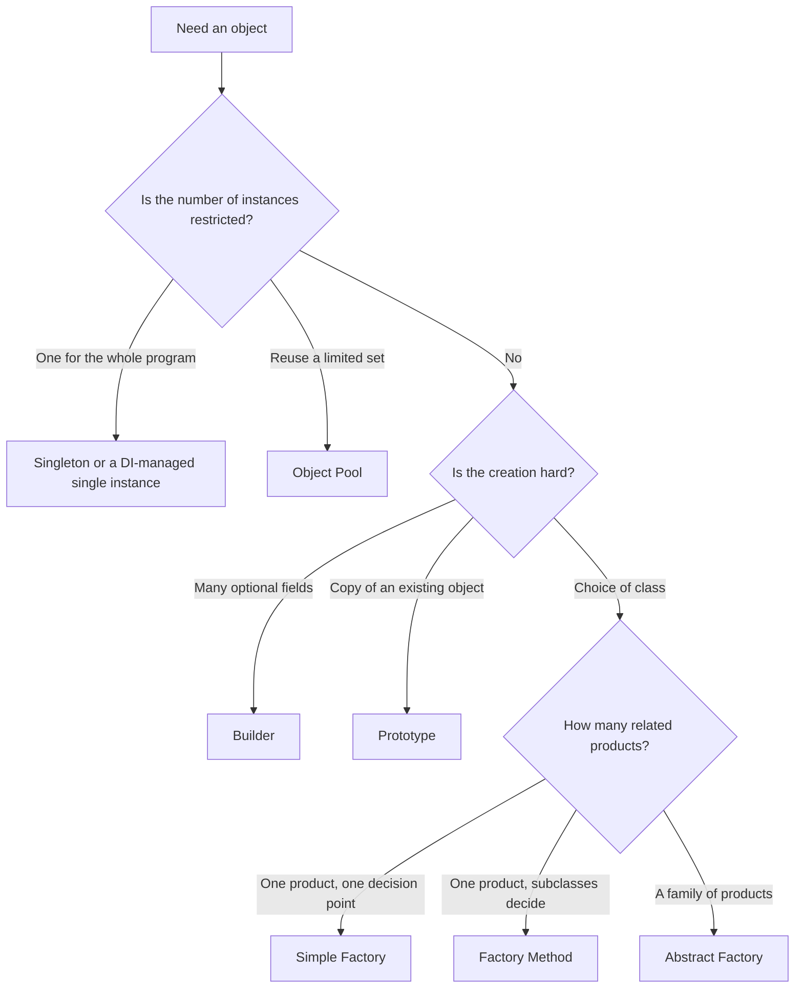
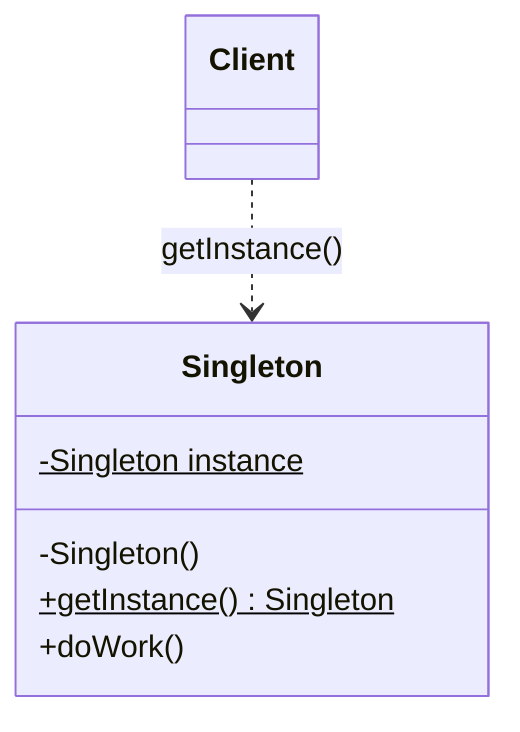
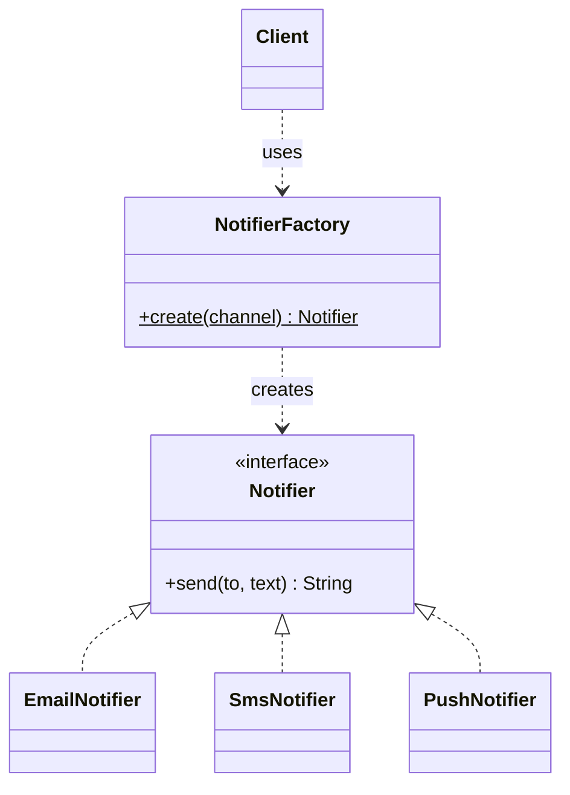
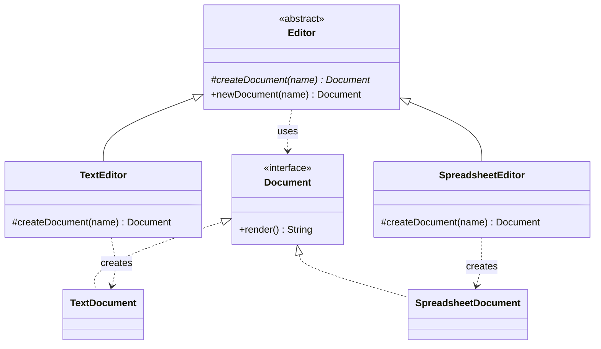
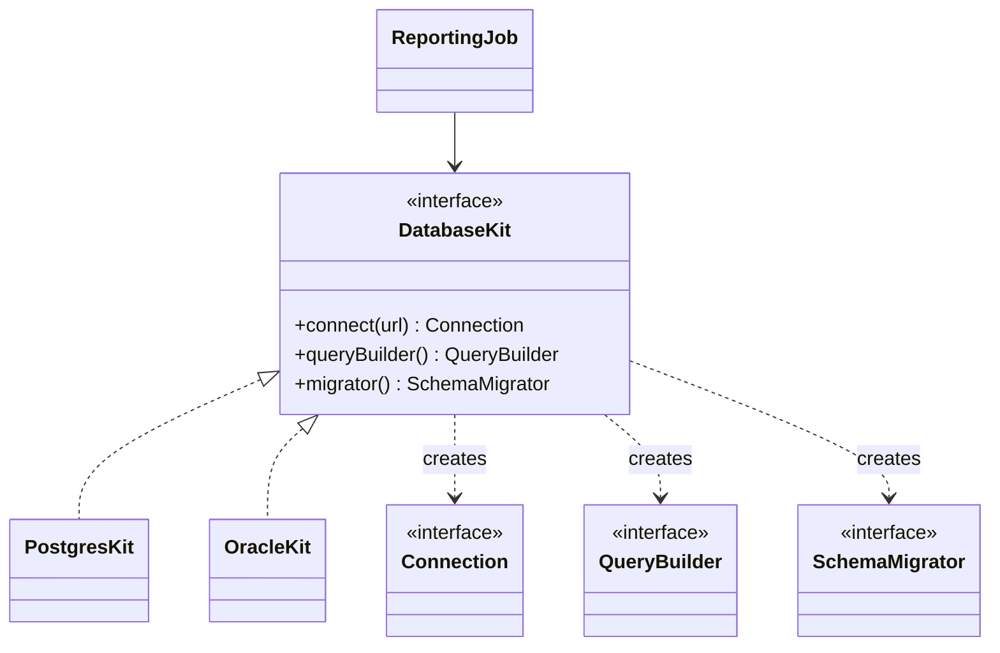
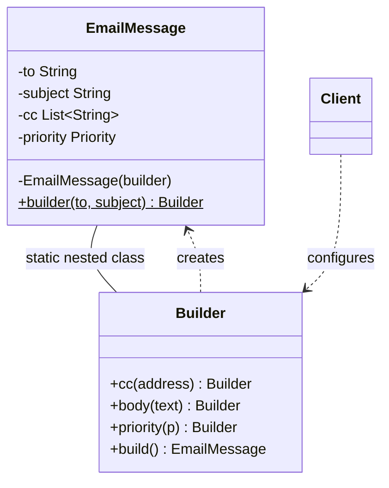
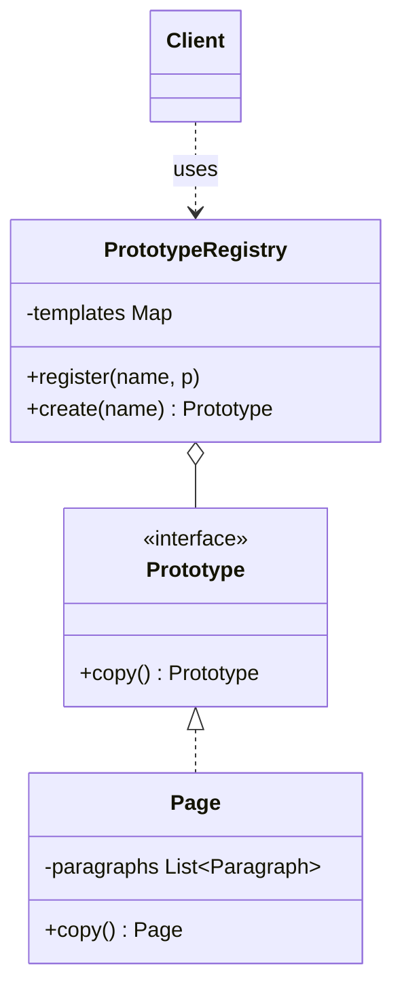
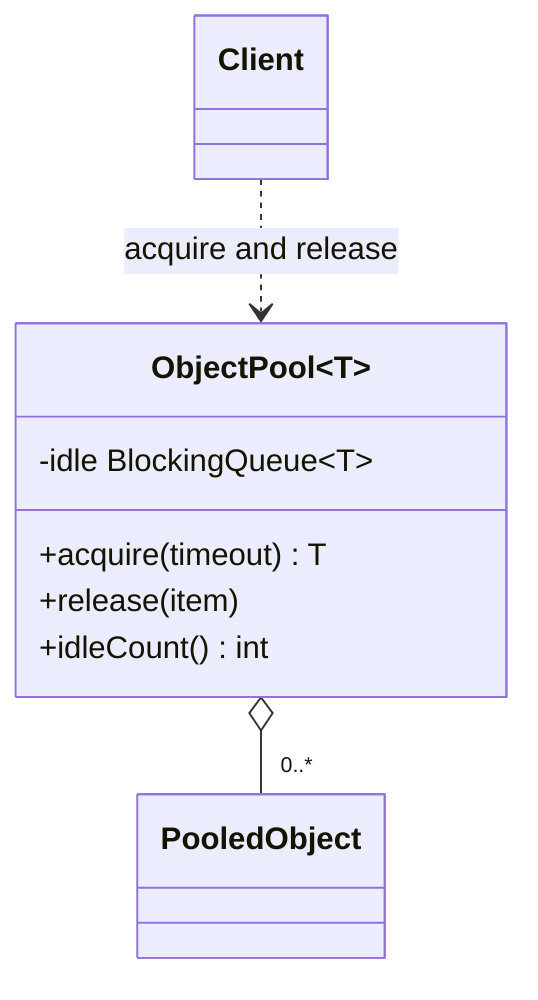
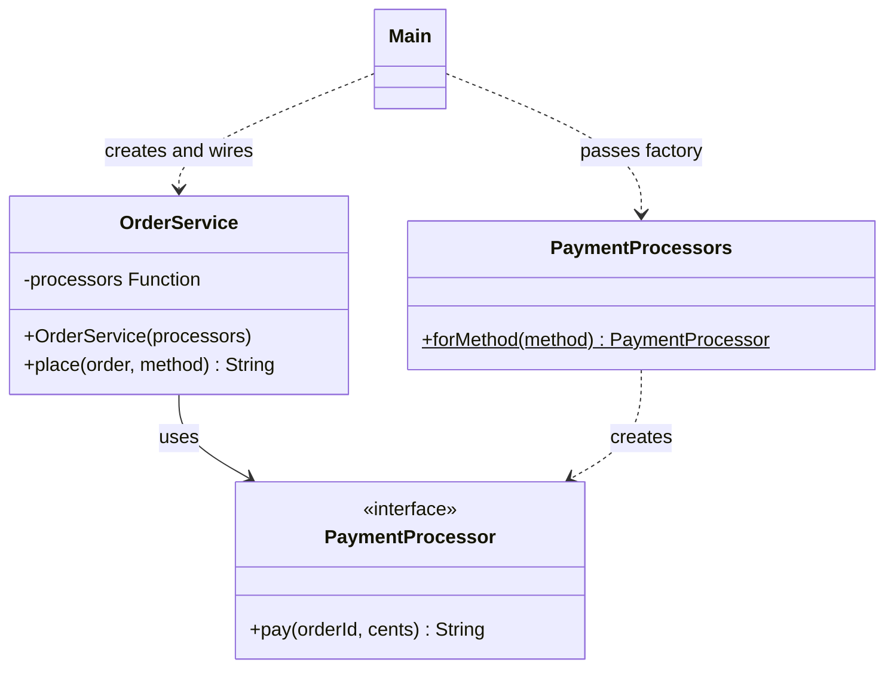

# Creational Patterns

## Why It Matters

Interviewers ask about creational patterns in two ways. They ask for a definition ("implement a thread-safe Singleton", "explain Factory versus Abstract Factory"), and they watch whether your design uses these patterns well when it creates objects: parking spots, payment processors, notifications, loggers. On the job, every code base decides where `new` appears. Code that calls `new` on a concrete class in many places is hard to test and hard to extend. Creational patterns put that decision in one place. This page covers Singleton, Simple Factory, Factory Method, Abstract Factory, Builder, Prototype, Object Pool, and Dependency Injection, with the thread-safe forms of Singleton in full detail, because interviewers probe them most.

## Core Concepts

A **creational pattern** is a design pattern that controls how a program creates objects. It separates the code that uses an object from the code that decides which class to instantiate and how to configure it. The Gang of Four (GoF) book defines five creational patterns: Singleton, Factory Method, Abstract Factory, Builder, and Prototype ([Gamma et al., 1994](#further-reading)). Simple Factory, Object Pool, and Dependency Injection are not in the GoF catalog. This page covers them because interviews ask about them next to the GoF five.

Terms used on this page:

- **Product**: the object that a pattern creates.
- **Creator**: the class that has the code that creates a product.
- **Client**: the code that needs a product and calls the creator.
- **Concrete class**: a class that you can instantiate. Its opposite is an interface or an abstract class.
- **Factory**: any method or class whose job is to create objects for its callers.
- **Instance control**: a rule about how many instances of a class exist. Singleton and Object Pool are instance-control patterns.
- **Immutable object**: an object whose state cannot change after its constructor returns. See [design principles](03-design-principles.md) for how to build one.

| Pattern | Intent in one line | Trigger in a requirement |
|---|---|---|
| Singleton | Exactly one instance of a class, with a global access point | "There must be only one X" (and the one is a real constraint) |
| Simple Factory | One method chooses the concrete class from an argument | "Create the right Y from a type code" |
| Factory Method | A superclass defers the choice of product class to its subclasses | "Each kind of Z creates its own kind of Y" |
| Abstract Factory | One interface creates a family of related products | "Products must match: all from vendor A or all from vendor B" |
| Builder | Construct a complex object in steps, then validate and return it | "An object with many optional fields" |
| Prototype | Create a new object by copying an existing one | "Start from a template and change a few fields" |
| Object Pool | Reuse expensive objects instead of creating them each time | "Creating X is slow and X has a limit" |
| Dependency Injection | The caller supplies the dependencies. The class does not create them | "Replace X in tests" or "choose X by configuration" |



## How It Works

Each pattern below has the same parts: intent, problem, structure, code, when to use, when not to use, and JDK examples. The interview questions for all patterns are in [Interview Angle](#interview-angle).

### Singleton

**Intent.** Ensure that a class has exactly one instance in the JVM, and give every caller access to it.

**Problem.** Some objects must exist once: the runtime environment, a shared ID generator, an in-memory registry. If two instances exist, the program breaks its own rule (two ID generators issue the same ID).

**Structure.** The class has a private constructor, a private static field that holds the instance, and a public static method that returns it.



Two facts about the word "one" matter in an interview:

- A JVM has one instance **per class loader**. If two class loaders load the class, two instances exist. Application servers with separate class loaders for each web application show this.
- A Singleton does not span processes. Three service instances on three machines have three Singletons. A rule such as "one global counter" needs a shared store, not a Singleton. See the HLD fundamentals pages.

The Java Language Specification (JLS) 12.4.1 says that the JVM initializes a class immediately before the first of these events: an instance of the class is created, a static method of the class is invoked, a static field of the class is assigned, or a static field that is not a constant variable is used. Class initialization runs under a lock (JLS 12.4.2), so the JVM runs a static initializer exactly once, even with many threads. Three of the five forms below use this guarantee.

#### Form 1: Eager initialization

The class creates the instance in a static field initializer.

```java
final class ConfigRegistry {
    private static final ConfigRegistry INSTANCE = new ConfigRegistry();

    private final Map<String, String> values = new ConcurrentHashMap<>();

    private ConfigRegistry() { }

    static ConfigRegistry getInstance() { return INSTANCE; }

    void put(String key, String value) { values.put(key, value); }

    String get(String key) { return values.get(key); }
}
```

"Eager" means that the instance exists as soon as the JVM initializes the class. The JVM initializes the class at its first use, not at JVM start. This form is thread-safe because of class initialization. Its cost: if the constructor is expensive and no caller ever needs the instance, the program still pays the cost on the first use of any static member. If the constructor throws, the JVM marks the class as erroneous (JLS 12.4.2). The first use fails with `ExceptionInInitializerError`, and every later use fails with `NoClassDefFoundError`.

#### Form 2: Lazy initialization with `synchronized`

The method creates the instance on the first call. `synchronized` makes the check and the creation atomic.

```java
final class LazyConfigRegistry {
    private static LazyConfigRegistry instance;

    private LazyConfigRegistry() { }

    static synchronized LazyConfigRegistry getInstance() {
        if (instance == null) {
            instance = new LazyConfigRegistry();
        }
        return instance;
    }
}
```

This form is correct. Its cost: every call to `getInstance()` takes the class lock, including every call after the first. Under contention, the threads wait for each other, only to read a field that does not change.

#### Form 3: Double-checked locking (DCL) with `volatile`

DCL avoids the lock after the first call. It checks the field before the lock, and again inside the lock.

```java
final class DclConfigRegistry {
    private static volatile DclConfigRegistry instance;

    private DclConfigRegistry() { }

    static DclConfigRegistry getInstance() {
        DclConfigRegistry local = instance;          // one volatile read
        if (local == null) {
            synchronized (DclConfigRegistry.class) {
                local = instance;                    // second check, inside the lock
                if (local == null) {
                    instance = local = new DclConfigRegistry();
                }
            }
        }
        return local;
    }
}
```

**Why `volatile` is needed.** The statement `instance = new DclConfigRegistry()` has three steps: (1) allocate memory, (2) run the constructor to initialize the fields, (3) write the reference to `instance`. The Java Memory Model allows the compiler and the CPU to reorder step 3 before step 2 when no happens-before relation forbids it. Thread A, inside the lock, can publish the reference before the constructor finishes. Thread B then runs the first check outside the lock, sees a non-null `instance`, skips the lock, and uses an object whose fields are not yet initialized. A write to a `volatile` field creates a happens-before edge with every later read of that field (JLS 17.4.5). All writes before the volatile write, including the constructor's writes, are visible to a thread that reads the new value. Since Java 5 (JSR-133), `volatile` makes DCL correct. Before Java 5, no declaration made it correct ([Bacon et al.](#further-reading)).

The local variable `local` reduces volatile reads: in the common path the method reads the volatile field once. It is an optimization. It does not change correctness.

The broken form omits `volatile`:

```java
final class BrokenDclRegistry {
    private static BrokenDclRegistry instance;   // no volatile: BROKEN

    private BrokenDclRegistry() { }

    static BrokenDclRegistry getInstance() {
        if (instance == null) {
            synchronized (BrokenDclRegistry.class) {
                if (instance == null) {
                    instance = new BrokenDclRegistry();
                }
            }
        }
        return instance;
    }
}
```

Recommendation: do not write DCL for a static Singleton in new code. Form 4 and Form 5 are shorter and have no memory-model risk. Know DCL because interviewers ask why `volatile` is there. DCL with `volatile` still has one use: lazy initialization of an *instance* field, where the holder idiom does not apply, because the holder idiom works only for static fields (*Effective Java*, 3rd ed., Item 83).

#### Form 4: Initialization-on-demand holder

A private static nested class holds the instance. The JVM does not initialize the nested class until `getInstance()` first touches `Holder.INSTANCE`.

```java
final class HolderRegistry {
    private HolderRegistry() { }

    private static class Holder {
        static final HolderRegistry INSTANCE = new HolderRegistry();
    }

    static HolderRegistry getInstance() { return Holder.INSTANCE; }
}
```

This form is lazy, thread-safe, and has no lock in your code. The class initialization lock (JLS 12.4.2) does the work. The demo below starts eight threads at the same moment and counts the distinct instances.

```java
import java.util.*;
import java.util.concurrent.*;

class ThreadSafetyDemo {
    public static void main(String[] args) throws Exception {
        int threads = 8;
        Set<HolderRegistry> seen = ConcurrentHashMap.newKeySet();
        CountDownLatch start = new CountDownLatch(1);
        ExecutorService pool = Executors.newFixedThreadPool(threads);
        for (int i = 0; i < threads; i++) {
            pool.submit(() -> {
                start.await();
                seen.add(HolderRegistry.getInstance());
                return null;
            });
        }
        start.countDown();
        pool.shutdown();
        pool.awaitTermination(5, TimeUnit.SECONDS);
        System.out.println("distinct instances: " + seen.size());
    }
}

class HolderRegistry {
    private HolderRegistry() { }

    private static class Holder {
        static final HolderRegistry INSTANCE = new HolderRegistry();
    }

    static HolderRegistry getInstance() { return Holder.INSTANCE; }
}
```

Output:

<!-- expected-output -->

```text
distinct instances: 1
```

#### Form 5: Enum Singleton

An enum with one constant is a Singleton. Joshua Bloch recommends it as the best way to implement a Singleton (*Effective Java*, 3rd ed., Item 3).

```java
enum IdGenerator {
    INSTANCE;

    private final AtomicLong next = new AtomicLong(1000);

    long nextId() { return next.getAndIncrement(); }
}
```

An enum constant is created once, when the JVM initializes the enum class, so the form is lazy per class and thread-safe. The language also blocks reflection and serialization attacks, as the next part shows. Limits: an enum cannot extend another class (it can implement interfaces), and it is a poor fit if the single instance needs lazy construction arguments.

#### Attacks on a Singleton and the defenses

Three mechanisms create a second instance without calling `getInstance()`:

1. **Reflection.** Code calls `setAccessible(true)` on the private constructor and then `newInstance()`.
2. **Serialization.** Deserialization creates a new object from the byte stream. For a `Serializable` class, `ObjectInputStream` does not call any constructor of that class. It runs only the no-argument constructor of the first superclass that is not serializable (for `PlainConfig` below, `Object()`), and then sets the fields from the stream (Java Object Serialization Specification, section 3.1). A guard in the Singleton's constructor therefore does not run.
3. **Cloning.** If the Singleton class implements `Cloneable` (or inherits it), `clone()` returns a second instance. Defense: do not implement `Cloneable`, or override `clone()` to throw `CloneNotSupportedException`.

A fourth case is not an attack: two class loaders that load the class create one instance each.

Defenses:

| Attack | Defense for a class-based Singleton | Defense for an enum |
|---|---|---|
| Reflection | The constructor throws if `INSTANCE` is not null. This works for the eager form, because the JVM creates `INSTANCE` before any reflective call. It is weaker for lazy forms, because an attacker can call the constructor first | `Constructor.newInstance` throws `IllegalArgumentException` for an enum class (documented in the javadoc) |
| Serialization | Declare `private Object readResolve()` that returns the instance. `ObjectInputStream` then returns the existing instance and discards the new object. Declare every instance field of an object reference type `transient`. If such a field is serialized, a crafted byte stream can capture a reference to the new object before `readResolve` runs (*Effective Java*, 3rd ed., Item 89) | The Java Object Serialization Specification (section 1.12) serializes an enum constant by its name only, and ignores `readResolve` and `writeReplace`, so deserialization returns the existing constant |

The demo runs the reflection and serialization attacks against three classes: a plain eager Singleton, a guarded eager Singleton, and an enum.

```java
import java.io.*;
import java.lang.reflect.Constructor;

class AttackDemo {
    @SuppressWarnings("unchecked")
    static <T> T roundTrip(T original) throws Exception {
        ByteArrayOutputStream bytes = new ByteArrayOutputStream();
        try (ObjectOutputStream out = new ObjectOutputStream(bytes)) {
            out.writeObject(original);
        }
        try (ObjectInputStream in =
                 new ObjectInputStream(new ByteArrayInputStream(bytes.toByteArray()))) {
            return (T) in.readObject();
        }
    }

    static Object reflect(Class<?> type) throws Exception {
        Constructor<?> constructor = type.getDeclaredConstructors()[0];
        constructor.setAccessible(true);
        Object[] args = constructor.getParameterCount() == 0
            ? new Object[0] : new Object[] {"INSTANCE", 0};
        return constructor.newInstance(args);
    }

    public static void main(String[] args) throws Exception {
        System.out.println("plain, reflection : "
            + (reflect(PlainConfig.class) != PlainConfig.getInstance()
                ? "second instance" : "same"));
        System.out.println("plain, serialize  : "
            + (roundTrip(PlainConfig.getInstance()) != PlainConfig.getInstance()
                ? "second instance" : "same"));
        try {
            reflect(GuardedConfig.class);
        } catch (java.lang.reflect.InvocationTargetException e) {
            System.out.println("guarded, reflection: " + e.getCause());
        }
        System.out.println("guarded, serialize: "
            + (roundTrip(GuardedConfig.getInstance()) == GuardedConfig.getInstance()
                ? "same" : "second instance"));
        try {
            reflect(EnumConfig.class);
        } catch (IllegalArgumentException e) {
            System.out.println("enum, reflection  : " + e.getMessage());
        }
        System.out.println("enum, serialize   : "
            + (roundTrip(EnumConfig.INSTANCE) == EnumConfig.INSTANCE
                ? "same" : "second instance"));
    }
}

class PlainConfig implements Serializable {
    private static final PlainConfig INSTANCE = new PlainConfig();
    private PlainConfig() { }
    static PlainConfig getInstance() { return INSTANCE; }
}

class GuardedConfig implements Serializable {
    private static final GuardedConfig INSTANCE = new GuardedConfig();

    private GuardedConfig() {
        if (INSTANCE != null) {
            throw new IllegalStateException("Instance already exists");
        }
    }

    static GuardedConfig getInstance() { return INSTANCE; }

    private Object readResolve() { return INSTANCE; }
}

enum EnumConfig { INSTANCE }
```

Output:

<!-- expected-output -->

```text
plain, reflection : second instance
plain, serialize  : second instance
guarded, reflection: java.lang.IllegalStateException: Instance already exists
guarded, serialize: same
enum, reflection  : Cannot reflectively create enum objects
enum, serialize   : same
```

The reflection attack needs access to the private constructor. If the Singleton class is in a named module that does not open its package to the caller's module, `setAccessible(true)` throws `InaccessibleObjectException`. Code on the class path is in the unnamed module, which opens all its packages, so the attack in the demo works. A security manager is not a defense in current Java. JDK 17 deprecated the Security Manager for removal (JEP 411). Since JDK 24, the JVM cannot enable a Security Manager at all: the API remains, but it enforces nothing, and `System.setSecurityManager` throws `UnsupportedOperationException` (JEP 486). JEP 486 says that a future release removes the API. In practice, treat reflection and serialization attacks as an interview topic and a reason to prefer an enum, not as a threat model for most applications.

#### Why Singleton hurts testing

A Singleton is global state behind a static method. Three problems follow:

- **Hidden dependency.** A class that calls `PaymentGateway.getInstance()` inside a method does not show the dependency in its constructor or signature. A reader cannot see what the class needs.
- **No substitution.** The class name is fixed in the call. A unit test cannot replace the real gateway with a fake, because the call is a static method.
- **Shared state between tests.** The instance lives as long as the class loader. State from one test remains in the next test, and tests pass or fail depending on their order.

The demo shows the wrong form (a hard-wired Singleton) and the right form (the class receives the dependency through its constructor):

```java
class TestingDemo {
    public static void main(String[] args) {
        try {
            new HardWiredCheckout().pay("acc-1", 500);
        } catch (IllegalStateException e) {
            System.out.println("hard-wired: " + e.getMessage());
        }
        InjectedCheckout checkout = new InjectedCheckout((account, cents) -> cents <= 1000);
        System.out.println("injected, 500 cents: " + checkout.pay("acc-1", 500));
        System.out.println("injected, 5000 cents: " + checkout.pay("acc-1", 5000));
    }
}

class PaymentGateway {
    private static final PaymentGateway INSTANCE = new PaymentGateway();
    private PaymentGateway() { }
    static PaymentGateway getInstance() { return INSTANCE; }

    boolean charge(String account, long cents) {
        // A real gateway would call a remote service here.
        throw new IllegalStateException("Cannot reach the payment provider in a unit test");
    }
}

class HardWiredCheckout {
    boolean pay(String account, long cents) {
        return PaymentGateway.getInstance().charge(account, cents);
    }
}

interface Payments {
    boolean charge(String account, long cents);
}

class InjectedCheckout {
    private final Payments payments;

    InjectedCheckout(Payments payments) { this.payments = payments; }

    boolean pay(String account, long cents) {
        return payments.charge(account, cents);
    }
}
```

Output:

<!-- expected-output -->

```text
hard-wired: Cannot reach the payment provider in a unit test
injected, 500 cents: true
injected, 5000 cents: false
```

Recommendation: if the program needs one instance, create it once at startup and pass it to the classes that need it. The instance is then a "singleton by construction", and no class enforces it. See [Dependency Injection](#dependency-injection) below and the Singleton entry in [anti-patterns](11-anti-patterns.md). For thread-safety rules inside a Singleton's state, see [concurrency in LLD](09-concurrency-in-lld.md).

**When to use Singleton.** Use it when the instance represents a real unique resource, when the class has no mutable state or only thread-safe state, and when no test needs a replacement. Examples: a read-only configuration holder, a stateless utility, an `enum` constant that represents a fixed concept.

**When not to use.** Do not use it to share mutable data between classes (pass the data instead), when tests must replace the instance, or when the requirement says "one per user", "one per tenant", or "one per connection". Those cases need a map or a factory, not a Singleton.

**JDK examples.**

- `java.lang.Runtime.getRuntime()`: the javadoc says that every Java application has a single instance of class `Runtime`.
- Enum constants: each constant of every enum is a single instance.
- Note: `Calendar.getInstance()` is not a Singleton. It returns a new `Calendar` on each call.

### Simple Factory

**Intent.** Put the decision "which concrete class to create" into one method, so clients do not use `new` on concrete classes.

**Problem.** A client that has `if (type.equals("sms")) new SmsNotifier() else ...` mixes two jobs: it chooses a class and it uses the object. Every client repeats the `if` chain, and every new type changes every client.

**Why it is not a GoF pattern.** The GoF catalog has no Simple Factory. It is a programming idiom: a static method (or one class) with a `switch` that returns a product. It is not Factory Method, because no subclass overrides anything. Do not call it "the Factory pattern" in an interview without saying which one you mean.



```java
import java.util.*;

class SimpleFactoryDemo {
    public static void main(String[] args) {
        for (Channel channel : Channel.values()) {
            System.out.println(NotifierFactory.create(channel).send("asha", "Order shipped"));
        }
    }
}

enum Channel { EMAIL, SMS, PUSH }

interface Notifier {
    String send(String to, String text);
}

class EmailNotifier implements Notifier {
    public String send(String to, String text) { return "EMAIL to " + to + ": " + text; }
}

class SmsNotifier implements Notifier {
    public String send(String to, String text) { return "SMS to " + to + ": " + text; }
}

class PushNotifier implements Notifier {
    public String send(String to, String text) { return "PUSH to " + to + ": " + text; }
}

final class NotifierFactory {
    private NotifierFactory() { }

    static Notifier create(Channel channel) {
        return switch (channel) {
            case EMAIL -> new EmailNotifier();
            case SMS -> new SmsNotifier();
            case PUSH -> new PushNotifier();
        };
    }
}
```

Output:

<!-- expected-output -->

```text
EMAIL to asha: Order shipped
SMS to asha: Order shipped
PUSH to asha: Order shipped
```

The `switch` expression over an enum has no `default`. If you add a constant to `Channel` and forget the `switch`, the compiler reports an error. This is a benefit over a `String` type code.

**Limit.** To add a channel, you edit the factory. This violates the Open-Closed Principle at one place instead of many (see [SOLID](02-solid.md)). That is an acceptable trade-off when the set of types is small and known.

**When to use.** Use it when one place can know all concrete classes, and the list changes rarely.

**When not to use.** Do not use it when third parties must add types without editing your code. Use a registry (`Map<Channel, Supplier<Notifier>>`) or Factory Method instead.

**JDK examples (static factory methods).** These are static methods that return an instance. They follow the idea of the Simple Factory, but several are not a `switch`:

- `Calendar.getInstance()`: returns a `Calendar` for the default time zone and locale. The method chooses the concrete class from the locale (in the OpenJDK source, `GregorianCalendar` for most locales, and `BuddhistCalendar` or `JapaneseImperialCalendar` for some), which is the Simple Factory decision.
- `List.of(...)`: returns an unmodifiable list. The javadoc does not name the implementation class, and it says that callers should make no assumptions about the identity of the returned instances.
- `Integer.valueOf(int)`: returns a cached instance for -128 to 127.

### Factory Method

**Intent.** Define a method that creates a product in a superclass, and let subclasses decide which product class to create (GoF).

**Problem.** A framework class has the workflow ("open a new document, add it to the open list, show it") but cannot know which document class to create. The application knows the class but not the workflow.

**Structure.** The creator declares the factory method (abstract or with a default). The creator's other methods call it. Each concrete creator overrides it.



```java
import java.util.*;

class FactoryMethodDemo {
    public static void main(String[] args) {
        Editor[] editors = {new TextEditor(), new SpreadsheetEditor()};
        for (Editor editor : editors) {
            editor.newDocument("report");
            editor.newDocument("budget");
        }
    }
}

interface Document {
    String render();
}

class TextDocument implements Document {
    private final String name;
    TextDocument(String name) { this.name = name; }
    public String render() { return "text:" + name; }
}

class SpreadsheetDocument implements Document {
    private final String name;
    SpreadsheetDocument(String name) { this.name = name; }
    public String render() { return "sheet:" + name; }
}

abstract class Editor {
    private final List<Document> open = new ArrayList<>();

    // Factory method: each subclass decides which Document to create.
    protected abstract Document createDocument(String name);

    // Template: this code is the same for every kind of document.
    Document newDocument(String name) {
        Document document = createDocument(name);
        open.add(document);
        System.out.println("opened " + document.render() + " (" + open.size() + " open)");
        return document;
    }
}

class TextEditor extends Editor {
    @Override protected Document createDocument(String name) { return new TextDocument(name); }
}

class SpreadsheetEditor extends Editor {
    @Override protected Document createDocument(String name) {
        return new SpreadsheetDocument(name);
    }
}
```

Output:

<!-- expected-output -->

```text
opened text:report (1 open)
opened text:budget (2 open)
opened sheet:report (1 open)
opened sheet:budget (2 open)
```

`newDocument` is a Template Method (see [behavioral patterns](08-behavioral-patterns.md)): it fixes the steps and calls the factory method for one step. Factory Method and Template Method often appear together.

**A functional variant.** If the subclass has no other reason to exist, pass the factory as a function. This removes one class per product:

```java
final class FunctionalEditor {
    private final Function<String, Document> documentFactory;

    FunctionalEditor(Function<String, Document> documentFactory) {
        this.documentFactory = documentFactory;
    }

    Document newDocument(String name) {
        return documentFactory.apply(name);
    }
}

interface Document { String render(); }
```

**Factory Method versus Simple Factory.** In Simple Factory, one class chooses by argument. In Factory Method, the choice is by subclass. Simple Factory adds a type by editing the factory. Factory Method adds a type by adding a subclass, with no edit to existing classes.

**When to use.** Use it when a class cannot predict the product class, when you want subclasses to choose the product, or when you want a framework to call your code to create objects.

**When not to use.** Do not use it when one `new` call in one place would do. Do not use it if the hierarchy of creators exists only to create products: pass a `Supplier` or `Function` instead.

**JDK examples.** These classifications are the common reading of the GoF pattern, not statements in the javadoc:

- `Iterable.iterator()` and `Collection.iterator()`: each collection class decides which `Iterator` class to return. The GoF book supports this reading: its Iterator chapter names Factory Method as a related pattern, because polymorphic iterators use a factory method to create the matching `Iterator` subclass.

### Abstract Factory

**Intent.** Provide one interface that creates a family of related products, without naming their concrete classes (GoF).

**Problem.** The program uses several products that must match. A Postgres connection must go with Postgres SQL syntax and Postgres migrations. If one part comes from Postgres and another from Oracle, the program breaks at run time. The client should pick the family once.

**Structure.** The abstract factory has one creation method for each product type. Each concrete factory returns all products of one family.



```java
class AbstractFactoryDemo {
    public static void main(String[] args) {
        for (DatabaseKit kit : new DatabaseKit[] {new PostgresKit(), new OracleKit()}) {
            new ReportingJob(kit).run();
        }
    }
}

interface Connection {
    String describe();
}

interface QueryBuilder {
    String paginate(String select, int limit, int offset);
}

interface SchemaMigrator {
    String addColumn(String table, String column, String type);
}

interface DatabaseKit {
    Connection connect(String url);
    QueryBuilder queryBuilder();
    SchemaMigrator migrator();
}

class PostgresKit implements DatabaseKit {
    public Connection connect(String url) { return () -> "postgres connection to " + url; }
    public QueryBuilder queryBuilder() {
        return (select, limit, offset) -> select + " LIMIT " + limit + " OFFSET " + offset;
    }
    public SchemaMigrator migrator() {
        return (table, column, type) ->
            "ALTER TABLE " + table + " ADD COLUMN IF NOT EXISTS " + column + " " + type;
    }
}

class OracleKit implements DatabaseKit {
    public Connection connect(String url) { return () -> "oracle connection to " + url; }
    public QueryBuilder queryBuilder() {
        return (select, limit, offset) ->
            select + " OFFSET " + offset + " ROWS FETCH NEXT " + limit + " ROWS ONLY";
    }
    public SchemaMigrator migrator() {
        return (table, column, type) ->
            "ALTER TABLE " + table + " ADD (" + column + " " + type + ")";
    }
}

class ReportingJob {
    private final DatabaseKit kit;
    ReportingJob(DatabaseKit kit) { this.kit = kit; }

    void run() {
        System.out.println(kit.connect("db.internal").describe());
        System.out.println(kit.migrator().addColumn("orders", "region", "VARCHAR(8)"));
        System.out.println(kit.queryBuilder().paginate("SELECT * FROM orders", 20, 40));
    }
}
```

Output:

<!-- expected-output -->

```text
postgres connection to db.internal
ALTER TABLE orders ADD COLUMN IF NOT EXISTS region VARCHAR(8)
SELECT * FROM orders LIMIT 20 OFFSET 40
oracle connection to db.internal
ALTER TABLE orders ADD (region VARCHAR(8))
SELECT * FROM orders OFFSET 40 ROWS FETCH NEXT 20 ROWS ONLY
```

`ReportingJob` does not know which database it uses. Changing the family is one constructor argument.

**Abstract Factory versus Factory Method.** Factory Method creates one product and uses inheritance. Abstract Factory creates a family of products and uses composition (the client holds a factory object). An Abstract Factory is often a set of Factory Methods, one for each product.

**Cost.** To add a new product type (for example `BackupTool`), you change the interface and every concrete factory. Adding a new family is cheap. Adding a new product type is expensive. If product types change often, this pattern does not fit.

**When to use.** Use it when the program must use one family at a time and the products of different families must not mix. Typical cases: UI toolkits by platform, database dialects, cloud-provider clients, themes.

**When not to use.** Do not use it when there is one product type (use Factory Method), or when no mixing rule exists.

**JDK examples (classification is the common reading, not stated in the javadoc).**

- `java.sql.Connection` creates `Statement`, `PreparedStatement`, and `CallableStatement` objects that belong to the same driver. The `DriverManager` or `DataSource` selects the family.
- `javax.xml.parsers.DocumentBuilderFactory.newInstance()` selects an implementation through the JAXP lookup mechanism, then `newDocumentBuilder()` creates a parser that matches the factory's settings. The javadoc calls the class "a factory API".

### Builder

**Intent.** GoF: "Separate the construction of a complex object from its representation so that the same construction process can create different representations." In the GoF form, a Director runs the steps and different concrete builders produce different products. The Java form that interviewers expect is the one from *Effective Java* Item 2: a static nested builder with named, chained setters that runs construction in steps and returns one valid, often immutable, object. Name both forms if the interviewer asks for "the Builder pattern".

**Problem: the telescoping constructor.** A class with required and optional fields needs a constructor for each combination of optional fields. The constructors grow, and call sites become unreadable:

<!-- fragment -->
```java
// WRONG: telescoping constructors. Which null is which?
final class EmailMessage {
    EmailMessage(String to, String subject) { }
    EmailMessage(String to, String subject, String body) { }
    EmailMessage(String to, String subject, String body, List<String> cc) { }
    EmailMessage(String to, String subject, String body, List<String> cc, Priority p) { }
}

EmailMessage m = new EmailMessage("a@x.com", "Hi", null, null, Priority.HIGH);
```

The caller must remember the order. Two parameters of the same type, swapped by mistake, compile and fail at run time. JavaBeans setters do not fix this: `new EmailMessage()` followed by `setTo(...)` leaves the object in an invalid state between calls, and the class cannot be immutable.

**Structure.** A static nested `Builder` class collects the values. Its `build()` method validates them and calls a private constructor of the product.



```java
import java.util.*;

class BuilderDemo {
    public static void main(String[] args) {
        EmailMessage ok = EmailMessage.builder("asha@example.com", "Invoice 42")
            .cc("finance@example.com")
            .priority(EmailMessage.Priority.HIGH)
            .body("Please find the invoice attached.")
            .build();
        System.out.println(ok);
        try {
            EmailMessage.builder("asha@example.com", "Invoice 43")
                .priority(EmailMessage.Priority.HIGH)
                .build();
        } catch (IllegalStateException e) {
            System.out.println("rejected: " + e.getMessage());
        }
    }
}

final class EmailMessage {
    enum Priority { LOW, NORMAL, HIGH }

    private final String to;
    private final String subject;
    private final List<String> cc;
    private final String body;
    private final Priority priority;

    private EmailMessage(Builder b) {
        this.to = b.to;
        this.subject = b.subject;
        this.cc = List.copyOf(b.cc);
        this.body = b.body;
        this.priority = b.priority;
    }

    static Builder builder(String to, String subject) { return new Builder(to, subject); }

    @Override public String toString() {
        return "EmailMessage[to=" + to + ", subject=" + subject + ", cc=" + cc
            + ", priority=" + priority + "]";
    }

    static final class Builder {
        private final String to;
        private final String subject;
        private final List<String> cc = new ArrayList<>();
        private String body = "";
        private Priority priority = Priority.NORMAL;

        private Builder(String to, String subject) {
            this.to = to;
            this.subject = subject;
        }

        Builder cc(String address) { cc.add(address); return this; }
        Builder body(String body) { this.body = body; return this; }
        Builder priority(Priority priority) { this.priority = priority; return this; }

        EmailMessage build() {
            if (to == null || !to.contains("@")) {
                throw new IllegalStateException("to must be an email address: " + to);
            }
            if (subject == null || subject.isBlank()) {
                throw new IllegalStateException("subject must not be blank");
            }
            if (priority == Priority.HIGH && cc.isEmpty()) {
                throw new IllegalStateException("a HIGH priority message needs at least one cc");
            }
            return new EmailMessage(this);
        }
    }
}
```

Output:

<!-- expected-output -->

```text
EmailMessage[to=asha@example.com, subject=Invoice 42, cc=[finance@example.com], priority=HIGH]
rejected: a HIGH priority message needs at least one cc
```

Design points:

- **Required fields go in the builder's constructor** (or the `builder(...)` method). The compiler then enforces them. Optional fields have defaults and setters that return `this`.
- **Validation runs in `build()`**, after all values are set. A rule that involves two fields (a HIGH priority message needs a cc) can run only there. A setter cannot check it.
- **The product copies mutable inputs** (`List.copyOf`). If the product kept the builder's list, a later builder call would change an already-built object.
- **The product's constructor is private.** The only way to create the object is through `build()`, so no invalid object exists.
- A builder object is not thread-safe. Use one builder per thread, or build in one thread.
- The builder above has no library dependency and is about 25 lines of code in the class.

**Related forms.**

- A **Director** is a class that calls builder steps in a fixed order to create a standard product (the GoF structure). Most Java builders have no Director, and the client is the director.
- A **record** with a compact constructor is enough for a small immutable object with three or four required fields. Use a builder when there are optional fields or cross-field rules.
- A **step builder** (a chain of interfaces, where each step returns the next interface) makes the compiler enforce the order of required fields. It costs one interface for each step.

**When to use.** Use it when a class has four or more constructor parameters (the threshold in *Effective Java* Item 2), when several are optional, when the object must be immutable and valid, or when construction needs validation across fields.

**When not to use.** Do not use it for a class with two or three required fields and no optional field. A constructor or a record is shorter.

**JDK examples.**

- `java.net.http.HttpRequest.newBuilder()`: the javadoc says an `HttpRequest` instance is built through a builder, and `build()` returns the request after the parameters are set.
- `java.util.Locale.Builder`, `java.util.stream.Stream.builder()`, and `java.lang.ProcessBuilder` are builders.
- `StringBuilder` appends parts in steps, and `toString()` returns a `String`. It has no Director and no abstract builder interface, so it matches the name more than the GoF structure. This is a judgment, not a javadoc claim.

### Prototype

**Intent.** Create a new object by copying an existing object (the prototype), instead of constructing it from scratch (GoF).

**Problem.** Creating an object is costly (it loads data, or runs many steps), or the program must start from a configured template (a standard email, a game unit with preset stats) and change a few fields.

**Structure.** The prototype interface declares a copy method. Each concrete class implements it. A registry can store named prototypes.



**Shallow and deep copy.** A **shallow copy** copies the fields of the object. If a field holds a reference, the copy and the original share the referred object. A **deep copy** also copies the referred objects, recursively, so the copy shares nothing mutable with the original. Fields of primitive types and references to immutable objects (such as `String`) need no deep copy.

The demo shows a shallow copy that shares `Paragraph` objects, a deep copy through a copy constructor, and a `clone()` that shares its list:

```java
import java.util.*;

class PrototypeDemo {
    public static void main(String[] args) {
        Page template = new Page();
        template.add(new Paragraph("Dear customer,"));
        template.add(new Paragraph("Your order has shipped."));

        Page shallow = template.shallowCopy();
        Page deep = new Page(template);
        shallow.get(0).setText("CHANGED via shallow copy");

        System.out.println("template: " + template);
        System.out.println("shallow : " + shallow);
        System.out.println("deep    : " + deep);

        Page cloned = template.clone();
        cloned.add(new Paragraph("Added to the clone"));
        System.out.println("template after clone.add: " + template);
    }
}

final class Paragraph {
    private String text;
    Paragraph(String text) { this.text = text; }
    Paragraph(Paragraph other) { this.text = other.text; }
    void setText(String text) { this.text = text; }
    String getText() { return text; }
}

final class Page implements Cloneable {
    private final List<Paragraph> paragraphs = new ArrayList<>();

    void add(Paragraph paragraph) { paragraphs.add(paragraph); }
    Paragraph get(int index) { return paragraphs.get(index); }

    // Copy constructor: the copy has its own list and its own Paragraph objects.
    Page(Page other) {
        for (Paragraph p : other.paragraphs) {
            paragraphs.add(new Paragraph(p));
        }
    }

    Page() { }

    // Shallow copy: the copy shares the Paragraph objects with the original.
    Page shallowCopy() {
        Page copy = new Page();
        copy.paragraphs.addAll(paragraphs);
        return copy;
    }

    @Override public Page clone() {
        try {
            Page copy = (Page) super.clone();   // copies the reference to the same list
            return copy;
        } catch (CloneNotSupportedException e) {
            throw new AssertionError(e);
        }
    }

    @Override public String toString() {
        StringBuilder sb = new StringBuilder();
        for (Paragraph p : paragraphs) {
            sb.append('[').append(p.getText()).append(']');
        }
        return sb.toString();
    }
}
```

Output:

<!-- expected-output -->

```text
template: [CHANGED via shallow copy][Your order has shipped.]
shallow : [CHANGED via shallow copy][Your order has shipped.]
deep    : [Dear customer,][Your order has shipped.]
template after clone.add: [CHANGED via shallow copy][Your order has shipped.][Added to the clone]
```

The shallow copy changed the template. The `clone()` method added a paragraph to the template, because `super.clone()` copied the reference to the same list. This is the standard bug with `Object.clone()`.

**Problems with `Cloneable` and `Object.clone()`.**

- `Cloneable` has no methods. It only changes how `Object.clone()` behaves. The `clone` method is `protected` in `Object`, so the interface does not declare it. A client cannot call `clone()` through the `Cloneable` type.
- `Object.clone()` is a shallow copy. The javadoc says that the contents of the fields are not themselves cloned. The author of each class must copy mutable fields in `clone()`, and must do it in every subclass.
- `clone()` creates the object without calling a constructor, so constructor validation does not run.
- A `final` field cannot be reassigned in `clone()`, so a deep copy of a `final` mutable field is impossible without removing `final`.
- `clone()` throws the checked `CloneNotSupportedException`, which forces `try`/`catch` in the caller or in the override.
- The javadoc states that `x.clone() != x` and `x.clone().getClass() == x.getClass()` are typical, but "not absolute requirements". Subclasses weaken the contract.

*Effective Java* (Item 13) recommends a **copy constructor** or a **copy factory** (`static Page copyOf(Page other)`) instead. A copy constructor needs no `Cloneable`, runs normal constructor code, throws no checked exception, and works with `final` fields. It can also take an interface type as its parameter (a conversion constructor, for example `new TreeSet<>(collection)`), so it can copy from any implementation. The `Page(Page other)` constructor in the demo is a copy constructor. For a deep copy of a large graph, you can also serialize and deserialize the object. That approach needs every class in the graph to be `Serializable` and costs much more CPU time than a copy constructor. The alternative is an explicit copy method for each class.

**When to use.** Use it when the program creates many objects from a small set of templates, or when a class has many fields and the new object differs in a few.

**When not to use.** Do not use it when the object holds resources that cannot be copied (open sockets, file handles, threads) or when the object graph has cycles that a naive copy does not handle. Do not rely on `Cloneable` for new classes.

**JDK examples.**

- `ArrayList.clone()` and `HashMap.clone()` return shallow copies. The `ArrayList` javadoc says: "The elements themselves are not copied."
- Copy constructors: `new ArrayList<>(collection)`, `new HashMap<>(map)`, and `List.copyOf(collection)`.
- `Object.clone()`, and the `clone()` method on every array type.

### Object Pool

**Intent.** Keep a set of reusable, initialized objects. Callers borrow an object, use it, and return it. The pool does not create or destroy objects for each use.

**Problem.** Creating the object is expensive (a database connection takes a network round trip and an authentication), or the number of objects must have an upper limit.

**Structure.** The pool holds idle objects in a queue. `acquire` removes one, and `release` returns it. If none is idle, `acquire` waits, creates a new one (if under the limit), or fails.



```java
import java.util.concurrent.*;
import java.util.function.*;

class PoolDemo {
    static int created = 0;

    public static void main(String[] args) throws Exception {
        ObjectPool<StringBuilder> pool = new ObjectPool<>(2, () -> {
            created++;
            return new StringBuilder();
        }, buffer -> buffer.setLength(0));
        StringBuilder first = pool.acquire(100);
        StringBuilder second = pool.acquire(100);
        try {
            pool.acquire(10);
        } catch (IllegalStateException e) {
            System.out.println("third acquire: " + e.getMessage());
        }
        try {
            first.append("report for asha");
            System.out.println("first holds: " + first);
        } finally {
            pool.release(first);    // release in finally: no leak if the work throws
        }
        System.out.println("idle after release: " + pool.idleCount());
        StringBuilder reused = pool.acquire(100);
        System.out.println("reused is first: " + (reused == first)
            + ", length after reset: " + reused.length());
        pool.release(reused);
        pool.release(second);
        System.out.println("buffers created: " + created);
    }
}

final class ObjectPool<T> {
    private final BlockingQueue<T> idle;
    private final Consumer<T> reset;

    ObjectPool(int size, Supplier<T> factory, Consumer<T> reset) {
        this.idle = new ArrayBlockingQueue<>(size);
        this.reset = reset;
        for (int i = 0; i < size; i++) {
            idle.add(factory.get());
        }
    }

    T acquire(long timeoutMillis) throws InterruptedException {
        T item = idle.poll(timeoutMillis, TimeUnit.MILLISECONDS);
        if (item == null) {
            throw new IllegalStateException("Pool exhausted");
        }
        return item;
    }

    // The pool resets the object before another caller can acquire it.
    void release(T item) {
        reset.accept(item);
        idle.add(item);
    }

    int idleCount() { return idle.size(); }
}
```

Output:

<!-- expected-output -->

```text
third acquire: Pool exhausted
first holds: report for asha
idle after release: 1
reused is first: true, length after reset: 0
buffers created: 2
```

Rules for a pool:

- **Return the object**, in a `finally` block or with a try-with-resources wrapper that calls `release` on `close()`. A missed `release` is a leak, and after enough leaks the pool is empty.
- **Reset the state** before reuse. In the demo, `release` runs the reset function, so the next caller gets an empty buffer. A pooled object that keeps the previous caller's data is a bug and, for credentials, a security problem.
- **Do not use a pooled object after releasing it.** Another thread may already hold it.
- A bounded `BlockingQueue` makes the pool thread-safe. See [concurrency in LLD](09-concurrency-in-lld.md).

**When to use.** Use it for objects that are costly to create and have a limit: database connections, HTTP connections, threads, native buffers.

**When not to use.** Do not pool cheap objects. A pool for small objects adds locking and the risk of stale state. Measure before you pool. Do not pool virtual threads: JEP 444 says that virtual threads are cheap and should never be pooled.

**JDK and library examples.**

- `ThreadPoolExecutor` (created by `Executors.newFixedThreadPool`) reuses a fixed set of threads for many tasks.
- Connection pools implement `javax.sql.DataSource`. HikariCP is one such library: its `HikariDataSource` class implements `DataSource`. The `DataSource` interface does not require pooling. The implementation does it.

### Dependency Injection

**Intent.** A class receives the objects it depends on from outside. It does not create them or look them up.

**Problem.** A class that calls `new SmtpMailer()` or `Config.getInstance()` inside its methods has a fixed dependency. A test cannot replace it, and a change of implementation edits the class. Factories reduce part of this problem (the class names an interface, but still calls a factory), and Singletons make it worse.

**Structure.** The class declares its dependencies as constructor parameters of interface types. A **composition root** (`main` or a framework) creates the objects and passes them in.



**Dependency Injection versus factories.**

| Question | Factory | Dependency Injection |
|---|---|---|
| Who creates the dependency? | The class calls the factory | The composition root creates it, and the class receives it |
| Does the class know about the factory? | Yes | No |
| Can a test replace the dependency? | Only if the factory is replaceable | Yes: pass a fake in the constructor |
| When does it fit? | The class creates objects at run time, with run-time data (a new `Notifier` for each request) | The class needs a long-lived collaborator, known at startup |

The two patterns combine. When a class must create objects at run time, inject the factory (a `Function<PaymentMethod, PaymentProcessor>` or a small factory interface), as `OrderService` does in the next section. The class still does not call `new` on a concrete class.

**Injection styles.** Constructor injection (shown above) makes dependencies required and visible, allows `final` fields, and makes the object valid after construction. Setter injection allows optional dependencies, but leaves the object partly configured. Field injection (a framework writes into private fields) hides dependencies and needs reflection or a container in tests. Recommendation: use constructor injection. See [architectural patterns](10-architectural-patterns.md) for where the composition root sits in a layered design.

**Dependency injection and dependency inversion.** Dependency Inversion is the design principle: depend on abstractions (see [SOLID](02-solid.md)). Dependency Injection is the technique that supplies the dependency from outside. A class can follow one without the other.

**When to use.** Use it by default for services and collaborators.

**When not to use.** Do not inject plain values or simple data objects (use a parameter). A DI framework for a 200-line program adds more setup than it removes. Manual wiring in `main` needs no framework.

**JDK and library examples.** The JDK has no DI container. `ServiceLoader` is a lookup mechanism and is closer to a service locator. Spring, Guice, Dagger, and Jakarta CDI are DI frameworks.

## Trade-offs and When to Use

| Need | Use | Instead of | Cost of the choice |
|---|---|---|---|
| Exactly one instance, a real constraint | Enum Singleton, or a holder | Lazy `synchronized`, DCL | Hard to substitute in tests |
| One object shared, but tests must replace it | Create once in `main`, inject | Singleton | The wiring code lives in `main` |
| Choose a class from a small, closed set | Simple Factory with an enum `switch` | Factory Method | The factory changes when the set changes |
| Let subclasses choose the product | Factory Method | Simple Factory | One extra class for each product |
| Create matching products | Abstract Factory | Several Factory Methods | A new product type edits all factories |
| Many optional fields, validation | Builder | Telescoping constructors, setters | About 25 lines of builder code |
| Start from a template | Copy constructor (Prototype idea) | `Cloneable` | One copy constructor for each class |
| Expensive, limited objects | Object Pool | `new` per use | Reset and leak risks |
| Replace collaborators in tests | Dependency Injection | Singleton or `new` in the class | Wiring code |

Rules of thumb:

1. Start with a constructor. Add a factory when the second concrete class appears, not before.
2. Do not add a pattern to satisfy an interview rubric. Add it when a requirement names its trigger.
3. When the interviewer says "extensible" or "testable", say which creational decision you isolate: "I put the choice of payment processor behind a factory so that I add a processor without editing the checkout."

## Java Example

The example below combines four ideas in an order system: an enum Singleton for IDs (Form 5), a Builder that validates an `Order`, a Simple Factory for payment processors, and constructor injection of that factory into `OrderService`.

```java
import java.util.*;
import java.util.concurrent.atomic.AtomicLong;
import java.util.function.Function;

class CreationalExample {
    public static void main(String[] args) {
        OrderService service = new OrderService(PaymentProcessors::forMethod);
        Order first = Order.builder("asha").line("pen", 3, 150).line("book", 1, 1200).build();
        Order second = Order.builder("ravi").line("lamp", 2, 2500).build();
        System.out.println(service.place(first, PaymentMethod.CARD));
        System.out.println(service.place(second, PaymentMethod.UPI));
        try {
            Order.builder("ravi").build();
        } catch (IllegalStateException e) {
            System.out.println("rejected: " + e.getMessage());
        }
    }
}

enum OrderIds {
    INSTANCE;

    private final AtomicLong next = new AtomicLong(1000);

    long nextId() { return next.getAndIncrement(); }
}

record OrderLine(String sku, int quantity, long unitCents) {
    OrderLine {
        if (quantity <= 0) throw new IllegalArgumentException("quantity must be positive");
        if (unitCents < 0) throw new IllegalArgumentException("price must not be negative");
    }

    long totalCents() { return quantity * unitCents; }
}

final class Order {
    private final long id;
    private final String customer;
    private final List<OrderLine> lines;

    private Order(Builder builder) {
        this.id = OrderIds.INSTANCE.nextId();
        this.customer = builder.customer;
        this.lines = List.copyOf(builder.lines);
    }

    long id() { return id; }
    String customer() { return customer; }

    long totalCents() {
        return lines.stream().mapToLong(OrderLine::totalCents).sum();
    }

    static Builder builder(String customer) { return new Builder(customer); }

    static final class Builder {
        private final String customer;
        private final List<OrderLine> lines = new ArrayList<>();

        private Builder(String customer) { this.customer = customer; }

        Builder line(String sku, int quantity, long unitCents) {
            lines.add(new OrderLine(sku, quantity, unitCents));
            return this;
        }

        Order build() {
            if (customer == null || customer.isBlank()) {
                throw new IllegalStateException("customer is required");
            }
            if (lines.isEmpty()) {
                throw new IllegalStateException("an order needs at least one line");
            }
            return new Order(this);
        }
    }
}

enum PaymentMethod { CARD, UPI }

interface PaymentProcessor {
    String pay(long orderId, long cents);
}

final class PaymentProcessors {
    private PaymentProcessors() { }

    // Simple Factory: one place that knows the concrete classes.
    static PaymentProcessor forMethod(PaymentMethod method) {
        return switch (method) {
            case CARD -> (id, cents) -> "card charged " + cents + " for order " + id;
            case UPI -> (id, cents) -> "upi collect request " + cents + " for order " + id;
        };
    }
}

final class OrderService {
    private final Function<PaymentMethod, PaymentProcessor> processors;

    // Dependency injection: the service receives its factory and does not look it up.
    OrderService(Function<PaymentMethod, PaymentProcessor> processors) {
        this.processors = processors;
    }

    String place(Order order, PaymentMethod method) {
        return processors.apply(method).pay(order.id(), order.totalCents());
    }
}
```

Output:

<!-- expected-output -->

```text
card charged 1650 for order 1000
upi collect request 5000 for order 1001
rejected: an order needs at least one line
```

Notes on the design:

- The invalid third order does not consume an ID, because `Order` takes the ID in its private constructor, after `build()` validates.
- `OrderService` receives a `Function<PaymentMethod, PaymentProcessor>`. A test passes a lambda that returns a fake processor.
- `OrderLine` is a record. Its compact constructor rejects bad values, so an invalid line cannot exist.

## Interview Angle

### Questions

??? question "Implement a thread-safe Singleton in Java and compare your options."

    State the options in order of preference, with the trade-off for each:

    1. **Enum Singleton.** Shortest. The JVM guarantees one instance, it is thread-safe, and it resists reflection and serialization attacks. It cannot extend a class.
    2. **Initialization-on-demand holder.** Lazy and thread-safe through class initialization (JLS 12.4.2). It needs no explicit lock. It does not resist reflection and serialization without extra code.
    3. **Eager `static final` field.** Thread-safe, simple, not lazy beyond the first use of the class.
    4. **`synchronized` `getInstance()`.** Correct, but takes a lock on every call.
    5. **Double-checked locking.** Correct only if the field is `volatile`. It avoids the lock after the first call. It is more code and more risk than 1 and 2.

    Write the first two forms:

    ```java
    enum AppConfig {
        INSTANCE;

        private final Map<String, String> values = new ConcurrentHashMap<>();

        String get(String key) { return values.get(key); }
    }

    final class LazyAppConfig {
        private LazyAppConfig() { }

        private static final class Holder {
            static final LazyAppConfig INSTANCE = new LazyAppConfig();
        }

        static LazyAppConfig getInstance() { return Holder.INSTANCE; }
    }
    ```

    Then add the limit: a Singleton is one per class loader, and it is global state, which makes tests harder. Say that in your design you would create the object once and inject it.

??? question "Why does double-checked locking need `volatile`?"

    Creating an object has three steps: allocate memory, run the constructor, assign the reference. The Java Memory Model lets the compiler or CPU reorder the assignment before the constructor ends when nothing forbids it. A second thread that runs the unsynchronized first check can then read a non-null reference and use an object whose fields are not initialized.

    A write to a `volatile` field happens-before every later read of that field (JLS 17.4.5). The volatile write publishes the reference only after the constructor's writes. Since Java 5 (JSR-133) this makes DCL correct. Before Java 5, it did not work with any declaration. A strong answer adds that the holder idiom and the enum avoid the issue, because class initialization is already synchronized.

??? question "How can someone break a Singleton, and how do you defend?"

    - **Reflection:** `setAccessible(true)` on the private constructor, then `newInstance()`. Defense: throw from the constructor if the instance exists. This is strong for the eager form only, because in a lazy form the attacker can call the constructor before the first `getInstance()`.
    - **Serialization:** deserialization creates a second object without calling the class's constructor, so a constructor guard does not help. Defense: a `readResolve()` method that returns the instance, and `transient` on every instance field of an object reference type, so that a crafted stream cannot capture the second object before `readResolve` runs (*Effective Java* Item 89).
    - **Cloning:** if the class implements `Cloneable`, `clone()` creates a copy. Defense: do not implement `Cloneable`, or override `clone()` to throw `CloneNotSupportedException`.
    - **Class loaders** are not an attack, but two class loaders create one instance each.

    The strongest defense against reflection and serialization is an enum: `Constructor.newInstance` throws `IllegalArgumentException` for an enum class, and the serialization specification writes an enum constant by name and restores the existing constant, so `readResolve` is not needed (the specification says it is ignored). Add that a named module that does not open its package also blocks `setAccessible`.

??? question "Why is Singleton considered harmful for testing, and what do you do instead?"

    A Singleton gives global, mutable, hidden state. A class that calls `getInstance()` has a hidden dependency, a test cannot replace the instance because the call is static, and state remains between tests. The fix is to keep "one instance" as a decision of the composition root: create the object once in `main` (or let a DI container do it), and pass it through constructors as an interface. The class then has no knowledge that only one instance exists, and a test passes a fake.

??? question "What is the difference between Simple Factory, Factory Method, and Abstract Factory?"

    - **Simple Factory** is an idiom, not a GoF pattern: one method with a `switch` that returns a product from an argument. Adding a type edits the factory.
    - **Factory Method** is a GoF pattern: a superclass declares a creation method and subclasses override it to choose the product. It uses inheritance. Adding a type adds a subclass.
    - **Abstract Factory** is a GoF pattern: an interface with several creation methods that return a family of related products. A concrete factory returns products that match each other. It uses composition. Adding a family is easy. Adding a product type edits every factory.

    Deciding question: how many product types must match? One decision, one product: Simple Factory. Subclass decides one product: Factory Method. A family that must stay consistent: Abstract Factory.

??? question "What is the telescoping constructor problem, and how does Builder solve it?"

    A class with optional fields needs a constructor for each combination, and calls such as `new X("a", "b", null, null, true)` are unreadable and error-prone, because same-typed arguments can swap without a compile error. JavaBeans setters fix readability, but leave the object invalid between calls and block immutability. A Builder collects named values through chained calls, validates them in `build()` (including rules that span fields), and calls a private constructor. The result is readable at the call site, immutable, and valid. Mention that the builder copies mutable inputs and that it is not thread-safe.

??? question "Explain shallow copy versus deep copy, and why `Cloneable` is considered broken."

    A shallow copy copies field values, so references in the copy point to the same objects as the original. A deep copy also copies the referred objects. `Object.clone()` makes a shallow copy, so a mutable field (such as a `List`) is shared between the original and the clone, and a change through one shows in the other. `Cloneable` has no `clone` method, `Object.clone()` is `protected`, it skips constructors, it conflicts with `final` fields, and it throws a checked exception. *Effective Java* Item 13 recommends a copy constructor or a copy factory. In an interview, give the `ArrayList` example: `list.clone()` copies the array of references, not the elements.

??? question "When would you use Abstract Factory? Give a design example."

    Use it when products come in families and families must not mix. Example: a reporting module that must work with Postgres or Oracle. A `DatabaseKit` interface creates a `Connection`, a `QueryBuilder`, and a `SchemaMigrator`. `PostgresKit` and `OracleKit` each return matching products. The job receives one kit. A new database is one new class. The cost is that a new product type changes every kit. If the product types change more often than the families, the pattern does not fit.

??? question "Factory versus Dependency Injection: how do they relate?"

    They solve overlapping problems at different points. A factory is called by the class to create an object at the time of need. With Dependency Injection, the class receives a ready object from outside and never creates or looks up the object. Use DI for long-lived collaborators known at startup (a repository, a gateway). Use a factory when the class must create objects at run time from run-time data (a notifier for each request). The two combine: inject the factory. Constructor injection also makes tests simple, because a test passes a fake.

??? question "When should you use an Object Pool, and what goes wrong?"

    Use it when creating the object is expensive and the number of objects has a limit: database connections, threads, large buffers. Problems: a missed `release` (leak), use after release (another thread holds the object), state left from the previous user (reset needed), and pool sizing (too small blocks threads, too large wastes the resource). Do not pool cheap objects, because allocation is cheap and the pool adds locking. Do not pool virtual threads (JEP 444). Name a JDK example: `ThreadPoolExecutor`.

??? question "Name JDK examples for creational patterns."

    - Singleton: `Runtime.getRuntime()`, and every enum constant.
    - Static factory methods (Simple Factory idea): `Calendar.getInstance()`, `List.of()`, `Integer.valueOf()`.
    - Factory Method: `Collection.iterator()`.
    - Abstract Factory (common reading): `DocumentBuilderFactory`, and `java.sql.Connection` creating its statements.
    - Builder: `HttpRequest.newBuilder()`, `Locale.Builder`, `Stream.builder()`.
    - Prototype: `Object.clone()`, `ArrayList.clone()`, copy constructors.
    - Object pool: `ThreadPoolExecutor`.

    Be ready to say that `StringBuilder` builds a `String` in steps, but does not have the GoF structure, and that `Calendar.getInstance()` is not a Singleton.

### Follow-up Questions

- "Is an eager Singleton thread-safe?" Yes. The JVM runs the static initializer once, under the class initialization lock.
- "Is the holder idiom lazy?" Yes. The `Holder` class initializes at the first call of `getInstance()`.
- "How many instances does a Singleton have with two class loaders?" Two.
- "Can a Singleton have a constructor argument?" Not directly in a holder or an enum, because a static initializer receives no arguments from the caller. Options: lazy initialization with `synchronized` and an `init(args)` method that throws if a caller calls it twice, or create the instance in a composition root and inject it.
- "Why is `getInstance()` on a Singleton harder to mock than a constructor parameter?" It is a static call. Static calls do not use dynamic dispatch, so a subclass cannot override it (and the private constructor blocks subclasses anyway). Mockito's `mockStatic` can intercept it, but that is a workaround for a design that hides the dependency.
- "Does the Builder pattern make an object immutable?" No. It lets you build an immutable object (final fields, private constructor, defensive copies). A builder that writes into a mutable product does not.
- "How does a Prototype registry differ from a Simple Factory?" The registry returns copies of stored, configured objects. The Simple Factory builds new objects from classes.
- "Can an enum implement an interface?" Yes. An enum Singleton can implement an interface, which also allows a test double behind the interface.
- "What does `Integer.valueOf(127) == Integer.valueOf(127)` print, and why?" `true`. The javadoc guarantees a cache for -128 to 127. Outside that range it is not guaranteed. This is a Flyweight, covered in [structural patterns](07-structural-patterns.md).

### Red Flags

- Answering "Singleton" for every "one instance" requirement without asking about tests or about "one per what".
- Writing double-checked locking without `volatile`, or not knowing why `volatile` is there.
- Calling `Calendar.getInstance()` a Singleton, or calling Simple Factory a GoF pattern.
- Creating a factory class hierarchy for a class with one implementation.
- Using `Cloneable` and `clone()` in new code, or claiming `clone()` makes a deep copy.
- Making a builder that returns a mutable product, or that has no `build()` validation.
- A Builder with setters that let the caller change the object after `build()`.
- Returning objects to a pool without resetting their state.
- Ignoring thread safety of the Singleton's own state: a thread-safe `getInstance()` does not make the fields thread-safe.

## Common Mistakes

| Mistake | Why it hurts | Fix |
|---|---|---|
| Global mutable Singleton used as a shared bag of data | Hidden coupling. Test order changes results | Pass the data. Keep Singleton state immutable or thread-safe |
| DCL without `volatile` | Another thread can read a partly built object | Add `volatile`, or use a holder or an enum |
| `synchronized` on a lazy `getInstance()` that code calls on every request | Every call takes a lock | Use a holder, an enum, or an eager field |
| Singleton for "one per user" or "one per tenant" | The requirement is a map, not one instance | Use a `ConcurrentHashMap` keyed by user or tenant, created by a factory |
| Public constructor on a Singleton | Callers create more instances | Private constructor. Use an enum |
| A factory with `if (type.equals("..."))` on `String` | Typos compile and fail at run time | Use an enum and a `switch` expression |
| Factory Method hierarchy for one product | Extra classes with no benefit | Use a constructor, or pass a `Supplier` |
| Abstract Factory when product types change often | Every new type edits all factories | Use separate Factory Methods, or a registry |
| Builder that keeps the caller's mutable list | A later change alters the built object | Copy with `List.copyOf` in the constructor |
| Builder that validates in each setter only | Rules across fields never run | Validate in `build()` |
| Sharing one builder between threads | The builder is not thread-safe | One builder for each thread |
| Shallow copy where a deep copy is needed | Copy and original share mutable parts | Copy mutable fields in a copy constructor |
| Implementing `Cloneable` and calling `super.clone()` without copying mutable fields | Same as above, with no compiler warning | Use a copy constructor |
| Pool without `finally` release | The pool leaks until it is empty | try/finally, or a wrapper with `close()` |
| Pool does not reset the object | The next user sees old data | Reset in `release` or in `acquire` |
| Field injection in new code | Hidden dependencies, needs a container in tests | Constructor injection |

## Commonly Confused With

| Looks like | Difference | Deciding question |
|---|---|---|
| Simple Factory vs Factory Method | Simple Factory: one class chooses by argument. Factory Method: a subclass chooses by override | "Does a subclass decide?" |
| Factory Method vs Abstract Factory | One product by inheritance vs a family by composition | "Is it one product or a family?" |
| Abstract Factory vs Builder | Abstract Factory returns a product at once, from a family. Builder returns one complex product in steps | "Do I need a family, or a configured object?" |
| Builder vs Telescoping constructors or setters | Builder validates once and builds a valid, often immutable, object | "Does an invalid half-built object exist?" |
| Prototype vs Factory | Prototype copies a configured instance. A factory builds from a class | "Do I start from an existing, configured object?" |
| Singleton vs static utility class | A Singleton is an object, can implement an interface, and can hold state. A static class cannot be substituted | "Does the caller need an interface?" |
| Singleton vs Dependency Injection of one shared instance | Singleton enforces one instance in the class. DI creates one instance in the composition root | "Who enforces it: the class or the wiring?" |
| Object Pool vs Flyweight | A pool lends objects one at a time and takes them back. A Flyweight shares immutable objects between many users at once (see [structural patterns](07-structural-patterns.md)) | "Does one user hold it exclusively?" |
| Dependency Injection vs Service Locator | With DI, the class receives dependencies. With a service locator, the class asks a registry for them | "Does the class call a lookup?" (see [anti-patterns](11-anti-patterns.md)) |
| Shallow copy vs deep copy | Shallow shares referred objects. Deep copies them | "Is any field a mutable reference?" |

## Quick Reference Card

| Pattern | Say in an interview | Java detail |
|---|---|---|
| Singleton | "One instance. Enum or holder. I inject it instead, for tests" | Enum: reflection and serialization safe. DCL needs `volatile` |
| Simple Factory | "A static method with an enum `switch`. Not a GoF pattern" | Missing enum case is a compile error |
| Factory Method | "The subclass decides the product. Template Method calls it" | Often replaced by a `Supplier` |
| Abstract Factory | "A family that must match. Easy new family, hard new product" | Inject the factory into the client |
| Builder | "Required in the builder constructor, validate in `build()`, copy mutable inputs" | Private product constructor. Not thread-safe |
| Prototype | "Copy a template. Prefer a copy constructor to `clone()`" | `Object.clone()` is shallow |
| Object Pool | "Costly and limited objects. Release in `finally`. Reset state" | `BlockingQueue`. Do not pool virtual threads |
| Dependency Injection | "Constructor injection. Wire in `main`" | Inject a factory if creation happens at run time |

Checklist before you say "Singleton":

1. Is the "one" a real constraint, or only a convenience?
2. Is it one per JVM, per user, or per tenant?
3. Can I create it once in `main` and pass it?
4. Is its state immutable or thread-safe?
5. If it must be a Singleton, is an enum or a holder enough?

## Further Reading

- Erich Gamma, Richard Helm, Ralph Johnson, John Vlissides, *Design Patterns: Elements of Reusable Object-Oriented Software* (Addison-Wesley, 1994). The original definition of the five creational patterns. Read the intent, applicability, and consequences of each.
- Joshua Bloch, *Effective Java*, 3rd edition (Addison-Wesley, 2018). Item 1 (static factory methods), Item 2 (builder), Item 3 (Singleton with a private constructor or an enum), Item 5 (dependency injection), Item 13 (clone), Item 17 (immutability), Item 83 (lazy initialization and DCL for instance fields), Item 89 (`readResolve` and `transient` fields for instance control).
- [Bacon et al., "The 'Double-Checked Locking is Broken' Declaration"](https://www.cs.umd.edu/~pugh/java/memoryModel/DoubleCheckedLocking.html): explains why DCL fails without `volatile` and that `volatile` repairs it since Java 5.
- [JLS 12.4, Initialization of Classes and Interfaces](https://docs.oracle.com/javase/specs/jls/se21/html/jls-12.html#jls-12.4.2): the rules behind the eager, holder, and enum Singleton.
- [JLS 17.4, Memory Model](https://docs.oracle.com/javase/specs/jls/se21/html/jls-17.html#jls-17.4): the happens-before rules behind the `volatile` argument.
- [Java Object Serialization Specification, section 1.12 (enum constants)](https://docs.oracle.com/en/java/javase/21/docs/specs/serialization/serial-arch.html): why enum constants survive deserialization as one instance. [Section 3.1](https://docs.oracle.com/en/java/javase/21/docs/specs/serialization/input.html): which constructor deserialization runs.
- [`Constructor.newInstance` javadoc](https://docs.oracle.com/en/java/javase/21/docs/api/java.base/java/lang/reflect/Constructor.html): the `IllegalArgumentException` for enum classes.
- [`Object.clone` javadoc](https://docs.oracle.com/en/java/javase/21/docs/api/java.base/java/lang/Object.html): the shallow-copy contract and the `Cloneable` rules.
- [`Runtime` javadoc](https://docs.oracle.com/en/java/javase/21/docs/api/java.base/java/lang/Runtime.html): the JDK's single-instance example.
- [`List` javadoc, unmodifiable lists](https://docs.oracle.com/en/java/javase/21/docs/api/java.base/java/util/List.html) and [`Integer.valueOf`](https://docs.oracle.com/en/java/javase/21/docs/api/java.base/java/lang/Integer.html): static factory methods and the cached range.
- [`DocumentBuilderFactory` javadoc](https://docs.oracle.com/en/java/javase/21/docs/api/java.xml/javax/xml/parsers/DocumentBuilderFactory.html): a JDK factory with a lookup mechanism.
- [`HttpRequest` javadoc](https://docs.oracle.com/en/java/javase/21/docs/api/java.net.http/java/net/http/HttpRequest.html): a JDK builder.
- [JEP 444: Virtual Threads](https://openjdk.org/jeps/444): why you do not pool virtual threads.
- [JEP 411: Deprecate the Security Manager for Removal](https://openjdk.org/jeps/411) and [JEP 486: Permanently Disable the Security Manager](https://openjdk.org/jeps/486): why a Security Manager is not a defense against the reflection attack in current Java.
- Related pages: [OOP](01-oop.md), [SOLID](02-solid.md), [structural patterns](07-structural-patterns.md), [behavioral patterns](08-behavioral-patterns.md), [concurrency in LLD](09-concurrency-in-lld.md), [architectural patterns](10-architectural-patterns.md), [anti-patterns](11-anti-patterns.md).
