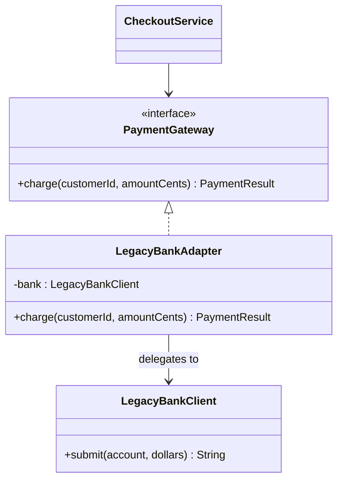
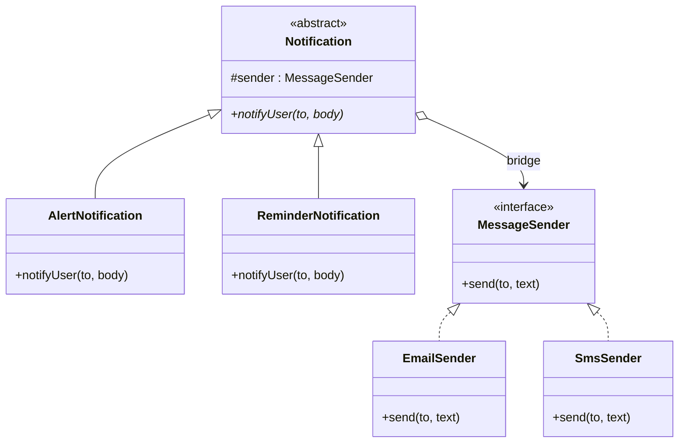
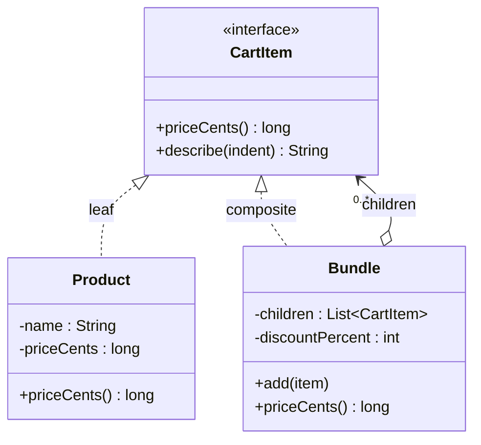
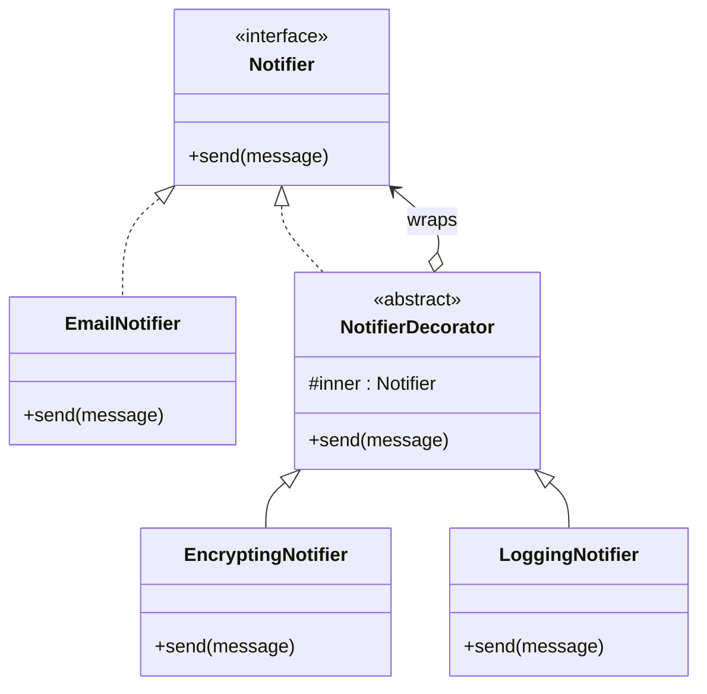
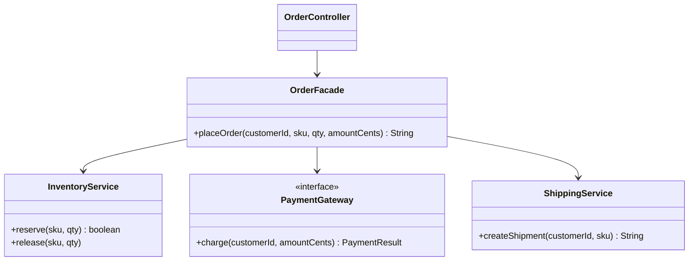
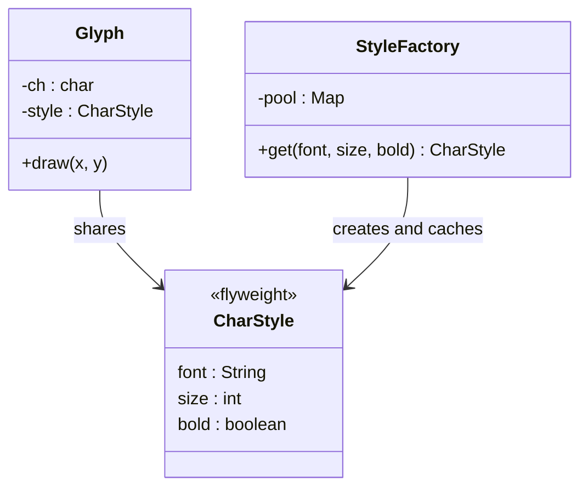
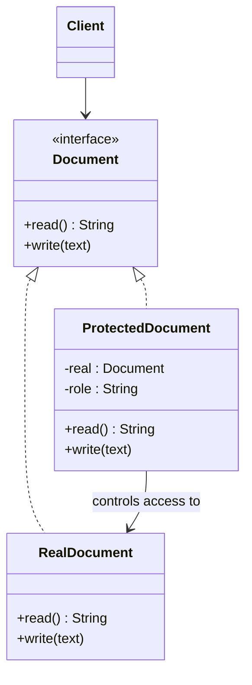

# Structural Design Patterns

A structural pattern describes how to compose classes and objects into larger structures. This page covers the seven structural patterns of the Gang of Four (GoF) catalog: Adapter, Bridge, Composite, Decorator, Facade, Flyweight, and Proxy. Each pattern has its own block under [How It Works](#how-it-works).

## Why It Matters

LLD interviews ask structural patterns in two ways. The first way is a direct question: "What is the difference between Adapter, Decorator, Facade, and Proxy?" The second way is a design problem, where the interviewer expects you to pick a pattern without a hint: Composite for a file system, Decorator for a pricing or notification pipeline, Facade for a checkout flow, Proxy for access control or lazy loading. On the job, you meet these patterns in the JDK (`java.io`, `java.lang.reflect.Proxy`, `Integer.valueOf`) and in frameworks such as Spring, where proxies add transactions and security to your beans. The four patterns that wrap another object look similar in code, so the questions test whether you know the intent of each one, not only its shape.

## Core Concepts

**Structural pattern**: a reusable arrangement of classes and objects that gives a larger structure a defined shape. Structural patterns deal with how types relate. Creational patterns deal with how objects are made, and behavioral patterns deal with how objects communicate. See [creational patterns](06-creational-patterns.md) and [behavioral patterns](08-behavioral-patterns.md).

**Intent**: the problem that a pattern solves, stated in one sentence. Two patterns can have the same class diagram and a different intent. The intent is the part that you must remember.

**Wrapper** (also called a delegating object): an object that holds a reference to another object and forwards calls to it. Adapter, Decorator, Facade, and Proxy are all wrappers. They differ in what the wrapper does with the call.

**Delegation**: an object handles a request by passing it to a second object. The caller does not see the second object. Delegation is the mechanism behind all four wrapper patterns. See [OOP](01-oop.md) for composition versus inheritance.

**Intrinsic state and extrinsic state**: terms for the Flyweight pattern. Intrinsic state is data that is the same for many objects, so objects can share it. Extrinsic state is data that differs for each use, so the caller passes it in.

**Subject, real subject, proxy**: terms for the Proxy pattern. The subject is the common interface. The real subject is the object that does the work. The proxy stands in for the real subject and has the same interface.

**Composition over inheritance**: the design rule that a class gets behavior by holding other objects, not by extending a parent class. Every pattern on this page applies this rule. The [design principles page](03-design-principles.md) and the [SOLID page](02-solid.md) cover the rule and the Open-Closed Principle that it supports.

### Pattern Summary

| Pattern | Intent in one sentence | Wrapper? | Interface of the wrapper |
|---|---|---|---|
| Adapter | Make an existing class fit an interface that the client expects | Yes | A different interface from the wrapped object |
| Bridge | Split an abstraction from its implementation so that both vary on their own | Holds an implementor | Abstraction and implementor have separate interfaces |
| Composite | Treat one object and a group of objects through the same interface | Holds children | Same as the children |
| Decorator | Add behavior to one object at run time, without changing its class | Yes | Same as the wrapped object |
| Facade | Give a simple interface to a group of classes | Holds many objects | A new, smaller interface |
| Flyweight | Share the common state of many small objects to save memory | No | The flyweight interface, with extrinsic state as arguments |
| Proxy | Control access to an object | Yes | Same as the wrapped object |

## How It Works

Each block below has the same parts: intent, problem, structure, Java code, when to use, when not to use, and JDK or framework examples. The code uses an order system, a payment flow, and a document editor. Where a wrong form and a right form exist, both compile.

### Adapter

**Intent**: convert the interface of a class into the interface that the client expects. The adapter lets classes work together that could not work together because their interfaces do not match.

**Problem**: your checkout code depends on a `PaymentGateway` interface. A legacy bank library has a `LegacyBankClient` class with a different method name, different units (dollars as a `double`, not cents as a `long`), and a different result type. You cannot change the library. If checkout calls the library directly, every caller repeats the unit conversion, and you cannot replace the library without changing every caller.

The wrong form calls the library from the business code.

```java
class WrongAdapterDemo {
    public static void main(String[] args) {
        System.out.println(new CheckoutService().payForOrder("c-1", 2599));
    }
}

class LegacyBankClient {
    // Returns "OK-<account>" on success and "ERR" on failure.
    String submit(String account, double dollars) {
        return dollars > 0 ? "OK-" + account : "ERR";
    }
}

class CheckoutService {
    private final LegacyBankClient bank = new LegacyBankClient();

    boolean payForOrder(String customerId, long amountCents) {
        // Unit conversion and result parsing sit inside business logic.
        String result = bank.submit(customerId, amountCents / 100.0);
        return result.startsWith("OK-");
    }
}
```

The problem: `CheckoutService` knows the legacy API. A second payment provider needs a second copy of this logic or an `if` on the provider type.

**Structure (object adapter)**



**Object adapter** holds an instance of the adapted class and delegates to it. **Class adapter** extends the adapted class and implements the target interface, so it is one object. Java has single inheritance for classes, so a class adapter works only if the target is an interface, as in this example.

```java
class AdapterDemo {
    public static void main(String[] args) {
        PaymentGateway viaObject = new LegacyBankAdapter(new LegacyBankClient());
        PaymentGateway viaClass = new LegacyBankClassAdapter();
        System.out.println(viaObject.charge("c-1", 2599));
        System.out.println(viaClass.charge("c-2", 0));
    }
}

record PaymentResult(boolean success, String reference) {}

interface PaymentGateway {
    PaymentResult charge(String customerId, long amountCents);
}

class LegacyBankClient {
    String submit(String account, double dollars) {
        return dollars > 0 ? "OK-" + account : "ERR";
    }
}

// Object adapter: holds the legacy client and delegates.
class LegacyBankAdapter implements PaymentGateway {
    private final LegacyBankClient bank;

    LegacyBankAdapter(LegacyBankClient bank) {
        this.bank = bank;
    }

    @Override
    public PaymentResult charge(String customerId, long amountCents) {
        String raw = bank.submit(customerId, amountCents / 100.0);
        boolean ok = raw.startsWith("OK-");
        return new PaymentResult(ok, ok ? raw.substring(3) : null);
    }
}

// Class adapter: is a legacy client and a gateway at the same time.
class LegacyBankClassAdapter extends LegacyBankClient implements PaymentGateway {
    @Override
    public PaymentResult charge(String customerId, long amountCents) {
        String raw = submit(customerId, amountCents / 100.0);
        boolean ok = raw.startsWith("OK-");
        return new PaymentResult(ok, ok ? raw.substring(3) : null);
    }
}
```

Trade-off between the two forms: the object adapter can wrap a subclass of the adapted class and can be built at run time with any instance. The class adapter exposes the legacy methods to the client, because the class inherits them, and it cannot adapt a `final` class. Prefer the object adapter in Java.

**When to use**

- You must use a class that you cannot change (a library, a legacy module, a generated client) and its interface does not match yours.
- You want one interface for several third-party providers (payment, SMS, storage).

**When not to use**

- You own both sides. Change one interface so that they match.
- The interfaces differ so much that the adapter holds business logic. Then the adapter is a service, and you should name it and test it as one.

**JDK and framework examples**

- `java.util.Arrays.asList(T...)` adapts an array to the `List` interface. The list writes through to the array.
- `java.io.InputStreamReader` adapts a byte stream (`InputStream`) to a character stream (`Reader`). Its javadoc calls it a "bridge from byte streams to character streams", but its structure is an adapter: it converts one interface to another.
- `java.util.concurrent.Executors.callable(Runnable)` adapts a `Runnable` to a `Callable<Object>` that returns `null`.
- `java.util.Enumeration.asIterator()` (since Java 9) adapts the legacy `Enumeration` to `Iterator`.
- Spring MVC uses `HandlerAdapter` to call different kinds of handler (controllers) through one interface.

### Bridge

**Intent**: decouple an abstraction from its implementation so that the two can vary independently.

**Problem**: a notification system has two dimensions. The first is the kind of notification: alert, reminder. The second is the channel: email, SMS. If you model both with inheritance, you need one class per combination: `EmailAlert`, `SmsAlert`, `EmailReminder`, `SmsReminder`. A new channel adds one class for each kind. A new kind adds one class for each channel. With `k` kinds and `c` channels you write `k × c` classes.

The wrong form uses one inheritance tree for both dimensions.

```java
class WrongBridgeDemo {
    public static void main(String[] args) {
        new SmsReminder().notifyUser("+91-90000-00000", "Payment due");
    }
}

abstract class Notification {
    abstract void notifyUser(String to, String body);
}

class EmailAlert extends Notification {
    void notifyUser(String to, String body) {
        System.out.println("EMAIL to " + to + ": [ALERT] " + body);
    }
}

class SmsAlert extends Notification {
    void notifyUser(String to, String body) {
        System.out.println("SMS to " + to + ": [ALERT] " + body);
    }
}

class EmailReminder extends Notification {
    void notifyUser(String to, String body) {
        System.out.println("EMAIL to " + to + ": [REMINDER] " + body);
    }
}

class SmsReminder extends Notification {
    void notifyUser(String to, String body) {
        System.out.println("SMS to " + to + ": [REMINDER] " + body);
    }
}
```

The problem: the class count multiplies, and the "alert" formatting repeats in every channel class.

**Structure**



The `Notification` hierarchy is the abstraction. The `MessageSender` hierarchy is the implementation. The field `sender` is the bridge between them. With `k` kinds and `c` channels you write `k + c` classes.

```java
class BridgeDemo {
    public static void main(String[] args) {
        Notification a = new AlertNotification(new EmailSender());
        Notification r = new ReminderNotification(new SmsSender());
        a.notifyUser("ana@example.com", "Payment failed");
        r.notifyUser("+91-90000-00000", "Payment due");
    }
}

interface MessageSender {
    void send(String to, String text);
}

class EmailSender implements MessageSender {
    public void send(String to, String text) {
        System.out.println("EMAIL to " + to + ": " + text);
    }
}

class SmsSender implements MessageSender {
    public void send(String to, String text) {
        System.out.println("SMS to " + to + ": " + text);
    }
}

abstract class Notification {
    protected final MessageSender sender;

    Notification(MessageSender sender) {
        this.sender = sender;
    }

    abstract void notifyUser(String to, String body);
}

class AlertNotification extends Notification {
    AlertNotification(MessageSender sender) {
        super(sender);
    }

    void notifyUser(String to, String body) {
        sender.send(to, "[ALERT] " + body);
    }
}

class ReminderNotification extends Notification {
    ReminderNotification(MessageSender sender) {
        super(sender);
    }

    void notifyUser(String to, String body) {
        sender.send(to, "[REMINDER] " + body);
    }
}
```

**When to use**

- A class varies in two independent dimensions, and you would otherwise build a class for each combination.
- You must switch the implementation at run time (the same notification, a different channel).
- You want to hide the implementation from clients, so that a change in it does not force a recompile of the clients.

**When not to use**

- The class varies in one dimension only. Use a plain interface and implementations.
- The implementation never changes. The extra layer then costs readability and gives nothing.

**JDK and framework examples**

- JDBC is a commonly cited example. The `java.sql` interfaces (`Connection`, `Statement`) are the abstraction that your code uses, and each database vendor supplies the implementation as a driver. This label comes from the pattern literature, not from the JDBC specification, and the fit is loose: the abstraction side is a set of interfaces, not a hierarchy of refined abstractions.
- SLF4J (the logging API) and its backends (called bindings before SLF4J 2.0 and providers since 2.0, for example Logback or the Log4j 2 provider) split an API from its implementation in the same way. SLF4J describes itself as a facade. It has no hierarchy of refined abstractions, so by the two-hierarchy test of this page it is closer to a plain service-provider interface than to a full Bridge. One structure can carry more than one intent label.

### Composite

**Intent**: compose objects into tree structures to represent part-whole hierarchies. Composite lets clients treat a single object and a group of objects through the same interface.

**Problem**: a shopping cart holds products and product bundles. A bundle holds products or other bundles, and has its own discount. The price code must work for a product, for a bundle, and for a bundle inside a bundle. Without a common interface the client checks the type of each element with `instanceof` and writes a recursive method by hand.

**Structure**



```java
import java.util.ArrayList;
import java.util.List;

class CompositeDemo {
    public static void main(String[] args) {
        Bundle gaming = new Bundle("Gaming kit", 10)
                .add(new Product("Mouse", 2000))
                .add(new Product("Keyboard", 3000))
                .add(new Bundle("Cables", 0)
                        .add(new Product("HDMI", 500))
                        .add(new Product("USB", 500)));
        System.out.print(gaming.describe(""));
        System.out.println("Total: " + gaming.priceCents());
    }
}

interface CartItem {
    long priceCents();

    String describe(String indent);
}

record Product(String name, long priceCents) implements CartItem {
    public String describe(String indent) {
        return indent + name + " " + priceCents + "\n";
    }
}

class Bundle implements CartItem {
    private final String name;
    private final int discountPercent;
    private final List<CartItem> children = new ArrayList<>();

    Bundle(String name, int discountPercent) {
        this.name = name;
        this.discountPercent = discountPercent;
    }

    Bundle add(CartItem item) {
        children.add(item);
        return this;
    }

    public long priceCents() {
        long sum = 0;
        for (CartItem child : children) {
            sum += child.priceCents(); // The same call works for leaf and composite.
        }
        return sum * (100 - discountPercent) / 100;
    }

    public String describe(String indent) {
        StringBuilder sb = new StringBuilder(indent + name + " (-" + discountPercent + "%) "
                + priceCents() + "\n");
        for (CartItem child : children) {
            sb.append(child.describe(indent + "  "));
        }
        return sb.toString();
    }
}
```

**Design choice: transparent or safe.** In the transparent form, the interface declares `add` and `remove`, so a leaf must implement them (usually by throwing `UnsupportedOperationException`). Clients treat all nodes the same, and they lose type safety. In the safe form, only the composite declares `add` and `remove`, as above. Clients that build the tree use the `Bundle` type, and clients that only read it use `CartItem`. This page uses the safe form. Recommendation: use the safe form in Java, because the compiler then rejects `add` on a leaf.

Other design points:

- A child can know its parent (a `parent` reference). This helps with operations that walk upward, such as "full path of a file", and it adds the duty to keep the reference correct when you move a node.
- Guard against cycles. A bundle that contains itself causes infinite recursion.
- If an operation runs often on a large tree, cache the result and invalidate it when a child changes.

**When to use**

- The domain is a tree: file system (file and directory), UI components, organization chart, menu, expression tree, bundle pricing.
- Clients must ignore the difference between one item and a group.

**When not to use**

- The structure is flat, or it is a graph with shared children that have several parents. Composite assumes a tree.
- Leaves and composites have so little in common that a shared interface has only empty or throwing methods.

**JDK and framework examples**

- `java.awt.Container` is a `Component` that holds other `Component` objects. In AWT, `add(Component)` is declared on `Container`, not on `Component`, which is the safe form. Swing changes this: `javax.swing.JComponent` extends `Container`, so every Swing component, even a `JButton`, has `add`. Swing is therefore close to the transparent form.
- The case study on an in-memory file system (`kb/lld/case-studies/14-in-memory-file-system/README.md`) uses Composite.

### Decorator

**Intent**: attach additional responsibilities to an object dynamically. Decorators are a flexible alternative to subclassing for extending behavior.

**Problem**: an order system sends notifications. Some notifications need encryption. Some need compression. Some need an audit log. Any combination can occur. If you add each feature by subclassing, you need a class for each combination.

The wrong form: inheritance explosion.

```java
class WrongDecoratorDemo {
    public static void main(String[] args) {
        new LoggedEncryptedEmailNotifier().send("Order shipped");
    }
}

interface Notifier {
    void send(String message);
}

class EmailNotifier implements Notifier {
    public void send(String message) {
        System.out.println("EMAIL: " + message);
    }
}

class EncryptedEmailNotifier extends EmailNotifier {
    public void send(String message) {
        super.send(new StringBuilder(message).reverse().toString()); // toy encryption
    }
}

class LoggedEmailNotifier extends EmailNotifier {
    public void send(String message) {
        System.out.println("LOG: sending");
        super.send(message);
    }
}

// The combination needs a new class. With n features you need up to 2^n classes.
class LoggedEncryptedEmailNotifier extends EncryptedEmailNotifier {
    public void send(String message) {
        System.out.println("LOG: sending");
        super.send(message);
    }
}
```

The problems: with `n` independent features you can need up to `2^n` subclasses. The order of features is fixed at compile time. A caller cannot add a feature to one object at run time.

**Structure**



A decorator implements the same interface as the object that it wraps, and it holds a reference to that object. Each decorator does its own work before or after the call to the wrapped object.

```java
class DecoratorDemo {
    public static void main(String[] args) {
        Notifier plain = new EmailNotifier();
        Notifier secure = new LoggingNotifier(new EncryptingNotifier(plain));
        plain.send("Order shipped");
        secure.send("Order shipped");
    }
}

interface Notifier {
    void send(String message);
}

class EmailNotifier implements Notifier {
    public void send(String message) {
        System.out.println("EMAIL: " + message);
    }
}

abstract class NotifierDecorator implements Notifier {
    protected final Notifier inner;

    NotifierDecorator(Notifier inner) {
        this.inner = inner;
    }
}

class EncryptingNotifier extends NotifierDecorator {
    EncryptingNotifier(Notifier inner) {
        super(inner);
    }

    public void send(String message) {
        inner.send(new StringBuilder(message).reverse().toString()); // toy encryption
    }
}

class LoggingNotifier extends NotifierDecorator {
    LoggingNotifier(Notifier inner) {
        super(inner);
    }

    public void send(String message) {
        System.out.println("LOG: sending " + message.length() + " characters");
        inner.send(message);
    }
}
```

Now `n` features cost `n` classes. The caller picks the combination and the order at run time. The order matters: `new LoggingNotifier(new EncryptingNotifier(x))` logs the plain message, and `new EncryptingNotifier(new LoggingNotifier(x))` logs the encrypted one.

**Java I/O streams are the standard JDK example.** `FilterInputStream` and `FilterOutputStream` are the base decorators. `BufferedInputStream`, `DataInputStream`, `GZIPOutputStream`, and `CipherInputStream` wrap another stream and add a feature. The `InputStream` and `OutputStream` types are the shared interface.

```java
import java.io.BufferedOutputStream;
import java.io.ByteArrayInputStream;
import java.io.ByteArrayOutputStream;
import java.io.DataInputStream;
import java.io.DataOutputStream;
import java.io.IOException;
import java.util.zip.GZIPInputStream;
import java.util.zip.GZIPOutputStream;

class IoDecoratorDemo {
    public static void main(String[] args) throws IOException {
        ByteArrayOutputStream sink = new ByteArrayOutputStream();
        // Chain: DataOutputStream -> BufferedOutputStream -> GZIPOutputStream -> sink.
        try (DataOutputStream out = new DataOutputStream(
                new BufferedOutputStream(new GZIPOutputStream(sink)))) {
            out.writeUTF("order-1001");
            out.writeInt(42);
        } // Closing the outer stream flushes and closes every stream in the chain.

        try (DataInputStream in = new DataInputStream(
                new GZIPInputStream(new ByteArrayInputStream(sink.toByteArray())))) {
            System.out.println(in.readUTF() + " " + in.readInt());
        }
    }
}
```

Each stream adds one feature: typed writes (`DataOutputStream`), a buffer (`BufferedOutputStream`), compression (`GZIPOutputStream`). The order is a design decision. Here the buffer sits above the compressor, so the many small writes of `writeUTF` and `writeInt` reach the compressor in large chunks. `GZIPOutputStream` has its own buffer for the compressed bytes. If you swap two streams, the program can still run but do different work: for example, encryption before compression leaves almost nothing to compress, because encrypted bytes look random.

**Decorator versus inheritance.** Inheritance fixes behavior when you write the class. Decorator chooses behavior when you build the object. Inheritance gives one object type per combination. Decorator gives one wrapper per feature. Decorator has costs too: a chain of many small objects is harder to debug, identity checks (`==`, `instanceof`) see the outer wrapper, and a decorator cannot reach members of the wrapped class that the shared interface does not declare.

**When to use**

- You add responsibilities to single objects, not to a whole class, and you can remove them again.
- Subclassing would produce too many classes, or the class is `final`.
- The features combine in any order or any subset (stream filters, pricing rules such as tax and coupon, cross-cutting wrappers such as retry, cache, and metrics).

**When not to use**

- The features have a fixed combination. A plain subclass or one class with a flag is shorter.
- The interface is large. Each decorator must forward every method, and this is long code (a base decorator class reduces it).
- Code depends on the concrete type of the object.

**JDK and framework examples**

- `java.io`: `FilterInputStream`, `BufferedInputStream`, `DataInputStream`, `GZIPInputStream`, `BufferedReader` over `InputStreamReader`.
- `java.util.Collections.unmodifiableList(List)`, `synchronizedList(List)`, and `checkedList(List, Class)` return a wrapper with the same `List` interface and an added rule (read-only, locking, type checks). These wrappers are decorators in structure. The unmodifiable wrapper is also close to a protection proxy, because it rejects writes. One structure can carry two pattern names, and the intent decides which name fits.
- Jakarta Servlet `HttpServletRequestWrapper` wraps a request so that a filter can change what the rest of the chain sees. Its javadoc states: "This class implements the Wrapper or Decorator pattern."

### Facade

**Intent**: give a single, simple interface to a set of interfaces in a subsystem. A facade makes the subsystem easier to use.

**Problem**: to place an order, the caller must check stock, reserve it, charge the payment, and create a shipment. The caller must call four services in the correct order and undo the earlier steps if a later step fails. Every controller and every batch job repeats this code, and each copy can get the order wrong.

**Structure**



```java
import java.util.HashMap;
import java.util.Map;

class FacadeDemo {
    public static void main(String[] args) {
        PaymentGateway fake = (customer, cents) ->
                new PaymentResult(cents > 0, "ref-" + customer);
        OrderFacade facade = new OrderFacade(new InventoryService(), fake, new ShippingService());
        System.out.println(facade.placeOrder("c-1", "sku-1", 2, 2599));
        System.out.println(facade.placeOrder("c-1", "sku-1", 9, 2599));
        System.out.println(facade.placeOrder("c-1", "sku-1", 1, 0));
    }
}

record PaymentResult(boolean success, String reference) {}

interface PaymentGateway {
    PaymentResult charge(String customerId, long amountCents);
}

class InventoryService {
    private final Map<String, Integer> stock = new HashMap<>(Map.of("sku-1", 5));

    boolean reserve(String sku, int qty) {
        int have = stock.getOrDefault(sku, 0);
        if (have < qty) {
            return false;
        }
        stock.put(sku, have - qty);
        return true;
    }

    void release(String sku, int qty) {
        stock.merge(sku, qty, Integer::sum);
    }
}

class ShippingService {
    String createShipment(String customerId, String sku) {
        return "SHIP-" + customerId + "-" + sku;
    }
}

class OrderFacade {
    private final InventoryService inventory;
    private final PaymentGateway payments;
    private final ShippingService shipping;

    OrderFacade(InventoryService inventory, PaymentGateway payments, ShippingService shipping) {
        this.inventory = inventory;
        this.payments = payments;
        this.shipping = shipping;
    }

    /** One call hides four steps and the undo rule. */
    String placeOrder(String customerId, String sku, int qty, long amountCents) {
        if (!inventory.reserve(sku, qty)) {
            return "REJECTED: out of stock";
        }
        PaymentResult result = payments.charge(customerId, amountCents);
        if (!result.success()) {
            inventory.release(sku, qty); // Undo the reservation.
            return "REJECTED: payment failed";
        }
        return shipping.createShipment(customerId, sku);
    }
}
```

A facade does not hide the subsystem. Clients that need more control can still call `InventoryService` directly. A facade also does not add new behavior to the subsystem: it coordinates calls that already exist. If the facade holds business rules of its own, it has become a service (an application service in a layered design, see [architectural patterns](10-architectural-patterns.md)).

**Risk: the facade becomes a god object.** If you add every operation of the subsystem to one facade, the facade has many reasons to change and many dependencies. See [anti-patterns](11-anti-patterns.md). Split it by use case: `OrderFacade`, `ReturnsFacade`.

**When to use**

- A subsystem is complex or has many classes, and most clients need only a few common flows.
- You want a layer boundary: for example, the web layer calls one entry point per use case.
- You want to reduce the number of classes that a client depends on, which lowers coupling.

**When not to use**

- The subsystem has one class or one simple method. A facade over it is a pass-through that adds an indirection.
- Clients need the full flexibility of the subsystem. Give them the subsystem.

**JDK and framework examples**

- SLF4J presents itself as a "Simple Logging Facade for Java": one API over several logging frameworks.
- Spring's `JdbcTemplate` gives one call for the repeated sequence "get connection, create statement, run, map rows, close, translate exceptions". Its javadoc calls it "the central delegate in the JDBC core package" and a "template class", and the class works through callbacks such as `RowMapper`. The same javadoc calls `JdbcClient` (since Spring 6.1) "a more focused and convenient facade" on top of it.
- `java.net.http.HttpClient` gives one entry point over connection management, HTTP versions, and redirects. This is an assessment by structure, and the JDK documentation does not label it a facade.

### Flyweight

**Intent**: use sharing to support a large number of fine-grained objects efficiently.

**Problem**: a document editor shows a text of 100,000 characters. If each character is an object that stores its own font name, size, and bold flag, the editor holds 100,000 copies of nearly the same data. Most characters share a few styles.

**Structure**



The intrinsic state (font, size, bold) lives in the shared `CharStyle`. The extrinsic state (the position `x`, `y`) is not stored. The caller passes it to `draw`.

```java
import java.util.ArrayList;
import java.util.HashMap;
import java.util.List;
import java.util.Map;

class FlyweightDemo {
    public static void main(String[] args) {
        StyleFactory styles = new StyleFactory();
        List<Glyph> text = new ArrayList<>();
        String content = "Structural patterns";
        for (int i = 0; i < content.length(); i++) {
            boolean heading = i < 10;
            CharStyle style = heading ? styles.get("Serif", 18, true)
                                      : styles.get("Serif", 12, false);
            text.add(new Glyph(content.charAt(i), style));
        }
        System.out.println(text.size() + " glyphs, " + styles.poolSize() + " styles");
        System.out.println(text.get(0).draw(0, 0));
        System.out.println(text.get(12).draw(120, 0));
    }
}

record CharStyle(String font, int size, boolean bold) {}

class StyleFactory {
    private final Map<CharStyle, CharStyle> pool = new HashMap<>();

    CharStyle get(String font, int size, boolean bold) {
        // Return the pooled instance if an equal one exists.
        return pool.computeIfAbsent(new CharStyle(font, size, bold), key -> key);
    }

    int poolSize() {
        return pool.size();
    }
}

class Glyph {
    private final char ch;
    private final CharStyle style; // shared, immutable

    Glyph(char ch, CharStyle style) {
        this.ch = ch;
        this.style = style;
    }

    String draw(int x, int y) { // x and y are extrinsic state
        return ch + "@" + x + "," + y + " " + style.font() + " " + style.size();
    }
}
```

Flyweight needs two rules. The shared state must be **immutable**, because a change by one user would change every user (the record guarantees this). Creation must go **through the factory**, because a public constructor lets callers bypass the pool. If the pool is shared between threads, it needs a thread-safe map (see [concurrency in LLD](09-concurrency-in-lld.md)).

**The `Integer.valueOf` cache is the JDK example.** The javadoc of `Integer.valueOf(int)` says that the method "will always cache values in the range -128 to 127, inclusive, and may cache other values outside of this range". The same range applies to `Byte`, `Short`, and `Long` (-128 to 127) and `Character` (0 to 127), and `Boolean.valueOf` returns two shared instances. Because of the cache, `==` on boxed values gives a result that depends on the value. Use `equals`.

```java
Integer a = Integer.valueOf(127);
Integer b = Integer.valueOf(127);
System.out.println(a == b);       // true: the cache range is guaranteed
Integer c = Integer.valueOf(1000);
Integer d = Integer.valueOf(1000);
System.out.println(c.equals(d));  // true: compare values with equals
// c == d is unspecified for values outside the guaranteed range.
```

`String.intern()` is a second JDK example: it returns one canonical instance for each distinct string value. Note that `Integer.valueOf` shows the sharing idea, but it does not separate intrinsic from extrinsic state, because an `Integer` has only intrinsic state.

**When to use**

- The program creates a very large number of objects, memory is the measured limit, and most of the state of each object can be shared.
- Objects with the same intrinsic state are interchangeable.

**When not to use**

- You have not measured a memory problem. Flyweight adds a factory, immutability rules, and the extrinsic-state plumbing.
- The objects have mostly unique state. Nothing is left to share.
- The object count is small. A few hundred objects cost less than the pattern does.

**JDK and framework examples**

- `Integer.valueOf`, `Long.valueOf`, `Character.valueOf`, `Boolean.valueOf`, `Byte.valueOf`, and `Short.valueOf`.
- `String.intern()` and the string literal pool.
- Game engines and UI toolkits share tile, sprite, and glyph data in the same way.

### Proxy

**Intent**: provide a surrogate or placeholder for another object, to control access to it.

**Problem**: a client uses an object through an interface, and you need to control the access without the client changing. The reason decides the proxy type:

| Proxy type | Control that it adds | Example |
|---|---|---|
| Virtual proxy | Delay a costly creation until the first use | Load a large image on `display()` |
| Protection proxy | Check the permission of the caller | Allow `write` only for the `EDITOR` role |
| Caching proxy | Keep results of costly calls | Cache exchange rates for a minute |
| Remote proxy | Represent an object in another process or machine | An RMI stub, a gRPC client stub |
| Logging or smart proxy | Count, log, or time calls, or manage a lock or a transaction | Spring `@Transactional` |

**Structure**



The proxy and the real subject implement the same interface. The client cannot tell them apart.

**Virtual proxy and protection proxy in code**

```java
class ProxyDemo {
    public static void main(String[] args) {
        Image image = new LazyImage("/img/cover.png"); // nothing loads here
        System.out.println("created proxy");
        System.out.println(image.display());           // loads now
        System.out.println(image.display());           // does not load again

        Document viewer = new ProtectedDocument(new RealDocument(), "VIEWER");
        System.out.println(viewer.read());
        try {
            viewer.write("new text");
        } catch (SecurityException e) {
            System.out.println("denied: " + e.getMessage());
        }
    }
}

interface Image {
    String display();
}

class RealImage implements Image {
    private final String path;

    RealImage(String path) {
        this.path = path;
        System.out.println("loading " + path); // costly work
    }

    public String display() {
        return "showing " + path;
    }
}

// Virtual proxy: creates the real image on the first call.
class LazyImage implements Image {
    private final String path;
    private RealImage real;

    LazyImage(String path) {
        this.path = path;
    }

    public String display() {
        if (real == null) {
            real = new RealImage(path);
        }
        return real.display();
    }
}

interface Document {
    String read();

    void write(String text);
}

class RealDocument implements Document {
    private String content = "draft";

    public String read() {
        return content;
    }

    public void write(String text) {
        content = text;
    }
}

// Protection proxy: checks the role before it delegates.
class ProtectedDocument implements Document {
    private final Document real;
    private final String role;

    ProtectedDocument(Document real, String role) {
        this.real = real;
        this.role = role;
    }

    public String read() {
        return real.read();
    }

    public void write(String text) {
        if (!role.equals("EDITOR")) {
            throw new SecurityException("role " + role + " cannot write");
        }
        real.write(text);
    }
}
```

The `LazyImage` code is not thread-safe: two threads can both see `real == null`. Add synchronization or a holder if threads share the proxy.

**Caching proxy.** The same shape applies: the proxy keeps a map from the argument to the result and calls the real subject only on a miss. The dynamic proxy below shows this with a handler.

**Remote proxy.** The proxy is a local object that hides the network: it serializes the call, sends it, waits for the reply, and returns it or throws an exception for a network failure. Java RMI stubs and generated gRPC client stubs have this role. The client calls a local method and cannot see the network, which is the benefit and also the danger: a remote call can fail and takes far longer than a local call.

**JDK dynamic proxies (`java.lang.reflect.Proxy`).** A hand-written proxy needs one class for each interface. The JDK can generate the proxy class at run time. You call `Proxy.newProxyInstance(loader, interfaces, handler)`. The returned object implements the listed interfaces, and every method call on it goes to `handler.invoke(proxy, method, args)`. Limits, from the javadoc: the arguments must be interfaces (not classes), so a JDK proxy cannot proxy a concrete class. Calls to `hashCode`, `equals`, and `toString` on the proxy also go to the handler.

```java
import java.util.Arrays;
import java.util.HashMap;
import java.util.Map;
import java.lang.reflect.InvocationHandler;
import java.lang.reflect.InvocationTargetException;
import java.lang.reflect.Proxy;

class DynamicProxyDemo {
    @SuppressWarnings("unchecked")
    static <T> T wrap(Class<T> type, T target) {
        return (T) Proxy.newProxyInstance(
                type.getClassLoader(),
                new Class<?>[] {type},
                new CachingLoggingHandler(target));
    }

    public static void main(String[] args) {
        ReportService service = wrap(ReportService.class, new SlowReportService());
        System.out.println(service.generate("Q3"));
        System.out.println(service.generate("Q3"));
        try {
            service.generate("");
        } catch (IllegalArgumentException e) {
            System.out.println("caught: " + e.getMessage());
        }
    }
}

interface ReportService {
    String generate(String reportId);
}

class SlowReportService implements ReportService {
    public String generate(String reportId) {
        if (reportId.isEmpty()) {
            throw new IllegalArgumentException("empty report id");
        }
        return "report:" + reportId;
    }
}

// One handler adds logging and a cache to any interface.
class CachingLoggingHandler implements InvocationHandler {
    private final Object target;
    private final Map<String, Object> cache = new HashMap<>();

    CachingLoggingHandler(Object target) {
        this.target = target;
    }

    @Override
    public Object invoke(Object proxy, java.lang.reflect.Method method, Object[] args)
            throws Throwable {
        String key = method.getName() + Arrays.toString(args);
        if (cache.containsKey(key)) {
            System.out.println("cache hit: " + key);
            return cache.get(key);
        }
        System.out.println("calling: " + key);
        try {
            Object result = method.invoke(target, args);
            cache.put(key, result);
            return result;
        } catch (InvocationTargetException e) {
            throw e.getCause(); // Rethrow the exception of the real method.
        }
    }
}
```

Two details matter in the handler. First, `method.invoke` wraps an exception from the real method in `InvocationTargetException`. That exception is checked, and the interface method does not declare it. If the handler lets it escape, the proxy wraps it again in an `UndeclaredThrowableException`, so the caller never sees the original `IllegalArgumentException`. The handler must throw `getCause()`. Second, this handler is not thread-safe, because it uses a plain `HashMap`.

Frameworks use the same idea at a larger scale. Spring AOP wraps beans in proxies to add transactions, security checks, and caching. The Spring reference says that Spring AOP uses a JDK dynamic proxy if the target implements at least one interface, and a CGLIB proxy (a generated subclass) if it does not, and that Spring Boot can enable class-based proxies by default. A known limit of proxy-based AOP: a call from one method to another method on the same object (`this.other()`) does not pass through the proxy, so the added behavior does not run. Hibernate uses generated proxy subclasses for lazy-loaded entity references, for example the object that `Session.getReference` returns.

**When to use**

- You need access control, lazy creation, caching, logging, or remote access, and the client must not change.
- The same cross-cutting rule applies to many interfaces (a dynamic proxy or a framework proxy).

**When not to use**

- A direct call is enough. Each proxy adds an indirection, a place for bugs, and a stack frame in every trace.
- The rule belongs in the domain logic. A permission rule that every code path must apply is business logic, and hiding it in a proxy makes the rule hard to find.
- The class is `final` and you have no interface. A JDK proxy needs an interface.

**JDK and framework examples**

- `java.lang.reflect.Proxy` and `InvocationHandler`.
- `java.rmi` stubs (remote proxy). The `Remote` interface marks the subject.
- Spring AOP and `@Transactional`; Hibernate lazy proxies.
- Mocking libraries such as Mockito create test doubles that intercept every call, which is the role of a proxy. The mechanism varies: older Mockito versions generated a subclass, and since Mockito 5 the default inline mock maker changes the bytecode of the mocked class instead.
- `Collections.unmodifiableList` as a protection proxy that rejects writes.

### Why Adapter, Decorator, Facade, and Proxy look alike

Adapter, Decorator, Facade, and Proxy all hold a reference to another object and forward calls. The difference is what the wrapper does with the call and what interface it offers.

| | Adapter | Decorator | Facade | Proxy |
|---|---|---|---|---|
| Interface of the wrapper compared with the wrapped object | Different | The same | New and simpler | The same |
| Number of wrapped objects | One | One | Several | One |
| What the wrapper adds | A translation | New behavior (a feature) | A shortcut over several calls | Control of access |
| Who creates the wrapped object | The client | The client | The facade or the client | Often the proxy |
| Stackable | Rarely | Yes, by design | Rarely | Rarely |

## Trade-offs and When to Use

| Situation | Pattern | Alternative | Why the alternative can be better |
|---|---|---|---|
| A class has the wrong interface and you cannot change it | Adapter | Change the interface | Choose this when you own both sides |
| Two dimensions of variation | Bridge | Strategy for the second dimension | Strategy is simpler if only one algorithm varies and the abstraction is not a hierarchy |
| Tree of items and groups | Composite | A flat list with a type field | A flat structure is enough when nesting never happens |
| Optional features that combine | Decorator | Subclasses; flags; Strategy | Subclasses suit a fixed combination. Flags suit two or three features |
| A complex subsystem with common flows | Facade | Documentation and helper methods | A static helper is enough for one or two flows |
| Millions of similar objects | Flyweight | Primitive arrays; one `byte[]` per row; a database | Measure first, because plain data structures use less memory than any pattern |
| Control access, lazy load, remote call | Proxy | A check inside the class | An inline check is simple when only one class needs it |

Costs of the family as a whole: every wrapper adds a layer of indirection, an extra object, and an extra frame in stack traces. Debuggers show the wrapper type, not the real type. Use a wrapper pattern when its benefit is named. Do not add one "for flexibility".

Recommendation: start with a direct call. Add a structural pattern when you see its trigger: a mismatched interface (Adapter), a class explosion (Bridge, Decorator), a tree (Composite), a repeated multi-step call (Facade), a measured memory problem (Flyweight), a control requirement (Proxy).

## Java Example

The next program joins four patterns in one order flow. An adapter converts the legacy bank API. A decorator adds logging to the payment gateway. A facade offers one call to place an order. A protection proxy limits who can call the facade. Save it as `Demo.java` and run it with `java Demo.java` (Java 21). The source launcher runs the first top-level class in the file, which is `Demo`.

```java
import java.util.HashMap;
import java.util.Map;

class Demo {
    public static void main(String[] args) {
        PaymentGateway gateway = new AuditedGateway(new LegacyBankAdapter(new LegacyBankClient()));
        OrderApi api = new AuthorizedOrderApi(new OrderFacade(gateway));

        System.out.println(api.placeOrder("c-1", "sku-1", 2599));
        System.out.println(api.placeOrder("c-2", "sku-1", 2599));
        try {
            api.placeOrder("guest", "sku-1", 2599);
        } catch (SecurityException e) {
            System.out.println("denied: " + e.getMessage());
        }
    }
}

record PaymentResult(boolean success, String reference) {}

interface PaymentGateway {
    PaymentResult charge(String customerId, long amountCents);
}

class LegacyBankClient {
    String submit(String account, double dollars) {
        return dollars > 0 ? "OK-" + account : "ERR";
    }
}

// Adapter: legacy API to PaymentGateway.
class LegacyBankAdapter implements PaymentGateway {
    private final LegacyBankClient bank;

    LegacyBankAdapter(LegacyBankClient bank) {
        this.bank = bank;
    }

    public PaymentResult charge(String customerId, long amountCents) {
        String raw = bank.submit(customerId, amountCents / 100.0);
        boolean ok = raw.startsWith("OK-");
        return new PaymentResult(ok, ok ? raw.substring(3) : null);
    }
}

// Decorator: adds an audit line to any PaymentGateway.
class AuditedGateway implements PaymentGateway {
    private final PaymentGateway inner;

    AuditedGateway(PaymentGateway inner) {
        this.inner = inner;
    }

    public PaymentResult charge(String customerId, long amountCents) {
        PaymentResult result = inner.charge(customerId, amountCents);
        System.out.println("audit: charge " + amountCents + " for " + customerId
                + " -> " + result.success());
        return result;
    }
}

interface OrderApi {
    String placeOrder(String customerId, String sku, long amountCents);
}

// Facade: one call for the whole flow.
class OrderFacade implements OrderApi {
    private final Map<String, Integer> stock = new HashMap<>(Map.of("sku-1", 1));
    private final PaymentGateway payments;

    OrderFacade(PaymentGateway payments) {
        this.payments = payments;
    }

    public String placeOrder(String customerId, String sku, long amountCents) {
        int have = stock.getOrDefault(sku, 0);
        if (have == 0) {
            return "REJECTED: out of stock";
        }
        PaymentResult result = payments.charge(customerId, amountCents);
        if (!result.success()) {
            return "REJECTED: payment failed";
        }
        stock.put(sku, have - 1);
        return "ORDERED: " + result.reference();
    }
}

// Protection proxy: only customers that start with "c-" may order.
class AuthorizedOrderApi implements OrderApi {
    private final OrderApi real;

    AuthorizedOrderApi(OrderApi real) {
        this.real = real;
    }

    public String placeOrder(String customerId, String sku, long amountCents) {
        if (!customerId.startsWith("c-")) {
            throw new SecurityException("unknown customer " + customerId);
        }
        return real.placeOrder(customerId, sku, amountCents);
    }
}
```

The expected output is:

<!-- expected-output -->

```text
audit: charge 2599 for c-1 -> true
ORDERED: c-1
REJECTED: out of stock
denied: unknown customer guest
```

## Interview Angle

### Questions

??? question "What is the difference between Adapter, Decorator, Facade, and Proxy?"

    All four wrap another object, so the difference is the intent and the interface.

    - **Adapter** changes the interface. The client expects interface A, the wrapped object has interface B, and the adapter translates.
    - **Decorator** keeps the interface and adds behavior. Decorators stack.
    - **Facade** gives a new, smaller interface over several objects in a subsystem.
    - **Proxy** keeps the interface and controls access: lazy creation, permission, caching, or a remote call.

    The deciding question: what does the wrapper change? The interface (Adapter), the behavior (Decorator), the number of things that the client must know (Facade), or who may reach the object and when (Proxy).

??? question "How does Decorator avoid the inheritance explosion? Show the Java I/O example."

    With inheritance, each combination of features is a class. With `n` independent features you can need up to `2^n` subclasses, and the combination is fixed at compile time. With Decorator, each feature is one wrapper class that implements the same interface and holds the wrapped object. The caller builds the combination at run time.

    Java I/O shows this: `new DataInputStream(new BufferedInputStream(new FileInputStream(path)))`. `FileInputStream` reads bytes, `BufferedInputStream` adds a buffer, and `DataInputStream` adds typed reads. All three are `InputStream`. The trade-off: many small objects, and an order that matters. For example, encrypt-then-compress gives almost no compression, because encrypted bytes look random, so you compress first and then encrypt.

??? question "Object adapter or class adapter? Which does Java support?"

    An object adapter holds the adapted object and delegates (composition). A class adapter extends the adapted class and implements the target interface (inheritance). Java supports both, but a class adapter needs the target to be an interface, because a class can extend only one class. A class adapter cannot adapt a `final` class, and it exposes the adapted class methods to clients. The object adapter can wrap any subclass and swap the instance at run time. In Java, use the object adapter by default, and name the reason if you choose the class adapter.

??? question "How is Bridge different from Adapter, and from Strategy?"

    Bridge is a design-time decision: you split an abstraction and its implementation into two hierarchies before the code exists, so that both change independently. Adapter is a repair: it makes two existing, incompatible interfaces fit after the fact. Strategy and Bridge have the same shape (an object holds a reference to an interface). Strategy swaps one algorithm in one class. Bridge connects two hierarchies, where the abstraction side can also have subclasses (alert and reminder notifications) that use the implementor (email or SMS). The deciding question: are there two dimensions of variation, each with its own subclasses?

??? question "Design the classes for a file system with files and folders. Which pattern do you use, and what operations does the interface have?"

    Composite. `FileSystemNode` is the interface with `name()`, `size()`, and `print(indent)`. `File` is the leaf, and `size()` returns its byte count. `Directory` is the composite. It holds a list of `FileSystemNode` and its `size()` is the sum of the children. `add` and `remove` exist only on `Directory` (the safe form), so the compiler rejects `add` on a file. I would add a parent reference if the operations need a path, and I would guard against a directory that contains one of its ancestors. A complete design is in `kb/lld/case-studies/14-in-memory-file-system/README.md`.

??? question "What are intrinsic and extrinsic state in Flyweight? Where does the JDK use the pattern?"

    Intrinsic state is the shared, immutable data that does not depend on the context. Extrinsic state is the data that differs per use, and the caller passes it in. In a text editor, the font, size, and bold flag of a style are intrinsic, and the position of a character is extrinsic. A factory returns one shared instance for each distinct intrinsic state. The JDK example is the `Integer.valueOf` cache: values from -128 to 127 are always cached, according to the javadoc, so `Integer.valueOf(100) == Integer.valueOf(100)` is true. Outside the range the result is not specified, so you compare boxed values with `equals`. `String.intern()` is a second example.

??? question "What are the types of Proxy? Give a use case for each."

    Virtual proxy: delays a costly creation until first use (large image, lazy-loaded entity). Protection proxy: checks the permission of the caller before it delegates. Caching proxy: returns a stored result for a repeated call. Remote proxy: stands for an object in another process and hides the network (RMI stub, gRPC stub). Smart proxy: adds counting, logging, locking, or a transaction (Spring `@Transactional`). All of them implement the same interface as the real subject, so the client code does not change.

??? question "How does `java.lang.reflect.Proxy` work, and what are its limits?"

    `Proxy.newProxyInstance(loader, interfaces, handler)` generates a class at run time that implements the given interfaces. Every call on the proxy goes to `handler.invoke(proxy, method, args)`. The handler can run code before and after, and call `method.invoke(target, args)`. Limits: it proxies only interfaces, so a concrete class needs a different tool such as CGLIB or ByteBuddy, which generate a subclass. A call through reflection costs more than a direct call. The handler must unwrap `InvocationTargetException` to pass the real exception to the caller. Calls to `equals`, `hashCode`, and `toString` also reach the handler.

??? question "Why does `@Transactional` not work when one method calls another method in the same class?"

    Spring implements `@Transactional` with a proxy around the bean. A call from outside goes through the proxy, and the proxy starts the transaction. A call from one method of the bean to another method of the same bean is a plain `this.method()` call. It does not pass through the proxy, so the transaction advice does not run. Fixes: move the called method to another bean, inject a reference to the proxy, or use AspectJ weaving, which does not depend on proxies. This question tests whether you understand that the framework behavior is the Proxy pattern.

??? question "A colleague proposes a `SystemFacade` with all 60 operations of the order, payment, and shipping modules. What is your response?"

    A facade should give a simple interface for the common flows. A facade with 60 operations is a god object: it has many reasons to change, depends on every module, and is hard to test. I would split it by use case (`CheckoutFacade`, `ReturnsFacade`), keep each to the few calls that clients need, and let advanced clients call the modules directly. I would also check that the facade holds no business rules. If it does, the rules move to the domain objects or to an application service.

### Follow-up Questions

??? question "Decorator and Proxy have the same class diagram. How do you tell them apart in code review?"

    Ask what the wrapper is for. A decorator adds a feature that the caller chooses and may stack. The caller builds the chain. A proxy controls access to the object, and often the proxy creates the real object itself, and the client does not know it has a proxy. If the wrapper decides whether, when, or how the real call happens (permission, lazy load, cache, remote), it is a proxy. If it adds work around a call that always happens, it is a decorator.

??? question "How do you add a new channel and a new notification kind in the Bridge example?"

    A new channel is one new class that implements `MessageSender`. A new kind is one new subclass of `Notification`. Neither change touches the other hierarchy. This is the benefit of Bridge: `k + c` classes, not `k × c`.

??? question "How would you make the Flyweight pool thread-safe?"

    Use `ConcurrentHashMap` and `computeIfAbsent`, or lock around the lookup. The shared objects must be immutable, which is already required by the pattern. Do not share a mutable flyweight between threads.

??? question "Where does Composite meet Decorator?"

    Both use recursive composition, and both have a wrapper that implements the same interface. A decorator wraps exactly one object and adds behavior. A composite holds many children and combines their results. A decorator is a degenerate composite with one child, but the intent differs.

### Red Flags

- Describing Adapter, Decorator, and Proxy by the same sentence ("it wraps an object") and giving no difference in intent.
- Using `Foo` and `Bar` for the example, or showing the diagram and not the problem that the pattern solves.
- Saying that a Facade "hides" the subsystem so that nobody can call it directly. The subsystem stays available.
- Using Flyweight for a few objects, or sharing a mutable object.
- Using `==` to compare `Integer` values and claiming that it works.
- Claiming that a JDK dynamic proxy can proxy any class.
- Adding a pattern to a simple problem. For example, a Decorator for a feature that has one fixed combination.
- Naming the Bridge for any use of an interface. The mark of Bridge is two hierarchies.

## Common Mistakes

| Mistake | Why it hurts | Fix |
|---|---|---|
| Adapter that contains business rules | The adapter becomes a hidden service. Tests and reviews miss it | Keep the adapter to translation (names, units, types, errors). Move rules to a domain class |
| Decorator that does not forward every method of the interface | Some calls skip the wrapped object, and the decorator silently loses behavior | Extend a base decorator that forwards each method, and override only what changes |
| Decorator order not documented | Encrypt-then-compress differs from compress-then-encrypt. Encrypted bytes look random, so the wrong order gives almost no compression | Build the chain in one place (a factory) and document the order |
| Composite that allows cycles | A node that contains itself or an ancestor gives a `StackOverflowError` | Check ancestors in `add`, or build trees only through code that prevents cycles |
| Transparent Composite with throwing `add` on leaves | The error appears at run time | Use the safe form in Java: `add` only on the composite |
| Facade that grows to hold all operations | God object with many reasons to change | One facade per use case. Keep business rules out of it |
| Flyweight with mutable shared state | A change by one user changes all users | Make the shared object immutable (a `record`) |
| Flyweight created without a measurement | Extra code and no gain | Profile memory first. Apply the pattern only to the objects that dominate |
| `Integer` compared with `==` | The result depends on the cache range: true for 127, unspecified for 1000 | Compare with `equals`, or unbox |
| Proxy handler that does not unwrap `InvocationTargetException` | The caller gets an `UndeclaredThrowableException`, not the exception of the real method | Unwrap it with `getCause()` and rethrow |
| Dynamic proxy used on a class that has no interface | `Proxy.newProxyInstance` throws `IllegalArgumentException` | Extract an interface, or use a subclass-based proxy library |
| Calling `this.method()` and expecting framework proxy behavior | The call skips the proxy | Call through the proxy (another bean) |
| Calling the Bridge a pattern for any interface use | The design gets an extra layer with no second hierarchy | Use Bridge only for two dimensions of variation |

## Commonly Confused With

| Looks like | Difference | Deciding question |
|---|---|---|
| Adapter vs Facade | Adapter changes one interface to match another and wraps one object. Facade defines a new, simpler interface over several objects | Do I convert an existing interface (Adapter) or simplify a group of interfaces (Facade)? |
| Adapter vs Decorator | Adapter changes the interface. Decorator keeps it and adds behavior | Does the wrapper have the same interface as the wrapped object? |
| Decorator vs Proxy | Decorator adds a feature that the caller stacks. Proxy controls access and often creates the real object | Does the wrapper add a feature (Decorator) or control access (Proxy)? |
| Adapter vs Proxy | Adapter uses a different interface. Proxy uses the same interface | Do the interfaces differ? |
| Bridge vs Adapter | Bridge is a planned split into two hierarchies. Adapter is a later repair of a mismatch | Did I design both sides together (Bridge), or must I fit existing code (Adapter)? |
| Bridge vs Strategy | Both hold a reference to an interface. Strategy varies one algorithm in a class. Bridge links two hierarchies. See [behavioral patterns](08-behavioral-patterns.md) | Does the abstraction side also have subclasses? |
| Composite vs Decorator | Composite holds many children and combines them. Decorator wraps one object and adds behavior | Does the wrapper hold one object or a collection? |
| Flyweight vs Singleton | Flyweight has one instance for each distinct state. Singleton has one instance for the class. See [creational patterns](06-creational-patterns.md) | Do many different shared instances exist, one for each value? |
| Flyweight vs object pool | Flyweight shares immutable objects at the same time. A pool lends a mutable object to one user at a time | Do users share the object concurrently? |
| Facade vs Mediator | Facade is a one-way simple entry to a subsystem. The subsystem does not know the facade. Mediator coordinates objects that talk to each other and know the mediator | Do the subsystem classes call back to the coordinator? |
| Decorator vs Chain of Responsibility | Decorator always forwards and adds work. A chain handler can stop the request | Can a link stop the call and not forward it? |

## Quick Reference Card

| Pattern | Trigger phrase | Key move | JDK example |
|---|---|---|---|
| Adapter | "Existing class, wrong interface" | Wrap it and translate. Prefer the object adapter | `Arrays.asList`, `Executors.callable`, `InputStreamReader` |
| Bridge | "Two dimensions of variation" | Abstraction holds an implementor interface | JDBC drivers (commonly cited, loose fit) |
| Composite | "Tree; treat one and many alike" | Leaf and composite share one interface. Use the safe form | `java.awt.Container` |
| Decorator | "Add features in any combination" | Wrap with the same interface, and stack | `java.io` filter streams, `Collections.unmodifiableList` |
| Facade | "Many calls for one use case" | One entry point for each flow. Do not grow it | SLF4J (name), Spring `JdbcClient` (javadoc calls it a facade) |
| Flyweight | "Millions of similar objects" | Share immutable intrinsic state through a factory | `Integer.valueOf` (-128 to 127), `String.intern()` |
| Proxy | "Control access to an object" | Same interface. Lazy, protect, cache, remote | `java.lang.reflect.Proxy`, RMI stubs, Spring AOP |

Rules to remember:

- The four wrappers differ by what they change: interface (Adapter), behavior (Decorator), scope (Facade), access (Proxy).
- A JDK dynamic proxy needs an interface. Spring uses CGLIB for classes without one.
- `Integer` values from -128 to 127 are always cached. Use `equals`.
- Composite: put `add` on the composite only.
- Decorator: `n` features cost `n` classes. Inheritance can cost `2^n`.
- Bridge: `k + c` classes, not `k × c`.

## Further Reading

- Gamma, Helm, Johnson, Vlissides. *Design Patterns: Elements of Reusable Object-Oriented Software*. Addison-Wesley, 1994. The original catalog. Read the Structure and Participants sections of each structural pattern.
- [`java.lang.reflect.Proxy` javadoc (Java 21)](https://docs.oracle.com/en/java/javase/21/docs/api/java.base/java/lang/reflect/Proxy.html). Defines proxy classes, the interface-only rule, and the handling of `equals`, `hashCode`, and `toString`.
- [`Integer.valueOf(int)` javadoc (Java 21)](https://docs.oracle.com/en/java/javase/21/docs/api/java.base/java/lang/Integer.html). States the guaranteed cache range of -128 to 127.
- [`FilterInputStream` javadoc (Java 21)](https://docs.oracle.com/en/java/javase/21/docs/api/java.base/java/io/FilterInputStream.html). The base class of the Java I/O decorators.
- [`InputStreamReader` javadoc (Java 21)](https://docs.oracle.com/en/java/javase/21/docs/api/java.base/java/io/InputStreamReader.html). The byte-to-character adapter.
- [`Collections` javadoc (Java 21)](https://docs.oracle.com/en/java/javase/21/docs/api/java.base/java/util/Collections.html). The unmodifiable, synchronized, and checked wrappers.
- [`Executors.callable` in the `Executors` javadoc (Java 21)](https://docs.oracle.com/en/java/javase/21/docs/api/java.base/java/util/concurrent/Executors.html). The `Runnable`-to-`Callable` adapter.
- [Spring Framework reference: Proxying Mechanisms](https://docs.spring.io/spring-framework/reference/core/aop/proxying.html). When Spring uses JDK proxies and when it uses CGLIB, and the self-invocation limit of proxy-based AOP.
- [SLF4J manual](https://www.slf4j.org/manual.html). A logging facade and its bindings.
- [Oracle: Java I/O Streams tutorial](https://docs.oracle.com/javase/tutorial/essential/io/streams.html). How to chain streams.
