# Behavioral Design Patterns

A behavioral pattern describes how objects communicate and how they share responsibility for an algorithm. This page covers the eleven behavioral patterns of the Gang of Four (GoF) catalog that interviews ask most: Chain of Responsibility, Command, Iterator, Mediator, Memento, Observer, State, Strategy, Template Method, Visitor, and Interpreter (in brief). It also covers Null Object, which is not a GoF pattern but is common in Java code. Each pattern has its own block under [How It Works](#how-it-works).

## Why It Matters

LLD interviews use behavioral patterns more than any other family. Case studies need State for an elevator, a vending machine, or an order, Strategy for pricing, spot allocation, or rate limiting, Observer for notifications and status updates, Chain of Responsibility for a logging framework or a cash dispenser, and Command for undo. A direct question ("What is the difference between Strategy and State?") tests whether you know the intent of a pattern, because the class diagrams of several patterns look the same. On the job, you meet these patterns in the JDK (`Iterator`, `Comparator`, `Runnable`, `FileVisitor`), in listener APIs, in servlet filters, and in every framework that uses callbacks. This page shows each pattern with a problem, a wrong form, a right form, and the cases where the pattern is the wrong choice.

## Core Concepts

**Behavioral pattern**: a reusable arrangement of objects that defines how they interact and who owns which part of an algorithm. Creational patterns deal with how objects are made, and structural patterns deal with how types are composed. See [creational patterns](06-creational-patterns.md) and [structural patterns](07-structural-patterns.md).

**Intent**: the problem that a pattern solves, stated in one sentence. Two patterns can have the same class diagram and a different intent. Strategy and State have the same diagram. The intent is the part that you must remember.

**Delegation**: an object handles a request by passing it to a second object. Strategy, State, Command, Chain of Responsibility, and Mediator all use delegation. See [OOP](01-oop.md) for composition versus inheritance.

**Polymorphism**: a call on an interface type runs the method of the concrete type at run time. Every behavioral pattern replaces a conditional (`if` or `switch`) with polymorphism. The [SOLID page](02-solid.md) explains why this supports the Open-Closed Principle (add behavior by adding a class, not by editing a method).

**Callback**: code that you pass to another piece of code, which calls it later. A listener (Observer), a command, and a strategy are all callbacks. In Java 21 a lambda expression is the shortest way to write a callback when the interface has one abstract method (a functional interface).

**Double dispatch**: choosing the method to run from the run-time types of two objects, not one. Java dispatches on the run-time type of the receiver only. The Visitor pattern simulates double dispatch with two calls. See [Visitor](#visitor).

**Subject and observer**: terms for the Observer pattern. The subject holds state and a list of observers. An observer is an object that the subject calls when its state changes.

**Context**: the object that holds a reference to a strategy or a state and delegates work to it. The context keeps the stable API that clients use.

### Pattern Summary

| Pattern | Intent in one sentence | What varies | Typical trigger phrase |
|---|---|---|---|
| Chain of Responsibility | Pass a request along a chain of handlers until one handles it | Which handler processes the request | "Several objects can handle it; the first that fits wins" |
| Command | Turn a request into an object so that you can queue, log, or undo it | The request itself | "Undo", "queue", "log of operations" |
| Iterator | Access the elements of a collection in order without exposing its structure | How the traversal works | "Loop over it without knowing how it is stored" |
| Mediator | Centralize how a set of objects talk to each other | The interaction between peers | "Many objects reference each other" |
| Memento | Capture an object's state so that you can restore it later, without breaking encapsulation | The saved state | "Snapshot", "rollback", "undo" |
| Observer | Notify dependent objects when one object changes | The set of dependents | "When X changes, tell Y and Z" |
| State | Change the behavior of an object when its state changes | Behavior for each state | "Behavior depends on the current state" |
| Strategy | Make a family of algorithms interchangeable | The algorithm | "Several ways to do the same thing" |
| Template Method | Fix the skeleton of an algorithm and let subclasses fill in steps | A step of the algorithm | "Same steps, different details" |
| Visitor | Add operations to a class hierarchy without changing the classes | The operation | "Many operations over a stable set of types" |
| Interpreter | Define a grammar and evaluate sentences of it with an object tree | The sentences of a small language | "Rules or expressions that users write" |
| Null Object | Replace `null` with an object that does nothing | The absence of a collaborator | "Null checks everywhere" |

## How It Works

Each block below has the same parts: intent, problem, structure, Java code, when to use, when not to use, and JDK or framework examples. The code uses an order system, a payment flow, and a document editor. Where a wrong form and a right form exist, both compile. Each block of code is a separate file, so a class name can repeat between blocks.

### Chain of Responsibility

**Intent**: avoid coupling the sender of a request to its receiver. Give more than one object a chance to handle the request. Pass the request along a chain until an object handles it.

**Problem**: a refund request needs approval. A support agent approves up to 100. A manager approves up to 1000. A director approves any amount. If one method holds the three limits in an `if` chain, every new level edits that method, and you cannot reorder or reuse the levels.

The wrong form puts all levels in one method.

```java
class WrongChainDemo {
    public static void main(String[] args) {
        System.out.println(new RefundPolicy().approve("r-1", 50_000));
    }
}

class RefundPolicy {
    String approve(String requestId, long amountCents) {
        if (amountCents <= 10_000) {
            return requestId + " approved by agent";
        } else if (amountCents <= 100_000) {
            return requestId + " approved by manager";
        } else {
            return requestId + " approved by director";
        }
    }
}
```

The problem: a new level or a new rule (for example "fraud review before any approval") edits this method. The class mixes the rules of every level.

**Structure**

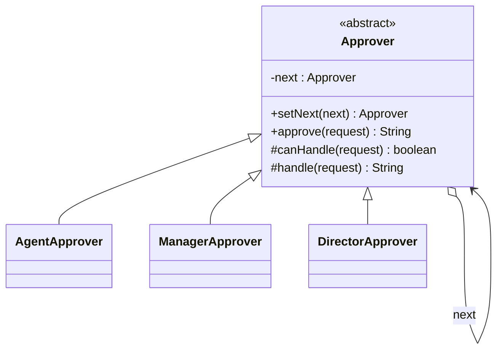

Each handler holds a reference to the next handler. The base class holds the forwarding logic once. A handler either handles the request or forwards it.

```java
class ChainDemo {
    public static void main(String[] args) {
        Approver head = new AgentApprover();
        head.setNext(new ManagerApprover()).setNext(new DirectorApprover());

        System.out.println(head.approve(new RefundRequest("r-1", 5_000)));
        System.out.println(head.approve(new RefundRequest("r-2", 50_000)));
        System.out.println(head.approve(new RefundRequest("r-3", 500_000)));
        System.out.println(head.approve(new RefundRequest("r-4", 5_000_000)));
    }
}

record RefundRequest(String id, long amountCents) {}

abstract class Approver {
    private Approver next;

    Approver setNext(Approver next) {
        this.next = next;
        return next; // Returns the next link so that calls chain.
    }

    final String approve(RefundRequest request) {
        if (canHandle(request)) {
            return handle(request);
        }
        if (next == null) {
            return request.id() + " rejected: no approver";
        }
        return next.approve(request);
    }

    protected abstract boolean canHandle(RefundRequest request);

    protected abstract String handle(RefundRequest request);
}

class AgentApprover extends Approver {
    protected boolean canHandle(RefundRequest r) {
        return r.amountCents() <= 10_000;
    }

    protected String handle(RefundRequest r) {
        return r.id() + " approved by agent";
    }
}

class ManagerApprover extends Approver {
    protected boolean canHandle(RefundRequest r) {
        return r.amountCents() <= 100_000;
    }

    protected String handle(RefundRequest r) {
        return r.id() + " approved by manager";
    }
}

class DirectorApprover extends Approver {
    protected boolean canHandle(RefundRequest r) {
        return r.amountCents() <= 1_000_000;
    }

    protected String handle(RefundRequest r) {
        return r.id() + " approved by director";
    }
}
```

The output is:

<!-- expected-output -->
```text
r-1 approved by agent
r-2 approved by manager
r-3 approved by director
r-4 rejected: no approver
```

There are two forms of the pattern. In the **first-match form** (above), exactly one handler handles the request. In the **pipeline form**, every handler does its part and then forwards the request, for example a logging chain where each appender writes the record. A servlet `Filter` chain is a pipeline where each filter can also stop the chain. The [logging framework case study](../case-studies/08-logging-framework/README.md) uses a chain.

**When to use**

- More than one object can handle a request, and the handler is not known in advance.
- The set or the order of handlers changes at run time or per configuration.
- You want to add a step (validation, authorization, audit) without editing the other steps.

**When not to use**

- The same handler handles every request. A direct call or a `Map` from type to handler is shorter.
- A request that no handler handles is a serious error. A chain can drop a request without a sign. Add a default handler at the end that reports the error, as the last link `r-4` shows.
- The chain is long and on a hot path. Each link adds a call.

**JDK and framework examples**

- `jakarta.servlet.FilterChain` (and `javax.servlet.FilterChain` before Jakarta EE 9): each `Filter` calls `chain.doFilter(request, response)` to pass the request on or does not call it to stop the request.
- `java.util.logging.Logger` passes a log record to its parent logger when `useParentHandlers` is true. This is a chain of loggers.
- Exception handling is a chain: the JVM looks for a matching `catch` block in each enclosing frame until one matches.
- Spring Security's `FilterChainProxy` runs a list of security filters in order.

### Command

**Intent**: encapsulate a request as an object. This lets you parameterize clients with different requests, queue or log requests, and support undo.

**Problem**: a text editor has buttons, menu items, and shortcuts that all run actions such as "insert text" and "delete text". The user also expects undo and redo. If each button calls the document directly, the button code knows the document API, and nothing records what happened, so you cannot reverse it.

The wrong form calls the document from each button and keeps no history.

```java
class WrongCommandDemo {
    public static void main(String[] args) {
        Document doc = new Document();
        doc.insert(0, "Hello");
        doc.insert(5, " world");
        // Undo is impossible: the document does not remember what changed.
        System.out.println(doc.text());
    }
}

class Document {
    private final StringBuilder text = new StringBuilder();

    void insert(int position, String s) {
        text.insert(position, s);
    }

    void delete(int position, int length) {
        text.delete(position, position + length);
    }

    String text() {
        return text.toString();
    }
}
```

The problem: to undo, the caller must know the inverse of each operation and the arguments. That knowledge spreads to every caller.

**Structure**

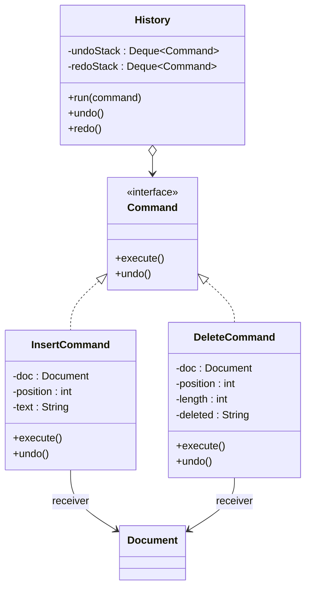

The command holds the **receiver** (the document) and the arguments of the call. The **invoker** (`History`) runs commands and stores them. A command that changes state must also store what it needs to undo the change. `DeleteCommand` saves the deleted text when it executes.

```java
import java.util.ArrayDeque;
import java.util.Deque;

class CommandDemo {
    public static void main(String[] args) {
        Document doc = new Document();
        History history = new History();

        history.run(new InsertCommand(doc, 0, "Hello"));
        history.run(new InsertCommand(doc, 5, " world"));
        history.run(new DeleteCommand(doc, 0, 6));
        System.out.println(doc.text());
        history.undo();
        System.out.println(doc.text());
        history.undo();
        System.out.println(doc.text());
        history.redo();
        System.out.println(doc.text());
    }
}

class Document {
    private final StringBuilder text = new StringBuilder();

    void insert(int position, String s) {
        text.insert(position, s);
    }

    String delete(int position, int length) {
        String removed = text.substring(position, position + length);
        text.delete(position, position + length);
        return removed;
    }

    String text() {
        return text.toString();
    }
}

interface Command {
    void execute();

    void undo();
}

class InsertCommand implements Command {
    private final Document doc;
    private final int position;
    private final String text;

    InsertCommand(Document doc, int position, String text) {
        this.doc = doc;
        this.position = position;
        this.text = text;
    }

    public void execute() {
        doc.insert(position, text);
    }

    public void undo() {
        doc.delete(position, text.length());
    }
}

class DeleteCommand implements Command {
    private final Document doc;
    private final int position;
    private final int length;
    private String deleted; // Saved at execute time, so undo can restore it.

    DeleteCommand(Document doc, int position, int length) {
        this.doc = doc;
        this.position = position;
        this.length = length;
    }

    public void execute() {
        deleted = doc.delete(position, length);
    }

    public void undo() {
        doc.insert(position, deleted);
    }
}

class History {
    private final Deque<Command> undoStack = new ArrayDeque<>();
    private final Deque<Command> redoStack = new ArrayDeque<>();

    void run(Command command) {
        command.execute();
        undoStack.push(command);
        redoStack.clear(); // A new action invalidates the redo history.
    }

    void undo() {
        if (undoStack.isEmpty()) {
            return;
        }
        Command command = undoStack.pop();
        command.undo();
        redoStack.push(command);
    }

    void redo() {
        if (redoStack.isEmpty()) {
            return;
        }
        Command command = redoStack.pop();
        command.execute();
        undoStack.push(command);
    }
}
```

The output is:

<!-- expected-output -->
```text
world
Hello world
Hello
Hello world
```

For a small command you can use a lambda: `Runnable` is a command with `execute` only. For undo you need a pair of actions, so a named interface (or a record that holds two `Runnable` values) is clearer. A **macro command** holds a list of commands and runs them in order. It undoes them in reverse order.

**When to use**

- You need undo and redo, or a history of operations.
- You must queue, schedule, retry, or log requests (a job queue, a task scheduler).
- You want to separate the code that triggers an action (a button, an API handler) from the code that performs it.

**When not to use**

- The action is a single call with no undo, no queue, and no log. A command class adds a type for no gain. Use a method call or a lambda.
- Undo by inverse operation is not possible (sending an email). Use Memento (a saved state) or a compensating action, and say so in the design.

**JDK and framework examples**

- `java.lang.Runnable` and `java.util.concurrent.Callable` are command interfaces. `ExecutorService.submit` is the invoker that queues them.
- `javax.swing.Action` is a command that menus and buttons share.
- `java.util.Timer` and `ScheduledExecutorService` store tasks and run them later.
- Database migrations, job queues, and "undo" stacks in editors use the same idea.

### Iterator

**Intent**: provide a way to access the elements of an aggregate object in order without exposing its underlying representation.

**Problem**: an order history stores orders in a structure that can change (an array, a linked list, a tree, a database page). If the class returns its internal list, clients depend on the structure and can change it by accident.

The wrong form returns the internal collection.

```java
import java.util.ArrayList;
import java.util.List;

class WrongIteratorDemo {
    public static void main(String[] args) {
        OrderHistory history = new OrderHistory();
        history.add("o-1");
        history.getOrders().clear(); // The caller destroys the history.
        System.out.println(history.getOrders().size());
    }
}

class OrderHistory {
    private final List<String> orders = new ArrayList<>();

    void add(String order) {
        orders.add(order);
    }

    // Leaks the representation: callers can add, remove, and sort.
    List<String> getOrders() {
        return orders;
    }
}
```

The problem: the caller depends on `List` and can break the class invariants.

**Structure**

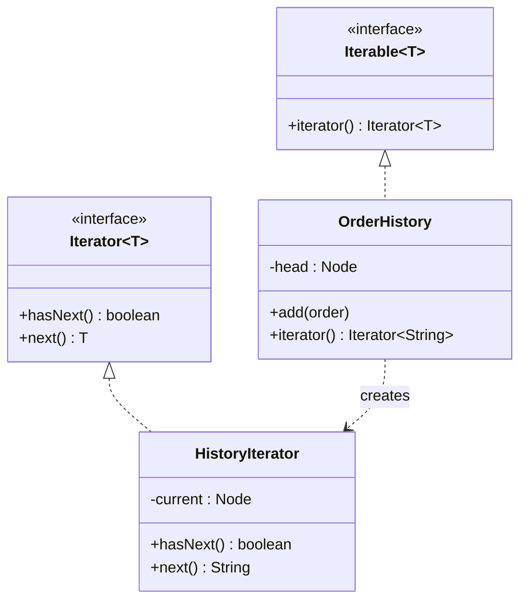

In Java the pattern is built into the language. A class that implements `Iterable<T>` works in the enhanced `for` loop. The `Iterator<T>` interface has `hasNext()` and `next()`, and an optional `remove()`. The `forEachRemaining` method (since Java 8) runs an action on each remaining element.

```java
import java.util.Iterator;
import java.util.NoSuchElementException;

class IteratorDemo {
    public static void main(String[] args) {
        OrderHistory history = new OrderHistory();
        history.add("o-1");
        history.add("o-2");
        history.add("o-3");
        for (String order : history) {
            System.out.println(order);
        }
    }
}

class OrderHistory implements Iterable<String> {
    private static class Node {
        final String order;
        Node next;

        Node(String order) {
            this.order = order;
        }
    }

    private Node head;
    private Node tail;

    void add(String order) {
        Node node = new Node(order);
        if (head == null) {
            head = node;
        } else {
            tail.next = node;
        }
        tail = node;
    }

    @Override
    public Iterator<String> iterator() {
        return new Iterator<>() {
            private Node current = head; // Each iterator has its own position.

            public boolean hasNext() {
                return current != null;
            }

            public String next() {
                if (current == null) {
                    throw new NoSuchElementException();
                }
                String value = current.order;
                current = current.next;
                return value;
            }
        };
    }
}
```

The output is:

<!-- expected-output -->
```text
o-1
o-2
o-3
```

Points to know for an interview:

- **Independent positions.** Each call to `iterator()` returns a new iterator with its own position, so two loops over the same collection do not interfere.
- **Fail-fast.** The iterators of `ArrayList` and `HashMap` throw `ConcurrentModificationException` if the collection changes during iteration by any means except the iterator's own `remove()`. The javadoc says that this behavior is best-effort and that you must not depend on it for correctness.
- **Weakly consistent.** The iterators of `ConcurrentHashMap` and `CopyOnWriteArrayList` never throw that exception. `CopyOnWriteArrayList` iterates over a snapshot.
- **Internal and external iteration.** `Iterator` is external iteration: the client controls the loop. `Iterable.forEach` and streams are internal iteration: the collection controls the loop and calls your code.
- **Return an iterator or a view, not the list.** To expose the elements without the representation, return `Iterator`, `Iterable`, a `Stream`, or an unmodifiable view such as `Collections.unmodifiableList` or `List.copyOf`.

**When to use**

- You own a custom collection (a tree, a graph, a paged result) and want standard `for` loops over it.
- You want several independent traversals of one structure (in-order, level-order).
- You want to hide the representation of a collection.

**When not to use**

- The collection is a plain `List` or `Set`. Return it (as an unmodifiable view) and let the client use its iterator.
- You need random access by index. Iteration order is the only promise.

**JDK examples**

- `java.util.Iterator`, `ListIterator`, `Iterable`, and `Spliterator` (the iterator of parallel streams).
- Every class in `java.util` that implements `Collection` returns an `Iterator`.
- `java.util.Scanner` implements `Iterator<String>`. `java.sql.ResultSet` gives a cursor with the same idea (`next()`), but it does not implement `Iterator`.

### Mediator

**Intent**: define an object that encapsulates how a set of objects interact. The mediator keeps the objects from referring to each other, so you can vary their interaction on its own.

**Problem**: a chat room has users. If each user holds references to all other users and sends messages to them directly, `n` users have up to `n × (n - 1)` references. Adding a rule ("do not deliver to muted users") means editing every user class.

The wrong form lets peers call each other.

```java
import java.util.ArrayList;
import java.util.List;

class WrongMediatorDemo {
    public static void main(String[] args) {
        ChatUser ana = new ChatUser("ana");
        ChatUser ben = new ChatUser("ben");
        ana.connect(ben);
        ben.connect(ana);
        ana.send("hi");
    }
}

class ChatUser {
    private final String name;
    private final List<ChatUser> peers = new ArrayList<>();

    ChatUser(String name) {
        this.name = name;
    }

    void connect(ChatUser other) {
        peers.add(other);
    }

    void send(String text) {
        for (ChatUser peer : peers) {
            peer.receive(name, text);
        }
    }

    void receive(String from, String text) {
        System.out.println(name + " got from " + from + ": " + text);
    }
}
```

The problem: every user knows every other user. Group rules have no single place.

**Structure**

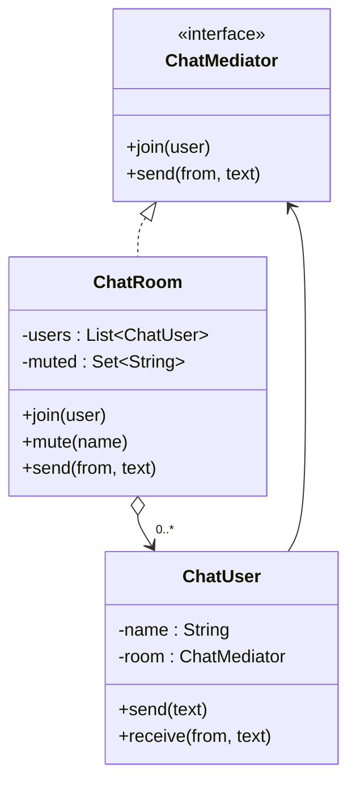

Each user knows only the mediator. The mediator knows all users and holds the rules.

```java
import java.util.ArrayList;
import java.util.HashSet;
import java.util.List;
import java.util.Set;

class MediatorDemo {
    public static void main(String[] args) {
        ChatRoom room = new ChatRoom();
        ChatUser ana = new ChatUser("ana", room);
        ChatUser ben = new ChatUser("ben", room);
        ChatUser cy = new ChatUser("cy", room);

        ana.send("hi");
        room.mute("ben");
        ben.send("spam");
        cy.send("bye");
    }
}

interface ChatMediator {
    void join(ChatUser user);

    void send(ChatUser from, String text);
}

class ChatRoom implements ChatMediator {
    private final List<ChatUser> users = new ArrayList<>();
    private final Set<String> muted = new HashSet<>();

    public void join(ChatUser user) {
        users.add(user);
    }

    void mute(String name) {
        muted.add(name);
    }

    public void send(ChatUser from, String text) {
        if (muted.contains(from.name())) {
            return; // One rule, in one place.
        }
        for (ChatUser user : users) {
            if (user != from) {
                user.receive(from.name(), text);
            }
        }
    }
}

class ChatUser {
    private final String name;
    private final ChatMediator room;

    ChatUser(String name, ChatMediator room) {
        this.name = name;
        this.room = room;
        room.join(this);
    }

    String name() {
        return name;
    }

    void send(String text) {
        room.send(this, text);
    }

    void receive(String from, String text) {
        System.out.println(name + " got from " + from + ": " + text);
    }
}
```

The output is:

<!-- expected-output -->
```text
ben got from ana: hi
cy got from ana: hi
ana got from cy: bye
ben got from cy: bye
```

The trade-off: the mediator can grow into a god object that knows every rule. Keep one mediator for one interaction (one dialog, one room), and keep each peer's own logic inside the peer.

**When to use**

- A set of objects communicates in a complex but well-defined way, and the references between them make the code hard to change.
- You want to reuse a component in another context, and its links to peers prevent that.
- Examples: a form where fields enable and disable each other, an air traffic controller, a chat room, a game lobby, a workflow coordinator.

**When not to use**

- Two or three objects talk in a simple way. A direct reference is clearer.
- The communication is one-way notification to unknown listeners. Use Observer.

**JDK and framework examples**

- `ExecutorService` sits between the code that submits a task and the worker threads. The submitter does not know which worker runs the task.
- Spring `ApplicationContext` mediates between beans: beans find each other through the container and not by direct construction. Spring MVC's `DispatcherServlet` coordinates the handler mapping, the handler, and the view resolver.

### Memento

**Intent**: capture and store the internal state of an object without breaking its encapsulation, so that the object can return to that state later.

**Problem**: an editor must save a snapshot before a risky change (a bulk replace, a form edit) and restore it on "cancel". If the caretaker reads every field of the editor to copy it, the editor must expose its fields, which breaks encapsulation, and the caretaker breaks each time a field changes.

The wrong form exposes the fields so that others can copy them.

```java
class WrongMementoDemo {
    public static void main(String[] args) {
        Editor editor = new Editor();
        editor.text = "draft";
        // The caller copies the state field by field and must know every field.
        String savedText = editor.text;
        int savedCursor = editor.cursor;
        editor.text = "broken";
        editor.text = savedText;
        editor.cursor = savedCursor;
        System.out.println(editor.text);
    }
}

class Editor {
    public String text = "";
    public int cursor = 0;
}
```

The problem: the fields are public, and each caller repeats the copy logic.

**Structure**

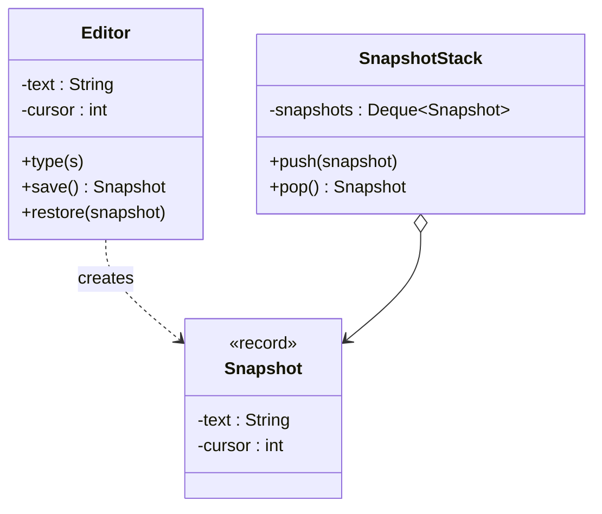

The three roles are the **originator** (`Editor`, which makes and reads snapshots), the **memento** (`Snapshot`, an immutable value that the caretaker cannot change), and the **caretaker** (`SnapshotStack`, which stores snapshots and never looks inside). Java has no friend access. A nested type inside the originator, with a private constructor, is the closest tool: the caretaker can hold the memento and cannot create or read it.

```java
import java.util.ArrayDeque;
import java.util.Deque;

class MementoDemo {
    public static void main(String[] args) {
        Editor editor = new Editor();
        SnapshotStack stack = new SnapshotStack();

        editor.type("Hello");
        stack.push(editor.save());
        editor.type(" broken text");
        System.out.println(editor.text());
        editor.restore(stack.pop());
        System.out.println(editor.text());
    }
}

class Editor {
    // The memento is an immutable nested type. Only Editor can create one.
    static final class Snapshot {
        private final String text;
        private final int cursor;

        private Snapshot(String text, int cursor) {
            this.text = text;
            this.cursor = cursor;
        }
    }

    private String text = "";
    private int cursor = 0;

    void type(String s) {
        text = text.substring(0, cursor) + s + text.substring(cursor);
        cursor += s.length();
    }

    Snapshot save() {
        return new Snapshot(text, cursor);
    }

    void restore(Snapshot snapshot) {
        this.text = snapshot.text;
        this.cursor = snapshot.cursor;
    }

    String text() {
        return text;
    }
}

class SnapshotStack {
    private final Deque<Editor.Snapshot> snapshots = new ArrayDeque<>();

    void push(Editor.Snapshot snapshot) {
        snapshots.push(snapshot);
    }

    Editor.Snapshot pop() {
        return snapshots.pop();
    }
}
```

The output is:

<!-- expected-output -->
```text
Hello broken text
Hello
```

Memento and Command both support undo, with different trade-offs. A command stores the operation and its inverse, which costs little memory but needs an inverse for each operation. A memento stores a full state, which costs more memory but needs no inverse. Real editors often combine both: commands for small edits and snapshots at intervals. Take care with mutable fields: a memento must hold a copy (a defensive copy) of any mutable object that it saves, or the snapshot changes with the original.

**When to use**

- You need a snapshot of state for undo, rollback, or a checkpoint.
- A direct read of the state by another object would expose the internals.

**When not to use**

- The state is large and snapshots are frequent. Store changes (commands or diffs) and not full copies.
- The state is already immutable. A reference to the old value is a snapshot, so no extra pattern is needed.

**JDK examples**

- `java.io.Serializable` with `ObjectOutputStream` saves the state of an object to bytes, and `ObjectInputStream` restores it. This is a commonly cited use of the idea, but serialization has its own security risks. See the [creational patterns](06-creational-patterns.md) page for the Singleton attack by deserialization.
- For a snapshot of a collection, `List.copyOf(list)` creates an immutable copy.

### Observer

**Intent**: define a one-to-many dependency between objects, so that when one object changes state, all its dependents get a notification and update on their own.

**Problem**: when an order is placed, the system must send an email, reserve stock, and update analytics. If `OrderService.place` calls each of them, the service depends on every one of them, and a new reaction (a push notification) edits the service.

The wrong form calls every reaction from the subject.

```java
class WrongObserverDemo {
    public static void main(String[] args) {
        new OrderService().place("o-1");
    }
}

class EmailService {
    void sendConfirmation(String orderId) {
        System.out.println("email for " + orderId);
    }
}

class InventoryService {
    void reserve(String orderId) {
        System.out.println("reserve stock for " + orderId);
    }
}

class OrderService {
    private final EmailService email = new EmailService();
    private final InventoryService inventory = new InventoryService();

    void place(String orderId) {
        System.out.println("placed " + orderId);
        email.sendConfirmation(orderId);   // Every new reaction edits this method.
        inventory.reserve(orderId);
    }
}
```

The problem: `OrderService` knows all its reactions. It cannot run without them in a unit test.

**Structure**

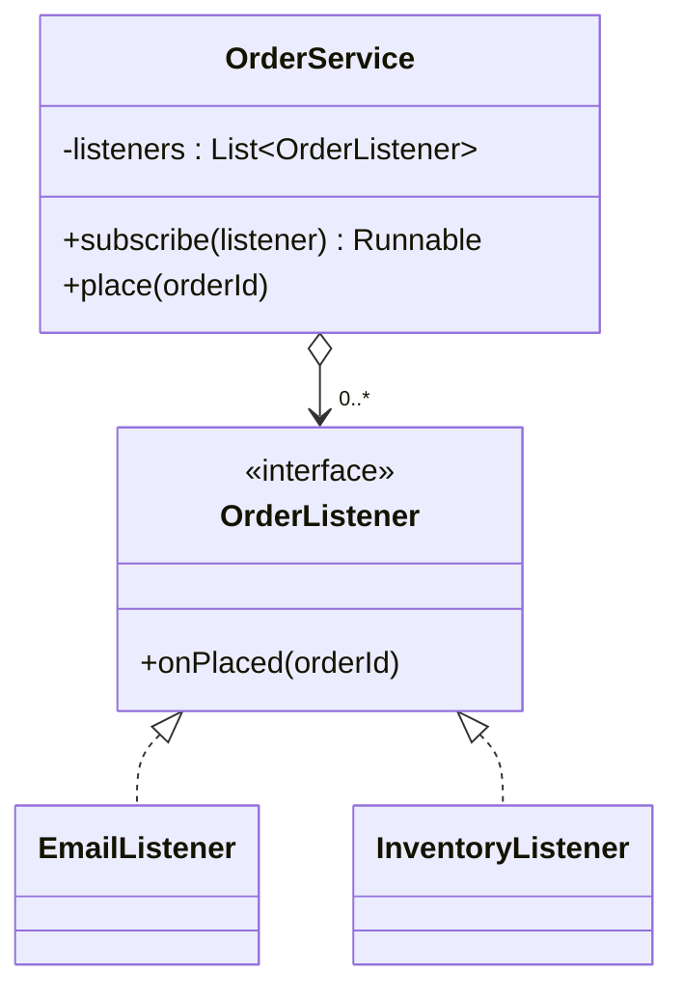

The subject (`OrderService`) holds a list of listeners and calls each one when the event happens. A listener subscribes and unsubscribes at run time. In this example `subscribe` returns a `Runnable` that removes the listener, so the caller can unsubscribe without a second method.

```java
import java.util.List;
import java.util.concurrent.CopyOnWriteArrayList;

class ObserverDemo {
    public static void main(String[] args) {
        OrderService service = new OrderService();
        service.subscribe(id -> System.out.println("email for " + id));
        Runnable cancelStock = service.subscribe(id -> System.out.println("reserve " + id));
        service.subscribe(id -> {
            throw new IllegalStateException("analytics down");
        });

        service.place("o-1");
        cancelStock.run();
        service.place("o-2");
    }
}

interface OrderListener {
    void onPlaced(String orderId);
}

class OrderService {
    // Copy-on-write: a listener can unsubscribe during a notification
    // without a ConcurrentModificationException.
    private final List<OrderListener> listeners = new CopyOnWriteArrayList<>();

    Runnable subscribe(OrderListener listener) {
        listeners.add(listener);
        return () -> listeners.remove(listener); // The caller calls this to unsubscribe.
    }

    void place(String orderId) {
        System.out.println("placed " + orderId);
        for (OrderListener listener : listeners) {
            try {
                listener.onPlaced(orderId);
            } catch (RuntimeException e) {
                // One failing listener must not stop the others.
                System.out.println("listener failed: " + e.getMessage());
            }
        }
    }
}
```

The output is:

<!-- expected-output -->
```text
placed o-1
email for o-1
reserve o-1
listener failed: analytics down
placed o-2
email for o-2
listener failed: analytics down
```

**Design decisions that interviewers probe**

| Decision | Options | Recommendation |
|---|---|---|
| Push or pull | Push: the subject sends the data in the event. Pull: the observer calls back to read the state | Push an immutable event object (a `record`). It does not expose the subject |
| Order of notification | Order of subscription, or unspecified | State the order in the contract. `java.util.Observable` leaves the order unspecified, which is one reason for its deprecation |
| Exceptions | A failing listener stops the loop, or the loop catches each exception | Catch and log per listener, as above |
| Threads | Notify on the caller's thread, or on an executor | Notify on the caller's thread by default. Use an executor if listeners are slow, and document that the listeners must be thread-safe. See [concurrency in LLD](09-concurrency-in-lld.md) |
| Modification during notification | Throw, or iterate over a snapshot | Use `CopyOnWriteArrayList` (a snapshot of the list at the start of the loop) or copy the list before the loop |

**Why `java.util.Observer` is deprecated**

`java.util.Observable` and `java.util.Observer` are deprecated since Java 9. The javadoc gives the reasons: the event model is quite limited, the order of notifications that `Observable` delivers is unspecified, and state changes are not in one-for-one correspondence with notifications (`Observable` needs a call to `setChanged()` first, and several changes can give one notification). `Observable` is a class, not an interface, so a class that already has a parent cannot be a subject. The `Observer.update(Observable, Object)` method passes an `Object`, so the observer must cast. The javadoc recommends three replacements: `java.beans` (`PropertyChangeSupport` and `PropertyChangeListener`) for a richer event model, the `java.util.concurrent` data structures for ordered messaging between threads, and the `java.util.concurrent.Flow` API for reactive streams. In your own code, define a small typed listener interface, as above.

**Memory leaks from listeners (the lapsed listener problem)**

A subject holds a strong reference to each listener. If a short-lived object (a screen, a request handler) subscribes to a long-lived subject (a service, a singleton) and never unsubscribes, the subject keeps the listener alive. The garbage collector cannot free the listener or anything that it references. The list grows, and each event calls dead objects. This is called the **lapsed listener problem**.

Ways to prevent it:

- Unsubscribe in a lifecycle method (`close`, `onDestroy`), or return a handle from `subscribe` as in the example. Use `try`-with-resources if the handle implements `AutoCloseable`.
- Hold listeners through `WeakReference` so that the subject does not keep them alive. The cost: a listener that nothing else references can disappear, and the subject must clean up cleared references. Use this only if the lifetime rules are clear.
- Give a listener the same lifetime as the subject, so that no leak is possible.

A lambda or an inner class that captures `this` keeps the whole enclosing object alive. This is a common source of the leak.

**When to use**

- A change in one object must trigger changes in others, and the number or identity of those objects is not known at compile time.
- The subject must not depend on the reactions (order processing and notifications).
- Examples: UI events, domain events, pub-sub, price alerts, status updates for food delivery.

**When not to use**

- One fixed reaction exists. A direct call is clearer and easier to follow in a debugger.
- You need guaranteed delivery, ordering across processes, or retries. Use a message broker. An in-memory observer list loses events when the process stops.
- The reactions must run in one transaction with the change. Observer hides the coupling, so the error handling is easy to get wrong.

**JDK and framework examples**

- `java.util.EventListener` is a marker interface for listener types. AWT and Swing use listeners everywhere (`ActionListener`, `MouseListener`).
- `java.beans.PropertyChangeSupport` and `PropertyChangeListener` implement bound properties.
- `java.util.concurrent.Flow` (since Java 9) defines `Publisher`, `Subscriber`, and `Subscription` for reactive streams. `SubmissionPublisher` is a ready implementation.
- Spring `ApplicationEventPublisher` and `@EventListener` publish and receive events inside the application context.

### State

**Intent**: allow an object to alter its behavior when its internal state changes. The object appears to change its class.

**Problem**: an order moves through the states `NEW`, `PAID`, `SHIPPED`, and `CANCELLED`. Each operation (`pay`, `ship`, `cancel`) is legal in some states only. If the order stores the state in an enum and every method has a `switch`, then each new state edits every method, and the legal transitions are spread over the class.

The wrong form uses a `switch` in each method.

```java
class WrongStateDemo {
    public static void main(String[] args) {
        Order order = new Order();
        order.pay();
        order.ship();
        System.out.println(order.status());
    }
}

enum Status { NEW, PAID, SHIPPED, CANCELLED }

class Order {
    private Status status = Status.NEW;

    void pay() {
        switch (status) {
            case NEW -> status = Status.PAID;
            default -> throw new IllegalStateException("cannot pay in " + status);
        }
    }

    void ship() {
        switch (status) {
            case PAID -> status = Status.SHIPPED;
            default -> throw new IllegalStateException("cannot ship in " + status);
        }
    }

    void cancel() {
        switch (status) {
            case NEW, PAID -> status = Status.CANCELLED;
            default -> throw new IllegalStateException("cannot cancel in " + status);
        }
    }

    Status status() {
        return status;
    }
}
```

The problem: with `s` states and `m` operations the class has `s × m` cases in `m` methods. A new state `RETURNED` edits all `m` methods. This form is acceptable for three states and a few operations. It becomes hard to read as the table grows.

**Structure**

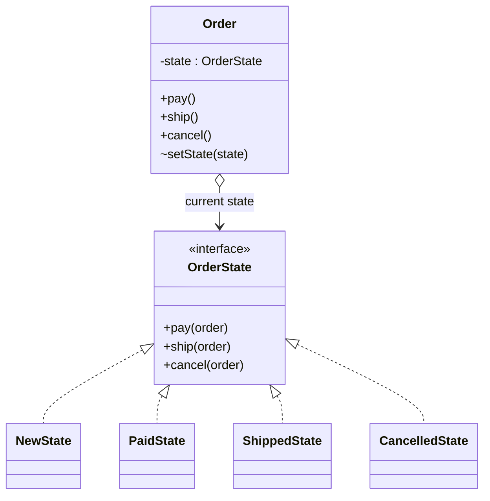

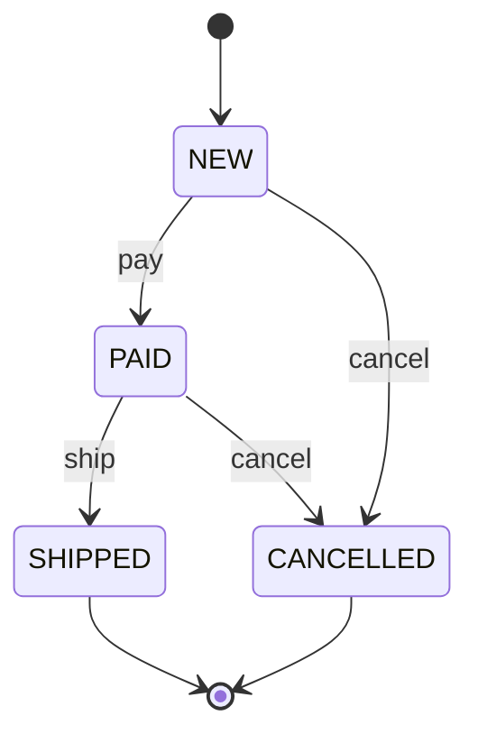

Each state is a class. The state class implements the operations that are legal in that state and rejects the others. The order (the **context**) delegates each call to its current state object. The state object changes the state of the context.

```java
class StateDemo {
    public static void main(String[] args) {
        Order order = new Order();
        order.pay();
        order.ship();
        System.out.println(order.status());
        try {
            order.cancel();
        } catch (IllegalStateException e) {
            System.out.println(e.getMessage());
        }
    }
}

interface OrderState {
    default void pay(Order order) {
        throw new IllegalStateException("cannot pay in " + name());
    }

    default void ship(Order order) {
        throw new IllegalStateException("cannot ship in " + name());
    }

    default void cancel(Order order) {
        throw new IllegalStateException("cannot cancel in " + name());
    }

    String name();
}

class NewState implements OrderState {
    public void pay(Order order) {
        order.setState(new PaidState());
    }

    public void cancel(Order order) {
        order.setState(new CancelledState());
    }

    public String name() {
        return "NEW";
    }
}

class PaidState implements OrderState {
    public void ship(Order order) {
        order.setState(new ShippedState());
    }

    public void cancel(Order order) {
        order.setState(new CancelledState());
    }

    public String name() {
        return "PAID";
    }
}

class ShippedState implements OrderState {
    public String name() {
        return "SHIPPED";
    }
}

class CancelledState implements OrderState {
    public String name() {
        return "CANCELLED";
    }
}

class Order {
    private OrderState state = new NewState();

    void pay() {
        state.pay(this);
    }

    void ship() {
        state.ship(this);
    }

    void cancel() {
        state.cancel(this);
    }

    void setState(OrderState state) {
        this.state = state;
    }

    String status() {
        return state.name();
    }
}
```

The output is:

<!-- expected-output -->
```text
SHIPPED
cannot cancel in SHIPPED
```

Details to decide:

- **Who owns the transitions?** In the example the state classes do (as the GoF book describes). The alternative keeps a transition table in the context or in an enum. A table is shorter for a fixed set of states. State classes are better when each state has its own behavior and its own data.
- **Stateless states can be shared.** A state class without fields can be one shared instance (a singleton or an enum constant), so that transitions do not allocate objects.
- **Enum with behavior.** An `enum` whose constants override methods gives the State pattern in one file. See [domain modeling](05-domain-modeling.md) for enums versus class hierarchies.

The [vending machine](../case-studies/07-vending-machine/README.md) and [elevator](../case-studies/04-elevator-system/README.md) case studies use State.

**When to use**

- The behavior of an object depends on its state, and the state changes at run time.
- Operations have large conditionals on the state, and the same conditions repeat in many methods.
- The set of legal transitions is the heart of the problem (order, ticket, elevator, vending machine, connection).

**When not to use**

- Two or three states and one or two operations. An enum and a `switch` are shorter.
- The state is only data and does not change behavior (a status label). Use an enum field.

**JDK and framework examples**

- The JDK has few classic examples. `java.lang.Thread.State` is an enum of thread states, and the thread behavior depends on it, but `Thread` does not implement the pattern with state classes. Treat it as a state machine, not as a GoF example.
- Spring Statemachine is a framework for state machines. Workflow engines model business processes with states and transitions.

### Strategy

**Intent**: define a family of algorithms, encapsulate each one, and make them interchangeable. Strategy lets the algorithm vary independently from the clients that use it.

**Problem**: a checkout computes a discount. Rules differ: no discount, a percentage, a fixed amount, a loyalty tier. If the method switches on a type code, each new rule edits the method, and you cannot test one rule alone.

The wrong form uses a type code and a conditional.

```java
class WrongStrategyDemo {
    public static void main(String[] args) {
        System.out.println(new PriceCalculator().finalPrice(10_000, "TEN_PERCENT"));
    }
}

class PriceCalculator {
    long finalPrice(long amountCents, String discountType) {
        if (discountType.equals("NONE")) {
            return amountCents;
        } else if (discountType.equals("TEN_PERCENT")) {
            return amountCents * 90 / 100;
        } else if (discountType.equals("FLAT_500")) {
            return Math.max(0, amountCents - 500);
        }
        throw new IllegalArgumentException("unknown discount " + discountType);
    }
}
```

The problem: a new discount edits the method (Open-Closed Principle violation), and a misspelled string fails at run time.

**Structure**

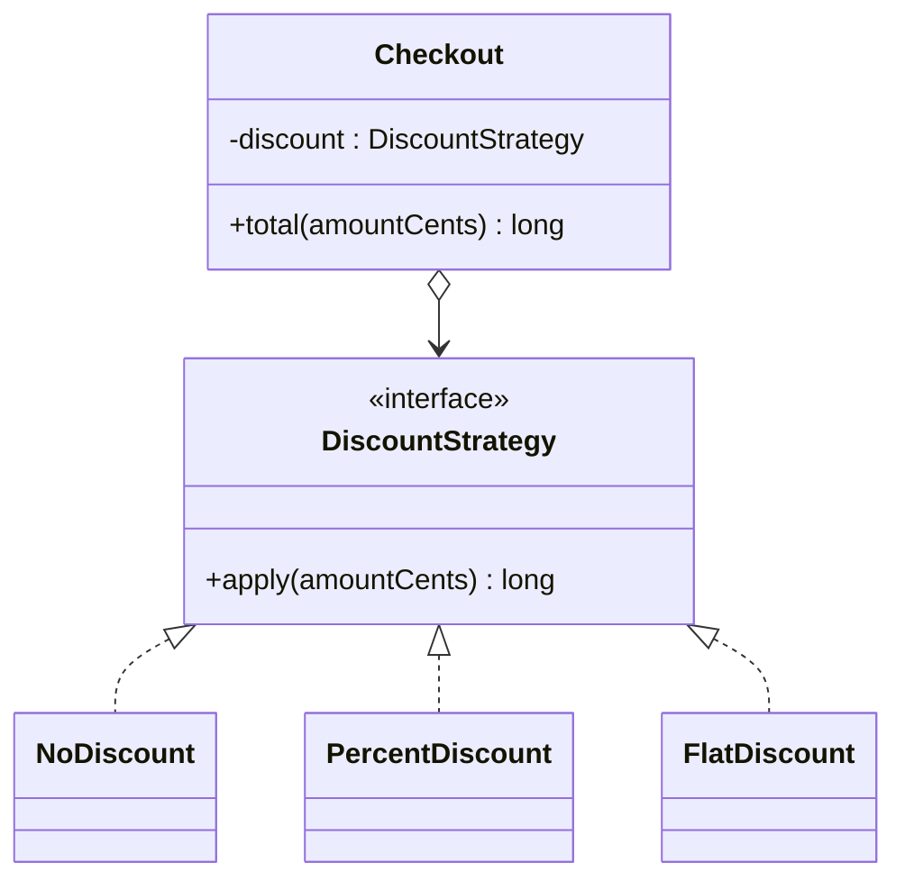

```java
class StrategyDemo {
    public static void main(String[] args) {
        System.out.println(new Checkout(Discounts.NONE).total(10_000));
        System.out.println(new Checkout(Discounts.percent(10)).total(10_000));
        System.out.println(new Checkout(Discounts.flat(500)).total(10_000));
        // A one-off strategy is a lambda at the call site.
        System.out.println(new Checkout(a -> a > 5_000 ? a - 1_000 : a).total(10_000));
    }
}

@FunctionalInterface
interface DiscountStrategy {
    long apply(long amountCents);
}

class Discounts {
    static final DiscountStrategy NONE = amount -> amount;

    static DiscountStrategy percent(int percent) {
        return amount -> amount * (100 - percent) / 100;
    }

    static DiscountStrategy flat(long cents) {
        return amount -> Math.max(0, amount - cents);
    }
}

class Checkout {
    private final DiscountStrategy discount;

    Checkout(DiscountStrategy discount) {
        this.discount = discount;
    }

    long total(long amountCents) {
        return discount.apply(amountCents);
    }
}
```

The output is:

<!-- expected-output -->
```text
10000
9000
9500
9000
```

**Strategy with lambdas.** If the strategy interface has one abstract method, each strategy is a lambda or a method reference. You do not need one class for each strategy. Java already has strategy interfaces: `Comparator<T>` (sort order), `Function<T, R>`, `Predicate<T>`, and `Supplier<T>`. If a strategy needs state or several methods, or has a name that appears in logs and configuration, use a class.

The strategy can be chosen at construction time (as above), passed as a method argument (`list.sort(comparator)`), or swapped with a setter. Recommendation: prefer constructor injection, and make the strategy stateless so that clients can share it between threads. The [parking lot](../case-studies/01-parking-lot/README.md) and [rate limiter](../case-studies/03-rate-limiter/README.md) case studies use Strategy.

**When to use**

- Several algorithms solve the same problem, and the client or the configuration picks one (pricing, routing, spot allocation, sorting, retry delay).
- A class has a large conditional that selects between behaviors.
- You want to unit-test each algorithm in isolation.

**When not to use**

- Only one algorithm exists and no second one is likely. Do not add the interface until the second algorithm appears (YAGNI).
- The algorithms differ in their inputs or outputs. Then they are not interchangeable, and a single interface hides the difference.
- The choice depends on the state of the object and changes on its own after events. That is State.

**JDK examples**

- `java.util.Comparator` with `Collections.sort`, `List.sort`, `TreeMap`, and `PriorityQueue`.
- `java.util.concurrent.ThreadPoolExecutor` takes a `RejectedExecutionHandler` strategy for a full queue (`AbortPolicy`, `CallerRunsPolicy`, `DiscardPolicy`, and `DiscardOldestPolicy`) and a `ThreadFactory`.
- `java.util.zip` and `javax.crypto` choose an algorithm by name or by object (`Cipher.getInstance("AES/GCM/NoPadding")`).
- `java.util.function` interfaces in `Stream` operations.

### Template Method

**Intent**: define the skeleton of an algorithm in a base class method and let subclasses redefine certain steps without changing the structure of the algorithm.

**Problem**: a data importer reads rows from a source, validates them, and saves them. The steps are the same for CSV and JSON files. Only the parsing differs. If each importer copies the whole flow, a change to the flow (for example "log the count at the end") must be made in each copy.

The wrong form copies the flow.

```java
class WrongTemplateDemo {
    public static void main(String[] args) {
        new CsvImporter().run("a;b;c");
        new JsonImporter().run("[a,b]");
    }
}

class CsvImporter {
    int run(String content) {
        String[] rows = content.split(";");   // Step 1: parse (differs)
        int saved = 0;
        for (String row : rows) {
            if (!row.isBlank()) {             // Step 2: validate (same)
                saved++;                       // Step 3: save (same)
            }
        }
        System.out.println("imported " + saved);
        return saved;
    }
}

class JsonImporter {
    int run(String content) {
        String[] rows = content.replace("[", "").replace("]", "").split(",");
        int saved = 0;
        for (String row : rows) {
            if (!row.isBlank()) {             // Copy of the same validation
                saved++;
            }
        }
        System.out.println("imported " + saved);
        return saved;
    }
}
```

The problem: validation and saving exist twice. A fix in one copy is missed in the other.

**Structure**

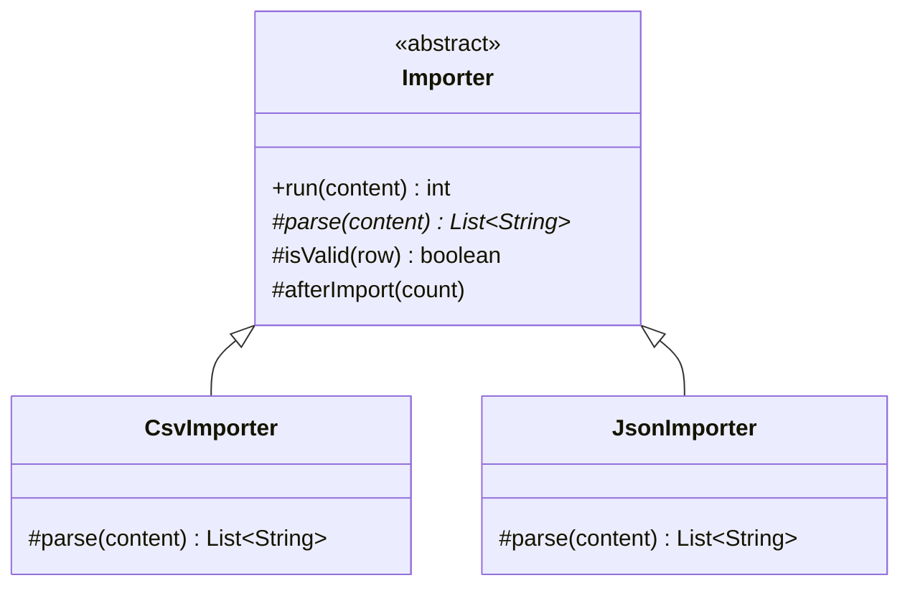

The template method (`run`) is `final`, so a subclass cannot change the order of the steps. The **abstract steps** (`parse`) must be implemented. The **hook methods** (`isValid`, `afterImport`) have a default body that a subclass may override.

```java
import java.util.Arrays;
import java.util.List;

class TemplateDemo {
    public static void main(String[] args) {
        System.out.println(new CsvImporter().run("a;;b;c"));
        System.out.println(new JsonImporter().run("[x,y]"));
    }
}

abstract class Importer {
    // The template method: final, so the order of steps cannot change.
    final int run(String content) {
        List<String> rows = parse(content);
        int saved = 0;
        for (String row : rows) {
            if (isValid(row)) {
                saved++;
            }
        }
        afterImport(saved);
        return saved;
    }

    protected abstract List<String> parse(String content); // Required step

    protected boolean isValid(String row) { // Hook with a default
        return !row.isBlank();
    }

    protected void afterImport(int count) { // Hook with an empty default
    }
}

class CsvImporter extends Importer {
    protected List<String> parse(String content) {
        return Arrays.asList(content.split(";"));
    }
}

class JsonImporter extends Importer {
    protected List<String> parse(String content) {
        String body = content.replace("[", "").replace("]", "");
        return Arrays.asList(body.split(","));
    }

    @Override
    protected void afterImport(int count) {
        System.out.println("json rows: " + count);
    }
}
```

The output is:

<!-- expected-output -->
```text
3
json rows: 2
2
```

Template Method uses inheritance. It follows the **Hollywood principle**: the base class calls the subclass ("do not call us, we call you"). The cost is the coupling of inheritance (see the fragile base class problem on the [OOP page](01-oop.md)). If the varying step is one small function, pass it as a lambda (Strategy) and avoid the subclass.

**When to use**

- Several classes share the same algorithm structure and differ in some steps.
- You want to control the extension points: subclasses may override the hooks and not the flow.
- A framework calls your code at fixed points (a test lifecycle, a servlet request).

**When not to use**

- The steps vary independently, or you need to change them at run time. A subclass is fixed at compile time. Use Strategy.
- The hierarchy would have one subclass. Keep the code in one class.
- You call an overridable method from a constructor of the base class. The subclass method runs before the subclass fields are set.

**JDK and framework examples**

- `java.io.InputStream.read(byte[], int, int)` calls the abstract `read()` for each byte, and a subclass needs to implement only `read()`.
- `java.util.AbstractList`, `AbstractMap`, and `AbstractCollection` implement most methods through a few abstract ones (`get` and `size` for `AbstractList`).
- `jakarta.servlet.http.HttpServlet.service` calls `doGet`, `doPost`, and the other `do*` methods.
- `java.util.concurrent.locks.AbstractQueuedSynchronizer` calls the methods `tryAcquire` and `tryRelease`, which subclasses implement.
- Spring `JdbcTemplate` and the other `*Template` classes fix the flow (open, execute, close) and call your callbacks. Their style is Template Method with callbacks (Strategy) and not inheritance.
- JUnit 5 lifecycle methods (`@BeforeEach`, `@AfterEach`) run in a fixed order around each test.

### Visitor

**Intent**: represent an operation to perform on the elements of an object structure. Visitor lets you define a new operation without changing the classes of the elements.

**Problem**: a shopping cart holds items of different types: books, electronics, and food. You need several operations over the cart: compute tax, print a receipt, export to JSON. If each operation is a method on every item class, each new operation edits all item classes. If one method checks types with `instanceof`, the compiler does not warn when a new item type appears.

The wrong form checks types with `instanceof`.

```java
class WrongVisitorDemo {
    public static void main(String[] args) {
        System.out.println(new TaxCalculator().tax(new Electronics(10_000)));
    }
}

interface Item {
    long priceCents();
}

record Book(long priceCents) implements Item {}

record Electronics(long priceCents) implements Item {}

record Food(long priceCents) implements Item {}

class TaxCalculator {
    long tax(Item item) {
        if (item instanceof Book) {
            return 0;
        } else if (item instanceof Electronics) {
            return item.priceCents() * 18 / 100;
        } else if (item instanceof Food) {
            return item.priceCents() * 5 / 100;
        }
        // A new Item type falls here at run time, and the compiler does not warn.
        throw new IllegalArgumentException("unknown item");
    }
}
```

**Structure (classic Visitor)**

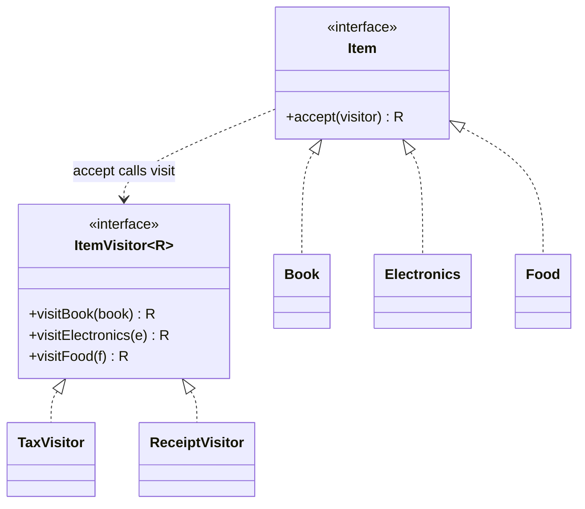

**Double dispatch.** Java picks an overloaded method at compile time from the static type of the argument, and picks an overridden method at run time from the type of the receiver only. A call `visitor.visit(item)` where `item` has the static type `Item` does not choose the `visit` method for the run-time type of the item. The Visitor pattern uses two calls. First, `item.accept(visitor)` runs the `accept` of the real class (dispatch on the item type). Inside it, `visitor.visitBook(this)` runs with the static type `Book` (dispatch on the visitor type). The result is a choice by both types.

```java
import java.util.List;

class VisitorDemo {
    public static void main(String[] args) {
        List<Item> cart = List.of(
                new Book("Dune", 1_500),
                new Electronics("Phone", 10_000),
                new Food("Rice", 2_000));

        long totalTax = 0;
        for (Item item : cart) {
            totalTax += item.accept(new TaxVisitor());
            System.out.println(item.accept(new ReceiptVisitor()));
        }
        System.out.println("tax " + totalTax);
    }
}

interface Item {
    <R> R accept(ItemVisitor<R> visitor);
}

interface ItemVisitor<R> {
    R visitBook(Book book);

    R visitElectronics(Electronics electronics);

    R visitFood(Food food);
}

record Book(String title, long priceCents) implements Item {
    public <R> R accept(ItemVisitor<R> visitor) {
        return visitor.visitBook(this); // Second dispatch: the compiler knows "this" is a Book.
    }
}

record Electronics(String name, long priceCents) implements Item {
    public <R> R accept(ItemVisitor<R> visitor) {
        return visitor.visitElectronics(this);
    }
}

record Food(String name, long priceCents) implements Item {
    public <R> R accept(ItemVisitor<R> visitor) {
        return visitor.visitFood(this);
    }
}

class TaxVisitor implements ItemVisitor<Long> {
    public Long visitBook(Book b) {
        return 0L;
    }

    public Long visitElectronics(Electronics e) {
        return e.priceCents() * 18 / 100;
    }

    public Long visitFood(Food f) {
        return f.priceCents() * 5 / 100;
    }
}

class ReceiptVisitor implements ItemVisitor<String> {
    public String visitBook(Book b) {
        return "BOOK " + b.title();
    }

    public String visitElectronics(Electronics e) {
        return "ELEC " + e.name();
    }

    public String visitFood(Food f) {
        return "FOOD " + f.name();
    }
}
```

The output is:

<!-- expected-output -->
```text
BOOK Dune
ELEC Phone
FOOD Rice
tax 1900
```

A new operation is one new visitor class, and no item class changes. A new item type is the problem: it adds a method to `ItemVisitor` and edits every visitor. Visitor fits a **stable set of types and a growing set of operations**. If the types change often, Visitor is the wrong choice.

**Modern alternative: sealed interfaces and pattern matching (Java 21)**

A sealed interface lists all its permitted subtypes. A `switch` expression with type patterns over a sealed type must cover every permitted type, and the compiler reports an error if a case is missing. Records give the data classes. You do not need `accept` or a visitor interface. The `switch` is the operation.

```java
import java.util.List;

class SealedDemo {
    public static void main(String[] args) {
        List<Item> cart = List.of(new Book("Dune", 1_500), new Electronics("Phone", 10_000));
        for (Item item : cart) {
            System.out.println(Operations.receipt(item) + " tax " + Operations.tax(item));
        }
    }
}

sealed interface Item permits Book, Electronics, Food {
    long priceCents();
}

record Book(String title, long priceCents) implements Item {}

record Electronics(String name, long priceCents) implements Item {}

record Food(String name, long priceCents) implements Item {}

class Operations {
    static long tax(Item item) {
        return switch (item) {
            case Book b -> 0;
            case Electronics e -> e.priceCents() * 18 / 100;
            case Food f -> f.priceCents() * 5 / 100;
            // No default: the compiler checks that all permitted types are covered.
        };
    }

    static String receipt(Item item) {
        return switch (item) {
            case Book(String title, long price) -> "BOOK " + title;
            case Electronics(String name, long price) -> "ELEC " + name;
            case Food(String name, long price) -> "FOOD " + name;
        };
    }
}
```

The output is:

<!-- expected-output -->
```text
BOOK Dune tax 0
ELEC Phone tax 1800
```

Pattern matching for `switch` is final in Java 21 (JEP 441), and record patterns are final in Java 21 (JEP 440). Sealed classes are final since Java 17 (JEP 409). If you add a new permitted type, every `switch` without a `default` fails to compile, which is the same safety that Visitor gives, with less code.

| | Classic Visitor | Sealed interface and `switch` |
|---|---|---|
| New operation | One new visitor class | One new method with a `switch` |
| New element type | Edit the visitor interface and all visitors | Edit the `permits` list. Each `switch` without `default` fails to compile |
| Boilerplate | `accept` in every element and a visitor interface | None |
| Open for third-party element types | Yes, if the interface is public | No. The permitted types are closed |
| Visitor holds state during traversal | Yes, as fields | Pass the state as an argument or use a local accumulator |

Use the classic Visitor if the types are in a library that you cannot seal, if you need a visitor object that carries state through a traversal, or if you target a Java version older than 21.

**When to use**

- A stable hierarchy of types needs many unrelated operations (tax, export, validation, pricing), and you do not want those operations inside the types.
- You traverse a tree (a syntax tree, a file system) and run a different action on each node type.

**When not to use**

- The element types change often. Each new type edits every visitor.
- The hierarchy is small and one or two operations exist. Put the method in the element class.
- Java 21 is available and the type hierarchy is under your control. Use a sealed interface and a `switch`.

**JDK examples**

- `java.nio.file.FileVisitor` and `SimpleFileVisitor` with `Files.walkFileTree`: the visitor gets `preVisitDirectory`, `visitFile`, `visitFileFailed`, and `postVisitDirectory` calls.
- `javax.lang.model.element.ElementVisitor` and `javax.lang.model.type.TypeVisitor` in annotation processing.
- `com.sun.source.tree.TreeVisitor` in the compiler tree API (a JDK module, not part of the Java SE API).

### Interpreter (in brief)

**Intent**: given a language, define a representation of its grammar together with an interpreter that uses the representation to interpret sentences in the language.

**Problem**: a promotion engine lets the business write rules such as `total > 5000 AND customer = gold`. You must evaluate a rule for an order. Hard-coded `if` statements do not allow new rules without a deployment.

**Structure**: each grammar rule is a class. A sentence is a tree of these objects (an abstract syntax tree). Each node has an `evaluate` method that calls `evaluate` on its children. The pattern is Composite plus an operation on the tree.

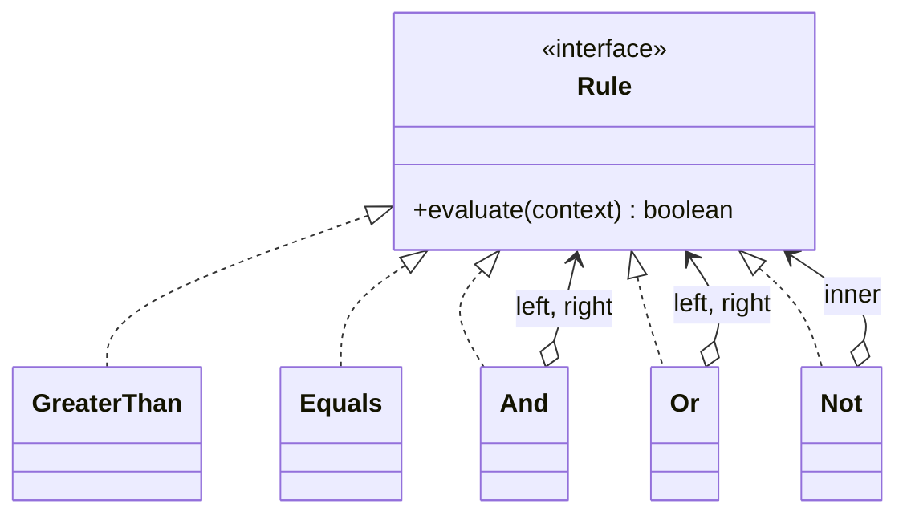

```java
import java.util.Map;

class InterpreterDemo {
    public static void main(String[] args) {
        // total > 5000 AND (customer = gold OR NOT region = EU)
        Rule rule = new And(
                new GreaterThan("total", 5_000),
                new Or(new Equals("customer", "gold"), new Not(new Equals("region", "EU"))));

        Map<String, Object> gold = Map.of("total", 6_000L, "customer", "gold", "region", "EU");
        Map<String, Object> basic = Map.of("total", 6_000L, "customer", "basic", "region", "EU");
        System.out.println(rule.evaluate(gold));
        System.out.println(rule.evaluate(basic));
    }
}

interface Rule {
    boolean evaluate(Map<String, Object> context);
}

record GreaterThan(String field, long limit) implements Rule {
    public boolean evaluate(Map<String, Object> ctx) {
        return ((Number) ctx.get(field)).longValue() > limit;
    }
}

record Equals(String field, Object expected) implements Rule {
    public boolean evaluate(Map<String, Object> ctx) {
        return expected.equals(ctx.get(field));
    }
}

record And(Rule left, Rule right) implements Rule {
    public boolean evaluate(Map<String, Object> ctx) {
        return left.evaluate(ctx) && right.evaluate(ctx);
    }
}

record Or(Rule left, Rule right) implements Rule {
    public boolean evaluate(Map<String, Object> ctx) {
        return left.evaluate(ctx) || right.evaluate(ctx);
    }
}

record Not(Rule inner) implements Rule {
    public boolean evaluate(Map<String, Object> ctx) {
        return !inner.evaluate(ctx);
    }
}
```

The output is:

<!-- expected-output -->
```text
true
false
```

The tree here is built in code. A real rule engine also needs a **parser** that turns text into this tree. The pattern covers the tree and the evaluation, and not the parser.

**When to use**: the grammar is small and stable, and the rules are data that users change at run time. Examples: filters, validation rules, discount rules, a small query language.

**When not to use**: the grammar is large, because each rule becomes a class and the tree is slow. Use a parser generator (ANTLR), an expression library (Spring Expression Language, MVEL), or a scripting engine. For rules that only developers change, plain Java code or a `Predicate` composed with `and`, `or`, and `negate` is shorter.

**JDK examples**: `java.util.regex.Pattern` compiles a regular expression into an internal tree of nodes and matches against it. `java.text.Format` and its subclasses (`MessageFormat`, `DecimalFormat`) interpret a pattern string. Both are matches by purpose and not by documented structure.

### Null Object

Null Object is not a GoF pattern. It appears in *Pattern Languages of Program Design 3* (Woolf, 1998), and Java code uses the idea in many places.

**Intent**: provide an object that implements the interface and does nothing, so that clients need no `null` check.

**Problem**: a service accepts an optional audit logger. If the field can be `null`, every use needs a check. One missing check gives a `NullPointerException`.

The wrong form passes `null` and checks at each use.

```java
class WrongNullObjectDemo {
    public static void main(String[] args) {
        try {
            new PaymentService(null).pay("o-1");
        } catch (NullPointerException e) {
            System.out.println("NullPointerException at the unchecked call");
        }
    }
}

interface AuditLog {
    void record(String message);
}

class PaymentService {
    private final AuditLog audit; // May be null.

    PaymentService(AuditLog audit) {
        this.audit = audit;
    }

    void pay(String orderId) {
        if (audit != null) {
            audit.record("pay start " + orderId);
        }
        System.out.println("paid " + orderId);
        audit.record("pay end " + orderId); // Missing check: NullPointerException.
    }
}
```

The output is `paid o-1` and then `NullPointerException at the unchecked call`.

**Structure**

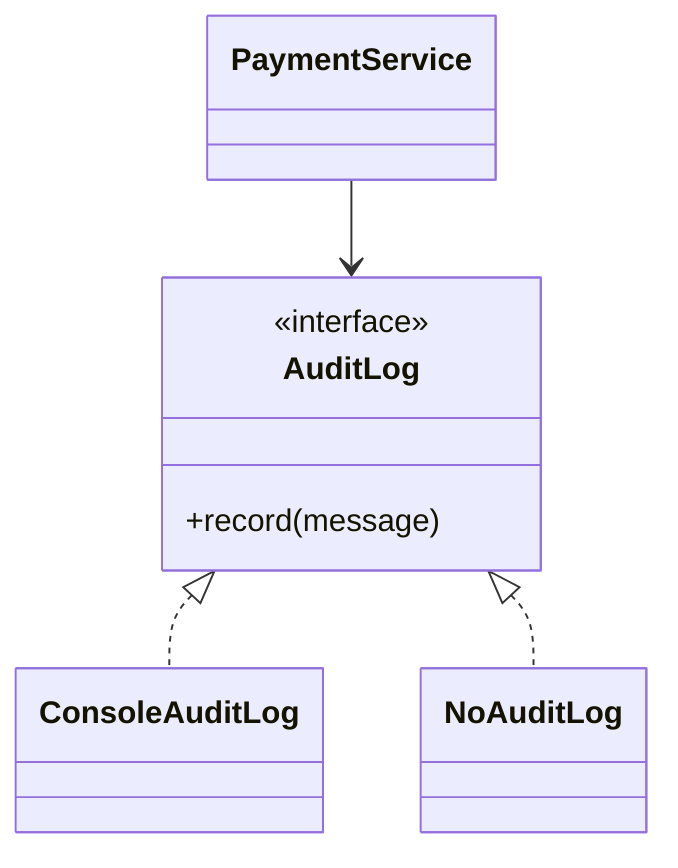

```java
import java.util.Objects;

class NullObjectDemo {
    public static void main(String[] args) {
        new PaymentService(AuditLog.NONE).pay("o-1");
        new PaymentService(m -> System.out.println("audit: " + m)).pay("o-2");
    }
}

interface AuditLog {
    AuditLog NONE = message -> { }; // The null object: it does nothing.

    void record(String message);
}

class PaymentService {
    private final AuditLog audit;

    PaymentService(AuditLog audit) {
        this.audit = Objects.requireNonNull(audit, "use AuditLog.NONE for no audit");
    }

    void pay(String orderId) {
        audit.record("pay start " + orderId);
        System.out.println("paid " + orderId);
        audit.record("pay end " + orderId);
    }
}
```

The output is:

<!-- expected-output -->
```text
paid o-1
audit: pay start o-2
paid o-2
audit: pay end o-2
```

Rules for a null object: it is stateless, so one shared instance is enough. It must be a safe default, not a hidden error. If a missing collaborator is a bug (a required payment gateway), fail fast with an exception, and do not hide the bug behind a null object. For a method that may return no value, `Optional<T>` is the better tool, because the caller must decide what to do. A null object fits a collaborator where "do nothing" is a correct behavior.

**When to use**

- The collaborator is optional and "do nothing" is a correct behavior (logging, auditing, metrics, a default discount of zero).
- You see the same `if (x != null)` check in many places.

**When not to use**

- A missing value is an error. Throw an exception or use a required parameter.
- The caller must act differently when the value is absent. Return `Optional`.

**JDK examples**

- `Collections.emptyList()`, `emptyMap()`, and `emptySet()` return an immutable empty collection and not `null`.
- `InputStream.nullInputStream()`, `OutputStream.nullOutputStream()`, `Reader.nullReader()`, and `Writer.nullWriter()` (all since Java 11) do nothing.
- SLF4J's `org.slf4j.helpers.NOPLogger` is a logger that discards every message.
- `Comparator.naturalOrder()` and `Function.identity()` are neutral strategies in the same spirit.

### Comparing the patterns

Several behavioral patterns have the same class diagram: an object holds a reference to an interface and delegates to it. The difference is the intent and who changes the reference.

#### Strategy, State, and Template Method

| | Strategy | State | Template Method |
|---|---|---|---|
| Intent | Choose one algorithm from a family | Change behavior when the state changes | Fix the flow, vary the steps |
| Mechanism | Composition: the context holds a strategy | Composition: the context holds a state | Inheritance: subclasses override steps |
| Who picks the variant | The client, at construction or per call | The state objects themselves, through transitions | The class hierarchy, at compile time |
| Does the variant change at run time | Rarely, and only if the client asks | Yes, as a normal part of the flow | No |
| Do the variants know each other | No | Yes: a state creates the next state | No |
| Context calls | One method on the strategy | Every operation that depends on the state | The base class calls the steps |
| Example | `Comparator`, discount rule | Order status, vending machine | `HttpServlet.service`, importer |
| Deciding question | Do I pick an algorithm from outside? | Does the object change its own behavior as events happen? | Do I need a fixed flow with fixed steps? |

#### Observer and Mediator

| | Observer | Mediator |
|---|---|---|
| Intent | Notify unknown dependents of a change | Coordinate known peers |
| Direction | One-way: subject to observers | Two-way: peers to mediator and back |
| Knowledge | The subject does not know what its observers do | The mediator knows the peers and holds the rules |
| Coupling | Subject to a listener interface only | Peers to the mediator. The mediator to the peers |
| Where the logic is | In each observer | In the mediator |
| Risk | Lapsed listeners, unspecified order, hidden flow | God object that holds all rules |
| Deciding question | Does one object announce a change to anyone who cares? | Do several objects need rules for how they work together? |

#### Command and Strategy

| | Command | Strategy |
|---|---|---|
| Intent | Represent a request as an object | Represent an algorithm as an object |
| Carries data | Yes: the receiver and the arguments | No: it gets the data as arguments |
| Lifetime | Created for each request, stored, queued, or undone | Created once and reused |
| Supports undo, queue, log | Yes, by design | No |
| Returns | Nothing in the basic form (`void execute`) | A result (`apply` returns a value) |
| Deciding question | Do I need to store, delay, or reverse the call? | Do I need to swap how a result is computed? |

#### Other pairs

| Looks like | Difference |
|---|---|
| Chain of Responsibility vs Decorator | A chain link can stop the request. A decorator always forwards and adds work. See [structural patterns](07-structural-patterns.md) |
| Command vs Memento | Command stores the operation and needs an inverse. Memento stores the state and needs no inverse |
| Visitor vs Strategy | Visitor chooses the operation by the element type (double dispatch). Strategy chooses the operation by the object that you pass |
| Iterator vs Visitor | Iterator controls the traversal and gives you the elements. Visitor adds an operation that runs on each element type |
| Null Object vs Optional | Null Object hides the absence behind the interface. Optional makes the absence visible to the caller |

## Trade-offs and When to Use

| Situation | Pattern | Alternative | Why the alternative can be better |
|---|---|---|---|
| Several handlers, the first fit wins | Chain of Responsibility | A list of rules in order, or a `Map` | A loop over a list of `Predicate` values is shorter if no link needs its own class |
| Undo, redo, queue, or log of actions | Command | Memento (snapshots) | Snapshots need no inverse operation. Use them when the state is small |
| Traversal of a custom structure | Iterator | Return a `Stream` or an unmodifiable view | A stream or a view is enough when the structure is a standard collection |
| Many peers with tangled references | Mediator | Observer, or an event bus | One-way notification needs no central rule holder |
| Snapshot and rollback | Memento | Immutable state | If the state is immutable, a reference is the snapshot |
| One change, many reactions | Observer | A direct call, or a message broker | A direct call is clearer for one fixed reaction. A broker gives delivery guarantees |
| Behavior depends on lifecycle state | State | Enum plus `switch`, or a transition table | Shorter for three states and few operations |
| Interchangeable algorithms | Strategy | A lambda, or a conditional | A lambda is a strategy with no class. A conditional is fine for two stable branches |
| Fixed flow, varying steps | Template Method | Strategy | Composition changes at run time and avoids the coupling of inheritance |
| Many operations over stable types | Visitor | Sealed interface and `switch` (Java 21) | Less code, and the compiler checks each `switch` |
| A small user-defined rule language | Interpreter | A parser library, or `Predicate` composition | Better for large grammars and for rules that only developers write |
| Optional collaborator with a neutral behavior | Null Object | `Optional`, or a required parameter | `Optional` shows the absence to the caller |

Costs of the family as a whole: each pattern replaces a conditional with extra types, and each extra type adds a file to read and a place for a mistake. The flow of control becomes harder to follow in a debugger because a call jumps through an interface. Observer and Mediator hide the flow most.

Recommendation: write the straight code first. Add a pattern when you see its trigger: a repeated `switch` on a type or a state (State, Strategy, Visitor), a need for undo (Command or Memento), a growing list of reactions (Observer), a set of peers that reference each other (Mediator), or a request that more than one object may handle (Chain of Responsibility). In an interview, name the trigger before you name the pattern.

## Java Example

The next program joins five patterns in one order flow. A chain of validation checks (Chain of Responsibility) rejects bad orders. A discount lambda (Strategy) computes the price. An enum with behavior (State) controls the order lifecycle. A list of listeners (Observer) sends notifications. A null object (`AuditLog.NONE`) removes the null checks for the optional audit log. Run it with `java Demo.java` (Java 21).

```java
import java.util.ArrayList;
import java.util.List;
import java.util.Optional;
import java.util.concurrent.CopyOnWriteArrayList;
import java.util.function.LongUnaryOperator;

class Demo {
    public static void main(String[] args) {
        List<String> inbox = new ArrayList<>();
        List<String> audit = new ArrayList<>();

        // Chain of Responsibility: each check can reject the request or pass it on.
        List<Check> checks = List.of(
                r -> reject(r.amountCents() <= 0, "amount must be positive"),
                r -> reject(r.customerId().isBlank(), "customer is missing"),
                r -> reject(r.amountCents() > 1_000_000, "amount over limit"));

        // Strategy: ten percent off, as a lambda.
        LongUnaryOperator tenPercent = amount -> amount * 90 / 100;

        // Null Object: one service with a real audit log, one with the do-nothing log.
        OrderService service = new OrderService(checks, tenPercent, audit::add);
        OrderService quiet = new OrderService(checks, LongUnaryOperator.identity(), AuditLog.NONE);

        // Observer: a listener list.
        Runnable cancelInbox = service.subscribe(e -> inbox.add(e.orderId() + " " + e.status()));
        service.subscribe(e -> audit.add("listener saw " + e.status()));

        Order ok = service.place("o-1", "c-1", 10_000);
        System.out.println(ok.id() + " price " + ok.priceCents() + " " + ok.status());
        service.pay(ok);
        service.ship(ok);
        try {
            service.cancel(ok); // State: illegal in SHIPPED.
        } catch (IllegalStateException e) {
            System.out.println("error: " + e.getMessage());
        }

        cancelInbox.run(); // Unsubscribe: the inbox gets no more events.
        Order second = service.place("o-2", "c-2", 5_000);
        service.cancel(second);

        try {
            service.place("o-3", " ", 5_000);
        } catch (IllegalArgumentException e) {
            System.out.println("rejected: " + e.getMessage());
        }

        Order noAudit = quiet.place("o-4", "c-4", 2_000);
        System.out.println(noAudit.id() + " price " + noAudit.priceCents());

        System.out.println("inbox " + inbox);
        for (String line : audit) {
            System.out.println("audit: " + line);
        }
    }

    static Optional<String> reject(boolean condition, String reason) {
        return condition ? Optional.of(reason) : Optional.empty();
    }
}

record OrderRequest(String orderId, String customerId, long amountCents) {}

record OrderEvent(String orderId, Status status) {}

interface Check {
    Optional<String> reject(OrderRequest request);
}

interface AuditLog {
    AuditLog NONE = message -> { };

    void record(String message);
}

interface OrderListener {
    void onChange(OrderEvent event);
}

// State: each constant allows some transitions and rejects the others.
enum Status {
    NEW {
        Status pay() {
            return PAID;
        }

        Status cancel() {
            return CANCELLED;
        }
    },
    PAID {
        Status ship() {
            return SHIPPED;
        }

        Status cancel() {
            return CANCELLED;
        }
    },
    SHIPPED,
    CANCELLED;

    Status pay() {
        throw reject("pay");
    }

    Status ship() {
        throw reject("ship");
    }

    Status cancel() {
        throw reject("cancel");
    }

    private IllegalStateException reject(String action) {
        return new IllegalStateException("cannot " + action + " in " + this);
    }
}

class Order {
    private final String id;
    private final long priceCents;
    private Status status = Status.NEW;

    Order(String id, long priceCents) {
        this.id = id;
        this.priceCents = priceCents;
    }

    String id() {
        return id;
    }

    long priceCents() {
        return priceCents;
    }

    Status status() {
        return status;
    }

    void setStatus(Status status) {
        this.status = status;
    }
}

class OrderService {
    private final List<Check> checks;
    private final LongUnaryOperator discount;
    private final AuditLog audit;
    private final List<OrderListener> listeners = new CopyOnWriteArrayList<>();

    OrderService(List<Check> checks, LongUnaryOperator discount, AuditLog audit) {
        this.checks = checks;
        this.discount = discount;
        this.audit = audit;
    }

    Runnable subscribe(OrderListener listener) {
        listeners.add(listener);
        return () -> listeners.remove(listener);
    }

    Order place(String orderId, String customerId, long amountCents) {
        OrderRequest request = new OrderRequest(orderId, customerId, amountCents);
        for (Check check : checks) {
            Optional<String> reason = check.reject(request);
            if (reason.isPresent()) {
                audit.record("rejected " + orderId);
                throw new IllegalArgumentException(reason.get());
            }
        }
        Order order = new Order(orderId, discount.applyAsLong(amountCents));
        audit.record("placed " + orderId);
        publish(order);
        return order;
    }

    void pay(Order order) {
        order.setStatus(order.status().pay());
        publish(order);
    }

    void ship(Order order) {
        order.setStatus(order.status().ship());
        publish(order);
    }

    void cancel(Order order) {
        order.setStatus(order.status().cancel());
        publish(order);
    }

    private void publish(Order order) {
        OrderEvent event = new OrderEvent(order.id(), order.status());
        for (OrderListener listener : listeners) {
            listener.onChange(event);
        }
    }
}
```

The expected output is:

<!-- expected-output -->
```text
o-1 price 9000 NEW
error: cannot cancel in SHIPPED
rejected: customer is missing
o-4 price 2000
inbox [o-1 NEW, o-1 PAID, o-1 SHIPPED]
audit: placed o-1
audit: listener saw NEW
audit: listener saw PAID
audit: listener saw SHIPPED
audit: placed o-2
audit: listener saw NEW
audit: listener saw CANCELLED
audit: rejected o-3
```

## Interview Angle

### Questions

??? question "What is the difference between Strategy and State?"

    The class diagrams are the same: a context holds a reference to an interface and delegates to it. The intent differs.

    - **Strategy** lets the client choose one algorithm from a family. The client picks it once, and the strategy does not know the other strategies. Example: a discount rule, a `Comparator`.
    - **State** lets an object change its own behavior as its state changes. The state objects know each other, because a state creates the next state. The client does not choose the state. Events cause the transitions. Example: an order that moves from `NEW` to `PAID` to `SHIPPED`.

    The deciding question: who changes the delegate? If the client does, it is Strategy. If the object does as events happen, it is State. In an interview, I would use State for the order lifecycle and Strategy for the discount on the same order.

??? question "Design undo and redo for a text editor."

    Use Command. Each edit is a `Command` object with `execute()` and `undo()`. The object holds the receiver (the document) and the arguments. A command that destroys data saves what it needs to undo it at execute time (a delete command saves the removed text). A `History` object (the invoker) holds two stacks. `run` executes a command, pushes it on the undo stack, and clears the redo stack. `undo` pops from the undo stack, calls `undo()`, and pushes to the redo stack. `redo` does the reverse.

    Trade-offs: commands use little memory, and each one needs a correct inverse. For operations without an inverse, or for a complex state, store a Memento (a snapshot) and restore it. Real editors combine both. To limit memory, cap the stack depth. To group typing into one undo step, merge consecutive insert commands with a macro command.

??? question "What is the difference between Command and Strategy?"

    Both wrap behavior in an object behind an interface. A command represents one request. It carries the receiver and the arguments, and the system creates it for each request so that it can queue, log, delay, or undo it. A strategy represents an algorithm. It is created once, it gets its data as arguments, and the client reuses it. The deciding question: do I need to store, delay, or reverse the call (Command), or do I need to swap how a result is computed (Strategy)?

??? question "Why is `java.util.Observer` deprecated? What do you use instead?"

    `Observable` and `Observer` are deprecated since Java 9. The javadoc says that the event model is quite limited, that the order of notifications that `Observable` delivers is unspecified, and that state changes are not in one-for-one correspondence with notifications. Other weaknesses: `Observable` is a class, so a subject cannot extend another class, and `update(Observable, Object)` forces a cast.

    The javadoc names three replacements: `java.beans` (`PropertyChangeSupport`) for a richer event model, the `java.util.concurrent` data structures for ordered messaging between threads, and `java.util.concurrent.Flow` for reactive streams. In application code, I define a small typed listener interface, keep the listeners in a `CopyOnWriteArrayList`, and pass an immutable event object.

??? question "How do listeners cause memory leaks, and how do you prevent them?"

    The subject holds a strong reference to each listener. If a short-lived object subscribes to a long-lived subject and never unsubscribes, the subject keeps it alive, and the garbage collector cannot free it. This is the lapsed listener problem. A lambda or an inner class that captures `this` keeps the whole enclosing object alive. The symptoms are growing memory and events that reach dead objects.

    Prevention: unsubscribe when the owner ends (a `close` method, or a handle returned from `subscribe`), use `WeakReference` for listeners if the lifetime rules are clear, or give the listener the same lifetime as the subject. Also log the listener count in a long-running service, so that growth shows early.

??? question "Implement the Observer pattern for order events. What do you decide about threads and exceptions?"

    I define `OrderListener` with one method, `onPlaced(OrderEvent)`. `OrderService` keeps a `CopyOnWriteArrayList<OrderListener>`, so a listener can subscribe or unsubscribe during a notification without a `ConcurrentModificationException`. `subscribe` returns a `Runnable` that unsubscribes. The event is an immutable `record`.

    Decisions. First, exceptions: one failing listener must not stop the other listeners, so I catch and log per listener. Second, threads: I notify on the caller's thread by default, so the order of notification is the order of subscription. If a listener is slow, I hand the event to an executor, and I document that listeners must be thread-safe. Third, delivery: an in-memory list loses events if the process stops, so for guaranteed delivery I use a message broker or an outbox table.

??? question "What is the Visitor pattern, and what is double dispatch?"

    Visitor puts an operation outside a class hierarchy. Each element has `accept(visitor)`, which calls `visitor.visitX(this)`. Java dispatches an overridden method on the run-time type of the receiver only. The first call (`item.accept(visitor)`) selects the code of the real element class. The second call (`visitor.visitBook(this)`) happens where the compiler knows the static type of `this`, so it selects the right overload. Two calls give a choice by two types. This is double dispatch.

    Visitor fits a stable set of element types and a growing set of operations. A new element type edits every visitor. In Java 21, I use a sealed interface with records and a `switch` expression with type patterns instead. The compiler rejects a `switch` without `default` that misses a permitted type, so I keep the safety and drop the boilerplate.

??? question "Chain of Responsibility: when do you use it, and what are the risks?"

    Use it when more than one object can handle a request, the handler is not known in advance, and the set or the order of handlers changes. Examples: a refund approval by amount, a logging pipeline, a request filter chain, a cash dispenser that tries the 100 note, then the 50 note. Each handler holds the next one and either handles the request or forwards it.

    Risks: a request can reach the end of the chain and no one handles it, so I add a final handler that reports the error. A long chain adds calls and makes debugging harder. A cycle in the chain gives an infinite loop. The order of the links is part of the behavior, so I build the chain in one place.

??? question "Template Method or Strategy? How do you choose?"

    Template Method uses inheritance. The base class fixes the flow, and subclasses override steps. The variation is fixed at compile time. Strategy uses composition. The context holds an algorithm object, and I can change it at run time. I choose Template Method when the flow is fixed, a framework calls my code at set points, and the variants form a small hierarchy. I choose Strategy when the variation is one step, when I need to switch at run time, or when I want to avoid the coupling of inheritance (the fragile base class problem). I make the template method `final` so that subclasses cannot change the order of steps.

??? question "Implement a state machine for a vending machine or an order. Enum or State classes?"

    I list the states, the events, and the legal transitions first. For a small machine (three to five states, a few events), an enum with behavior is enough. Each constant overrides the transitions that it allows, and the base method throws `IllegalStateException`. For a larger machine, or when each state holds its own data and logic, I use State classes behind an `OrderState` interface. The context delegates each event to the current state. The state sets the next state. Stateless states are shared instances. A transition table is a third option when states differ only in the allowed transitions. In all three forms, illegal transitions fail with a clear error, and the context is the only owner of the current state.

??? question "What is the difference between Observer and Mediator?"

    Observer is one-way. A subject notifies observers that it does not know, and the observers decide what to do. Mediator is two-way. Peers send messages to the mediator, and the mediator knows all the peers and holds the rules for how they interact. In a chat room, the room (mediator) decides who gets a message, who is muted, and in what order. In an order system, a listener on an order event (Observer) reacts to the event, and the order does not know the listener. Risk of Observer: a flow that is hard to follow. Risk of Mediator: a god object. The deciding question: is it an announcement to anyone who cares (Observer) or the coordination of known peers (Mediator)?

??? question "How do Iterator, `Iterable`, and fail-fast behavior work in Java?"

    `Iterable<T>` has one method, `iterator()`, and a class that implements it works in the enhanced `for` loop. `Iterator<T>` has `hasNext()`, `next()`, and an optional `remove()`. Each call to `iterator()` returns a new iterator with its own position. The iterators of `ArrayList` and `HashMap` are fail-fast: if the collection changes during iteration, except through the iterator's own `remove()`, the next call throws `ConcurrentModificationException`. The javadoc says that fail-fast behavior is best effort, so I do not use it for program logic. The fix for a removal inside a loop is `iterator.remove()` or `collection.removeIf(...)`. Concurrent collections have weakly consistent iterators that do not throw this exception.

??? question "What is a Null Object, and when is it better than returning `null` or `Optional`?"

    A Null Object implements the interface and does nothing, so the caller needs no `null` check. Use it for an optional collaborator where "do nothing" is correct behavior: a logger, an audit hook, a metrics sink, a zero discount. Use `Optional` when the caller must decide what to do about a missing value, because `Optional` makes the absence visible. Do not use a Null Object when a missing collaborator is a bug (a required gateway). In that case, fail fast with an exception. A null object is stateless, so one shared instance is enough.

??? question "How would you use Memento and Command together for undo?"

    Command stores the operation and its inverse, which uses little memory. Memento stores a full snapshot of the state, which needs no inverse. I use commands for small, reversible edits. I take a snapshot before an operation that is hard to invert (a bulk replace, an import) or at intervals, so that undo does not replay a long list of commands. The memento must be immutable, and the originator must create and read it, so the caretaker (the history) cannot see the fields. In Java, a nested class with a private constructor in the originator gives this.

??? question "Where does the Interpreter pattern fit, and when do you avoid it?"

    Interpreter represents each rule of a small grammar as a class and evaluates a sentence as a tree of these objects. Examples: filter expressions and discount rules that users write. It works when the grammar is small and stable. For a large grammar, each rule is a class and performance is poor, so I use a parser generator such as ANTLR, an expression library, or a scripting engine. The pattern covers the tree and its evaluation. A parser that builds the tree from text is a separate part. For rules that only developers write, composing `Predicate` objects with `and`, `or`, and `negate` is shorter.

### Follow-up Questions

??? question "Chain of Responsibility and Decorator both wrap the next object. How do you tell them apart?"

    A decorator always forwards the call and adds work before or after it. A chain link can stop the request and not forward it. The intent of a chain is to find one handler (or to let each link act and maybe stop). The intent of a decorator is to add a feature to the same call.

??? question "How do you make the Command history thread-safe?"

    First I check whether I need it. A single-user editor runs commands on one thread. If several threads can issue commands, I run all commands on one thread (a single-thread executor), or I guard the `run`, `undo`, and `redo` methods with one lock, because each of them changes the two stacks and the document together. The commands themselves must not share mutable state without a lock. See [concurrency in LLD](09-concurrency-in-lld.md).

??? question "Can State objects be shared between contexts?"

    Yes, if they have no fields that depend on the context. A stateless state is one shared instance (an enum constant or a static field). The state then gets the context as a method argument, as in `pay(Order order)`. If a state needs per-context data, create one state object for each context, or keep the data in the context.

??? question "How does a sealed interface give Visitor-like safety?"

    `sealed interface Item permits Book, Electronics, Food` lists every subtype in one place. A `switch` expression over `Item` with a case for each subtype and no `default` compiles only if all permitted subtypes are covered. If I add `Toy` to the `permits` list, every such `switch` fails to compile until I add a case. This is the check that a Visitor interface gives, without `accept` methods.

??? question "Why call the template method `final`?"

    The template method defines the order of steps. If a subclass overrides it, the subclass can skip or reorder steps and break the guarantees that the base class gives. `final` makes the flow fixed and the hooks the only extension points.

??? question "How does Iterator relate to streams?"

    An `Iterator` is external iteration: the caller controls the loop and calls `next()`. A stream is internal iteration: the library controls the loop and calls the caller's lambdas. Streams use a `Spliterator`, which is an iterator that can also split its elements for parallel work. Use an iterator when you need to control the pace or to remove elements. Use a stream for a pipeline of transformations.

### Red Flags

- Describing Strategy and State with the same sentence ("a context holds an interface") and giving no difference in intent.
- Using `Foo` and `Bar`, or showing a diagram and not the problem that the pattern solves.
- Using `java.util.Observer` and `Observable` in new code, and not knowing that they are deprecated since Java 9.
- Subscribing a listener and never unsubscribing it, or not knowing the lapsed listener problem.
- A Visitor for a hierarchy that gets a new type every week.
- Implementing Command without undo data (the delete command that does not save what it deleted).
- A Mediator that holds all the business logic.
- Returning the internal `List` from a collection class, and calling it an Iterator.
- A Null Object that hides a required collaborator.
- A `switch` on a state in every method of a class with eight states, and no mention of State.
- Using a pattern for a problem that has one fixed case. For example, Strategy with one implementation.

## Common Mistakes

| Mistake | Why it hurts | Fix |
|---|---|---|
| Chain with no final handler | A request that no handler handles disappears | Add a last handler that rejects or reports the request |
| Chain with a cycle | The request loops forever | Build the chain in one place. Never link a handler to an earlier link |
| Command that does not store undo data | `undo` cannot restore deleted or replaced data | Save the previous state at execute time |
| Redo stack not cleared after a new action | Redo after a new action replays commands on the wrong state | Clear the redo stack in `run` |
| Mutable snapshot in a Memento | The snapshot changes with the original | Copy mutable fields, or save immutable values |
| Returning the internal collection from an iterable class | The caller changes the internal state | Return an iterator, a view, or a copy |
| Changing a collection inside a `for-each` loop | `ConcurrentModificationException` | Use `iterator.remove()` or `removeIf` |
| Mediator that grows into a god object | One class has all rules and many reasons to change | One mediator for each interaction. Keep the logic of a peer in the peer |
| Listener that never unsubscribes | Memory leak (lapsed listener problem) | Return a handle from `subscribe`, and unsubscribe in `close` |
| A failing listener stops the notification loop | Later listeners miss the event | Catch and log exceptions for each listener |
| Notifying listeners while holding a lock | Deadlock if a listener calls back into the subject | Copy the listener list, release the lock, and then notify |
| Using `java.util.Observable` | Deprecated since Java 9, unspecified order, class not interface | Define a typed listener interface |
| State transitions spread over the context and the states | Nobody knows where a transition happens | Keep each transition in the state class or in one table |
| Strategy chosen by a `switch` inside the context | The `switch` is the problem that Strategy removes | Pass the strategy in, or look it up from a `Map` |
| Stateful strategy shared between threads | Race condition | Make strategies stateless, or create one for each use |
| Template method that is not `final` | A subclass breaks the flow | Make it `final`. Expose hooks only |
| Calling an overridable method from a base class constructor | The subclass method runs before the subclass fields are set | Call it from a factory or from an `init` method after construction |
| Visitor on an unstable hierarchy | Each new type edits every visitor | Put the method in the type, or use a sealed interface and `switch` |
| Null Object for a required collaborator | A bug passes without a sign | Fail fast with `Objects.requireNonNull` |
| Interpreter for a large grammar | Many classes and slow evaluation | Use a parser generator or an expression library |

## Commonly Confused With

| Looks like | Difference | Deciding question |
|---|---|---|
| Strategy vs State | Strategy: the client picks an algorithm. State: the object changes behavior through transitions between state objects that know each other | Who changes the delegate: the client or the object? |
| Strategy vs Template Method | Strategy uses composition and changes at run time. Template Method uses inheritance and is fixed at compile time | Do I swap the algorithm at run time, or fix the flow and vary steps? |
| State vs enum with `switch` | Same purpose. The enum is shorter for a few states. State classes scale when each state has its own behavior | Does each state have its own logic and data? |
| Command vs Strategy | Command is one request with its receiver and arguments, and can be stored or undone. Strategy is a reusable algorithm | Do I need to store, delay, or undo the call? |
| Command vs Memento | Command stores the operation (needs an inverse). Memento stores the state | Is an inverse of the operation available and cheap? |
| Observer vs Mediator | Observer is one-way notification to unknown listeners. Mediator is two-way coordination of known peers | Announcement to anyone, or rules for peers? |
| Observer vs publish-subscribe through a broker | Observer works inside one process, and the subject holds the listeners. A broker sits between publisher and subscribers, can persist events, and works across processes | Do I need delivery guarantees or several processes? |
| Chain of Responsibility vs Decorator | A chain link can stop the request. A decorator always forwards and adds behavior | Can a link stop the call? |
| Iterator vs Visitor | Iterator controls the traversal and returns the elements. Visitor runs an operation that depends on the element type | Do I need the elements, or an operation per element type? |
| Visitor vs `instanceof` chain | Visitor uses double dispatch and the compiler checks each element type. An `instanceof` chain has no such check | Does the compiler report a missing type? |
| Interpreter vs Composite | Composite is the structure (a tree). Interpreter adds a grammar and an evaluation on that tree | Does the tree represent sentences of a language? |
| Null Object vs `Optional` | Null Object hides the absence. `Optional` shows it to the caller | Must the caller act on the absence? |
| Template Method vs Factory Method | Factory Method is a Template Method step that creates an object. See [creational patterns](06-creational-patterns.md) | Does the overridden step create an object? |
| Facade vs Mediator | A facade is a one-way entry to a subsystem. A mediator coordinates peers that know it. See [structural patterns](07-structural-patterns.md) | Do the subsystem classes call back to the coordinator? |

## Quick Reference Card

| Pattern | Trigger phrase | Key move | JDK example |
|---|---|---|---|
| Chain of Responsibility | "First handler that fits" | Each handler holds the next. Add a final handler | `FilterChain`, nested `Logger` parents |
| Command | "Undo", "queue", "log" | Request as an object with `execute` and `undo`. History of two stacks | `Runnable`, `Callable`, `Action` |
| Iterator | "Loop without knowing the structure" | Implement `Iterable`. Each iterator keeps its own position | `Iterator`, `Iterable`, `Spliterator` |
| Mediator | "Peers reference each other" | Peers talk to one coordinator that holds the rules | `ExecutorService` (by structure) |
| Memento | "Snapshot", "rollback" | Immutable snapshot that only the originator can read | `Serializable` (commonly cited) |
| Observer | "When X changes, tell others" | Typed listener list, immutable event, unsubscribe handle | `PropertyChangeListener`, `Flow` |
| State | "Behavior depends on state" | One class per state. The state sets the next state | `Thread.State` (enum only) |
| Strategy | "Several ways to do it" | Interface, or a lambda. Inject it | `Comparator`, `RejectedExecutionHandler` |
| Template Method | "Same steps, different details" | `final` template, abstract steps, optional hooks | `AbstractList`, `HttpServlet.service` |
| Visitor | "Many operations, stable types" | `accept` and double dispatch, or sealed interface and `switch` | `FileVisitor`, `ElementVisitor` |
| Interpreter | "Users write rules" | One class per grammar rule, evaluate a tree | `java.util.regex.Pattern` |
| Null Object | "Null checks everywhere" | Do-nothing implementation, shared | `Collections.emptyList()`, `nullOutputStream()` |

Rules to remember:

- The same diagram means different patterns. Name the intent: who changes the delegate, and why.
- `java.util.Observer` and `Observable` are deprecated since Java 9. Write a typed listener.
- Every listener needs an unsubscribe path, or it can leak.
- Command needs undo data. Memento needs an immutable snapshot.
- Visitor fits stable types and growing operations. In Java 21, a sealed interface and a `switch` do the same with less code.
- Make a template method `final`.
- A stateless strategy or state can be one shared instance.
- Use a Null Object only where "do nothing" is correct. A missing required collaborator is a bug.

## Further Reading

- Gamma, Helm, Johnson, Vlissides. *Design Patterns: Elements of Reusable Object-Oriented Software*. Addison-Wesley, 1994. The original catalog. Read the Intent, Applicability, and Consequences sections of each behavioral pattern.
- Woolf, Bobby. "The Null Object Pattern". In *Pattern Languages of Program Design 3*. Addison-Wesley, 1998. The source of the Null Object pattern.
- [`java.util.Observable` javadoc (Java 21)](https://docs.oracle.com/en/java/javase/21/docs/api/java.base/java/util/Observable.html). The deprecation notice and the three recommended replacements.
- [`java.util.Observer` javadoc (Java 21)](https://docs.oracle.com/en/java/javase/21/docs/api/java.base/java/util/Observer.html). Shows `@Deprecated(since="9")`.
- [`java.util.concurrent.Flow` javadoc (Java 21)](https://docs.oracle.com/en/java/javase/21/docs/api/java.base/java/util/concurrent/Flow.html). The reactive streams interfaces in the JDK.
- [`java.util.Iterator` javadoc (Java 21)](https://docs.oracle.com/en/java/javase/21/docs/api/java.base/java/util/Iterator.html). The contract of `hasNext`, `next`, and `remove`.
- [`java.util.ArrayList` javadoc (Java 21)](https://docs.oracle.com/en/java/javase/21/docs/api/java.base/java/util/ArrayList.html). Describes fail-fast iterators and that they are best effort.
- [`java.util.Comparator` javadoc (Java 21)](https://docs.oracle.com/en/java/javase/21/docs/api/java.base/java/util/Comparator.html). The JDK strategy interface.
- [`java.nio.file.FileVisitor` javadoc (Java 21)](https://docs.oracle.com/en/java/javase/21/docs/api/java.base/java/nio/file/FileVisitor.html). A visitor in the JDK.
- [`ThreadPoolExecutor.RejectedExecutionHandler` in the `ThreadPoolExecutor` javadoc (Java 21)](https://docs.oracle.com/en/java/javase/21/docs/api/java.base/java/util/concurrent/ThreadPoolExecutor.html). Four rejection policies as strategies.
- [JEP 409: Sealed Classes](https://openjdk.org/jeps/409). Final in Java 17.
- [JEP 440: Record Patterns](https://openjdk.org/jeps/440). Final in Java 21.
- [JEP 441: Pattern Matching for switch](https://openjdk.org/jeps/441). Final in Java 21. Defines the exhaustive `switch` over sealed types.
- [Jakarta Servlet specification: `FilterChain`](https://jakarta.ee/specifications/servlet/). The filter chain as Chain of Responsibility.
