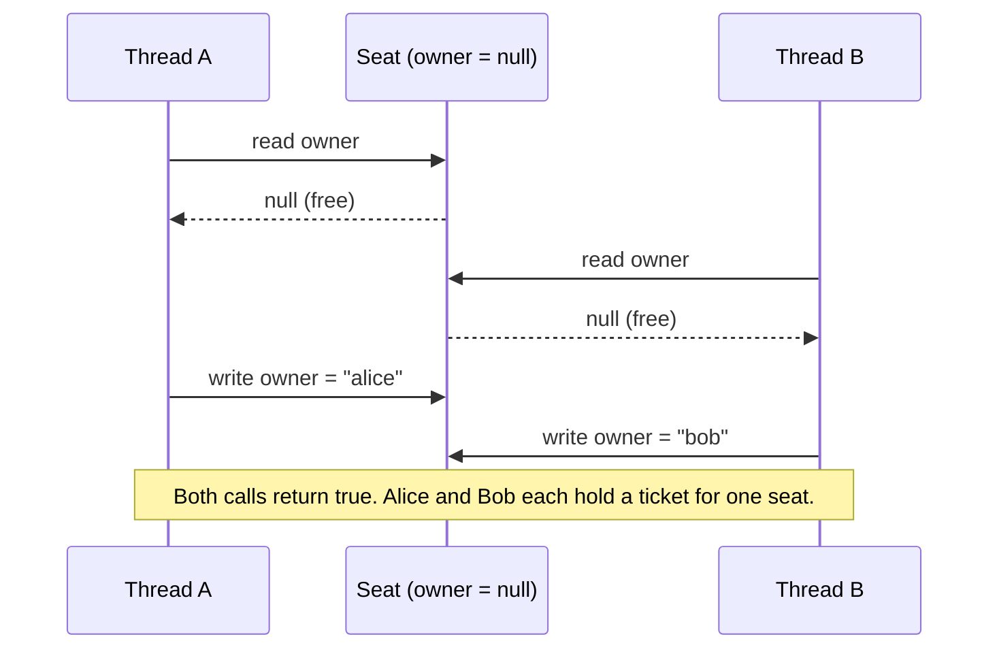
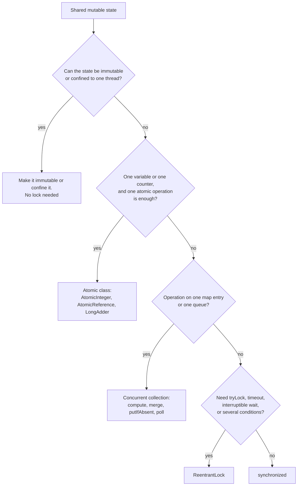

# Concurrency in LLD

A low-level design runs in one process, and in a real system many threads call its classes at the same time. This page shows where the data races appear in typical LLD problems, which tool fixes each one, and how to discuss the topic in a 45-minute round without over-engineering. The page covers the use of the Java concurrency tools in a design. The tools themselves (the memory model, `synchronized`, `Lock`, executors) have their home in [Concurrency Basics: Threads, Locks, and the Java Memory Model](../../java/07-concurrency-basics.md) and [java.util.concurrent: Executors, Locks, Atomics, and Synchronizers](../../java/08-java-util-concurrent.md). See also `kb/operating-systems/03-synchronization.md` for the operating system view.

## Why It Matters

Interviewers add the sentence "Now two users book the same seat at the same time" to most LLD problems: movie booking, parking lot, hotel booking, inventory, wallet, rate limiter, auction. A candidate who answers "I add `synchronized`" gets partial credit. A candidate who names the shared state, the check-then-act sequence that breaks, the smallest lock that fixes it, the deadlock risk, and the cost of the lock gets full credit. On the job, the same skills prevent double bookings, negative balances, and the rare production bug that no test finds. The page gives a runnable demo with deterministic output for each case.

## Core Concepts

**Thread**: a unit of execution inside a process. All threads of a process share the heap, so two threads can read and write the same object at the same time.

**Shared mutable state**: data that more than one thread can reach and that at least one thread can change. If state is not shared, or not mutable, no race on it is possible. Every concurrency fix removes one of the two properties or controls the access.

**Race condition**: a bug where the result depends on the order in which threads run their steps. **Data race**: a specific form in which two threads access the same variable, at least one access is a write, and nothing orders the accesses (JLS 17.4.5). A program can have a race condition without a data race (two correct atomic operations in a wrong order), and the reverse.

**Check-then-act**: a sequence that checks a condition and then acts on the result, such as "if the seat is free, assign it". Between the check and the act another thread can change the condition. Check-then-act is the most common race in LLD problems.

**Read-modify-write**: a sequence that reads a value, computes a new value, and writes it back, such as `balance = balance + amount` or `count++`. Two threads can read the same old value, and one update is lost.

**Atomicity**: an operation is atomic if other threads see it as one step, either complete or not started. **Visibility**: a write by one thread becomes readable by another thread. **Ordering**: the order in which threads observe the writes. The Java Memory Model (JLS chapter 17) defines the *happens-before* relation. If action A happens-before action B, then the effects of A are visible to B. Each edge connects a pair of actions (JLS 17.4.5): the release (unlock) of a monitor happens-before every later acquire of the same monitor; a write to a `volatile` field happens-before every later read of the same field; a call to `Thread.start()` happens-before every action in the started thread; every action in a thread happens-before another thread returns from `join()` on that thread. A `ReentrantLock` and the `java.util.concurrent` classes give the same guarantees, as their javadoc states.

**Critical section**: the code that touches shared mutable state and must run in one thread at a time. Keep it as small as the invariant allows.

**Invariant**: a condition that must hold between operations, for example "the balance is not negative" or "a seat has at most one owner". A lock protects an invariant, not a variable.

**Thread safety levels** (the first four levels follow Bloch, *Effective Java*, Item 82. *Thread confinement* is from Goetz et al., *Java Concurrency in Practice*, section 3.3):

| Level | Meaning | Example |
|---|---|---|
| Immutable | State never changes after construction. No lock needed | `String`, `record` with immutable fields, `List.of` |
| Unconditionally thread-safe | The class keeps its own invariants under concurrent calls. Callers need no extra lock | `AtomicInteger`, `ConcurrentHashMap`, `ArrayBlockingQueue` |
| Conditionally thread-safe | Single calls are safe. A sequence of calls needs a caller lock | `Collections.synchronizedList` when you iterate |
| Not thread-safe | The caller must lock all access | `ArrayList`, `HashMap`, `StringBuilder` |
| Thread-confined | Only one thread touches the object | A local variable, a `ThreadLocal` value |

**Lock granularity**: how much data one lock protects. A *global lock* protects the whole structure. A *per-object lock* protects one object. A *striped lock* protects a group of objects that share a hash bucket.

**Deadlock**: a state in which each of two or more threads waits for a lock that another one of them holds, so none can continue. Coffman et al. (1971) list four conditions that must all hold: mutual exclusion, hold and wait, no preemption, circular wait. A design prevents deadlock if it removes one condition. Lock ordering removes circular wait.

**Optimistic and pessimistic concurrency control**: pessimistic control takes a lock before the work and assumes a conflict. Optimistic control does the work without a lock, and checks at the end whether another thread changed the data (Kung and Robinson, 1981). If it did, the operation fails and the caller retries.

**Producer-consumer**: a design in which producer threads put work items into a shared queue and consumer threads take them out. The queue decouples the speed of the two sides.

### Where Races Appear in LLD Problems

| Problem | Shared state | Broken sequence | Invariant | Smallest fix (section) |
|---|---|---|---|---|
| Seat booking | Seat owner or status | Check "free", then assign | One owner per seat | Lock per show, or CAS on the seat ([Seat booking](#seat-booking-check-then-act)) |
| Multi-seat booking | Several seats | Hold seat 1, fail on seat 2, leave seat 1 held | All seats or none | One lock over the show, or ordered locks ([Seat hold with expiry](#seat-hold-with-expiry)) |
| Parking spot assignment | Set of free spots | Two cars read the same free spot | A spot has one car | Atomic `poll` from a free-spot queue ([Parking spot assignment](#parking-spot-assignment)) |
| Inventory decrement | Stock count | Read stock, check `> 0`, write `stock - 1` | Stock is not negative | CAS loop or lock ([Inventory decrement](#inventory-decrement)) |
| Wallet balance | Two balances | Debit one account, credit the other, in two steps | Total money is constant. No negative balance | Lock both accounts in id order ([Wallet transfer](#wallet-transfer-and-deadlock)) |
| Rate limiter counter | Counter and window start | Read count, compare, increment | At most N requests per window | Lock per client ([Rate limiter counter](#rate-limiter-counter)) |
| Lazy cache or singleton | Reference to a shared object | Two threads create two objects | One instance | Holder idiom, `computeIfAbsent` |
| Order status | Status enum | Two threads move an order to different states | A legal transition path | Compare-and-set on the status, or a lock on the order |

## How It Works

The steps below follow the order in which you work in an interview: find the shared state, find the broken sequence, pick the tool, pick the lock granularity, check for deadlock, and say what you leave out.

### Step 1: Find the shared mutable state

Read your class diagram and mark each object that more than one request can reach. In a booking system these are the `Seat`, the `Show`, the `Inventory`, and the `Wallet`. Mark each object that only one request reaches (a `BookingRequest`, a local variable) as safe. Mark each immutable object (a `Money` record, a `SeatId`) as safe. What remains is the list of objects that need a decision.

### Step 2: Find the broken sequence

Write the sequence of steps for each operation on the shared object. If a step reads state and a later step writes state based on the read, the sequence is a check-then-act or a read-modify-write. The sequence diagram below shows how two threads book the same seat.



The wrong form below makes this interleaving deterministic. A `CyclicBarrier` holds both threads after the check, so both see a free seat, and then both write. The barrier is a test hook that forces the schedule. The real race has the same effect when the schedule happens to match, which can be rare and is hard to reproduce.

```java
import java.util.*;
import java.util.concurrent.*;
import java.util.concurrent.atomic.*;
import java.util.concurrent.locks.*;

class RaceDemo {
    public static void main(String[] args) throws Exception {
        UnsafeSeat seat = new UnsafeSeat();
        // The barrier forces both threads to finish the check before either one writes.
        CyclicBarrier afterCheck = new CyclicBarrier(2);
        AtomicInteger successes = new AtomicInteger();
        Runnable booking = () -> {
            if (seat.book("user", afterCheck)) {
                successes.incrementAndGet();
            }
        };
        Thread a = new Thread(booking);
        Thread b = new Thread(booking);
        a.start();
        b.start();
        a.join();
        b.join();
        System.out.println("successful bookings for one seat: " + successes.get());
    }
}

class UnsafeSeat {
    private String owner;

    boolean book(String user, CyclicBarrier afterCheck) {
        if (owner == null) {                 // check
            try {
                afterCheck.await();          // test hook: both threads pass the check first
            } catch (Exception e) {
                throw new IllegalStateException(e);
            }
            owner = user;                    // act
            return true;
        }
        return false;
    }
}
```

The program prints the line below. The barrier makes the result the same in each run.

<!-- expected-output -->

```text
successful bookings for one seat: 2
```

### Step 3: Pick the tool



| Tool | Use it when | Strength | Limit |
|---|---|---|---|
| `synchronized` | An invariant spans several fields or objects, and you need no timeout | Short code. The JVM releases the monitor on exit, also on an exception | No timeout, no `tryLock`, no interruptible wait. In Java 21, a virtual thread that blocks inside `synchronized` pins its carrier thread (see [Virtual threads](#virtual-threads-and-synchronized)) |
| `ReentrantLock` | You need `tryLock`, a timeout, an interruptible wait, a fair order, or several `Condition` objects | More control. A timeout can detect a deadlock | You must call `unlock()` in `finally`. More code |
| `ReadWriteLock` / `StampedLock` | Reads are much more frequent than writes, and the critical section is long enough to pay for the lock | Many readers at once | More complex. Measure first. Do not use it for a short section |
| Atomic classes (`AtomicInteger`, `AtomicReference`) | One variable, or one reference to an immutable object, changes with compare-and-set | No blocking. No deadlock | Cover one variable only. A condition over two variables needs a lock |
| `LongAdder` | A hot counter with many writers and a rare read of the total | Lower contention than `AtomicLong` | No atomic check-then-act. `sum()` is not an exact snapshot while writers run |
| Concurrent collections | The state is a map, a queue, or a set | Atomic compound methods: `putIfAbsent`, `compute`, `merge`, `poll`, `offer` | Safe for single calls. Two separate calls are not atomic together |
| Immutable object | The state is a value that you replace, not edit | No lock on read. Safe publication through `final` fields (JLS 17.5), if `this` does not escape from the constructor | A change creates a new object |

### Step 4: Pick the lock granularity

| Granularity | How | Benefit | Cost | Use it when |
|---|---|---|---|---|
| Global lock | One lock for the whole service or store | Simple. All invariants safe. No deadlock from lock order | All requests wait for one another | The first version in an interview. Low traffic. Operations over many objects |
| Per-object lock | One lock for each seat, account, or spot | Requests on different objects run in parallel | Operations on several objects need several locks, so you must order them | The objects are independent and traffic is high |
| Striped lock | A fixed array of locks. The key hash selects the lock ([Striped locks](#striped-locks)) | Bounded memory. Parallel for different stripes | Two unrelated keys can share a stripe and wait. Several keys need ordered stripe locks | Millions of keys (for example one counter for each client) |
| Lock-free (atomics) | Compare-and-set on one variable | No waiting thread | Only for one variable. A retry loop under high contention | One counter or one reference |

Recommendation: start with the coarsest lock that is correct. Say in the interview: "One lock per show is correct and simple. If the show becomes a hot spot, I move to a lock per seat and lock the seats in id order." Moving to a finer lock is a refinement that you describe, not a first step that you must implement.

### Step 5: Check for deadlock

If a request holds one lock and takes a second, ask which other request takes the same two locks in the opposite order. Section [Wallet transfer](#wallet-transfer-and-deadlock) shows the problem and the fix. The three tools, in order of preference:

1. **Take one lock only.** A coarser lock removes the problem.
2. **Lock in a global order.** Sort by a stable key (an id) and take the locks in that order. This removes the circular-wait condition.
3. **Use `tryLock` with a timeout.** If a lock is not available in time, release what you hold, wait a random time, and retry. A thread that gives up its locks breaks the hold-and-wait condition, so a permanent deadlock cannot form. The cost: the threads can collide again and again, and without the random wait they can *livelock* (all threads retry in step and none makes progress). The code is also longer than a fixed lock order.

Also: do not call unknown code (an event listener, a payment gateway, a callback) while you hold a lock. That code can take other locks or block for a long time. Collect the work inside the lock and run it after the lock is released.

### Step 6: Say what you leave out

State the scope: "The locks protect one JVM. For several servers I need a database constraint, an optimistic version column, or a distributed lock, and that belongs to the HLD." See [the section on discussing concurrency in an interview](#how-to-discuss-concurrency-in-an-interview).

### Worked Cases

Each case is a complete program. All outputs are deterministic: the demos join every thread before they print, and they print only results that do not depend on the schedule.

#### Seat booking: check-then-act

The fix for the race above has three forms. The demo starts ten threads that book the same seat, and releases them together with a `CountDownLatch`. Each form lets exactly one thread win.

```java
import java.util.*;
import java.util.concurrent.*;
import java.util.concurrent.atomic.*;
import java.util.concurrent.locks.*;

class SeatBookingDemo {
    public static void main(String[] args) throws Exception {
        List<Seat> seats = List.of(new SynchronizedSeat(), new CasSeat(), new LockedSeat());
        for (Seat seat : seats) {
            AtomicInteger booked = new AtomicInteger();
            AtomicInteger failed = new AtomicInteger();
            CountDownLatch start = new CountDownLatch(1);
            List<Thread> threads = new ArrayList<>();
            for (int i = 0; i < 10; i++) {
                String user = "user-" + i;
                Thread t = new Thread(() -> {
                    try {
                        start.await();
                    } catch (InterruptedException e) {
                        return;
                    }
                    (seat.book(user) ? booked : failed).incrementAndGet();
                });
                threads.add(t);
                t.start();
            }
            start.countDown();
            for (Thread t : threads) {
                t.join();
            }
            System.out.println(seat.getClass().getSimpleName()
                    + " -> booked seats: " + booked + ", failed attempts: " + failed);
        }
    }
}

interface Seat {
    boolean book(String user);
}

// 1. synchronized: the check and the write run under one monitor.
class SynchronizedSeat implements Seat {
    private String owner;

    @Override
    public synchronized boolean book(String user) {
        if (owner != null) {
            return false;
        }
        owner = user;
        return true;
    }
}

// 2. Atomic reference: one compare-and-set replaces check and write.
class CasSeat implements Seat {
    private final AtomicReference<String> owner = new AtomicReference<>();

    @Override
    public boolean book(String user) {
        return owner.compareAndSet(null, user);
    }
}

// 3. ReentrantLock: same as synchronized, with try/finally and optional timeouts.
class LockedSeat implements Seat {
    private final ReentrantLock lock = new ReentrantLock();
    private String owner;

    @Override
    public boolean book(String user) {
        lock.lock();
        try {
            if (owner != null) {
                return false;
            }
            owner = user;
            return true;
        } finally {
            lock.unlock();
        }
    }
}
```

<!-- expected-output -->

```text
SynchronizedSeat -> booked seats: 1, failed attempts: 9
CasSeat -> booked seats: 1, failed attempts: 9
LockedSeat -> booked seats: 1, failed attempts: 9
```

How to choose between the three forms:

- `synchronized` is right when the booking changes more than one field (owner, status, timestamp). The monitor covers all of them.
- `AtomicReference.compareAndSet(null, user)` is right when the whole state is one reference. It needs no lock and cannot deadlock. If the booking also writes a second field, the CAS covers only the first one. Put both fields in one immutable object (a `record Booking(user, time)`), and swap the reference.
- `ReentrantLock` is right when you need `tryLock(timeout)` (return "seat busy, try again" and not block) or a `Condition`.

#### Parking spot assignment

The shared state is the set of free spots. A wrong form scans the spots for the first free one and then marks it: two cars can read the same free spot (check-then-act). The right form removes the spot from a queue of free spots. `ConcurrentLinkedQueue.poll()` removes the head as one atomic step. Two cars never receive the same spot, and no car holds a lock while it parks.

```java
import java.util.*;
import java.util.concurrent.*;
import java.util.concurrent.atomic.*;
import java.util.concurrent.locks.*;

class ParkingDemo {
    public static void main(String[] args) throws Exception {
        ParkingFloor floor = new ParkingFloor(List.of("A1", "A2", "A3", "A4", "A5"));
        Set<String> assignedSpots = ConcurrentHashMap.newKeySet();
        AtomicInteger parked = new AtomicInteger();
        AtomicInteger turnedAway = new AtomicInteger();
        ExecutorService pool = Executors.newFixedThreadPool(8);
        for (int i = 0; i < 20; i++) {
            String plate = "CAR-" + i;
            pool.submit(() -> {
                Optional<String> spot = floor.park(plate);
                if (spot.isPresent()) {
                    assignedSpots.add(spot.get());
                    parked.incrementAndGet();
                } else {
                    turnedAway.incrementAndGet();
                }
            });
        }
        pool.shutdown();
        if (!pool.awaitTermination(10, TimeUnit.SECONDS)) {
            throw new IllegalStateException("tasks did not finish in 10 seconds");
        }
        System.out.println("parked: " + parked + ", turned away: " + turnedAway);
        System.out.println("distinct spots used: " + assignedSpots.size());
        System.out.println("free spots left: " + floor.freeCount());
    }
}

class ParkingFloor {
    // poll() removes the head atomically, so two cars never receive the same spot.
    private final Queue<String> freeSpots;
    private final Map<String, String> plateBySpot = new ConcurrentHashMap<>();

    ParkingFloor(List<String> spotIds) {
        this.freeSpots = new ConcurrentLinkedQueue<>(spotIds);
    }

    Optional<String> park(String plate) {
        String spot = freeSpots.poll();
        if (spot == null) {
            return Optional.empty();
        }
        plateBySpot.put(spot, plate);
        return Optional.of(spot);
    }

    void leave(String spot) {
        // remove returns null if the spot is not occupied. A second leave for the same spot
        // must not put the spot in the queue twice, or two cars could receive it.
        if (plateBySpot.remove(spot) != null) {
            freeSpots.add(spot);
        }
    }

    int freeCount() {
        return freeSpots.size();
    }
}
```

<!-- expected-output -->

```text
parked: 5, turned away: 15
distinct spots used: 5
free spots left: 0
```

The design choice behind this code: a queue of free spots turns "find a free spot" (a search over all spots, a check-then-act) into "take the next one" (one atomic call). If the allocation Strategy needs more than "next free" (nearest to the entrance, a spot of the right type), keep one free-spot structure for each type and lock around the removal. See `kb/lld/case-studies/01-parking-lot/README.md` for the complete design.

#### Inventory decrement

The wrong form is the classic read-modify-write: `if (stock > 0) stock = stock - 1`. Two threads can both read `1`, both pass the check, and both write `0`. The store sells two items and has one. A `ConcurrentHashMap<String, Integer>` does not fix this when you write `map.put(sku, map.get(sku) - 1)`, because each call is atomic and the pair is not.

The wrong form compiles. The comments show the broken steps.

```java
class WrongInventory {
    private final Map<String, Integer> stock = new ConcurrentHashMap<>();

    boolean reserve(String sku) {
        Integer have = stock.get(sku);       // step 1: read
        if (have == null || have == 0) {     // step 2: check
            return false;
        }
        stock.put(sku, have - 1);            // step 3: write. Another thread may have run 1-3
        return true;                         // between our step 1 and step 3, so a sale is lost.
    }
}
```

The right form uses a compare-and-set loop on an `AtomicInteger` for each SKU. The loop reads the current value, stops if it is zero, and tries to replace it with `current - 1`. If another thread changed the value, `compareAndSet` fails and the loop reads again. The demo has stock of 30 and 20 items, and 100 requests (50 for each SKU).

```java
import java.util.*;
import java.util.concurrent.*;
import java.util.concurrent.atomic.*;
import java.util.concurrent.locks.*;

class InventoryDemo {
    public static void main(String[] args) throws Exception {
        Inventory inventory = new Inventory();
        inventory.add("sku-1", 30);
        inventory.add("sku-2", 20);
        AtomicInteger sold = new AtomicInteger();
        AtomicInteger rejected = new AtomicInteger();
        ExecutorService pool = Executors.newFixedThreadPool(8);
        for (int i = 0; i < 100; i++) {
            String sku = i % 2 == 0 ? "sku-1" : "sku-2";
            pool.submit(() -> (inventory.tryReserve(sku) ? sold : rejected).incrementAndGet());
        }
        pool.shutdown();
        if (!pool.awaitTermination(10, TimeUnit.SECONDS)) {
            throw new IllegalStateException("tasks did not finish in 10 seconds");
        }
        System.out.println("sold: " + sold + ", rejected: " + rejected);
        System.out.println("left sku-1: " + inventory.available("sku-1")
                + ", left sku-2: " + inventory.available("sku-2"));
    }
}

class Inventory {
    private final ConcurrentHashMap<String, AtomicInteger> stock = new ConcurrentHashMap<>();

    void add(String sku, int quantity) {
        stock.computeIfAbsent(sku, k -> new AtomicInteger()).addAndGet(quantity);
    }

    boolean tryReserve(String sku) {
        AtomicInteger counter = stock.get(sku);
        if (counter == null) {
            return false;
        }
        while (true) {
            int current = counter.get();
            if (current == 0) {
                return false;
            }
            if (counter.compareAndSet(current, current - 1)) {
                return true;
            }
        }
    }

    int available(String sku) {
        AtomicInteger counter = stock.get(sku);
        return counter == null ? 0 : counter.get();
    }
}
```

<!-- expected-output -->

```text
sold: 50, rejected: 50
left sku-1: 0, left sku-2: 0
```

`ConcurrentHashMap.compute` is the alternative. `stock.compute(sku, (k, v) -> ...)` runs the function atomically for that key. The javadoc says that other updates on the map may block while the function runs, so keep the function short and do not touch the map inside it.

#### Wallet transfer and deadlock

A transfer changes two accounts. The invariant is: the total money stays constant, and no balance goes below zero. The operation needs both accounts locked. This is where deadlock appears. Thread 1 transfers from account 1 to account 2 and locks 1, then 2. Thread 2 transfers from 2 to 1 and locks 2, then 1. If each thread takes its first lock before the other takes its second, neither can continue.

The demo shows both forms:

1. The wrong form has two threads that take two locks in opposite order. A `CountDownLatch` makes each thread hold its first lock before it asks for the second. Each thread uses `tryLock` with a 200 ms timeout so that the demo ends. A real program with `lock()` or `synchronized` would hang. Both threads time out.
2. The right form locks the account with the lower id first, in every transfer. The two threads then transfer in opposite directions 500 times each, and the balances end where they started.

```java
import java.util.*;
import java.util.concurrent.*;
import java.util.concurrent.atomic.*;
import java.util.concurrent.locks.*;

class DeadlockDemo {
    public static void main(String[] args) throws Exception {
        // Wrong form: each thread takes its own account first, then the other one.
        ReentrantLock lockA = new ReentrantLock();
        ReentrantLock lockB = new ReentrantLock();
        CountDownLatch bothHoldFirst = new CountDownLatch(2);
        CountDownLatch bothTried = new CountDownLatch(2);
        AtomicInteger timeouts = new AtomicInteger();
        Thread t1 = new Thread(() -> crossLock(lockA, lockB, bothHoldFirst, bothTried, timeouts));
        Thread t2 = new Thread(() -> crossLock(lockB, lockA, bothHoldFirst, bothTried, timeouts));
        t1.start();
        t2.start();
        t1.join();
        t2.join();
        System.out.println("opposite lock order, threads that timed out: " + timeouts);

        // Right form: every transfer locks the lower id first.
        Bank bank = new Bank();
        bank.open(1, 10_000);
        bank.open(2, 10_000);
        Thread x = new Thread(() -> repeat(500, () -> bank.transfer(1, 2, 10)));
        Thread y = new Thread(() -> repeat(500, () -> bank.transfer(2, 1, 10)));
        x.start();
        y.start();
        x.join();
        y.join();
        System.out.println("ordered locks, balances: " + bank.balance(1) + " and "
                + bank.balance(2) + ", total: " + (bank.balance(1) + bank.balance(2)));
    }

    static void crossLock(ReentrantLock first, ReentrantLock second, CountDownLatch bothHoldFirst,
                          CountDownLatch bothTried, AtomicInteger timeouts) {
        first.lock();
        try {
            bothHoldFirst.countDown();
            bothHoldFirst.await();
            if (second.tryLock(200, TimeUnit.MILLISECONDS)) {
                second.unlock();
            } else {
                timeouts.incrementAndGet();
            }
            bothTried.countDown();
            bothTried.await();   // keep the first lock until both threads have tried
        } catch (InterruptedException e) {
            Thread.currentThread().interrupt();
        } finally {
            first.unlock();
        }
    }

    static void repeat(int times, Runnable task) {
        for (int i = 0; i < times; i++) {
            task.run();
        }
    }
}

class Bank {
    private final Map<Integer, Account> accounts = new ConcurrentHashMap<>();

    void open(int id, long balance) {
        accounts.put(id, new Account(id, balance));
    }

    long balance(int id) {
        Account account = accounts.get(id);
        synchronized (account) {   // readers use the writers' lock: visibility, no torn long
            return account.balance;
        }
    }

    void transfer(int fromId, int toId, long amount) {
        Account from = accounts.get(fromId);
        Account to = accounts.get(toId);
        Account first = from.id < to.id ? from : to;
        Account second = first == from ? to : from;
        synchronized (first) {
            synchronized (second) {
                if (from.balance < amount) {
                    throw new IllegalStateException("insufficient funds");
                }
                from.balance -= amount;
                to.balance += amount;
            }
        }
    }

    static final class Account {
        final int id;
        long balance;   // guarded by the monitor of this Account

        Account(int id, long balance) {
            this.id = id;
            this.balance = balance;
        }
    }
}
```

<!-- expected-output -->

```text
opposite lock order, threads that timed out: 2
ordered locks, balances: 10000 and 10000, total: 20000
```

Why the ordered form works: the wait-for relation can form a cycle only if one thread holds A and waits for B while another holds B and waits for A. With one global order, a thread that holds the lower lock can wait only for a higher lock. A thread that holds the higher lock never waits for a lower one. The wait-for graph has no cycle.

Two more rules for transfers:

- Reject a transfer from an account to itself, or lock it once. `synchronized (first)` twice on the same object works (the monitor is reentrant), but a `Lock` that is not reentrant would deadlock.
- Check the balance inside the lock. A check before the lock is a check-then-act.
- Read the balance under the same lock. `balance()` takes the account monitor. Without it, a reader has no happens-before edge with the writer and can see a stale value. A plain `long` field can also be read in two 32-bit halves on some JVMs (JLS 17.7), so the reader could see half of an old value and half of a new one.
- The ordering key must be unique and stable, so that every thread computes the same order. If the objects have no such key, Goetz et al. (section 10.1.2) order them by `System.identityHashCode` and take an extra tie-breaking lock when two hash codes are equal.

#### Seat hold with expiry

A booking flow has two steps: the user holds seats, pays, and then the system confirms the booking. The hold expires if the payment does not finish in time (here 300 seconds). The shared state is the maps of holds and bookings. The invariant: a seat has at most one valid hold or booking, and a multi-seat hold succeeds for all seats or for none.

A lock for each seat has a problem for multi-seat holds: the thread that holds seat A1 and fails on A2 must undo A1, and two threads that take the seats in opposite order can deadlock. One lock for the whole show makes the multi-seat hold atomic with no ordering rule. The trade-off is that two users who book different seats of the same show wait for each other, but the critical section is a few map operations. It runs in microseconds, so a show with a few hundred seats works with a single lock.

The demo uses an injected clock (`MutableClock`) so that the expiry is deterministic. It does not call `System.currentTimeMillis()`.

```java
import java.util.*;
import java.util.concurrent.*;
import java.util.concurrent.atomic.*;
import java.util.concurrent.locks.*;

class SeatHoldDemo {
    public static void main(String[] args) throws Exception {
        MutableClock clock = new MutableClock(0);
        ShowSeats show = new ShowSeats(List.of("A1", "A2", "A3"), 300, clock);

        System.out.println("alice holds A1, A2: " + show.hold("alice", List.of("A1", "A2")));
        System.out.println("bob holds A2, A3: " + show.hold("bob", List.of("A2", "A3")));
        System.out.println("bob holds A3: " + show.hold("bob", List.of("A3")));
        System.out.println("alice books: " + show.confirm("alice", List.of("A1", "A2")));

        clock.advance(301);   // bob's hold on A3 expires
        System.out.println("bob books A3 after expiry: " + show.confirm("bob", List.of("A3")));
        System.out.println("carol holds A3: " + show.hold("carol", List.of("A3")));

        // Ten threads race for the last free seat.
        ShowSeats busy = new ShowSeats(List.of("B1"), 300, clock);
        AtomicInteger won = new AtomicInteger();
        AtomicInteger lost = new AtomicInteger();
        List<Thread> threads = new ArrayList<>();
        for (int i = 0; i < 10; i++) {
            String user = "user-" + i;
            Thread t = new Thread(() ->
                    (busy.hold(user, List.of("B1")) ? won : lost).incrementAndGet());
            threads.add(t);
            t.start();
        }
        for (Thread t : threads) {
            t.join();
        }
        System.out.println("held seats: " + won + ", failed attempts: " + lost);
    }
}

class MutableClock {
    private final AtomicLong seconds;

    MutableClock(long start) {
        this.seconds = new AtomicLong(start);
    }

    long now() {
        return seconds.get();
    }

    void advance(long delta) {
        seconds.addAndGet(delta);
    }
}

class ShowSeats {
    private record Hold(String user, long expiresAt) {}

    private final Map<String, Hold> holds = new HashMap<>();
    private final Set<String> booked = new HashSet<>();
    private final Set<String> allSeats;
    private final long holdSeconds;
    private final MutableClock clock;

    ShowSeats(List<String> seatIds, long holdSeconds, MutableClock clock) {
        this.allSeats = new HashSet<>(seatIds);
        this.holdSeconds = holdSeconds;
        this.clock = clock;
    }

    // One lock for the show: the all-or-nothing hold is atomic and cannot deadlock.
    synchronized boolean hold(String user, List<String> seatIds) {
        long now = clock.now();
        for (String id : seatIds) {
            if (!isFree(id, now, user)) {
                return false;
            }
        }
        for (String id : seatIds) {
            holds.put(id, new Hold(user, now + holdSeconds));
        }
        return true;
    }

    synchronized boolean confirm(String user, List<String> seatIds) {
        long now = clock.now();
        for (String id : seatIds) {
            Hold hold = holds.get(id);
            if (hold == null || !hold.user().equals(user) || hold.expiresAt() <= now) {
                return false;
            }
        }
        for (String id : seatIds) {
            holds.remove(id);
            booked.add(id);
        }
        return true;
    }

    private boolean isFree(String id, long now, String user) {
        if (!allSeats.contains(id) || booked.contains(id)) {
            return false;
        }
        Hold hold = holds.get(id);
        return hold == null || hold.expiresAt() <= now || hold.user().equals(user);
    }
}
```

<!-- expected-output -->

```text
alice holds A1, A2: true
bob holds A2, A3: false
bob holds A3: true
alice books: true
bob books A3 after expiry: false
carol holds A3: true
held seats: 1, failed attempts: 9
```

How the design handles expiry: a hold stores `expiresAt`. A seat is free if it has no hold, or if the hold expired. The check runs when someone asks for the seat (lazy expiry), so no background thread is needed. If you need an event when a hold expires (to notify the user), add a `ScheduledExecutorService` that removes expired holds. The scheduler task takes the same show lock. The complete design is in `kb/lld/case-studies/05-movie-ticket-booking/README.md`.

#### Rate limiter counter

A counter for each client has a read-modify-write: read the count, compare it with the limit, and increment. The demo uses a fixed-window counter. `computeIfAbsent` creates the `Window` object for a client exactly once. The `synchronized (window)` block then locks that one client. Other clients never wait. The demo passes the time as an argument, so no clock is read.

```java
import java.util.*;
import java.util.concurrent.*;
import java.util.concurrent.atomic.*;
import java.util.concurrent.locks.*;

class LimiterDemo {
    public static void main(String[] args) throws Exception {
        FixedWindowLimiter limiter = new FixedWindowLimiter(5, 1_000);
        long now = 10_000;   // fake time: the demo does not read the system clock
        AtomicInteger allowed = new AtomicInteger();
        AtomicInteger denied = new AtomicInteger();
        List<Thread> threads = new ArrayList<>();
        for (int i = 0; i < 12; i++) {
            Thread t = new Thread(() ->
                    (limiter.allow("client-1", now) ? allowed : denied).incrementAndGet());
            threads.add(t);
            t.start();
        }
        for (Thread t : threads) {
            t.join();
        }
        System.out.println("same window -> allowed: " + allowed + ", denied: " + denied);
        System.out.println("next window -> allowed: " + limiter.allow("client-1", now + 1_000));
    }
}

class FixedWindowLimiter {
    private final int limit;
    private final long windowMillis;
    private final Map<String, Window> windows = new ConcurrentHashMap<>();

    FixedWindowLimiter(int limit, long windowMillis) {
        this.limit = limit;
        this.windowMillis = windowMillis;
    }

    boolean allow(String clientId, long nowMillis) {
        long windowStart = nowMillis - nowMillis % windowMillis;
        Window window = windows.computeIfAbsent(clientId, k -> new Window());
        synchronized (window) {   // lock per client: other clients do not wait
            if (window.start != windowStart) {
                window.start = windowStart;
                window.count = 0;
            }
            if (window.count >= limit) {
                return false;
            }
            window.count++;
            return true;
        }
    }

    private static final class Window {
        long start = -1;
        int count;
    }
}
```

<!-- expected-output -->

```text
same window -> allowed: 5, denied: 7
next window -> allowed: true
```

For a single global counter that many threads increment and few read (a metric, not a limit), `LongAdder` has lower contention than `AtomicLong`. A limit needs an atomic check and increment, so use a lock or a CAS loop for it. The algorithms (token bucket, sliding window) have their home in `kb/hld/fundamentals/13-rate-limiting-algorithms.md`. See `kb/lld/case-studies/03-rate-limiter/README.md` for the class design.

#### Striped locks

A lock for each key does not scale to millions of keys: each lock object costs memory, and you must remove it when the key goes away. A global lock serializes everything. A striped lock is the middle: a fixed array of `n` locks, and the key's hash selects one. The demo uses four stripes for six accounts. Two accounts on the same stripe share a lock, and that is a cost, not a bug. Each stripe also owns its own map, because a plain `HashMap` that several locks share is not safe: a structural change in one stripe is not ordered with a change in another stripe.

```java
import java.util.*;
import java.util.concurrent.*;
import java.util.concurrent.atomic.*;
import java.util.concurrent.locks.*;

class StripedDemo {
    public static void main(String[] args) throws Exception {
        StripedBalances balances = new StripedBalances(4);
        List<String> accounts = List.of("acc-1", "acc-2", "acc-3", "acc-4", "acc-5", "acc-6");
        List<Thread> threads = new ArrayList<>();
        for (int t = 0; t < 6; t++) {
            Thread thread = new Thread(() -> {
                for (int i = 0; i < 1_000; i++) {
                    for (String account : accounts) {
                        balances.deposit(account, 1);
                    }
                }
            });
            threads.add(thread);
            thread.start();
        }
        for (Thread thread : threads) {
            thread.join();
        }
        for (String account : accounts) {
            System.out.println(account + ": " + balances.balance(account));
        }
    }
}

// Striped locks: a fixed number of stripes. Each stripe has its own lock and its own map.
// A key belongs to one stripe by its hash. Keys on different stripes do not wait for
// each other, and the number of locks stays constant however many keys exist.
class StripedBalances {
    private final ReentrantLock[] locks;
    private final List<Map<String, Long>> maps = new ArrayList<>();

    StripedBalances(int stripeCount) {
        locks = new ReentrantLock[stripeCount];
        for (int i = 0; i < stripeCount; i++) {
            locks[i] = new ReentrantLock();
            maps.add(new HashMap<>());
        }
    }

    private int stripeOf(String key) {
        return Math.floorMod(key.hashCode(), locks.length);
    }

    void deposit(String key, long amount) {
        int stripe = stripeOf(key);
        locks[stripe].lock();
        try {
            maps.get(stripe).merge(key, amount, Long::sum);
        } finally {
            locks[stripe].unlock();
        }
    }

    long balance(String key) {
        int stripe = stripeOf(key);
        locks[stripe].lock();
        try {
            return maps.get(stripe).getOrDefault(key, 0L);
        } finally {
            locks[stripe].unlock();
        }
    }
}
```

<!-- expected-output -->

```text
acc-1: 6000
acc-2: 6000
acc-3: 6000
acc-4: 6000
acc-5: 6000
acc-6: 6000
```

Guava has `Striped<Lock>` for this (`com.google.common.util.concurrent.Striped`). The JDK `ConcurrentHashMap` in JDK 7 and earlier was a literal striped design: an array of `Segment` locks. Since JDK 8, the OpenJDK implementation locks at a finer level: it inserts the first node of an empty hash bin with a compare-and-set and no lock, and for other updates it locks the first node of that one bin (implementation notes in the `ConcurrentHashMap.java` source). Reads take no lock. A multi-key operation on striped locks must lock the stripes in index order, for the same reason as in the wallet transfer.

#### Optimistic locking with a version number

Optimistic locking does not hold a lock while the user thinks, calls a payment service, or waits. The record carries a `version`. The reader remembers the version it read. The writer states that version, and the write succeeds only if the stored version is still the same. The write also increments the version. If the version changed, another writer won, and the operation fails with a conflict. The caller reads again and retries, or reports the conflict.

The demo forces the conflict: a latch makes both threads read version 0 before either writes. One thread wins. The other gets a conflict, reads the new state, and retries in a loop until its write succeeds. With two threads and one deposit each, the loser conflicts exactly once. The final balance contains both deposits, and the version shows two writes.

```java
import java.util.*;
import java.util.concurrent.*;
import java.util.concurrent.atomic.*;
import java.util.concurrent.locks.*;

class OptimisticDemo {
    public static void main(String[] args) throws Exception {
        VersionedWallet wallet = new VersionedWallet(100);
        // Both threads read version 0 before either one writes.
        CountDownLatch bothRead = new CountDownLatch(2);
        AtomicInteger conflicts = new AtomicInteger();
        Runnable deposit = () -> {
            WalletSnapshot seen = wallet.read();   // a local variable, so the loop can reassign it
            bothRead.countDown();
            try {
                bothRead.await();
            } catch (InterruptedException e) {
                return;
            }
            // Retry loop: on a conflict, read the new state and try again.
            while (!wallet.tryUpdate(seen.version(), seen.balance() + 50)) {
                conflicts.incrementAndGet();
                seen = wallet.read();
            }
        };
        Thread a = new Thread(deposit);
        Thread b = new Thread(deposit);
        a.start();
        b.start();
        a.join();
        b.join();
        WalletSnapshot end = wallet.read();
        System.out.println("conflicts: " + conflicts);
        System.out.println("balance: " + end.balance() + ", version: " + end.version());
    }
}

record WalletSnapshot(long balance, long version) {}

class VersionedWallet {
    private long balance;
    private long version;

    VersionedWallet(long balance) {
        this.balance = balance;
    }

    synchronized WalletSnapshot read() {
        return new WalletSnapshot(balance, version);
    }

    // Writes only if nobody changed the wallet since the caller read it.
    synchronized boolean tryUpdate(long expectedVersion, long newBalance) {
        if (version != expectedVersion) {
            return false;
        }
        balance = newBalance;
        version++;
        return true;
    }
}
```

<!-- expected-output -->

```text
conflicts: 1
balance: 200, version: 2
```

The database form of the same idea has a condition in the `UPDATE`. The statement changes a row only if the version is the one that the caller read. The number of changed rows is the result: 1 means success, 0 means conflict. This SQL block runs on SQLite and has the same meaning in PostgreSQL and MySQL.

```sql
CREATE TABLE wallet (id INTEGER PRIMARY KEY, balance INTEGER NOT NULL, version INTEGER NOT NULL);
INSERT INTO wallet VALUES (1, 100, 0);
-- Thread A read (balance 100, version 0) and writes first: it matches.
UPDATE wallet SET balance = 150, version = version + 1 WHERE id = 1 AND version = 0;
-- Thread B also read version 0. The version is now 1, so the condition matches no row.
UPDATE wallet SET balance = 150, version = version + 1 WHERE id = 1 AND version = 0;
```

The final state of the table:

```sql
SELECT id, balance, version FROM wallet;
```

<!-- sql-result -->

```text
id | balance | version
1 | 150 | 1
```

The second `UPDATE` changed no row, so thread B must read again and retry. JPA gives the same behavior with a `@Version` field. See `kb/databases/04-transactions-and-isolation.md` for isolation levels and optimistic locking in the database.

Choose between the two kinds of control:

| | Pessimistic (lock first) | Optimistic (check at the end) |
|---|---|---|
| Conflict is frequent | Better: threads wait once | Worse: many retries |
| Conflict is rare | Wastes time on locks | Better: no waiting |
| Work between read and write is long (user input, remote call) | A lock held that long blocks others | Better: no lock is held |
| Failure mode | Waiting, deadlock | Retry storm, starvation of one thread |
| Example in a booking system | The hold step of a hot show, where many users want the same seats | A user edits a booking profile or a cart over minutes, and two edits rarely collide |

#### Immutable objects

An immutable object cannot change after the constructor ends, so threads can share it without a lock. These rules make a class immutable in Java (Bloch, *Effective Java*, Item 17, and for the escape rule Goetz et al., section 3.4): provide no method that changes the state; make the class `final` (or a `record`) so that no subclass adds mutable state; make all fields `private` and `final`; do not let `this` escape from the constructor; and copy every mutable input and output (defensive copies). A class that holds a `List` must copy it with `List.copyOf` in the constructor and return the unmodifiable copy. `final` fields also give a safe publication guarantee (JLS 17.5): if `this` does not escape during construction, a thread that sees a reference to the object sees the values of its `final` fields as the constructor set them, and the state of the objects reachable through those fields as it was when the constructor ended. The guarantee does not cover fields that are not `final`.

Immutable objects fit LLD value types (`Money`, `SeatId`, `Booking`, `Order` lines) and configuration or price lists that change rarely. For the data that changes, use *copy-on-write with an atomic swap*: readers keep a snapshot, and a writer builds a new object and swaps the reference with `AtomicReference.updateAndGet`. The function that you pass to `updateAndGet` must have no side effects, because it can run more than once when two writers race.

```java
import java.util.*;
import java.util.concurrent.*;
import java.util.concurrent.atomic.*;
import java.util.concurrent.locks.*;

class ImmutableDemo {
    public static void main(String[] args) throws Exception {
        PriceCatalog catalog = new PriceCatalog(Map.of("tea", 150L));
        // Readers keep a snapshot. The writer builds a new object and swaps the reference.
        PriceList before = catalog.current();
        catalog.update("coffee", 200L);
        PriceList after = catalog.current();
        System.out.println("old snapshot: " + before.priceOf("tea") + " tea, "
                + before.size() + " item");
        System.out.println("new snapshot: " + after.priceOf("coffee") + " coffee, "
                + after.size() + " items");

        List<String> source = new ArrayList<>(List.of("tea"));
        Order order = new Order("o-1", source);
        source.add("coffee");   // the caller changes its own list afterwards
        System.out.println("order lines: " + order.lines());
        try {
            order.lines().add("cake");
        } catch (UnsupportedOperationException e) {
            System.out.println("order lines cannot change");
        }
    }
}

final class PriceList {
    private final Map<String, Long> centsByItem;

    PriceList(Map<String, Long> centsByItem) {
        this.centsByItem = Map.copyOf(centsByItem);
    }

    long priceOf(String item) {
        return centsByItem.get(item);
    }

    int size() {
        return centsByItem.size();
    }

    PriceList with(String item, long cents) {
        Map<String, Long> copy = new HashMap<>(centsByItem);
        copy.put(item, cents);
        return new PriceList(copy);
    }
}

class PriceCatalog {
    private final AtomicReference<PriceList> current;

    PriceCatalog(Map<String, Long> initial) {
        this.current = new AtomicReference<>(new PriceList(initial));
    }

    PriceList current() {
        return current.get();
    }

    void update(String item, long cents) {
        current.updateAndGet(list -> list.with(item, cents));
    }
}

record Order(String id, List<String> lines) {
    Order {
        lines = List.copyOf(lines);   // defensive copy, and the copy cannot change
    }
}
```

<!-- expected-output -->

```text
old snapshot: 150 tea, 1 item
new snapshot: 200 coffee, 2 items
order lines: [tea]
order lines cannot change
```

See [design principles](03-design-principles.md) for immutability as a general principle, and [OOP](01-oop.md) for encapsulation and defensive copies.

#### Producer-consumer with `BlockingQueue`

Use a `BlockingQueue` when one part of the design produces work and another part runs it at its own speed: a notification service, a logging appender, a task scheduler, a pub-sub broker. The queue is the only shared state, and it is thread-safe. The producer calls `put`, which blocks while a bounded queue is full. The consumer calls `take`, which blocks while the queue is empty. A bounded queue gives *back pressure*: a fast producer slows down and does not exhaust memory. The `BlockingQueue` javadoc states that the actions of a thread before it puts an element into the queue happen-before the actions of the thread that takes the element, so the consumer sees all fields that the producer wrote.

The demo has three producers, two consumers, and a queue of capacity 4. Each producer sends the values 1 to 50. To stop the consumers, the main thread waits for all producers and then puts one stop signal (a *poison pill*) for each consumer.

```java
import java.util.*;
import java.util.concurrent.*;
import java.util.concurrent.atomic.*;
import java.util.concurrent.locks.*;

class ProducerConsumerDemo {
    private static final String STOP = "STOP";

    public static void main(String[] args) throws Exception {
        BlockingQueue<String> queue = new ArrayBlockingQueue<>(4);   // bounded: back pressure
        int producers = 3;
        int consumers = 2;
        int perProducer = 50;
        AtomicInteger processed = new AtomicInteger();
        AtomicLong sum = new AtomicLong();

        List<Thread> threads = new ArrayList<>();
        for (int c = 0; c < consumers; c++) {
            Thread t = new Thread(() -> {
                try {
                    while (true) {
                        String job = queue.take();
                        if (job.equals(STOP)) {
                            return;
                        }
                        processed.incrementAndGet();
                        sum.addAndGet(Long.parseLong(job));
                    }
                } catch (InterruptedException e) {
                    Thread.currentThread().interrupt();
                }
            });
            threads.add(t);
            t.start();
        }
        List<Thread> producerThreads = new ArrayList<>();
        for (int p = 0; p < producers; p++) {
            Thread t = new Thread(() -> {
                try {
                    for (int i = 1; i <= perProducer; i++) {
                        queue.put(String.valueOf(i));   // blocks while the queue is full
                    }
                } catch (InterruptedException e) {
                    Thread.currentThread().interrupt();
                }
            });
            producerThreads.add(t);
            t.start();
        }
        for (Thread t : producerThreads) {
            t.join();
        }
        for (int c = 0; c < consumers; c++) {
            queue.put(STOP);   // one stop signal for each consumer
        }
        for (Thread t : threads) {
            t.join();
        }
        System.out.println("jobs processed: " + processed);
        System.out.println("sum of job values: " + sum);
    }
}
```

<!-- expected-output -->

```text
jobs processed: 150
sum of job values: 3825
```

Design points to state in an interview:

- **Queue type.** `ArrayBlockingQueue` is bounded. In the OpenJDK source it uses one lock for all access. `LinkedBlockingQueue` is optionally bounded. In the OpenJDK source it uses two locks (a `takeLock` for the head and a `putLock` for the tail), so one producer and one consumer do not wait for each other. These lock counts are implementation details, not part of the javadoc contract. `PriorityBlockingQueue` is unbounded and orders the items. `DelayQueue` releases an item after its delay (a scheduler). `SynchronousQueue` has no capacity: a put waits for a take.
- **Bounded or unbounded.** An unbounded queue hides an overload as an `OutOfMemoryError`. Choose a bound, and decide what a full queue does: block (`put`), wait with a limit (`offer` with a timeout), or reject (`offer` without a timeout, then tell the caller).
- **Shutdown.** Options: a poison pill, an `ExecutorService.shutdown()`, or interrupt the consumers. Without one of them the consumer threads never end.
- **Failure of a consumer.** If an item fails, catch the exception inside the loop, or the thread ends and the queue grows. Decide on a retry or a dead-letter queue.
- **Ordering.** With several consumers, items start in queue order but finish in any order. If order matters per key, use one queue for each key, or hash the key to one of `n` single-consumer queues.

For a production service, use an `ExecutorService` and do not manage the threads yourself. The executor already owns a `BlockingQueue` and a set of workers. The complete designs are in `kb/lld/case-studies/15-pub-sub-message-queue/README.md` and `kb/lld/case-studies/16-task-scheduler/README.md`.

#### Thread-safe Singleton

A Singleton has one shared instance, so its creation and its state are both concurrency questions. For creation, the simple correct forms are the eager `static final` field, the holder idiom, and the enum, because the JVM runs class initialization under a lock. Double-checked locking is correct only with a `volatile` field. For the instance state, creation safety does not help: if the Singleton holds mutable state, you still need the tools of this page. [Creational patterns](06-creational-patterns.md) covers all forms, the reason that `volatile` is needed, and the testing problems.

#### Compound actions on thread-safe collections

A thread-safe collection makes each call atomic. Two calls in a row are not atomic together. The wrong form below checks `containsKey` and then calls `put`. Two threads can both see "absent", and each creates and stores its own `Session`: the second `put` replaces the first, and the first caller can hold an object that is not in the map. The code compiles and is wrong.

```java
class WrongSessionRegistry {
    private final Map<String, Session> sessions = new ConcurrentHashMap<>();

    Session sessionFor(String userId) {
        if (!sessions.containsKey(userId)) {            // check
            sessions.put(userId, new Session(userId));  // act: another thread may have put one
        }
        return sessions.get(userId);                    // may return the other thread's object
    }

    record Session(String userId) {}
}
```

The right form uses the atomic compound method. `computeIfAbsent` runs the function once per absent key, and every caller gets the same object.

```java
class SessionRegistry {
    private final Map<String, Session> sessions = new ConcurrentHashMap<>();

    Session sessionFor(String userId) {
        return sessions.computeIfAbsent(userId, Session::new);
    }

    record Session(String userId) {}
}
```

Other atomic compound methods: `putIfAbsent`, `computeIfPresent`, `compute`, `merge`, `replace(key, old, new)`, and `remove(key, value)`. The iteration over `Collections.synchronizedList` also needs a lock that the caller holds (the javadoc requires manual synchronization on the list while you iterate).

#### Virtual threads and `synchronized`

Since Java 21, `Executors.newVirtualThreadPerTaskExecutor()` runs each task on a virtual thread (JEP 444). In Java 21, a virtual thread that blocks while it holds a `synchronized` monitor cannot unmount from its carrier (platform) thread, so it blocks the carrier. This is called *pinning*. JEP 491 (Java 24) removes this limit for most cases. If your design blocks inside a critical section (for example a remote call) and runs on Java 21 virtual threads, prefer `ReentrantLock` there. A design that does not block inside the lock has no problem on any version.

### How to Discuss Concurrency in an Interview

The common failure is to add locks everywhere or to add threads that no requirement needs. Use this sequence. It takes two to four minutes.

1. **Ask first.** "Do I design for one process with many threads? Is the data in memory or in a database?" The answer sets the scope.
2. **Name the shared state and the invariant.** "The shared state is the seat map. The invariant is: one owner per seat."
3. **Show the broken sequence in one sentence.** "Two users check the seat, both see it free, and both assign it."
4. **Give the simplest correct fix and its cost.** "One lock per show. It is correct, and users on the same show wait for each other for a few microseconds."
5. **Name the refinement and when you would use it.** "If a show is a hot spot, I use a lock per seat and lock the seats in id order to avoid a deadlock."
6. **Name the scope limit.** "This protects one JVM. For several servers I use a unique constraint or a version column in the database."
7. **Stop.** Show the lock in the code. Do not add a thread pool, a lock-free structure, or a distributed lock unless the requirements ask for one.

What over-engineering looks like: a lock on every method of every class, a `ReadWriteLock` for a short critical section, a lock-free algorithm that you cannot explain, custom thread management when an `ExecutorService` fits, and `volatile` as a replacement for atomicity. What under-engineering looks like: no answer to "two users book the same seat", or a `HashMap` that several threads write.

Recommendation: write the thread-safe class so that the lock is inside the class, and the callers do not know about it. A caller that must remember to lock makes the design fragile.

## Trade-offs and When to Use

| Approach | Correctness effort | Throughput | Deadlock risk | Use it for |
|---|---|---|---|---|
| Single global lock | Lowest | Lowest | None from lock order | First answer in an interview. Low traffic |
| Lock per aggregate (show, order, wallet) | Low | Good | Only for operations over several aggregates | Most LLD designs |
| Lock per element (seat, spot) with ordering | Medium | High | Yes. Order the locks | Hot aggregates with independent elements |
| Striped locks | Medium | High, bounded memory | Yes for multi-key operations | Very many keys |
| Atomic classes and CAS | Medium. Only for one variable | High, no waiting | None | Counters, one reference, status flags |
| Concurrent collections | Low | High | None | Maps and queues with single-key operations |
| Immutable snapshot with atomic swap | Low | Very high reads | None | Read-heavy configuration, price lists |
| Optimistic version check | Medium | High if conflicts are rare | None | Long user flows, database rows, several servers |
| Single-threaded owner (a queue and one worker) | Low | Limited by one thread | None | Per-entity ordering, for example one actor for each wallet |

Recommendation: prefer the technique that removes sharing (immutable, confined, single owner) to the technique that controls sharing (lock). Use a lock when an invariant spans more than one variable.

## Java Example

The example combines three tools in one small booking service: a lock for each show (the invariant spans several seats), an immutable `Booking` record that readers share without a lock, and a bounded `BlockingQueue` that hands a confirmation to a notification worker. The service calls `offer` after it releases the lock, so a full queue never blocks a booking. If the queue is full, the booking stays valid and the service reports the missed notification. Ten users try to book the same seat. The demo prints only the results that do not depend on the schedule.

```java
import java.util.*;
import java.util.concurrent.*;
import java.util.concurrent.atomic.*;
import java.util.concurrent.locks.*;

class BookingServiceDemo {
    public static void main(String[] args) throws Exception {
        // Bounded: if the notification worker falls behind, book() reports it (see below).
        BlockingQueue<Booking> confirmations = new LinkedBlockingQueue<>(100);
        BookingService service = new BookingService(List.of("A1", "A2", "A3"), confirmations);

        AtomicInteger booked = new AtomicInteger();
        AtomicInteger failed = new AtomicInteger();
        CountDownLatch start = new CountDownLatch(1);
        List<Thread> threads = new ArrayList<>();
        for (int i = 0; i < 10; i++) {
            String user = "user-" + i;
            Thread t = new Thread(() -> {
                try {
                    start.await();
                } catch (InterruptedException e) {
                    return;
                }
                (service.book(user, "A1").isPresent() ? booked : failed).incrementAndGet();
            });
            threads.add(t);
            t.start();
        }
        start.countDown();
        for (Thread t : threads) {
            t.join();
        }
        service.book("zoe", "A2");   // a second seat, no contention

        // The notification worker drains the queue. The demo takes the items on this thread.
        int notifications = 0;
        Set<String> seatsNotified = new TreeSet<>();
        Booking next;
        while ((next = confirmations.poll()) != null) {
            notifications++;
            seatsNotified.add(next.seatId());
        }
        System.out.println("booked seats: " + booked + ", failed attempts: " + failed);
        System.out.println("notifications: " + notifications + " for seats " + seatsNotified);
        System.out.println("seat A1 owner is one of the ten users: "
                + service.ownerOf("A1").map(u -> u.startsWith("user-")).orElse(false));
        System.out.println("free seats: " + service.freeSeats());
    }
}

record Booking(String seatId, String user) {}

class BookingService {
    private final Map<String, Booking> bookings = new HashMap<>();   // guarded by lock
    private final List<String> seatIds;
    private final BlockingQueue<Booking> confirmations;
    private final ReentrantLock lock = new ReentrantLock();

    BookingService(List<String> seatIds, BlockingQueue<Booking> confirmations) {
        this.seatIds = List.copyOf(seatIds);
        this.confirmations = confirmations;
    }

    Optional<Booking> book(String user, String seatId) {
        if (!seatIds.contains(seatId)) {
            throw new IllegalArgumentException("unknown seat " + seatId);
        }
        Booking booking;
        lock.lock();
        try {
            if (bookings.containsKey(seatId)) {
                return Optional.empty();
            }
            booking = new Booking(seatId, user);   // immutable: safe to share after the lock
            bookings.put(seatId, booking);
        } finally {
            lock.unlock();
        }
        // Outside the lock: a slow or full queue does not block other bookings.
        // Policy for a full queue: keep the booking and log the missed notification. A
        // production design would retry from the stored bookings.
        if (!confirmations.offer(booking)) {
            System.err.println("notification queue full, seat " + seatId);
        }
        return Optional.of(booking);
    }

    Optional<String> ownerOf(String seatId) {
        lock.lock();
        try {
            return Optional.ofNullable(bookings.get(seatId)).map(Booking::user);
        } finally {
            lock.unlock();
        }
    }

    List<String> freeSeats() {
        lock.lock();
        try {
            return seatIds.stream().filter(id -> !bookings.containsKey(id)).toList();
        } finally {
            lock.unlock();
        }
    }
}
```

The expected output is:

<!-- expected-output -->

```text
booked seats: 1, failed attempts: 9
notifications: 2 for seats [A1, A2]
seat A1 owner is one of the ten users: true
free seats: [A3]
```

## Interview Angle

### Questions

??? question "Two users try to book the last seat at the same time. How does your design prevent a double booking?"

    First I name the shared state and the invariant: the seat status is shared, and the invariant is that a seat has at most one owner. The unsafe sequence is check-then-act: two threads both read "free" and both assign the seat.

    The fix is to make the check and the assignment one atomic step. For a single seat, I use `synchronized` on the seat, or `compareAndSet(null, user)` on an `AtomicReference`. For a booking that holds several seats, I use one lock for the show, so the "all seats or none" step is atomic and there is no lock-ordering problem. The cost is that users of the same show wait for each other for a few microseconds, which is acceptable.

    The limit: this protects one JVM. With several servers, the same guarantee needs a database constraint (a unique key on show and seat) or an optimistic version column, and I say so.

??? question "What is the difference between `synchronized` and `ReentrantLock`? When do you choose each?"

    Both give mutual exclusion and a happens-before edge, and both are reentrant. `synchronized` is a language feature. The JVM releases the monitor when the block exits, also on an exception. `ReentrantLock` is a library class with more control: `tryLock()` and `tryLock(timeout)`, an interruptible `lockInterruptibly()`, an optional fair order, and several `Condition` objects for one lock. The price is that I must call `unlock()` in a `finally` block.

    `ReentrantLock` also allows a lock that is not block-structured: one method takes it and another releases it, or a thread takes locks hand over hand along a list. `synchronized` cannot do that. I can also ask a `ReentrantLock` whether it is held (`isHeldByCurrentThread`), which helps in assertions.

    I use `synchronized` by default because it is shorter and cannot leak a lock. I use `ReentrantLock` when I need a timeout (for example to detect a deadlock or to return "busy"), an interruptible wait, several conditions, or when I block inside the critical section on a Java 21 virtual thread, where `synchronized` pins the carrier thread. I do not choose by speed alone, and I would measure first.

??? question "How do you avoid a deadlock in a money transfer between two accounts?"

    A deadlock needs four conditions: mutual exclusion, hold and wait, no preemption, and a circular wait. The transfer holds the lock of the source and waits for the lock of the target. If another transfer holds the target and waits for the source, the wait is circular.

    I remove the circular wait with lock ordering. Each transfer locks the account with the lower id first, whatever the direction. A thread that holds a lower lock waits only for a higher lock, so no cycle can form. A second option is `tryLock` with a timeout: if the second lock is not free in time, the thread releases the first lock, waits a random time, and retries. Because the thread gives up what it holds, no permanent deadlock forms, but the retries cost time and can livelock without the random wait. A third option is one lock for the whole bank, which is correct and simple but serializes all transfers. I also check the balance inside the lock, and I do not call external code while I hold it.

??? question "Is `ConcurrentHashMap` enough to make my inventory thread-safe?"

    No. Each method of `ConcurrentHashMap` is atomic, but a sequence of calls is not. The code `if (map.get(sku) > 0) map.put(sku, map.get(sku) - 1)` has a check-then-act and a read-modify-write across separate calls, so two threads can both sell the last item.

    I use an atomic compound method: `compute` or `merge` for the update of one key, which runs the function atomically for that key. Or I store an `AtomicInteger` for each SKU and decrement with a compare-and-set loop that stops at zero. If an order changes several SKUs, I need a lock over them, because no single-key method covers two keys.

??? question "What is optimistic locking, and when do you prefer it to a lock?"

    Optimistic locking does the work without a lock. The record has a version number. The writer reads the version, does the work, and writes with the condition "the version is still the one I read", and increments it. If another writer changed the version, the write fails and the caller retries or reports a conflict. In SQL: `UPDATE ... SET version = version + 1 WHERE id = ? AND version = ?`, and I check that one row changed. JPA does this with `@Version`.

    I prefer it when conflicts are rare and the time between the read and the write is long or unbounded: a user fills a form, or the code calls a payment service. A lock held for that time blocks other users. I prefer a lock when conflicts are frequent (a hot seat, a flash sale), because retries waste work and can starve a thread. It also works across several servers when the version lives in the database.

??? question "How do you make a class thread-safe by making it immutable? What are the rules?"

    An immutable object has no state change after construction, so there is no race on it. In Java: make the class `final` (or use a `record`), make all fields `final` and private, do not let `this` escape from the constructor, do not provide setters, and copy each mutable argument and each mutable return value (for example `List.copyOf`). Fields that are `final` also give safe publication (JLS 17.5): if `this` does not escape from the constructor, a thread that sees the reference sees the values that the constructor wrote to the `final` fields, and the objects reachable through them as they were at the end of the constructor.

    To change the data I create a new object. For shared data that changes, I keep the immutable object behind an `AtomicReference` and swap it with `updateAndGet`. Readers need no lock. The cost is the copy on each change, so it fits read-heavy data such as a price list.

??? question "Design the threading of a producer-consumer component, for example a logging appender or a notification sender."

    I put a bounded `BlockingQueue` between the callers and one or more worker threads. Callers are producers: they call `offer` or `put`. Workers are consumers: they call `take` in a loop and process the item. The queue is thread-safe and gives happens-before between a put and the matching take.

    Decisions I state: the queue is bounded to give back pressure, and a full queue either blocks the producer, waits with a timeout, or rejects the item (for a logger I drop or block by policy). Shutdown uses a poison pill or `ExecutorService.shutdown()`, and I wait for the workers with `join` or `awaitTermination`. A failure of one item is caught inside the loop so the worker survives. If order per key matters, I hash the key to one of `n` single-consumer queues. In production I use an `ExecutorService` and let it own the queue and the threads.

??? question "What is lock granularity? How do you choose between a global lock, a lock per object, and striped locks?"

    Lock granularity is the amount of data that one lock protects. A global lock is the simplest, and it is correct if every access to the shared state uses it, but all requests wait for each other. A lock per object (per seat or per account) lets requests on different objects run in parallel, but an operation on two objects needs two locks, so I need a lock order to avoid a deadlock. Striped locks use a fixed array of locks and select one by the key hash. They bound memory when there are millions of keys, and unrelated keys can share a stripe and wait.

    I start with the coarsest lock that is correct, and I say when I would refine it: when measurement shows contention on the lock. A finer lock adds a deadlock risk and more code, so it must pay for itself.

??? question "A colleague says: use `volatile` on the seat status and the code is thread-safe. Is that correct?"

    No. `volatile` gives visibility and ordering for single reads and writes: a write is visible to later reads of the same variable. It does not give atomicity for a sequence. `if (status == FREE) status = HELD` is still a check-then-act, and `count++` is still a read-modify-write on a volatile field. Two threads can both pass the check.

    `volatile` is right for a flag that one thread writes and others read (a stop flag), and for publishing an immutable object. For the seat, I need a lock or `compareAndSet`.

??? question "Where does concurrency appear in the rate limiter, and how do you keep the limiter fast?"

    The shared state is the counter and the window start for each client. The sequence "read the count, compare it with the limit, increment it" is a read-modify-write, so two threads can both pass at count 4 with a limit of 5. I use `ConcurrentHashMap.computeIfAbsent` to create the state of a client exactly once, and a lock on that client's state for the check and increment. Clients do not wait for each other. For a token bucket I can keep the state in one immutable object and use `AtomicReference.compareAndSet`.

    To test it deterministically, I inject a clock, and the test passes a fixed time. The algorithms are in the HLD rate-limiting page.

### Follow-up Questions

??? question "Your lock is per show. How would you change it if one show becomes a hot spot?"

    I move to a lock per seat. A single-seat booking takes one lock. A multi-seat booking sorts the seat ids and takes the locks in that order, so two multi-seat bookings cannot deadlock. If a later seat is not free, the booking releases all locks and fails. I measure first, because the finer lock adds code and a deadlock risk.

??? question "What happens to a hold if the server crashes?"

    The in-memory hold is lost, because the state is only in memory. This is acceptable only if the requirements allow it. If not, the hold and the booking go to a database. A hold row has an expiry time, and a unique constraint on show and seat prevents two active holds. Expired holds are ignored by the query or removed by a periodic job. That belongs to the data model, and the in-memory lock does not replace it.

??? question "Can `compareAndSet` fail forever (starvation)?"

    A thread that loses a CAS retries, and under high contention it can retry many times. Another thread always makes progress, because `compareAndSet` (a strong CAS) fails only when another thread changed the value. The `weakCompareAndSet*` methods can also fail spuriously, as their javadoc states, so a loop must surround them. This is lock-free, not wait-free. For one hot counter, `LongAdder` spreads the updates over cells and lowers the contention. For a check-then-act under heavy contention, a lock can be faster than a retry loop.

??? question "How do you test a concurrent design?"

    I test the invariant, not the schedule: start `n` threads with a latch so they begin together, join them, and assert the result ("one booking, nine failures"). I repeat the test many times. To force a specific interleaving, I use a latch or barrier hook, as in the race demo, or I inject a clock. A passing test does not prove that the code is correct, because the schedule can hide a race. Tools such as jcstress test concurrency at a lower level. I also review the code for the pattern "read, then write without a lock".

??? question "Why not make everything `synchronized` to be safe?"

    It serializes all calls, so throughput drops. It can also create a deadlock when two synchronized objects call each other. And it does not fix a sequence that spans two objects, because each object has its own monitor. I identify the shared state and the invariant, and I lock only that.

### Red Flags

- Answering "I add `synchronized`" and not naming the shared state, the invariant, or what the lock protects.
- Saying that `ConcurrentHashMap` or `volatile` makes a sequence of operations atomic.
- Locking in different orders in two methods, or not knowing the term "lock ordering".
- Calling an external service, a listener, or an overridable method while holding a lock.
- Starting a platform thread for each request (`new Thread` in a loop) in a server design, with no bound on the number of threads. Use a bounded pool, or on Java 21 a virtual thread for each task (JEP 444 recommends one virtual thread per task and no pooling of virtual threads). The demos on this page start a few platform threads only to force a race.
- Using an unbounded queue and not saying what happens when the consumer is slow.
- `lock()` without `unlock()` in `finally`.
- Locking on a `String`, a boxed `Integer`, or a public object (for example `this` in a class that others can lock).
- A busy-wait loop (`while (!ready) {}`) instead of a `BlockingQueue`, a `Condition`, or a latch.
- Adding a distributed lock, a lock-free algorithm, or a `ReadWriteLock` that the requirements do not need.
- Saying that thread-safe means "the tests pass".

## Common Mistakes

| Mistake | Why it hurts | Fix |
|---|---|---|
| Check-then-act on a `Map`, even a `ConcurrentHashMap` | Two threads pass the check. A value is lost or created twice | `putIfAbsent`, `computeIfAbsent`, `compute`, `merge`, or a lock |
| `count++` on a plain or `volatile` field | Lost update: two threads read the same value | `AtomicInteger`, `LongAdder`, or a lock |
| Reading shared state without the lock that writers use | A reader can see a stale or a half-updated state. The lock gives visibility as well as exclusion | Use the same lock for every access of the guarded state |
| Lock released outside `finally` | An exception leaves the lock held, and all later callers wait | `lock.lock(); try { ... } finally { lock.unlock(); }` |
| Two locks taken in different orders | Deadlock | Lock in one global order (for example ascending id) |
| Calling a callback, a listener, or an I/O method inside the lock | A slow or foreign call blocks all other threads. It can deadlock | Collect the work inside the lock. Run it after unlock |
| Lock on a changing or shared object (`synchronized (this.list)` where the field is reassigned, a `String`, an `Integer`) | Threads lock different objects, or unrelated code locks the same one | Lock on a `private final Object` or the object that holds the state |
| Returning an internal mutable collection from a getter | The caller changes it without the lock | Return a copy or an unmodifiable view, or use `List.copyOf` |
| Using `HashMap` or `ArrayList` from several threads | Lost updates, lost entries, or a corrupt internal structure. In JDK 7 and earlier, two threads that resized one `HashMap` at the same time could create a cycle in a bucket list, and a later `get` looped forever | Use a concurrent collection, or guard with a lock |
| Unbounded queue between producer and consumer | The queue grows until memory ends when the consumer is slow | Use a bounded queue and define the full-queue policy |
| Consumer thread dies on one exception | Work stops without a message | Catch exceptions inside the loop and log them |
| Calling `Thread.sleep` to wait for another thread | The wait is too short or too long and the test is flaky | Use `join`, a latch, a future, or a `BlockingQueue` |
| Swallowing `InterruptedException` | The thread cannot be stopped | Restore the flag with `Thread.currentThread().interrupt()` or rethrow |
| Printing in a demo before all threads end | The output changes between runs | `join` every thread, then print results that do not depend on the schedule |
| Fine-grained locks in the first version | More code and a deadlock risk with no measured gain | Start with a coarse lock. Describe the refinement |
| One local lock for a multi-server system | The lock protects one JVM only | Use a database constraint, a version column, or a distributed lock |

## Commonly Confused With

| Looks like | Difference | Deciding question |
|---|---|---|
| `synchronized` vs `volatile` | `synchronized` gives exclusion and visibility for a block. `volatile` gives visibility and ordering for one variable and no exclusion | Does the code change the state in more than one step? Then use a lock |
| `synchronized` vs `ReentrantLock` | Same exclusion. `ReentrantLock` adds `tryLock`, timeout, interruptible wait, fairness, and several conditions | Do I need a timeout or an interruptible wait? |
| Atomic classes vs locks | Atomics cover one variable and never block. A lock covers any set of variables and can block | Is the invariant over one variable? |
| `AtomicLong` vs `LongAdder` | `AtomicLong` gives an exact value and supports CAS. `LongAdder` has lower contention and a sum that can lag while writers run | Do I need check-then-act, or only a total? |
| `ConcurrentHashMap` vs `Collections.synchronizedMap` | `ConcurrentHashMap` locks small parts and has atomic compound methods. `synchronizedMap` locks the whole map, and iteration needs a manual lock | Do many threads write at the same time? |
| Thread-safe vs immutable | Thread-safe: the class keeps its invariants under concurrent calls (with locks inside). Immutable: nothing changes, so no lock is needed | Can I replace the value instead of editing it? |
| Optimistic vs pessimistic locking | Pessimistic takes a lock before the work. Optimistic checks a version at the end and retries | Are conflicts frequent, and is the work between read and write long? |
| Deadlock vs livelock vs starvation | Deadlock: threads wait for each other and none runs. Livelock: threads run and retry in step and make no progress. Starvation: one thread never gets the resource | Do the threads wait, or do they run without progress? |
| Race condition vs data race | A race condition is a wrong result that depends on the order of steps. A data race is an unordered conflicting access to one variable (JLS 17.4.5) | Is the bug a missing order of operations, or a missing synchronization on a variable? |
| `BlockingQueue` vs `ExecutorService` | The queue passes items between threads. The executor owns a queue and a pool of workers and runs tasks | Do I need to manage the threads myself? |
| Global lock vs distributed lock | A JVM lock protects one process. A distributed lock needs an external system (database, Redis, ZooKeeper) | Does more than one server write the same data? |

## Quick Reference Card

Procedure:

1. Name the shared mutable state and the invariant.
2. Find the check-then-act or read-modify-write.
3. Remove the sharing if you can: immutable, confined, or single owner.
4. Otherwise, make the step atomic: atomic class, concurrent-collection method, or a lock.
5. Start with the coarse lock. Name the refinement.
6. If you hold two locks, order them. Do not call foreign code under a lock.
7. State the scope: one JVM, or several servers.

| Case | Tool | One-line reason |
|---|---|---|
| One seat, one owner | `synchronized` or `compareAndSet(null, user)` | Check and assign must be one step |
| Several seats, all or none | One lock per show | Atomic and no lock order |
| Free parking spot | `ConcurrentLinkedQueue.poll` | "Take the next" is atomic |
| Stock decrement | CAS loop on `AtomicInteger`, or `compute` | Read-modify-write with a floor of zero |
| Transfer between accounts | Lock in id order | Removes circular wait |
| Rate limiter per client | `computeIfAbsent` plus a lock per client | Clients do not block each other |
| Millions of keys | Striped locks | Bounded number of locks |
| Read-heavy shared data | Immutable snapshot and `AtomicReference` | Readers take no lock |
| Long user flow, rare conflict | Optimistic version check | No lock during the wait |
| Work for another component | Bounded `BlockingQueue` | Back pressure and decoupling |

Rules to remember:

- A lock protects an invariant, and every access to the guarded state uses the same lock.
- A thread-safe collection makes single calls atomic and not call sequences.
- `unlock()` goes in `finally`.
- Two locks need one global order.
- A demo joins its threads and prints only schedule-independent results.
- A JVM lock does not protect several servers.

## Further Reading

- [JLS chapter 17: Threads and Locks](https://docs.oracle.com/javase/specs/jls/se21/html/jls-17.html). The definition of the memory model, happens-before (17.4.5), data races, and the final field guarantee (17.5).
- [`java.util.concurrent` package javadoc (Java 21)](https://docs.oracle.com/en/java/javase/21/docs/api/java.base/java/util/concurrent/package-summary.html). The overview of the executors, queues, concurrent collections, and the memory consistency properties.
- [`ConcurrentHashMap` javadoc (Java 21)](https://docs.oracle.com/en/java/javase/21/docs/api/java.base/java/util/concurrent/ConcurrentHashMap.html). The atomic `compute`, `computeIfAbsent`, and `merge` methods and the warning to keep the function short.
- [`BlockingQueue` javadoc (Java 21)](https://docs.oracle.com/en/java/javase/21/docs/api/java.base/java/util/concurrent/BlockingQueue.html). The four forms of each operation and the happens-before guarantee.
- [`ReentrantLock` javadoc (Java 21)](https://docs.oracle.com/en/java/javase/21/docs/api/java.base/java/util/concurrent/locks/ReentrantLock.html). The `try`/`finally` idiom, `tryLock`, and fairness.
- [`AtomicReference` javadoc (Java 21)](https://docs.oracle.com/en/java/javase/21/docs/api/java.base/java/util/concurrent/atomic/AtomicReference.html). `compareAndSet` and `updateAndGet`, and the rule that the update function must be free of side effects.
- [Oracle Java Tutorial: Concurrency](https://docs.oracle.com/javase/tutorial/essential/concurrency/). Synchronization, deadlock, liveness, immutable objects, and high-level concurrency objects.
- [JEP 444: Virtual Threads](https://openjdk.org/jeps/444). The pinning behavior of `synchronized` in Java 21.
- [JEP 491: Synchronize Virtual Threads without Pinning](https://openjdk.org/jeps/491). The change in Java 24 that removes most pinning.
- Goetz, Bloch, Bowbeer, Lea, Holmes, Peierls. *Java Concurrency in Practice*. Addison-Wesley, 2006. The reference for thread confinement (3.3), safe publication, lock granularity and lock striping (11.4), lock ordering (10.1), and queues.
- Bloch. *Effective Java*, 3rd edition. Addison-Wesley, 2018. Item 17 (minimize mutability), Item 82 (the thread safety levels), and Items 78 to 84 (concurrency).
- [OpenJDK 21 source: `ConcurrentHashMap.java`](https://github.com/openjdk/jdk21u/blob/master/src/java.base/share/classes/java/util/concurrent/ConcurrentHashMap.java). The implementation notes: a CAS for the first node of an empty bin, and a lock on the first node of a bin for other updates.
- [OpenJDK 21 source: `LinkedBlockingQueue.java`](https://github.com/openjdk/jdk21u/blob/master/src/java.base/share/classes/java/util/concurrent/LinkedBlockingQueue.java) and [`ArrayBlockingQueue.java`](https://github.com/openjdk/jdk21u/blob/master/src/java.base/share/classes/java/util/concurrent/ArrayBlockingQueue.java). The two-lock queue and the single main lock.
- [Guava `Striped` javadoc](https://guava.dev/releases/snapshot-jre/api/docs/com/google/common/util/concurrent/Striped.html). A library implementation of striped locks.
- [jcstress](https://openjdk.org/projects/code-tools/jcstress/). The OpenJDK harness that tests concurrency behavior and memory model outcomes.
- Coffman, Elphick, Shoshani. "System Deadlocks". *ACM Computing Surveys* 3(2), 1971. The four conditions for deadlock.
- Kung, Robinson. "On Optimistic Methods for Concurrency Control". *ACM Transactions on Database Systems* 6(2), 1981. The original paper on optimistic concurrency control.
